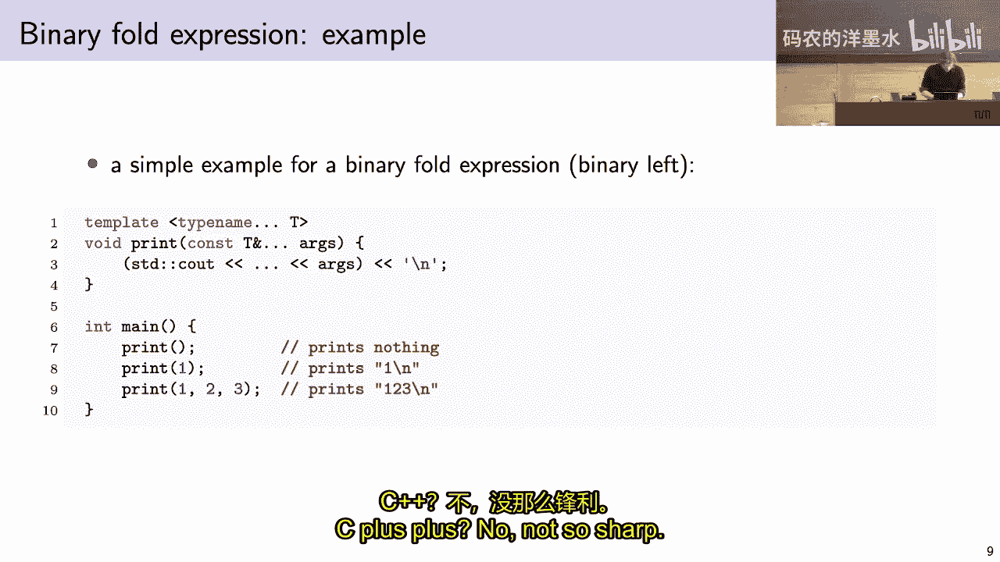
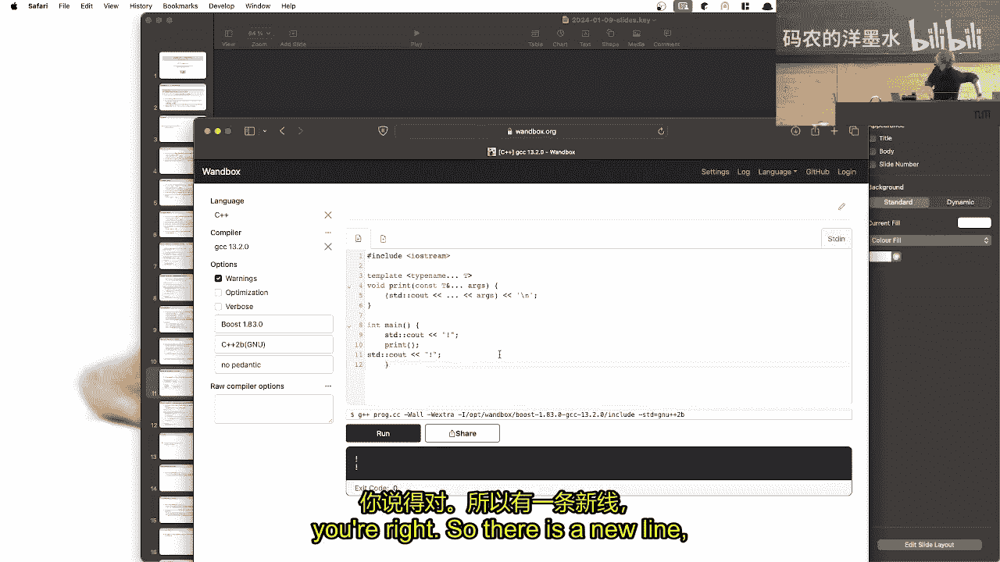
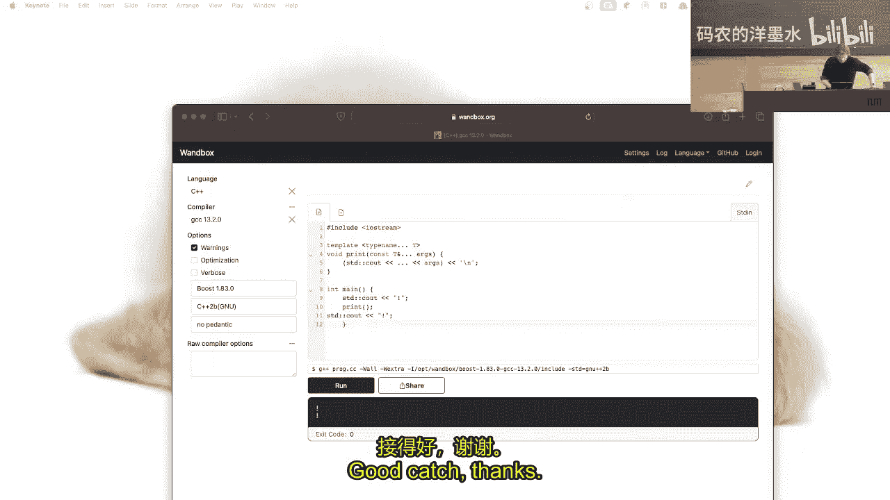
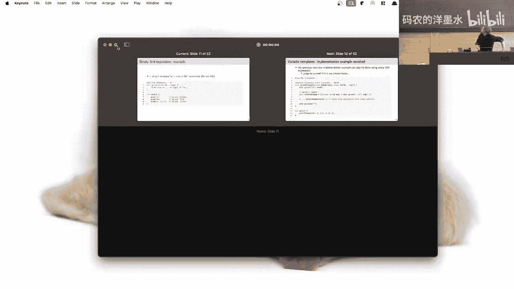
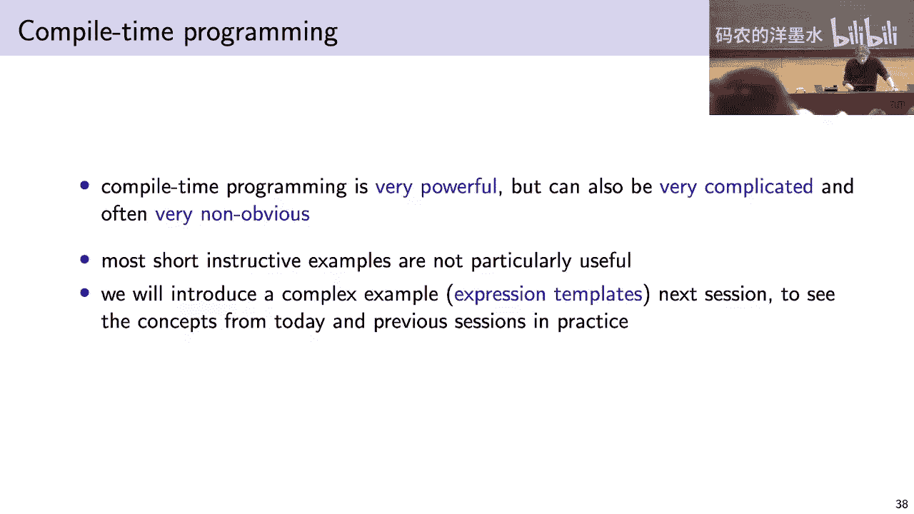

# 009：STL与迭代器 🚀

## 概述
在本节课中，我们将学习C++中的可变参数模板和编译时编程。这些高级特性允许我们编写更灵活、更高效的代码，特别是在处理未知数量的参数或在编译时进行计算时。

---

## 可变参数模板 📦

上一节我们介绍了模板的基本概念，本节中我们来看看可变参数模板。可变参数模板允许我们定义接受任意数量参数的模板。

### 定义可变参数模板
可变参数模板使用参数包，参数包可以接受零个或多个参数，用三个点（`...`）表示。

**类模板示例：**
```cpp
template <typename... Ts>
class Tuple {};
```

**函数模板示例：**
```cpp
template <typename... Ts>
void printTuple(const Tuple<Ts...>& tuple) {
    // 实现细节
}
```

### 实现可变参数函数
实现可变参数函数通常使用尾递归或折叠表达式。









以下是使用尾递归的实现方法：
```cpp
template <typename T>
void printElements(const T& head) {
    std::cout << head << std::endl;
}

template <typename T, typename... Ts>
void printElements(const T& head, const Ts&... tail) {
    std::cout << head;
    if constexpr (sizeof...(tail) > 0) {
        std::cout << ", ";
    }
    printElements(tail...);
}
```

### 折叠表达式
C++17引入了折叠表达式，使处理参数包变得更加简单。

**求和函数示例：**
```cpp
template <typename R, typename... Args>
R reduceSum(const Args&... args) {
    return (args + ...);
}
```

**打印函数示例：**
```cpp
template <typename... Args>
void print(const Args&... args) {
    (std::cout << ... << args) << std::endl;
}
```

---

## 编译时编程 ⚙️

上一节我们介绍了可变参数模板，本节中我们来看看编译时编程。编译时编程允许我们将计算从运行时转移到编译时，从而提高运行时性能。

### 常量表达式
常量表达式是在编译时可以求值的表达式，使用 `constexpr` 关键字标记。

**常量表达式函数示例：**
```cpp
constexpr int square(int x) {
    return x * x;
}
```

**常量表达式变量示例：**
```cpp
constexpr int x = 7; // 常量表达式
const int y = square(5); // 常量表达式
```

### 编译时 `if` 语句
编译时 `if` 语句（`if constexpr`）允许在编译时根据条件选择代码路径。

**示例：**
```cpp
template <typename T>
auto getValue(const T& value) {
    if constexpr (std::is_pointer_v<T>) {
        return *value;
    } else {
        return value;
    }
}
```

### 模板元编程
模板元编程利用模板在编译时进行计算，是编译时编程的重要组成部分。

**计算阶乘的示例：**
```cpp
template <int N>
struct Factorial {
    static constexpr int value = N * Factorial<N - 1>::value;
};

template <>
struct Factorial<0> {
    static constexpr int value = 1;
};
```

### 类型特征
类型特征允许我们在编译时查询类型的属性，是模板元编程的重要工具。

**标准库类型特征示例：**
```cpp
std::is_integral_v<int>; // true
std::is_pointer_v<int*>; // true
```

### SFINAE
SFINAE（替换失败不是错误）允许模板在替换失败时被忽略，而不是导致编译错误。

**示例：**
```cpp
template <typename T>
typename T::value_type negate(const T& value) {
    return -value.value();
}

int negate(int x) {
    return -x;
}
```

### 概念（C++20）
C++20引入了概念，使模板约束更加清晰和易读。

**示例：**
```cpp
template <std::integral T>
T add(T a, T b) {
    return a + b;
}
```

---



## 总结
本节课中我们一起学习了可变参数模板和编译时编程。可变参数模板允许我们处理任意数量的参数，而编译时编程则通过将计算转移到编译时来提高运行时性能。这些高级特性是C++强大功能的重要组成部分，掌握它们将帮助我们编写更高效、更灵活的代码。