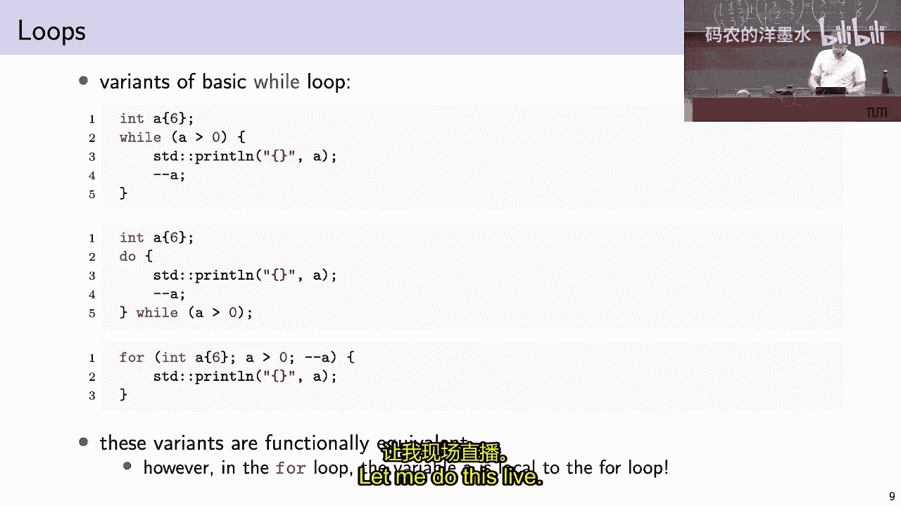
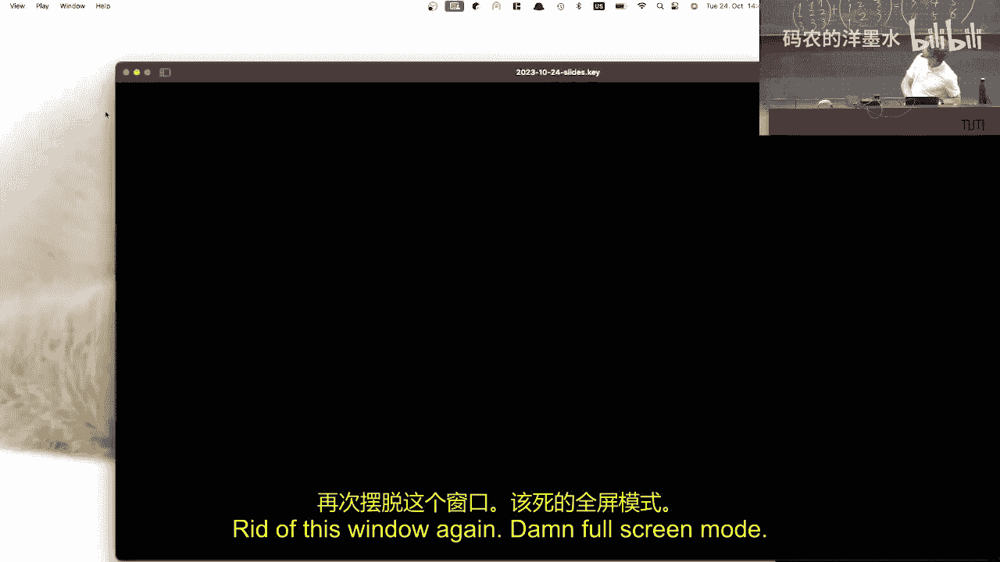
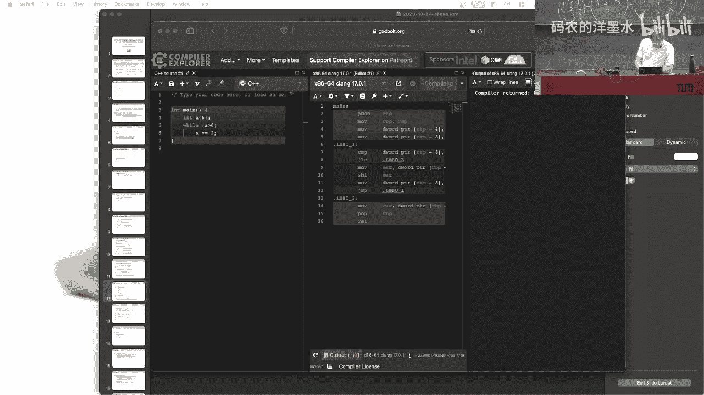
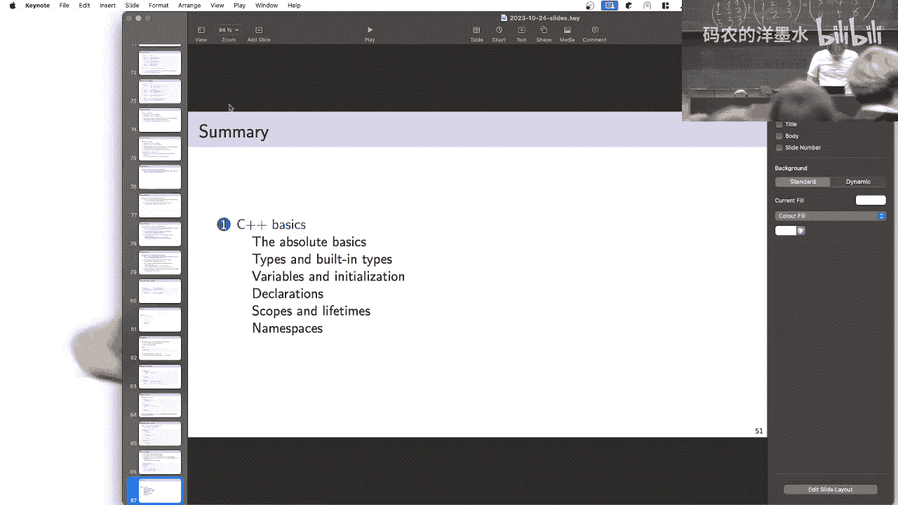

# 【全集 2024版】慕尼黑工业大学 C++编程概念 IN2377 中英字幕 p01 Lecture 1 - 基本类型 -BV1gDqwBmEuC_p1-

Test， test。Test， test。So welcome， everyone。Welcome both here。In the auditorium and also online。

 welcome to the C+ bus course。You haven't seen me yet last week。 My name is D B。 S Laa。And。Yeah。

I'm gonna do this little course for you。 That's about C modern C plus plus programming。

 even though it's not in the course title， The modern is important。Right， first things first。

 there's a tweet session also today。The idea is that Y V K。

 So feel free to join the tweet back to ask your questions there， but also feel free to trust。

 you know。Raise your hand or make yourself known somehow here in the auditorium。Right。

 as you may have seen， not too many of you have seen yet， because it's。Only in quotation marks，735。

But there' have like4500 people more registered for the courserus。 there's a zullip stream。

 So if you go to zulip dot it dot to D E， there's a stream called CPP for this course and a stream called CPP Homes。

 That's for everything about the homework assignments of this course。

There's also a Gila part that automatically announces if anything happens to the upstream repository for the homeworks。

 meaning new。New homeworks are released。 You will get an automatic notification。

 And in the case that we have to fix something。Because we may messed up。

 that will also give you a notification that something was fixed。Right， let me briefly check。

 I'm pretty sure I uploaded this to Mole。Oh， it's hidden from the students， shit， okay。

So I upload it， but it's not showing。嗯。So。Very good。

 The slides are now available on Google I actually uploaded them sometime this morning。😊，But， yeah。

I forgot that I have to unhide them for you to show。Right。Very good。 very will。 Alright， Zulip。

 So as you may have seen already， there's quite a few questions that haven't been answered during the L lecture here。

 and apparently also not during the exercise session on Thursday with Jononas。

So if you have questions somewhere in between on the weekend and the evening。

 on Wednesday on Friday on Monday， you know， when there isn't a course here， feel free to go to Zlip。

 ask a question there。You can also help your teammates if you so desire。 but I'm trying。 And。

 of course， also Yoas and David will try to be there。And answer your questions， as much as possible。

The other thing that you might have noticed from last week is that on tweet back。

 there are questions from you， which is good。 That's how it should supposed to be。

I'm reading them while I'm doing the lecture。And I'm trying to answer them。

 Sometimes there are too many for me to handle。 Sometimes I don't have a good answer either right now。

 So what I'm doing is after the course， I'm gonna sit down and answer all of your questions on feedback in writing。

I did so last week， unfortunately， with a few hours delay because I had some other dates right after the course。

But today， I should be able to do this right after the course。

 So feel free to check back to the tweets or to old ones and see if there are questions that you wanted answering and have been answered by me。

😊，Right。嗯。What we've done last time is motivated a little bit why we are talking about C plus+ at oil。

嗯。What you've hopefully already tried is figuring out how C plus plus works by combininging。I really。

Small program by doing your own little shared library and by running your own unit tests。

I hope you've done this already。If you' are familiar with this kind of stuff。

 if you've used the common line before or a compiler for some other language or for C or C plus plus。

 it should have been easy。If not， you might have struggled a bit as some of the messages show。

But it's an important struggle。 you need to learn this。 This is what programming is about。

 at least in the compile languages。Right。And what you probably also noticed already is that there's different versions of C plus plus。

 different versions of the standard， and that the compilers。

Don't all support the same subset of the standard as they should。So。If you encountered this。

Welcome to C plus programming。 That's how it's been for the last。12 or 13 years。

 And how it's probably gonna continue。To be。Right， so what I want to talk to about today is more basics。

 but less basics in terms of。How to do call the compiler， how to do translation units， headophils。

 modules， whatever。 But more about the actual language， You know。

 what kind of sets it apart from other languages。 And， of course。

 what we're gonna talk about today is。Not very special。A lot of other languages have。

 essentially the same。But you will see it's not boring， actually。

 when I was preparing this yesterday evening and this morning。I encountered a few things。

That were really interesting。And very others wasn't sure myself yet。What's happening。Okay。

So let's try this again。So give me a minute。 I have to try programming a different frequency into my handset。

 Unfortunately， it doesn't support it。 Oh， hold on。 I can use a different。Tcer。Okay。

 let's try this one。 Whoa， this is louder。Right， so basics。As I said。

 C plus plus basics are rather simple。It's a programming language， after all。 So， yeah。

 it has what every other programming language also has。

Kind of the only complexity that comes is from the。Special cases， exceptions and。

 and so on that turn up everywhere。We are not gonna to cover everything。

 every of these special cases。Because it's just impossible first， I don't know every special case。

 and second， even if I did， covering them would take way too long and maybe also not be that interesting。

So what I'm going to talk about here might not be complete， might not be the complete picture。

 And in some cases， it might even be inaccurate。Most of those cases。

 I hopefully know about that and chose chose it that way。嗯。Because of of detecting reasons。

And sometimes， I don't know。Sometimes I'm also surprised myself。 I've been doing Cpl for a long time。

 for more than。25 years，26，27 years。收呀。Even then you can be surprised。 The important URL。

 you should know。 And that's one that will turn up if you Google anything basically it' one of the top links。

 anyway， is the CPP reference dot com website， which essentially contains a readable。

Reference documentation of C plus plus that's oriented on the standard。 And that's also。

Very much up to date， basically all the time。Can I redirect you to recommended literature for the course？

 Yes， you know， there's a Mole page for the course。There's。Let me see。 what did I call it。

There's forum code messages from instructors， and。Let let me actually show this。

 I can show this here on the screen， right？呃。各喂。I'm here， so here's a Mo page。And。If you check。

 you know， you see here the slides that are finally visible and they ask messages from the instructors。

And there's general information on the course and exam modalities that might be interesting to read。

 if you care about this。 but more interesting here， there's literature and links。

 So there's a few books recommended， although you can already see in the publication dates that they are not covering modern C plus plus。

 but rather。Subset of modern C plus plus。There's links like the plus plus core guidelines。

 which are really， really， really good to read。 You should read them。 They are not a book。

 so you won't read them from。Start to finish， but you will pick。Our things here。

 that are interesting。The reference that I was just mentioning is here。

 Here's a collection of blog posts， Mona CPP dot com。There's online C plus compilers。

 which are really useful if you don't wanna install every single compiler version on your local machine。

嗯。Use van box or a got bowl， the compiler Exper。And here's references， for it and Cbank and so on。

 If you have suggestions to add to this list， please feel free to let us know and we'll。

 I will update the list。Right， so this is important because。I won't be able to talk about everything。

 I won't be able to show you everything and some things you also should。Discover yourself， you know。

 because you will learn better that way。So use the references。Right。

Will we always do compil compilation manually， or we'll be using C Mac from now on。

 You will be using C Mac from now on。 We are in the 21st century。 So， yes， we will be using it。

But still， in order to appreciate what something like sea make does。

 you first have to do the blood and sweat yourself to get your hands dirty and then see。

How things work。How do we track exercise progress。I presume you will refer to the points。

You will see in your Git repository an issue， it will be opened once the deadline is over。

 and it will tell you if we counted your point or not。 So in in an issue in your Gitla repository。

 there will be a tracker。However， it's not visible yet because the first deadline hasn't happened yet。

Starting Thursday evening， you should be able to see the issue， and then you will also be seeing。

How your points are coming along。Your voice is still not too clear， even if I put the volume on max。

 I presume you're referring to the stream。I can't put the volume up here in the streaming program anymore。

 It's already on maximum。And anything else that I do here probably won't affect the streaming either。

 So I'm。I don't know what to do about that。 I'm sorry。

Maybe you do your system settings as also sometimes an extra volume control。What about the pan。

I said it last week。 I did learn to cook a little bit， and it's in use， basically every single day。

So thank you to everybody who contributed。Right， so to the content。

The smallest C plus program is a one or two liner， depending on where you place the。

The second bracket。It says int main parent thesesis。Open and closed。

 And then curly braces open and closed。This is a special function because it marks the entry point of your program。

 So basically， the first instruction of your main program is the first。

 of your main function is the first instruction that your program will execute。😊。

Except for some exceptions with。You know。thetic and global variables and constructs and whatnot。

 But we'll talk about this later。 And basically， when the main routine is finished。

 your program finishes。That's the important part you need to know。

 And that's why this main routine has to be in every single of your programs。

 Unless you're writing a library， then you don't need it。Right。

 and what you always see is that this is a function。Let's to synt for a bit。

 We will talk about it bit more， of course， in detail。 But in general。

 this is a function called main。 It returns an int， which is an integer。And it takes no arguments。

There are versions where you take arguments。 For example。

 if you w to see the command line arguments that you put there， you know， like the compiler flags。

 when you call the compiler， then you get them here。And what you most notably see。

 there's nothing in the body。Even though the function has a return type， nothing is being returned。

And the only place where we can do something like this in C plus plus is in the main function。

Because it has an implicit return 0。But that's the only function where this is true for all the other functions that you write yourself。

 the compiler will complain If you have a return type， but don't re actually return anything。You can。

Have avoid return types。 So basically voids as theres no return type at all。 So instead of the int。

 you can have a void to signal that you're not returning anything。But basically。

 any operating system， when calling a， when invoking a program expects a return code。

 And usually what happens is if， if it's anything nonze。

 then the operating system assumes some error condition。So there will still be an implicit return 0。

 even if you specify boy。 That's why main is special。Right。

 then I'll move through this a little bit quicker because I'm pretty sure you've seen this before。

 maybe for Java or some other language， not for C plus plus， but in general。

 there's not that much difference here。If you w to do computable algorithms。You know。

 theoretical informatics， what algorithm is computable and so on。

You will require at least four elementary building blocks， like an elementary processing step。

 like adding two variables， storing a result or so。Doing a sequence of steps or not just one edition。

 but several。Doing conditional processing， basically an if statement that is something you need。

 and you need some kind of loop and surprise。 C plus supports all of these。So， let's have a look at。

An elementary processing step。This is， for example， one， where you declare a variable called x。

Its of type integer。It's initialized with a value 0。And that's it。

This is a very elementary processing step。 Se aside memory for an integer， assign a value to it。And。

Be done with it。Then we can have a sequence of steps。 And C plus plus is is marked by the semico。

 which you also need， if you don't do a sequence。 But strictly speaking。

 the semico is there to mark a sequence of instructions that should be executed one after another。

In this case， you have a declaration and definition of a variable called X without an initialization。

So basically the same without the initializer。 And then afterwards。

 you assign a value to the variable。So this is a sequence of steps， and。You mark this by semicos。

And even if your sequence ends， you still need to put a semi on because it makes for easier parsing。

Conditional processing is an if statement。 The syntax is that you have to put a condition in parentesis。

This has to be a Boolean expression， for example， like comparing x to 0。And then， you have。Well。

 if the condition is true， you have an execution block。 and if the condition is not true。

 you have can have an optional L statement。That wouldn't be executed if the condition is false。

And surprise， we have loops。 for example， the wild loop that executes viola condition is true and does something repeatedly。

Why the condition is true。So this is not very surprising。

This looks almost like Java or any other language that is kind of oriented on the sea language。

And even if it's a more modern language。It looks pretty similar， right maybe some minor differences。

But yeah， that's about it。Right， blocks。That is something that is a bit。

Different to Java and very different to Python is that blocks or scopes are done in Cpl using curly braces。

Like here。 So these curly braces opening and closing mark a block。And。Also a scope。

 what a scope is well talk about in a moment。嗯。Yeah， so if you're grouping statements。

You have to put them into a block， particularly if you wanna have them in an if an else statement。

 for example。Different to Java is you don't have to put these curly braces everywhere。

 Even if you only have a single statement， if you only have a single statement， like here。

 you can omit the braces。Which is。Yeah。Ave bit nicer。But less consistent。 So Java in that way。

 is more consistent。Loops。We've already seen the viine loop。My condition is to execute something。

You can also do a do while loop， which has a condition checking at the end of the loop。

Which is essentially same， right， Just different order for some， for this particular simple code。

 it makes no difference。 It's the same。And then there's the so calledled for loop， which。Yeah。

 it's a bit of a sea relic。In that it has an initialization statement where it can， for example。

 declare a loop variable like this A and initialize it。A condition statement。

 which is separated by semicolon and another statement， which is a loop update statement。

 which is executed if the condition is true。And not the first time， but then the subsequent runs。

 And then there's the body again。So these three loops are all the same。

 Some of them are more convenient in different situations than others。 So choose whichever you want。

 The only real difference is that this loop variable in this fall loop is local to this loop itself。

 whereas here。The A stays around once the loop is done。

 So if you have an statement after the y loop here or here， the a is still there and the value of a。

 While as if you do the for loop after the fall loop。

 the a is gone because it's local to that fall loop。Oh， that's a good question。About initialization。

 I'll talk in a moment。 But this is one。 If you don't initialize a variable， what value does it have。

Unfined。And that's the variable has a static scope。嗯。But it's undefined。

 And that's one of the many things。That you have to pay attention to N C plus plus。

 A lot of things are undefined。It's not Java。 Not everything is safe and fine and shiny。

 You can't make any mistakes。 You can C plus plus is like a loaded gun that's pointed at your foot。

 And if you do a mistake， well， you shoot yourself into the foot。And depending on what you're doing。

 this might be a fairly big one。Right。One of the things that is one of the big guns is that C plus doesn't enforce in。

By you by the programmer。And if you don't initialize it， like， for example， oops， where's my。呃 here。

So after this statement， what X contains is undefined。It could be 0。It could be 10107。It could be。

7 million， whatever。嗯。Doesn't matter。 You don't know。It actually depends。

 The compiler won't touch the memory。 It will just allocate it like， this is there。

 but it won't touch the value until you touch it。And that means whatever was there before is what's in there now。

 And that's also one of the reasons why you can have so many security issues。

 the C plus plus code or C code。Because initialization isn't enforced。Right。

Aren't fall loops generally speaking better for performance as opposed to wide loops。

 No why would they be。No。嗯。The thing is， the compiler is pretty clever。 You know。

 compilers do a lot of static analysis。For performance， and you will see。

 and that's actually what you should do at some point。嗯。If。え？Now， let me do this live。

To get rid of this window again， damp full screen mode。

So you open your browser， you type in got bold。Dot org。And you get to this website。

And what you can do now， as you can see here， I experimented with printing and different compiler versions here。

If you can write a little for loop。And I'm not seeing what I'm typing。So I initialized it with6。

 right， And then I was。While it's bigger than 0。 and then I was decreasing it。 And then I do some。

Whatever。呃。I don't know。 Let's multiply it by 2。And what you see here？Well， I shouldn't so。

What you see here is assembly code that's generated， for example。

 by Microsoft Viish Studio version 1930。呃，7。By this thing here。And you can also， for example， check。

 Let's use a recent cllang。17 or1。Compilation failed with the fuck。All right。

Cause I didn't specify the standard library。 So let's just get rid of this for now。

So here you see the code for the for loop and just out of interest。 what you can do now is you can。

 if I can find my cursor。If you can just write the same as a while loop。Coing like this sucks。

And while a is bigger than 0。都。Does this look less efficient than the for loop。

I didn't check the explicit code， but it definitely doesn't look longer or shorter， by a lot。

 So probably。If you wan to be sure。Do that。And， you know。Right。

Is there an else if statement， No， there's no dedicated else if statement。 However。

 what you can do is you can。嗯。You come to my screen。

 What you can do is you can just nest if statements in the else block as much as you want。Right。

 and there's some loop control。 You can exit loops early using brake。

 You can continue a particular iteration whilst keeping the rest of the body with continue。Yeah。

 ever said， fairly standard。 You will see this in every other programming language。

Which compiler should we use in Godbolold， Whichever you want， That's the point。

That's why there is Scottbo。 If you wanna see if GCC or clang generates a more efficient code in different optimization settings。

Try it out。Yes。We will come to that。So the question about initialization。

 and we will actually come to that today。Right， but first， we talk about time safety。

So the idea of the case is that the language is typea。 That means if you have an object。

 it has a type。And that type will define what it can do if it's an integer。

You can do certain operations like addition， multiplication， and so on。嗯。

And only those kind of operations will be done。Right， also。

 it will be certain that the type is initialized。And that whatever operation you do， that always。

The object will be in a valid state。There's two types of safety， two types of type safety。

 One of them is static， which is basically checked。By the compiler。 And if it's not type safe。

 the compiler will say nope。And theres dynamic type safety， which。It's basically checked at runtime。

Right。And if the runtime sees， there's violation， then something happens like aborting the program also。

No。What difference does it make， For example， the compiler can see that youre not calling a method draw。

That you think is valid for some UI object。On an integer， because an integer can't do that。

 And the compiler will catch that and tell you， hey， whatever you're trying to do， It's not valid。

Dynamic time safety might be that you're multiplying to integers。Where the result is too big。

For the integer， we rest storing it。That's something you can only detect at run time。

 not at compile time。So ideally， these type of checks are done both at compilation stage and at runtime stage。

Now， the bad story is C， plus plus is neither。It's not statically typea。 It's not dynamically typea。

Dyynnaically， Tafe is pretty well understandableably。 C plus is there for performance。

 And dynamic type checking， type checking kills performance。 So that， that's why it's not there。

Static type safety is also not there。Or。Parts of it are there， but not completely。

Because performance。On the one hand， and on the other hand is you also wna do extra stuff in your code。

 right， You wan to do low level， low level programming with C plus plus。

 That's also one of the reasons it's there。And static， full static type safety would interfere that。

But the thing is， still， even though hip Pla doesn't enforce it， you should do your very best。

To be typea， both static and dynamic。And you should really try very hard not to violate it because if you do。

 there might be undefined behavior in a program。 there might be crashes。

 There might be security issues。 There might be exploits of your program。 And that would be very bad。

 And you intend that to happen， of course， then for whatever reason。

So the thing is what you should do。What we don't really teach here。

 But what we encourage you to do on your own。If。To use， well， I mean。

 we do teach you to use the compiler。 We also tell you to use all warnings enabled and also heat the warnings。

 So ideally， if you see in this dash W all， that means activate all warnings。

 And then there was a dash W error。Make all warnings into errors so that you cannot ignore the warnings。

The warnings are there， for a reason。Don't ignore them。 Make sure they don't turn up。

 And if any do turn up， fix them。That's the first thing you can do。

 The second thing you can do is you can use static analysis tools that do more static type safety checking。

 And one of the very good tools doing that is called clang tidy。😊，It's really， really， very good。

If you have it。Use it。 And a lot of Ides。Do that。 So， for example， the C C line that I'm using。

 and I'm pretty sure any other I D E that's working with the clang tools in the background。

 which is basically everything from V I and Eex to。IThink Viual Studio is not using it。

 but Viual Studio code definitely has a clang D back end。

It will already show you while you're typing。 It will do these kind of analysis steps while you are typing。

 So if you have any good I D E， this will already happen automatically。

What you have to actively do yourself is to run dynamic analysis tools like sanits， address sanits。

 undefined behavior， sanits， and so on。 Those you usually have to run on your own CMake helps you a little bit with that。

 but still。It's a bit of a pain to set up。 But once you have it set up。

 use it because it will catch things that。Are a problem。So。Use the compiler。Heat the warnings。

 The compiler produces activate all warnings。Your static analysis tools ideally。

 already within your I D E。A lot of them supported directly these days， via cl tidy。

And set up dynamic analyzers for runtime。Safety。And， for example， if you。

IfThey're familiar with something like lead code， where you can practice your programming skills。

 Of course， you can do lead code and C plus plus。And you， for example。

 p practicing for interviews at companies where you w to get a job。嗯。

It will run sanitizers on your coat in order to catch any undefined behavior that your code might have。

Right， so what C plus is。 It is a typed language。 It's， in fact， a strongly typed language。

 So basically。All objects in C+ West must have a type。 There are no typeless objects。

 like in jascript or other scripting languages。You need to have a type everywhere。

And the types that you can use are the ones that are built in， which we'll talk about a bit today。

 And there are user defined types， which you can define yourself。

 And the prime example for that are classes， which we talk about in。2 weeks or three weeks， I think。

Right。So how does it work？嗯。In general where it looks like this， you have a type。

Whatever type that is。 So you have to insert the actual type name here。

 and then you have a variable name there。 and that declares and defines a variable of type。逮捕。Right。

 and then you need the semicolon。No。The standard way of doing initialization in modern C plus plus is with the curly braces like this。

 So you have curly braces open and closed。 And in between， there is an initializer。So， in fact。

And that' here really， really sure you don't need to initialize this。Right now。

 this is how all of your variable declarations should look like。 type variable name initializer。

Make it a habit to always have an initializer there。Think about it。What should be there。

Which extensions for V S code do I recommend。I don't know。 I don't do C plus plus in V S code。

 I use V S code， but not for C plus plus For that， I use C line。

 and that has all kinds of stuff already included。Should I be using STD C out or ST TD print F。

That's an easy answer。 Use SDD C out because SD TD print F is an old C。

Relic that is completely unsafe， and which。You shouldn't even be touching with a footlong pole。Right。

So let's talk about types first， and then we talk about initialization。

 So hold your horses on the initialization questions。 I will answer them。So first on。

 we have numbers， surprise。 We are programming on computers and computers have numbers。

 We have natural numbers that are called unsigned numbers， in C plus plus。😊。

They use a binary representation， you know， zeros and one surprise。 that's whole numbers， so。

IfThe natural numbers are 0，1，2，3，4，5。 and so on， the whole numbers are 0，1，-1，2，-2，3，-3， and so on。

 They are also supported obviously in there called s numbers， because they have a sign。

EOne of the interesting facts is that basically all computers or most modern computers use a two complement representation for that for signed numbers。

But only since C plus plus 20。 So only since three years ago is that actually in the standard。

The standard before that didn't say how assigned integers are represented。

 It was implementation detailed。Which was a bit weird。 And， in fact。

 I didn't know about this until someone in this course 1 or two years ago pointed this out to me。

 And I was like， what the fuck。But anyway， it was fixed in C+ West 20。Floating point numbers。

 of course， also there using the I E 7，5，4 standard and all the operations that you would expect。

You probably know all these。 This is a modulus operator。 These are increment and decrement operators。

 plus， plus increments the value by one minus minus decreements the value by one。

 comparison operators， fairly standard。 The only thing you might not be familiar with is that equal comparison is done with two equal signs and not just one。

In order to distinguish it from assignment。Unequal is the nu operator。Together with the equal sign。

 And there's the logical operators and， or and not。And the logically operators are a bit weird。

 in so far that you have to。Double them， because single versions are operators for bitvis operations。

 Why these are the logical operators for logical operations。Now。

 what you can talk about quite a bit is what kind of natural and whole numbers does C plus support。

 There is。Let me see。 short， short int， sign short， sign short int， unsign short。

 unsign short bh bh bh bh blah blah until unsigned， long， long int。So that's a lot。The thing is。

 these are all different notations for the same base type， which is listed in this column。

 So essentially， there's a short end， unsigned version of it， a regular in， unsigned version of it。

 long int， unsigned version， long， long end， unsigned version。Now。

 the bad thing about these is what you can probably already imagine is that a short has less digit than a long and a long has less digit than a long long。

While that in general is true， how much digits you actually have is only guaranteed as a minimum。

 So shorts are guaranteed to be at least 16 B。Integers are also guaranteed to be 16 Bs。

 and long ins are guaranteed to be 32， While long， long ins are guaranteed to be 64 B。

And then you see。In actual systems， like 32 B systems， which。These days。

 probably not too many are around anymore， because I think even the。

Smartwach process 604 bit these days。 so probably the most relevant column for you is this one。

 the 604 bit systems。But the plus was around for 32 B systems。 It was around for 16 B systems。

 It was around when 8 B systems were standard。 So， yeah。

 I left out those columns because you probably can't remember 8 B systems existing。I can。

 I had one back in the days。But yeah， so the relevant column is mostly this and maybe a little bit of this。

 And what you see here。As usual。Like， at least back in the days， Microsoft had a special role。

Because on Windows， for some reason， the long end on a 60 fo bit system is 32 B。What the fuck。嗯。Yeah。

 that's just how it is。So if you need a guaranteed accuracy。Choose。An appropriate row of this table。

 Or if you're bored with this and not having to remember this。Use the fixed with inter intetro types。

 If you need a 32 B int。Use an int 32， and core T。It's defined in the standard library in the head C。

 SDD end。E they are signed and unsigned versions ranging from 8 to 64 B。

They are all in the namespace， S TD。And yeah。The only drawback is while theyre in the standard。

 compilers are not supposed。Not forced to support all of them。 So， for example。

 if you have a compiler on a 32 B system， it might not implement the 64 B types。Or if you have。Like。

 you know， one of the IBM power systems。I'm actually talking out of my F here。

 I'm just guessing it might not support the 8 bit types at all。Because it's a 128 bit architecture。

Right， but anyway。 So here， if you have a long A， which is not initialized， which is bad， right？

 So bad example here， Ba， Ba you go away。This might be 32 or 64 B， or even 128。 Who knows。

 Where these here are guaranteed to 32 and 64 bits。Right。

So if you want to represent values of integers， there's numbers。Like 42，42， right。

 you can also specify numbers with space 8。 So O， this is denoted with a 0 prefix。

So if you ever write 0，1。For 01， it doesn't matter。 but 0，5，2。

 you might be surprised that this is not 52， but it's a different number in the ocal system。

 A bit more obvious is hexadeimal 0 x is the prefix and then comes a hexadeimal number with 0 to 9 and a to f。

 right。So。Yeah， and of course。There are some interesting cases like the hexet estimateim number。 F。

 F， F F might be -1。 if you're using a signed integer， or it might be 65535。

Depending on what integer you're using， right， A 16 bit integer signed or unsigned might be either this or this value。

 so。Yeah， be clear on what you're doing。 If you want to be explicit what a type should be。

 you can add a suffix to the literal to decate to denominators as unsigned or long or long， long。

 or you can also combine unsigned and long or unsigned and long， long。

You probably won't do this too often。 but if you need it， it's handy。

And if you're dealing with very big numbers。In code， hot coded numbers。That have lots of zeroes。

 for example， like this number here， you can put in these single quote numbers to make it more readable for you。

 The computer won't care。 But for you， this might be more readable。Is it important to know the types。

 of course。How else would， would you be programming and see， plus， plus。You have to use types。 So。

 yes， you need to know about those。Can you explain what makes a function call unsafe。 I will。

 but I will definitely do this in writing and not here in the class。Why is there ST TD before。呃。

This example here， because， as I said here， these types are defined in the namespace SD。

 So you need to prepen an SD colon， colon to indicate that you're using the namespace S TD。Right。

Okay， somebody was asking about size T。 Here is size T。 This is a special type。

 That's an unsigned integer。😊，In standard library functions。 And then there's also this so called。

Pointer， pointer di T or however you wanna read it， PT TR D T。

Which is essentially the same as size T， but signed。So it has a sign。

 So size T is usually is' guaranteed basically to be able to index。Or represent the size of any type。

That's valid N C plus， plus。And that， of course， also means that it's able to hold the size。off。

The biggest array that you can store。So。嗯。That's what size T is for。

 And a lot of standard library functions use it when。Size things are coming up。Essentially。

 if you wan to do a difference between sizes or a difference between pointers。

 that's where this point ofative comes in。But what's actually not define understand is how big these are。

So every compiler， every operating system and architecture might have different sizes of these。

And since C plus plus 23， theres actually also suffixes for both types。that is for the pointer div T。

 and U Z is for size T。And if you ask yourself now， why the heck would this be there， In fact。

 this is very useful for fall loops。 I actually wanted to put an example here。 But for some reason。

 my late minted crapept out on that particular example。 And I couldn't make it work。

 So I'm dropping it。嗯。But we'll get to that later as well。 So just be。

 there's now suffixes for size T， which are fairly handy in four loops。Thats logic values。

Which are called Boolean or N P speak。Seriously。Okay， let's see。Right， so there's bulls。

 which can be true of false。Again， it's not defined how big a variable of Tpool is。 It could be 1 B。

 It could be 4 B。 It could be 8 B that depends on the compile and the architecture。And， yeah。

 of course， these are used， for example， for conditions in if statements or loops。Now。

 there's floating point numbers。 I mentioned them already。 There's float for 32 B floats。

 There's doubled for 64 B floats。Depending on what accuracy you wna have， for example。

 a regular float is approximately 7 decimal digits。 A double is about 15 of them。

And then there's a long double type， which is。Something。Could be 64 B。 could be 128 B。

On Intel architectures， it's typically 80 bit for historic reasons。Yeah。

 which usually means you have 19 digits。 and the interesting part is。

 this is not necessarily complyant to the I E standard。And， of course。

 floating point values are a bit special。 You can have minus infinity or plus infinity。

 You can have negative 0。Which is also a valid value。 So be careful when you compare to 0。

And there's not a number values， which means what happens， for example， if you do invalid。

Floating point operations。Like。Exceeding the maximum value。Also on。

 this is something you need to be able to check for in some of the numerical algorithms。Now。

 also for floating points， as lits there， as you would expect them to be with point notations，3。

1415 would be an approximation of pi。You can drop the leading0 if there's nothing And just say 05 for 0。

5。 You can use scientific notation with an exponentialonent to。Yeah。

By default these lits with a point。Or with an exponent， R of type W。

So if you wanna specify a literal of type float， you have to add a small F or a capital F。

 Or if you wanna specify a long double， you have to specify L afterwards。 And also here。

 we can use single quotes to make things more readable for the human。Now， what's interesting。

And I actually spent like one and a half hours this morning researching into this because it was always new to me。

Since C plus was 23， there's fixed width floating point types。 So similar to the integers。

But you only have some guarantees。And there were in C plus plus 11。

 they introduced the fixed width integers。12 years later。

 they introduced fixed with floating point types。 Theyre called floatlo 16 type， floatlo 32。

 floatlo 64， float 128 for the corresponding sized I E 7，5，4 floating point types。

Not all the compilers have to support all of them。 And， for example， the float 1。

28 might not be there on every architecture。What's interesting is theres all the beef floats。

 which are called brain floats。Because whoever introduced them thought it would be cool to call them that。

The difference is， basically， maybe you know a little bit about machine learning and deep learning。

 training， neural networks and so on。And you might know that for quite a while。

 F 32 was a standard data type to do this。It's kind of。A compromise， because。

The first GPU is accelerating machine learning training。The horrible in performance with float 64。

 so。You used float 30 tools， which was also handy because it requires less memory。 Ha， right。

 They are half the size only。But they have left precision。That's why， for example。

 stuff like normalization and so on。  normalization layers are so important because as。

A limited accuracy of float 32s。 Of course， floatlo 64s are also limited in accuracy。

 but the limits are a lot wider。Well， and then， of course， people found out that， oh， yeah。

 if we have the sides again， be safe。Memory。And we can even compute faster。

 And a lot of the most recent GPus， like the A 100 from Nvidia or the instinct from， from AM M D。

Instit M I 25， for example， support natively the float 16 type。 So basically a half float。

 it's often called。hich has even less accuracy。But it faster requires less memory。

 And that's why it's there。 And that's also finally the reason why it took until 23 to make it into the C plus standard。

One of the first proposals was actually already there 2018。

 It got voted out because it wasn't nice enough。And what they also added this time was the B float。

 which is basically also a 16 B float。With a difference in how many bits are allocated to the exponent and to the manisa。

 And the idea of the B float is it keeps the exponent from float 32 so that conversions and the value range between flow editor and float 32 and B float 16 are similar。

 You just lose precision。And since there's hardware these days that uses these data types natively。

Like GPUs and also some CPUs these days。 That's why they are there in the standard because。

 of course， C plasma is therefore for high performance computing。Right。

 also these types are in the namespace S TD。There's also another difference。

The integer fixed with integer types， these。They map。To the regular integers。

 depending on the system。They are the same。 They are the same type。 They are aliases。

The floating point values。The fixed with floating point values are not aliases。

 They are separate types。 They might be implemented as the same。

 but they are different in the C plus type system。Which is a bit weird because it's inconsistent with integers。

 But that's how it is。 As said， there are special cases in C plus plus for all the reasons。

 And basically， back in C plus plus 11， they didn't want to。

They wanted to have ease of implementation on the compiler side， and they wanted to make it aliases。

12 years later， they said。Eas of implementation in the compilers。

 B fact users are more important of the language， so they shouldn't be aliases。So you see shifting。

Priorities in， in the standard， which unfortunately， lead to inconsistent behavior in the standard。

And also inconsistent to the integer fixed with integers， there are suffixes like F 16， F 32， F 64。

 and so on for the fixed with floating point types。And I have to disappoint you， except for GCC。

 none of the other compilers are yet supporting these。Unfortunately。

It's really a negative0 and C plus plus， yes。in any programming languages that uses floats。

What's the difference between things specified in the C plus plus standard and those in the standard libraries。

None， because the C plus standard covers the language and the standard libraries。

 That's the C plus standard。On the implementation side。

 you have the compiler taking care of the language， adhering to the standard。

 and you have the standard library that also has to adhere to the standard。 And， of course。

 they work together。But。What's usually happening is， is that the compilers。

Develop new stuff like the C plus plus 23 stuff a lot faster than the standard library。

 because the standard library is usually a lot more tricky。What does implementation defined mean。

It means that the standard doesn't define anything in that a particular implementation。

 like the Viual Studio compiler on a 32 B Windows might do one decision while GCC on a 64 B Linux might do a different decision。

So if you read something as implementation defined。

 you shouldn't assume anything because if youre run it on a different system or a different compiler。

 you might get different results。And if you know， say this sucks。Yes。

 if you want to make your program portable over any system， any compiler。

 you have to spend extra effort。But the good thing is， Cm helps you with this。 There's a lot of。呃。

Utilities in Cic where you can detect compiler features。

 standard library features and then adjust your program accordingly。What does ST TD mean。

And if you Google it， theres。Several meanings to it。 in this context， it means standard library。

What's the point of float 632 and 64， if there's float in double。Very little。

But the main reason to do this was to introduce float 16， floatlo 1 and 28， and B float 16。

 So if you try to introduce those three and left are the other ones， that would be inconsistent。

 So they introduce the other ones， too。Right， let's move on a little。 There's a few questions。

 which I will have to answer afterwards， because there too many。Characters and strings。

 There's another type inblasts that's ugly as hell。Yeah， let's talk first about characters。

Character char。They are guaranteed to have minimum 8 bit。And they might be signed。

 They might be unsigned。 So the only thing you can rely on is essentially on its having 7 bit。

And 7 B ask key， if you know， that， doesn't include Umla， doesn't include any。

Special characters from other languages， so。If you have to re use charts。

 use English alphabetic characters， digits and basic punctuation characters。 and that's it。

There is Char 16 and Cha 32， which were introduced in C plus 11 for U TF 16 and 32。 That's cha 8。

Which was finally introduced in C plus plus 20。 I don't know why it took that long。

 but it took that long to represent U TF 8。And this WR abomination that got introduced or got van was。

2003， I think that's implementation defined and nobody wants to use it because it sucks。So yeah。

 characters are mess and an even bigger mess are string data types。So if you see char arrays。

 that's how strings were done in C。嗯。And C， plus plus。

 they're done with a standard library class called S TD String， which is actually fairly good。😊。

Very optimized and pretty， pretty nice and relatively safe。

So let's skip over all the ugly C stuff because this course is about modern C plus plus and not old C plus plus。

Right， that's character。 And， of course， there's endless stories about。

0ero terminated strings and not forget about those。 In most cases， if you do modern C plus。

 you don't need it and you don't need to know about it。Right。

 character Little roads are noted by things in。Single quotes。You have to escape a few things。

 like if you wanna do a quote itself， you have to escape it with a backslash。

 If you wanna have a backslash， you need to escape the back slash with a back slash。

 and there are special characters like the line ending back slash N。And new lines or in not line。

 any new line。 And you can also do UTF litals like this， if you want to。Right。By default。

 these lits are of type cha。 If you wanna have U TF 8，16 or 32 lits， you can prepen。

 This is actually a prefix。 This time， you ate small U or capital U in order to get the appropriate char types here。

And， finally。That's the type void， which is nothing。So。Actually。

 you can't define any type of object of type void。 It's basically only used for to indicate that a function has no return type like this function here。

 void some function。Right。Can we open the windows， It's hot。But we knows。

I don't see anyone else here。 They have doors， but they have fire doors。

 And I don't think we should be opening them permanently。嗯。Right， why do we not just use Java。

Good question。 A raft。I mean， rust is probably the better analogy here in the performance context。

But the job I've worth written。With all the drawbacks of C plus plus in mind。

That's why Java is what it is。But they also made some decision that killed performance。

That's fine for a lot of applications。 I would say even for most applications， but for some。

 it's not。 And for those， plus is still there。Why are you not using raft yet。Well。

 because raft hasn't shown。That it can do everything that C plus can do yet。 But， of course。

 rust also。Developed out of the。Bad stuff of C plus plus。 That was a motivation。

 If C plus plus were perfect， there would not not be any reason for rust。

Or similar languages like carbon or whatever。Right， okay， now we come finally to initialization。

 So we talked about variables， we have a bit of better idea now what types are there。

 at least for built in types。 So now you should know what in and flow actually mean。

Precisely and not just vaguely， you know。And yeah， what is unfortunately the optional is that in utilizationization of variables。

So you can forget it。 You can intentionally drop it。There's two kinds of initialization。

 One of them is the one we've already seen with the curly braces and some initialized expression in there。

And what you probably are more familiar with is the assignment in utilization。Right。

 so variable aim equals something。Or variable name。 And regular braces。Something。

So the thing is N C plus plus，1 is safe。 The other one is unsafe。

 The first one that I'm showing you is the one you should be using because it's safe。

 It doesn't allow any implicit conversions。That would result in problems。Right， and of course。

 as I mentioned already， initialization is optional。So。Yeah， if you don't initialize。

 the value is undefined。And yeah， that might lead to bad situations。 So let's see a few examples。

 This is here how it should look like。Type， variable name， curly braces， initializer。 Fine。

 Everybody's happy。Here's a bit of a more of an old school definition and initialization type。

 variable name， equals initializer。It's fine， right， It's not necessarily bad。

 But what can happen is that you can do some implicit conversions， which might surprise you。

 So in order for this not to happen。And the examples that I'm giving you here are。

Not very awesome as examples， because these are obvious。

Everybody who has some kind of clue will spot the problem potential problem here。But， there's。

Locationations and circumstances， which I can't show you yet because you won't understand them。

 most likely。Where this matters。 So as a。Mattter of practice。

 get used to using curly braces as initializers like here。

 That's how it should look like in every modern C plus plus code。Now。

 what can happen here if you do this assignment in initialization or initial initialization with the regular braces。

So what can happen， for example， is。You assign the value of a double A to an unsigned integer C。This。

 of course， doesn't make much sense。 This is the value of pi。

 which is an irrational number represented as a floating point number。

 And here you have an inside int， which。Yeah， can't store it。 So if you do the unsafe initialization。

 it will automatically truncate the a to 3。That might be what you want to achieve。

But it's happening implicitly， and that might surprise you or anybody who's not that familiar with C plus plus。

And the same， for example， here， of course， if you initialize an unsigned with a float value。

That can be represented as an uns in， then。It's fine。 Nothing bad happens， right， It works。

 And as as you would expect。 Now， if you do the same thing。With the curly braces。

 you would get a compiler error with clang and a warning with cheese received。 for whatever reason。

 cheese received is only warning on this。Should be an error because， no。

 there's potential information that going from a double to an unsigned or going from a float to an unsigned。

 That's not allowed。 And if you want to do that， you have to make it explicit by and putting a cast in there。

An explicit cast that says， yes， I want to convert my floating point number to an integer。😊。

And how these cs look like we will talk about next time。That was a question。嗯嗯哼。So， the。

The question is， if the curly brace in itsization also works。After the variable declaration。

 So in basically， when you would do an assignment， no， it does not。

So this is only for initialization。What you can do in the assignment， though。

 is you can create a new object on the right hand side with that curly brace inization and then assign that so you can kind of achieve the same effect。

 It's less efficient because you create a temporary object。 But then again。

 most simple most of these statements should be optimized away by the compiler afterwards。Right。

A YouTube link。 No， I'm not gonna click that。The fact that in Cpl initialization is optional。

 This is something the originators forgot， or does it have some kind of advantage。

 It has an advantage。Consider， and that's， for example。

 that's a very practical example from our C plus library。

 Consider that we are allocating storage for a few gig of a 3D image。Let's say。

 100 gig of memory are allocated。And in most cases， we don't want to initialize this to 0。

Because we will assign and actually value to it later。

But we can't do that when we allocate the memory， or at least not in a reasonable way。

So it's a performance reason。Performance is the reason why C plus plus utilization is not mandatory。

Other languages make it mandatory， but you pay the performance penalty because that means。

You might have to initialize a few gigabys of memories with a useless value that you're never going to use。

So you have the trade off performance whether the safety and inblasts。

 A trade off usually is in favor of performance。And safety goes out the window。

For what applications is performance so critical that you can't just use Java。

Medical image processing。When we have。S it T scan in a shock room of a hospital。That C T scan。

 itself takes。1 second，5 seconds， maybe depending on how much of the body area you scan。

 maybe even 8 seconds。And you want the trauma surgeon who is standing there like， oh。

 the patient is bleeding and dying right there。 You don't want to have an hour。

Until the image is actually computed， you want to have it as fast as possible。 So， of course。

 you can throw hardware it。Which people do， of course。To some extent， but， of course。

 although the device needs to be affordable for the hospitals。

 So what you do is you program it using a proper programming language for that purpose。

And if you need performance。You use C plus plus。Again， example。Deep learning。

 artificial intelligence。 What do you guess are all the big deep learning frameworks written in Pytorrch。

 Ten of law。宅吧。No。Eancy plus， plus。Surprise。Right。So let's get through the rest of it because I'm talking too much。

 as usual。declarationlars。So before you use any variable function。Template or whatever alias。

 you have to declare it so that a compiler knows what it is。And a declaration。Basically。

 has the form of。I mean， you can write this down using。Proper definition。

 I'm not doing this here because it would be too long and too， too hard to read。

 but there might be a prefix like static of virtual。 There might be the base type。

 or there has to be the base type。Like an integer or a constant integer or an SD vector。

 which is part of the standard library。Then a name。Which might have a declarator。Like。Star。

 parentheesis， star， parenthesesis， square brackets。Yeah， these are nasty things。 They exist。

 but you won't see them very often。 Op suffixes and optional initializes of function bodies。

 This is kind of how most declarations look like。 This is pretty worthless。

 So let's look at actual examples。So， for example， that's a constant modifier that he can put in front of a variable type。

Which means that after initialization， you can't change this variable anymore。

 And if you try to do so， the compiler will tell you， e you wanted this to be constant。More examples。

Here， the first one， declares。A variable of type integer with name， I， no initialization。Oh。

 this is a more interesting one。 It declares a variable of name count with a type that's called auto。

Auts is not actually a type。 It tells the compiler deuce the type from the initializer。

Here you the unsafe initialization with assignment。And what's this， This is a literal。

Of type integer。 So the compiler will deduce the type of count to int。

This might look like a non typed language， but it's still a strongly typed language。

 It's just lets the compiler do some of the work。In this simple example， you would probably say。

What the fuck itt has one left character to type， and it's more clear to read。But let me assure you。

 there are situations， especially with template meta programming， where the auto is salvation。

 We'll get to that in a few weeks。So here's a constant float。 There's an initializer。

 Heres an S TD vector of strings。 So basically an array of strings from the standard library that is initialized with two strings called Martin and Marcos。

😊，Oh， here's an interesting one。 Heres an integer called error number， which is declared as X turn。

Extern means that I'm not defining the variable as well。

 I'm not allocating storage space for it because it's coming from some external library。

 and there's already storage allocated for it there。That's why that's the external keyword。

And then you can continue this。 You can define structures that group data together， like。

Day month year。You can declare and define functions that's called day。

 returnsturn an integer takes a date that's a structure that we just defined previously and does something like returning the date of that structure。

There could be a function that takes a float as an argument and returns a float。

 And the name is indicative。 It says it's probably gonna do this square root computation。

But there's no definition of the function because of the semicolon。 This is just a declaration。 Oh。

 I'm a function。 I'm taking a float argument。 I'm giving a float back。Here。

 we also have the definition in form of the body of the function。

This is a forward declaration of astruct that's called user。

 but we don't tell the compiler yet how it's actually looking like。 I'm just telling the compiler。

 look， there is astruct。 a user defined data type called user。But。

I will tell you how it's actually looking like later。In some cases， that's useful。 In some cases。

 it's not。 And here you see an alias that uses a standard library type， S TD complex of double。

And calls it complex。For short。So these are all examples of declarations。

Each of these declarations needs to have a name as names。

 you can use letters and digits under course， considered a letter。And。

You shouldn't be using global names with an under core because they are reserved for the standard library。

Some names are reserved， like all the keywords that you've seen already， if， while L。Also。

 the built in types are reserved keywords。 So don't use them as names。 The compiler will complain。C。

 plasma has case sensitive name。 So if you write a capital T or a small T matters。And yeah。

 this can lead to weird errors because sometimes you do count and count with a small in a capital C。

 And you don't know this and the compiler complains And you're like， what。I don't see the difference。

Good names are important。 If you've listened to any software engineering lecture or course or tutorial。

 you will know that naming your variables and functions and user defined data structures and so on properly is an important topic。

 but it's also hard。Two guidelines that are important for C programmers and C++ programmers。

Don't encode the type in the name that was all the style a few years ago。 Don't do that。

 It's superfluous。And maintain a consistent name and style。 for example。

 use Chel case or something like this。 And ideally， you are using some tool like clangform。

 which does this for you。Type aliases。 We've already seen an example， if you have a long。Name。

 you might want to shorten it to something easier to write。Or if you wanna have freedom to exchange。

 for example， what my integer is in my entire program in only one spot。

 you might want to have an alias somewhere in your coat。

This is especially useful for templates and type traits， which we'll talk about in a few weeks。

Just so that you've seen it， there's an older version of this。 This was introduced in C plus 11。

Here's a version that was relevant before。 It says type def， and it switches the order。

 So it's a bit harder to read， but it means exactly the same。What does track mean。

 It defines a user defined data type， usually a class。 We will talk about this， in a moment。

But template meta programming。You will learn in a few weeks once we've covered the other stuff。

Can you override existing types with aliases， no。How does the compiler know where to find the external variable memory location。

 It doesn't。 The link I will know。And if the linker doesn't find it in the library。

 you're linking to it， it will complain。嗯。Some guidelines for certain frameworks recommend not using auto。

That is true。嗯。There's a few reasons for that， in some cases。There's lazy evaluation。

 Like if you use the numerical in algebra library eigen， which is also used in pytoch and Tensorflow。

 by the way。嗯。A to。Will yield results that you don't want。

We will also give an example of this in a few weeks with expression templates。

 There also auto doesn't do what you expected to do。There's， of course。

 the other reason that some people are resistant to change and auto is a new thing。

 N C plus plus it was introduced in 2011。 And if you were a programmer before that。

 you might just not like it。And hate to have to think for a moment， yourself。嗯。For performance。

Doesn't matter。It can be less readable in some time， in some cases。 But in general， when you need it。

 you know， you need it。 And then it's， of course， also good。

You will see some examples where it's pretty good later on。

Why shouldn't we include the type in the name。This is standard practice in game development。忘了。

That kind of gives it away because most game development is not modern。Sorry about that。

ll probably tread on a few toes there。嗯。😊，You have I D Es。 If you hover your mouse over the variable。

 you will see the type。 Why， Why would you need to litter your name with the type information。

Unless you're doing variants and unions。That's really not necessary。 these days， maybe in the La in。

Maybe when you're using VI without any plugins， yes， it was warranted。 But these days。

 we have modern development tools use them。 There's no。

 no need to make bad variable names due to that。Right。Scopes， let's go through this quickly。

If've already seen that， the curly braces mark a scope or a block。

And if you do a declaration inside a scope。That's where it's valid。 As soon as the scope ends。

 the variable declaration is gone。There are several types of scopes。

 The most common one is the local scope， which is。Enclosed in those curly braces。

Then there's the class Co， which is essentially。When you're defining our class。

 there's also curdy braces。 That's this class called。

 We will talk about this when we talk about classes。That's the namespace cope。

Which we'll talk about in a bit today。The statement scope， which is a special thing。

 If you have an initializer or a variable declaration in a for loop， as we've seen before。

 or a Sw statement。That's kind of the scope。That's valid only for that statement。 And that's why。

The variable A from the fall loop in the previous example was gone after the fall loop because it was in the statement scope。

 And then there is the global scope， which is basically anything that's not in any of the other scopes。

Tampus。If this is your program。Which is， of course， lacking a main function。

 So it's not a complete program。This would be a global variable。

This would be a local variable that's local to that function F1 and anything that's declared in that scope of the function。

 F1 is local to that。Scope of that function， right， And if you introduce more curly braces。

 which you can do as much as you want， that is another local scope。And so on， and so on。Right。

 now we play a few games with this example here。 So here's a variable called X。 It's global。

 Here's a very variable called Y。 That's local to the function。😊。

Now I'm declaring another X that's also local to the function。So as long as you inside the function。

 X will now refer to this local X and not the global one。

 because this x is hiding the other one inside that scope。 So if you assign one to that X。

 it will assign it to here and not to the global one。Now you're doing a bad thing。

 You're doing another variable X。In a nested scope。

 So this is hiding that thing that was hiding that thing。 So if you assign  two to it。

 it's assigning two to this variable and not to this one and not to this one。Right。

 if you wantan to access the global X， you can do this using the colon operators。

 this scope resolution operator， double colons。If you w to refer to that X in this scope。You can't。

Tuff luck。 That's why you shouldn't do stuff like this。

 This is actually a horrible example of how you shouldn't name your variables。Right。

 there are more examples that are funny。 Let's have a global X here。

It have a function that declares its local X and initializes it with x。

So you might think what's happening is that you declare a new x and initialize it with x and that you would assign the value of the global variable to this new X。

 No， that's not what's happening。 You're in the local scope here。

 So you will assign the new variable with its own value。And since it didn't have a value before it。

Whatever is in that memory location at that moment。And yeah， you can。

Play these games as much as you want。The cool thing here about the fall loops with the statement scope is。

 you can declare your loop variable。 Use it in the fall loop。😊，To another for loop。

And use the same variable name again without it clashing because it's gone as soon as the followup exits here。

And here you see basically a range for loop， which we'll talk about next week a bit more。

 the modern version of the fall loop。Right。So。嗯。What's also interesting is the lifetime of an object。

So basically， it starts when the object is constructed。And it ends when the objective is destructed。

For user defined data types like classes orstructs， you can explicitly do those operations。

 The construct and destruct are special functions， which we'll introduce later。😊。

For objects that don't have this。Like bit， bit in data types like int。

You can consider that they have constructs and destructives that dot。Bless you。😊，Do nothing。Right。

 and if you use an object out of its， outside of its lifetime， you guess it already。

 That's undefined behavior。 Anything might happen。From crashes to a security issue。

So the interesting part， that's lifetime。But there's also a storage duration。

 And these don't necessarily overlap。 But they overlap usually， but they don't match exactly。

So a storage duration begins when the memory is allocated and it ends when the memory is delocd。

The good thing is。Lifetime is basically inside the storage duration。

 but it's not necessarily the same。So you need to be certain what's happening。

 So most of the variables you will have。Our automatic storage duration。

 So the compiler will take care， when it gets created。And when it gets destroyed。

 and most of these things will be on the stack automatically done by the compiler。

 Because if you have variables inside the scope， that's what happens。

That's a static storage duration。Which starts when the program starts and lift until the end of the program。

 And this is how we can get stuff to execute before the beginning of main and after the end of main。

By having constructors and destructors of static objects。

These are global variables or variables that you mark with a keyword static。

We will see examples of these later。There's dynamic storage allocation where you handle the allocationation and de allocationlocation yourself。

 That's not the compiler doing it， but you。 And， of course， that is error prone。

 because if you forget about allocating the storage before you're using it or delocating it afterwards。

Travele ensus。So this is done using new and elite。 And， in fact， I'm telling you。

You can forget about this， immediately。Because we will talk about a safe way of doing things in our resource management chapter。

And finally， there's a threat local storage that's。Basically， local to each threat。

So just to see how it looks， these examples look like。

 you just the keyword static for static variables， you threat local for threat local variables。

 and you can also have static， for example， inside local scopes， where， for example。

 X would have automatic storage duration because it's inside a scope。

Where why would have static storage duration because the keyva static is there。And， of course。

 these here are all global variables。嗯。Because they are the globaloscope。

But I'm modifying the context here。Well， this doesn't matter because global variable is static by default。

 So you can say static。To be make it explicit， but it's the same。 and threat locally， of course。

 changes it to threat local storage。Right。Is everything on the stack automatic。 No。

 it's the other way around。 Everything automatic is usually on the stack。And， incidentally。

That's why you can have problem with recursions。 So let's say。Your。

Doing a high level of recursion with a function like this that declares not only X。

 but several other variables that take up storage。 And you do several recursive calls of that function。

 That means each time you call that function。That automatic storage is allocated on the stack。

 And once you， once you call the function recursively again and again and again。

And that means if your recursion depth is too deep， your tech will be full。

Because usually the stack is like 64 k or 1208 k or so。If you don't know what the stack is。

 read it up， I'm not gonna explain it here。Yeses。Okay， so the question is。

 if you call F several times， but not recursively。um。That is the stack storage space here reused。

So if there's nothing in between， probably yes， but you can't rely on it。If it's recursive。

 then you call F again inside F。 So that means the storage space for that X will still be there while you call it again。

 So there's a new X allocated。And。What happened happened。The Y is aesthetic。

 So this is only allocated onces， actually， regardless how often you call F。

 because it has static storage duration。 So it will that's how you can persist a value through several function calls。

 if you want to。There's more questions， which I will deal afterwards。

 because I still wantan to briefly cover namespaces in the last minute。

Namespaces are basically another way to group identifiers， classes， functions。Variables。

 intoological units。 And they look like this namespace。 then the name of your name space。

 curly braces。 And then you have stuff in there。This is also a scope， the namespace scope。And， yeah。

It's very useful if you use different libraries。 So， for example， a lot of libraries might have。

A variable called it。Call me。Well， probably not a variable。 if a function call me， right。

 And if you use two variables two libraries that both have the same function。You have a name clash。

 If you wrap them in name spaces， you don't have a name clash。Right， and that's， for example。

 how you can have foo and bar in namespace A and in namespace B， another fo without them clashing。

 And if you wna select which one you wanna call， you have to explicitly qualify namespace A colon。

 colon。 That's the scope resolution operator。Fo， so we are calling this fo here and B fo would be calling this fool here。

 And if you don't specify any namespace， it will look up。

Regular global scope or local scope for a function called food。 There is none in this example。

 So it will say， oh。No food here。You can nest name spaces， if you want to。

Either explicitly like this or like this。And the good thing about name spaces is they're open， so。

You can always add stuff to a namespace Later on。 You don't need to go back to the initial namespace declaration。

 You can just open the namespace again and add more stuff to it。One thing about complexity。

 usually namespaces means you're doing something big。And if you're doing something big。

 that means there's a lot of content。And， for example。

 it might not be too clear which to which scope this curly brace belongs。 So， for example。

 one of the standard practices is to say， okay， namespace is a big thing。

 So I'm gonna annotate this curly brace with， oh， this is the one that's ending the namespace。Right。

Oh， yeah。 there's one more thing。 I wanna say， sorry for going over time again by a minute or two。

 You can do using statements。If you're fed up with constantly having to write namespace， colon。

 colon。Where does this happen。Standard library， S TD， colon， colon。

 You've seen it a few times already in the slides。 You will see it a lot more in the upcoming slides。

And if you are tired of that， you can say using namespace， S TD or using namespace， whatever。

And then all the symbols from that name space are imported into the current scope。

So what you can do is you can， for example， do a using namespace S TD in global scope of your program。

And then you can refer to anything in the standard library without the S TD column， column。But then。

 of course， everything in the standard library and you probably don't even know what's in the standard library。

 I also don't know。 I have a good idea of what's in there， but I don't know everything。

And that might clash with your names。 That's why the namespaces are there。

 And that's why it's a good practice， usually to not import a full name space into global scope。😊。

But if you want to do it。You can't do so。So thanks very much。And see you next week。And don't forget。

 I will answer all your questions by keyboard after this。Thank you。

