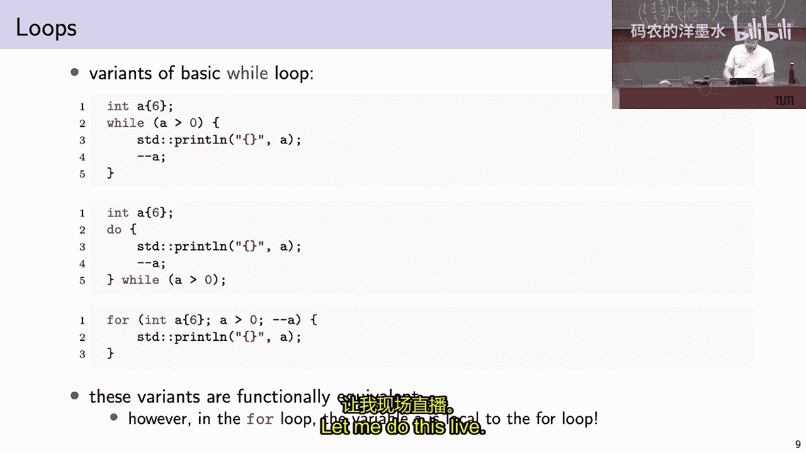
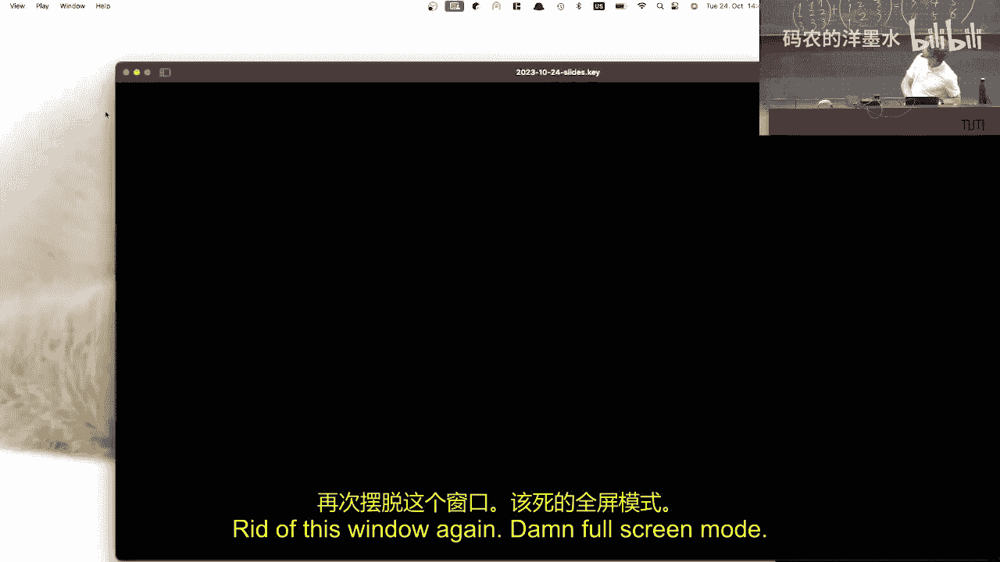
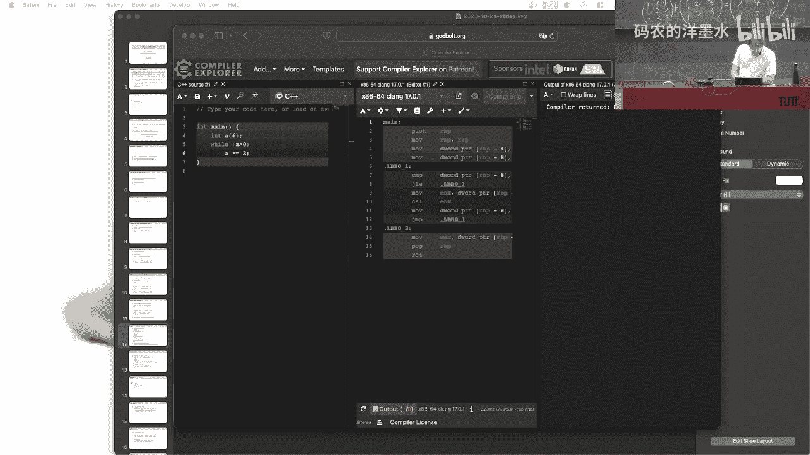
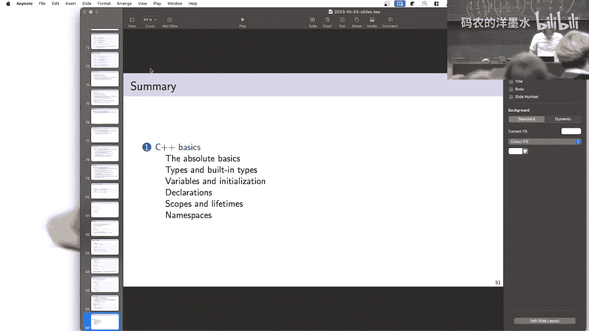

# C++编程概念：1：基本类型 🧱

## 概述
在本节课中，我们将要学习C++语言的基础——基本类型。我们将了解C++中可用的各种内置数据类型，如何声明和初始化变量，以及作用域和命名空间等核心概念。理解这些基础知识是编写正确、高效C++程序的第一步。

## 课程内容

### 欢迎与课程介绍
欢迎大家来到C++课程。我是D.B.S. Laa，我将为大家讲授这门关于现代C++编程的课程。

课程使用多种交流渠道。除了课堂提问，大家可以通过Zulip平台（`zulip.it.tum.de`）在课程CPP和作业CPP Homes流中提问或讨论。作业相关的GitLab仓库会通过Gila自动通知更新或修复。

上节课我们介绍了如何编译一个简单的C++程序，创建自己的共享库以及运行单元测试。大家可能已经注意到，C++有不同的标准版本，并且不同编译器对标准的支持程度不同，这是C++编程的常态。

本节课我们将深入语言本身，探讨其基础特性。虽然很多概念与其他语言类似，但其中不乏有趣和特殊的细节。

### 基本程序结构与控制流
最小的C++程序是`main`函数：
```cpp
int main() {}
```
`main`函数是程序的入口点。当`main`函数执行完毕，程序就结束了。`main`函数特殊之处在于，即使声明返回`int`，也可以不写`return`语句，编译器会隐式地添加`return 0;`。如果声明为`void main()`，操作系统仍期望一个返回码，因此也会有隐式返回。

可计算算法至少需要四种基本构建块，C++都支持：
1.  **基本处理步骤**：例如声明并初始化一个变量 `int x = 0;`。
2.  **步骤序列**：用分号分隔的语句，按顺序执行。
3.  **条件处理**：使用`if`语句，根据布尔表达式决定执行路径。
4.  **循环**：使用`while`、`do-while`或`for`循环重复执行代码块。

以下是这些结构的示例：
*   **条件语句**：`if (x == 0) { /* 代码块 */ } else { /* 代码块 */ }`
*   **循环**：
    ```cpp
    while (condition) { /* 代码 */ }
    do { /* 代码 */ } while (condition);
    for (int i = 0; i < N; ++i) { /* 代码 */ }
    ```
    注意，`for`循环中声明的变量（如`i`）作用域仅限于该循环。

在C++中，代码块和作用域使用花括号 `{}` 来定义。与Java不同，如果`if`或循环体内只有一条语句，花括号可以省略，但这可能降低代码一致性。



**重要提示**：在C++中，如果你声明一个变量但没有初始化它（例如 `int x;`），它的值是**未定义的**。这可能导致程序行为不可预测和安全漏洞。因此，养成初始化变量的习惯至关重要。





### 类型安全
C++是一种**强类型**语言，每个对象都必须有类型。类型定义了对象能执行的操作（例如，整数可以加减乘除）。

类型安全分为两种：
1.  **静态类型安全**：在编译时检查。编译器能发现诸如“对整数调用绘图方法”这类错误。
2.  **动态类型安全**：在运行时检查。例如，两个整数相乘的结果超出了该整数类型能表示的范围。

然而，C++为了性能和底层编程的灵活性，**并未完全强制执行这两种类型安全**。未定义行为、程序崩溃或安全漏洞都可能源于类型安全违规。

因此，程序员必须主动确保类型安全：
*   **使用编译器警告**：编译时使用 `-Wall -Werror` 等标志，将所有警告视为错误并修复它们。
*   **使用静态分析工具**：如 `clang-tidy`，许多现代IDE已集成此类工具。
*   **使用动态分析工具**：如 AddressSanitizer、UndefinedBehaviorSanitizer 等，在运行时检测问题。

### 基本数据类型
C++提供了多种内置数据类型。

**整数类型**
计算机处理数字。C++有表示自然数的**无符号**整数和表示正负数的**有符号**整数。现代计算机普遍使用二进制补码表示有符号数（C++20标准正式明确）。

整数类型有多种，但大小（位数）仅保证最小值：
*   `short` / `short int`：至少16位。
*   `int`：至少16位。
*   `long` / `long int`：至少32位。
*   `long long` / `long long int`：至少64位。

实际大小取决于系统和编译器（例如，64位Windows上`long`是32位，而Linux上通常是64位）。

为了保证精确的位数，C++11引入了固定宽度整数类型（在头文件 `<cstdint>` 中）：
```cpp
#include <cstdint>
int32_t  a; // 精确32位有符号整数
uint64_t b; // 精确64位无符号整数
```
这些类型位于 `std` 命名空间中。编译器不一定支持所有类型（例如，32位系统可能没有`int64_t`）。

**整数字面量**
*   十进制：`42`
*   八进制（前缀`0`）：`052`
*   十六进制（前缀`0x`或`0X`）：`0x2a`
*   二进制（C++14起，前缀`0b`或`0B`）：`0b101010`
可以使用后缀指定类型，如 `42u`（无符号）、`42l`（long）、`42ull`（unsigned long long）。对于大数字，可以使用单引号 `'` 作为分隔符提高可读性，如 `1'000'000`。

**`size_t` 和 `ptrdiff_t`**
`size_t` 是无符号整数类型，用于表示对象大小或数组索引，足以容纳任何类型的大小。`ptrdiff_t` 是有符号版本，用于表示指针差。它们的大小是实现定义的。C++23为它们引入了后缀：`uz` 对应 `size_t`，`z` 对应 `ptrdiff_t`。

**布尔类型**
`bool` 类型，取值为 `true` 或 `false`。用于条件语句和循环。其大小（占多少字节）是实现定义的。

**浮点类型**
*   `float`：通常为32位IEEE 754单精度浮点数（约7位十进制精度）。
*   `double`：通常为64位双精度浮点数（约15位十进制精度）。
*   `long double`：精度和大小取决于实现（在x86系统上常为80位）。

浮点数有特殊值：正负无穷大、负零、非数字（NaN）。

**浮点数字面量**
*   带小数点或指数：`3.1415`， `0.5`， `6.02e23`
*   默认类型是 `double`。后缀 `f` 或 `F` 表示 `float`，`l` 或 `L` 表示 `long double`。

C++23引入了固定宽度浮点类型（同样在 `<stdfloat>` 中）：
*   `std::float16_t`, `std::float32_t`, `std::float64_t`, `std::float128_t`
*   `std::bfloat16_t` （“脑浮点”，用于机器学习）
这些是独立类型（而非别名），但目前编译器支持有限。

**字符类型**
*   `char`：至少8位，可能是有符号或无符号的，通常用于存储基本ASCII字符。
*   `char16_t`：用于UTF-16编码（C++11引入）。
*   `char32_t`：用于UTF-32编码（C++11引入）。
*   `char8_t`：用于UTF-8编码（C++20引入）。
*   `wchar_t`：实现定义，通常不推荐使用。

**字符字面量**
用单引号表示：`'A'`。特殊字符需要转义：`'\''`（单引号）， `'\\'`（反斜杠）， `'\n'`（换行）。指定编码前缀：`u8'a'` (UTF-8)， `u'a'` (UTF-16)， `U'a'` (UTF-32)。

**`void` 类型**
`void` 表示“无类型”。不能创建 `void` 类型的对象。主要用于指示函数没有返回值，例如 `void function() {}`。

### 变量声明与初始化
上一节我们介绍了各种基本类型，本节中我们来看看如何创建和使用这些类型的变量。

声明变量的基本形式是：**类型 变量名;**。在C++中，初始化是可选的，但**强烈建议始终初始化变量**，因为未初始化的变量包含未定义的值，是常见错误来源。

现代C++推荐使用**花括号初始化**（也称为列表初始化）：
```cpp
int x{42}; // 正确：直接初始化
int y = {42}; // 正确：拷贝列表初始化（不常用）
```
这种方式更安全，因为它禁止可能导致数据丢失的隐式窄化转换。例如：
```cpp
double pi = 3.14159;
unsigned int a = pi; // 可能编译通过，但隐式截断为3，可能非预期
unsigned int b{pi}; // 错误或警告：禁止从double到unsigned int的窄化转换
```
如果确实需要转换，应使用**显式类型转换**。

旧的赋值式初始化 (`int a = 5;`) 或圆括号初始化 (`int a(5);`) 可能允许不安全的隐式转换，因此应优先使用花括号初始化。

**`auto` 关键字**
`auto` 让编译器根据初始化表达式自动推导变量类型：
```cpp
auto count = 42; // count 被推导为 int
const auto pi = 3.14159f; // pi 被推导为 const float
```
在简单情况下优势不明显，但在处理复杂类型（如模板元编程）时非常有用。需注意，在某些特定库（如Eigen）中，`auto` 可能导致非预期的惰性求值。

**常量**
使用 `const` 关键字声明常量，初始化后其值不可修改：
```cpp
const int max_size = 100;
```

**类型别名**
使用 `using` 可以为类型创建别名，提高代码可读性或便于类型替换：
```cpp
using MyInt = int; // C++11 风格
typedef int MyInt; // C风格，等价但可读性稍差
```

### 作用域与存储期
变量不仅有其类型和值，还有作用域和存储期，这决定了它在何处可见以及存活多久。

**作用域**
作用域是程序中变量可见的区域，通常由花括号 `{}` 界定。
*   **局部作用域**：在函数或代码块内声明。
*   **类作用域**：在类定义内声明（后续课程介绍）。
*   **命名空间作用域**：在命名空间内声明。
*   **语句作用域**：例如在 `for` 循环初始化语句中声明的变量。
*   **全局作用域**：在所有函数和类之外声明。

内部作用域的变量会隐藏外部作用域的同名变量。可以使用作用域解析运算符 `::` 访问全局变量。
```cpp
int x = 0; // 全局x
void func() {
    int x = 1; // 局部x，隐藏全局x
    {
        int x = 2; // 内层块局部x，隐藏外层局部x
    }
    x = 3; // 修改的是局部x (值为1的)
    ::x = 4; // 使用::访问并修改全局x
}
```

**存储期**
存储期指对象所占用的内存何时分配、何时释放。
*   **自动存储期**：最常见的类型。在进入其作用域时分配，离开时自动释放。通常位于栈上。
*   **静态存储期**：在程序开始时分配，程序结束时释放。包括全局变量和使用 `static` 关键字声明的局部变量。
*   **动态存储期**：由程序员通过 `new` 和 `delete` 手动管理内存分配和释放。容易出错，后续课程将介绍更安全的管理方式。
*   **线程局部存储期**：使用 `thread_local` 关键字，变量在每个线程中有独立的实例。

```cpp
void func() {
    int auto_var = 0; // 自动存储期
    static int static_var = 0; // 静态存储期，只初始化一次，值在调用间保持
}
```

### 命名空间
命名空间用于将标识符（变量、函数、类等）组织到逻辑组中，防止不同库之间的名称冲突。

定义命名空间：
```cpp
namespace MyLib {
    int value;
    void foo() { /* ... */ }
}
```
使用作用域解析运算符 `::` 访问命名空间成员：
```cpp
MyLib::value = 42;
MyLib::foo();
```

**`using` 声明**
可以引入特定名称或整个命名空间到当前作用域，以简化代码：
```cpp
using std::cout; // 引入cout
using namespace std; // 引入整个std命名空间（谨慎使用，可能引起名称冲突）
```
通常不建议在全局作用域使用 `using namespace std;`，以免造成污染和意外冲突。最好在局部作用域（如函数内）或显式地使用 `using` 引入个别名称。

命名空间可以嵌套，并且是开放的，可以多次向同一个命名空间添加内容。



## 总结
本节课我们一起学习了C++的基本构建块。我们了解了各种内置数据类型（整数、浮点数、布尔值、字符），学习了如何安全地声明和初始化变量，并探讨了作用域、存储期和命名空间等关键概念。记住，始终初始化变量，优先使用花括号初始化，并善用编译器警告和静态分析工具来编写更安全的代码。这些基础知识是后续学习更高级主题（如函数、类、模板）的基石。