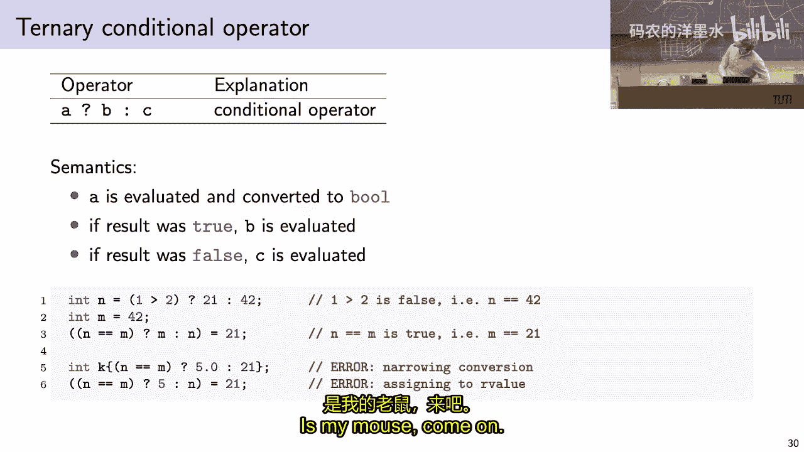
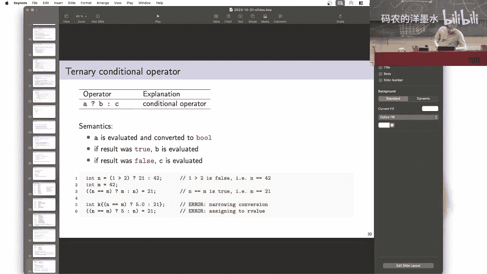
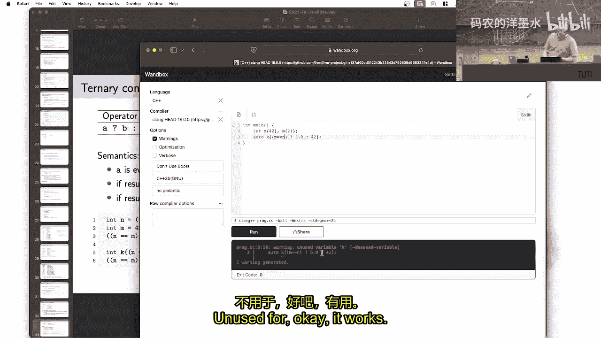
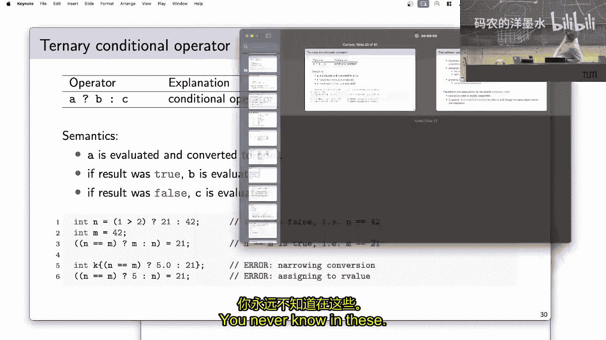
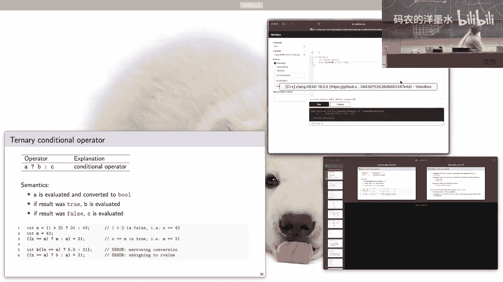
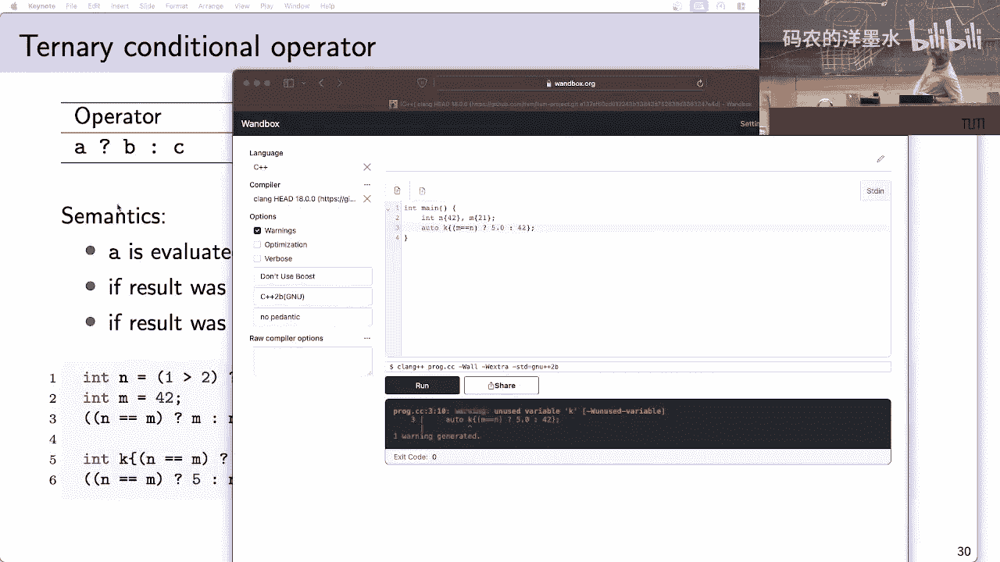
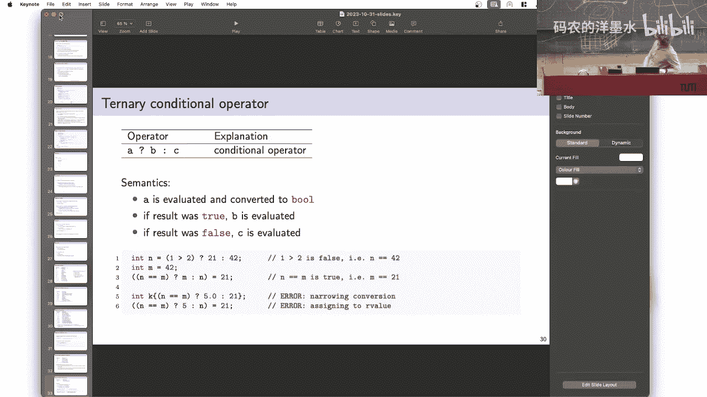
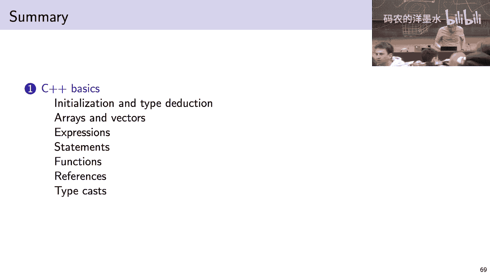

# 【全集 2024版】慕尼黑工业大学 C++编程概念 IN2377 中英字幕 p02 Lecture 2 - 函数与内存基础 -BV1gDqwBmEuC_p2-

Test， test。Test， test。So but。Wecome test yep。Welcome， everyone。To the Cpl course。Two minutes late。

 I need to start working earlier。 Sorry about that。Today's feedback session is that J X A。

 some of you have already found。And the news of the day。

 which actually the news of yesterday is that we have an exam date now。 It's February 22。

And some of you asked， which time。I'm not sure if that's completely fixed yet。

 but the current time is 11 o'clock in the morning。嗯。We have an auditorium for 50 people。

Which is why I'm not too certain if the time was stick edit is， because you're more than 50 people。

 In fact， 874 of you have submitted the first homework。In some fashion。

And almost 21300 are registered。 So 50 spots for the exam will not be enough。

So I'm talking to the administration how that's going to work。嗯。This is a slow process。

 so I don't know。If it's going to work at all。And we might have to resort to actually doing this exam online。

 I don't know。 We will have to see how this is。Goon to happen。Depends， of course。

 a lot on how many of you actually take part in the exam。Right， just as a reminder。

The final grade is the points from the exam plus the points from the homework assignments。

The homework assignments are not a bonus。 Theyre an integral part of the grade。

 And if you don't do them。Your grade will be verse。Right。Oh， yeah。 And speaking of the exam。

 before you ask if it's possible to move it， since we probably require at least 3 to 5。

 if not more auditoriums。 No， we will not be able to move it。

 Ill be happy if we have the auditoriums at all。And if you do have the auditoriums。

 I need people who do exam through provision。 I currently have three people available from my group。

 and you can count how many auditoriums that covers。2。So yeah， this will be a problem。

 and we will see how this is gonna work out。 But I think the one thing that is fixed now is the actual date。

 So look forward to February 22。Yeah。Right。So。In the first session， we talked about Y C plus plus。

Last week， we talked about some extreme basics， like what types are there。

 What kind of language is C plus， plus， What can you do。Today， we will continue these basics。

And move a bit ahead so that you can have most of the elements of the language so it can do anything。

That's on the menu today。 And then basically starting next week。

 we will move towards the topics where it actually gets interesting。 Like。

 how can you do object oriented programming。 But this is standard library offer。

 How can you do generic programming， How can you do compile time programming and all this stuff。

 So this is gonna come。 But before we can run， we have to walk And if we want to walk。😊，Yeah。

 we have to do these things。So we already talked about initialization last week。

 I want to pick it up again。And briefly， talk about it。So there's two kinds。

 One of them is the safe kind with the。Cly braces， so calledled universal in initialization。

 And that's the one you should prefer using。 And that's the one you should be getting used to。

And that's the one you'll hopefully see mostly in the examples on the slides。If not。

 then I messed up。Right。The main difference between safe and unsafe here is narrowing。

 And let's look at a few examples here what this narrowing can mean。This is perfectly fine， right。

 assigning an integer lital， which we know since last week is a tie of type int。😊。

Initializing an int with that is perfectly fine。 Iializing an int with a float， lital。😊。

Works with this not， the compiler will not complain。 Maybe there it will issue a warning。

 but nothing else。But， of course， what will happen is a truncation because an integer can't represent a floating point type。

And the same is true if you do the utilizationiliation using regular parentheesis。

 So if you don't wanna happen these side effects to happen like narrowing truncation and all this stuff。

 use this here。This uniform utilization with curly braces because then the compiler will tell you。

 hey， you're doing something stupid。 F it。If you do want。That 7。5 is rounded down to 7。

That make it explicit。And for that， we will have the type cast that we will handle at the end of this session today。

And if you write down the typecast， oh， yes， I w to convert from floating point to indture。

 I know I'm gonna lose information there， but I'm making it explicit。 Then the compiler will say。

 okay， fine。 You wanted it that way。 And anybody reading your code will say， oh， fine。

 He wanted it that way。 or she。😊，Right。So， of course。That could be the end of the story。

 This being C plus plus， it's not。So there are some subtleties you can enjoy。um。Internally。

Anything that's initialized using this uniform initialization has a type that's called S TD initializer list。

With a rap type T， This is a template， actually。You get to that。 what exactly that is。And。Yeah。

So it's a bit less straightforward than you might think。And you can have surprises。Right。

 because if you do the same thing， like initializing a vector。

 which is a standard library class for a dynamically sized array。 we will get to this in a moment。

You can do it with both in itizations。 You can do the uniform in initialization。

 and you can do the conventional one with regular parenthees。

 What you can't do here since this is a class of the standard library。

 you can't do the assignment thing。Or least。Not equals 99。 That doesn't work。

There are some ways you can do assignment in civilizationisation here。

 but let's not talk about those。 The interesting part here is。That this is an initializedr list。

 even if it has no only one element。 So what it tries to do is it tries to create an array。

 andally sized array， a vector。That contains this one element，99。

The other one will actually call a constructor that takes an integer argument。

 and that constructor means you're reserving space for 99 elements。

 And you are all initializing them with a default value， which in this case would be 0。So。

 tiny difference。Great difference in effect。You can also have errorss。Let's say。

You're doing a vector not of integers， but a vector of strings。

So you wanna store text instead of numbers in your dynamically sized array。 F。

 you can do this with uniform initialization。 And the string that's gonna end up there is hello。😊。

If you do the same thing with the regular parentheesis， this is not gonna work。

Because what it will try to do it will try to find a constructor of SDD vector。

That takes a child literal。Well， but there is none。 So the compiler would say， oh， this no。

I don't want that。Oh， okay。 so no， that's not uniform in realizationization。

 That's default in itsization。 So what happens if you don't provide an initializer。

For global variables and static variables or any variable with static lifetime。

 there will be a default in utilizationization if you don't do anything。

 which for integral types of floatinging point types is 0 or something。

For local variables that are non statics or basically anything else。If you don't initialize it。

 there is no initialization。But these are all cases where we do inization。

 These are all examples of where we do inization。So， no default values。So， these are。

Some corner cases that you probably won't encounter too often。But yeah， you should know about them。

So since it's called an initializer list， you can guess there can be more than one element。

 And that is convenient because that means you can initialize， for example。

 an entire vector of floating points with several entries like this。

 Just comma separated list of values and bam。😊，That's it。And if you think of， if you think， well。

 that's true， here， every other reasonable language has that。 Yes。

 C plus plus didn't have it until C plus plus 2011。So， they were。Almost 30 years of Cpl。

 very couldn't do this。Yeah， that's just how it is。Right。

 so what you can also do is if you have astruct， which is a user defined data type。

 we will talk about this when we talk about classes in two weeks。

 But just as a precursor already here as a teaser， you can group other variables inside astruct。

 You can also add methods。 but that's not relevant right now。 And the thing is。

 if you have such astruct， you can also directly initialize it。Because here's an integer。

 Here's a string。 So you provide an integer lit and a string liter。 Ta works。And that's also。

 incidentally。All these kind of initializations only work with the uniform initialization。So， if you。

The recommendation to stick to the uniform in itization is not just because it's safe。

 but because it's also the uniform， because it allows you to do more stuff。

 And if you get used to this style。😊，There are no surprises， essentially。Of course， yeah。

 there can be surprises， right， because it's C plus plus， so。Let's look at these examples。

 Were initializing a complex number。 You know， the thing that has a real and an imaginary part。

 So two numbers that you put in there。 for example， you could do 0 as a real part。

 One as an imaginary part to represent I， the imaginary number。

 That works using regular parentheesis that， of course， also works using curly braces。

 which is what you should do。You can default， initialize it。Using curly braces， which is fine。

 Since there is a default constructor for the complex class in the standard library。

 But if you try to do the same thing with parent thesis。What actually happens is that you。

 you're not declaring a variable set 3 of type complex with a default value。

 You know what you're doing here is you're defining or declaring a function called set 3 that returns a complex value and takes no arguments。

And that could be surprising to some。So it pays to be a bear of this。And， yeah。As a rule of thumb。

 use the curly braces for an utilization。Right， there were some questions。

Can you briefly explain the concept of astruct again。

I'd like not to because we are gonna spend more time in two weeks， but briefly。

You're grouping together。Other variables， plus methods。Inside astruct， we talk about this。

 but essentially， this is a class in C plus plus， right。Are implicit conversions allowed。

In thestruct initializer。 So narrowing conversions， no other implicit conversions， yes。

What's the difference between a constructor and a list constructor。

 We'll also talk about this in two weeks in more detail。

 but essentially it's what kind of arguments your constructor takes。

 and depending on what constructors you have and what arguments you're calling them with。

 the compiler will dispatch it to one or the other。So again。

 I don't want to talk too much about it today because we will deal with it in detail。In two weeks。

Or actually。No， in two weeks， yeah。Right。So as we've seen， if you do an empty curly braces thing。

 you get the default value， which is typically some representation of 0。

If you have a user defined type like the vector or the string。

 it depends on what kind of default construct you implement。 but typically， that's also。

Something like an empty vector or an empty string or whatever。Right。

Coming back to the topic of initializes， if they are not there， this can lead to undefined behavior。

Why does Cpl allow that noation is done。 Well， I mentioned it already last week。

 It's for performance reasons。If you have a big object。

 let's say a huge array allocating several gigabytes。

And you don't want to initialize it because it's gonna be overwritten with some content in a moment。

Then you don't want initialization for performance reasons。 But， of course。

 that it could happen that you're trying to。Use the variable before you actually assign the value to it。

So， example here。This global variable A is in global scope。

I could add aesthetic static in front of it to make sure that it's really global scope。

 regardless of where it stands。This is the exception。

 Those static variables with static storage duration。 they get default initialized。

 You can't do anything about that。There will be default initialized。

 So this will have a default value of 0。This X here is a local variable， non static storage duration。

 So it will。Not be initialized。And if you try to use its value， like so。Whatever the value of x is。

 it's not defined。 We don't know。 So effectively， what will happen。

 The compiler will reserve that memory。Probably on the stack for this x and whatever is in that memory location from previous program executions。

 that's the value that's gonna be there。 And that could be anything。Right。

 and that means the value of y， even though it looks to be well defined。

 It's now also undefined because the value of x was undefined。And of course， this is going to change。

Every time you run your program or every time you run your program on a different system。

 the value of X will be different。 So the behavior of a program might be different。

 and you will scratch your head。 What the heck is happening。

And this could be the reason why it's happening。So the recommendation is use compiler warnings for all Uni space compilers。

 That's dash W all。 So enable all warnings for visual studio。 I think it's slash W all。😊，嗯。

And look at the warnings。 Don't ignore them because they will tell you， oh， look。

 here's something uninitialized。 Did you really want that。I not answer all the track questions。

 I will answer them in writing afterwards today， but I'll not answer them here because that's the topic of future lectures。

What are different cast types than narrowing cast。 So a narrowing cast is， for example。

 if you go from a float to an integer。Floats cannot be re represented by integers。

 That's definitely a narrowingcast。If you go from。A short integer to a long integer。

That's not narrowing because the long integer has a broader range of values and we can represent all the values of the short integer。

 That would be an implicit cast that's gonna happen on initialization。

 And it's a safe one because no information is lost。

 If you go from a long integer to a short integer。 there might be information lost because short integer has less numbers that it can represent。

And strictly speaking， if you go from integer to float， flow to integer is clear。

Floating point numbers can't be represented by integers。

 but also the other direction is difficult because some integers cannot be accurately represented as a floating point。

So that might also be a narrowing conversion。Can you disallow the use of a default constructor for a custom class？

 Yes， you can。You will learn how， in a bit。So what I want to talk today about today is again。

The keyword auto。That you've seen already last week。You can use auto， instead of the type。

In a variable declaration。Like this。 So here is a compiler。

 This is and knows this is an integer literal。 So the auto will resolve as an int。

Here the compiler knows， oh， this is a character lit， so this will resolve as a cha。Now， you can。

 of course， argue for these simple examples。It makes it harder to read because you first have to think about what exactly is that literal in terms of type。

 or it's gonna deduce as that。 And then you might still have some lingering doubts if you thought about the correct type of the compiler。

 maybe did something else。 So for these simple examples。

 you're probably not gonna use auto because it doesn't pay off。But。

Where you wna use it is in stuff like this。For example， for memory management。

 we are gonna use unique pointers， a so calledled smart pointer。

 We will talk about this later trademark。嗯。But these have a bit of syntax， as you see here。

 So the standard syntax is， you declare a variable U 1。Of type S TD， unique pointer to int。

 and you initialize it with the SDD make unique call for int with the default value。

That's a bit lengthy。So you can make this a lot shorter by saying auto。

 because it's already clear with， if you call SD make unique， that a unique pointer will pop out。

 So this is。A lot more readable and shorter to write than the first line。

At least for any kind of experienced C plasma programmer。And then you can do stuff like iterators。

 They iterate over， iterate over the content of a container。 Again。

 this is something we will talk about in detail later。But typically。

 you acquire these iterators by calling begin on the particular container like this vector。

And the type of an iterator is something that each container defines for itself。

 It's not a universal type。So what you have to do is you have to specify S TD vector， double colon。

 colon iterator。 That's the type alias inside that vector class。That is something。You don't know。

 It's implementation defined。 So you have to write this。And。In fact。

 you don't give a damn what kind of iterator that is， because it's gonna be an iterator。

 And you can use it using the standard API of iterators。 So you don't care what the actual type is。

 And so writing order iterator equals begin。Is a lot more convenient because you don't care。

 And there's gonna be a lot of more template based code。

 especially with expression templates and all the stuff that is gonna come later where this comes in very handy。

 So auto is intended for these kind of use cases， not for these。 It works here as well。

But nobody reasonable would use it there because just writing down the explicit type is。

Easier and easier to read and understand。If you write an auto statement somewhere。

How do you know what the compiler actually deduced。

One way of finding out is to use the boost library。Booz just kind of。

A big collection of libraries that。Does everything And the kitchen sink。In fact。

 a lot of the standard library parts came from the Bo library because theyve implemented their first。

 And then the standards people said， oh， this is cool。 We should have it in the standard。

 Let's pull it out。This happened quite a few times。So， for example。

 the unique pointer comes from boost initially the print library。

 the SD format capacity comes from boost for first and so on and so on。 Well， actually， hold on。

 format didn't come from boost format came from the format library。Anyway。

By using the boost type I D thing is you can print the type of what your compiler de as auto。

For example， if you do this here， you initialize a variable A with an initializer list containing 13 and 14。

Then the type will be acidD initialized list of int。

And if you do this unique pointer thing that we've seen before， you will get a unique pointer to int。

 which is is expected。 What you might be surprised of is this default argument for the delete。

hich is a default lit for thety in。Right， but you don't care。 You don't need to know this。 It's fine。

And， in fact， if you use a proper I D E that is clang D based。

 you will probably get the type deduced here when you hover your mouse over it while you're in the I D。

So depending on how good your I DE is， you might not even need this stuff here。

 You will get it in the I DE directly。But actually， it's not about the I D， I D E itself。

 but what kind of language server it uses。Right。Our custom cast operators counted as non narrowing。

Yes。You can create cast operators for user defined types。 And if you have one。

Then that counts as non narrowing， even though it might do stuff that is narrowing。

 That's then up to you。收痒。You could do that。Now， let's briefly talk about arrays and vectors。

 They are building block for basically any programming language。 You need arrays and vectors。

 What's the difference in C plus plus， what we call array is something that is fixed size。 So。

 you know， it size from the beginning。 And this is done using the standard library class called S TD array。

在了。You specify the type of what。You want to have as an array。

 and you specify the number of elements that you want to have in this array because this is fixed size。

 So you need to know the number of elements at compile time。It's not。

Possible to do an ST TD array with user input。Because you don't know what the user input would be。

 So if you wanna do numb as a user input， STTD array won't work because it has to be known at compile time。

 When you translate the program， Nm needs to be known。

The guarantee is that this is contiguously in memory as， for any array that you would expect。

 it will be aligned for your processor or architecture。 You can do all the default stuff。

 like initialization。With empty braces or a list initializer。 you've seen this already。

 There's a member function called size that tells you how many elements it has。 But then again。

 you shouldn't be surprised because you already know it from the beginning。

And you can access elements using the operator with the square brackets。

I'll give you an example in a moment。 Or the member function called at the difference between these two。

 They do the same thing with one difference。Ad will check if your access to the array is valid。

 So if your index is between 0 and the number of elements，-1。

Whereas the operator with the brackets will not check。There's no safety net there。 And， of course。

 there's iterators of various kinds。 So how does this look like。Here has an array。Of integers。

 and namely 10 of them。 And we initialize them with nothing。

 So we have 10 integers contiguous in memory that will be default， initialized with their value。

Which is 0。Here's an array of three floats。With these three values， as in itsization。

You can now loop over the contents of the array by doing a for loop。

 That's classical C style for loop， right， So you initialize your loop counter。

 I even did a C style initialization here， not the curly braces。Didn't find that。

You check against the size， you increase the loop variable。

 and you access your elements of the array using the bracket operator。

The bracket operator will not do bounce checking because the idea is。

 you're gonna use this in for loops like this。Which already know that they're doing the correct thing。

 right， because you're checking this。In your loop condition that you're not iterating beyond the end of the array。

You can do the same using the add function like this。 So you can call a dot at。 And， for example。

 if you try to access the 11th element， which won't be there because the array only has 10 elements。

You will get a runtime  error which will say， oh， out of range。

 you try to access an element number 11 in an array that only had size 10。Right。

 so what you can also do is there's this so called range for loop。

Where it can iterate over that container， which in this case is this array here。And you can use auto。

For the type of the elements that you wouldlit over。 But you could also say float in this instance。

 right what also be correct and then print the contents of the array and surprise he would get 0。01。

12。2。来 by来。Is there ever a situation where one should use operator the bracket operator。

Over the at operator。Yes， performance， as usual。So。

If you have a huge loop that's gonna run a million times。

Where you already check that the indices are。Correct， you don't wanna have the bound。

 Maybe you don't wanna have the bounce checking done again， every single iteration of the loop。

If it's 10 elements like this， you probably don't care。 So， in fact。

 the standard should be you using at。 So you have a double safety net of your excesses in the array。

Oh， and here's an answer that says， if you don't have exceptions available on your platform。

 I don't think there's any platform anymore that doesn't support exceptions。

Even all the embedded stuff usually supports exceptions now。

And there's extremely efficient implementations of exception these days。

 There's no reason to not use them any more。Right， what you've probably seen。Our sea style arrays。

 And I'm gonna hop over this pretty fast。 just so you've seen them at some point。

So what you can do is you can declare a sea style array like this。

An integer A with this bracket operator and 10 after that， That's an array of 10 integers。

That you can default， initialize and so on。 But the thing is。They are from C。

 They are therefore for backward compat。 But that's the only reason do not use them。 They are evil。

Why are they even。They don't know their size。So once you declared this。

 there's no way to find out what the size of this array is after the fact。So you can't check。

 There's no automatic bounce checking。And due to these two simple things。

 they are the source of a lot of crashes of programs， a lot of buffer overflows and so on。

 So there is no reason whatsoever to use them again， because now we have SDD array。

 and it can do everything。 C styleyle arrays can do but better， safer。

 and there's no fucking overhead either。 It's just as efficient， if not more efficient。

So don't use C style arrays ever if you see them。Drop that coat。 It's awful。Or fix it。

There are some certification processes that do require certain guarantees， yes。But you can。

You can get around this。 You can have exceptions even for the certified users。 Now， there are some。

Things you have to do to make it be be performant enough。 But yeah。It does happen。Yes。For this。

 for the array。No contradiction because the SD is array implemented using compile time programming。

 So any overhead that there might be is at compile time。

And the runtime code will be just as efficient as the C array with additional functionality。

So that's one of the key points of。Modern C plus plus， there's compile time programming。

 which we talk about in depth in in a few weeks。Which makes all the safe techniques just as fast。

 if not， as， if not faster than the old standard techniques from C。And the point is。

 we don't need C anymore more， except for backwards compatibility， for new code。

You should never touch this again。EYou comment that you can compute the size of a sea style array。

 but doing the size of operator。Nope， you can't。 It will give you the size of one integer。

 but not of the 10。Doesn't work like that。Right， fixed size arrays are admittedly relatively rare。

 You need them。 if you， for example， do。The computer graphics with3 or 4D vectors there。

 you know that they are gonna be 3 or 4D， but。In most of the cases。

 what you will need are nonfix size arrays because the size might be according to user input or some other data。

 and so on so you need dynamically sized arrays。And if you heard algorithm and data structures。

 you know， there is such a type。 And that's exactly what SDT vector does。 It's contiguous in memory。

 it has these shrinkage and growth factors so that the amortized cost of resizing the array is relatively low。

 and you have all the expected functional such as pushback， clear resize to do changes and。

 of course， the same interface as STD array as well。Right。Example。Looks fairly similar。

 declarecl a vector instead of array。 you no longer need to provide a size because it's now dynamic。

 You can call pushback to add elements。 You can print the size。 You can clear the vector。

 Now it's gonna be size 0。 First， it has size 10。 Then it has size 0。 and it can do a resize。

 and then it has size 5 and so on and on。 It's the same。What might be interesting。

 It's also a fairly novel addition are these range four loops that every other modern language already had。

 The C plus pass was late。So if you have any type that is itable。

 So if it's any type of container like this array or vector。You can have a special loop。

 a special for loop， which has an in statement， a range declaration and arrange expression。

 and then you can loop over it。😊，So let's look at it in action。So you could have a vector。

With five elements。 And you could。Loop over it。Adding even more elements， right？

 So that's a traditional follow loop where you。Yeah， loop over it。

Then you can do this range for loop where you basically iterate over this container， a。

And each element of this container will be stored in this variable E。

 which is now of type auto constant auto because we don't wna change it and even a reference。

 which I'll explain later what that is to make it more efficient。 But then again。

 this is a vector of in。 so it doesn't matter。So you could also drop the reference here and it wouldn't change a thing。

And then print the contents of that one element。 and then print a line ending。

 And then the output you get is 1 to 3，4，5 from the default from the initialization。And 1011。

121314 from the fall loop that you did here。You can also put other containers。

 and the initial lier list counts as a iterableable container。 So you can do this。 For example。

 you can have an initializerr list here as the。Range expression。Then， iterate over it。And you can。

 again， use the keyboardword auto if you don't care exactly what the type here is， you could。

 of course， say in as well。 And then this will print out everything。That's in the initialer list。

Hows the vector still guaranteed to be contiguous in memory if its size is not fixed。Well。

 because if you resize it。It will allocate new memory that's bigger or smaller。

 depending on what you're doing， Resize， copy everything over。And that's it。

 So it's less efficient than a fixed size array。 Obviously， if you do resize it。

 if its size stays fixed， it's just as efficient。And the resizing algorithm。

There's a very clever one。 It's a basic one that you learn in algorithms and data structures。 So。

 for example， if you have a vector of 10 elements， you add an 1111th element to it。

 it will resize to twice its size， for example， so that the next pushes don't trigger another copy。

But be advised if you。Push elements to your container。 And if you do this a million times。

 there will be quite a lot of resizes and copies in your memory。

 So if you know the size of your container in advance。Like， for example。

 you already have the user input that the size depends on。 And， you know， there's 10 million entries。

 Then reserve the size There's a function called reserve。

 You can basically pre allocatecate the size。 so it doesn't need to resize all the time。

 And then you can run your follow with the pushbacks。Right。Oops， okay。

So what I want to get to is a bit more meat today than last week。 This was kind of。Seriously。

Is it always the same time this happens。系 don no。Ta， that it work again。 Let's see。

There are some good news that I just received。 If you've tried to look at the recording of last week。

 you will notice that the video was missing。😊，The Tom live recording system had an I O issue while our lecture took place last week。

 So the video was lost。I didn't record the video on my laptop because I didn't want to wastete the space on my disc。

So unfortunately， there was no video。Now， they just wrote me that the video could be found in the back up。

 So now they're restoring it。 And I guess tomorrow or so the video should be back。

 I hope that today there's no issues。 But today， I'm recording here as well。

 So worst case comes to worst。 I have the video。Right， so expression statement functions。

 These are the meat。That we need everywhere。 So let's talk about expressions first。

 What is an expression。The sequence of operators and opera。And typically。

 the evaluation of such an expression produces a result。 Like if you add two numbers。

The sum of the two numbers is a result。And there might also be side effects。

Like printing stuff that will produce something else than a result。So it's also kind of a result。

 but not something that's directly returned as the result。So what is an expression。

It's characterized by two properties。 One of them is the type。We know what a type is now。

 at least in C plus， plus。And what it's also characterized by is the value category。

 That's something we haven't talked about yet。So。There's quite a few。Value categories。

We'll talk about them later also not in that much detail， because it's a really messy topic。

 But essentially， you need to know broadly that there are two categories。 One is called an L value。

 and one is called an R value。The names come from the fact that an L value is basically something you can have on the left side of an assignment。

Whereas in our value is something that can be on the right hand side of an assignment。

 That's kind of the original idea。It's。Not that simple， unfortunately， but in general。

 this is kind of a good intuition to have an L value is something that is basically an object with an identity。

That you can refer to， let's say a variable called a。 Then a is the identity。

 and then it's an L value。our value。It's something that refers to the value of an object。

 And that doesn't need to have a name。 could be a temporary result。

 The result of the edition 2 plus 3 doesn't have a name。 You can't refer to it。 So it's an R value。

Because you could also put it on the right hand side of an equation。Right。So。

An expression is operators operating on opera。 What are operators， wow。

We have unary operators like negation address of T reference。 These are minus1% and star。

We have binary operators， just the athmetic operations plus minus divided by multiplication。

 equality and so on。 And we have one tannerary operator， which is this question mark colon thing。

We'll talk about that in a moment。Almost all of these operators can be overloaded for custom defined types。

Which we'll talk about later， not today。But just be aware of it。

 That's one of the features of C plus plus。 It's fairly unique that you can overload these operators so it can change the meaning。

 what equality means for your user defined type， if you want。If you're nasty。

 you're changing it that way that it means inequality， for example。Well， an operator will have opera。

 and the opera can be other expressions again。Or primary expressions。

And these primary expressions are literals。 That's something we've seen already。

They have very good names。 far I've seen。And others。Among those as， which we'll talk about next week。

 fold expressions， which we'll talk about in a few weeks。And so on。So essentially， we have operators。

Like these arithmetic operators， the union operators have one opera。

 The binary operators have two opera。And yeah， they're just， as you expect them to be。

 addition subtraction。Bitwise， not bitwise and and so on and so on and so on。

 modo with a percent sign。 And yeah， it's， it's fairly standarded。One thing that is undefined here。

Is overflow。So unsigned overflow is defined。If an unsigned variable overflows， it starts back at 0。

If there's a signed overflow， it's undefined。 So you don't know what happens。

Division by 0 is also undefined behavior。If you do it with floating points。

 this might give you an exception triggered by the processor。It might not give you an exception。

 It might give you not a number or what not depends on your system and compiler。

And shifts that are invalid。 So shift is， you know。

 if you shift the bit pattern of a value to the left or to the right， if you do。That in a stupid way。

 it's also undefined what happens。Now， that's logical operators。 We've seen those already logical。

 not logical and logical or。The interesting party here is short circuiting for these。

So what does that mean。If you have a logical expression， A and B。

That it's only true if both A and B are true， right？ So if a is false。

 you can stop evaluating because the entire expression will be false。

So that's what short circuiting means。 If a is false in an end statement。

Evaluation will stop because the entire value of the expression is already decided。So it will。

 if you rely on B being evaluated。Don't。 in an end statement， this is not guaranteed。

Same for the or statement。 It's true if either one of these is true。 So if A is already true。

 B will not be evaluated。 That's again， short circuiting。Then there's a comparison operators。

 No surprise here。The only thing you have to keep in mind。

 And I've saw this in a few sort of messages already。Comparison is 2 equal s， not one。

 One equal sign is assignment in C plus plus。Speaking of assignment， there we are。

Here's the one assignment。Then there are some other assignment operators。

 which essentially a shorthand not for a equals a plus B。 You can do the short end S A plus equals B。

 And you can do this with all the other binary operators as well。😊，Naturally。

Since L values are the stuff that are on the left hand side of the assignment。

 that's what should be on the left hand side of an assignment。You can only assign。Something to。

Let's say a variable with a name， for example。 Otherwise， it doesn't work。Right。

 for the built in types， these shorthand assignment operators are equivalent to the longhand assignment operators。

 for the user defined types， you can override these operators separately to mean something else。

If you wan to do that。So just to be sure， the guarantees only for the built in types。

Because most of the user defined types also wna have that guarantee。And why do we have this。

Compared to this。To get， a question of performance。 In this statement， we evaluate expression A。

 we evaluate expression B and perform the operation with those two opera。

 And then we assign the result to a。😊，Here。We don't evaluate 8 twice。Which is what happens here。

 But we validate it only once。 And the result of the operation is directly stored on a。 So it's。

Potentially。At tap more performance。 And C plasma is about performance。 That's why it's there。

Assignment operator have a return type， and that return type is a reference。

To the result of the assignment so that you can chain assignments like this。

This works So we can assign， basically declare three variables， ABC， assign a value to C。

And the value that is returned from that is assigned to B。

 and the value that's returned from that is assigned to a。Right， what does O P mean， Well。

 it means the actual operator plus minus star divided by modulus and， and so on and so on。Yeah。

 this chaining isn't used too often。 You won't see this in much code。

 And this is actually here a very bad example。Because。What you might think。

Is that we're trying to compare D with a function return value。 But actually， what we're doing here。

 we had comp call a function， assign it to D。And use that variable inside the if statement。

 So this is not particularly good style， but this is possible。 And this。

Since the assignment returns the value of what you assign to the D。

It is then converted automatically into a Boolean， which then is evaluated by the if statement。So。

 but that's not a good style。 So probably you won't see this a lot。There's more operators。

 unary operators。 There's increment and decrement。 What does it mean it means increment means increasing by one。

 Decrement is decreasing by one。And now you see where the name， C， plus， plus comes from。

It's a post fixed increment operator。Of C， which means youre improving C by one。他啦。

There's the two versions that are slightly different。 There's the prefix and the postfi version。

 the prefix version basically ins the value and returns a reference to the result。

Whereas the post fixed version creates a copy first。Performs increment。

On the original object and returns the copy， copied value。 So if you need the previous value。Of a。

Before you increment it， you do the post fixed increment。But， of course。

 that's less efficient than the prefix increment because there's a copy。

That's why if you look at a for loop in one of the previous examples。

You will see that I'm using the prefix version。Of the increment， of course， in these simple cases。

 the compiler probably can figure out himself that the actual copy isn' needed。

 But if you wan to be explicit。Use the prefix version。Right。Now， to the tenant operator。

Which is a bit weird。 If you haven't seen this before， it's basically a tiny if statement。Right。

So depending a， the expression A will be evaluated to bull。 and if it's true。

Then B will be the result of the operator， otherwise， C。So what he can do is， for example。

 if one is bigger than 2， then either use 21 or 42 as a result of this initialization of n。

 Of course， one is not bigger than 2。 So 42 is used。This is typically done for short end notations。

 You can even use it on the left hand side of an assignment。 So， for example。

 if the value of n and M is equal， then you want to assign M。To this。

And then you want to assign this to M。 If not， you wantan to assign it to N。 That's possible。

You have to pay attention。With the types of B and C， typically。

 they should match because if they don't， you're gonna get in trouble。

 So if you w to try to initialize an integer。With a floating point value， even though。

And is equal to M。 This will be a problem because 5。0 can't be。

Assigned to an interteger without narrowing。And of course， here。

 although you can't assign 21 to a number because the number is not an L value。

 It doesn't have a name。Yes。Good question。 So the question is， if I replace the integer by auto tool。

I actually don't know。 Let's try it out。Where's my event box session。Withs my browser。是。

Oh I should put it up so you can actually see them。Where is my mouse going？

way， okay。

So here's my red box。 So let's say， auto。Okay， and let's do some integers and。And first。And then。

 initialize。This was n equals。50 or42。Right。That's that。Oh， self comparison always it is to true。

 So I didn't。Tpe properly。Unused for。 Okay， yeah， it works。

Interesting， so I wasn't sure I would have probably said yes， but yeah。You never know in these cases。

I don't maybe no， no that one。

He that。Here。

Come on， go away。

哦。David。Now I'm confused on my windows。They're gone。ok。here it is。Thanks for the question。

 That was actually something I。Did't know。Right， operators。 So if you have several operators。

 the question is， which one will be evaluated first。

 So if you have arithmetic operators like addition and multiplication， you know。In Germany。

 it's ped for trees， a multiplication before addition， right， And this is， of course。

 also modeled in the language via are operator precedes。

If the operators have the same precedence and it's evaluated from left to right。Al right， to left。

 depending on their asciivity。And。If it has lower precedence and it's evaluated later。Right。

 so since this is sometimes not obvious， the the recommendation is to use parent thesis to make the evaluation order clear。

Right。Oh， and the question of evaluation order。 So if you have operators with opera。

 you don't know in which order the opera will be evaluated。 If you have a plus B。

 you don't know that A will be evaluated first or B。You don't know。 It's undefined。

 The compiler can decide whatever it wants。So precedence examples。So here， and this is easy。

Myplication before addition。 So this is 7， right，2 times 3 plus  one。But if you do this。Well。

It's left associative。 So 50-6 takes place first。So you have 44 and then -2。 So you get 42。But here。

Okay， this is something off the cuff。 since I don't usually use bitwise operations at all。

 I wouldn't know。 I would presume that I think this is lower priority than the end。But I think。

 I'm wrong。Right， so the minus has the highest priority。The shift has higher priority than the end。

 Okay， so I would have been half correct。And then you can do stuff like this。

You probably would think this compares。This checks if x is between 0 and 99。 It does not。

It's left associative。 So this is evaluated first。Is x smaller or equal。E bigger or equal than 0。

This could be true or false。But the result of this comparison is true of false or compare automatically converted to inteature 01。

And then what you have is 01， smaller equals than 99。 Well， both 0 and 1 are smaller than 99。

 So this statement here is always true。Even though it doesn't look like it。

Or if you have stuff like this， for example， here， the tenerary operator。And comparisons here。

 this might not evaluate to what you would expect it to。So use parent this and use them often enough。

And can you please go away your。Disturbing me。Right， so precedence。

 there's a big table that's continuing over several slides， three slides。 In fact。

 I copied it from the standard essentially， more or less。You don't need to know this by heart。

 I don't know it by heart， even after more than 20 years of C plus+ programming。

 And this didn't really change， so。Some things are natural。Like。The scope resolution。

Having the highest precedence。Increment， post post fix and prefix being fairly high on the， on the。

 on the rank。Then addition and abstraction being lower than the multiplication and division stuff。

 Yeah， comparison being lower， Biwise operation being lower。Assignments being lower。

 Most of this is fairly。Expected， right。嗯。But if you're unsure， especially in stuff like this。

All here。 Oh here。Add parent thesis where you want them。 And then it's clear to everyone。

 even if you don't know this by heart。 And I can guarantee you that most programmers don't know this table by heart。

我法呢。To house。Often， often。Can you do assignments inside the terary operator。Yeah。Sure。Why not。

If you wanna write obfucated code， sure。嗯。Does that mean auto decides the type on runtime， no。

Autto is a pure compile time construct。Like a lot in C plus plus。

 If O would decide on the type at runtime， this would mean that the type of an object has to be carried around at runtime。

Does this sound like something C plus+ will do。That's terribly inefficient， no。It's not。

It's compile time。Right。Hi， may I on time。That is usual。 Okay， let's continue statements。

 We've seen plenty of statements before。 You can do a declaration statement， declare a variable。

 initialize it， and then semi me colon。You can have expressions， like。Well， you just had expressions。

 an operant plus plus two operas done。 You can also have a function coil。

 which is alsoz an expression。You can have a compound statement。

 which is basically several statements separated by semicoons and inside a certain scope。

No surprise here。We have if statements。 we've seen those before。 We talked about them。

 The only news here really is that if statements can have an initializer statement with a semicolon before the condition。

You will see this very rarely because this was introduced fairly late。 I think in C plus 17。

But sometimes it's convenient。 So， for example， here。

You want a compute value story variable that's only relevant for that if statement。

 So you do that in the initializer statement。 And then you do the condition。Based on this variable。

You could also do it like this， which is probably what most code does。

 since sometimes you also need the value after the if statement。 But if you don't。

 this is a way to make things a bit shorter and maybe clearer。Oh， let's go back to slide 34。

 Somebody found it ha ha。Here's the so called spaceship operator。Because it looks like a tie fighter。

 right。And I hope you're not too young to know what a tie fighterer is。Oh dear。Science， but yeah。

 science fiction fantasy 101。 Look up what a tie fighter is。So yeah。

 this is a three way comparison operator。This is fairly new。 It's in was introduced in C+ West 20。

And。The idea of this was if you have a user defined type and you overload comparison operators。

In order to do this properly， you have to overload the equal operator， the unequal operator。

 the smaller， the greater， the smaller， equal， the greater equal operator。

 So you have six operators to overload separately。And， of course， typically。

 you want to overload them in such a way that they all work together as expected。

So this this is such a。Common use case。 Cpl decided to introduce a new operator。

And I think this is the only new operator in all its history， more or less。Well。

 not quite all its history， but I think all its history that combines all these comparison operators into one。

So that you only have to overwride one of these operators。

 and then the compiler automatically generates the correct code of this。We talk about this aitator。

Notable case is de referencing of a point and incrementing it。Yeah， they're not gonna do that。

 They're not gonna use pointers。Not no， no longer necessary in modern C plus。Right， if statements。

Right， there's the L is associated with the closest if。 So if you do something like this here。

Where you might think the orientationdentation。Makes your。嗯。Intent clear。 Well， this is not Python。

 The C plus compiler doesn't care about your indentation at all。

 It's just there for you optics to read， make readable code。 This else belongs to this condition。

So if you wna have this S belong to the outer condition， you need to do blocks to make it explicit。

There's a switch statement。 If you wan to switch between different values of a variable。

 you can also have an init statement here， but。Typical use case looks like this。 Sw some value。

 and then you have cases where you have discrete number of cases that you wanna check。

 So instead of doing repeated， if else， if else， if else statements， you do a switch。嗯。

It's not terribly elegant because each cave statement has to be completed by a brake statement to jump out of the switch。

 because otherwise， execution just falls through。To the 42 case。 In some cases， you wanna do this。

In some cases， you want to process both of these values the same way。

 and only have one break statement after the second one。But the compiler might complain and say， a。

 you probably forgot a break here at a warning。 And if you wanna tell the compiler， Oh， yeah。

 I intended it this way。 You can add this special fall through statement here。

To mark that the fall through is intentional， both for the compiler and probably also for the reader of the code。

Right， there's a y loop。 We've seen this before。 There's a do while loop。 We've seen this before。

Here's an example， yeah。I don't think I need to say anything about that。 We've seen the for loop。

 the traditional one already with the in it statement， condition and iteration expression。Again。

 nothing surprising here。In its statement。Loop condition， iteration expression。And， yeah。Oh yeah。

 And here's some of my favourite examples of what stupid shit I do in my code。For example。

 if you have a。Small integer。Because you want us save space and be efficient， right。

But you're trying to iterate until 2，56。 How many values can an unsigned integer represent。0，2。2，55。

 So， yeah， any U in aids is smaller than 2，56。 So this is an infinite loop。他啦。嗯。

Here's another of my favorites。 I like to do this。 You have an unsigned loop variable that you're counting down。

And you're comparing it against 0。 This is also an infinite loop， why。Cause as you reach 0。

The loop comparison is still true， so it will execute once more。Then decrement the loop variable。

 It's unsigned。 So what happens from 0， It's which it back to the largest value it can represent in the unsigned case。

 if it's a 160 B system， it would be 65000。535，32 B system。2 billion， something， whatever。

 So it would roll over to the largest possible value。Because that's what happens with unsed。

And this is something I regularly do。 And I always like， why is my program not terminating。

 Did you do an insideside loop backwards again， like， oh， shit。 Youre so stupid。 You don't learn。怎样？

Signed overflows are still undefined， yes。Laza and I just had an old A F moment。

I have no idea what that means。You have to clarify。Or maybe not。 maybe I don't want to know。Right。

Functions。We've seen functions already。 Let's talk a bit about them。So what are functions。

You associate a sequence of statements inside a body with a name that you then can call from other places in your program。

So you have a return type， a name， a parameter list in parentheesis can be empty， and then braces。

 curly braces and statements in the body。And then you can， if you have such a function。

 you can declare it。 You can define it， and then you can call it by invoking the name。

 this appropriate argument list。So， examples。They can have no return type， which is marked as void。

No return type。 And then we have， for example， here， two parameters， one of int， one of float。

We can have。A return type， like an integer。But if you do。

 then the function has to have a return statement with an appropriate type。

With the exception of the main function that we've already seen。

 it has to have an integer as return type。But。You can drop the return statement here because there will be an implicit return 0。

 anyway。Right， argument passing。 you can do this by value， which is， if you just。Do it。

 as you would expect it to。 So what you can do now is you can change the value of your argument inside the function。

 return it as return value。But the change of the original V will not propagate back to the color。

 So if you call it the square function with 8， like in this case。

 you can do whatever you want inside the function。Because the value of this parameter is discarded after the function executed。

 So the value of V isn't changing here。How does this work？ What menu you call it's square。

A copy of V is made and that copy is passed to square。 so you can do to that copy whatever you like。

 it's not going to pass back to your color。You can also car pass arguments by reference so the changes in the function propagate back to the collar。

And we will do that。In more detail next week。So you can have unnamed function parameters。

 if you want。So just no name associated to the type。 This works。嗯。Usually。

 you do this if you have an interface where some parameter needs。

 the number of parameters needs to be kept the same， but you're no longer using some。

So you can do it like that。 But if you invoke the function， you still have to supply a parameter。

 even if you can't use it。 but that's really a rare case。Defiiled arguments are less rare。

 They're actually fairly common。 Some of the function arguments might have default values。 So。

 for example， you might have three parameters， AB，C。A doesn't have a default value， but B and C do。

What does having added value mean， that means you can invoke the function with either one。

2 or three parameters。And if you invoke it with one。

 then the default values for the other two are used。 if you invoke it with two。

Then the values that you passed for the first two are used and the default one for the third。

 And if you specify all three， then none of the default values is used。

And the rule for default values is you can。 you have to specify them from the right to the left。

 so you can't。You can't leave， for example， B without a default value and have a half a default value。

 That doesn't work。 If you add default values， it needs to progress from last forward to the first parameter。

 and you can stop somewhere， but no holes。Not sure if I correctly understood the size of comment earlier。

I'll answer that later。Are the only positional arguments。Or also named。Okay， okay， I understand。 No。

 there are no named arguments。 I think there was a few proposals to introduce this to C plus plus。

 but it would be such a disruptive syntax that it would break backwards compatibility。

 So it's not there。Arguments are positional， so you have to know the order。And you can't change it。

 So if it's ABC， you have to specify the arguments in the order， ABC。And if you don't know the order。

 you have to look it up in the documentation。 Usually， your I D E helps you finding the order。

2 functions with no arguments except arbitrary many parameters， no。No， C plus accepts。Exactly。

Those amount of parameters that you have declared that's changed over old style seat。

If you want a function to have no arguments。You just provide no arguments。

What's the use case of unatives， There's basically no none。No that are particularly useful。

So let's use the last 15 minutes to talk about references。 that's。

So traditionally a bit of a more tricky topic。So let's start。

 And this will follow us over the course again and again。References。

References are essentially an alias。 So you have an app object， like a variable A。

 and you want to define an alias to it。 That's called， for example， B。

 You do this by doing a reference。 And there's two types of references。

 an L value reference and an R value reference。Ignore the R value reference for now。

The add value reference is essentially what you're thinking of if you're thinking about references。

 our value references turn up very seldom。Right。References are special。 Theyre an alias。

 So you can't do an alias to nothing that doesn't make sense。 So reference to void doesn't work。

You can't change your reference after you created it。 so you can't。

Make the reference point to something else， be an alias to something else。 You can't do that。

 If you put a reference as an alias to something that's gonna be it。

 You can't change what is this aliasing。However， what you have alias， of course。

 you can change the value becauses otherwise， there would be no point。

References themselves are not necessarily objects。They' are just an alias。

 so they could occupy storage。Like a pointer。But they don't have to。 It's up to the compiler。

If it has storage or not。And that means since it doesn't have guaranteed storage。

 you can't do a reference to a reference。Because a reference can only be to something that actually exists in memory。

So if it's not existing in memory， So yeah。And， of course， you also can't do an array of references。

 which some people would like to do now and then also including myself here。

It doesn't work because if you don't wanna do an array of something， you need to have storage。

 If you don't have storage， then yeah， it's not there。

Why do we actually care about breakfast compatibility。

I understand this need in jascript being widely used in the Web。 But for compile languages。

 it seems like a very painful burden to take。 when you can link the binaries。Then， I thought。嗯。

But it， also。Yeah。So let's put it like this。 Javavascript wasn't around。For a while。

 let me actually check when the Java came into being。Jaramascript，1995。

 C plus plus was already existing for almost 15 years back then。So， Trascript is a。

Fairly young language compared to C plus plus。 And if you compare to C， it's even younger。嗯。

Theve was around in the 70s， right，60s，70s。 I don't remember。嗯。So back then。

 there was a lot more code in C N C plus， plus than。Newf， jascript or Java or something。Of course。

 now。Almost 30 years have passed since Javascript came into being 28 to be exact。

So it's maybe heh the the， the， the kind of， you know， before it was like everything is in sea。

And there's these new languages， Javascript， Java， they are coming up。 They are coming up。

 So backst Comibility was a huge thing。 Back then。 Meny plus plus was introduced。

Because that was the only code that was there。嗯。Nowadays， of course， all the jascript is old and。

At is comparably old， at least older than most of you here。嗯。And， of course， a lot more code。

 If you wanna call it code is available in jascript， then in C。In terms of lines of code。

 I'm pretty sure that's true。Although that's a guess， I don't really know。 So yeah。

 the spec compatibility is a pain in the ass。 And， of course， today， you could say。

 what do I care about C code from the 70s。 Do I need that。Well， the thing is。

 we probably do care about the C plus code that's still in our productive system from 25 years ago。

 And C plus plus code from 25 years ago was using all the C style elements。 There was no SDD array。

 There was no value references。 There was no move constructors and all these things。

 So a lot of the things for modern C plus only got introduced in C plus plus 11。

 and that is only 12 years ago。😊，So a lot of the breakfast compatibility stuff was required。

Back then。So， yeah， that's why it's still there。 But that's also why there's languages like carbon。

 which are basically C plus plus modifications， which throwing out the backst compatibility。

 That's why there's rust， which is essentially like Java。 and there's Java， right。

 because Java was also basically， let's take C plus plus and throw out the old garbage。😊，Right。

 the rest is the same thing。嗯。So， yeah， there's still a reason for backwards compatibility。

 even today。And the simple， when you can link the binaries， yeah。

 you usually can't switch compiler version or operating system version。

 And you have to retlate the binaries。 You can't just link to them。

And if you can't translate them anymore， because your compiler now is no longer backward compatible。

 then compatibility is gone。And you need to use。An older compiler for that and a newer compiler for your newer code。

 And then you have to probably。Go back to a C， external C interface to interface。 I mean。

 that's really painful。 Then you might just as well do the new code in rust or anything and anything else。

 because that would be the same pain。But rest， of course， is then nicer than C plus plus。

So the back commability is a huge point， still even today。Maybe in 20 years， it will no longer be。

 but currently it is。 And if you think that there are still cobal programs around from the 50s。

In some main frames， and cobal programmers are really looked for。

You might say probably gonna stay that way for a while。Right， references。嗯。

So how do you do a reference？Let's say if you have a variable I。At the time， okay。Good。

Which I initialize with 10。 And now I do a reference to I that I call J。 So J is now an alias to I。

 I can use J and I， and they' are basically gonna both refer to the same。Variable。

I can also declare another variable K that I initialize with the value of I。

 but only J is a reference because only that has the Mpers character。

So the qualifier is part of the Declarator， not of the type。You can， however， write it like you want。

 You can have the reference character be adjacent to the name。

 You can also have it adjacent to the type。Both of them arevailed。 Both of them mean the same thing。

Most code。Uses the convention that you。Add it to the type。

And that's also what I'm most familiar with， because in a sense， you read now， okay。

 this is a reference to int。 It's called N Here you would read。 Oh， it's an integer。 Oh， no。

 it's a reference to an integer called M。So this is kind of a bit more natural to read and that why most code bases have this convention。

 But you don't have to use it。Of course， the confusion is， if you do that。

 you might think it's type part of the type when it's not。

 So if you write it like this and then add a comma in another statement。

 you might think this is also a reference， but it won't be。

So that's why to avoid this confusion statements should only declare one identifier。Per line。Right。

 references thankfully have to be initialized because otherwise， they won't be aliases。

 So you always have to have an initializer， and it has to be a valid object。Right， of course。

 there's exceptions。 but we will see those。So let's look at some traditional reference examples for L value references。

 We have already seen this。Let's take some variables I and J。 And now R is a reference to I。

 So if I change R， I'm changing the value of I because R's are alias。If I assign。

A different variable to R。I'm not changing the alias。 R is still an alias for I。

 I can't change what it's aliasing anymore after I initialized it。

 So this assigns the value of J to R。 And since R is alias in I。

 it's essentially assigning the value of J to I。And， of course。

 if I change the underlying value of I and then refer to it via R， and I have。The change there。

So this is what a reference does。 It's basically an alias。For something。Now。

 this is particularly you won't do this that way very often。 This is just a stupid。

 instructive example。 What will happen very often is that you have a function call。

Where the parameter is a reference， because now what happens。

 Let's say I have a variable I here in the main function。

 And then I'm calling the function full with this parameter as an argument。So what happens is。

This eye will have a reference attached to it。 So it will have an alias called value。

 And if I'm changing this value， this will propagate back to the color or well。

It's not actually propagating。 It's just since you're changing the original variable that's here with the collar。

It's gonna be changed。 So it will be 52 after the first call of who。 And if you call it again。

 it will change its value again。Because this is a reference。And this is essentially an alias。

Our references and point us the same thing。They're extremely similar， yes。The main difference is。

 as your colleague already said， a reference cannot point to nothing Where a pointer can。呀。

But essentially， references are。Good enough for everything。 We don't need pointers anymore。Right。

 more examples。 And you can do some funky stuff with references。 So， for example。

 you can have two global variables。 This is horrible code style， but just for the example here。

And you can have a function that returns a reference。To an existing variable。

And what you can do is you can return a reference to one of these globals。

 depending on your argument， for example， like this。And then， you can assign。

Something to the return value of your function。Which might look weird at first， at first glance。

 But since you're returning a reference to something。

That is something you can have on the left side of an assignment， right， It's an L value。So。

 this works。This is a stupid code。 You won't do it like that ever， basically。

 but that's what you could do。Now， our value references， our value references are a bit different。

 There are references， So there are aliases。 But the difference is。

 they can't bind2 L values directly。They can， can only bind to our values。

 So basically to temporary values。So what is valid is， let's say we have this I variable again。

 I can't do an hour value reference to I。Because I is a named object。 It's an L value。

 So the only way I can do a reference to it is by an L value reference。

What I can do is I can do a temporary。Like 42， that's an expression。 It doesn't have a name。

 It's an R value， so I can do an R value reference to it。Now， the funky thing that happens is。

That now I have this K that refers to a temporary value。But since it's an alia to this。

 this temporary value lives on as long as there's this reference there， which is a bit weird。

But then again， you're probably never gonna use R value references in this particular way。

 This is just to illustrate the difference of R values。 So， for example， here。I do。An expression。

Which is the sum of two variables。 I plus J。 The result is a temporary。 It doesn't have a name。

 So it's an R value。 And I'm assigning an R value references called K to it。

 So K is now 42 since 10 plus 32 is 42。Right， and if I now。

 I can use K and do stuff like adding 42 to K。And now the temporary value is gonna be 84。

Which is a bit weird。But， yeah。Where it becomes interesting。

 So you're probably never going to use our value references like this。 This is a stupid use case。

 But nevertheless， that's a question。Well， yeah， of course。

 you could just define a variable named K that takes the result of I plus J。

 That would be essentially the same。Right， but this is just to illustrate what an our value reference does。

 because the actual purpose for our value references is not that， but something different。

 which we'll get to in a moment。Yes。😊，So I is a variable that refers to a memory location which stores the value of 10。

I plus J is an expression that gets evaluated。 So it's a plus operator taking two opera。

 it's computed， and they result。It's a result。 It's a value， but it doesn't have a name yet。

You're not assigning it to a variable。 So it doesn't have a name。 It's just lifted memory somewhere。

 And now I'm basically creating an alias to that temporary value。And by that， I kind of make it。live。

省人民。Go to the actual use case of this。 so I can do overloads of functions so I can have several functions full。

 One of them takes a reference to int。 One of them takes a constant reference to int。

 and one of them takes an R value reference to int。😊。

That's the actual use case for the a value reference to do this overload resolution。So。

 if I call it F。With a variable I， then I'm gonna call the L value reference。Version here， because I。

Is an integer， and the easiest thing to convert it to is an reference。If I call it fool with J。

 which is a constant。I will call the con reference version of F。

If I call fo with a temporary object like this 1，2，3 or I plus J or something like that。

 an temporary expression。Then this will call the R value reference version of the function。

And so on and so on。 This is really useful， as we will see， for performance reasons， later on。So。

 there's constant references。Which don't allow you to change the value the alias is referring to。

Which sometimes is odd useful， mostly for function callss。And。Yeah。

 you can also have constant L value reference references to extend the lifetime of a temporary。

 So this also works without the con， it wouldn't work。But， yeah。

So the thing with references that you need to pay attention to is。

That you can take take an alias of something。That is gonna go out of scope before your reference goes out of scope。

Example here。I have a local variable I inside a function fool。I'm returning this eye as a reference。

So essentially， I'm returning this I so that the call can refer to that variable。

Outside of the function。But。Once the function terminates， the variable I is gone。

Because the scope is over。 So you have a reference that essentially aliases nothing。

 but you can still use it to access stuff。This gives you undefined behavior。Surprise。

 and this gives you crashes， security issues and so on。

 So make sure you use warnings because the compiler will usually catch something like this if you activate all warnings。

So I will answer your questions on tweet after the lesson。

 because I wanna briefly talk about typecasts before I end。

Type cuts allow you to convert between types。And the main operator for doing this is called static cast。

There's other cast operators like concast， reinterpre cast， Seat cast。

 All of them are basically evil。And you shouldn't use them They just there because sometimes in low level systems programming。

 you might need them。But usually they are failure of design。 If you have to use them。

 most of them are mark a failure of your design。The only type of cast that you are supposed to use is static cast。

And dynamiccast， if you are in polymorphic class hierarchies。

 But this is something we'll cover later。So what are the static cards do。

Let's say we have two sum functions。 One works for integers， One works for floating points。Now。

 we do a integer variable， A， a floating part variable B， and we call some with argument A and B。

 and the compiler won't know which version to call the integer version of the double version。

Which one is correct， He the， the compiler doesn't know。 So you can tell it。 Okay。

 please convert my first argument to double。And the second one is double already。 Then， of course。

 yes， I will call the double version or convert the second argument to int。 And that's。

What static cast does， even if it loses you information， But you make your intent explicit。

 So if you do a static cast， that's why it's so ugly。 That's why it is has an underscorecord。

 and you have to write it and have to specify the type that you want to casting to。And so on。

That's why it's there。 You make your intent explicit， and it's ugly。So you don't do it that often。

Right。That's what I wanted to talk about today。 Thanks for listening and see you next week again。😊。

