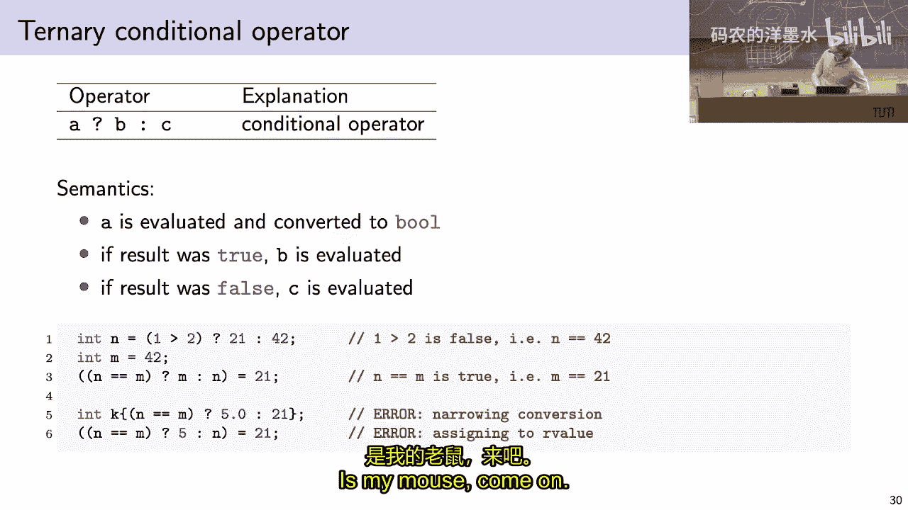
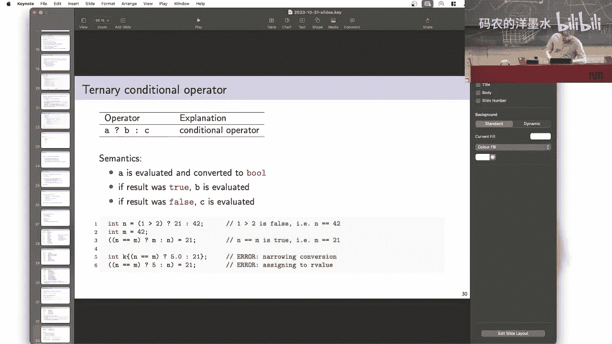
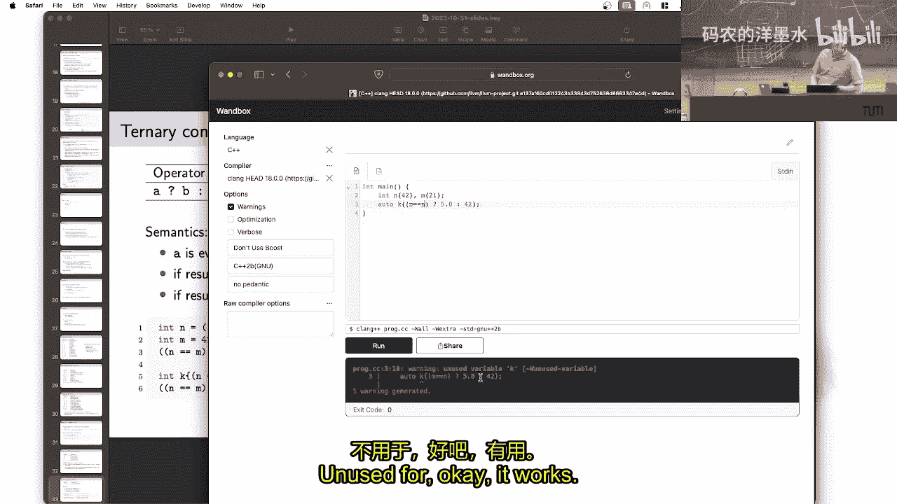
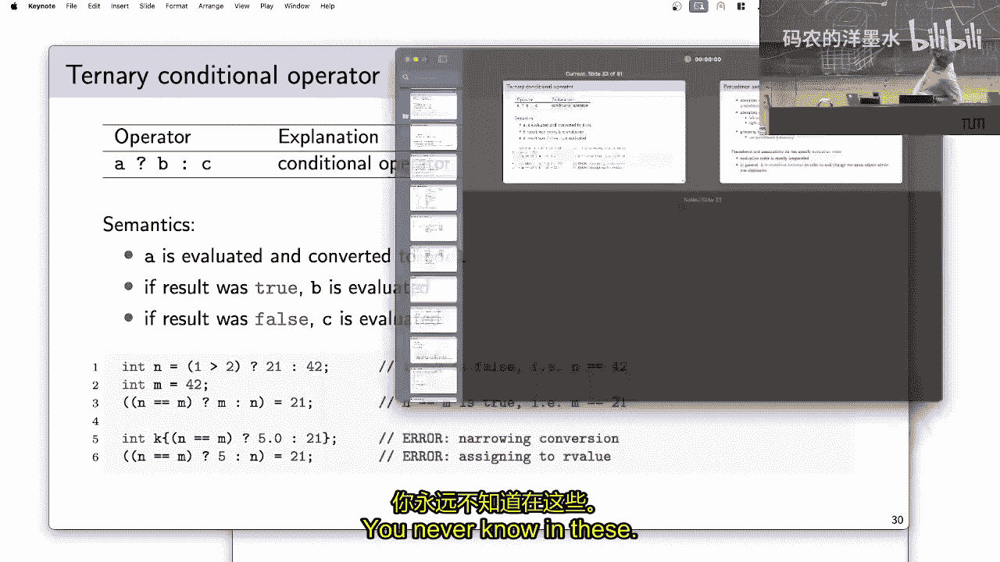
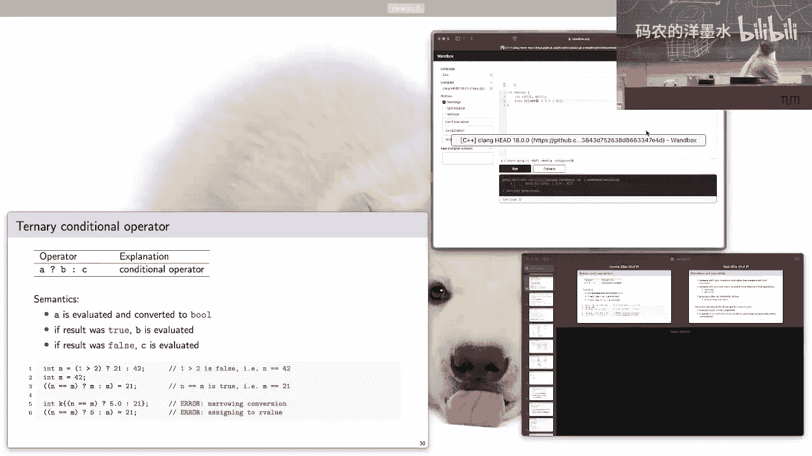
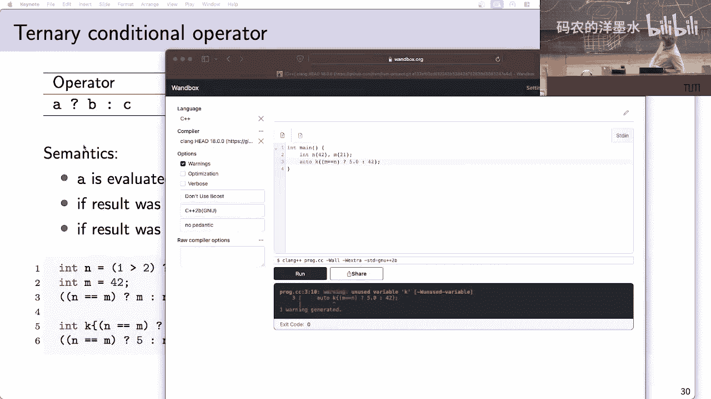
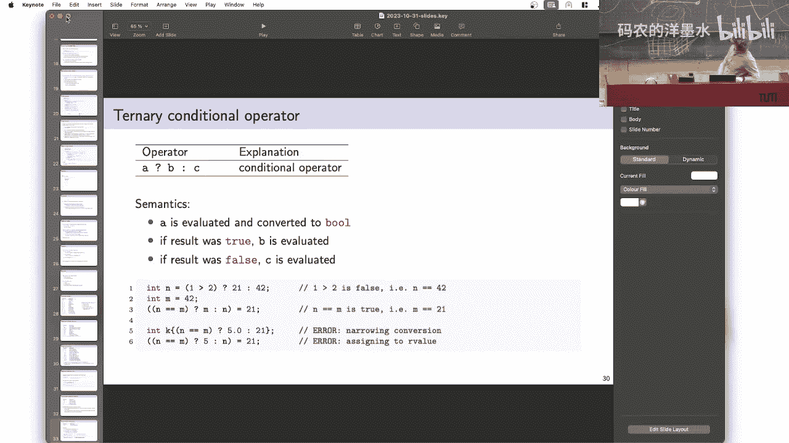
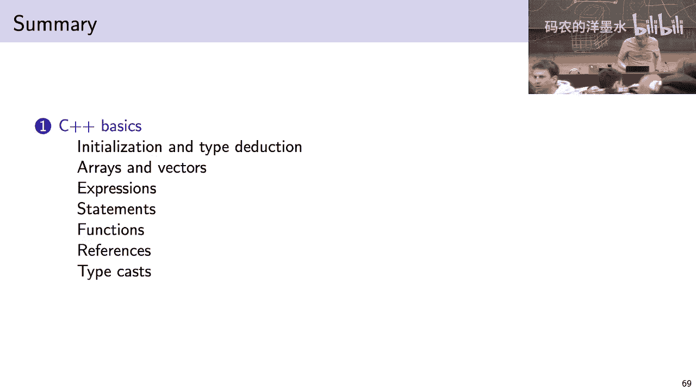

# C++编程概念：02：函数与内存基础 🧠

在本节课中，我们将要学习C++编程中的一些核心基础概念，包括变量的初始化、数组与向量的使用、表达式与运算符、控制流语句、函数定义与调用，以及引用和类型转换。这些内容是构建更复杂C++程序的基础。

上一节我们介绍了C++的基本类型和语言特性，本节中我们来看看如何更安全地初始化变量以及使用现代C++的容器。

## 初始化：安全与不安全的方式

在C++中，初始化变量有两种主要方式：使用花括号 `{}` 的安全初始化（称为统一初始化）和使用圆括号 `()` 的传统初始化。推荐使用统一初始化，因为它能防止意外的**窄化转换**。

**窄化转换**是指将一种类型的值转换为另一种类型时，可能丢失信息的转换。例如，将浮点数转换为整数会丢失小数部分。

```cpp
int a = 7.5; // 不安全：发生窄化转换，a 的值是 7
int b {7.5}; // 安全：编译器会报错，阻止窄化转换
int c (7.5); // 不安全：与传统赋值类似，c 的值是 7
```

如果你确实需要进行可能丢失信息的转换，应该使用显式的**类型转换**，这会让你的意图更清晰。

使用统一初始化还有一个好处：它可以用于初始化标准库容器和用户自定义类型（如 `struct`），功能更统一。

```cpp
std::vector<int> v1 {99}; // 创建一个包含一个元素 99 的向量
std::vector<int> v2 (99); // 创建一个包含 99 个元素（值均为0）的向量
```

对于未显式初始化的变量，其行为取决于其存储期。具有静态存储期的变量（如全局变量）会被默认初始化为零值；而局部变量则不会被初始化，直接使用其值是**未定义行为**。

## `auto` 关键字：类型推导

`auto` 关键字让编译器根据初始化表达式自动推导变量的类型。对于简单类型，显式写出类型可能更清晰。但在处理复杂类型（如迭代器、智能指针）时，`auto` 能极大简化代码并提高可读性。

```cpp
auto i = 42; // i 被推导为 int
auto c = 'a'; // c 被推导为 char

// 使用 auto 简化智能指针声明
auto uptr = std::make_unique<int>(); // 无需写出 std::unique_ptr<int>
```

如果你不确定 `auto` 推导出的类型，可以使用某些IDE的功能或库（如Boost.TypeIndex）来查看。

## 数组与向量：固定大小与动态大小

C++提供了两种主要的序列容器：固定大小的 `std::array` 和动态大小的 `std::vector`。**永远不要使用C风格数组**，因为它们不安全且功能有限。

`std::array` 的大小在编译时必须已知，并保证内存连续。它提供了安全的元素访问方法 `.at()` 和不进行边界检查但更快的 `[]` 运算符。

```cpp
#include <array>
std::array<int, 10> arr {}; // 包含10个默认初始化为0的int
arr.at(0) = 5; // 安全访问，会进行边界检查
arr[1] = 10;   // 快速访问，无边界检查
```

`std::vector` 的大小可以在运行时改变。它同样保证内存连续，但在扩容时可能需要重新分配内存和拷贝元素。如果事先知道大致大小，可以使用 `.reserve()` 来预分配空间以提高性能。

```cpp
#include <vector>
std::vector<int> vec; // 初始为空
vec.push_back(1); // 添加元素
vec.resize(5);    // 调整大小为5
```

遍历容器时，推荐使用**基于范围的for循环**，它更简洁、更安全。

```cpp
for (const auto& element : vec) {
    std::cout << element << '\n';
}
```

## 表达式、运算符与控制流

**表达式**由运算符和操作数组成，求值后会产生一个结果（可能带有副作用）。每个表达式都有**类型**和**值类别**。值类别主要分为**左值**（有标识符的对象，可出现在赋值左侧）和**右值**（临时值，通常出现在赋值右侧）。

C++提供了丰富的运算符，包括算术、逻辑、比较、赋值、递增/递减和三目运算符等。需要注意运算符的**优先级**和**结合性**，不确定时使用括号来明确求值顺序。

```cpp
int result = (2 + 3) * 4; // 使用括号明确优先级
```

控制流语句用于控制程序执行的路径，包括：
*   `if`/`else`：条件分支。
*   `switch`：多路分支（注意每个 `case` 后通常需要 `break`）。
*   `for`/`while`/`do-while`：循环。
*   现代 `for` 循环：基于范围的循环。















使用 `if` 和 `switch` 时，可以包含一个可选的初始化语句。

```cpp
if (auto it = vec.begin(); it != vec.end()) {
    // 使用 it
}
```

## 函数：定义、参数与返回

**函数**将一组语句封装起来，并赋予一个名称，以便在程序中多次调用。函数由返回类型、函数名、参数列表和函数体组成。

参数传递主要有两种方式：
*   **按值传递**：函数获得参数的副本，修改副本不影响原始数据。
*   **按引用传递**：函数获得参数的别名，通过别名修改数据会影响原始数据。

```cpp
void byValue(int x) { x = 10; } // 修改不影响外部
void byReference(int& x) { x = 10; } // 修改影响外部

int a = 5;
byValue(a); // a 仍然是 5
byReference(a); // a 变为 10
```

函数参数可以有**默认值**，但带有默认值的参数必须从参数列表的最右边开始连续出现。

```cpp
void print(int a, int b = 10, int c = 20) { /* ... */ }
print(1);     // 等效于 print(1, 10, 20)
print(1, 2);  // 等效于 print(1, 2, 20)
```

## 引用：变量的别名

**引用**是一个已存在变量的别名。一旦引用被初始化为某个变量的别名，就不能再改为其他变量的别名。通过引用修改变量，实际上修改的是原始变量。

主要分为两种引用：
*   **左值引用** (`T&`)：绑定到左值（有名字的对象）。
*   **右值引用** (`T&&`)：绑定到右值（临时对象），主要用于实现移动语义和完美转发，这是高级优化技术。

```cpp
int original = 42;
int& ref = original; // ref 是 original 的别名
ref = 100; // original 现在也是 100
```

引用必须在定义时初始化，并且不能为 `void`。引用本身不一定会占用存储空间。**不能创建引用的引用，也不能创建引用数组**。

需要特别注意：**绝不能返回局部变量的引用**，因为局部变量在函数结束后就被销毁，返回的引用将变成“悬垂引用”，导致未定义行为。

```cpp
int& badFunction() {
    int local = 10;
    return local; // 错误！返回了即将销毁的局部变量的引用
}
```

## 类型转换：`static_cast`

在C++中，应使用 `static_cast` 进行显式的、编译时检查的类型转换。它比C风格转换 `(type)value` 更安全，因为功能受限，且意图更明确。其他转换操作符（如 `reinterpret_cast`）应尽量避免使用。

```cpp
double d = 3.14;
int i = static_cast<int>(d); // 显式转换，i 的值为 3
```

使用 `static_cast` 可以消除函数重载时的歧义，或明确指示你接受可能的精度损失。

---



本节课中我们一起学习了C++中函数与内存的基础知识。我们了解了安全初始化的最佳实践、`auto`关键字的使用、现代容器`array`和`vector`的用法、表达式与控制流、函数的定义与参数传递机制，以及引用和类型转换的核心概念。掌握这些内容是编写正确、高效且现代的C++代码的关键。下一节课，我们将深入探讨面向对象编程的基石：类与对象。