# 【全集 2024版】慕尼黑工业大学 C++编程概念 IN2377 中英字幕 p03 Lecture 3 - 指针与引用 -BV1gDqwBmEuC_p3-

Test， I's tried， right。Test， I， right。T安。Right， so welcome everyone。

Welcome to the concept of C plus+ programming course。

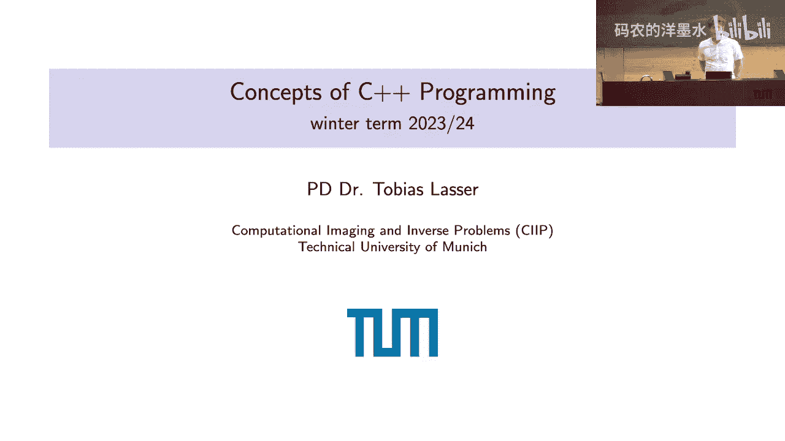

Right， so today we have another feedback session。This time， it's Z B4 B。

 Some of you have found it already。And sinceionas advised me of that from the exercises that he's prioritizing questions that are upvoted by you。

I also try to do the same。In order to have， yeah， the more relevant questions at the top so that I can answer them。

Right。So， without further ado。Today， we are getting to some more interesting things。

 The basics are out of the way。😊，We know how to。Do compilation。

 how to split our code and source and header files。 We know how to makes use C make。

Some of you are encountering your first linker issues。

Because of function signatures and namespaces and stuff like that。When in general。

 it seems like a lot of you are。Doing well， we have over 800 homework exhibitions last week。

 and I think 700 something of them passed， which is cool。Simple enough homeworks。And today。

 we're going to talk about a bit more interesting stuff。 So we talk about procedural programming。

Which N C plus+ means functions， return values， parameter passing， function overloading。

 and a few other things like funcctors and Lambda expressions。And， finally。

EWe spend a bit of time talking aboutarrow handling。So， let's start。Return types。

We all didn't know that。 He made a few examples。So you write down a function name。And before that。

 you specify the return type。Could be an integer。What you can also do。

 which doesnt known from some other languages， is you can also do a trailing return type。

 which is done the following day。 So something has to be in front of the。

 the function name that doesn't go away plus， plus backward compatibility。

So you have to write auto and then an arrow symbol as a minus and greater sign。

 And then you specify the type。This is the trailing return type。Which also works。Looks a bit weird。

 Maybe if you're more of a sea guy， if you come from different languages that do it like this。

 it might look more familiar， yes。So if you don't put auto with the trailing return type。

 the compiler will say， no， either you do the regular return type and you don't put auto。

Or you do the trail return type。 Then it requires auto in front。Right， so。

The real usefulness of this comes with templates。 So it wasn't。

More or less copied from other languages， but it came out of necessity that this was introduced。

Essentially， for example， if you have something like two template parameters， you're summing them up。

 assuming that there is some sum function for those two types。

 And then you don't know what the result of the sum is。

 So you can't specify this as a regular return type because then the arguments don't have a name yet。

But once the argument list is complete， you can use them in the trailing return type and basically say。

 oh， whatever the type is of the sum of x plus y， that should be the return type of this function。

So that's the main use case for trailing return types。We come to templates。

 So if you don't understand what's written there yet， don't worry。

 We'll get to generic programming and templates later on。

 This is just to motivate why trailing return types are there at all。Right。

So what you don't see here。It's how to return multiple values。 These are all one return value。

 However you specified in the front or in the back。So if you wanna return more than one value， Yeah。

 out of luck in C plus plus， that's no built in。Sport for doing this。But， we can。

Similulate that using some standard library types， namely S TD pair for returning a pair of values or S TD tople for returning。

An arbitrary number of values，1，2， many。Right。And。What you can then do that was also introduced in C plus 17 is use structured bindings。

 So basically， while it doesn't have first level language support， multiple return types。

 it does have some support。 and that is in form of structured bindings。 So how does this look like。

 Let's say we have a function food that returns a pair of an integer and a string。

 So this is essentially。A conglomerate of two types。

 in and string you created by calling STD Make pair。These are two。

 This is a type from the standard library。 This is a function from the standard library。

And you can do the same with a tablet if you wanna return3 or more。Types at once。

 And then what you can do when you call it the function is you can do these structured bindings。

 which are characterized by having the keyword auto。The parent feedus here。 So the brackets。And then。

 you list。The variables you wanna have there。 So if you're returning2， you should lift 2。

 if you're returning 3， you should lift 3。 And then basically。

 instead of having to decode the pair or the topple manually to get the first or the second element。

 you can。EYou can directly assign names to those parts of your return， return values。So， yeah。

 in general， this is useful for returning multiple values， but you can also use it otherwise。

 So in general， structured bindings allow you to bind multiple values in one statement。

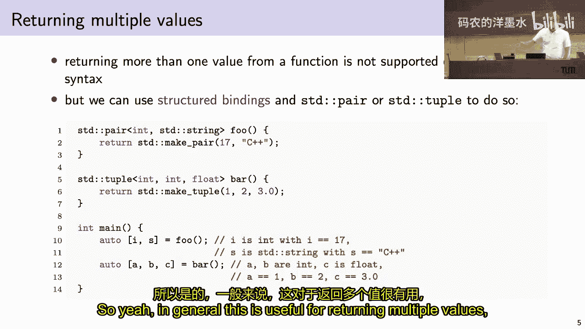

And this also works。For example， one of the， I think。More。Typical use cases you will have is。

 for example， iterating over a hash map， which is a map with keys and values。 So as a key。

 I'm choosing a string。And the value is an integer。Slightly weird， but why not。

 And then you can iterate over it using the range fall loop。 So you're iterating over the container。

 And for each element in the container， which is now a key value pair。Which。

Without that structured binding， you would have to store as a pair first and then use the pair to access the first。

 And the second element of the pair， you can now basically directly assign a to variables called key and value。

 for example。And as you can see， we can qualify the auto with a reference and a con if we want to。

 in order to avoid any unnecessary copies in this loop and then print the key values stored in this。

Hash map。Right。So this is another use for structured bindings。

And I think this is probably the most popular one。Oh。

 could you have this my Boo partition not connecting to wifi or ethernet。Cte support。Right。

 what else can you do with structured bindings， You can also bind members of astruct or of an array。

So you've seen the tract already， you can basically gather。

Several variables inside arestruct like this A and B。 You can even initialize them immediately。

And then you can basically also create a tract。And assign the elements of the tract to。

Different variables。Why would want to do that。Who knows？ I mean， in this simple example。

 it doesn't really make too much sense， but it's possible and the same is possible for a raise。

The note these are fixed size arrays。 This only works with fixed size arrays， because， of course。

 if you would use an STD vector， you don't know how many elements it has because it's variable。

 And then， of course， you can't decide at compile time how many variables you would need。

Contrary to other languages。The structured bindings don't support not giving a name to a variable。

 So in other languages， you might sort of supply an Andas score to say， oh。

 I don't care about the second variable。 So I don't want to give it a name。

 I just give it an And score， this doesn't work in C plus plus Well it works once because Andas core is a valid variable name but if you do it again or for a second variable that you don't care about。

Their compiler will complain because you're then trying to redefine the variable called Anna core。

Right， as we've seen， you can have qualifiers。 You can make references out of it。

 This would be a copy here because you would copy the values into X and Y。

 This here would create a reference to the values in that tract。

 So if you change anything in that tract， the value of the reference that we created via the structured bindings would。

 of course， also change。Or if you use the reference to change the value， then， of course。

 originalstruct value would also change。Right， if you have your own data type。That。

Has multiple components that you want to offer to use us via the structured bindings。

 This is possible。 You can do this also for your own data types， for your own classes orstructs。

 in order to do this， you need to implement a certain API， which looks very much like an SD Tple。

It's tiny bit complicated。 So I'm not showing it here。 and of course。I don't know。

 I've never done it before， never had the use case。 but if you do。

 I'm pretty sure you're able to look up the reference。

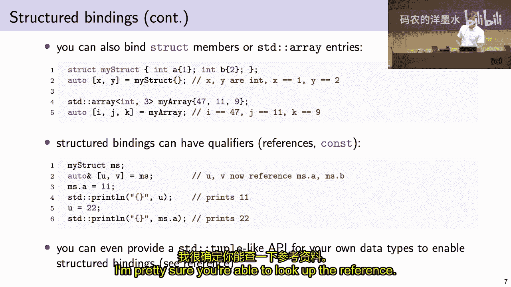

So。We know now how to return multiple values from a function。Via a pair or a tu of it。嗯。Okay。

 some fail in the slides here。So ignore that lower part for now。 And， of course， what is here。

 you have to specify the tapple all three types。 And then when you create the tapple。

Whether you already implicitly specify the types already。 So if you're。

If you don't want to specify that， you can just。Use auto as the return type of the function。

And then the compiler will automatically look at the return statement。

 deduce what kind of type is reduce is returned here in this function and use that type as the type return type for that function。

And as you've maybe read already， this is convenient for you because now the function is a lot shorter and easier to read if it's just such a one liner。

 But， of course， if you。Do this in the library。Where you maybe only give the head of file to the user。

 which contains only the declaration of the function。Yeah， but。

Then how is the user supposed to know what that function returns so。Use with care。

Some code it makes sense， and some code， it just creates unreadable code for the user。

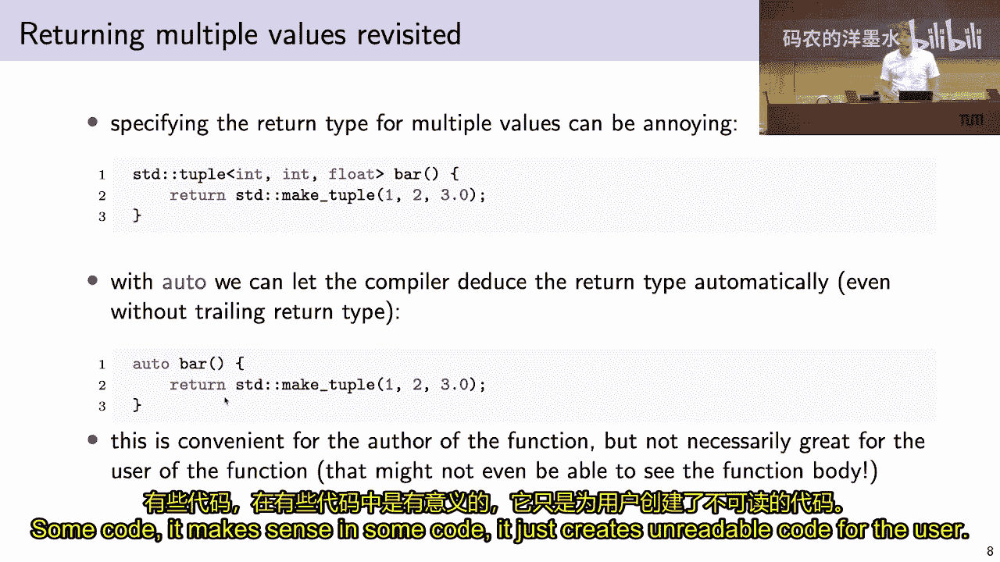

Right， so so much for function and return values。 The other thing we've seen parameters。

The thing we need to talk about here is how to pass those parameters。 One of them is by value。

 We've seen this quite a few times already。 We can also pass it by reference。

Which basically gives you an alias to an existing variable elsewhere so that it can change and modify it inside the function。

 and the change will be seen by the color of the function。Or you can do it by constant reference。

 which is basically the same， except that you disallow changing of the value inside the function。

Why would you do this？Because of performance。Because。This is the standard。

 If you don't care that the value。Is changed for the color， right。

 If you want the valued changing for the color， you use a reference。But this here creates a copy。

For an integer， a copy。It's negligible It doesn't matter。 But if this is something bigger。

 like an image that is  several gigabs big and that you don't want to copy。

 then a constant reference is very handy because that is basically just。

More or less a pointer or an alias。 and an alias is very efficient in terms of memory。

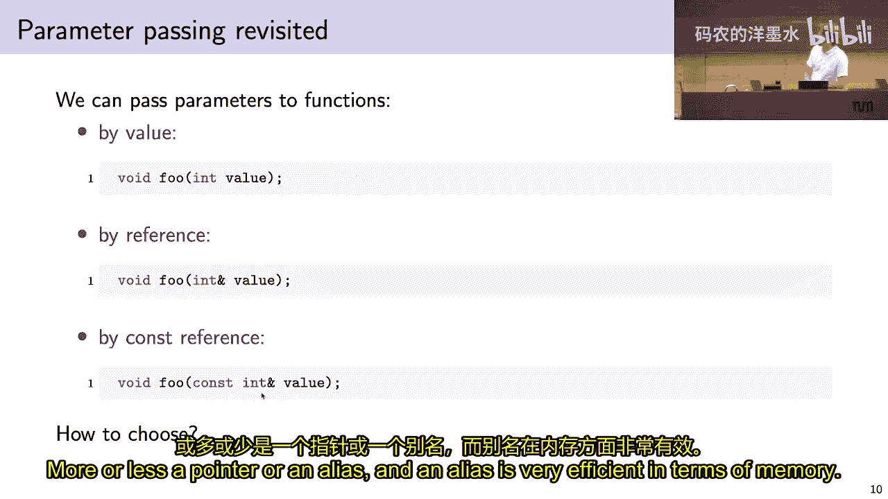

Right， how do you choose what to do？ And there is a very handy resource that I mentioned already。嗯。

The C plus+ core guidelines， which you should take a look at at some point。You can take the chance。

 of course， now or after the lecture or during the homework sessions， it's a very。

 very useful collection of guidelines， how to do modern C plus plus in a good way。

And this is written down by the C plus plus gods like B Strstr。 You know。

 the inventor of C plus plus Herb Sautter and other grades of the C++ community。So， and， of course。

 you can， it's on Github。 You can also， you know， propose your own additions or changes to those guidelines。

 So those guidelines。 This is where I copied that figure from。Basically， say。

 if you have a parameter。That just goes out of the function。 It doesn't come in。 The test goes out。

 rather then obviously， it's a return type。Right。So you return that parameter via the return type。

 If you have something that has to go in first and then you do something to it。

 and then it goes out again。Then that is naturally a reference without a con。

Because that's how it works， right？If you have something that goes in。But doesn't go out。

 Then you can take it by value。Or by constant reference。 And the difference basically is。

 if it's cheap。To copy or impossible to copy because some types can't be copied like unique pointer。

Then you do it by value。 Otherwise， you do it by cons reference in order to have it efficient。Right。

So。You don't need to look at this all the time。 In most of the cases， it's fairly obvious。

 Which one you use。 And in the verse case， you use by value。 And if you notice。

 that's maybe a ta slow or my memory usage goes up by a lot。

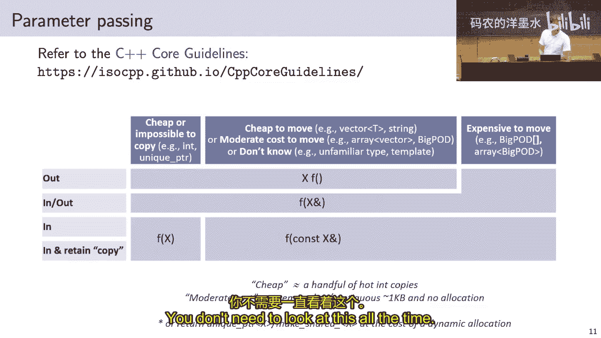

Or I wanted to change it to a reference anyway。 you will notice。

 So it's just a performance consideration in the end。

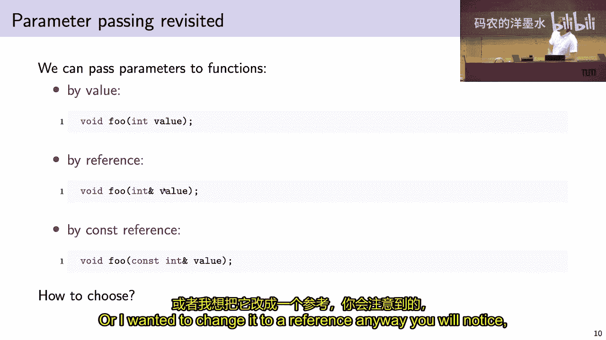

Right， there was a question。

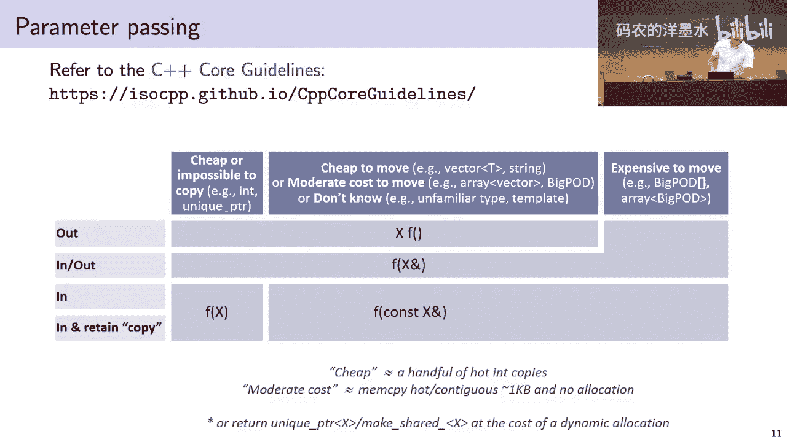

Okay， so the difference between a constant reference and a reference is that here inside the function。

 youre allow to change value。And once you return from the function。You call this with an argument。

 right， And basically， let's say you have a variable A， and then you call F。With variable A。

 And if it's a reference， that means value is now a reference for a。

 So any change you do to value or it happens to a。 So in your call context。

 A was modified after calling the function。If you have it as a con reference。

The function full is not allowed to change value。That's， that's the difference。

Which slide had a mistake and where。Let me know。 I'll fix it。

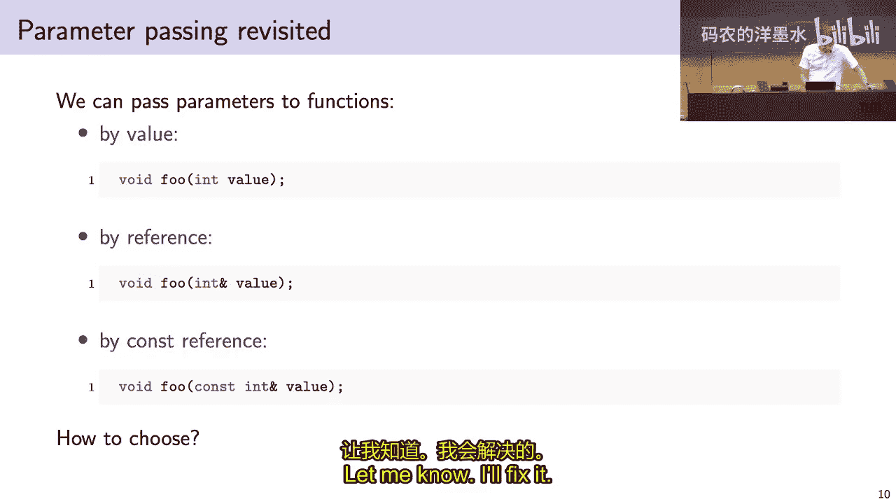

What are big P， O D。Big plain old data type。So。Let's say。

This thing you never use because it's a seat array so you can forget about it。 right， You remember。

 you should never use that。This is the better solution， doing an STD array of something that is big。

So you have many of these copies， and those are not necessarily cheap to move。 What is moving。

 you ask。Wait for。Two weeks。And then I'll explain to you what moving is。

 So you don't need to understand this。

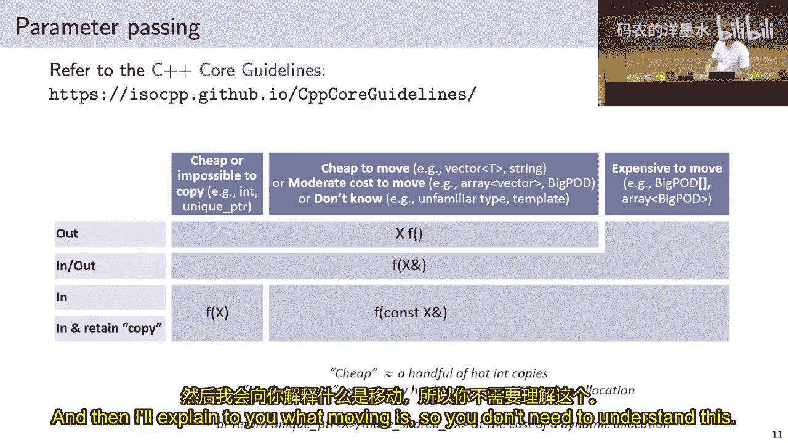

Graphic completely， but just be aware， theres basically three types of passing parameters and。

Go by value， by default。 And if you need something else。Go by one of the others， yes。

Because they are cheap to move。So a vector internally。 So the question is。

 why is a vector cheap to move that's in the table here。

 So a vector is storing something on the heap。 The vector itself is just basically the pointer to the heap。

 the size and maybe some other control parameters。 So moving that is copying the pointer essentially to the new object then copying the control stuff like size and maybe currently allocated memory and so on。

 So this is cheap to move。😊。

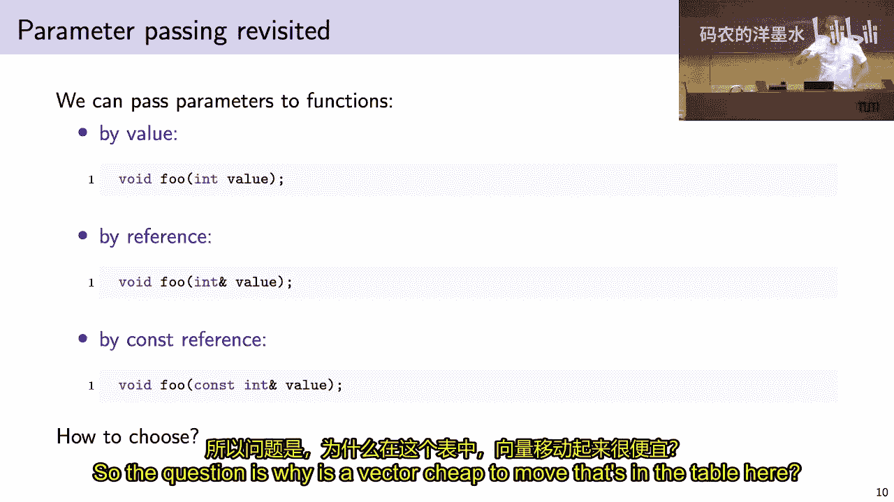

An SDD array is actually storing the stuff。 So you would have to actually to move all the stuff youre storing。

But since the vector is essentially just。Wrap her around around the pointer to the heap。

 It's cheap to move。And if you didn't understand anything of what I just said。Don't worry。

 It will become clear in the following weeks。

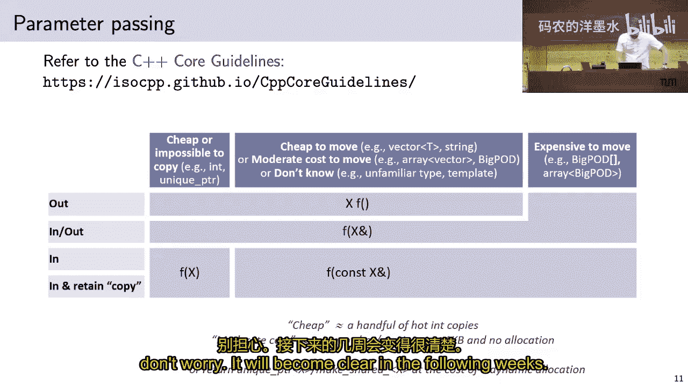

Right， summarize guidelines as a set。Just pass it by value。 or if it's。Expensive to copy。

 pass it by con reference。 So a string。Well， depends on string could be an entire book。

 So maybe a bit expensive to copy could be a short word of four characters would be cheap to copy。

So to be safe， you could do a con reference。You could also pass it。By value。

And it might not matter much。 If you don't care about performance and memory。

 then it doesn't matter at all， anyway。Yes。😊，That。Those are our value references which we talk about later when we talk about moving。

So they will come， don't worry。Right， for integer。You pass it by value。

 constant reference to an integer doesn't make any sense because an integer is typically 32 or 60 for bit。

 And a reference most current architectures a 60 for bit， so。Nothing gained。 Nothing lost， but。

Just makes the users scratch ahead and say， why the heck would you do that。Right。

 in anything that goes in and out， that's a reference， obviously and out， you return it。

 Or if it's multiple values and return it via pair or topples and maybe use structured binding to access them。

 yes。So if you don't know what is cheap to move or cheap to copy。Don't worry， Use by value。

And you would be fine。If then later on， you find out your application is slow or you're using too much memory。

 Then you can profile or get some idea。 It It comes by experience。 I would say， so at the beginning。

 you don't have to worry。 And let me repeat one of。Michael Abbrash principles。

At least that Michael Abbers the first guy I actually heard it from。嗯。

Don't waste your time on premature optimization。Yes， you're using Z plus。

 You're probably using it before because you care about performance。

If you don't care about performance， you'd probably be better off using。Python。

 jascript or some scripting language， right， So you're using it for a reason， right， but still。

Write your code first， Write it nice， Write it maintainable， easy to understand。

 And then if you notice performance isn't good enough。

 then you can still optimize the relevant parts。 You don't need to optimize everything。

Most of the code。Its 80%。 performance doesn't matter。 And in the 20% where it matters。

 the A U A should spend the effort。 Don't spend it elsewhere。 It's wasted effort。

Hows the pan doing quite well。In use everyday。Right。Function overload。 Now we come to the。

Nice part of C plus plus， Or you can hate it。 I actually like it because what you can do is you can overload functions so it can use a function of the same name with a different amount of parameters。

😊，And they will be different。So if you have a， a function F。With an integer as an argument。

 that's one function。 If you have a function F of a double as an argument， that's another function。

 It's not the same。And the resolution between which one to call。 And if you actually invoke this F。

 this is what we call overload resolution。And yeah， essentially， what the compiler does， it looks。

Which functions are there in the current scope， checks the arguments。

 which which you're calling it and which candidates are there and finds the best match。

If there's no best match。Or if there's an ambiguous match， the compiler will said， hey， you idiot。

 you made a mistake。Yes。So what we'll get to in a few slides is the overload resolution only takes place via the arguments。

 The return type doesn't factor into this。Okay， so the question is。

 what happens with auto return types。

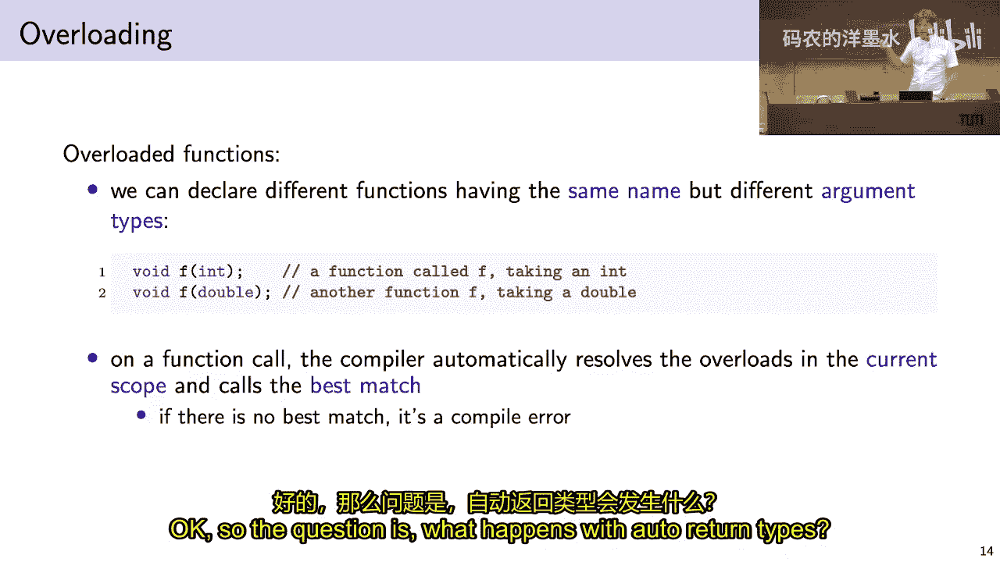

So let's go back to the slide with the auto return type like here， for example。

The thing is it's not a。So this time， it's a bit earlier， I think last time， last two weeks。

 it was always 12 minutes later or 14。 So either somebody is playing a joke or the。

Stuff isn't working properly。 Hol on， I'll change one thing。How about no， Okay， I'm back。

Let's see if this changes things， so。Right， so the auto return type is not something dynamic。

Doesn't change with different invocations of the function。 It's at compile time。

 decided at compile time when the compiler sees。The return statement。 And then that type is。

The returns is the return type。So just because it's auto， it doesn't change dynamically。

So if you have an if statement， for example， here that you return different types。

 depending on some condition， that doesn't work。Needs to be a fixed type。

 It's just a convenience notation。Doesn't change anything logically。

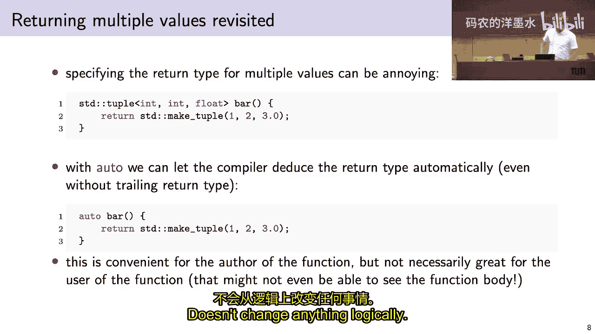

Right， so what are the criteria for overload overload resolution。嗯。It's an exact match。

So F with an int is called F with an int as an argument， but that's easy。

Or constant that would also be a trivial conversion。 You can do promotions， which mean you can。

 for example， expand a bull to an integer or a flow to a double or a short to an int， you know。

 these things where nothing gets lost。Then it tries to do a match using standard conversions。

And these conversions can be la C。 As you can see， into double might be losing precision。

 double to int is definitely losing precision。And so on and so on。

You can have user defined conversion operators， which we'll get to later。You can have ellipsis。

 which we also get to later。 But yeah， this is essentially the order。 And if none of these works。

 the compiler will say， no。ItSo example。Print function。 And you have four of them，1 for ins。

1 for double， one for long， one for char。Right？So now I have a function F that's calling these print functions。

4 various things here。 So， for example， I call it with a char。 Then obviously。

 I have an exactec match for the print with a char function。 So that is called。

Here I have an exactec match for the integer one。Here， I'm calling it with a short。

There is no exactec match for short。But the。Most easy promotion from short of to int so that the int version will be called。

And the same happens if you call it with a float， then it will promote it to a double。

And that is the one that's being called。Same happens if you do literates。 This is a character lit。

 or you'd call it the Qar version。 an integer lital integer lit， or you call it the inversions。

 This is a long int literate， or you call it the long inversion。Right。Another example。

A bit more complex。 Ha ha this complex numbers from the standard library。 And you see here。

 I'm using an alias for complex because I wanted to make the code in the slide shorter。

I usually dislike doing that because now I have complex types here。And I can no longer be sure。

Because， for example， I'm often writing code that that's linear algebra or analysis stuff。

 so math things。Also this complex numbers。 And sometimes I have my own。Complex types。In my namespace。

 So I'm no longer sure which complex type this is here。But yeah， for this short code in a bit。

 it's still okay。But that's why I mis these using namespace。

 S TD statements or these using things here。 It's just for clarity here。So， I have power functions。

Integer to a power of an integer， double to a double， double complex， and so on and so on。

And now there's a few interesting cases， right， So in int matches to int int W， W to w， W， W complex。

2 double complex， no surprises here。What's interesting here。Here we have a table。And an int。

But there is no such thing。So what could happen now。

 it could try to convert the double to an int and call it the int int version。

Or it could try to convert the end here to a double。And call the AW version。Both are valid。

 Both are at the same stage。And that means。The compiler would say， no。

 I don't know which function to call here。 If you want to make sure which one to call。

You have to make a cast and cast either this one to an int or cast this one to a double so that I can pick either this one or the other one。

Right， and coming to the topic previously mentioned the return type。Doesn't matter for overloads。Why。

Because that would make function calls context dependent。So， let's say， we have。

Square root functions for floats and doublets。 So different accuracy Yes， obviously， right。

 So we have different implementations。And。If I call。Square root with a double argument。

 but store the result in a float。If the return。Type would participate in overload resolution。

 This call here would be ambiguous。Or if I do the same thing with auto instead of float。

 So what you would expect and what actually happens is that overload resolution only cares about the argument。

 So the double version is called。 And here the double is stored in a float。

 There's an implicit narrowing。 That's why there's an equal sign and not the universal unitization here because that would give you an error。

😊，An auto would obviously pick double as the type of D。Right， and then， of course。

 you can play the same game with the float version and float and double。Things very historic。So。

 yeah， this is fairly。Easy to see why the return type doesn't participate in overload resolution。

Sometimes you will curse this。But， in general。It's the reasonable way to do things。

Why does the I D E always suggest that I do something。嗯。This is actually not your IdeE。

 but it's clang tidy that's running in the background。 We have the Kang D server language server。

And this can be done in any editor that's reasonable， including V I or Eex， for example。

And why is it suggesting to use and place back instead of pushback。Push back。So obviously。

 you're talking about an FD vector doing stuff to it， adding an element to the back。

If you do pushback， the argument is copied and stored in the vector。 If you do in place back。

The argument is directly constructed in the vector storage。What's the difference， One copy less。

So it's a bit of an optimization。But， keep in mind。You're fine doing pushbacks。

 And if you're doing something that's performance critical and that's happening in a loop。

You will notice that you might want to do it more efficiently， and then you can do it in place back。

 But following these clk tidy。Suggestions is a good way of doing things。And incidentally。

 you will see。

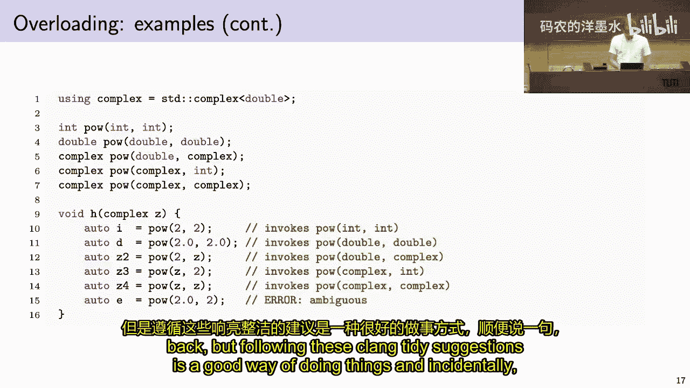

A lot of dec tidy suggestions come from these C plus core guidelines。So in a way。

 if you use clang tidy automatically in your IE。You're reading those core guidelines。

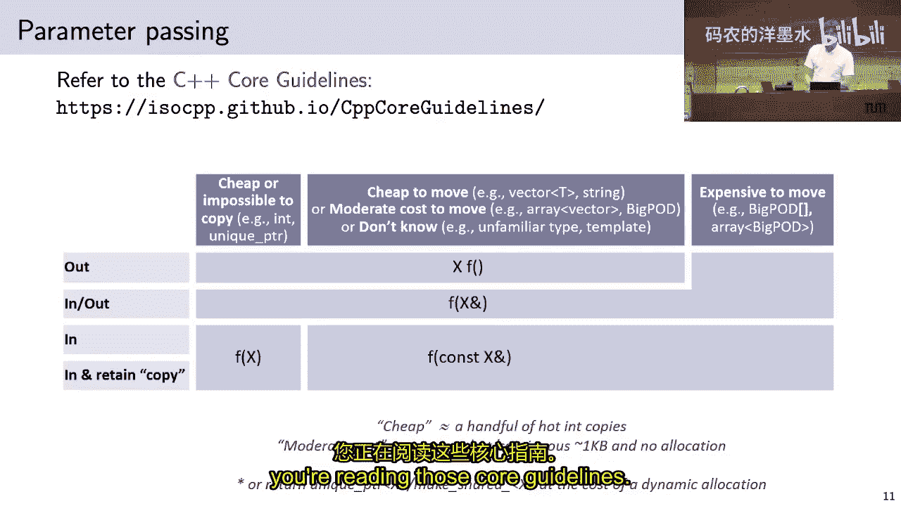

And you're following them。Right。Do overloaded parameters work as trading return types， yes。

Because trailing return types don't return types don't participate in overloading。 And， of course。

 how you specify the return type doesn't matter。Right。

So now we come to the more interesting part of today。Namely， function objects。

So we've seen regular functions， how to return stuff from there， how to pass arguments。

 how to overload them。What we talk about now are function objects。So， one thing， first。

A regular function in C plus+ is not an object。It's just。A piece of code where it can。

 which you can call。And effectively， this is usually。

Pushing some arguments into registers or the stack， and then jumping to a particular address。

 Storing the return address in the stack and then going back to that return address。 right。

 So that's what functions do。 They are not objects。 They don't have a state。

They don't have a memory location， per。That also means you can't pass them as parameters。

Because you only can pass actual objects as parameters。And they can't have state。Now， you can ask。

But I've seen functions with state。Yes， you can simulate it by using static variables inside a function。

An aesthetic variable will be in static storage duration。

 meaning it lifts for the entire duration of the program。So that way， you can simulate state。

 but the function itself doesn't have the state。 You would just simulate it using other means。

And the other thing you might say， oh， I've seen code。 Mia function is passed as an argument。Yes。

But what actually happened in that code was that he created a function object， a fun tour。

Using that function as the thing to call。So there are function objects， obviously。

 And you can also call them fun， if you want。And essentially， anything can be a function object。

As long as it's an object and as long as it defines an operator。There's two parenthesis。

 so a calling operator。And these kind of function objects。They can be used like function。

 meaning you can call them。 You can say， okay， I'm calling you with these in these parameters。

 and I may store the result that you return。嗯。Yeah。As an example。Here's astruct。And as I mentioned。

 already， abstract cannot only aggregate data。Like variables can also have functions。As members。

So here is a particular special function， namely the operator， the calling operator。

Buthich you can specify it to take one argument， an integer and return an integer。

 It's up to you what the arguments and the return type are。And it does something。

And then you can instantiateate this tract。 So now you have an object。Of type editor。

 called my editorer。You can store a value in there。If you want to change the standard in itsization。

 and now we can invoke the operator， the calling operator by doing the call syntax here。

So this is implicitly invoking the operator with the brackets。But the argument one。

 and I'm ignoring the result because I'm not storing it anywhere。 Why not。And then I can do it again。

 can change the value。 I can do it again。 And this way。

 you have a function object that can store a state， but you can use it like a function。😊，Right。

There's also a standard library type called S TD function， which is used。

To wrap and pass around something that you can call。 So basically， anything that has this operator。

 this calling operator implemented， or， of course， a regular function。Right。

 it's defined in the functional header， and you can use it like this。You can， for example。

 define a regular function。Like this。 simple one that adds 3 to its argument and returns that value。

And then it can store it inside such an SDD function。Give it a name。

 And then you have a function object。However， it's not the actual function itself。 That is an object。

 That is still true。 Functions in C plus are not an object。

But you have an object of type SD function that's storing。The function。

And now we can use it like a function。 So it can call adder with an argument and use it to initialize a variable。

Or you can store it again and make it a bit more explicit that this function is returning an integer and taking an integer as an argument。

😊，So， the。Yeah， the function type， if you wna declare it explicitly， is given as return type。

 parent thesesis， argumentalist parenthesesis is closed， but usually you don't have to。

 because theres deduction guides for SD function， which we talk about when we talk about templates。

In a bit more detail。That make these unnecessary。 So this kind of stuff here works。Already。

One thing to note here is that this is a raper。It's an object。 So what does this object do？

It essentially stores。A reference or a pointer to the thing that you called。In case of。

A regular pus function。 That's an address that it stores。

In case of a function object that has a call operator。It stores a reference to that object。

 and then does。The call。That's overhead。In terms of memory， because you need to store。

That address or that reference somewhere。So， SD function has。Memory requirements， not a lot of it。

 but there is some memory requirement。And。If you call a function， we are this ST TD function。

 So like this error call here。First goes into the call operator of STTD function。

Which then redirects the actual call to the callable object。 So there's one indirection。

Involved in doing such a call。For this。You don't care。Instead of two call， instead of one call。

 it's two calls。 So what the heck you don't mind if you're doing a billion calls in a hot loop。

You might care。So if you're doing a hot loop and calling S TD functions all the time。

 you might want to refactor your design to remove that indirect。But then again， this is。

Something that's kind of common in C， plus， plus。If you're using it， there might be an overhead。

 So you have to be aware of it。 But if you're not using it， you don't incur that overhead。

What happens if Tra has multiple operators。 So I presume you mean if there has multiple calling operators。

Like， where are we。Like here， you could have a second calling operator。

 You can overload either the call operator。For example， taking two intetro parameters。

Could be a second overload。And then it's regular overload resolution also for these call operators。

They have a special syntax in how you declare them。 So the keyword operator needs to be there。

 And then the symbol of what operator youre。Implementing， but otherwise。

 they are just regular functions， or they act like regular functions。Right， here's another example。

Regular function。That's some stupid stuff。Astruct with a calling operator that does the same stupid stuff。

You can use both。F， a function object。And you can store it in an STD function and then use that function object to call it。

In both cases， it works。And what you can also do。If you can also do fix the parameter to to a particular value if you want to。

 probably you won't do this with a one argument function。

 but you might do it with two or three argument functions where the last one。

 you don't care or want to fix to a default value。This you can do using STD bind。

 And the result of ST TD bind basically takes this function object， fixes。The parameter。

 and you can then store the result in an SD function in here。 Unfortunately。

 the deuction guides fail you， and you have to explicitly。

Specify the type of function that you will get。 namely。

 a function that returns nothing and takes no argument。 And then you can call that function。

Are function pointers used N C plus+。Essentially。No。So， internally， yes。But essentially。

 but the main idea is SD function。Is。A wrapper for a function pointer。 that's just as efficient。

It's sameme interactiondirection， same memory cost。

And is's safer to use and actually even more comfortable to use， too。So no。

 you don't need function pointers。Any more。 But they are there。

 You can find them in C plus plus code， particularly in non modern C plus plus code。Death operator。

 the coding operator， need a semico。No。So if you define a function like this。

 you also don't add a semicolon at the back。 And the same is true for functions defined inside a truck。

 you don't need to have a semicolon at the back。 In fact， if you do， it's a syntax error。Yes。Yes。

 of course。Because you are storing it in an SDD function， and that is the indirect。Why is C+ so ugly。

Good question。嗯。It's just how it is。I mean， it grew out of sea。

 so it inherits any ugliness that sea has。And its main focus is on back compatibility。

 So it's backward comp to most of sea。95% maybe or so。And it's， of course。

 backwards compatible to the C plus version from 30 years ago。That's just how it is。

And let's say it like this， are the new additions that are coming with the new standards， between 17。

2023 and upcoming 26， They're not making it easier。

 And most of them don't make it any prettier either。That's why there are things like rust。

 carbon and all these things that are trying to do C plus better。And potentially， neitherr。

But then again， I have to say， if you look at rust code。Is it really nicer。Less ugly。I don't know。

 I mean， it's code。Has a certain syntax。 And yeah。It's just how it is。You could do cobal or forron。

Right。I call back functions also factorss， Most likely， yes。So， of course。Yes。

 they have function objects in a way because you need to store them somewhere and then call something that is callable。

What's the difference between printum in line 12 and line 16。The difference is。The first one。呃。

Creates a function object out of a real C plus plus function。

The second one creates a function object out of a truck that has a call operator。

So this is a funture created from a function。 This is a funture created from a fanctor。

But the thing is， S D function takes all of these and uses them in the same way。Templates。

We talk about templates。In a bit， but essentially， they are there for generic programming and doing magic like template me programming。

We talk about this。Right。So now， to the fun part。Now that we know what function objects are in C plus。

 there's another way of doing function objects。 They got introduced in C plus plus 11。

And expanded in C plus 14，17。 And I think a few minor changes were done in 20 and 23。

But the main thing， it's a modern C plus feature and any code where you see alumna expression。

Is most likely， at least C plus 11。Or higher。So what are Lada expressions。

 they are essentially anonymous function objects。And they count as an expression。

 If Remember last week， we talked about statements， expressions， and so on。And essentially。

 a Lada expression is， as the name says， an expression。

 And you can use them anywhere where an expression is allowed。One of the。

Favorite examples is calling a standard。Library algorithm。

 like find an object in a container that fulfills a certain condition。So， find if。

So you specify your container range。 So container begin container。 and it could also be。

A part of the container， if you only want to look at part， but that doesn't matter here。

 The interesting part is how do you specify the condition and that you can do using an an anonymous function object。

 which is defined like this C plus， plus， you have the square brackets。😊，Argument list。Function。

 object body， where you can do any kind of code。Of course。😊，You have。

Plenty of ways how to do these things。嗯。And other languages， of course， other have them。

 and C plus has copied it from them。 And， you know。

 there's a quite a lot of exchange between programming languages。

 particularly the ones that are old and that keep developing。

 They keep adding stuff that other languages have。And the other way around。Right。

So a function object。So it' such an anonymous function object。 We call it a closure。

 That's something you never actually see， but that is there。And this closure as an object。

That can contain。Variables or references， depending on what you do in the capture list。

 and the capture list is this。This thing here in the front， which we talk about in a few slides。

So in general， how does the Lada expression look like， capture list in square brackets。

 parameter list in regular brackets， Traing return type notation and for Lada expression death no other way。

 You can't have the return type in the front。 It doesn't work。

 It's a new syntax that was introduced in 2011。So the only way to specify a return type is by using this trailing return type notation。

 and then you can have a function body。The actual return type， trailing return type is optional。

 You don't need to have it。 If you drop it， the compiler will automatically try to deduce the return type from your return statement。

 like in regular functions where you use auto as the return type。You can have the capture lift empty。

 You can have the parameter lift empty， and you can have the body empty。And， in fact。

If the parameter list is empty， T， you are allowed to drop it completely。

 So the shortest Lada expression is this。So。2 collections of opening and closing brackets。

Square and curly brackets。Rus look， Ru looks beautiful unless it doesn't。

I think that's a good way to summarize almost every language。They' have beautiful examples。

And Ru has quite a few beautiful examples， where it's cool。But some stuff is not beautiful。And。

 of course， you can find a lot of examples where rust is more beautiful or。Easier， easier to read。

 easier to understand， maybe even more efficient， maybe more safe。 fancy， plus， plus。But then again。

 you can find this for every language pair。Oh my God， this is like jascript。 I don't do jascript。

 so I don't know。Right， so let's see a few examples of Lada expressions。For example。

Let's write a function that detects if a certain number is a multiple of three and then returns true of false。

So I have an argument that I do the remainder division with remainder by 3。

 And if the remainder is 0， I return true because then it's a multiple of three。Now。

 I have a vector of numbers。Whatever numbers。And I'm calling the remove if algorithm from the standard library that basically removes an element from the vector or all elements from the vector。

That fulfilled this condition。And this condition， I can specify。The name of that function。And now。

 if you paid attention to earlier， you should scratch your head and say。

But we in regular plus functions， not function objects。 So I can't pass them as。

An argument like this。You're right。 Strly speaking， you shouldn't be able to。But this is Cplus。

 so you can。 An exception。 What is essentially done is that the address of this function is passed here along to the remove if。

 and it has a particular overload that can deal with this case。However， what you see already here。

 it's basically， if you want to do this remove， if you have to write a function somewhere else。

Outside of the function you' are currently implementing。

Because you can't nest functions inside functions in C plus plus。

So doing something like this is a pain in the ass because you need to navigate your code， go outside。

 do the function， and then refer to it。So this is a lot more convenient if you specify an anonymous function。

 namely a Lada expression that does the same thing。😊，Shorter。

And in place right there where you need it。 So you didnt don't need to guess what this function does。

The name might be good truth chosen well。 And it you probably have an idea what it does。

 But here you see it straight away。Functionally， there's no difference。Efficiency wise。

 there's no difference。But这 is。Niceer to read。Right， you can store numbers。Lambdas， Lamers， Ladas。

Invaris。And the easiest way to do this is use type auto。Because what is the Lada expression。

 it is the closure， it's an object。A closure object。But the type of it is anonymous。

 Only the compiler knows it。 You can't carry it。 and you also can't write it down。

 So that's actually the only way to store a lambda。 You can't write down the type of a Lada。

 So that's why you have to use auto。But， of course， internally， the compileilable replaces by。

Some whatever name it generates for this particular Lada expression。And then once it's stored。

 you can call it like any other function object。Of course， you can also store it in an SD function。

Same way， essentially， just a bit longer to type。 So instead of auto， you write S T T function。

 and you can use it the same way。 No difference。There's a difference in performance though。

Because SDD function is this one indirection。Where is here。

 the Lada is stored directly without an indirection。But both of them broke。And if you want to。

 you can state the signature explicitly return type arguments。 and yeah。

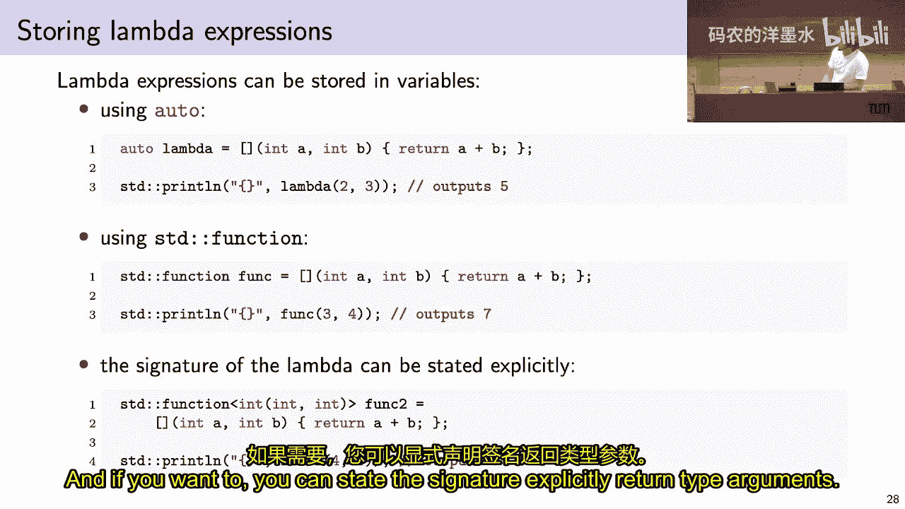

Right， so as I mentioned already， alumda expression generates a closure， but the type of the closure。

You can't access it。It's there。 The compiler knows it internally， but you can't access it。

And that means。Whenever you create a lambda like this。It has its own unique closure type。

 And if you create another lambda， even if it looks exactly the same like this。

It gets a different closure type。And that means this particular function here won't work。

Because this return type。Its one type Lambda expression， internal thing， whatever it want。

And this is， I'm the expression into anything， number 2。They are different。

 even though they do the same and look the same。 And that means these two return statements have different types。

 And that means auto as a return type doesn't work。 The compiler would say。

I don't know what you actually wanted。Right。Yeah， so， in fact， what I already said is here inverts。

 the compiler generates a unique closure class。 Theres a constructor to set up。

Captureists and a calling operator that that's the actual execution of the function body。

You could do this yourself。 like in the previous example here， right， You didn't need a lambda here。

 You could do this yourself， but it's just more convenient。And the interesting thing is。

It's just a convenience feature。 It doesn't really change the game。 But in the end。

 it did change the game because it allowed。Way more nice code to be written。

 So Ladanas were actually one of the big， big features of C plus plus C1。

Would my funk work if the return type would be an ST TD function， yes。

This only doesn't work because auto tries to automatically deuce the type。

 but both of them can be stored in an STD function。And then SDD function as a return type would be。

The option， how you can make it work。 Very good。Right。嗯。The return type， as I mentioned， already。

 the compilability de it from the return statement。 So if you do no return statement。

 it has void return type。 If you do a return integer statement， integeracy return type。

If you do stupid stuff like returning an int or a W， the compiler will say， oh。

 I can't induce the type。In those cases， you can specify an explicit return type with the trading return type notation。

 and then the compiler will automatically convert this double to integer。Right。

 so let's briefly talk about the capture list， because I mentioned it a few times。

 but we didn't talk about it。So what you can do。 So each Lada creates a closure class。

 and this closure class can have a state。 And the way you fill that state is via the capture list。😊。

Why would you want to do that， Because it's an anonymous function。

 You can even pass it around into different scopes and contexts。

And youna want might want to capture some of the local scopes variables。

Like the value of a certain variable， you can capture this。

You can even capture this pointer to refer to an entire object。 What is this pointer。 Don't ask me。

 we will get to this。Next week， I guess。Maybe week after that， I don't remember。And basically。

 capture can be done in two ways by doing a copy。It's like a function argument， passing by value。

Or you can do it by reference。Like， you can do a function argument by reference。And essentially。

 if you look at the code that the compiler internally generates， of course。

 you can't easily look at that。 But if you would be able to。

 you would see that each Lada creates such a closer class， a constructor。 And in this constructor。

 any capture would be initializing a member variable that's either。😊，Of the same type。

 if you copy it or a reference to that type， if we create a reference。

 this would be done in the constructor， and the calling operator would then execute the body。Right。

So how does this work？嗯。Here' has a variable eye。Here's a Lada function that capture us I by value。

So whenever， so now we store this Lambda in the named Lambda 1。And what it does it outputs。

The value of I。So what you can do now。If you can call it this Lada function。Here in this scope。

 or you can pass it out of that scope and call it elsewhere。

 But it will still know what the value of I is because he captured it by value。If you try to change。

Cture that he captured it by value。 The compiler will say no， because he captured it by value。

 So it's read only。So you can't change the value。 If you want to change it。

 you have to capture it by reference。 And， of course， if you capture it by reference， what happens。

 you have a reference on an alias to the original variable I。

 So if you do this increment here and actually call it the Lada。

Then the0 would be incremented by one。 So the output will be one。And， of course， what can happen now。

 you can do really stupid stuff like you can。Pass back a Lada that captures a reference to a local variable of that function。

So you return from the function， all the local variables get destroyed。

But that Lada still has a reference to that variable that no longer exists。

This is what we call a dangling reference。And， of course。

 what will happen if you call it this particular Lada after G has finished executing。It's undefined。

So essentially， what this is trying to do is will access a memory location that might already belong to another process。

 So your program might just be killed。Seec for it， for example。Or。

That J location where J was stored is now used for a different variable。

 And you might suddenly change this variable， even though it doesn't look like it。

 So it's undefined behavior。And it's very hard to debug。The good thing is。

All reasonable compilers will warn you about doing this stuff。

 And if the compiler doesn't catch it most likely they clang tidy will so use clang tidy。

 It's a good thing。Right。Yeah。Yeah， because implicitly， what happens if you do it by copy， it's。

 it's a constant value that you get in your closure class and that is not allowed to be changed。

So if you want to use it kind of as a local variable。

 you have to actually declare a local variable in the function body。

So the capture is not intended to be used as local variables。Right， and， of course。

 the usual stuff with copy and aliasing applies， so。If one lambda captures this I。

 which has a value of 42 by。Copy。Then it will have。I。

 with the current value that it had when you created the copy 42， So it will return 84。

 if you call it。This here stores it as reference。 So if you change the I。

 even after you create the Lada。And then call it。The new value of I will be used because's， it's。

 it's an alias to the other value。Why capture if you can chef pass as a parameter。 Good question。

Depends on your logic。Maybe a capture is。More suitable。Maybe not。So of course。

 you can do essentially the same as a parameter。 You can pass the parameter by reference。

 you can pass it as a value。So， yeah， there's a certain redundancy there。 But the difference is。

Of course， that the capture。Is there in the closure object。

 So it's there for every invocation of the Lada。 So if you call it several times。

The captureists still there。For the parameter， this might change with every invocation of the Lada。

So in most cases， it will be pretty clear。If it's a capture or。A parameter。Right。

That's default captures。You can capture everything in your context by copy， with an equal sign。

Or everything by reference， with the emen sign。You can still add things to the list if you do that。

 But the only thing you can do is you say can say， oh， I capture everything by reference。

 except the variable I that I capture by value。Or the other way around capture everything by value or by copy and capture I by reference。

 This is fine。But， you can't。This would be senseless。 And so the compiler doesn't load。

 You can't capture everything by reference and say， oh， yeah。

 And I especially w to capture I by reference， too。 That doesn't make sense。So。

 these default captures。Are kinda cool because everything that's in your local context automatically is there for you to use in the Laar。

😊，But the same thing is rather dangerous because everything that is in your local context。

Is available in the luna， And that might be stuff。That you are not even never of。

Particularly if you're。Captturing this parameter and access member variables of your class。

So this can be dangerous。 and in fact， the guidance is， don't use default captures。Unless really。

 really necessary。So。Now， there's a question I want to talk about。

 Why do all O S and kernel developers hate C plus plus。So first， I would say this is not true。嗯。

This is particularly lineus towels， obviously。EI've heard the name Ken Thompson。

 I don't remember what he does。 I've never heard the name to you， Deard。It's probably an oversight。

 Let me Google that person。We see。Open source。Programr Cared Hecker。Okay， sorry。 I don't know you。

Anyway， why do they hate C plus plus So alignrs。So you have to be aware of the history。When Linux。

 the Linux kernel was developed。That was。Oh my God， history。I would guess in the 90s。 No。

 it has to be before that before I because I used my first Linux， I think in 92，93。No。

 it's probably misremembering。 So the first Linux kernel was apparently 1991。No。

 I didn't use it back then thing probably more like 96 when I used it first。So， anyway。It was 1991。

So what was around in terms of language Is ever see。That was fairly developed and fixed。

There was C plus plus that didn't even have its first isL standard yet。So back then， remember。

 the first I standard of C plus was in 98， so seven years later。So。

C plusster wasn't even an option back then。No， not a realistic option。And the compiler sucked。嗯。

Go a few years forward。 Go into 2000。 The decision to write the Linuxux kernel and see was already made。

Why would you change to C plus plus now， Is it so much better， C plus plus 98 and C plus plus 2003。

No， they earned so much better。 They were classes， yes。There were exceptions。

 runtime type information， stuff like that， stuff that you don't want in the kernel。

So why would you use it there。You don't want it。And old styles he pla was notoriously。

Urgly and error prone， just as C was。But C， the good thing is C is smaller in terms of language scope。

 So the type of errors you can make are less。 C， plasma has more ways of shooting yourself into the foot。

 So why would you use it back then。The time point where Cpl became relevant in my eyes for anything like kernel development was Cpl 2011。

But then， of course， El of Kner was already 20 years old。Why would you change things？ And then。

 of course， linenus is。Very focused person。So he didn't change his opinion。

 Even Viy Ppas improved a lot。And， of course， the thing is modern C plus plus。

 I would say iss ready for kernel use and would be good in the Linuxux kernel。😊，But of course。

 it would require changes。That you might not want to do。 And， of course， the other thing is。How many。

Programs added that write good modern C plus plus code。Not very many。

How many programmers are there that write good C code。But they are a lot more because good see。

Has been around for 30 years longer， essentially。So， yeah。It's easier to do it in C。 And， of course。

 now you see that some parts of the Linux kernel are done in rust。And that's no surprise， Ru。

Is basically trying to do C plus was better。And it succeeded in a lot of ways。

And that's basically its first major use in， in stuff like O S and kernel development。 So why not。

I would say modernency platforms would be fine for kernel development。

 But if you look at the history， it's clear why it's not being used in Linux。I do know Ken Thompson。

 I just didn't remember what he did。Right， and I also have to say。

 it's not all kernel developers that hate C plus plus Windows。There。

Ginnal stuff was written in C plus+， so Microsoft did like it。And still likes it。Right。

 so one of the reasons C plus has a bit of a tough standing or had a bit of a tough standing in the past isarrowhand。

And arrow hand is a shit shop in any language。Let's be honest about that。 It's crap anywhere。Yeah。

 so how do you do， How do you deal with errors。Let's say， you could say。Something is wrong。

 So I try terminate the program entirely。That might be fine for some use cases。 But in general。

 if you have use a library that suddenly aborts your program， for a reason you don't even know about。

That would suck。So probably not the coolest way to do things。

One of the standard ways in C programming is to return an error code。And let the caller decide。But。

 of course， what is an error code， If you have a regular return type of an integer。

What is an error code。Sometimes you can do this like。

 let's say you're returning only positive values。 So anything negative is an  error。Fine。

 in some cases， it works。 In some cases， this doesn't。Or what the C standard library does。Who。

 we turn something。That's somehow valid。Not necessarily useful， but valid。

And set a global error variable called Er no。This is， for example。

 if you call the C standard library square root function with a negative number， which is， of course。

 invalid。 you will get some kind of return value。That is meaningless。

 and the error nerve variable will be set。 This is a global variable。

 So you need to query it basically all the time to find out if an error happened。

So you might forget about that。 So the error won't be handled。And the other thing， of course， is。

This is one global variable。 If you have multiple threats trying to set thatarrow flag。

 you get issues。Or another option is， have an arrow handler。 Something is wrong。

 Call a function that you register beforehand that tries to handle an error。But， of course。

 how would you know how to handle the error， You need to know the type of the errors。

 or maybe there's different error handlers。 And you don't know the context in which it happened。

 So it's also not the greatest thing。 It happened。 This is the way some。For example。

 operating system things do it。But it also not the best way。But let me be sure。

Most of these ways suck。

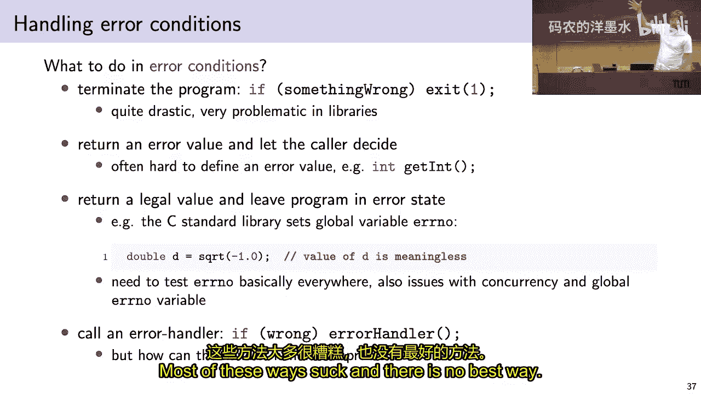

And there is no best way。So， for example， the C plus+ solution is called exceptions。But that's you。嗯。

And they also。Good and bad， at the same time。So what they do is essentially。

 they keep track of where you are in your call stack。And if somewhere something happens。

 you basically go back in your card stack。Until you find a place where someone says， oh。

 I know how to handle this type of error。This is done。 We throw expressions。

 A lot of other languages also have this。 So you throw an expression。 and the idea is， really。

 you throw it out there。To see if somebody feels responsible for handlinging this and if nobody feels responsible。

 if everybody says， oh， that's an inception item I'm want to deal with it。Then the program says。

 okay， I terminate。And how to handle them is。You wrap the code that you wanna。EDeal with exceptions。

 You wrap this in try blocks。So where exceptions can happen。 You wrap this in a try block。

 and then in the catch block。You see。If you can't handle the exception or not。

This is another way of doingarrow handling。It's fairly decent， for some purposes。

It's not great for others。So let's talk first about some of the details， how this works。

 And then let's talk about。How else you can handle errors。Right。So。You do it。

 So generating an exception is by calling throw。 That's a keyword。

 and any kind of expression can be thrown。So you can throw a value，42， you can throw an object。

You can throw essentially whatever you want。That is maybe in retrospect， a two generic concept。

 Maybe you should have narrowed it down to a certain set of types that you can throw。

 But damage is done。 This was introduced before 2000 before modern C plus+。

 And now it's there for backwards compatibility。

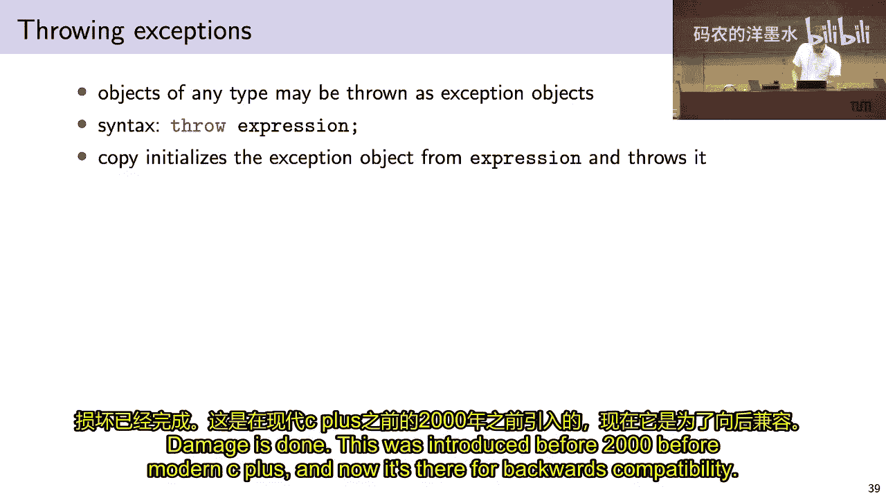

Right， there are some standard classes from the standard library that are basically a class hierarchy。

With the root class， SDD exception。 and then you have some derived classes like invalid argument。

 runtime error out of range and so on。All these standard library expression classes have an explanatory string attached。

That you can query and print out， for example， to explain why your program has an issue。So。

 for example。You could throw。An inte。Or you could throw a logic error with a string attached。That。

 in this case， doesn't really explain what's happening。 but yeah。So if you throw an exception。

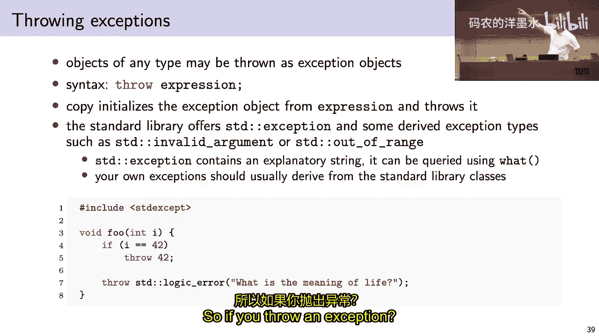

What the program does， it tries to do stack unwinding。 So essentially。

 if you are our first called the function food then bar， then another few functions and you're here。

 and there's where the exception happens。It goes basically back， step by step in this card stack。

Until it finds a catch block that wants to deal with this type of。Exception。

The cool thing about this is the stack unwinding happens in a safe way。😊。

So all the local variables get destroyed properly when the stack is unbound。

 So you have no issues of。Memory leaking or resources dangling。 They will be handed。In a good way。

So you， you roll back this stack thing。 And， of course， for this to work。

 there's a little bit of overhead。 You need to keep track of where you are and what happens。

And that means there's a little bit of memory overhead。For exception handling。

 So as soon as you have exception handling in your program。

 there's a bit of extra memory that's being used for every function call in order to enable the stack onwining。

😊，And the other thing is， theres a bit of runtime overhead。Because， of course。

 you don't know when an exception happens。 but when it does happen。 So if it doesn't happen。

 everything's fine。 No runtime overhead。 But if an exception does happen。

 the stack unwinding happens。 And that means。Stuff gets destroyed first in several contexts。

 potentially， and that might。Hurt your real time applicationdi。So very often， realtime applications。

Disabled exceptions。So that this doesn't happen。However， that's now。In the last few years。

 there some implementations of exception handling， which have a guaranteed runtime。

And they are good enough for essentially， all。Or most of the applications that you can do。

In real time or embedded programming。Right。So how does it look like？Well。

 you try out something in a try block， and then you can have multiple catch blocks that try to catch。

 for example， integer exceptions。Or。Any kind of standard library exception or any of its derivatives。

 all of them are caught here。And。没有。That's how a standard thing looks like。 And a good practice。

 for example， to have in your own program is to have a main function that is essentially a try block。

 calling some stuff and a catch block dealing with those exceptions。😊，Of course， this exception hand。

Yes。Okay， so the question is， what happens。 Let's say you're somewhere and you try to allocate memory。

 and the memory is full。This is a situation you're describing Moles no。Mhh。😊，Okay， O， okay。

 I understand。 So the question is to repeat it for everyone and also the online audience。

What if you have reserved resources in your function。Be it memory on the heap， be it a network。

 socket or a file handle or whatever。What happens if an exception is thrown。

So this is what we will deal with in the chapter resource management。

 What you should do is all of these resources should be wrapped。In。Our AI I wrapper。

 like the unique pointer。Like。The， the F stream class。

 standard library class or some other of the standard library classes。

Their distractors get called before the stack is unwound。

 So if you have a nice class that's wrapping the resource that has a distractor that cleans up the resource。

 you'll find。If you don't。Yeah of like。Right。Some functions。Don't throw exceptions。 And if you know。

 you should tell everybody about that。 And you can do this by adding the keyword。

 no except after your function declaration。That means to everyone tells to everyone。

 this function will not throw an exception。This is cool for you to know。

 so you don't need to handle the exception。 This is cool for the compiler to know。

 because then it can do some optimizations that are otherwise not possible。However。

This is not a contract。It could still happen that this function。My function。Does throw an exception。

The compiler can't fully check。 So the easy cases like， if the function body contains a throw。

 the compiler will catch and say， hey， you said no， except。 doesn't work。What could happen， however。

 is， let's say the function is using an SD vector， which is allocating memory on the heap。

 and there might be normal memory available。S T D vector will throw an exception of。

Of type SDD bed alloc。 So education wasn't possible。

And that means this function might throw The compiler will detected。

 Maybe you overlook it because you don't know that a certain standard library function might throw。

So it's hard to check these no accept cases。 And if it happens， that a no accept function throws。

Sumber。Your program is just cute。Which is。Kind of okay in the sense of like， yeah。

 nobody knows how to deal with this。But in a user perspective， its， of course， sucks。

 if your programme suddenly， it's like。讲。And terminated also means that no cleanup is done。

 No resources are free to anything。 So if you throw in a in a no except function， no cleanup happens。

Which also sucks， of course。So with， you can basically return different types。 Oh my God。 Yeah。

 you could。嗯。But the thing is， and that's my next slide。 Don't do that。

Exceptions are not a way to do control flow。They're there to handle exceptional cases。

 There's an overhead。um。And you shouldn't be using it。Just for fun。

You should use it for those cases and nothing else。Of course， there's also some other functions。

 except the no except marked ones。 like a instructor is not allowed to throw。

Move constructors and assignment operators are not allowed to throw。 And if they do throw。

 you have an issue， your program will terminate。嗯。Right。Checked and unchecked exceptions。

 like in Java， nope。But there is a standard library type， S T D exception。

And you can use that basically as a catch oil like here。

 So if your exception is derived from this class。Any catch statement like this will catch your exception。

 as well。Do we have something like assertions？ Yes， we will get to that。Compile time programming。Oh。

 that's a good one。 Do Arithmetic operators throw exceptions。Nope。They have have undefined behavior。

 So signed overflow is undefined behavior。 So you don't know what happened。Got them it。

Let's try again。No of these don't throw。Try catch。Do they have a performance impact if nothing is thrown。

 no。Test， test， okay。Apparently， it wasn't the sender。Because it still happens。

 So I don't know where it's coming from。Right。So， where we。Right。

 so the interesting part is one of you mentioned it， and。Rt arrow handling is kind of nice。

Some aspects， yes， for some use cases， it's really nice。嗯。

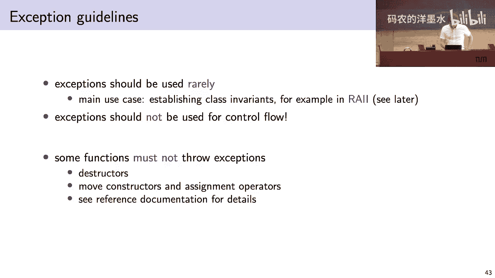

And guess what。 C plus plus 23 has。Almost the same as rough arrow handling。

So there's a type that's called SD expected。That's yet another way of handling errors。 And。

 of course， it was。Inspired by rust and some other languages that do it that way。So the idea is。

 you have a return type that wraps the regular type that you expect。

And an error condition that happens in an unexpected case。 So you always get something back。

 It might be the value you want， or it might be an error。 But there's always something。

And then you get this object， and you can query if it has a value using half value。

 You can access the value using value function or the dereferencing operator。

You can call error if you know， it doesn't have a value。Yeah。The good thing about this is。

There's no stack unwinding happening。 This is a regular。Control flow。

 You're returning something from a function。Might be what you wanted。 It might be an error。

 So you always have something。 And you know that you have to deal with both cases somehow。

So it's very obvious。There is no performance overhead。Per se。

 because there's no stack unwinding or anything。 And there are no dynamic memory allocations。

Because this is handled in a clever way in the implementation of SD expected。

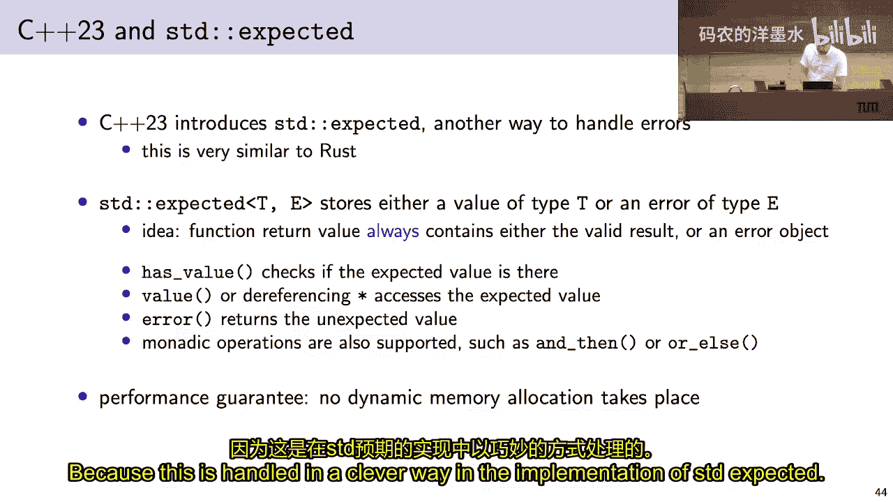

So how could it look like just for you to get an idea what you can do So you can have a parse number function。

That returns and F TD expected with double。Which is what you expect。 So， for example。

 you want to parse a number from a string。 So you expect the value as a double。But if some。

 for some reason， a par error happens because an invalid character was there。

 you return the pass error instead。And， for example。

 you can call S TD unexpected and return that using a particular value of the pass  error in them。

Or do then do the actual passing。 There might be some other error conditions。

 So you might have to expand your pass errors with different errors that you can have。

 And then you return。The past value here just wrote 0。

0 because I don't want to do any parsing here on the slide。And then you can call your pass number。

And here has seen if statement with an initializerr first that actually does the pass number call。

 And then it decides if the return value。Has a value。 If yes， I can use it。 Otherwise。

 I can query which kind of error I got and then do something about it or not。And if you do this。

 for example， now I can this， I store this， you see here。I combined things from this lecture。

 I started this activity in a Lada。😊，Process， and now I'm calling this process for。

Various values that I have in an initial lines list that I'm looping over with a range for loop。

So this looks a lot more。Like rust， right， fairly similar。And other performs， basically similar。

This is cool for some kinds of errors。 like these passing errors。 You expect them to happen。

You have to look at your strings。 They might not pass correctly。 So these are expected to happen。

 And using exceptions here is a bit bad because once you throw the exceptions。

 you're out of your context。 You're gone from the parse function。

Whereas let's say you're a compiler and passing your input。

 You want the compiler to parse as much as it can。 So you get a list of errors of what's happening。

 So you can't use exception for that， but you can use this expected pattern here to very good effect for this。

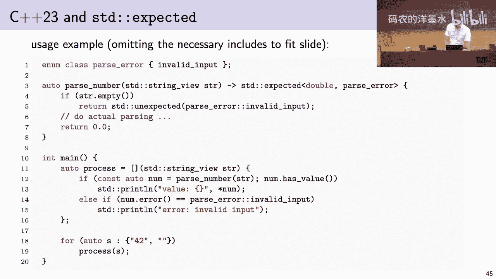

Right， both of these error handling mechanisms， exceptions and the expected thing have their value and their use cases where they are good。

And， of course， it's cool if you have both and you can select which one you wna use。😊。

But also is very often used， still is returning arrow codes。Why， well。

 because there's a lot of C style code。And it requires a lot of。

Discipline to make sure thatre actually handling these errors。

 And it requires you to free the resources and so on by by hand。Yeah。

 so I think with the section handling and this kind of ruststein SD expected。

 you're in a good place in C plus to handle errors。That's it for today。 Thank you very much。

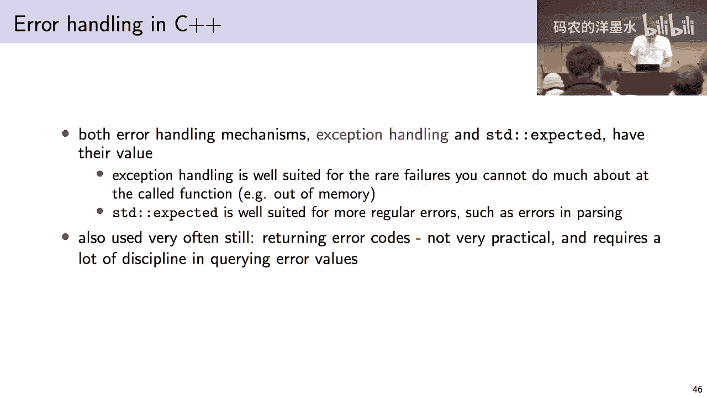