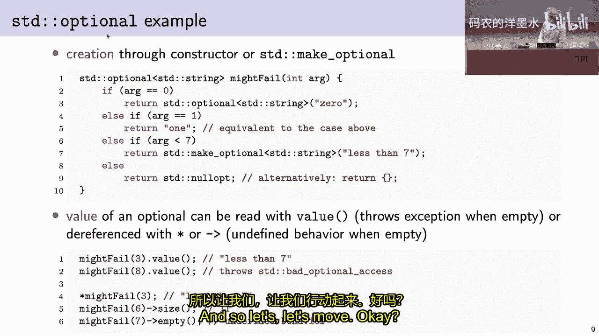
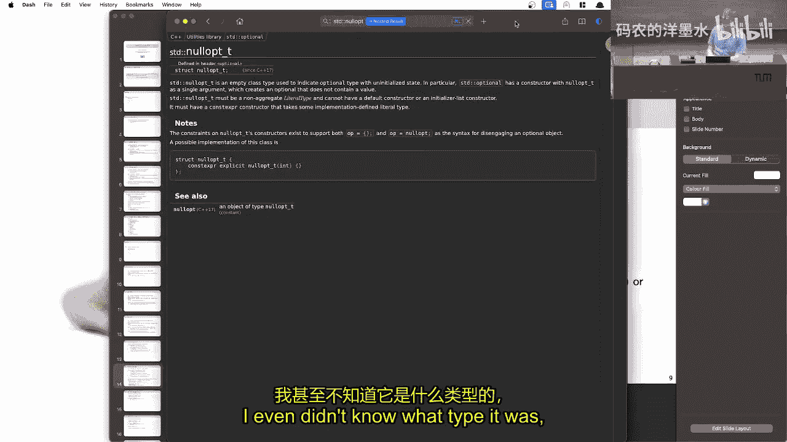
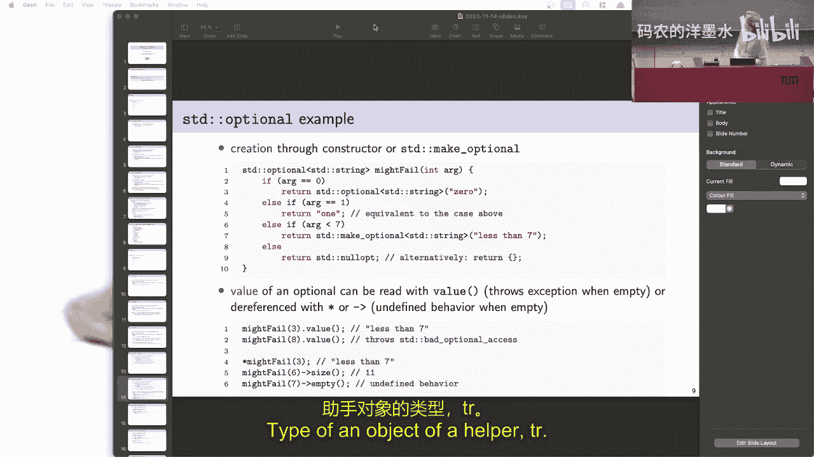
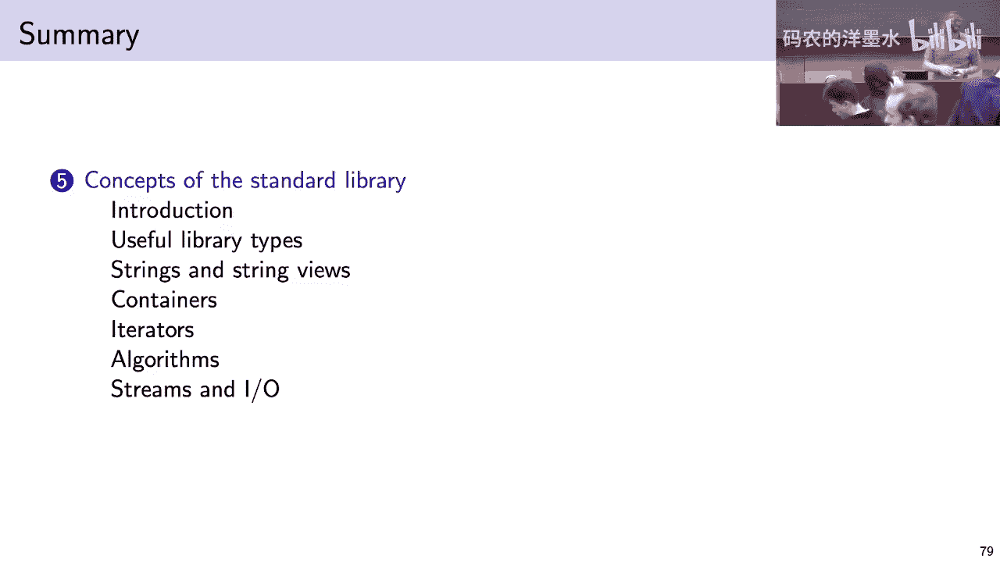

# 【全集 2024版】慕尼黑工业大学 C++编程概念 IN2377 中英字幕 p04 Lecture 4 - 面向对象编程 -BV1gDqwBmEuC_p4-

Test， test。Test test， test。Let's see this works。And let's get started，So let's try this again。

 Welcome to the concept of Cpl programming。And of course。

 I was thinking I could update OBS without any issues。完了。Of course， there were issues。

 all the devices had to be redone。So， but I was working。

Hopefully it's working in case the audio is not working for the stream， please let me know。Right。

 important things first， today's feedback session is Z N 21。

And I see some of you have already made it。Right。Okay， so we have a bit of a program today。

Because we are talking about the standard library。This is the only。

The only time we are going to explicitly talk about the standard library。

But you will see it will crop up again and again because it's part of the。Well， C plus standard。

 obviously， right， And you've maybe already noticed or in some of these assignments that the standard libraries have different implementations and not all of them are as up to date as we would wish them to be。

所有。Im want to cover a lot of things today。 Useful library types is probably the most important one。

Followed by strings， string views， containers， iterators， algorithms。And hopefully。

 there will be some time left for streams and I O。I'm not going into detail of any of these things。

 So these are just。Short。Introduction so that you know that the things are there。

 what the concepts are and the details， when you need them for your assignments， for example。

 you most likely will have to check out the reference to see。Yeah， but things are working。

So I'm using a different microphone today。嗯。So I don't know if the audio is this bad all the time。

But I'm hoping there's no noise。So let's see if that works out or not。Right， so the standard library。

It's a collection of C++ classes， so user defined data types that were defined by the C++ standard。

Types。And functions。Can I increase the volume， Yes， I can。So it's echoing even more now。Okay。

So the interesting part here， everything， as you probably noticed already。

 is in the STD namespace for a standard。And also important， C++ is self hosting。

 that means the standard library is implemented in C++。And that's also a requirement。

 no other languages are needed to do all these things here。It's part of the standard。

 as I already said， but the standard only defines the interface。

 So how you interact with the standard library， it defines how it should work。 So the semantics。

And some kind of contracts， like what kind of runtime guarantees are there。

 What side effects are there and so on。 The actual implementation is not part of the standard。

So that sometimes LED to situations where people said。How the hell are we supposed to implement this。

And the consequence of this was that essentially。That。Nowadays。

 to include anything in the standard library， there needs to be a working implementation。

Or at least a prototype of an implementation to prove that its， that you can actually implement this。

As you've noted already， the two big well actually the three big compilers。

 I'm only mentioning two here。 So GCC has its own standard library called Li STTD C plus plus Kang has its own standard library。

 Li C plus plus you can enter， you can switch libraries between these clang seamlessly works with Li STD C plus plus。

I think GCC。More or less works with S C plus bus if you want to。 and of course。

 there's the Microsoft implementation of the standard library。

 which actually to this day is I would probably say the best implementation that there is。

Which is funny because had you asked me the same thing five years ago。

 I would have said it's by far to the worst。So they've improved things a lot。The only drawback is。

It's for Windows。It's a shame。 They should make it available for the other compilers， really。

But then， of course， there's no business case for that。Right， so the functionality is quite a lot。

 It's split into sub librariesraries。 And as you've seen。

 that means also that you have to include a lot of headers all over the place。

 if you use different things of the standard library。And of course， backs compibility is there。

 the C， so parts of the C standard library are also there and you can use them if you want to。Right。

 and as I mentioned in the beginning， there is an effort in C plus plus 20 to make these header files go away because they have various drawbacks and the replacement is called modules。

And the C+ modules， things get a little bit easier。

 You don't have to include that many things anymore。 And， in fact， in a few years， with C plus+ 26。

No， actually， I think the C plus was 23 already， but no implementation is there yet。

 A simple import S TD will be sufficient to have all the standard library functionality there。Right。

 that's let make the standard library an API。嗯。Not quite。 Well。

 maybe it depends on what exactly you call an API。In some ways， yes。

 it's an interface with certain guarantees， so yeah， it's an API。It's not a binary level API。

 So there's no definition of how it should like on the binary level。

So depending on what you understand as an API， yes or no。

Are there languages that are not self hosted， yes。Pretty sure you can't host Java and Java because you need a virtual machine。

 if you don't have that， there's no Java， right。Why not use the C standard library。Yeah。

 because it's tiny。Really tiny。And if you look at it。

 what we have instance the plus standard library， we have the C library。 plus。

 we have various utilities for memory management， error handling， time。

 interesting data types that I'll talk about in a moment。We have strings， containers， algorithms。

 iterators， numerics。Input output， reading， regular expressions， localization。

 calendar and time zones， and so on。 I mean， in terms of content。

 if you think about the C library as this big， the C plus standard library is probably like this big。

 If you look at the Java standard library， it's even bigger。Right， so let's dive in。What are useful。

Could it please increase the volume？ No， it's at max。Sorry。If that microphone really sucks。

 I can switch back to my old one。嗯。Right， so the first part I want to talk about is SDD optional。

It's a data type that。Might contain something or not。That's what the name says。

 It's defined in the option header。And theres a template parameter that tells you what the option is actually storing。

 So why is this useful。You can use it as a return type for functions that might produce a reside or not。

And。If whatever the function is doing is good， you return an optional field with that value that you wanted to produce。

 and otherwise， you return an optional without a value to indicate that whatever you did didn't work out。

 and that's no result。It's a little bit like the expected type that we looked at last time。

 except that the idea for the expected is that it always contains something。

 either a return type or an error code， versus the optional just is something or nothing。Right。

 so if you think about how you did this without optioners。

 there was either a separate Boolean flag that tells you computation succeeded or there was maybe。

A value， like if your function is returning an integer and only positive values are the interesting ones。

 it might return -1 as a signal Oh this failed or didn't produce a result。

 So optional is kind of making this explicit。 It's an object。😊，It acts a little bit like a pointer。

 so it can dereference it to access the stored value。

And you can also use the arrow operator to access the stored things。 So if you wonder what that is。

 don't worry。It's just there if you're familiar with pointers。

An optional basically replaces one use case of pointers where you would say either it's pointing to something or it's pointing to nothing or an nu pointer。

 So for this these things， you use SDD optional。How does it look like。

You could have a function might fail that returns an optional。 So in the case of success。

 you would read an SD string out of that optional。 In the case of failure。

 it would return an empty optional。And how does this work， Well。

 you can return an SV optional like this。Or you can rely on the compiler to create an optional out of whatever you provide。

 since it already knows that it has to return an optional。So it's actually no overhead here。

 or I can call explicitly the function that's called make optional。 So create an optional。

Out of the argument that you specify。So these are the three options。They are， essentially。

The same just different syns more or less。And if you want to return some nothing。

 this is called the null opt。 So the null optional。Or you can also return just the empty braces。

And then once you have this option。You can read it out with value， for example。

 So you call the function。 it returns an optional。 And then from that optional。

 you can call the function value to get the stored value。 And of course， if there's no value stored。

It's gonna throw an exception。That's of type， bad option and access。

So if you want to check first if something is actually stored。You can。

Check it with if it's empty or not。No， actually， sorry。You can check it with has value or。

What's happening here？All right。Oh， this is on the next slide。 So I'm sorry， I got confused here。

 So anyway， you can access the value with the dot value function。 You can also dereence。

 basically use a de referencing operator that got overloaded here to access the value。

And since it's supposed to return a string， if it has a value。

 you can also directly call string functions。On the optional。

 So you can treat the optional as it were， as if it were basically kind of pointer to a string。

Of course， if nothing was returned， doing that is undefined behavior。

 So you should always very first if the optional has a value， theres the has value function for this。

 or you can just put the optional itself inside an if statement and then it will automatically convert to bull and return true if something is stored and falses if not。

 yes。Yesス。No， that's actually， I think in terms of definition， it should be。Be you。But actually。

 I'm not sure what it actually is。 So if it were a function， it probably would have to。

Have a different syntax。 okay。It's a constant of type null opt T。And so let's， let's move， okay。

Go on to exit。 So here's， here's a reference。 So it's。Constant of type null opt T。

 And if you click on null opt T， that's an empty class type。That does's nothing。And essentially。

 will'll tell the optional to create itself with no content。 So it's a convenient notation。

 But as you see， I even didn't know what type it was。 So it's。

Type of an object of a helpostract。

Good question。 Thanks。 I actually， never。Never care to think about what N opt actually is。

Interesting。Right， so why do we need to make optional function。Well sometimes。It might be nicer。

Then just creating the option via the constructor like this or having an implicit construction via this to make it very explicit what's happening。

But I agree this is the most of a both syntax of these three options。

 So probably not the most attractive one。 I think the reason I would guess the reason it's there is to have。

A very similar interface to unique pointer and shared point of， which is something which we cover。呃。

 later。These are memory management classes， and they have make something。

 make something and probably optional。was。Decided that it should have something similar。

 but you don't need it。 As you see， there's other options to create an optional。

So we can check the value with has value or the implicit conversion to bo。Which is， by the way。

 done by overloading the conversion operator to Bo for this class。 we'll talk about this next week。

 how to do this for your own class。And you can also do this kind of magnetic stuff where you can say。

 oh， I want the value。 If there is one， if there's none。

 then I use whatever is provided as the argument as a default value。Right。Not confused， where am I。

Here。Right， you can also clear an optional afterwards。 if you， for。

 for some reason wantan to do that by calling reset。 and then it no longer has a value。

I would say this is probably also some of the。Lesser use cases that you probably don't have too often。

 So the standard stuff is creating one， returning it。

 checking if it's there and then accessing the value with。Dot value or。The value。

And that's called or function。Right。So。The magnetic operations got added。

 I need to get my window back here。 Sorry， I can't see what I'm。Presenting。

This spin management is slightly aggravating here。But alas， so since C+ was 23。 So very。

 very recently， you can also use montic operations。

 So we already had the value or that there's now also and then or else and transform。 And， of course。

 this is inspired by other languages， such as rust。😊，Guess it's。And basically。

 the idea is that you can then create chains of things。That do stuff with whatever the option is。

 So and then is supposed to provide call a function that is provided as an argument applied to the value。

If there is a value， otherwise， it would return an empty optional。Our ads is。

But we the option itself， if has a value， otherwise， the result of the function。

And transform basically transforms， applies a function that it apply supplies an argument to the optional。

 if it has a value or otherwise an empty optional。 This sounds a bit weird。

 I think it's easier to look at an example。 So here's a function that produces an optional。 somehow。

 we don't care how。And now， we call it。And then we can， on the called result， we can， for example。

 invoke or else。Which if the optional has a value， returns the optional itself。Otherwise。

 it returns whatever the function that I specified here returns。

And this is a simple Lada that I specify in line here that returns an option with value 0。

So this is an option of int。 So essentially， a full returns are I opt。

Our ads makes an empty makes an optional of this value 0 out of it。

So now the result of this operation is either。An optional with some value that came out of the function 4 or an optional with value 0。

Now， I could then call the function and then。Which if the option has a value。

 which by now is guaranteed due to the or else。Function。And then， basically， applies。

The function to the value in the option。 So the， it takes an argument。

 This function that we provide here。O the type that we store in the option， which is an integer。

And then does something to the value。But it has to return and optional， again。

Because that's the return type of the end then function。So in this case。

 since the compiler wouldn't know that n plus one is supposed to be wrapped in an optional。

 you have to explicitly state the return type of the Lada here， and then you can apply， transform。

Which essentially applies this function here to the contents of the optionaler。 Or if it's empty。

 then it does nothing， essentially。And then you can call the value or thing which retrieves the value of the optional。

 And if there's no value， it puts out-1，3，3，7。And then， you can。Print out what happens here。

 So in this case。Depending what the function food does， you would have 0 plus 1 times 2， so2。

Or if it returns any other number， then it's the other number plus 2 times plus  one times 2。

 And actually， this or case will never take place thanks to the or L statement up here。Yes。クちとして。这是。

Yes， so the question was， instead of return， specifying the return type could adjust return SD optional of n plus1。

 yes。Might be。Nr or not。 I chose this version here。

 So I copied this example from someone else and then modified it slightly。

 And this was one of the modifications I did。Right。I don't know。 It's not。I'm not used to this style。

 because。I don't know。 Im， I'm not used to it。 So I don't know if this is really cool or not。

 Some people like it。😊，So this is why I got introduced here。And if you like these chains， then。

Maybe it's cool and useful。I don't know， strictly speaking。

Probably more comfortable with the standard code that。That's what you know， the text here describes。

 So maybe an if statement and then a function called a so。 But then again， this is more concise。

So I probably need to just need to get used to it。Right。

SDD pair is something we already encountered last week。It's a pair。 basically。

 you can aggregate two different types， whatever they are， together into a pair。

 and then hand them around as a pair。There there's basically first and second that allow you to access the first and the second part。

And there's a function called make pair that creates a pair。Yeah。You can compare pairs。

 and there's lexiographic comparison implemented by overloading these comparison operators for ST TD pair。

But essentially。That's about it。 It doesn't really do anything else。Right。

The interesting part is that pair essentially has no overhead。This is a compile time construct。

 We will learn a bit more about this later on how this actually works。

 But there's no overhead whatsoever。 So if you're wrapping two things in a pair。

 you don't have additional storage。 You don't have additional runtime。

The only thing that you have a little bit on top is an additional compile time because the pair code obviously needs to be compiled。

But otherwise， you're losing nothing by doing a pair。And the same is true for TL。

 its pair just for an arbitrary number。And you see there's also a makepper。

A function that creates a tableu。There are structured bindings to access parts of the table。

 of course， that also works for pairs。嗯。And if you have several values， you have accessor oops。

You have accessories called ST TD Gt。And I would be the index of whatever you have stored in the pair。

 So0 or one for a pair with two entries， or 0，1，2 for a pair tod with three entries。

 and so on and so on。And as you see， there's kind of a theme with this make tupper and make pair and make optional Where it here。

So most of these types have a make function that creates that。 It's in some cases。

 like for this optional， not really necessary， but for these pairs and tuples that usually cannot be reduced automatically by the compiler。

 they are pretty handy and relatively short to write。

Thanks for answering the questions about the mons and stuff。So I can skip answering them no。

And as usual， I'll of course， go through your questions on feedback and answer them after the fact。

 So maybe after I'm back in the office or sometime in the evening today。

 so you can also read my answer later on。Right， next up is SDD variant。That's a bit of a weird type。

 So if you've heard about a union。That's essentially the modern Cpl answer to a union。

So what it does， it can store。Things of different types inside this one SD variant object。

But it can store only one of these at the same time。 So if you want to store an integer or a float。

 but you don't know which one you want。 and it might change At one time， for example。

 you could use an S TD variant of in and float like this。Store the integer in there。

And get an integer value back if you want it back。So the interface is a bit more ugly。

 So because you have to call S T。Get， which you've already seen here for the Tupper。 It's the same。

 just a different template argument。And you can also try to get a float value out of this。

 I wrap this into a try catch block here because currently this variant is storing an integer。

 So trying to get a float out of it won't work。 And in fact。

 you will get an exception that's called bad variant excess。And it will tell you， oh。

 you try to access a value that I'm currently not storing。Now。

 we can store a float value in the variant。And then there will be a float in there。

 And you can now get the float。 And if you try to access the integer。

 it would provide give you an exception。 You can check if this S TD holds alternative。

If there's currently a float or an integer in there。 and after storing a floatat， of course。

 this holds alternative float will be true， whereas the holds alternatively in will be false。Right。

Slide 12， lines 6。Oh yeah。 Thanks。 Yeah， that's a typo。 the order is switched。

 So this is an integer constant， this is a W constant。 So yes， this has to be switched。 Thanks。

 I will fix it later on。So。How has this stored in memory？It's。

 it's guaranteed to basically only take as much storage as the biggest data type that you trying to store takes。

Otherwise， there's no overhead， and， of course， there's not storage enough for storing two of these。

 or it's always just one。So， it's a bit of a。Beirard guys。 Sometimes it's useful。But in most cases。

 you want to。Avoid。Avoid doing a variant unless you really， really need it。So let me tell you。

 this is a union。So this is the C Plusrus equivalent of a C union。So。

There's actually no overhead compared to a union。 There's no extra storage。 There's nothing extra。

 The only thing that happens is compile time magic of modern C plus plus。

 So there's no overhead versus's a regular union， it's just more safe to use。

So if you have to have a union use SDD variant instead。And yeah。It's a bit cumbersome to use。

 As you see， you have to check first， if what youre。Wanting to have is actually stored in there。

 But if it is， you can get it。And that's it。Some things that you might want to do。

 And that's a typical use case for these variants is that you want to invo invoke different functions on the variant。

 depending on what the variant contains。So here's a simple， stupid example。As usual for these slides。

 it's nothing useful。 but let's say you have a variant that stores an int af floatat or a string。

For whatever reason。And then I will， I would like to have three different functions that take an int。

 upload or a string as an argument。That I want to invoke on this variant。

 And depending on what it actually stores Currently， one of these three functions should be invoked。

So instead of basically doing if the variant holds an in called the int function or if the variant holds a float。

 called the float function， or if the variant holds a string called the string function。You do。

 instead。SDD visit。This is a visit algorithm。You supply it。With a function object。

That has overloads of the calling operator for these relevant types。

And then apply it to that variant。 And essentially。

 what will happen here if the variant stores afloat。Then it will call the float operator。

 which in this case， would output， float， whatever。If you store a string。

 it will call the string operator， the call operator with the string argument。

Or if it stores an integer， it would call the integer recording operator。Right， this is。

How we can do it。The drawback is。You have to define astruct with all these operators from the outside。

 because as you know， you can't definestruct inside functions。

So you have to do this outside somewhere， but then you can invoke it with STD visit。

And have different stuff happening， depending on what。The variant is currently storing。

You can do this a tiny bit more easily。Thanks to C plus 17 and 20。

So this is typically C plus plus magic。I won't explain exactly what it does because we will talk about varietyic templates in a few weeks。

So if you know what this is， be glad， otherwise。Here' is the plus plus magic for you。

Because what you can do now is you can。In line， basically instantiate this overload structure。

 fill it with lambda functions that take these arguments that are relevant for the variant。

And call visit。For that thing。 So instead of having to define。A sample visitor class， somewhere else。

You can do it in line with this overload pattern。Of course。

 you have to define this overloadstruct somewhere。Unfortunately， it's not in the standard library。

 It should be， I think。But anyway， that's a line that you have to put somewhere in your program。

 and that's it。 And then you can use it for various versions of your calling operator and your visitor。

 depending on your variant。Why don't we call the constructor in the code samples， Well， I do it here。

Here， I call the constructor directly so that the Marine will be a string from the start。Here。

 I didn't call the construct， but rather did an assignment just to make it more clear that I'm changing。

What's in the very end。 So that it's a bit more clear because if the first kind of initialization would be a bit more hidden。

 It's just detectic purposes。 Its but good justice well initialize it here。

Can a function return a variant， yes。Why not use list in on slides 12，13，14。嗯。Well actually， here。

 I could have。Here I'm calling makePre。Here I'm calling Me Tel and makeg Pes of there is no list in sization。

Yeah， it's， it's， it's， yeah。What can I say here， I'm doing it。With uniform inization。 So typically。

 I'm doing it with uniform inization。A variant always depends on what types you declare it with。

 If you do a variant of。Apppis and peers， where Apple and PR are two classes that you have。

 Then it's a different variant than this one。What's the difference between a variant and a union。

 They do the same thing。 Union is O C style。 variant is modern C plus plus style。

 So do the modern version。Right。So these were some of the useful library types。

That you will probably have to order to use in some of the homework assignments。In fact。

 very interval。Come up later this week， I guess。So you will have some fun playing around with it and getting a feel for it。

😊，Oh， this is a good question。Let's go back here。 Why don't we just let's do it here。

So why don't we call just call the。Overloaded function directly， instead of calling visit。Well。

 then our code would look like。If。S，DD holds alternative to。Int。Of we。It's true。

 Then we call the in operator。It's if。All its alternative to float is true。

 then called the float version and so on and so on。 So it would be a huge if statement。

 depending on what the variant is currently storing。

 S TD visit does that for you and probably more efficient than you do it if you do it on your own。Oh。

 and if you do。This， this overload thing。 it's abstract。 But the thing is， you have to do it once。

 And then essentially， once you instantate it for different Lada functions， you can use it anywhere。

 That's why I said this should have been part of the standard library so you can use it anywhere。

You only need this one， whereas if you do it like this。

 you have to define a tract for every different variant that you plan to visit。

Whereas here you have to have this line once somewhere。

 and then you basically instantate it like this。Right and how this works。

 I'll explain in a few weeks。Right。Strings， we briefly talk about strings already。S TD string is。

The string class， there is no built in data type for strings， unfortunately。

It's guaranteed to be continuous in memory。We know the length。Where you might think。

 why do we have to mention this， Well because in C， strings don't know their length。

You have to scan a C string until you reach the zero termination character。

 and then you know the length。 So essentially， that's the reason why SDD string exists in C plus plus。

There's a lot of member functions。 There's constant expression constructors。

 which you will learn to laugh later on。And yeah。So the actual tower handling is a bit nasty。

 And as you've might have seen in some of the error messages。

 S TD string is actually called S T T basic string。Of cha。

There are specializations for UTF character types and so on。 And if you have your own character type。

 you can also do a specialization of STD string for that。Right。

 and if you attempted to use charter pointers， because O C plus code and C code uses that。Don't。

Use STD string instead。 It's better in every single day， and it's more efficient。

Definitely more efficient than a child pointer。So what can you do with a string。

 You can default construct it， and then it will be empty surprise。

 You can construct it from a string literal。T， then the string letter will be stored。

 You can access characters。 Oh， and it works like an array or a vector。

 So you can use add or the bracket operator to access elements。

 And like for array and vector add is bounce checked and the。😊，Bracket operator is not。Yeah。

So you see， there is some consistency in the standard library classes。You can iterate over a string。

 meaning you can call a range。 You can do a range follow loop over a string and then do stuff with the characters。

Like， for example， in this case， I'm doing a range follow with a reference to each of the characters。

 And I'm changing the characters by adding one to them。And， of course， the changes in ASI code。

 So instead of hello word， we will have this。Funny string here。

You can do this explicitly with iterators。 So this is the。

correspondingorsponding loop to this one here。 So you would call begin to get the beginning iterator。

 You do it with auto because you don't care about the iterator type。

Iterate until you reach the n Sinel and then increase the itator in each loop iteration。

 dereference the iterator to get the value and then do an increment on that。 and then。

You functionally do the same thing as you。You can compare strings。嗯。As much as you want。 So here。

 for example， are the Uuntu names of older versions of Uuntu。 and finallynily enough。

 some of them after lexiographic comparison that you would expect。 but for example。

 Uuntu 18 is not bigger than Uuntu 5 for some reason， at least not lericographically。Right。

 there's other functions like size length。 If it's empty or not， you can append stuff。

 You can also use the operator plus equals。 It's overloaded for strings to append stuff to the string。

 plus does concordation。 you can find。Substrs using find， you can produce substrs。

The only important thing here is the sub string。 returns a new SDD string。

So if you do string processing and call up string a lot of times。

 you will have a lot of memory allocations and convert comparably slow code。

That's why if you do string parsing， like， let's say you're doing a chasing parser。

ESDD string view is preferred。Because that's just a view on a string。 It doesn't own the memory。

 So you still have to have an actual string somewhere。 So it's just a view on onto it。

 But creating sub strings of the view has no overhead。

So this is a read only view with actually no overhead whatsoever。

 It's internally just appointed to the string and the length。 How long the string view actually is。

And。You typically create it from a string。 And since you never have chart pointers in your code。

 right， you don't create it from chart pointers， but you could。

If you really wanted to or from a string lit。 The only thing you have to be there， it's a view。

 So if the object， your viewing goes out of scope or is destroyed or somehow vanishes。

 The view is still there， might still be there。 And then， of course， if that object is gone。

It's undefined behavior of what you're actually looking at。Otherwise。

 it has the same interface as string。And the sub string operation is guaranteed to go in all of one service constant effort。

So， for example， if you want to pass this garbage string here。嗯。

You could do this by taking sub strings。Of the original string。

 But that would create a copy of at least part of the string。 So you have an O of N complexity。

 If you create a string view first and then do a sub string of the string viewer， you have。

All of one for both of these operations。And then there are some handy operations like you can remove prefixes or remove suffixes。

 which are also all of one operation。 So for parting of text。 that's your method of choice。But then。

 again。You're probably using a different language if you're passing text and not C plus plus。

 And if you have to， this is how I can do it。嗯。Function chs。

 And this is probably where you've encountered string views already in the homework assignments。

Instead of passing a string。Which would create a copy of that string。With its corresponding memory。

 allocation， and so on， you could just pass a string view。And then， it's clear。嗯。

That there's no copy involved， because it's just a view。But， of course。

 you could also do a constant reference to a string here。

 Then you're just passing a reference and not doing a copy either。So， in the end。

You could do that or the other thing。 And yeah， it's fine。

So there's a lot of questions which I will answer later on in writing， because I can't。

Can't answer all of them now and still get through all the topics I wanna get through。

And a lot of them are questions kind of what library function is more suited to some。

One thing or the other。 And I'll answer them， but later on。Right。

 so what I want to talk about as well are containers。

 So sorry for not for skip a lot of your questions now。 I'm not ignoring them。

 I will answer them later on。嗯。Oh， this is an important one。

 Can I modify the string that I'm viewing with a string view？ Yes， obviously， you can。But， no。

 you can't actually hold on。Can you， can you the string view， No， string view is weird only， sorry。

You can't。So anyway， containers， we've seen already containers。 A string is a container。

 We have seen STD array。 It's a container。 We have seen SD vector。 So in generally。

 there's a lot more containers。😊，It's an object that stores a collection of。Other objects。

The storage space will be managed by the container。It's generic in that it works for many types。

 using template parameters。And you have various member functions that allow you。

To access the members， to iterate through them。And the idea is that even though you might have different types of containers like sequence containers or associative containers。

 most of the functions to access stuff。Are similar。

Or I call it the same and have similar functionality。So， for example。

 we have SDD array and SD vector。We haven't talked about ST T T list， but you can guess what it is。

 It's a doubly linked list。There is an SD set or map which are associative containers that are optimized for search。

 meaning logarithmic complexity for search operations。And there's unaudered associative containers。

 which are essentially hash maps， which again optimized for search and usually have amortized O of one complexity。

 But as you know， there can be hash collisions。 So the worst case guarantee here is linear complexity like unaudered set or unaued map。

Right， so vectors we already looked at， they are essentially dynamically growing arrays with a very with a。

Sensible， growing and shrinking strategy so that you have an amortized cost of copying with of N。

They stored contiguously， this is a guarantee。嗯。And it usually pre allocates memory for a certain amount of elements。

 So if you resize it。It will allocate new memory copy of the old stuff over。So yeah。

 there's a certain cost so attached to that。Random access is guaranteed in of1。

 insert and removal at the end is typically ofV1。But it could be off n because if。

 you might have to relocate right there。 And if you insert or remove in any other position。

 then the end。You have complexity of O of N because you have to remove or insert an element。

 You have to copy everything so that the new element has a place or the old one is removed。So this。

 you have to be aware。 These are the complexity things。 But otherwise。

 this is probably the container you will use the most。Serve seen it already。

 It has the add function to access elements or the bracket operator。

 There's pushback to add an element at the back。That's back to access the element at the back。

 that's pop back to remove the element at the back。

 there's iterators you can use their random access iterators so you can also increase or decrement them as much as you want。

 you can insert stuff， you can erase things， you can clear the vector， check if it's empty or not。

 return the size and so on and on。That's one thing some of you already have asked。

 Let's talk about this in a moment。 Let's say we have something that's expensive to copy because it contains。

 for example， a big string。And we have a vector of these expensive to copy objects。Now。

 let's say I'm adding this via pushback。So I have the object here that gets created in memory first。

And then via pushback， another copy is created so it can be stored in the vector。

So what you could do instead is you could move this object if you don't need it anymore into the vector to save yourself the copy。

And before you ask what is moving， we will talk about this in more detail。But actually。

 the more natural choice here would be to directly construct the element in place using the in place back function。

 So essentially， instead of creating the object first and copying it or moving it over。

 you would just create it right there where it should be in the vector at that position where it should be。

So you can do this with in place back at the end or in place with an iterator wherever you want it。

 wherever you want to have it。That's the difference between pushback and in placeback。 a copy。

 essentially。Oh yeah， And also another important thing。

 if you have an inner loop that's gonna to run for a few thousand a million times and it contains a pushback operation。

 be aware that every so often， you will have a re operation of the vector。

This might not be terribly efficient because it means memory allocation。

 copying things over again and again and again。 So if you know already。

 you're gonna need a lot of space， you can reserve it first， You can also。

Check if the capacity is exactly what you reserved。Even if the size of the vector is still 0。

 this is just reserving numbers。 And then you can run a follow up。

 a big follow loop and do pushbacks without reallocations because the place was already reserved。

If you noticed。That you reserve too much memory， you can also call a shrink to fit to basically release the extra capacity that's currently not needed。

Why is it more efficient to create an object rather than copying it？So if you think about this。

 here you have the cost to create the object E1。Let's save。The cost is C1。

Now you have the cost to copy it over into the vector。 Let's call that C 2。

If you call in place back instead。You only have the cost for the creation and not for the copying。

So if the copying is anything non negligible， like it might be for this object here。

It saves yourself a copy。Of course， if you execute this once， like in this code。

 you probably don't care。 If you execute this a million times， then youmate might start car。Right。

What other containers are there。So I won't talk about all of them。 SD array is essentially a vector。

 except you have to know the size at compile time， otherwise it。Acts the same。

D Q is a double ended queue， which is essentially also like an SDD vector。

 Only it's no longer guaranteed to be contiguous in memory。 So essentially。

 instead of what happens for D Q is， when they grow or shrink， they won't reallocate and copy over。

 but essentially the。Distribute stuff throughout memory。 So theyre no longer guaranteed to。

Be contiguous in memory。But that， of course， you might not care about。 if you， for example。

 really want a double ended Q， You don't care where the rest in the middle is stored。

 You care about the O of one access to both of the ends。So that's what this provides。

 there's list for a W link list。And I think you should know when an array or a double N A Q would be preferable to a list。

That depends on how many elements you will insert in the middle and delete in the middle。

 There's a singlely linked list。 It's called SDD forward list。

 and essentially although these provide the operations that you would expect。

 but the exception that there's of course， no random access for a list right So the operator at and the bracket operator don't exist for these list types。

There's SDDQ。Which provides a Q interface， you know， pushed to the front pop from the back。嗯。

You can specify which of the actual sequence containers it wraps。

So it's essentially not a container itself， but just a wrapper around one of the actual containers providing the Q interface。

And the default is probably a D queue。 I think if you don't specify anything。

 it's gonna be a D queue。St is the same。Just providing a stack interface， you know。

 with push and pop。And a priority queue is just， again， the same wrapping。

sequence container this time you need a random access one。

 so it's either a vector or DQ and provide a priority Q interface that you would need for extra algorithm or something。

Did you already cover iterators。 No， well get to them in a bit。

Let's talk about the other containers first。 So there's associative containers like the unaued map。

Where you can store key and value pairs。So the key to access the value， it's essentially。

A hash table。A very efficient one。That has amortized of one complexity for the main operations。

You can't access the elements in order， so you can't sort them by key orO because it's a hash table。

 right。And if you want to， you can provide custom hash functions。To the hash table。

 So if you have your own data type or you need a better hash function than a standard library provides。

 you can provide your own。Through a template parameter。So how does this look like？

You create an unored map that has strings， as keys。And the double as a value。Why not。

And what you could do is you could call it name to grade and then basically say， oh。

 the student Maya got 1。3。 student Huber 2。7。 and the student Laer， Oh， he failed again，5。0。Right。

 you can use the ad and bracket operators again。Because for hash maps， this makes sense， right。

 so you can look up elements via the bracket operator。A sign stuff through the bracket operator， oh。

 I still didn't pass， but it's not better。You can search for a key using defined function。

It's a bit clunky because then you have to check again。

 the end iterator to see if you actually found it or not。

And what you re get back from the search is actually a pair。Of key and value。

 The first thing is the key。 The second is the value。Right。

 you can check if the key exists by either calling count。

And checking if it's 0 or not zero to see if the key is already there。

 or you can call it the contains function which exists n C plus plus 20。

 which gives you two or if that thing is contained or not。Right。

 you can update or insert elements using the bracket operation， which is fairly natural。

 You might not expect that。You can insert pairs with explicit insert calls。

 you can do insert with implicit pair creation via the the kind of uniform incentization here。

 or you can use the in place thing to directly construct that thing right there in the hash table like for the vector。

And finally， you can， of course， also remove elements by calling eras similar to the other containers。

 which also have the erase function。 or you can call clear to remove everything。Then there's SDD map。

 which is essentially the same thing， just that the keys are ordered。And in fact， even sorted。

So internally， this is an A V， L or red or black tree。 I think in all the major implementation。

 it's some form of red or black tree。Which guarantees logarithmic complexity for all the important operations。

So， this is。On average， probably worse in the unored map because amortize is of one。

 But if you need the guarantee that there's no worst case of an operation， you have to choose this。

Otherwise， the interface is the same。The only different systems now。

 the keys are sorted you can do range queries like getting all the elements that are greater than something。

 So， for example， this you can do with upper bound or the lower bound functions that give you basically an iterator to all the elements that。

😊，Ful this condition amount。No， if you don't need a key need a key value pair。

 but need to efficiently store as keys， we have essentially the same thing as unaued map and map with set。

 unaued set and set。 The difference we are storing only keys here。嗯。An order set is a hash table。

 essentially with O1。嗯。And it looks like this。 You can store stuff like a shopping list here and then find if that thing is in the shopping list or not。

嗯。It's essentially the same functions。 There's no difference really to to the map functionality insert in place。

Doing insert and so on。 Yeah。 So the funny thing is， oh， yeah， here。 So insert returns a pair。😊。

Which tells you word was inserted， so you can iterate from that。And a booleion。

 if the insertion succeeded。 So why would an insertion fail。Because the key is supposed to be unique。

 So if you add a key again， it will say， oh， no， I'm not adding that。

 but it won't actually throw an exception， but you will notice via the second part of the pair that's returned by insert。

Removing works， as you expected。 It's copy and paste from the previous example。

And the same is with STD set。 That's an unaued set now implemented via trees with a logarithmic complexity guarantee。

And you can also do range queries again with upper bound and lower bound。

Andm going through this very quickly， because the details don't really matter。

 If you need these containers， you will look up the reference and check which functions you want。

 The important part now is that you get to learn there multiple containers。

 They have very similar interfaces as far as that is possible， and they have different features。

 depending on what you need。Right， let's briefly talk about threat safety。

So we are not talking about parallel programming yet。 this will come later， but just so you know。

Two different containers will never interact with each other， which is just logical， right。

 so they don't share state。 So you can call them from however many threats you want。

The same container。If it's a constant function。 So if you don't change the state of the container。

 you can also call them from as many thread as you want。嗯。Read operations， with iters are also fine。

 but， of course， anything that modifies。Something needs synchronization。 and how we do that。

 we will learn in a few weeks。So now since you asked， what about iterators。

 So let's talk about iterators for a bit。The problem is， now we have all these container types。

There's an array that lies contiguously in memory， has a fixed size。

 There's a double ended queue that has contiguous chunks in memory， distributed somewhere。

 Theres an hash table。 There are trees。 There are completely different data structures。

 How do you go through them in a consistent way。 But iterative is one pattern that you can use。

So basically， go through all of the container elements in。A useful order。And， of course。

 what is a useful order depends on what type of container you are talking about。

So the idea is essentially， we now with an iterator。

 which is like something like a pointer to each of the elements in the container。

 We don't know where they actually lie memory。 We don't care。 We just want to access these。

 And essentially， this is what the standard library provides。

 as many iterator types as there are containers。And they have different capabilities。

So an iterator that works for an SDD vector is， of course， an iterator that won't work for a list。

Because iterating through a vector in a list is completely different。

And the same is true for an iterator for a map or a set， right。So this is hand a useful abstraction。

To access the content in a very similar fashion。Regardless of what type of containers actually is。

Funny thing is。You won't ever know what exactly the iterator is。At least you won't care。

 You could find out by looking into the standard library and seeing how the iters are defined。

 But the standard doesn't define it。And you。Don't need to care either。Right。

 the only thing you need to care is actually about it invalid。

 So if you're iterating through a container and you're changing things。

You might invalidate iterators。Right， of course， there are some situation where this doesn't happen。

 But， of course， let's say you're iterating through a hash map and you're changing。

 you're removing and adding keys somewhere while you're iterating。

 then probably that won't work properly。So how does this work，Essentially。

 all the containers have a begin and an end function。

The begin gives you an iterator that points to the first element。

 whatever the first element means for that container。And end is a sentinel that basically points。

To an element。That's no longer in the container。Right， the extra types。Of beginning end。

 you don't care。 That's why you have auto。You don't need to know。There is a type， obviously， right。

 but you don't have to know。And then the beginning thing actually points to the beginning to the first element。

 And then if you dereence the iterators or the star operator applied to this iterator。

 you get the value， which in this case would be one because one is the first element in this vector。

And since one is the first element is a string， you can also call its member functions。

 And as you remember， string has a member function called size。 And since one is three characters。

 the size is three。😊，The end iterator。Points to the first element after the container。

 So it's actually not something that points to a valid value。 So if you dereference it。

Unfined behavior happens。Now， if any of you has been reading in Zullip。

 you might have seen that some people have this thing that， oh， on my computer， it works fine。

 But as soon as I push it to the C I， I get sack for it。Or a crashes or something like that。

That that usually comes from undefined behavior。 And for example。

 dereencing an end iterator is undefined behavior。 It might work when you execute the program once。

 it might crash the program if you execute it a second time。

It might shoot your entire operating system if you run it on Windows。Yeah。

It's really undefined behavior。Of course， then the idea is， if you have an iterator to the beginning。

 you w to move to the next element。 And the easiest way to move to the next element is to increment the iterator。

 basically increase it by one。 So it will move to the second element。And then， you can。

Increase it again and again and again， until you obey the key through。And yeah， this。

 you can check with a condition like why the iterator is not equal to the end。

You can dereference the iterator and have access to your element。

 And then by increasing the iterator by one。You can access all elements in order。And， of course。

 we can formalize this into the range for loop， iterate over the entire container element by element。

 and what's internally happening， the compiler will call begin check against the end condition increment the iterator for each loop。

 and also does the dereferencing for you already。 So the range for loop essentially just a convenience notation for a regular for loop thats calls begin。

Compares the current iterator against the end iterator and increments iterator per loop iteration。

So this here would be the classical for loop with a better trust set。

You can do it like this if you want， because then you have direct access to the iterator。

 and you can， for example， insert a new element。And O， now you should say， okay。

 but now the iterator is no longer valid， right， If I change my underlying container。

 the current iterator is no longer valid， true。But thankfully。

 the insert operation gives you a new iterator that points。😊，To the newly inserted element。

So we can continue your iterations with the object in the standard way and go on。

 Since you already inserted the thing， you probably wantan to increase iter to the next element。

 because。You're not interested in that。 You can do the same for eras eras where you again return a new valid iterator。

 So as long as you use that new value as the iterator， you can continue。So， yes， iters and objects。

They have a type， but you， as a user of iterators， don't need to care about the type。

 One of the major reasons why there is the auto keyword。Right， so what kind of iters are there。

You don't care about the extra type， but you'd care about the features that the iterators support。

This is， essentially。Was implemented through。Kind of clause in the standard library text。These days。

 it's also actually implemented VSC plus pass 20 concepts， which we'll talk about later。

But so the idea is there's iterators that work for input。 There's iterators that work for output。

 right， And they do exactly what you expect them to。嗯。Input iters， you can only read。

 output iters you can only write to。Yeah， you can do equality comparison between two such iterators。

 You can dereference them them。 You can increment them。嗯，讲。So they are single parts only。

 so you can't decrement them， so you can only go forward。

And only equality comparison is allowed between iterators themselves。 And if you increment them。

 you can only do this by one。 So incrementing them by two like this。Doesn't work。Why do we do this。

Well， because we have， for example， lists or singlely linked lists， which， of course。

 don't really allow going backwards， so。That's why we have input output iterators。

 And the cool thing is now， since we have these categories， a function like find。😊。

That requires only an input iterator because it will have to go through every element of the container anyway。

 So input iterator is fine。 And for copying， this another standard algorithm。 you go， of course。

 from an input iterator when you read to an output iterator where you write to。

So forward iterator is a combination of input and output iterator。

Bdirectional iterator is a forward iterator that can go backwards so that it can decrement as well。

 So we can now have multipass algorithms that go back and forward。And there's random access iters。

 which are another generalization that allow random access。 So， for example。

 if you have a vector or an array。That's essentially supporting random access。

 And that means you can also now increment and decreement by other amounts than just one。

 because now you can do random access。And furthermore， you can have a contiguous iterator that。

Guarants that the elements are also contiguous in memories。

 So that's actually what you have if you iterate through an S TD vector。

This contiguous iterator concept didn't exist prior to C+ 17。

 so often a random access iterator was treated just like a contiguous iterator， but yeah。

So this is kind of the distinction between SD vector and SD DQ。 right， SD DQ is not guaranteed to be。

Contiguous memory versus SD vector is， and contiguous iterator。Basically。

 fits to S T vector and SD array， whereas random access iterator fits to a DQ。Right。

 what is is there。There's a so called library that's called Rangs。

This used to be a third party library by a single guy developed over the years。And it。

 is one of the examples where a library， an external library was so cool and so useful。

 it got adopted into the Zpl standard。😊，This happened in C plus 20。

 and you can do some functional style programming with it。 So one of the typical examples。

 you have some kind of container。That you can then operate on functional style。

 using the pipe symbol。By applying a filter that does something via a Lada function。

 By applying a transform， that does something via a Lada function。And， yeah。Stuff like that。

You might have seen this from other languages。 This is， of course， inspired。 other languages。

 surprise。But yeah， it works very well。 Its also very efficient。

The only drawback is the actual content in C plus plus 20 of this ranges library is fairly limited。

So there's not too much views and not too much operations you can do on these views。But thankfully。

 this is getting extended in C plus plus 23。 But if you look at what the actual ranges library can do。

 versus what the C plus plus standard rangers can do， you will be a bit disappointed。😊。

So it got better， a lot better。 And C was 23。But， of course。

 all the compilers don't support C plus plus 23 ranges fully yet， so。

You're in this shit situation that if you want to do range of stuff。

 you probably want to include the original rangeangrs library。

Until the compilers get to supporting everything from C plus was 23。 The good thing is。

 now it's in the standard already。 there were， I think the first two meetings for C plus was 26 that happened。

 I think the last one happened just a few weeks ago， one or two weeks ago。

And they already adopted a lot more functionality into the Rnges library for C plus 26。

So if you have a bit of patience， all the cool stuff will actually be there in the language。Right。

 so a range is basically a new concept that's like a container， something that can be iterated over。

 It doesn't have to be a container。But， it could be。And。Essentially， again。

 the idea is anything that has a begin function for an iterator and an end function is arranged。

And a view is something that you can apply to arrange。And usually performs some kind of operation。So。

 like。A filter operation or transform operation。The view， importantly， doesn't own the data。So。

 it's efficient。The time complexity to copy move assignment is， of course， then constant。

 It's like a string view， essentially， right， from the concept。The binary or operator is overloaded。

 So the pipe symbol to kind of。Mimic other languages or like the shell。

 the the shell where you can pipe stuff together。That's why this operator was chosen for overloads。

 and views are lazily evaluated， which is very cool because that means this filter function。😊，Well。

 this example is not very good。 Ill show you a better one later on。 But essentially。

 they are only called for the stuff that you're actually using afterwards。

So they are not evaluated on everything immediately， but only once you' are using the results。

 that's what lazy evaluation is。So another example。

 let's say we have a function that checks if a number is a prime number， does a very inefficient。

Algorithm to check that， but it works。So what it could do now。

 I w to have the 20 prime numbers starting at 1 million。

So I can create the view that creates the numbers starting from 1 million。

All the numbers starting from1 million。 Then I filter those numbers with the prime function is prime function。

 And then I take the first 20。And since this is all lazily evaluated。 So basically。

 you start for the 1 millionth entry， the filter is executed。 And then you do this for the first 20。

 and nothing else is computed。And that way， you can put out the first 20 prime number starting at 1 million。

 which in a fairly concise and nice。Yeah。Fion。Who are the Cpl gods and where do they meet。

I've mentioned a few already。 So definitely B throwstrpe is one as a creator。 and he's still around。

 obviously， even though he's getting a bit old no， there's Herb Sa， for example， and there's。

Unwashed it。 I forgot his name。Andrej Tanessco， I think he probably horribly mispronouncing his name and maybe modifying it。

 too。 He' is one of the guys who created all the container stuff。嗯。Yeah。

 there's quite a few got people there。 And if you look at the standard text and the proposals that they vote on。

Some of them are really cool documents。 So for example， in the last standards meeting。

 the Linear algebra Library was voted on that's been in the making for， I think。

 almost 10 years or longer now。And the final text of it is really， really good。

 I read it actually yesterday。 And it was like， oh， that's such such a cool thing。

 And there's people from all the big companies in the standards Committee from Nvidia， from Intel。

 from Apple， from Google， Facebook and so on， because obviously， they use C plus， plus。

 and they want stuff in there that they makes it more useful to them。😊，Right。

 and Rangers is one of these examples that makes life a bit easier。For the programmer。Right。

 if you want to have a bit more info about the Raers Library。

 one of the the bad thing is there's almost no literature in it。There's almost no tutorials on it。

 and most of the tutorials。Leave it at that。With no further information。

The only decent source I found is actually reference。 has a few nice examples。

 And the C plus plus 20 book of Ka Gr。It's an ebook。 I actually bought it back then。

And it's fairly nice。Right。If you are aware of any other nice source about ranges。

 I'm happy to know about it。So 15 minutes left。 So let's go over the last stuff algorithms。嗯。So。

 algorithms are。Yeah， it's it's not a too awesome part of the library。

There are a few standard algorithms like， let's say。Sot。Right so there's spread over four headers。

 andnumeric algorithms， there's algorithms for memory operations like copying and stuff。

 there's old algorithms from the C standard library， and of course。

 most of the container algorithms like fine sort and things say are an algorithm header。

The funny thing is the ranges library due to its nature is providing algorithms， too。 So sort。

 for example， exists in the standard library， algorithm library and in the ranges library now。😊。

So it's a bit of application， and it's not terribly clear which one you should use。

 But probably if you're doing a range of stuff already， that sort will be more convenient。

 not necessarily better， but more convenient to use。

So the regular SDD sort takes a range first to last。 So begin and end， typically。

And both of the iterators need to be random access iterators， obviously。

 And then it does an en look and sorting。Surprise。You can provide your own custom comparison function。

 So if you want to sort in a descending order， for example。

 you would provide a little lambda that does the comparison the way around you want to have it。嗯。

There's a stable sort algorithm that's called stable sort。 So obviously。

 S T T sort is some version of quick sort， probably a variant that does。

Quick sword in the first few iterations and then merger sword in the low， no。

insertion are in the lower levels。The stable sort。It probably some version of me。 So shit， I forgot。

Sorry， I don't remember。You can partially sort a range just until the whatever elements。

 you can check if a range is sorted or not or sorted until a certain element。

 So there's a few hand algorithms that you could implement on your own， but you don't have to。

 And of course， there's a lot of effort in the standard libraries to make these as fast as possible。

 right。Their search algorithms。嗯。The two searching， in sorted and unsortted ranges。For example。

 theres find to find a certain element。Find if where you can supply a predicatet。

 So find the elements that fulfills a certain predicatet that you can， for example。

 specify as a Lada function。There's a regular search to search for a range of elements in a range of elements you can count or count if。

And so on， there's lots of unsorted search functions just to give an idea how they look like。

 you can call find。On a vector from begin to end and find that certain element。And the result。

 you can， for example， use to compute。The index of the element using the distance function。

 So I compute the distance from the beginning of the container to the found element。

 And since this is a vector。 So it's continuous in memory， you can do that。 And 0，1，2，3。

 that's the index of 7。Right。And yeah， if you don't find something like the 9。

 you will get the end Sinel of the iterator。Find if allows you to。

Define a predicatet as a labda function， like here。No surprise here。On sorted ranges， you can。

Do more efficient search of course right because if it's already sorted。

 you can do binary search so you can search for an occurrence of a certain element using the algorithm called binary search can call upper bound and lower bound。

 which you've already seen in the associative containers in the ordered ones。

 equal range to search for all occurrences of a certain element。Some of these are a bit。Yeah， weird。

 So binary research doesn't return you only if the element was found， not where it was found。

Whereas if you want to find it， you actually have to call lower bound。

 So find the first element that is bigger or equal than the search value。Or up bound or equal range。

 If you wantan to find all the elements that have the same value， Let's， for example， as 3。

 So if you want to find an iterator an assorted range from 3 to 3。

 you will get an iterator from here to there by calling equal range。Right。

 you can compute permutations。I'll hop over that。 you can call Yota。

 which is the Yota function to generate basically numbers。From。2 to 6， for example。

 by doing this S TD Yota from starting from2， you want to store five elements in this array。

You can create your next experimentutation， your previous perutation， and so on， la， la， la， la la。

 you can compute minima maximma。 You can do merges。 You can do intersection union differences。

 You can create heaps。You can sample elements。 You can swap， copy， rotate， shuffle， and so on。

 and so on。 There's a lot of stuff in there。I don't want to go all over all of it because essentially。

 you can just。Read the documentation。 It just pays off to have some idea of what's there in general and then look for the details if you actually need it。

Right， finally， I want to close with。With the stream library。It the third algorithm of range is lazy。

 Oh my God， I don't know。I would have to check。Right， so streams。

Streams are the initial ways Pla+ was supposed to interact with I O。

And it's still the main way of interacting with I O。 So essentially， you will have different streams。

 They are class hierarchy。 So in streams are for input operations。

 out streams are for output operations， Sur。 I O streams are for input and output。😊。

And as you've probably seen already， C out is console output stream， the default output stream that。

Wepresent the console operations， which is usually called S TD out in most operating systems。

You can have streams on strings。嗯。And， yeah。It's a bit weird。 I have to say all the stream stuff。

 But essentially， you don't have to care about too much of the details。

 You can check the status of the stream with good and fail and bad。

 So some of the stream operations throw exceptions。 Some of them don't。

 So you have to check error conditions。You can check for the end of file。

 You can convert a stream to a booleion to check if any everything is fine or not。 So， for example。

Yeah， you can read in a value from the console， check its boolean result if it was successful or not。

😊，And if it was not successful， then you can do some errorhandy。So input streams。Have an operator。

 the bitshift operator， got repurposed here to the input operation。So essentially。

 this is supposed to be from the console。Read in the value into the variable value。

 That's how you're supposed to read it。 And that's how I can do it。 You can， of course。

 call it the read operation， which immediately reads a given number of characters into a buffer。

Or a get function that gets you single or multiple characters until you find it the dim。

This is a bit。It works。 It's fine。 It's not too great。

 There are languages that do I owe a lot better。That's how it is unfortunately。

Output operators is the bitshift operator in the other direction。

 So I'm sending this one to 3 to the output。Right， and you can also， of course。

 call write to call to write more stuff at once。You can， since it's a stream。

 it doesn't have to be to a console or to a file。 You can have a stream。On a string， for example。

 to do kind of。In an output operations on a string， if you on to， it has the same interface。And。

 of course， more importantly， you have file streams So are called if stream， for in file stream。

 off stream， for output， file stream and F stream that can do input and output。

And here's a bit weird。 So， for example， if the final opening phase。

 doesn't throw an exception as you would expect， maybe。

 but you have to explicitly check the condition。Of your stream to see if the opening of the file worked。

Right， and then。I don't know。 I have to say it's a bit weird， but then again。

 dealing with files is nasty business。 So yeah， that's just how it is。One of the other drawbacks。

 aside from not being terribly intuitive， is that they are not necessarily very efficient。

Streams are implemented in a class hierarchy with virtual functions。Even。

Talk about that in a bit what that actually entails。

 But let me just say this poly E comes at a runtime cost。U。

So there are sometimes a performance overhead， especially if you output a lot of stuff in the loops。

They respect the locale settings。 So if you're outputting numbers or stuff。

 or the locale parsing is happening。And。Let's put it like this。 parsing anything。

Can be quite slow with streams。 And you might have seen benchmarks that even Python is faster。

 It's string passing dense plas with streams。So since that was the case， another guy came around。

 developed a library called Li FMT。That essentially mimics what Python does。For parsing and printing。

And it's a lot better and a lot faster and a lot more efficient than what the C plus streams do。And。

 in fact， it got adopted into the standard as ST TD format N C plus plus 20。

And this is what you've seen already a few times in the slides。Just with an explicit call SD format。

 And then you can output that already formatted string on the console out。

 And that is very efficient。 And， in fact， now C plus plus is actually。😊。

Relevant for string passing and and outputting， because now it's as fast as other languages。

 And as you've seen， it took an plus was 23 to provide a function like printing。

That basically makes this。Puts this two things together into button function Co。And as you've seen。

 there's essentially only one two released compilers that are currently supporting the last thing。

 Kang 17 and Visual Studio in its recent version。Right。

So you've seen a little bit of an overview of what's in the standard library。

Most of the stuff is really， really good。Because it has been there for many years。

 and the standard library implementers have been optimizing it for a long time。

 for your architecture， for your operating system。 So if you need an algorithm like that。

 use a standard library， Don't roll your own unless you're really。

 really sure that rolling your own will be better in some。

 for some reason than what the standard library already did。Right。

So I've shown you some of the parts。 There's a lot more in the standard library。But essentially。

 it will come online as you need it。 Just be aware that some of the basic things are here。

And you can use them in all of the homeworks， obviously， as they part of C plus+。That's it。 And for。

 for once， I'm in time。 Thank you very much。

