# 【全集 2024版】慕尼黑工业大学 C++编程概念 IN2377 中英字幕 p05 Lecture 5 - 资源管理 -BV1gDqwBmEuC_p5-

And yet another test， let's see if this works。Test， test。Test， test。Right， hello， everyone。

Welcome to the concept of C plus+ programming course。

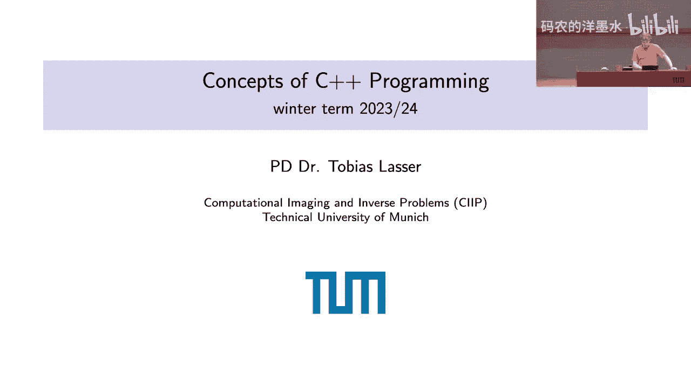

Most important information。 First， our feedback session today is called Z T， P， K。

And some of you have already found it。The stream should be working。 I just tested it。嗯。Right。

There's a few things I want a brief dimension。You've already received this information。

We are the modelodle announcement， as well。There has been a shift in the time of the exam。

 So the exam is now at 4 o'clock in the afternoon of February 22。

Because that was the only time we were able to reserve a sufficient room。

 sufficiently many auditoriums for the amount of people that are probably going to attend the exam。

But the other issue that we face is there's a number of auditoriums， at least 5， maybe even 7 or 8。

And。We don't know if we are able to actually manage that with the three people that we are。Cause。

 you know， we need people to do exam supervision B in several auditors at the same time。

 So I'm currently investigating if we can do the exam online。And if you do so。

 you will hopefully hear within the next few weeks， if we will do that or not。

The other thing is early December。 So December 4， the official cost evaluation will start。

I will take one of the December sessions。To。To show you。

 to give you a little bit of time to fill out the course evaluation， I will announce that in advance。

 I don't know yet which date I will pick。Right。So this。

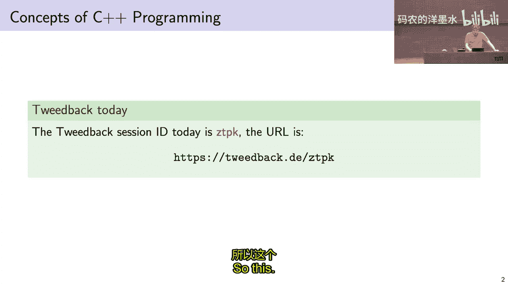

Before we get started， I wanted to share this information with you。Right， can I increase the volume？

 Are you talking about the auditorium。If so。Yes， I can。If you're talking stream， no， I cannot。

 I'm already at that maximum。Right。So。There's a strike going on by students and not just students。So。

Happy that you're here， anyway。Even if you are on strike， of course， if you are on strike， currently。

 you can watch this。Yeah。Later on， in the recording。

Will we also do pointer malloc free stuff in this course。 No。

 this course is about modern C plus plus。 You will actually learn next week how we do this resource management in modern C plus Plus。

 So don't worry。😊，We'll get there。Oh， and this is an interesting question。

 When a new seed version comes around。 So even C， the very old base language of Cpls receives updates occasionally。

 They are not terribly huge updates， but they are there。😊，And typically。

 C plus plus takes care that the language updates to C are also integrated in C plus plus standard。

 So usually there's no， no issue。But it's not 100% compatible。Right， so on the menu today。

 we have classes。Right， so how do we do object oriented programming in C plus plus。

 You've seen this already。 You've done it already in some of the homework assignments。

 So it's not terrible news that it's possible at all。

 And you've probably also seen the highlights of it already what we're gonna discuss today。

 a few of the details。 Most of this will be in terms of constructs and des because this will be very important for next week's resource management。

And since operator overloading is fun， well also talk about that。

So even though the agenda looks fairly small， there will be quite some information。

 If you compare it to last week's lecture where we did a bit of a tour to through the standard library of C plus plus。

From the topic， I was forced to already show a few of the advanced techniques we haven't introduced yet。

 This should be a bit easier going than last week。 But yeah， it's nothing complicated。 It's just。

Lengthy with a lot of exceptions， as usual。So a class， we've seen this already。

 And I'm pretty sure you already know what classes are used for to encapsulate data。

 to abstract them a away to provide interfaces and so on。 and so。 So。

 I' not talk about why you would want to do classes。 I As， you know why you would like them。

 or in some cases why you would not like them。Right。

 so in terms of how do we actually do this N C plus plus， it's fairly simple。

You specify the class keyword， and there's actually two。Either class orstruct。

 And now this also solves the mystery of what is astruct。 Well， astruct is a class。Right。

And then you do some opening curly braces， put some member specifications there。

And closing curling braces。 And what's a bit weird is that you have to put a semicolon after these closing curly braces。

 So it looks like a scope。It acts like a scope。 If you remember about scopes in our first and second week。

 this is the class scope。However， even though it is a scope， it requires a semicodon at the end。

Let thats that how it is。It's a bit weird， but that's how it is。Right。

 so you can pick any name that's a valid identifier just like for variables。

 And this is a list of declarations where you can have variables。Memer functions。

 which are essentially functions that are specified within the class。

 or you can nest types into it so you can have aliases， and you can have other classes。

 So this is one of the few locations in C plus where you can actually nest things。

 You can have a class inside a class inside a class。😊，Prob won't do this too often。

 but it's possible。 Where， for example， if you have a function。

 you can't nest a function into a function。But， of course。

 we can get around this with Lada expressions。 So yeah。

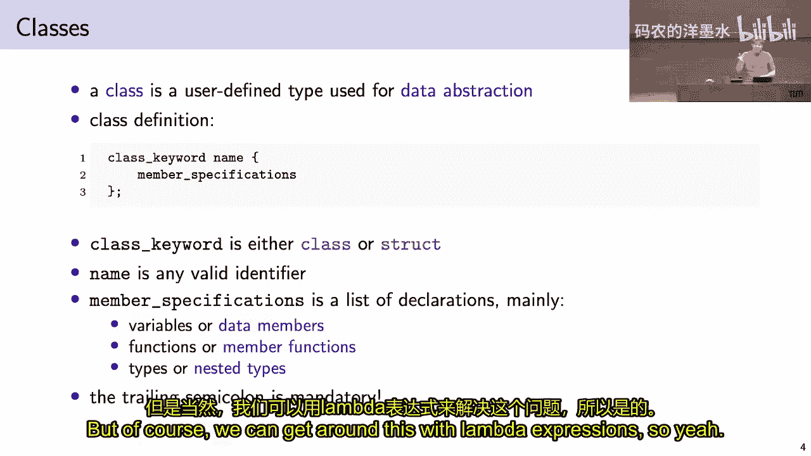

So let's talk about these members， that data members。Which assume simply variable declarations。

They need to have a different name than the class name。

 because the class name itself is a special member， which we'll talk about in a moment。

And you can initialize those variables， as usually， you don't have to， but you can。

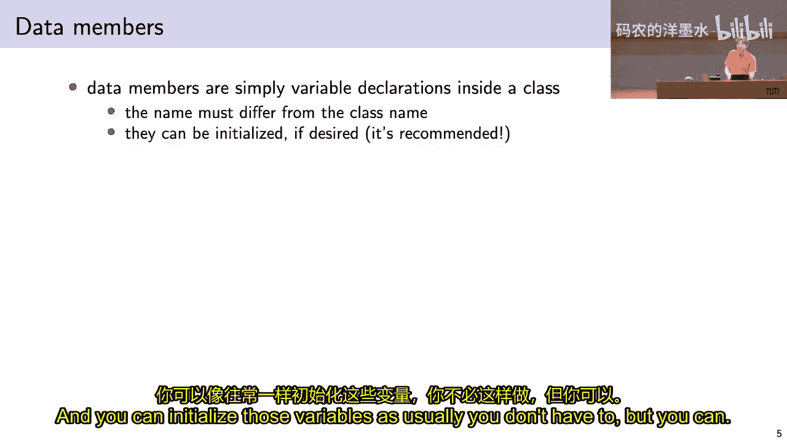

And as usually， it's recommended。There's a few details。The declaration has to be a complete type。

 So the compiler needs to know at that point in the code how big。

How much space does it have to allocate？ So you can't use forward dec types here。 And if you ask。

 what is the forward declare type， I will have a slide on that in a moment。嗯。As usually。

 you can have modifiers on your data members。 X is not allowed because it doesn't make any sense。

Static is allowed。 So the static modifier makes out of that member variable aesthetic storage variable。

 And you can also add thread local。 And of course， you can also add cont if you want to。So。

What's the difference between class in， We'll get to this in a moment。Some patients。Right。

 so example，struct full。So， it's a class。The thestruct keyword。

 there's a difference to the class keyword， but it's a minor1。And we'll get to it。 It's called F。

And one of the typical naming conventions is to have classes， have capital first letters。

You don't need to do this， but it's a fairly typical naming convention。

Then I can declare a variable I of type integer。 I'm initializing it with a value of 42 can declare a string。

 I'm initializing it。 I can declare a vector。 I'm not initializing it。And in fact。

 this vector probably needs a type here。Because otherwise。

 the compiler wouldn't know what kind of factor this is。 So that's actually error in the slides。

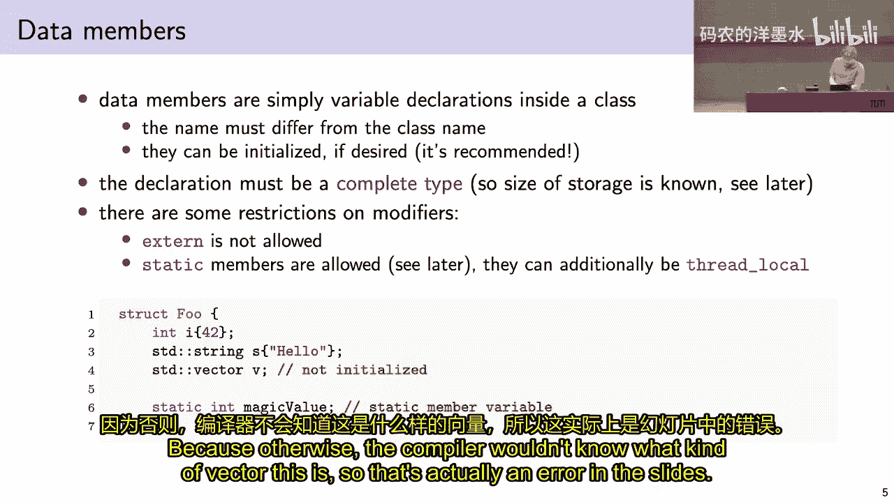

And here you can see we can have a magic value that we can make static。😊。

So what does this mean if I have a static variable。

 It's similar like if you have a static variable inside a function。

That will be a value that is persistent through function callss。

 And if you have a static member variable， that is a value that's persistent through all objects of the class。

The weird thing is， well， it's not terribly weird if you think about it。

 but something that might be unexpected。There is， you don't need to explicitly define these regular member variables because as soon as you will declare or define an object of type food。

 the memory for these will be allocated anyway。The static things are not related to the actual object。

 So you have to define a memory location elsewhere。 So you have to have a statement in full colon。

 colon， magic value somewhere else to actually reserve the memory。😊，Why is external not allowed。

 What is external used for。External variables。That are declared。Most likely。

 in another language that are defined in another language。 So it's a declaration so we can use。

Variables from a module that was compiled with a different language。

That language is not gonna have C plus plus classes。

So there's no point of having member variables external。And， as usual。You can。Actually。I think。

 but I'm actually currently not sure。 Let me open my van parts instance or hold on。Can I do that。

 Can I do that。So you don't see what I'm typing， but it's essentially just testing。

 if you can auto declare variables in the class as auto。 And I think you can if you initialize them。

 let's see if I'm correct。No， you can't。Okay， I'm not correct。

 So no auto data members are not allowed。I just tested it。 I wasn't sure myself。

I would have said yes， if it can be invert， but apparently， no。

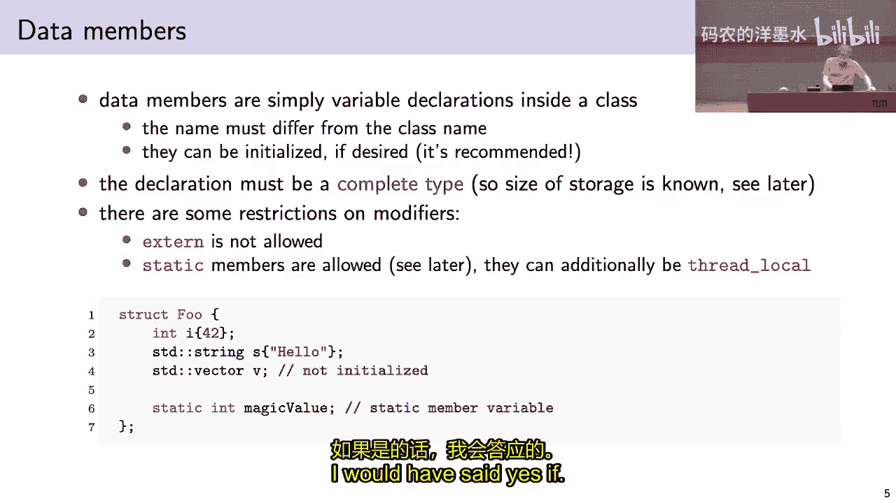

So now you have a class。 You have member variables。 Now I'm calling the class bar instead of full。

And I have a con data member。 So obviously， I can't modify this anymore after any sization。

So if I instantiate a member of this class bar， let's call it B。

 I can access the members via the dot notation， which you've already seen。嗯。And yeah。

 I can use them for operations。 The non cons variables I can modify the cons variable I can read out。

 but not modify。Now， if you have， for some reason。A pointer。A raw pointer。

 which typically you shouldn't have because that's not modern C plus plus。

 But in case for some reason， you do have a raw pointer， which you could。Create like this。

 taking the address of another bar object。Sttoring it in a pointer to a bar object。 That's possible。

 That's valid。 It's just， you shouldn't do it。Because that's no point， really。

 But just to illustrate， if you had a pointer for some reason。

 and this is just the shortest way to get one。You could dereference the pointer like the dereferencing operation you've seen with optional and and other standard library data types or iterators to access the value。

 And then once you have the object that the point is pointing to， you can use the member access。😊。

To get to the variable I of that instant C of the bar class。For shorthand notation。

 mainly to avoid the parentheesis， you can also use this error notation。 It means exactly the same。

Right， and that's some fun stuff you can do。 You can actually overload。 This is an operator。😊。

For the class， and it can be overloaded， so it can change。What this kind of statement means。

 it's nasty because， of course， you have a very strong expectation because that's how it works in the rest of the language。

 But for your data type， you could overload it。

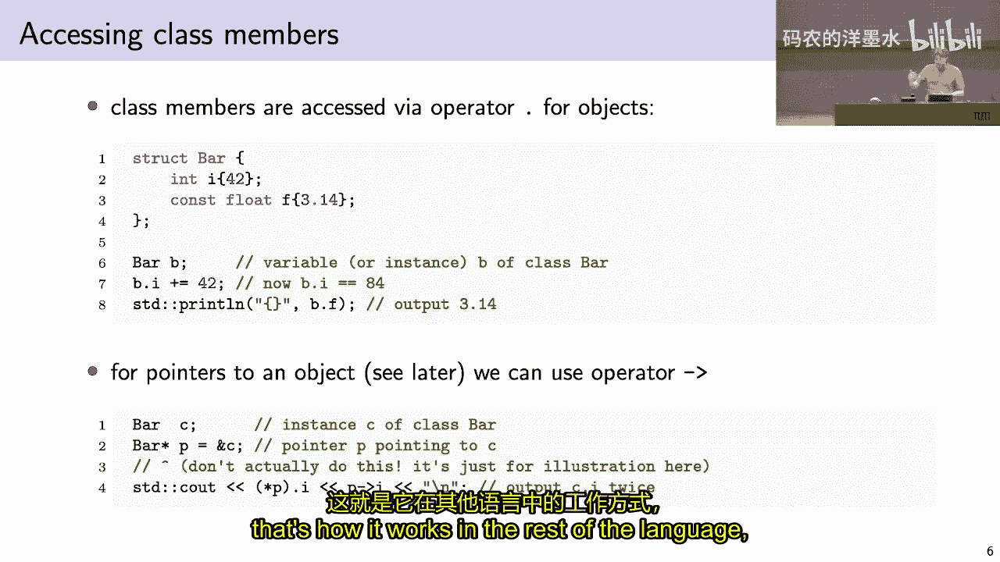

So how do you do the overloading First， we need member functions。

 So member functions are basically just like member variables， except they are functions， right。

 So you declare them inside the class。You can have modifiers like static。

You can have vifiers that something new。That you haven't seen before。

So if you have a non static member function， you can qualify it as cons。Or with a rough qualifier。

So this is just an overview。 we will talk about each of these things later today in all of these three cases about the virtual functions。

 we will talk about them in two weeks actually。 so that is really later。And in addition。

 there's even special member functions。 and they are really called special member functions。

W whichhich we'll talk about in a bit。Which are the constructs and des and the overloaded operators。

 So just to get， for you to get an idea what this can look like， you can have。

A simple member function， Fo， no arguments， no return type， no qualifier， no modifier， nothing。

 It's just a regular， non static member function。Then you can have a function that is conqu。

Meaning the con follows after the parameter list。And what this means we'll talk about in a moment。

 So don't ask it。We can have a static member function。Talk about it in a moment。

We can have a constructor that is a special member function that's called exactly like the class。😊。

And now， you know why you can't define variables that are called exactly like the class name because that is reserved for。

Constructors， thesestructs are the class name prepened with a tilde character。And again。

 we'll talk about them later。 And here's an operator， for example。

 the comparison operator that is overloaded for this。Use a defined data structure。 And again。

We'll talk about details in a bit。Os， wrong window。

Can you declare a static variable inside a function。Yes， you can。

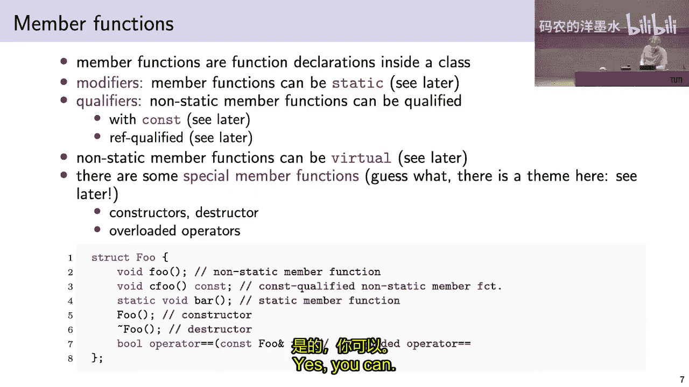

We've seen this already。In previous lectures， right。

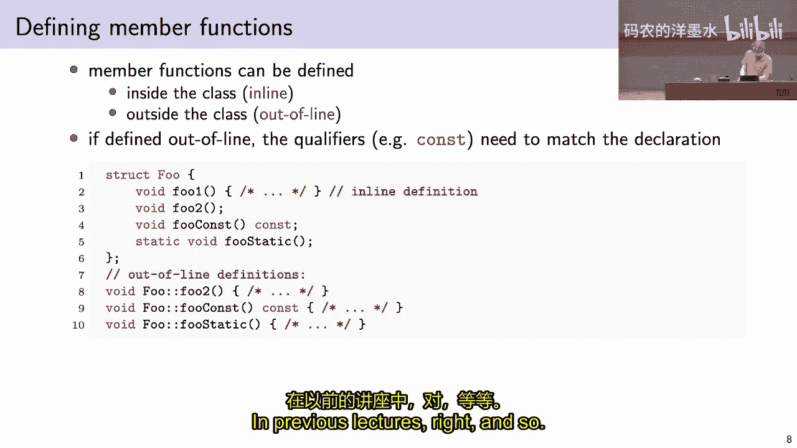

So。Now， these are the declarations with various things that we haven't talked about yet。 Now。

 let's first talk about the definition。 So what is the actual function body。

 What are the functions doing， There's two options You can do them in line inside the class declaration。

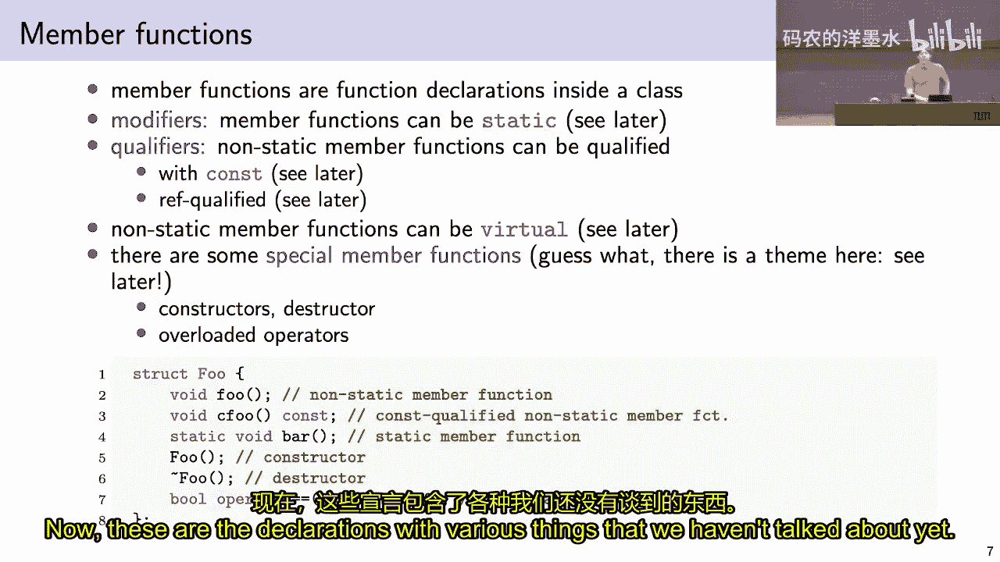

Or outside， which is called out of line， right， So examples。

Fu one here would be a function that is defined in line of the class because you put the body of the function right there。

At the declaration point inside the class declaration。You don't do this for the other functions here。

So in order to define what they actually do， you have to do it out of line。Somewhere else。

 And typically， what you do is you put。The declaration of the class in the headerophil。

And the definitions， the out of line definitions in a source file， why。

Because you're probably going to use the class in multiple modules of your program。

So you will include it in multiple locations。And you only need the interface。

 and the interface is fully specified by the class declaration。

 So it's sufficient to just include the declaration that' faster to compile。It takes less longer。

And it's faster。So yeah， that's why you put the declarations。

 usually in the header file and the out of line definitions in a source file。

 So you have to compile this only once because， of course。

 the actual code usually takes longer to compile compared to the declarations。

There are some special cases like templated code where you do prefer to have things in line like this。

But we'll get to this later， surprise。I'm gonna say that a lot。Today。So yeah。

 what I've said is on the slide。 So I'll skip that。

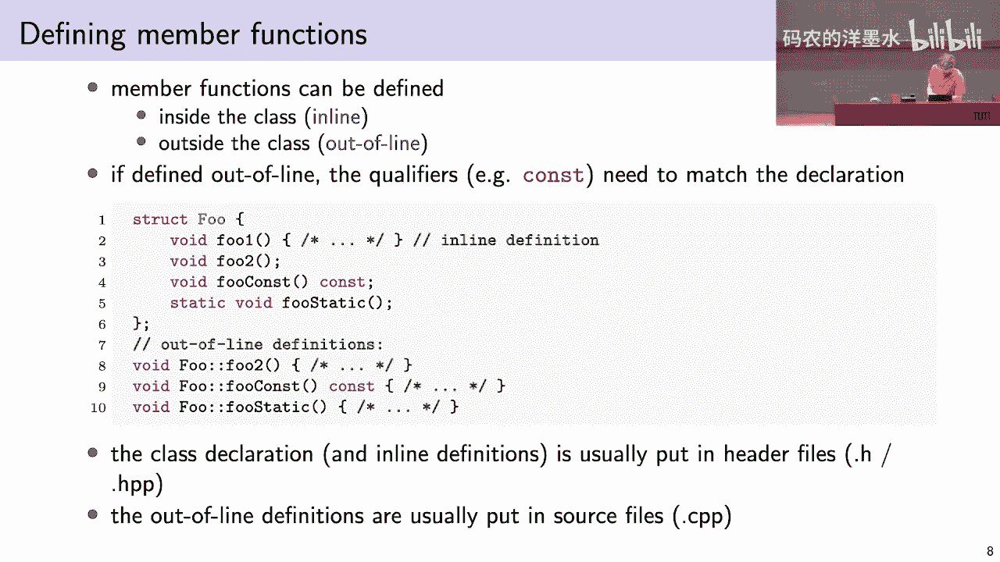

Right， so let's talk about。Let me actually see。What。have a slide about this。 Sorry。

 I'm briefly jumping through my slides because this year is too small。

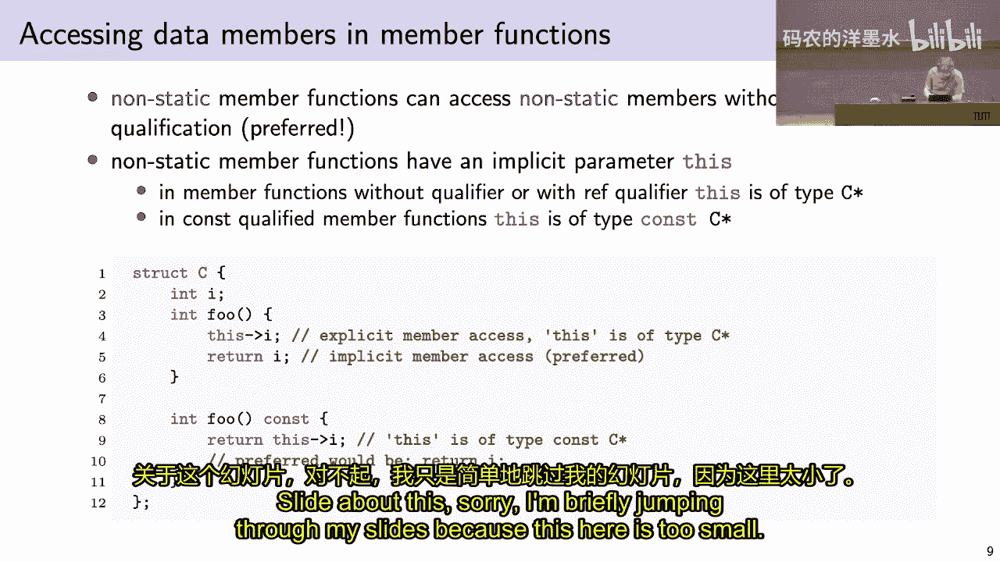

Friends， right， no。

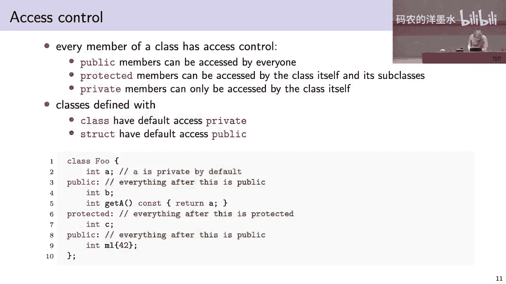

Okay。So let's stick with a non static。Member functions， for now。

And if you are in a non static member function， you can access the non static member variables。

Interesting part about these non static member functions that they have an implicit parameter called this。

That's。Basically， always there。And you can use it if you want。

 And it basically is a pointer to the current instance of the object you're working with。

So the extra type of the this pointer is a pointer to the class type。

If you have a constant qualified member functions， it's a constant pointer。

And I don't want to really talk about pointers。 Consider pointers， like references。

And one of the special things about references was that once you set the reference or once you would set the alias。

 you couldn't change。What it is alienliasing anymore。 You can do this for pointers。

 but for all effects and purposes。It's still， it's， it's a similar mechanism。

 and it works almost to same。Now， what you can do now， if you are in a function fool in astruct C。

 in a class C， you can access the member variable I using the this pointer and the arrow notation。

But you don't have to。You can just refer to I like this， and I would say。This is the preferred。

Way of doing things。 Of course， if you're coming from some of the other languages where this is always used because you have to use it。

It might be more。The common for you to have this， this thing here。

 I think it makes for less readable code。 But anyway， that's my opinion。No。

If you have a constant annotated function and here we already see what it does。

 it doesn't allow you to change。The member members。

 because this pointer is a constant pointer so you can't change these stuff that's pointed to。

And that makes sense because if you say the function is constant， you're promising。

Or declaring that your function is not going change the object state。

We don't need supervision during the exam。 We are all very honest， people。I'm sure。Now。

 this is a good one。 I don't really understand why we have to declare the static member member variable elsewhere。

 Well， it's static。 that means it's alive for all of the objects that you potentially create of this class。

😊，It exists only once。 So it's not created when you create an object of the class。

 but it already is created before you even create any of the objects of the class in the way。

This is done plus。 is you have to。Define the variable somewhere else。That's just how it is。

 Basically， to allocate that。呃。That memory further readable。

Can I use auto food to define the function out of line。 No， you can't。 You have to basically。

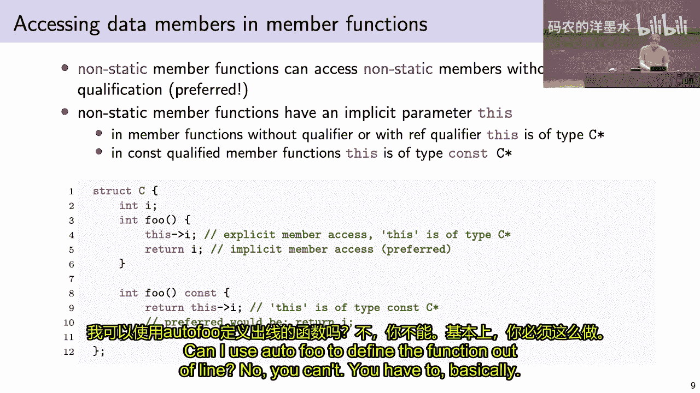

Repeat everything that's already there。 Yeah， because it has to match。

Do you recommend overr operator something。Depends。

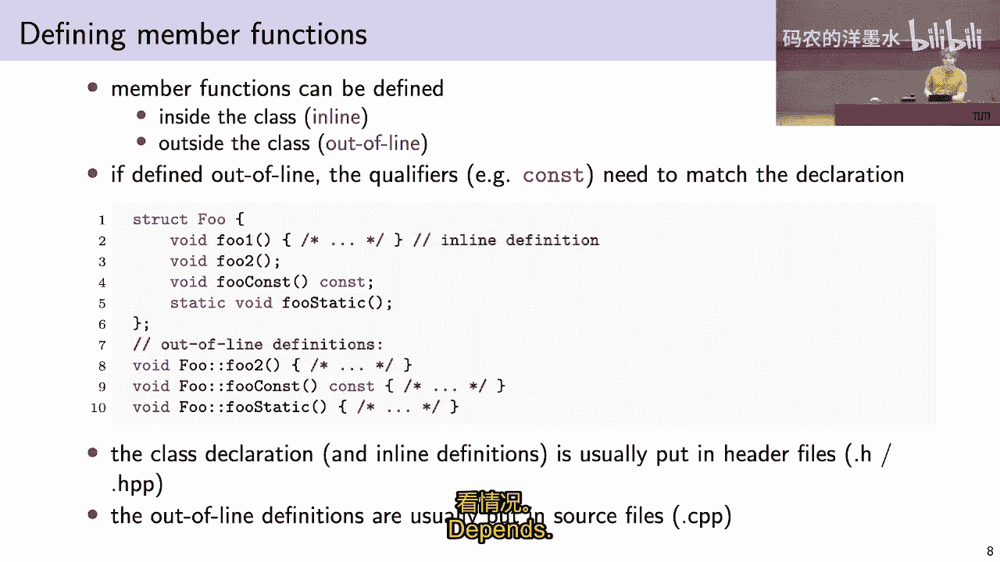

The equal operator that I showed in the previous example。Is， for example。

 sometimes a very useful operator to override because if you w to compare two objects of type  Fuo。

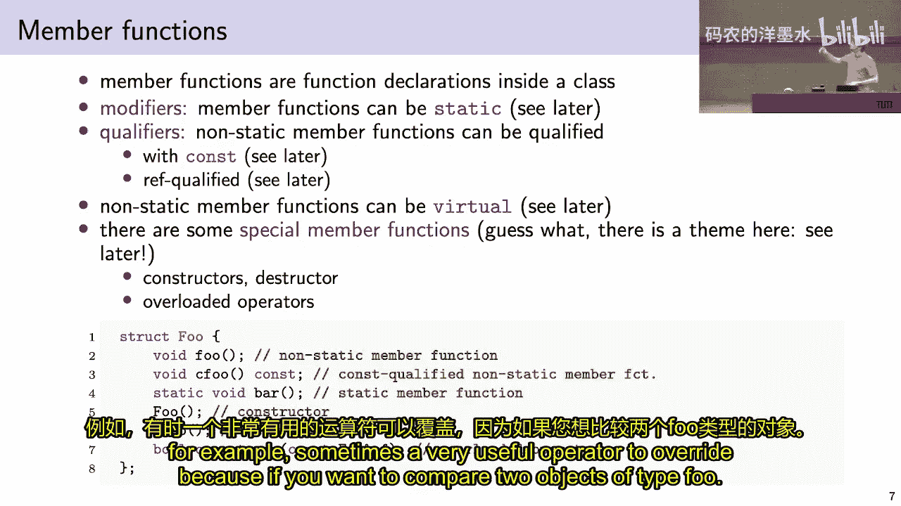

By default。There would be a default comparison operator that does a bit wise comparison of the objects。

If that is fine for you， you don't need to override it。

If your class is a bit more complex than this one， you might have to override it。

 There's not a member function is equal or something that doesn't exist inency plasma。

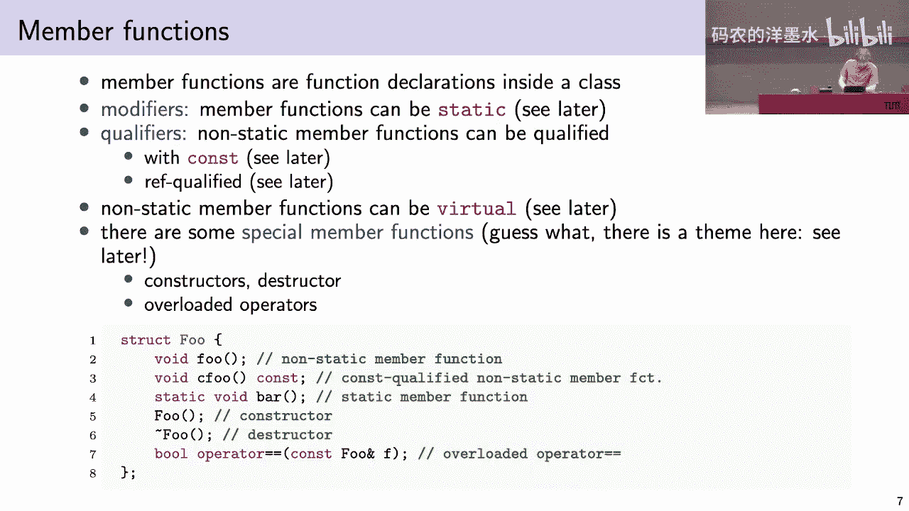

Right。So now， as I mentioned， you can nest user defined types。

 so you can have astruct B inside of Instruct A。 And， of course， once you instruct B。

 Instruct A is available for your use because you're nested in there。So， if you wanna do。

Access stuff from a。It's fine。And this friend thing， we talk about this in a moment。But basically。

 the idea is， if you have a private variable here in the class。

 A that is not supposed to be accessed from anybody else， except。Oject of type A。And here。

 since B is nested， it's an automatic friend。 and you can do this。

And it acts a little bit like namespaces。 So if you want to instantiate the B directly。

 you basically do the namespace notation with the double code。

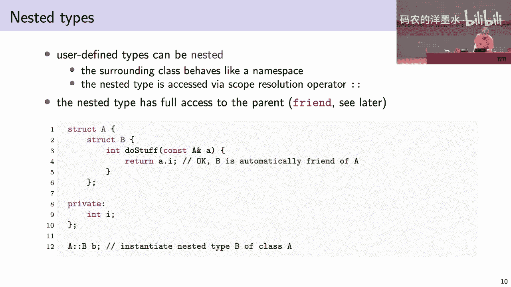

So now we get to the difference。Of what is astruct and what is a class。 What's the difference。

 So first is access control。 Each member be it a variable or a function can be public。

 So it can be accessed by everyone。 It can be private， which is the opposite。

 It can only be accessed by class。 the class itself and protected as somewhere in between。

 It's kind of like private to everybody outside but it's available for access by the class itself and derived classes。

😊，But then again， I have to say in most code， you will only see public and private protectedect is pretty rare。

Now， the difference between a class and abstractstruct is that if you open a class。

 the default access control is private。 If you open astruct， the default access is public。

That's the only difference。Why are there even， two keywords？Why it not just class。

 Well it truck was a thing from C。 They took it over。

 And the most useful thing was to give it a slightly different meaning than class。

 And that's basically。The difference。So if you do a class， it's by default private。

 So the first variable you declare here is gonna be private by default。

Then you can make things public by stating public colon。

And then everything that follows is gonna be public。 Then you can say protected。

 Then everything that follows is gonna be protected。 And it can say public again。

 So you have more public stuff。 But， of course， you wouldn't do that。

 Since the class declaration is an interface for the user of the class。

 You typically put the public part。 at the top。Because that's what the user cares about and put the private and protected parts at the bottom。

 because that's usually implementation details that the users do not have to care about。

Can you go one more time over why we prefer having header files and implementation files。

 If there's time， I will do it。Later， in the class。Otherwise。

 I'll answer it in writing after the class。Oh， that's an interesting question。

 There's a no discard attribute。That is。2 square brackets。 This is。

A so calledled attribute that was introduced in modern C plus plus。 And notice discard。Is a function。

Whose result you cannot ignore。So in the homework assignment。

 there's this its valid S Q L query function that returns a Boolean。

 and it's qualified with a no discard attribute。This notice card attribute says you have to store or evaluate the result of the function somehow。

 So if you just call the function is valid S Q L query without storing or evaluating the result。

 the compiler will say， you can't ignore the result。 you have to do something with it。So no。

 it's not an alternative of X。 It's an attribute that tells the compiler how the function is supposed to be used。

What exactly does Kst。The constant annotation of a function mean， like this one here。

It means that this particular member function get a can access all the member variables of the class full。

But it can't change any of them because it's a function that by virtue of its interface promises not to do so。

So， the compiler will also。Complain if you try to change things。

Why do questions regarding the homework homework on Zullip keep reducing。I would hope that it is。

 because。You got started or the stupid。 excuse me。 All the basic C make questions are gone。Almost。

All the compiler issues。 Oh， my compiler doesn't support C plus plus 20。

 Oh it says it supports C plus plus 20， but actually doesn't support this C plus plus 20 feature。

 Those questions are mostly gone。Which was a lot of the volume。

And you're getting to the actual programming part。 And as intended。

 the actual programming part is not that terribly difficult。So， yes。

 there's less questions because the homework。It's kind of easier。

 The initial hurdle of setting things up with C plus plus， getting C make to work。

 including dog test and all this stuff is a bit painful。So， that is done。And， of course。

 the other reason is。Less people are。Doing the exercises。

So the usual name of the game is also the attendance here in the auditorium or in the online auditorium week by week。

 The number of active participants goes down。That's either because you're bored of me or bored of Yas or bored of the。

Content of what we do。Or you said realized you took too many courses this term。

 and you're kicking some of them。There's plenty of reasons。Why less people do things。

 But it's a completely normal trajectory。Tiktok eboy， look。What the fuck is that。

I don't want to know。Thanks。It a static member variable useful inside the private section of a class。

 Yeah， why not？ you can。 if it's useful， depends。Right， so， okay， now we have public。

 protected and private members。 Sometimes we wanna break the excess control。

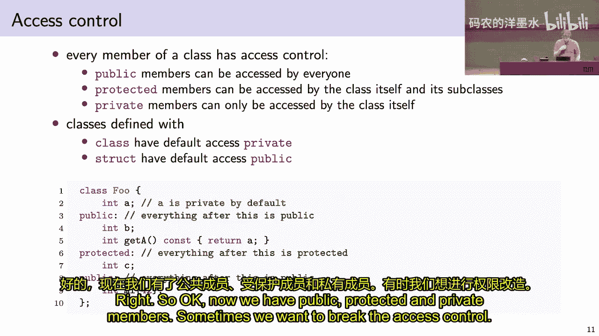

This is what friends are for。At least in programming languages to break access controls to。

 to kind of。Get over the hurdles of excess control so you can put front declarations in the class body。

 So granting the friend， this could be a function or another class。

 access to the private and protected members of the class。

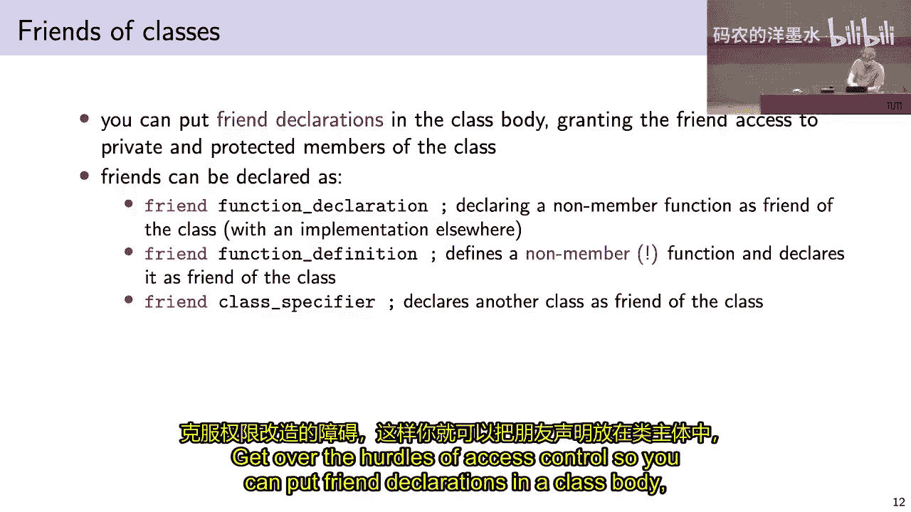

So you would do a friend function declaration to declare a non- member function as a friend of the class so that it is able to access the internal parts。

You can also do。The function definition immediately， not just the declaration。

 but also the definition in there， which is a bit weird because it's inside the class declaration。

 But due to the friend keyword， it's not a member function， but it's a non member function。

But it's defined inside the class。 This is a bit weird， but you can do it。So that's not。Yeah。

It's not recommended to do so。 And， of course， you can have a class as your friend。

A friendship is non transitive。 So if I'm your a friend， that doesn't mean you are my friend。

 And yeah， that's how it is in C plus+ as well。And， in fact， you can declare these friends anywhere。

 It doesn't have to be in the public or private part。 It doesn't matter。

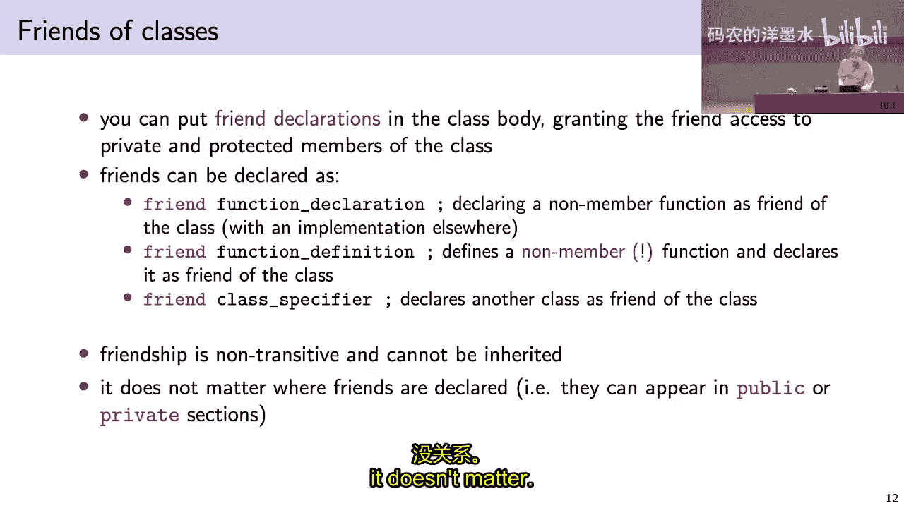

So， example。嗯。Class A。 So it's a class that means by default， all the members are private。

 So everything here is private。 The variable A is private。 Oh， these are friend declarations。😊。

They don't matter。 They are neither public nor private。 So class B is a friend of A。

 So this class B here。 So the function fool that takes a is an argument can actually access the private data member of a because it's a friend。

Declared here。I can declare a non member function fo as a friend of this class A。

 So if I have this non memberm function fo， I can also access the private parts of a。

Because it's a friend。And I can also do。A class， a function declaration and definition right there。

It's a non member function， even though it's declared inside a because the friend keyword is there。

 And， of course， since it's a friend， I can use private variables。And as you see。

 I can also have class B， have a friend so that class B。Oops， okay， so this doesn't work as expected。

 because if C is a friend of B。And B is a friend of A。

 That doesn't mean that C is automatically a friend of A。 So this actually doesn't work。

 So C cannot access private stuff from A because it's not explicitly a friend。Right。

I went from having no friends to having friends in C plus plus。 Absolute win， indeed。Same for me。

What is your main champ in Lo。League of legendds。 Oh my God。 In't that like years out of date。

 I don't know。 I'm no no longer gaming anyway。Should we rather use classes because。Default。

 private is better。Depends on what you do， maybe。Actually。

 I'm falling in love with C Plus as I learn more about it。 mission accomplished， thanks。😊。

Started off bed with Cm。 Yes， and Dogy syntax。Yes， still dogy， by the way。Yeah。

 you see plasma is cool。Are we going to discuss testing specifically4 C plus plus。

What do you mean by testing， Do you mean unit test， integration tests， testing frameworks， If so。

 our answer to what testing framework is cool。You've seen it already in the Homeworks。

 It's stock test。 We like it quite a lot。嗯。That's nothing really special for C plus plus in terms of testing。

 You have a unit testing framework。You do the usual stuff for testing。 It's yeah。

Nothing we will talk specifically about。嗯。What parts or when are parts from the Bo library transferred over to the C plus standard。

 extremely rarely。😊，I think file system was from boost。 That wasn't C plus was 17。For C plus 26。

 they've approved a linear algebra library that is kind of a bit using boost U B as a motivation。

Smart pointers were transferred from boost， essentially。 But then again， this was not。

So booth specific， there were others。嗯。There's a few things from booze that have a chance to get into the Cpl standard。

 But it's actually， that's very few libraries that do make it。

Format and ranges are two examples of bigger libraries that made it into the plasma standard。

But those are not from boost。Right。Let's continue。Forward declarations， I promise to talk about this。

 So I'll do this。 Now。 You can forward declare a class。 What does this mean you're saying class name。

 colon， semi colon。So essentially， you're saying this name is a class。

 but I'm not telling you what it contains。This is called a forward。Declaration。

It's an incomplete type， obviously， because it lacks all the content of the class。

But the good thing is， these incomplete types can be useful。So， for example。

 if we have a class A that's referring to class B， but class B is also referring to class A。

That's a circular dependency that you can't break other than using the forward declaration。And。

 of course， since the type is incomplete， you can't instantiate anything。

That is just foreverva declared because the compiler doesn't know how much memory it will need。

 So it can only use it for references or pointers。 Since we don't do pointers。

 it's essentially just references。

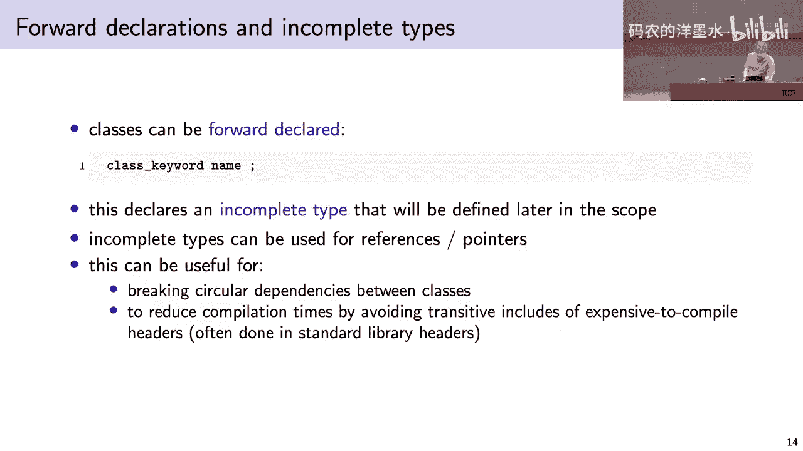

So， example。Theres a class called a， but I'm not telling you what it contains。

 There's a class that's called class from an expensive header that I'm not telling you what it does。

But the name tells you， it's probably a very big and complex class。Now， you can。

Have another class that uses this class from the expensive header as a reference as a member variable。

And you can also use a reference to a， which was another class that's probably declared as an argument for this member function。

 fo。And so on。 And， of course， you can still do。Reference to B。Because B。

Knows how much space it needs。 There's just one member variable。 It's a reference。

 so it needs a storage space。That is necessary for a reference。Now， the idea is。

That you're including the expensive header。Only in the source file， Foo。

 where you actually define the function Foo and probably need this stuff from the expensive header class。

Right， and the idea is now， since you only include the expensive header file in the source file and the source file is only compiled once。

 So you only include once。You pay the price for passing that expensive header only once。

 If you would include the expensive header， like you would typically do in the header file F by doing an include expensive header here。

 Then everywhere you include the full header。 you also include the expensive header。

 So you make compilation of the full header。Longer。And the standard library， for example。

 uses this technique quite a lot。Because a lot of the standard library classes are very big and complex。

So it uses these further declarations。And pointers and references to these four classes to speed up the compilation。

 because the standard library is big and complex and compiling it all every time you include the standard library somewhere。

Would be horrible for compilation times。You don't see the compilation time issue in your homework assignments。

 These are tiny programs that probably if you have any kind of decent machine combined more or less like this。

 right， So you don't see that issue yet。 But as soon as you get to a few thousand lines with a few templates and a you header and source files。

 you will see that compilation can quickly take a few minutes up to a few hours depending on your project。

And if you look at it， for example， if you've looked at benchmarks。Of processors。

One of the typical benchmarks is compiling the Linux kernel。Yes， as a C。

 I know it's not strictly speaking C plus plus， but still， for example， back in my days。

 when I was compiling Linux kernels more than 20 years ago。These compilations took up to an hour。

Because the computers better horribly slow back then。Nowadays。

 we are below a minute on the powerful systems。 So yeah。But even then。

 a minute can be annoying if you have to wait for a minute for everything to recompile。

 So trying to make compilation fast is something that's worthwhile。

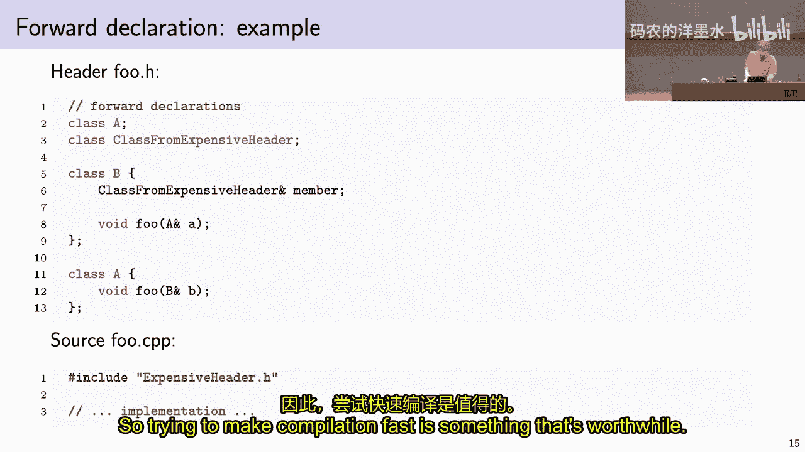

Now， since we am。Have a question about。Const， let's answer this。

So we can have member functions at our cons。 These are member functions that promise to not change the state of the class。

So you cannot change the object。So let's see an example。 class， Where's my pointer。Here， class A。

Private member I， public interface， get and set。And oh my God do I hate this kind of interface。

 if you have。Public Ed and said， why don't you make the variable non private。But anyway。

 some languages like it like this。 And you can do it in C plus+ 2。 And， of course。

 there might be a reason to do so because。Yeah， at least it doesn't make any sense。 In this example。

 you could just make eye public and be done with it。But anyway， the getter returns the value of I。

 And obviously， it's not gonna change I because it's just returning the value So it can mark this function as constant。

Cause it's not going to change the state of the object。The set function， obviously。

Is going to change the variable I because set， that's what set does， right。

 so it can't be declared constant If you did it， the compiler would complain at this instruction and say。

 hey， you're changing the member state， even though you promised not to do so。

So why does it make sense to do this。Because you remember。When we talked about argument passing。

Our recommendation was。Small， easy to copy variables。You pass them by copy， by value。

And larger classes like string or more complex or vectors or stuff like this。

 you pass by constant reference in order to avoid the copy。

And the cons reference is to make sure that you don't change the state of the object during the function。

 to promise the caller， Im not touching your arguments。

 They will be left unchanged even after I execute。 Where if you have a noncons reference。

There's no promise that you don't change it and anything could happen to it。 In some cases。

 you want it， like if you have an in out parameter。But in some cases， like this one， you don't。

And now you see the difference。 If you have the non const A， you can， of course。

 call a cons function。 It's fine。On the con a， you can call a con function of the fine。

 But if you start setting things on the con A， that's not gonna work because the con a。

By definition here， by the declaration here， sorry， not by the definition。

 promises to not be changed。 So you can't call a non con。

And since we use constant references as parameters all the time for efficiency reasons。

This kind ofness。It's important to do。 So whenever you see a member function that is not changing the object state。

 put a con modifier there。Good practice。 And the thing it's called con correctness。

There is a few ways you can circumvent this。I'm not gonna give you ideas how。

 except for one is if you have a variable that's declared mutable。For example。

 if you put the keyword mutable in front of this int eye。

Then even constant functions are allowed to change that particular variable。Why is this there。

Think about a complex class， doing something complicated。It might have a cache。

For efficiency reasons。And even though you are。Calling a constant function。

Which doesn't modify the public state of the class。 You might want to update your cache。

Even if it's just a read through your public state of the class。

 So this is what mutable is there for。 If you need。

 if you have private storage that doesn't reflect the public part of the class。

 that could be changed even by a con function。 And typically。

 the prime example for this is something like a cache。Otherwise。

 don't do it because you are just confusing things。

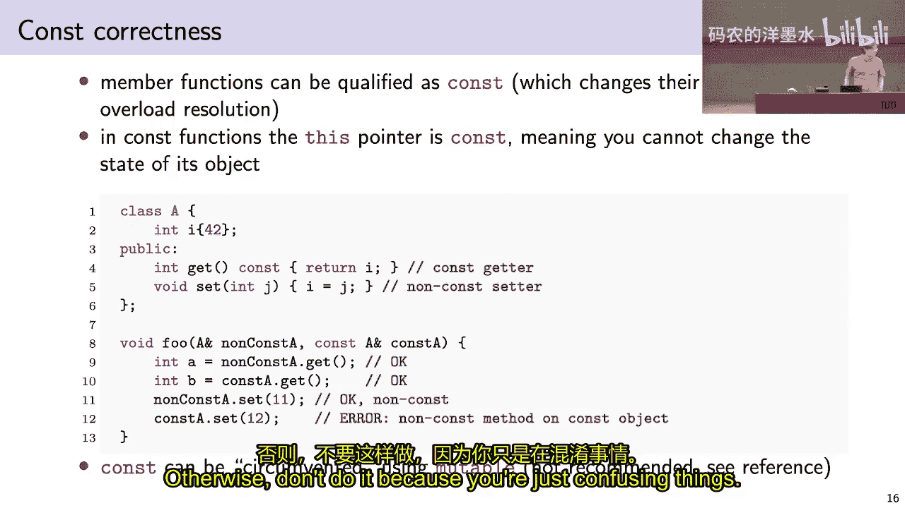

Now， the interesting part is， this const is also used for overload resolution。嗯。So。

Before I read this stuff， let's just look at the example。 So I have a function get a that's non con。

 have a function get a that is cons。So I can have the same function name。Different function bodies。

 because const participates in the overload resolution。 So these are two different functions。

 even though they have the same name。And I can do the same for get B。I can have it as con。

And I can call get a。Now， of course， the question is。Which get A is this calling。

But it's quite obvious， since this is a constant function。It's the const get a that is called。

To declare a fool and a con fool。Somehow， I can call。Get a on the non con fool。

 and it will call the noncon function。 So it returns one。I can call it get B。

 which is the con function。 So it will call the con function。 So it will return the value to。

And I can call it get C。It doesn't care。 It just returns3 all the time。Now。

 if you have the con variable C fo， you can call get A， and that will call the con version of a。

 You can call get B because it's a constant function。 and that always calls the con function get A。

 which returns to。 And if you try to call get C， this gives you an error because a cont。Object。

 a constant reference here cannot call a noncon。So， this is sometimes useful。ETo do。

Because the con version does some easy operation， The non constant version。

That's some more complex operation。Why do we need non member functions。strictlyricly speaking。

 you can wrap everything in a class and every function could be a member function。

That's like Tra does it， as far as remember。So you need a class for everything。

 even though if you don't， you're not really using the object oriented paradigm。C originally。

 as C plus originally comes from C， and C doesn't support object oriented programming。

 So that's the main reason why there is。Non memberm functions。

But it's also even in these modern days， non member functions are。Cool。

Because sometimes you don't need a class。 If you're not storing state。

 if you're not doing an interface， why would you need a class。That's why they are nonme functions。

What does it mean const， I hope I've explained this。Static。Means that whatever it is。

 has static storage duration， meaning it exists through the entire program。

For all the instances of that class。That is， for example。

 if you wanna have shared state of all objects of the same class。You could do a static variable。But。

 of course， you would then also need static member functions to actually access。

Or work with that without accessing an object。 Of course。

 the object itself can access also the static member variables。

But the use cases of this are fairly few。 so don't worry too much。

Friendship is neither symmetric nor transitative， yes。Does inheritance exist， yes。

We deal with it in two weeks。Why in two weeks。Because next week。

 I want to talk about memory management and resource management first。

 because that's more important than inheritance。But for that。

 I need today's class about constructs and stuff， which I get to in a moment。

 So that's why the O O part is split in2 and the resource management is in between there。Oh。

 that's a good question。 Is there any program that optimizes compilation and or tells you if you recompile something very often。

Yeah， you you use the build system for that。 The build system。Make sure that you only。

 reboot the relevant parts。Of your coat， and not everything。A lot of questions。 only should。

 I answering all of them in writing afterwards。 I'm just deciding which  one I should answer now。

Am I the only one who prefers piazza over Zullip。Pazza is very nice because it offers a lot。

 I personally hate the interface。But that might be just because I'm not used to it enough。

 And the other thing is。It's not hosted here。 It's not hosted in Germany， so。

We are not allowed to use it。Sullip is hosted by ourselves here at Tom。

 So if we are allowed to use it。 same for Slack or any of the other commercial alternatives。

Not allowed。Right， oh， ref qualifies， fun topic。

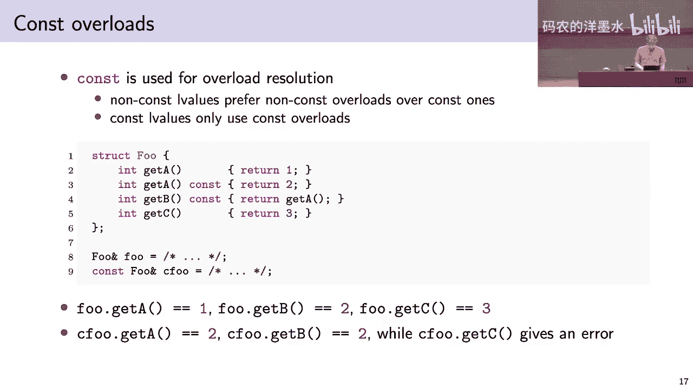

That's something you will see， extremely rarely。So don't worry if you don't get it in the first go。

Like the con qualifier， there's a ref qualifier， and it looks weird because essentially。

 it allows you to add an M percent after the argument list of the function and a dual M percent。

If you do this， you need to provide both versions。And you can。Mix and match。

You can also do overloads。You can also do con。Yeah， so you can mix this。 But if you do overloads。

All of the overloads have to have。The ref qualify either this one or the other one。 Now。

 if you're thinking about it， why would you want to have that。So essentially。

 this is for an L value ref qualifier。 This is an R value ref qualifier。

And if you look at the example， So I have a， I have a string S that I'm storing in thestruct bar。

And I have a constructor。That by default initializes that string。

 And we will talk about the construct syntax in a moment。

 that default initializes the string to anonymous。But you can provide a different string when you construct it。

 And here I'm。Constructing an object B of type R， where I initialize the string with redt pop。

Because it's a cool name， right。So if I call it foo， now it has to decide which of these fos to call。

Now， the B is a named object of type R。So it's an L value reference， right。

 So it will call the first version， which。Prints out the string followed by normal instance。

 And since what we initialized the string was f Bob， It says f bo， normal instance。Now。

 now I'm creating an object bar。With no arguments， So it will use the default value for the string。

 which is anonymous。And call the function fool on this temporary object of power。

 which will be immediately destroyed after the statement。Because it doesn't have a name。

So since it doesn't have a name， it's an R value。And this is what the R value overload will do。

The R value function will be called this fo， which will assess anonymous， temporary instance。

 And this is exactly what will happen。So now you ask。Why do we need this。

It's extremely rarely that you will need this。 Like really rare。

 I think I had one instance so far in my program career where I actually needed this。

But just so you know that it's there because I think the first time I saw this in some other code。

 I was like， what the fuck， I didn't even know this syntax existed。So yeah， here you are。

 It's called a ref qualifier， and it allows you to overload two functions based on what type of object you're calling those member functions with。

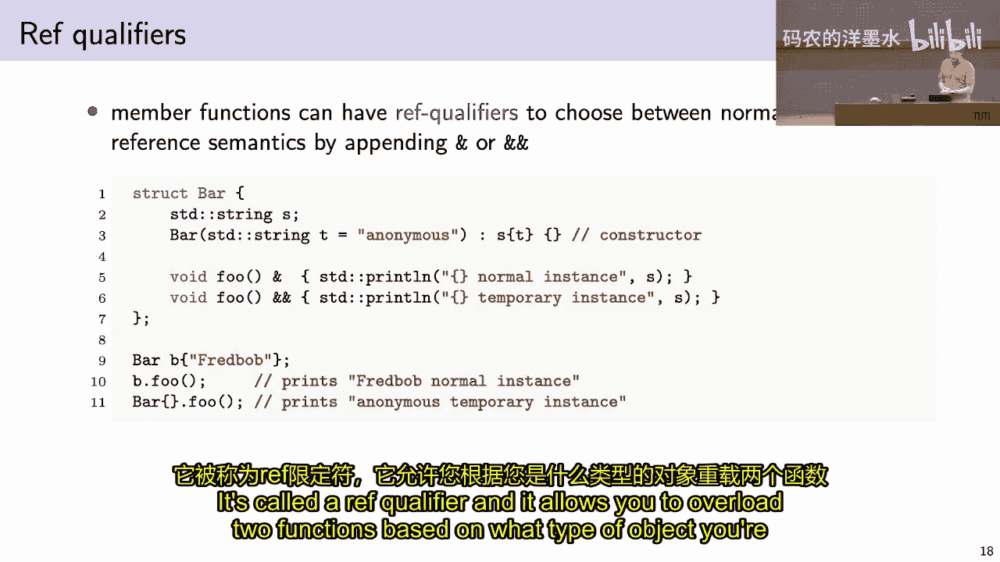

Right， now there were questions about static class members。

 So let's talk about them in a bit more detail。Class member variables。Can be static。

 and class member functions can be static。 And， in fact。

 they act like regular static namespace elements or global static namespace elements。

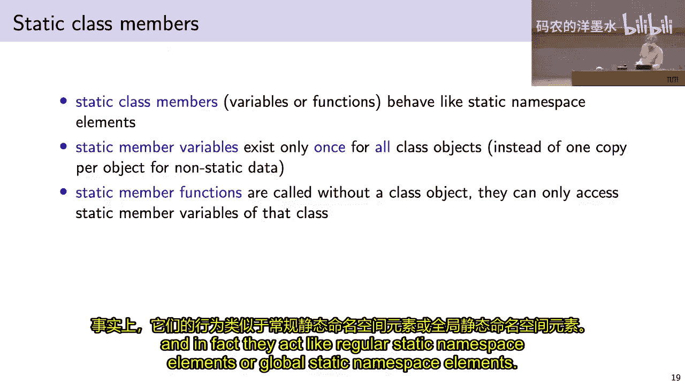

So as I said， static member variables exist only once for all the class objects。

Which is not the typical thing because typically a class member exists per object per copy of that class instance。

And the member functions。There， in fact。Theyre basically， global functions。

That are in the name space of the class。 But the static member functions don't have a this pointer。

Because they're aesthetic。 And that means the only class variables they can access are these static class variables。

Right， and as I mentioned， static member variables must be defined elsewhere outside the class or that actual memory is allocated for them。

And you can access them。

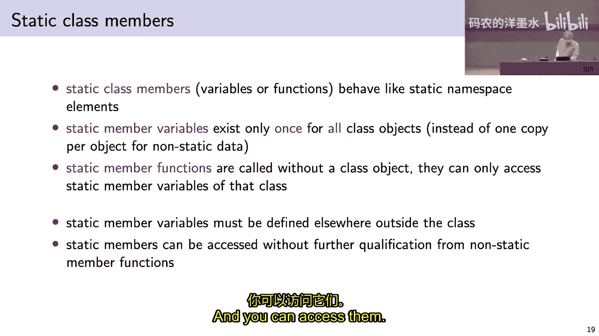

Also from non static member functions。 So examples。Actually， not。It's not a terribly awesome example。

 but it's not the first example of code that I've presented either。 So a date class， right。

 there's a lot of better choices you can do to represent a date。

 But this is the one that fits the slide。 So I'll use this。😊，Start date， month year。

Have a default date。And that default date。I'm gonna store。As a static member variable。

 because I needed it only once。For all the data objects， it will be the same。

So what I can do now is I can have a set date function。

 which ideally would be some doing some sanity checking on the input and so on。

 which I'm not doing here。And I have default values for all arguments for the day， for the month。

 for the year。And0 indicates the default value because except for the year，0 is not a valid value。

 And I'm ignoring that the year 0 actually would be valid。And the thing is， now。

If I have a nonze value in D D， I'm gonna use it and set the current day to that day， if it's not。

A set， if it's or the default will is 0， then I'm using the day from the default date。

 and the default date is a static member variable here so I can access it here like a regular member variable。

 even though it's static。And then I can have a static member function。

 set default that allows me to set this default。Of course。

He wouldn't necessarily need it because you could do this one liner。Was it directly。 But， of course。

 you would have some sanity checks on the actual values here。

So usually this function would be a bit more complex。So。Now， this is the function itself。

 All the class itself， all the functions were declared in line。

 So we don't have any out of line declaration definitions。

 So the only thing that's missing is now I need to actually reserve memory for this default date。

 And I do this。😊，By specifying。The， the declaration again and initializing it with some default value。

 as usually， the initialization is optional， but I'm doing it here。 So I have a useful default value。

In the 1770s。Right， and now I can use。Set date。 And if I call set date without any argument。

 it will use a default 0， which makes it use a default date， which is 1612，7070。

 I can change the default。Because of that static variable。

 it will work for all the instances of the date。 And if I then do a set date。

 it will use a new default date。It's not a horribly useful example。But。

I hope it kind of illustrates the point。Why does iced use slack then。Don't ask me。

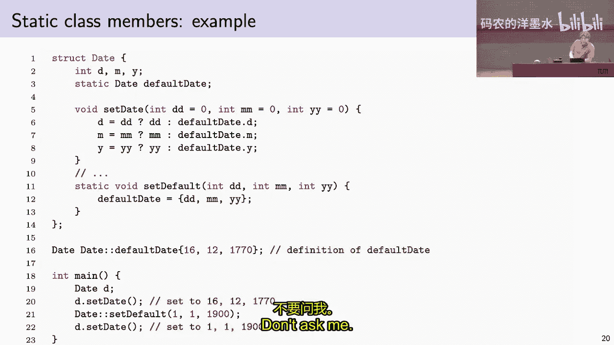

Right， so enough talk， holy， Moly， I talked about classes for almost an hour。

So I have a bit more things to talk about。 So let's get on with this。Constructors and deors。

So when ever， an instance of object is created。The constructor is called。

When the object is destroyed， the deor is caught。 So let's say。It's a local variable。

 It's a local variable of your class type。 As soon as it go out of scope， it will be destroyed。

If it's a global variable， it will go out of scope once it' lifetime ands。

 which is at the end of the program。 and then the deor will be called。

So we've seen already what a constructor is。 It's a special member function。

 The name is the same as the name of the class。 There's no return type。 There's no qualifiers。

 neither cons nor ref qualing or nothing。You can have an argument list and you can overload the constructor。

 so you can have several constructors， depending on the argument list。

The one that doesn't have arguments is called the default constructor。

So that is called when you try to initialize。An instance of your class with empty parentheesis or nothing。

That's the default constructor。The de is also a special member function。 It has the name。

 Ti the class name， also no qualify all return types， and it does not allow any arguments。

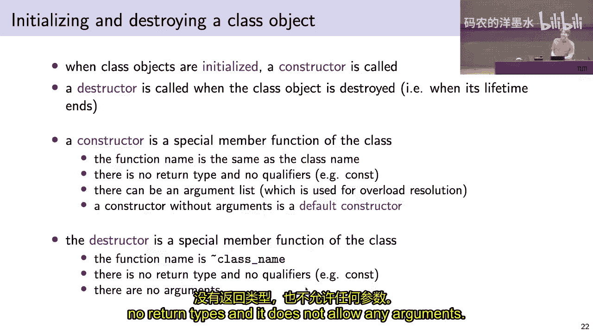

Which also makes sense because it's usually called implicitly。 And there are now arguments。

 if you call it implicitly。

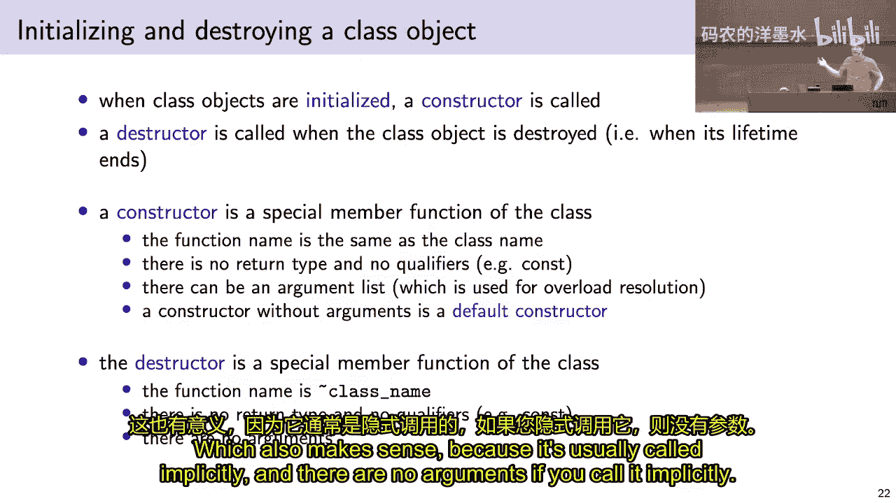

So a constructor is a kind of special function。 If the name gives it away way。

 It's a special member function。 So it has a slightly different syntax。

 There's the so calledled initialize list。😊，Which is executed first。

 And then there's the function body of the constructor， which is executed second。

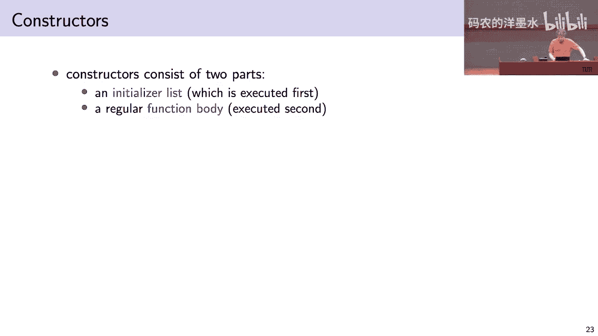

And the initializerer list is for initializing all the member variables of the class。

You should do them in the order of their definition。

 because even if you specified in a different order。

 the compiler will do in the order of definition anyway。 So just to make sure there's no confusion。

 Do it in the order of their definition。If something is not in the initializer list。

 it will be default initialized or with the initial value that you provided in the declaration。嗯。

Const member variables are special because you can only initialize them right there when you declare them or in the initializer list of your constructor。

 There's no other place where you can initialize them。😊，Right， and if you have a constructor。

 you can call。Another constructor to do the work。 so you can chain constructor calls inside constructors so that they do different type of stuff。

 And you don't have to replicate the code。 This is called delegating constructors。

And sometimes the compiler automatically defines constructors for you。 We will look at this later。

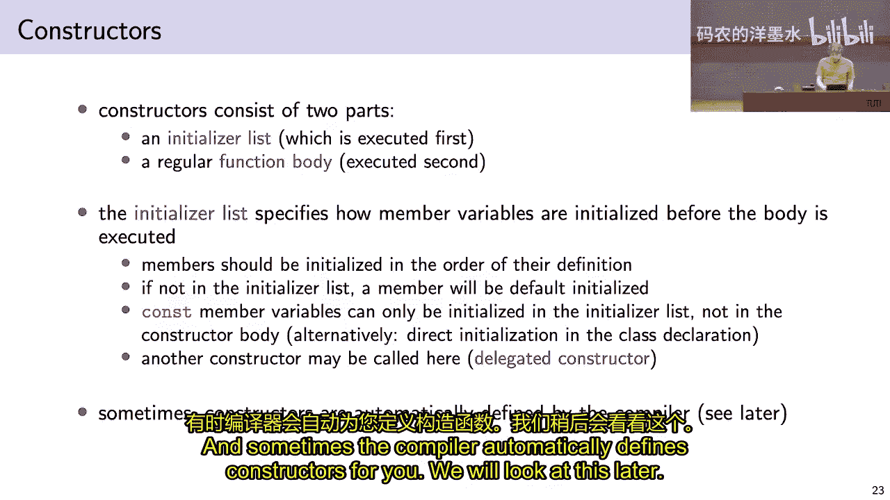

Can you have a class without a default constructor？ Yes， we will talk about this later。

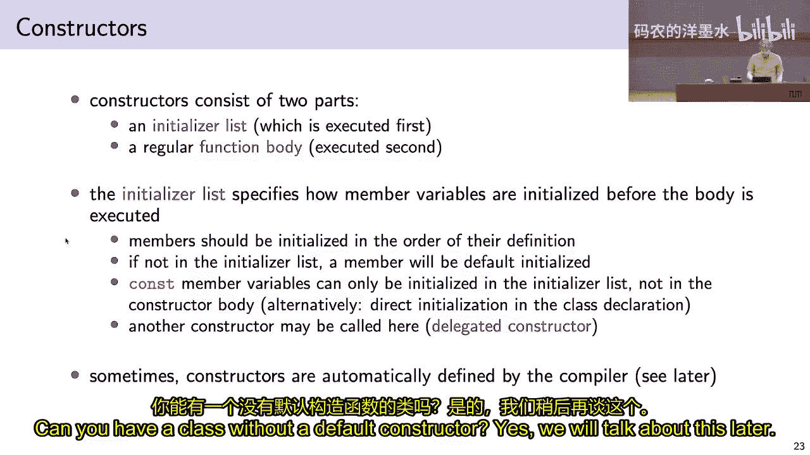

So， examples。Here's a class， A。That has a default constructor because the member function is called a no return type empty argument list。

 So it's， it's a constructor and the default constructor because of empty argument list。And it does。

 Nothing useful。Here， there's no default constructor。And no other constructor。But。

The compiler will create a default constructor for you， in that case。And for a， the inte A。

 nothing is done。But for a， which have a default constructor。

 the default constructor will be automatically called。

Here's a class fool where A is to initialize directly。 B and C are not。

So now I have a full constructor。 That's the default constructor because it has no argument。Now。

 I'm doing the initializerr list。 This is denoted by the colon。

 Then comes a comma separated list for initializing all the member variables。

 and then comes the function body of the constructor。The body actually does nothing。

And I'm only initializing B and C in that order because that's a declaration order of B And C。

 And I'm not initializing A because it already has an initializer。He has a different construct。

 It has three arguments。And it's used to initialize the values of ABC explicitly。

 And we do this by initializing A， B and C， with those values provided in the arguments。

And what I can also do is I can have a constructor that takess only one argument ofload that first delegates to the default constructor。

 which is this one。And then there some additional stuff on top。

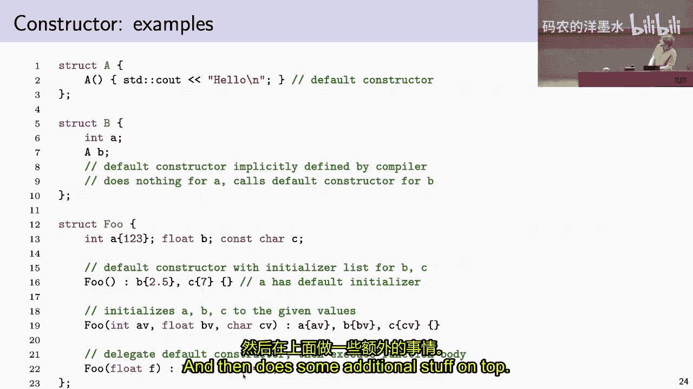

Right， when you initialize a class object， the compiler will decide which construct to pick。

 This works be a regular overload resolution。 So it's nothing new。

It just for these special member functions。Right。Regarding the initialization。

 we need to take a bit of。Care。If you specify nothing。So you declare a variable of type 4。

And immediately， do the semicos。 So you do nothing。 That's default in itsization。

If you do value initialization with this empty uniform initialization here。

It's called value in its utilizationization， but it will also call the default constructor。

 if there is any。This year。It's probably a function declaration。Not necessarily。In italization。

 So beware of using parentheesis for default initialization。

 If you wanna have some fun Google most vexing parts， C， plus， plus。

 and enjoy what you will discover。😊。

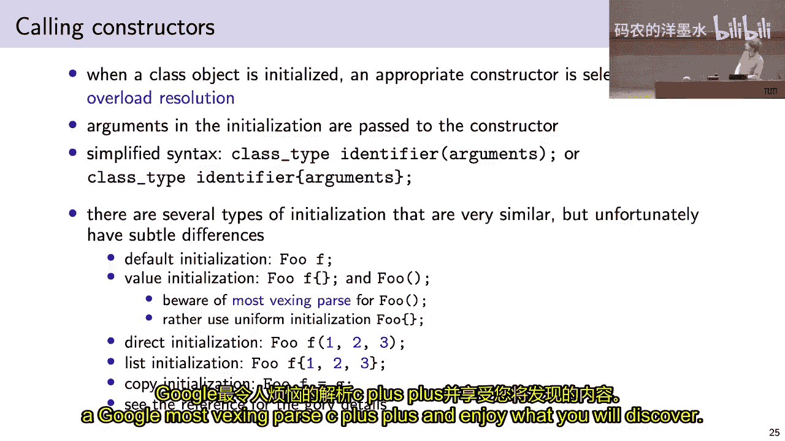

It's ugly。That's a lot of things。 Directir initialization is calling the constructor with basically the regular function called syntax。

 Why you're doing the initialization。

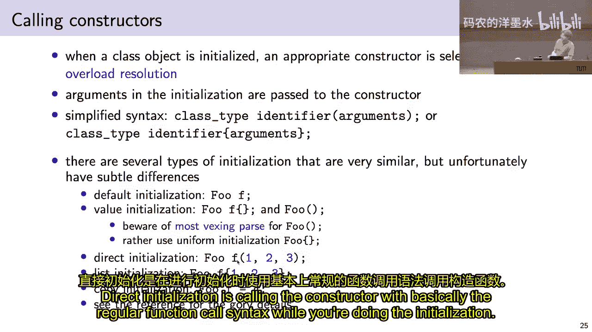

That is going to call the construct with three three integer arguments。You can do the list in its s。

Mhich per default is an initializer list。 You know， the SD initialize the list。

 but it will match to a constructor that takes three integer arguments。However。

 if you have a constructor that also takes an STD initialize the list directly。

 that one will be preferred because there's an implicit con。Conversion。

From initialized list to its parts。Right， there's copy initialization where you do this。

 where you copy from another object。 The values is over。And yeah， there's。A lot to take care。

 But I think the take home message is actually very simple。Use uniform initialization。

 and you're basically protected from all these stupid cases。

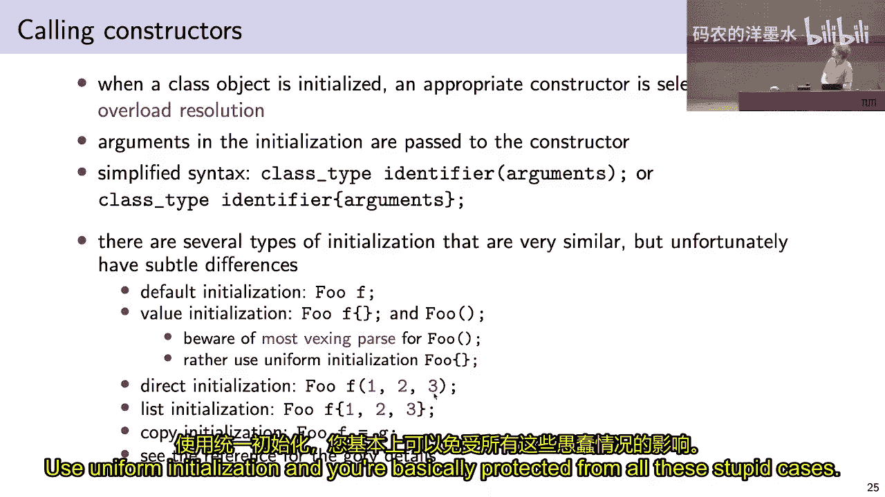

So use the curly braces when doing initialization， it also makes sense for user defined classes。

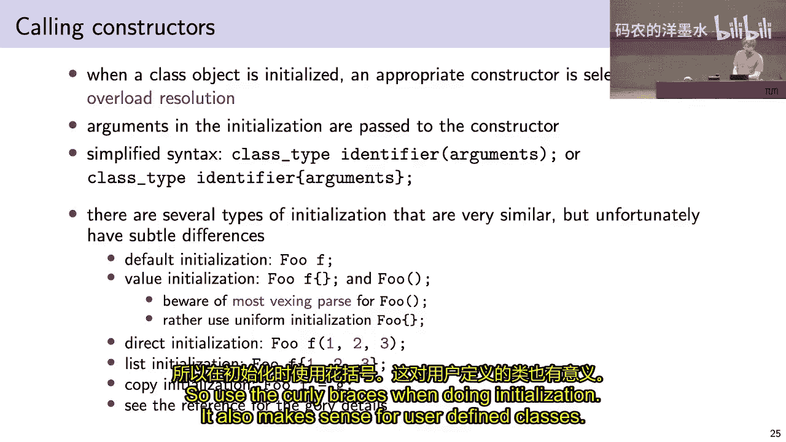

No。That's even more special cases。Constructors that take exactly one argument are called conversion constructors。

You can mark them as explicit。So they are also only used for explicit conversion。

 So what I do do I mean， Let's look at an example。 I think that makes more sense。

 Strfu has a constructor that takes。An integer is an argument。 So it's a one argument constructor。

 And this is used for conversions。Struck power also has a one argument constructor。

 but it's marked as explicit。So now let's see how this differs。Let's have two functions。

 print full and print bar that take an object of type V or type R and do something with it。Now。

 what I can do is I can call print full with an integer directly。

 because what will happen internally。There's an integer constructor for Fo。

 And the compiler knows an object of type Fuo is expected。

 So that we check if Fo has a converting constructor from integer。 it has。

So it will do the implicit conversion。It will take the integer。Create a temporary object of type fo。

 Iize it with that conversionver converting constructor。

 and then put that full temporary fo object as the argument of printfu。

That's a so calledled implicit conversion。And it's enabled by this implicit conversion constructor。

If you do the same for power， it will fail。Why test the same constructors。 Everything is the same。

 except for the keyword explicit。Explicit means there are no implicit conversions。

So this kind of maybe surprising behavior that happens for print Fu is excluded for the print bar。

Now， if you insist。On。Doing。Print bar with an integer。

What you will have to do is you will have to make explicit your intent by doing a static cast of bar to bar。

 basically from the integer。And then put it into print bar。Then the compiler would say， okay。

 you explicitly wanted to convert your integer to a bar object and use a temporary bar object to invoke the print bar function。

😊，Fine， you can have it。So it's good practice to always mark one argument constructors as explicit。

 So you don't have these weird， implicit con conversions that can markck up your code。😊。

I can smell polymorphphy coming in the horizon。 Yes， it will come two weeks。

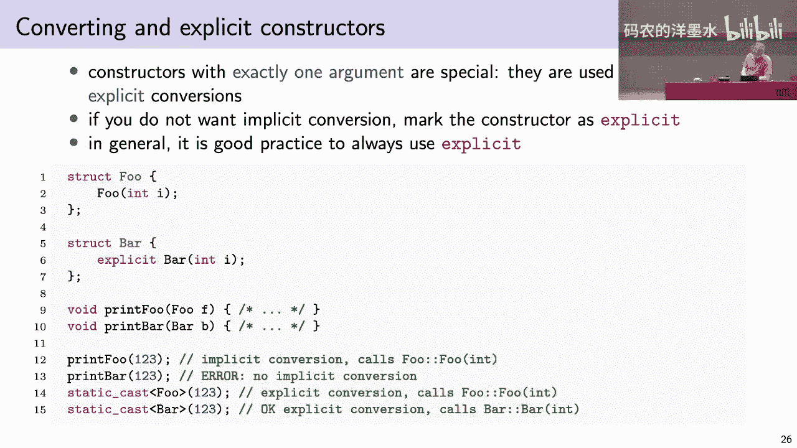

Right， there's more special constructors。 They are so calledled copy constructors。

 They are the ones that have a single argument of type reference to the class or cons reference to the class。

They are called copy constructor。What happens again， Let's look at the example。

 I have a copy constructor here because it's a constructor that takes a constant reference to the class。

No。I have a function that takes a full object， as a parameter。I'm doing。

An instantiation of the class， F。It calls the default constructor because there is none。

 It uses a compiler generated one。 since theres no data member variable。 It does nothing。Now。

 if I call， sorry， if I now create an object。G of type 4。

This will invoke the copy constructor because F is obviously of typeoo。

 and it can fit this overload resolution for the copy constructor。

And the typical behavior will be that you take the member data members of F and copy them over to G。

 Of course， there is no data members in this example， but that's immaterial。Now。

 if you call do stuff。With an object。Of type 4。This is by value， right？ So what happens。

 A copy of G is made and provided as the argument of the function do stuff。

 So there's an implicit copy happening。 And even for this implicit copy。

The copy constructor will be called。 So if your object needs special work to create a copy。

 you define such a copy constructor。

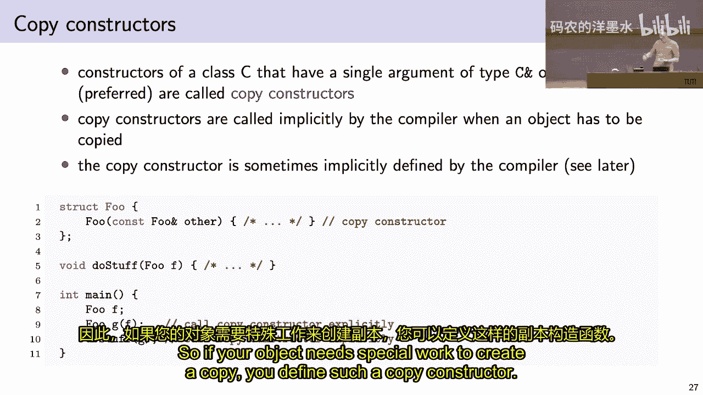

Now， let's talk about the detractor。 Detractors are called when the lifetime ends。

So for automatic storage duration， that's essentially the end of the scope。

 So if you have introduced an artificial scope here， instantiate a member variable bar。

 and then the scope ends automatically。Basically， before this， just before the scope ends。

 the deor of bar B will be called。And the same for。This is also a scope。

 the function scope of the function F and ones and the structure of this A object will be called。

If you ever call an deor explicitly， that's probably wrong because that means a deor will be called twice。

 So don't do that。 undefined behavior。 And usually this undefined behavior in this case。

 means a crash。

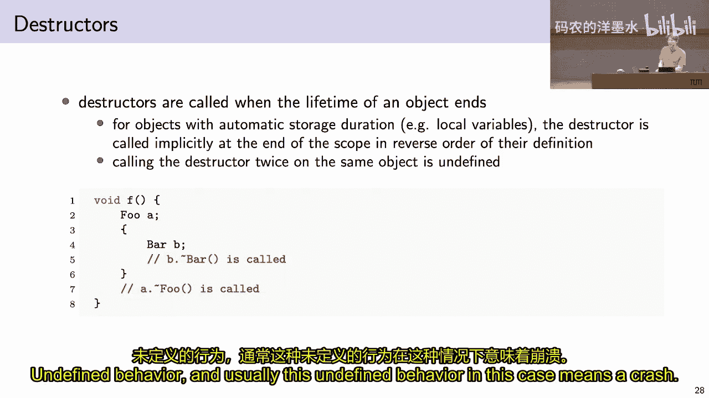

Right， you can do anything in the de。 It's a function。

 but typically it's used to clean up the object like free resources， release file handles。

tererminate network connection and stuff like that。And， yeah。

If you have an object fo that have a member variable bar of type bar。

Then they are called in the reverse order。 So the fo is called。 So essentially。

 what happens is the object bar is created first with the constructor。

 and then the fo is created with the constructor。 But for destruction。

 it's the other way around F is destroyedoid first。And par afterwards。

 So it's always the opposite order of。Construction。Right， uploadload over it。Operator overloading。

Let me get a drink。Holy shit， how did I manage to talk that long about these two topics。Anyway。

 operator overloading， let's do this fast。We can overload functions。

Operators are functions so we can overload operators。They have a special syntax。

They are called return type， whatever the return type is， operator keyword。

 and then the operator symbol。And then arguments。

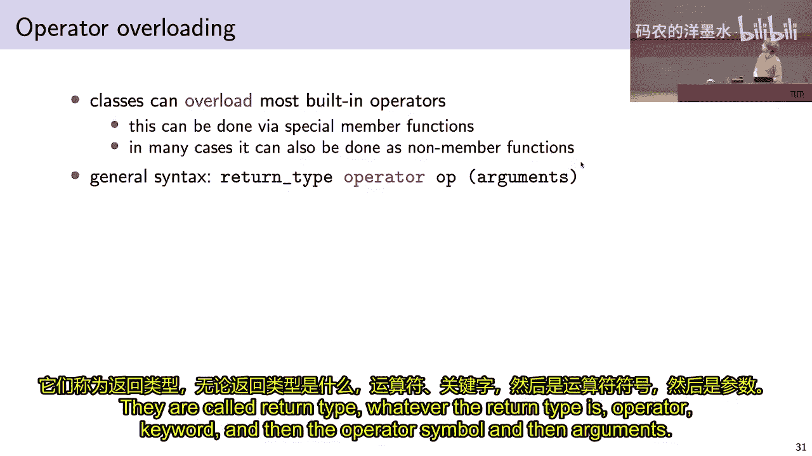

Which of these operators is chosen is done by regular overload resolutions。

 So there's no change here。嗯。And there's no requirement that， for example， if you over。

 overload the addition operator that youre actually doing addition。It's not mandatory。 You can do。

Division， instead of editing， if you want to confuse your user， it's not necessary。

 And if you think about the standard library， you saw the stream library very briefly at the end of last session。

 this overloaded。嗯。The bit shift operators。And at the beginning。

 this was weird for people because they were used to the bit shift operators， meaning bit shifts。

 right。But then the standard library got established。 And nowadays。

 you don't blink if you see a bit shift operator for sending it to standard output， for example。

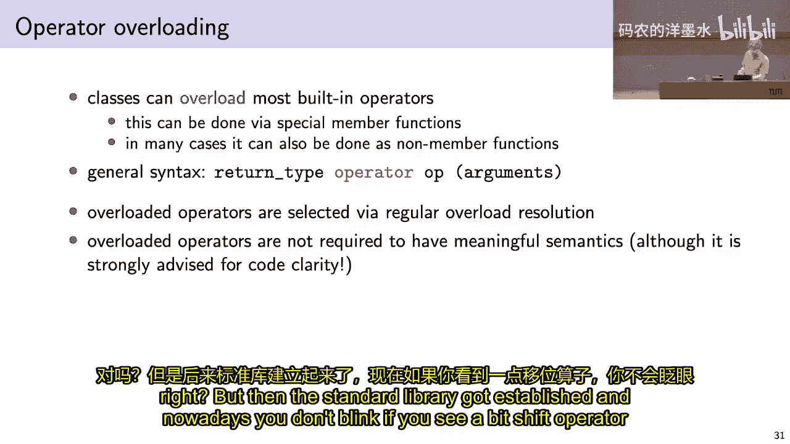

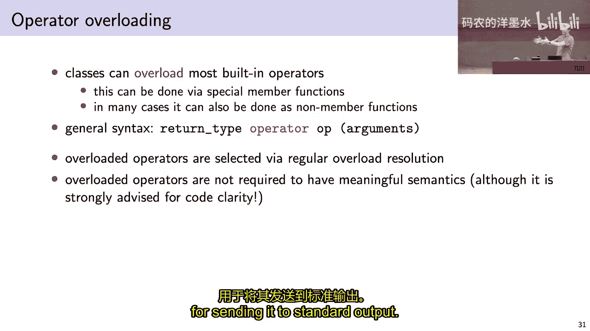

Right， you can overload basically everything which includes assignment， call operator。

 de referencing operator and even the comma operator。

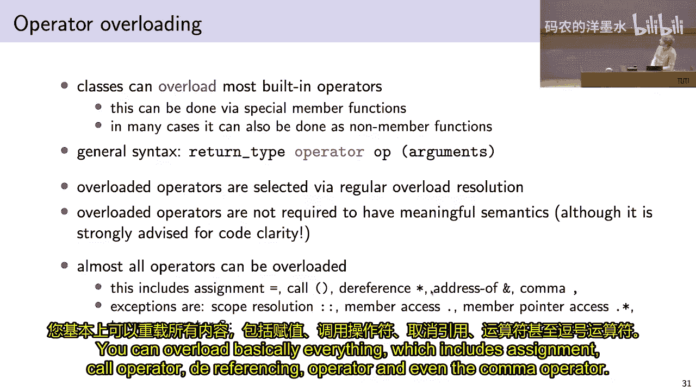

I can tell you， if you overload the comm operator， you can do really weird stuff。

 You can make your code utterly unreadable。But you cannot overload it the scope resolution。

 member access， member pointer access。But you can overload thearrow operator。

 So minus greater sign that can be overloaded， and you can't overload the turnernary operator。

 which kind of for all of these makes sense， right。

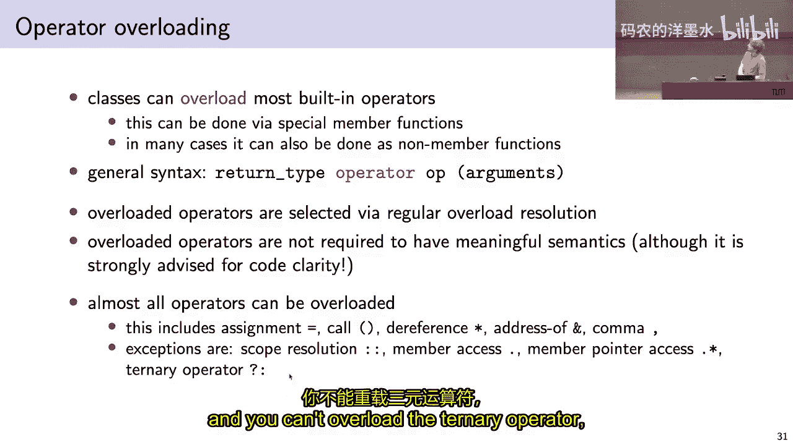

So what can you overload， You can overload the unary operators plus and minus。

Why would you want to do that。Why not？Right， you can。

You can overload the binary arithmetic and relational operators。 There's two ways of doing this。

One of them is left inside， operator， operator with the right hand side。

 or as a So as a member function， basically of the class with one argument or as a freestanding function。

That takes。2 arguments。So these callss are treated like regular function cards。

 That means if you're overloading the logical operators and an or。Their special behavior。

 the short circuiting。So， for example， if you have an end operation and the first operation evaluates as false。

 the second one will not be evaluated for overloaded operators， that's no longer true。

Because obviously， the overloaded operators no longer need to actually do an or or end operation。

So yeah， what you should do is take the second argument as a con the argument as a con reference。

 if you implement it。As a member function。 So it would look like this if you want to have your custom int type。

Which this case， does nothing special。 You can overload the plus operation like this。

Since you're returning the result， you're actually not changing the state of the member of the object here。

 So you can declare this as constant。And you can， for example， overload the comparison operator。嗯。

Out of line by taking two constant reference arguments and doing a regular member comparison and return the result。

 And then you can use the plus operation and the comparison operation for your user defined data type。

 just like for the built in data types。

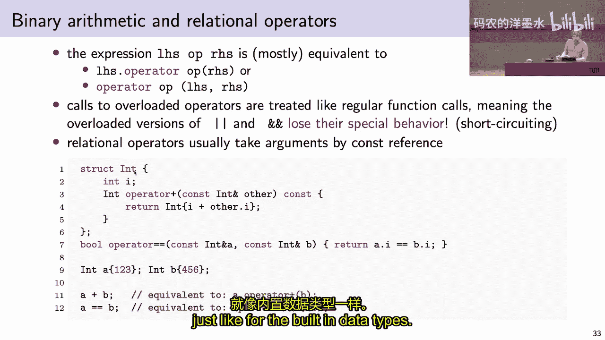

You can overload increment and decreement operators。 The only difficulty here is that you have。

Prefix and suffix， prefix and postfix， increment and decreement operators。

The ones without an argument are the prefix， the ones with an unnamed integer argument that is not used actually。

 is for the postfi increment。 so we can overload them。And。Do stuff。Right。And， for example。

 if you overload。The post the prefix increment， but don't overload the post fixed increment。

But the compiler will say， but sorry， there's no post fixed increment。 You need to upload it。

You can overload assignment。

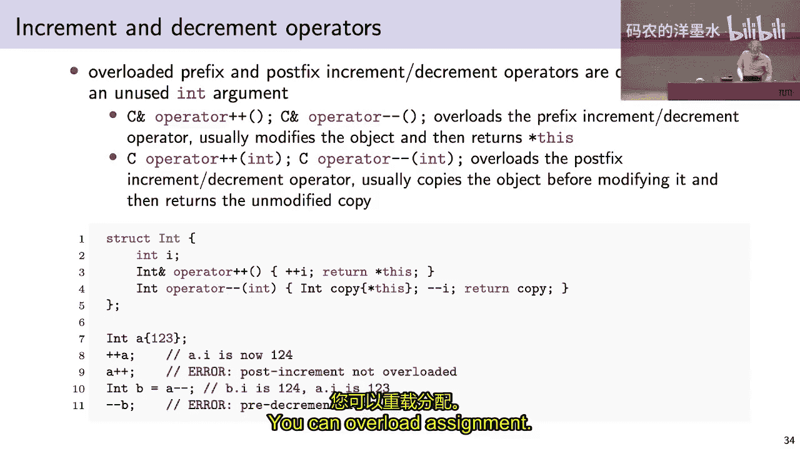

Typically， this is done inside the class， or it has to be done inside the class with one constant reference argument to the。

Whatever you're passing there。You can overload the combined assignment operators plus equals。

 minus equals， times equals， and so on and on。And this way。

 you can construct a data type that supports all the standard operations like a built in data type。

Can you overload enough operators to turn Cpls into Python？ I'm afraid not。

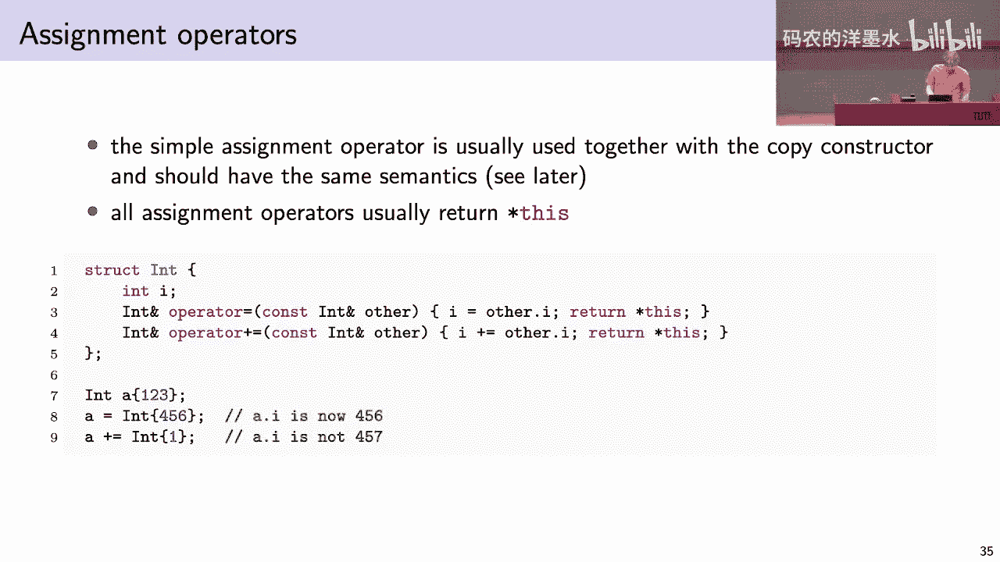

There's more。 That's conversion operators。They are used if you wna convert between values of other types to the class。

And the other way around， their syntax is a bit weird because it's operator。Type。Purency this。

You can declare them as con because they usually don't change anything。

They have an implicit return type type that you don't have to specify。

 You can use explicit to allow this allow these implicit conversions that we've seen earlier。

 and a typical operator to overload is a so calledled operator bull。

Because that makes your class available in if statements。 And if you have， for example。

 an error condition or not， that could be something you can use。

 if you think about the optional standard library component。

 that's overloading the bull conversion operator so you can check if the optional contains a value。

So how does this work， You can have an int conversion operator for your int。

So that you can in convert it implicitly。From an integer。Do an integer， sorry。

You can have an explicit float conversion operator for your float class。

Which since now it's explicit， an implicit conversion like this won't work from your floating point。

 Use defined floating point type to the regular floating point type， this won't work。

 But if you do the steady cast。Then yes， it's allowed because an explicit cost。

Now， you might think。This could be cumbersome because now， when you call these operators。

 you would have。To say which overloaded operator actually use。

 So let's say you have a name space where you defined your class and a user defined overloaded operator。

And now， you're defining objects。Of this class， in a different namespace。

 Nam it the global name space。 So you might think you will have to call the operator plus explicitly with invoking the namespace。

 That works， yeah。In fact， you can drop。The namespace qualifier here。

 because the compiler will do an argument， dependent lookup。

 So it will see both arguments are from namespace A。 So， yes。

 I will use the overloaded operator from namespace A。And in fact。

 the purpose of overloaded operators is to have convenient calls like this。

 So you probably won't ever do it explicit call like this。 but rather you would do x plus y。

 and the compiler would automatically check。 all these are two user defined data types there from namespace A。

 So I will check if there's an overloaded operator in namespace A and use it if it's there。

Right。Holy crap。 Now， I went faster than expected。嗯。

Is this the same operator calling operator concept that we use inside the visitorsor tracts。 Yes。

 you paid attention。 So last week， we introduced the variant data type， a typeafe union。

 which we are the visitor pattern。 You could have call operators overloaded for the different types that are stored in the variant。

 And yes， these were。😊，Overloads of operators。呃。Where is it。

I don't have an explicit。 Oh yeah， here。The call operator is one of the operators you can overload。

And that's exactly what you saw there， overloading for a custom。User defined data type。

Now， also a brief comment， why is overloading of the comma operator so weird。

Because the comma is one of the lowest binding operators。 So it has the lowest priority。

And that means you are typically using it to say several things in one line， right。

 You do comm to specify multiple arguments for a function。

 You do commerce to initialize or declare several variables in one line。

You can overload the comma operator for your class to change that。

 and that is can be extremely charmrring。

Right， these conversion operators are convenient if you define。Your own。For example。

 arithmetic data types and basically to have the back conversion from。Integer to your data type。

 you would have a constructor taking a single a converting constructor and to convert back to the original data type。

 You have the conversion operator that you can overload。Of course。

 you can decide if that makes sense or not， but you can。And I say， I have to say。

 operator overloading is one of the specialties of C plus plus。 Not too many other languages do it。

If you do it nicely， it can be really cool because what you can do now is you can define a matrix class。

😊，Representing matrices and have it do standard operations like matrix addition and matrix multiplication。

 and so on。And do this using the star operator and the plus operator and the minus operator and so on。

Of course。You can also create horrible confusion。Because if you basically。You know， create。

Read it。Create a data type where the name isn't terribly different than from the built in data type like here。

And you might not have syntax highlighting to highlight that like here that this is a custom data type。

 And then you overload the operators to mean different things。 So plus no longer means plus。

 but something else。And then you replace one line of code where you initialize。

 declare your variable。 And suddenly， the code below that no longer makes sense。

Or becomes hard to read。 So if you want to do code obfucation， overloading of。

Operators。You can。Use it to great effect。Copy。Class members without a custom copy constructor。

We talk about that。Tomorrow， not tomorrow next week。 So I'll leave that question for later。Right。

 the last thing I want to talk about is Inum classes。

 So there's another class data type that is called Inum class。It's used for enumerations。

 For example， if you wanna have。Values of a traffic light。 You could encode this as 0，1，2。

 or you could say， oh， it's red， yellow and green。And Inome class allows you to do exactly that。

 Inome class are two keywords that you have to put in that order。Give it a name。

 And then you specify。Essentially， tax， more or less。To define valid values for this data type。

The underlying data type is typically an int。And what happens internally that the first value gets assigned to the value 0。

 the second value 1， third value 2， and so on and so on。嗯。You have to access these values。

 And we have the scope resolution operator。 So， for example， here， if you do an。

Inst of your traffic light and want to assign it with initialize it， you have to say traffic light。

 colon， colon， yellow。Because yellow is only defined within the context of this traffic light。

You cannot just assign integers to it， even though it is internally represented as integers。

 but you can do explicit conversions like this。 But then again， you need to take care that you're。

Value matches up。 This what the compiler actually uses for the value。Why am I mentioning this？Well。

 Im don't really have to mention much more than this because that's essentially how it works。

 And there's a C version of this thing。 It's called just inum， drop the class。

 just inum traffic light。There's two differences。You don't have to use。The scope resolution operator。

 so you can just state yellow anywhere without saying， oh。

 it's from the from the inum class traffic light。And you can have implicit conversions to int。嗯。

So these， those are the two reasons why C plus was introduced to inum class。

It's the same as an inum from C， C。But， in a bit。Better way。

 It's a bit more cumbersome because you have to use a scope resolution operator。

 And since youre using descriptive names， those are usually a bit longer。

So it gets a bit more annoying to type， but trust me。

This is the version of the inum you want to use in your code if you need inum。

 So use inum class and not the straight inum。Can you iterate over inums， no。

Right。And for once。I'm done again just a few minutes ahead of time， but which is fine。

 I'm just making up for the last few weeks。 Thank you very much。😊。

