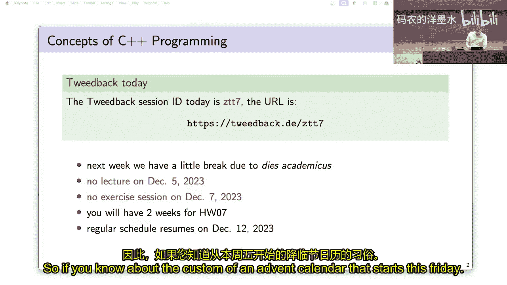
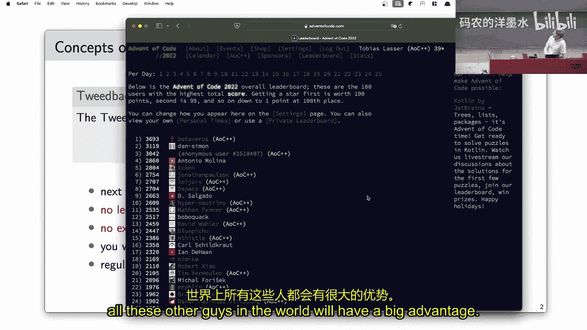
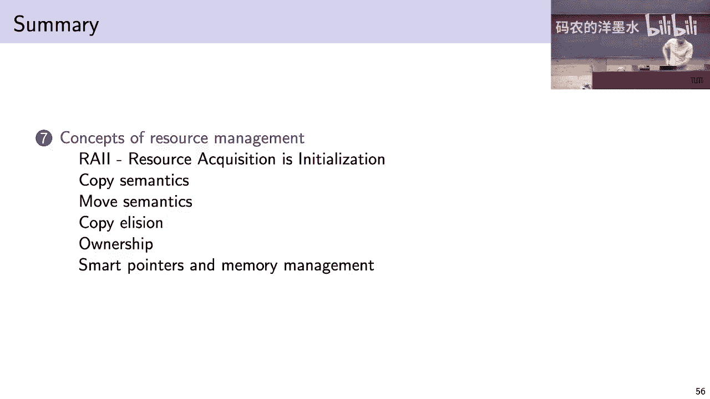

# 【全集 2024版】慕尼黑工业大学 C++编程概念 IN2377 中英字幕 p06 Lecture 6 - 移动语义 -BV1gDqwBmEuC_p6-

So welcome， everyone。I come to the concepts of thepl course。Yet， again。Before we start today， I have。

But first， of course， the sweet extreme is today that T T 7， Some of you have found it already。

But although there's a bit of a announcement regarding next week。

 we will have a little break in the course for next week。Because essentially on December 7th。

 there's D academic course。Meaning， there would be no exercise session。

And since I don't want to do a lecture without an exercise。

 I'm also removing the lecture on December 5。 So next week， you have a little break from the course。

Obviously， we make Home 7， which is gonna be released end of this week last for two weeks。

 So you have a bit more time。 And don't worry， it's not gonna be bigger due to that。

 It's just the regular homework。 this two weeks of extra one week of extra time。And after next week。

 it's only next week that is special。 So we will resume our regular schedule on December 12。

So that's the first announcement。The second announcement is actually not on the slides， because I。

Technically can't do it yet。But I want to show you anyway， because。Well。

 there's today is November 28， and on Friday， we will have December 1。

So if you know about the custom of an advent calendar that starts this Friday。

And， of course， we're computer scientist。 Theres a special advent calendar that's called advent of code。

😊，嗯。That obviously hasn't started yet。 but the website is already here。

And what you will get is essentially， assignments。Every single a day that you can open。

You do your solution。They are very nice programming assignments。 They get harder。

 so they are fairly easy to start with， and then they get harder and harder。

And just to give you an idea how this looks like。 No， where is it。but but。Fuck events。 Oh， yeah。

 right。 So last year's event， you can see， I took part in。One weekend。 I couldn't。

 So two stars means I solved the assignment fully。 So I solve basically all of them until December 21。

 with the exception of this weekend here， there was too much happening。 didnn't have time。To do it。

 And the last few days， I rather spent with my family than doing the code assignment。

But the fun thing is there leader boards。 This was last year。

 So there's global leader boards in this time zone。

 we are fact because the only thing that counts in this leaderboard。

 How fast are you And the things are released， I think in our time zone in the middle of the night。

 maybe at 5 or so in the morning。😊，So unless you get up then and do the assignment quick。

All these other guys in the world will have a big advantage。

 But what we do have is private leader boards。 And you can see one here that I made for last year's course。

And you see， there were some very。EActive people who solved everything ahead of me。

And there were a lot of people who didn't solve a lot of things。 I will create a private dealerboard。

 Maybe we'll use the same one again for this year。 I'll post it on Moodle。

 So be ready if you wan to take part in practice E， plus， plus。😊。

Feel free to do so in this year's advent of code。I try to take part myself again as well so that you have some motivation。

 also to keep up my own coding skills， because I usually don't get to code a lot in my position。嗯。

Yeah， but then again， I have a full time job。 I have a family。

 I don't know how much time I will be able to dedicate。I will post the private leaderboard I D。

EProbably tomorrow， a day after tomorrow on Moodle。And on Zlips， if you want to take part。

Feel free to sign up。Right。That's， as a preliminary。So what's up today is， as promised。

 we will talk about resource management。 So if we're interrupting the O， O part。From last week。

 because as a second part of it， where we talk about inheritance and polymorphphy and virtual functions and stuff like that。

嗯。We interrupting this because we want to talk about resource management first and then talk about inheritance。

Right。Can we go into how to implement a modern allocator sometime。It's not on the schedule。嗯。

And it's a fairly， very， very specific thing。 So typically， you don't implement your own allocators。

I see if we can do something about this or not。 But let's say it like this。

 I don't have a lot of experience in that because I've never done it。 Never needed it。

Can we make the homework more difficult， challenging， please。No。We'll do it as we have it。

 if it's easy for you。And it's right。There' advent of code。 You can take partdon。

 The assignments start easy， get it progressively a bit more difficult。

 Feel free to post it on the source code on your Github might be nice for some people looking to hire you to see how the code you write looks like。

😊，So。Now to the extra topic， resource management。This is one of the major ones， because this is。

One of the few points， where C plus really， really differs from C and has to differ from C because C has a lot of deficits in this area。

Defiicits in terms of security， error， prone Ne and， and stuff like this。

So the idea here is and the central concept of C plus is called R A I I Resource acquisition is inization。

That acronym will haunt you for a while。 if you do see plasma development。 And the main idea is。

 if you have any type of resource。Typically， this could be memory that you're allocating for。

Various tasks， it could be sockets， It could be files。

 a mut text for parallelization and synchronization， database connections。 You know。

 anything that qualifies as a resource that isn't just there that you need to manage。And the idea is。

 since you have to manage it， like requesting the resource。

That also means that typically you also have to clean up the resource at some point。And， of course。

 one of the big。Problems with this is that you might forget to clean up。

Or that an error is happening。That your code is deviating from the regular path because of an error or an exception。

And skips。Take a part where you clean up。So our AI， I is a mechanism left us where you can ensure。

That cleanup is happening。 And the idea is that youd take the resource and an object and tie them together。

 So basically， as long as the object is alive， the resource is alive。 And as soon as the object dies。

 the resource gets cleaned up。And how is this done。Well。

 the idea is to use constructor and deor for this， because the construct is always called when you create an object。

 and the de is always called when its lifetime ends。

So if you do automatic storage duration variables。Then the compiler manages this automatically for you。

 That's why it's called automatic。Meaning。If your resource is tied to an object that is managed automatically by the compiler。

 you can't make any mistakes anymore。 You can't forget to clean up。

It won't happen that you clean up twice。 the same resource and stuff like this。所啊。Essentially。

 we already know how to do it because last time we talked about constructors and deors。 So basically。

 what we just do now。Is talk a bit about the details。And as you can guess， it's T plus plus。

 So there are a lot of details。Right。But the general concept is very simple。Have a resource。

 Def a matching class。 And the only task of that class is managing that resource。 Nothing else。

 Don't put anything else into there。 separate the concerns and make sure that your class that's managing the resource is only doing that。

So the constructor will take care that the resource is initialized， acquired， requested。

 whatever you need to do。And establishes basically that once a constructor is done。

 the resource is ready to use。Right， of course， there could be situations where it doesn't work。

There's not enough memory to get the memory you request。

 The network is not available or any of these things could happen， right？ So， of course。

 what happens then。Typically， if the constructor doesn't finish because of the  error condition。

 it might get an exception。And。If it happens that way， yeah。Then the constructor doesn't finish。

And the object isn't created。 So there's no chance of having an object that just partially initialized due to the constructor。

And the same， on the other end is happening in the de， you take care of cleanup。

 And since the de is automatically called exactly one for each automatic variable。

That takes care of the other part。Now， very it gets difficult。Is that you can copy objects。

 And if you copy an object。That is managing a resource。 What do you do on copying that object。

Do keep the same resource so that you have two objects managing the resource， the same resource。

 and you have an issue。Because then the cleanup happens twice for the same resource。

 and then most likely。In case of memory， for example， means a crash。Or some other undefined behavior。

So you need to take care that copy operations do the correct thing。And that was a move。

Butch is something。That you haven't seen yet， but which we will introduce today。There's a persistent。

Okay， so there's some sound in the background。 I'm not sure if I'm imagining it。

 but it's not a feedback from the headset。Sorry about that。Right。So as I mentioned already。

 in order for this to work as expected， That means the class you have is managing only that resource and only that class is managing that resource。

 nobody else。And of course， those are AII classes that should be used。

With automatic storage duration or temporary storage duration so that they get cleaned up by the compiler automatically。

So in a sense， that nothing happens。So let's look at a simple example， how this works in practice。

Or how this might work in practices again， not a terribly useful example。 but you get the idea。

So let's say you have a function that writes a message to some file called message text。

So you can already guess that this is a problem in a multi threaded application。

Because if we call this concurrently several times at once。

 you try to open and write to the same file at the same time。

 So what you need first is a mut text to synchronize the excess。

We will do this in more detail a bit later in， in the lecture。

 So if you don't know what a mutex is now， just accept that it's there for synchronization of multiple threats。

 We do it as a static muttex。 So it's shared between all invocations of the right message card。Right。

 then we request a lock。Of that new text。This is done via the R A I I Rapper class from the Standard Library。

 called Lock Artt。And as you see， the only thing you have to tell is here's the mutex。

 Please lock it and nothing else。 This will essentially block your thread until the muttex becomes available。

 Then it will lock it。And then you can do your thing that you want to have synchronized。

 And the synchronized thing you you wantan to do is want to open a file called message text。

 Check if it's really open。 And then if not， you throw an error。

And write out the message into that fight。And as you see here， that's it。

 There is no clean up closing the file。 There is no clean up releasing the mut text because the file。

 the if the offstream here。And the mutex， the lockguard。They are R AI I classes。

 They take care of cleaning up their stuff themselves。 So nothing happens。

Nothing needs to be done explicitly by you because everything happens automatically for you。

And even if you leave the function through this exception here。Once the throw is done。First。

 all the objects that got initialized completely will be destroyed。

 So all the resources will be released properly， and then the stack will be unboundund。

 and the a matching catch statement will be looked for。So， basically， this。

Kind of programming with our AI Make sure that you are threat safe。

 It makes sure that you are exception safe and that nothing bad can happen。 that you can't forget to。

Deal with your resources。So this is how the user code should look like。 and the。Nice part about it。

 The user code is extremely simple。 You can't make a mistake here， basically。I'm having a dilemma。

 Should I ignore warnings， The answer is always， no。And if you wanna see。Why that is。

 Take a look at all the posts on Zullip that say， oh。On the pipeline， my program crashed with。

A thick fault or a sick ill or something。 All these typical。Things。And if you look at it。

 the people has probably ignored warnings in most of the cases。

 because those warnings were pointing towards undefined behavior。

And if you have undefined behavior that could be a crash， it could not be。 So， yes。

 you wna treat warnings ideally， even as an error。 And there's a flag minus w error that does exactly this for you。

If you have warnings regarding implicit conversions。Which is apparently your question。

Make sure there are no implicit conversions。 Make your intent explicit by using static cast。

 Then you have an explicit conversion， and the warning will be silenced。😊，Oh， good question。

 So back to the resource management。So， there is a garbage collector。No。The idea here。

 this is not cleaned up by garbage collection。 This is cleaned up by the des of the class。

 lock art and of the class O， F stream。So this is explicit code that gets executed explicitly by the compiler as soon as this scope ends。

😊，And this ends by either executing everything。 And then the function is over。

 or it ends if you do an exception， like an explicit one or an implicit one that could happen in any of these calls。

So this is not a garbage collection。 What's the difference。Garbage collection means。

That you don't care。 You just throw your stuff there。 You reserve all the resources that you need。

 and you don't clean them up because periodically， there will be a garbage collector。That will look。

 O this resource still in used。No， then I can reclaim it。This means。

If you have plenty of resources and plenty of computing power， you don't care。 It's convenient。

 Let other people take care of your trash， right， That's also how we do it in real life。

 Let other people take care of our trash。 It's easy。 It's convenient。 but you pay a price for it。

 It comes in performance。 and it comes in。Using resources longer than necessary。 So here and see。

 plus， plus， you use the resources exactly how long you need them by having this R A I classes。

And they are released at very discrete points in time。 And， you know， when this is going to happen。

 it's not going to happen randomly somewhere。And it's not suddenly stalled your system because there's a huge garbage collection process running right now when you need actually need the computing power。

But it happens thatministically， when you say it happens。

So that's a big difference between garbage collectors and explicit memory management。 And no。

 we shouldn't close the file because that's what O S stream does for you。

 The deor of O S stream makes sure to close the file。Interesting part is， for the longest time。

 C Plus， plus supported garbage collectors。 So you could have a garbage collector if you wanted。😊。

And that would。Take care of things for you。If you wanted， almost nobody used it。

Because if you're already using garbage collection and stuff。

 you might just as well use Java and be rid of all the issues of C plasmas， right。No。

 you use the pla for performance。 And then a garbage collector is out。 It's not， no， not。

 not a thing。And funnily enough， C plus was 23。Removed the。

Sport for garbage collectors in Cpl because essentially， nobody was using it anyway。

So no garbage collection in C plus plus。Mtics is more efficient than semaphos。

 We'll answer this later。 Not today。 That's not the topic today。 What is a mus， not the topic today。

 We have a section。 We have an entire week where we talk about parallel programming in C plus plus。

 That's when we will answer those questions。😊，How does the Mutex lock out know which file to lock。

 It doesn't lock the file。 It locks the mutex。 And since the muttex is shared between all calls of right message。

That's sufficient。Right， okay。So。Stretly speaking， that's it about resource management， right。

 You need to write wrappar classes around resources。

 Are AI I classes with constructs and destructs taking care of requesting the resource。

 initializing it and。Cleaning it up。So the why we have more slides here today。

 about 60 something slides。With some reviews， So it's actually less。

 it's because they have details to take care of。The most important thing is。Copies。

And this is particularly relevant for。Classes that manage resources。 Then there's move。

And then there are some special things， like copy illusion。And we'll talk about some。

 some other things later。So let's get the basics out of the way first。嗯。Right。So。

We've already seen that there's a copy constructor。It's invoked。And you create a copy of the class。

 right， There's also copy assignment。That creates a copy of a class， right。

 So there's these two operations。And the interesting part is。For building types， you don't care。

 The compiler does it for you。 for the user defined types that you define yourself， it might matter。

Because what by default happens is a so called shallow copy where essentially each element of the class is copied one by one。

 verba ti。So if you're managing a resource and let's say you have a file handle or a pointer to some allocated memory。

 copying that verbaim would mean you have a exact copy of that file handle or memory pointer。

 And then if you clean both of them up in the deor， you get a crash。😊，Or some other issue。So。

You will have to do your copy operations yourself for classes。 For example。

 if a copying may be expensive， you might want to disallow copying at all。嗯。Or， well。

 if you manage resources， that's kind of the main， main use case here。So the copy constructor。

 we've seen it。 It's a constructor。 So the class name and the parameter list contains a con reference to。

One object of the same type。Right， so when is it invoked。

 We've seen this already just to make sure there's copy and utilizationization where you do a new object of type T called a and initialize it with a。

Object of the same type T called B， Or you do the preferred uniform initialization。

 which is also called direct initialization， in this case。When you do a call by value。

 when you pass your object of type T by value to a function。

 a copy is created when you call that function。And if you do a return statement on a function that returns。

An object of type T The return will create a copy。Of what you are。

Returning so that it's actually there when you wanna have it。So examples， we've seen this。嗯。

This is a converting constructor。 So a constructor is one argument。This is conversion from in。

 We make it explicit so that no implicit conversions happen by accident。

 And he has a copy constructor。Very well。Do something very simple because the only class member that we have is a variable of a type integer called V。

 So we just initialize that V with the value of V of the。Agument that we are supposed to copy。

 So in this case， the copy construct is trivial。 You actually don't need to define it。

 The compiler would do it for you， but we just do it here so they can see it。And basically。

 these two statements， we have an object of type A called a 1 and another one called a 2。

 This is a copy constructor in vocation。Where we copy the contents of object a1 into a2 at time of construction。

 and this is another copy constructor invocation。Just with a different notation with a non uniformization。

You can do These are constructors that happen when you construct the object。 Obviously。

 you can also assign an object when it's already constructed。 This is what's called copy assignment。

And essentially， this is whenever your object turns up on the left hand side of any type of assignment。

So the assignment operator， we've seen this before。 it's an operator。

 you can overload for your class。It's called operator equals。

 It takes a constant reference to the class， and it returns a reference to itself so that it can chain assignments as you're used to。

There's a second version， which I won't talk about now。 We'll talk about it later。Because typically。

 we use the first version and forget about the second one。So yeah， copy assignment is called。

And select it when overload resolution selected。And how does it look like， Same object as before。

 class member V。Explit converting constructor， copy constructor。 And heres a copy assignment。

 This is slightly more complex than the copy constructor。

 because now we not only copy the value of V。But we also return a reference to ourselves so that we can chain this operator in multiple expressions。

And here's the difference。 This is a copy constructor because this happens at construction of the object。

 But this here is a plain assignment。 No objects are being constructed here。

 So this is a copy assignment operator。Now， I already said that in some cases。

 the compiler generates the copy constructors for you。 And actually。

 these are most of the relevant cases。So what will happen is the following。

 There will be a declaration， not a definition， a declaration of a copy constructor。

 If there's no user con defined copy constructor。That declared constructive will be public， and。

It may or may not be defined。 So let's find out。So。

This declared copy constructor will be defined as deleted， and this is really equals delete。

And that means you can't invoke it。 And if the compiler tries to invoke it。

 it will give you an error message。 Oh， this constructor is supposed to be deleted。

 so you can't call it。And the compiler will do this for its own。

Implicitly declared a copy constructor， if。Essentially， it can't do it。

Why would it not be able to define its implicit copy constructor， Well， because as。

Members that can't be copy constructed。Like a con member。 No， sorry， forgetget up a con member。

 anything that doesn't have a comp constructor。嗯。If you have a bath class。That can't be constructed。

 I know we haven't talked about inheritance yet， but you can imagine what a base class is， right。

 something else that you derive from。 And if the base class can't be copied。

 then the derived class also can't be copied。嗯。The same is true， actually， for a de here。

 for base classes。 then you can't copy， or at least then the compiler doesn't do a copy constructor for you。

And if you have user defined move constructors or move assignment operators。

 which well talk about in a bit， if any of these things is true。The compiler will say， oh， yeah。

 here's a copy constructor， but I'm deleting it for you because it doesn't make sense。

Copy assignment operator a similar story。 It will always be declared if you don't do one of your own。

And if it doesn't make sense。The compile I will delete it。 So I will not go through the details。

 It's the same thing again。So if it's not deleted。Then the compiler will create our constructor or assignment operator for you。

Only if it's actually used。 So now overhead， lala。But it's not really overhead anyway。

 So we don't care。 And what it will do is we'll do a member wise copy of the object based classes and members in the order that they were initialized。

And the same is true for the copy assignment， except that they are not。Copy initialized。

 but copy assigned。So let's take a look。How this looks like。 So if we have the same structure。

A as before with a， oh， now it's a constant data member called V， so it cannot be changed。

I'm only doing the conversion constructor。But， I'm not defining。

A copy constructor or a copy assignment。 So I'm saying， compiler， do it for me。Now we try to use it。

 Here's a copy construction where we construct a 2 from the object a1。

 This is fine because there is an implic declared copy constructor。

 and it's also defined by the compiler because there's no reason why it wouldn't be。😊，However。

 the assignment， if you try that。It's not gonna work because the compiler would say。

I declare a copy assignment for you， but I'm not implementing it because I can't。

 Here's a constant variable。That means it's constant from its creation onwards。

 So an assignment operator that happens after creation can't change that value。

 So I can't do an copy assignment operator for you。😊，So it would complain at this line and say。

 compilation error。Okay， this is a real question。So when copy constructing an object， Okay。

 it's basically a reference to the place in memory where the original one is placed， no。

Copy is a copy。 It's not a reference。If you have an object here that has state and you have an object of the same type that has the same state。

 but it's a different object。 You copy over the values。 It's not a reference。 You copy it over。

 It's creating a copy。 No references here。So， if youd。

If the compiler automatically generated copy operations aren't good enough for you。

 you have to do them your own。 However， the good news is you don't have to do this very often。😊，嗯。

Because essentially， if the implicitly generated versions don't work。

 then probably your version also won't make sense。Essentially， the only。

Or one of the only cases where you would do your own copy operations is if you're managing resources。

 whichvoila is the topic of today R A I I。And， of course， yes， if the。

 if you define the copy constructor， the compiler won't do one for you because then you would have two。

 And， you know， the one definition rule。You can't have the same function twice。

This is not an overload because the signature is the same。So how should you do that。Well。

 the idea is if you do copy operations on your own。

 you should do both the constructor and the assignment。Or none of them。Becauseuse， of course。

 if you allow copy construction， then copy assignment。

Should also be possible And the other way around。Copy assignment should have a check for self assignment。

Because if you do a self assignment where you're managing a resource。

 you might just lose the resource completely， right。And， yeah。So let's look at an example。

 It's a stupid example。But it has to fit a slide。 so I had to make it slightly stupid。

So it's a class A that is， for some reason， using a unique pointer to an integer array to manage some memory。

This is stupid because S TD vector does this a lot better。So you wouldn't ever do a class like that。

 but just to see how it could work。So what is S TD unique pointer。

 We will talk about that in a moment， but essentially， we are just rapping。

A pointer to some memory that we w to manage。 And it's a R A， I， I class itself。

So we don't need to take care of the cleanup。 Uni point that will do this for us。So essentially。

 what we are doing here， we are reserving some capacity of memory。And it's a storage for integers。

Right， so we have。A constructor that takes a capacity。

 which we use to initialize our value of capacity and the memory that we have will be initialized with make unique call。

 which creates a unique pointer allocates the memory。

 and the size we allocate is obviously the capacity。😊，So far， so good。

 Nothing difficult has happened here。The interesting part is the copy operation。

This is obviously managing a resource。 right？ So we want to make sure that the copy operation makes sense。

So a copy constructor copies the capacities。 Okay， fine。 So actually， we call。

 we delegate the constructor to this one here， which initializes the capacity with this value that we copy。

 It allocates new memory for us already。😊，The delegated constructor。

 So the only other thing that we need to do on the copy constructor is to actually copy over the values from the memory that we're managing to the new copy of this class。

 And we do this We the SDD copy algorithm that's in the standard library。😊，Right。

 for the assignment operator， this is a bit more complex because here we could delegate some of the work to the。

 to another constructor that we already had and just needed to copy things over Here。

 we first in the assignment， we first need to check。If we assign to ourselves。

Because what do we do if we do a self assignment。 Well。

 let's see what would happen if we leave the checkout。 But let's look first at the other code。

 So first， we will see if our current capacity， because the assignment operator means we already have an object that's alive that already manages a resource。

So if you now copy over。The object， another object to this one。

 We can first check if the capacity is the same。If not。We need to relocate memory。

So if we start the new capacity， we make a new memory allocation。

And now you see something very short scratch your head。 What about the old memory。

 How is it getting freed， well。This assignment here of the memory。

Is an assignment of unique pointers and unique pointer is an our A I I class。

 So the old memory that we had will automatically get destroyed by this statement。

 and new memory will be assigned to us。 And then we can copy over the values from the other class and return a reference to this。

😊，If the capacity was the same， we wouldn't need to relocate memory。

 We could use the same memory and just copy over the values and be done。So the copy constructor is。

 the copy assignment is a bit more involved since now two objects are involved。

 which are both alive already。And， yeah。That that's just how it is。Now。嗯。

Why do we check for self assignment If we don't， if we try a self assignment， So assign。A equals a。

 What would happen。But actually， in this case， nothing too bad because we check for the same capacity。

 But if you do wouldn't do the capacity check， we would allocate new memory and free already the old memory so that you can't copy over the old memory anymore。

And， of course， as was an efficiency gain。 Third assignment shouldn't do anything。

What are the colons in slide 18。You mean these ones， probably。These are， we looked at them last week。

 These are the initializer lists for the constructors。 So constructors have a specific name。

 the same as the class， and they have a specific syntax how we can initialize the members by doing a comma separated list of initialization statements。

After a colon that follows after the argument list of the constructor。

That's something we dealt with last week。Right， so this is how。Copy operations could look like。

 Of course， this is a stupid example because you wouldn't ever code something like this。

 You would just use SD vector， but， of course， internally， SD vector have to do something like this。

 So it would probably look similar。Now， there's an important rule。

When dealing with all these constructors。 And this is called the rule of three， because essentially。

 what it says， if you need a deor。Or a copy constructor。Or a copy assignment operator。

You should do all three of them， even if you really need only one。What's the reasoning。

But if you have， let's say， a user defined instructor。That means you're doing clean up。

And that means if you're doing a copy， especially a copy assignment。

 you will need to do the same cleanup as in the de。So， yeah， you need both of them。

If you have a copy constructor。That means you need some specific copy logic。

 That means you also need a copy assignment。And if you copy assignment。

 you also need a copy constructor。And the thing is， while the compiler will define something for you。

 It's probably wrong in that case。 So if you have a copy constructor or do the copy assignment。

And to a de， even if it's empty， just do it。So it's there。 That's the rule of three。

And that makes it easy。 You don't need to think， do I really need an assignment and a copy operation construct and a instructor or maybe not。

 Can I maybe leave these two or three lines away， No， don't follow the rule of three。

 do all three of them if you need any of them。And if you don't need any of them， leave them out。

And essentially， the only reason why you would need any of those is。

 if you're managing a resource or something similar。Right， now let's talk about move semantics。

That's something that is。K。I want to say new， but actually it was introduced since C+ 11。

 so it's more than 10 years old already。嗯。But yeah， let's explain it。So， sometimes。You need a copy。

But you don't want to actually create a copy。Let's say you have an object。A temporary object。

They idea assign copy assigning to another object。Trictly speaking， the temporary object， sorry。

 I have to assign a the different。 You have something that you're assigning a temporary object to。

 This is a copy assignment， right， as we have seen。

But the temporary object will be gone after that statement。

 So doing an actual copy of the temporary object is kind of inefficient。So essentially。

 what you would like is to move that temporary object into the actual object that you're interested in。

The other option is， of course， that you might want to disallow copying。You could say， I am unique。

You can't create a copy of me。However， what you could do is you could move me to somewhere else。

Right， this is how we do it for our persons and for， for actual objects in in real life， right。

 we can't copy them。But we can move them around。 I can give you my phone， right。

 then I moved it from me to you。And this is essentially what move， what move operations are about。

 Avo a copy。But basically allow you to do an efficient passing on of the object to somebody else without doing a copy。

So the idea is， these move operations， they steer the resources。Right。

And leave the argument that they are stealing from in a state that is essentially empty。

The standard says valid but indeterminate state。And now we can discuss very long for what that actually means。

What is typically meant is that this object is no longer useful。To do any regular operations on。

But that you're still supposed to be able to call operations on it without the program crashing。So。

But， I mean， the typical way things happen is once you have an object that's moved from。

 don't use it anymore。 It was moved from。 It no longer has any content。So how does this work。

 This is where these R value references come into play。 So this is a move constructor。

 a constructor that takes an R value reference as an argument to the class type。And typically。

 if you do a move contractor， you should always add the keyword， no， except。Which you don't have to。

 but you should， because a move contractor should never throw an exception。

 because the only thing you're doing is stealing the representation of another object of the same type。

Nothing should happen there。You're not allocating resources or anything。

And how do you select between move and copy constructor。But it's an overload。

 It's an overloaded constructor。 So overload resolution will determine。嗯。

Which of these will be used and how can you guide the compiler to use the R value reference constructor。

 This is where the function S TD move comes in。From the utility header that basically takes an L value reference and converts it to an R value reference so that the compiler knows。

 oh， I will use the move constructor overload。There's very few cases where you don't need an SDT move because it's implicit that you will be moving。

 But in the most of the cases where you wna have it happen， you will need that S TD move。

 We will see as a few examples。So let's say we have a class， no content because it doesn't matter。

Default constructor。 so we can default construct one like this。 copy constructor。Move constructor。

So you see the differences， constant reference。Const L value reference was 1 m%。

 Here's an R value reference with 2 m%。No。If you do。A copy initialization。

 the copy constructor is called because you put an L value in there。 It's a named value。

 A1 is something that is named a named object。 So this is an L value reference。

 So the copy constructor is called。If you create an R value reference out of the L value reference by calling SD move。

They move contractors called it。Right。And how is it invoked， Well， essentially。

 if you do any kind of initialization where STD move is part of the argument list。

Or if you call a function that has passed by value， where。

 which you call with an SD move and where it happens implicitly， actually is in the return statement。

So you saw a few slides earlier that a return statement is typically a copy。

But if there are move operations， they are invoked in favor。

 because what will happen if you do a return， the function is over。

 Anything that's local to the function will get destroyed anyway。 So you don't have to create a copy。

 You could just move the object you're returning to the collar。And that's what's happening。

Why did you use。Explicit。Parent thesis here instead of uniform inization。I don't know。

Maybe I should have used the uniform initialization here。So if we can do this for construction。嗯。

You can do it for assignment， too。 It's essentially a mirror of the copy assignment just now。

 it's called move assignment。 takes an R value reference。

 should be no except you don't have to do it。Overload resolution， SD move la， la la。

 here's the example。Default constructor。Copy constructor， move constructor。

Copy assignment with a constant reference。Move assignment with an add value reference。

And now you see， I'm initializing two new objects of type A。

1 with an L value reference that calls a copy constructor。

1 with an R value reference through SDD move。Move constructor。And I can do the same for assignments。

 This is a regular copy assignment that that we've seen already。

 And this is a move assignment through the call of S TD move。No。Why is this useful。

Mostly for efficiency。And I think the best example here。Is this one here。

 if you're returning anything from a function that's maybe a bit bigger， not just an integer or so。

 maybe a big class， an SD vector。That might be many gigabytes big。Instead of copying it。

That would be stupid， right， You're moving it because you're you're returning from the function。

 You're leaving the function。 So creating a copy would be inefficient。

 So move construction and move assignment。Is for efficiency reasons。First and foremost。

And the second reason for it， there are some classes where you want to disallow copying。And surprise。

 what if are these classes。Typically， they are R A I I classes， because if you have a file handleer。

How would you copy it。That's a specific， unique file handle。 You can't create a copy of it。

You can create a new one， but that wouldn't be a copy。So typically。

 what you do for those R AI classes， you disallow copying。But you allow moves because if you say。

 well， I'm managing this resource。 If you say you are managing now instead of me， well have it。

 move it to you。 And now I'm out of the game。This is basically what move operations are for。

What does no except do again， Well， it actually doesn't do anything。Itself。

 it just tells the compiler， this function is not supposed to throw an exception。

That doesn't mean the compiler will 100% bulletproof check for you that no exception is thrown from this function。

It just means if that code does create an exception。Your program will crash。It's a bit weak。 I know。

 but yeah， it's most， mostly for you as a user to know， oh， there's no exceptions expected from this。

 And for the compiler to know， oh， I don't need to wrap this in exception handing and stack unwinding code so I can be more efficient。

Does move really move the memory。That depends on how you implement the move construct。

 We'll talk about this in a moment。What happens at machine level when moved， we， we。

 we'll look at an example。Before we look at an example， how you implement it。

 let's briefly look at the implicitly defined move operations by the compiler。

So the same story as with the user define， with the compiler defined copy operations。

 move operations get declared。If。There is no user defined copy， constructor or copy assignment。And。

 of course， if you didn't declare a move assignment。So if theres no copy or move assignment。

 then the compiler will create one for you。Also， if there's no instructors。 And if for some reason。

 the class cannot be moved from because there's members that can't be moved or base classes that can't be moved。

 it will be defined as deleted。And the same thing， blah， blah， blah for the move assignment operator。

So the compiler will do one for you if all the conditions are met and we do a member wise move。And。

 of course， that depends on the members what a move actually means。

Let's say you have two integer variables， and you move one to the other。That's actually a copy。

 That's no reasonable way of moving an integer variable。 So you're just copying it anyway。However。

 let's say you're， you have a。Handle to a database connection or a file or memory。 And you move that。

 That means you actually。Copy the value of the handle， and。Kind of make the old handle invented。

So that effectively， you've moved it over。This is how it's done。What is this example。 Oh， yeah。

 this is an example for the implicit operators。 So there's a class without copy operations。

 without move operations。 And that means the compiler will automatically do move construction for you。

 And in this case， not move assignment because you can't move assign any con variables。走。

How do you do it yourself。So， copy operations。Typically， weren't necessary。

 You sometimes want them for classes that manage resources。Move operations， however。

 you almost almost always want to have them for any resource management class。And as usually。

 the guide is， if you have move constructor， you should also do move assignment。

 If you have move assignment， you should also do move constructor。

You should check for self assignment， and。Even though it's called move constructor or move assignment。

 you could。Trust perform a copy anyway。 You could。 You define the code。

 The compiler doesn't check if you're。Doing it properly。 But the idea behind this is， of course。

 that you don't create a copy with new resources， but that you steal the resources of the argument that you're moving away from。

And， of course， it means always clean up any。Previously， previously had resources。

So how does this look like？We come back to the example we already looked at for the copy operations。

 So this very class that。You shouldn't do anyway because SD vector is better。

That manages some memory with a certain capacity。We've seen this regular constructor already。

 I dropped the copy operations because we've seen them already。

 Here's how you would do move operations。The move constructor is moving from another object other into this object that's just being created。

So for the capacity， that's an integer， an uns sign integer。You can't really move it。

You just create a copy of it， but a copy of an integer is cheap anyway。

 So there's no performance gain to be had。However， what we do。

 instead of allocating new memory for this instance of the class。

 we take the memory the other class had already and steal it。😊。

By calling E D move from the other memory。Now， strictly speaking， that would be it。

But in order to make sure。That the other classes in a valid state， we set its capacity to 0。And。

 ideally。The class is checking its capacity before doing anything like trying to access members。

Right， because the old class， thanks to this move。Constructor of the unique pointer that it's holding the memory。

It won't no longer point to any memory。 Other memory will be empty。

It won't manage any memory anymore because it got moved from。And， of course。

The actual move is happening inside the unique point of move constructor。

And what will the move constructor of unique pointer do。

 it will copy over the pointer that's underlying this and set the other pointer to 0。So， basically。

 invalid。Move assignment is。Pretty much straightforward。 You check for self assignment， do nothing。

 If it is a self assignment。 If not， you copy over the capacity， you move over the memory。

 set the other capacity to 0。Same thing。So， have understood it correctly。

 When you move from an object。Let's say you move。 What did you say。You have an object A。

 and you're moving it to an object B after the move， A will essentially be empty T。

And you shouldn't use it anymore。 Yes， that's the idea。走。Since now， there's five operations， deor。

 copy assignment， copy constructor， move constructor， move assignment。 There's five operations。

 There's also a rule of  five。And essentially what it says。If you want move operations。

 you should do everything。 You should do de， copy operations and both move operations。

If you only want move operations and want to disallow copying， do their copy operations anyway。

 but mark them as deleted。So that users are not allowed to copy。呃。The thing。So why do we do this。

Well， essentially， the rule of three is for copy。The rule of five is for move。

If you do the rule of three and do only the copy operations， as we've seen the implicitly。

Defined the compiler won't do implicitly define move operations for you because you have copy operations。

 If you want move operations， you need all five。 and if you wanna disallow。

Coing you disallowed explicitly。Rule of three is really important because if you don't do it。

 you get code that's wrong。Ruleer 5。You're only adding the move operations。

 Move is there for efficiency。 It's not there for actual functionality。

 So if you fuck this up or forget about it， it's not that bad。 It's just an efficiency loss。

Why not destroy the moved object。Why would we do that。

The object we are moving from lives somewhere else。In the color context。

So it will be destroyed in the color context。But， of course， since it no longer has a resource。

 since you stole that， the de of the object should check if anything is actually has to be done。

 So in the case of unique pointer。For example， it would check if it's actually pointing to something things or do I need to release a memory or did I get moved from。

 then I don't need to do anything。When does it make sense to have both copy and move。

I can give you an example from our library that we use for， for image processing。Essentially。

 we have a class that represents images of any dimension，2D，3D，4D，5D， whatever。

And we wna both be able to copy them。And since。Our images can live on CPUO or GPO memory。

 We need some custom logic to do the copy。 The member wise copy of the compiler wouldn't work。

 So we need copy operations。But in some cases， we don't want to actually copy the image because we have。

A return statement where you return an image， for example， If we don't want to copy to happen。

 We wantna enable move operations。 So we have both copy and move。

If you're doing a unique pointer class。Os。Like here。You don't wanna allow copying。

Because because copying doesn't make sense。 You can't copy the same memory allocation。

 It exists only once。 So there you only want move operations and not copy operations。

Thus Ru change default behavior of assignment from copy to move。I have no clue， sorry。

I would have to look this up。Right。Rule of 0。 That's the last of the rules。

 So we have the rule of three for copy operations and de。

 We have the rule of 5 for copy deor plus move， and the rule of0。

 which essentially is the easiest one because it says， if you don't do resource management。Or。

 in other words， ownership of something。You shouldn't have any of these。

 You shouldn't have a destructor。 You shouldn't have copy operations here。

 shouldn't have move operations。Because you need those really only if you deal with ownership and if you have a class that has ownership。

 it should do that and that only don't overload your class with functionality。Right。Now。

 I promised that there is a second version of the copy constructor。

The one where you don't pass the argument by constant reference。But where you pass it by value。

That's a weird thing that you typically don't do。 so you can forget about it immediately。 Again。

 I just wna have it shown。 The idea is， basically。That the compiler takes care of the copy for you when you call the copy assignment。

Because you're calling by values。 So you will already get a copy using the copy constructor here。

And then the only thing the copy assignment needs to do， basically。

Take whatever the argument has and use it for its own。 And you can do this with a swap operation。

It's not。The most。Efficient way of doing things。 It's convenient because essentially replacing both the copy assignment and move assignment by this one。

 So instead of doing a copy and move assignment， you do only this one assignment operator with a by value argument。

 And then essentially， the cop， the compiler will create a copy when you call it。

And then you ex do a move， basically， from the copy。So， you swap。The old with a new capacity。

 you swap the memory with the old one。And that's it。 And essentially， whatever other hat。

 since it's a copy， it will be go out of scope as soon as this operator is done and the compiler will destroy it。

It's convenient because you need only need to write only one operator instead of two， but。

It's not terribly efficient。Right， so。There's a bit more fancy stuff that's coming now。

And it's under a heading copy edition because in some cases。

 the compiler is required to not do a copy in places where you would expect a copy。

So let's talk about this。But first， we need to be a bit more precise about what our values and L values are。

 And， in fact， I already promise this is not。Very accurate。 So L values， you remember。

 I said that something that can stand on the left hand side of an assignment。

And our value is something that can stand on the right hand side of an assignment。

But what's really the matter is。Anything that has an identity。 So has a name， like a variable name。

Is called a generalized L value， G， L value。Whereas the no identity stuff is actually a PR value。

 like a pure R value。And now we have these intersections of further distinction between cannot move and can move。

This got introduced in C plus plus 11 since that introduced move functionality。 So essentially。

 an L value， a pure L value is something that has an identity， but cannot be moved。

Whereas an x value is an L value or a G L value that can be moved。

And then R value is either an x value。 So an something that has an identity and can be moved or something that has no identity and can move。

 which is a PR value。It sounds more complicated than it actually is。 Anything that has a name is a G。

 L value。Anything that doesn't have a name is a PR value。

And if you take a look at the intersection of things that can move and have an identity。

 that's what we call an x value。And。Yeah， that's about it。

And the idea is now SDDD move is actually just， is actually not doing anything。It's a no operation。

 It just casts an object from an L value。To an x value expression。So， it's really just。Essentially。

 aesthetic cast。 Look at the library definition of SD move。

 It will be something like aesthetic cast to an R value reference。

So it doesn't do an actual operation。And the thing is， move doesn't do any actual move。

 It only allows you to have a second overload， instead of copy。To have an L value reference version。

 which is a copy and an R value reference version。Which is a move operation。

 And so that the move actually doesn't move。 You have to implement it as a move。

 So something like this。I thought that was a swap thing something like this here where you actually steer the memory of presentation。

So in order for the move to be actually efficient， you have to do something that is efficient。

 If you don't do that， you can't forget about move， actually。Now， in certain circumstances。

 compilers have to omit， copy or move construction。So， for example， if you're returning。A PR value。

Let's go back。 What is the PR value。 It as something that has no identity and can move。

That's a PR value。 So if you're returning a PR value。

 which could be a temporary object that you're just creating in the return statement。The compiler。

Has to make sure that there's no copy and no move。 Even though earlier we said in a return statement。

 the value will be copied or if possible， will be moved。But in these cases。

 where you're returning a temporary object like this。There is no copy， and no move。

Which is good for performance reason， obviously， right。And it makes sense。

 You're creating this object in the return statement。

 So there's no reason to copy it over or move it over。

 You can just directly create it where the function was called。 No need to copy or move。

There's another guaranteed copy e。If you don't any sitation like this， where F。

Gives you an object of type T。 You initialize a new object of type T with that T that's returned from the F。

 And then you initialize another object。Of type T， with that result。Even though this might look like。

 oh， there's a copy or move from the function， then theres a copy or move initization for that T。

 And there's another copy or move initization for that T。 the compiler here has to guarantee that。

 in fact， this object here is only constructed once。

 and there is no move and no copy in this entire statement。

 even though it looks like there might be one，2 or three of these。These are guarantees。

So if your copy and move constructor have side effects。Like， it prints a statement。

Or it does some additional stuff that's not related to the actual move or so。

You can't rely on that because in some cases like this or this here。They want to happen。So。

 in other words。None of your copy or move operations should have any side effects。Ever。

There's other optimizations that are。Optional。Some of their return values。Can also be passed。

So some of the non temporary return values， so。If you have more complex operations like this。

 this is obviously a an temporary value that you're returning。You can also have named。

 return value optimization， but that's optional。 You can't count on it。Of course。

 most of the compilers will do it for speed， but you can't rely on it。So。

That's why your copy and move operations should never have side effects。

 They should only take care of business， and nothing else。Another example。Here we have。A constructor。

 regular constructor。That。Outputs constructed。 He has a copy constructor that says copy constructed。

 Since we have no move constructor。The compiler will declare one for you。

But since there is a copy constructor already defined by you， it will define it as deleted。

 So essentially， theres no move operations for this class。So， if you now return。

A temporary object of this type from a function called fu。And you initialize an object of class A。

 with this function call。There won't be a copy construction message， because。

Theres no copy constructor being called。 This is return value optimization。

And the copy has to be eed。 So this is actually only constructed with the regular constructor here。

Right。Okay， this is a good question。 Let's say I have several functions that write stuff to a file。

 write header， write main content， write footer。And right fire。

And now you're saying this right file opens a file and passes the file stream to the other three functions。

Do I have to open and close the file for every function callil， no。

The idea is that what you do is you pass it on。 That means you move it over。From the first function。

 you move it to the second。 So it's not closed。 It's just being passed along， like here。Here's my。

 here's my file。 Do something with it。 And then you pass it on to the next one。 Here's my file。

 do something with it。 Pass it on until the next one until you're done， and then you destroy it。

So think of it as moving objects， like as passing on objects that you have in your hand。

 So as long as you do this， we are move， you're fine and you don't have to open and close it every time。

If you don't do it with move。You would close the file。Create a copy。

Create a copy that means classified， open new and and so on。 Yeah， that's not terribly efficient。

So that's what move things allow you。 And this also ties in with the slides about ownership semantics。

So R AI， I and move are essentially there to enable ownership。

 And what does ownership mean if I have something。And I have it in my hands。 Then I own it。

And in terms of code， that means you have a resource like memory， file handle or whatnot。

You encapsulateulated it in a class that owns it。And only that class and only that one object of the class owns it。

 and manages it。And if you wantna hand it over to someone else， you do this explicitly。

 We are moving it over。Essentially， handing over the object to someone else。And that's the idea。

 Use R A I I as a rapid resource in a class that only。Takes care of managing the resource。

Initializing it in the construct， releasing it or cleaning up in the de， implement move operations。

To hand the resource over to someone else， To hand ownership over。And then you have to decide。

 in most cases， you don't want to allow copies。 That would be the rule of five。

So you wanna delete the copy operations。Right。Last but not least。

 let's talk about smart pointers and memory management。

If you're familiar with C code or old style C plus plus code。

 you know that memory management is you take a raw pointer。E thing， right。

You allocate memory explicitly by calling malllo or new。Depending if you're using C or O C plus plus。

And then you do something with that pointer。 And eventually。

 you have to release the pointer to release the memory again。

And you do this via a matching call to delete if you had a new or a free， if you had a malllo。

If you forget freeing it。That stuff happens。Memory isn't released。 There's no garbage collector。

 so it won't ever be released until your program terminates。Who has ever had a browser。

That when you had several taps open。Grew to be a memory hawk。

Fieffox was a prime candidate in some of its versions for quite a long while for doing that。

How can a browser use all the memory in your computer。

 well if there's a memory leak and it's no longer freeing the memory that you use。嗯。

Just one of the easiest examples since usually browsers stay open for a long time。

Particularly on notebook computers， which you typically never shut off。

 but just go to sleep and open and they are there when they were。So C plus S， thats R A I。

 and memory management is done via smart which are a raper。For ownership， semantics of pointers。

So a unique pointer is the main class of an owning smart pointer。

 So it's a pointer that's smart and that it manages the memory on its own with constructor and de structure。

And it has ownership。 So that means there's a construct to allocate it。 There's a de to free it。

 There's no copy operations。But there's smooth operation so it can pass the memory on。

And the cool thing is， since you can overload the operators。😊，um。

Like de referencing operator and thearrow operator。

 you can use a unique pointer exactly like a raw pointer。Yeah。There's no overhead。 It's just safer。

It's defined in the memory include it's a templated class so you can use it for any type。

 and essentially， it obviates the need for any row pointer。So。Always use a unique pointer。

 Never attach raw pointers。And tiny quotation mark in the end， there might be 0。

01% of the cases where raw point does make sense。But in almost all practical cases， they don't。

So use a unique pointer。How you create them， you call S TD make unique。

 and you can pass along the arguments that you need to construct that particular type。

That's de referferencing with a star。 we've seen this before。

 like de referencing an iterator or dereferencing a raw pointer。 It's the same。

 It's an overloaded operator and the SD unique pointer class， you can subscript it。

 If your unique pointer is referring to an array， Then you can sub it。

 That member access with thearrow operator。😊，And essentially， it's。A no overhead wrapper。

You can convert it to Bo automatically。 This is done via the conversion operator that we've seen last week。

So you can use it in if statements to see if the unique pointer is actually managing any memory。

And you can， if you really want to get the raw pointer， which is fine， right。

 because if you call it get， you get the raw pointer， you can pass it on， for example。

 to some C library code。😊，But you're still managing ownership。

 So even though you pass it on to some other library。

 it doesn't need to take care of lifetime of the pointer or the memory。Your unique point of us。

 And as soon as it's destroyed， the memory is freed。So no memory leaks can happen。What you can do is。

Called release。Which actually says， okay， I'm relinquishing ownership here。

 have your point to do with it as you want。 Of course， now since you're relinquishing ownership。

 bad stuff can happen。That's also why this is very， very rarely required。

 So I'm just mentioning it for completeness。 You will probably never call it。

So how does this look like。Let's have a basicstruct with two data members。

And a function that takes a unique pointer to this class。Now， there's an interesting thing。

I said unique pointer implements ownership。Ownership means this class dis allowslows copying。

 but I'm passing the unique point by value。So the only way this works is we're called fo。

With an F TD move wrapped around the pointer。Because if youd omit the SDD move。

 it would try to create a copy of this a pointer。And since this is not possible for a unique pointers。

 this would error。The compiler would give you an arrow。

So here's another function bar that takes a constant reference。

And here it's already clear you're taking a constant reference to something。

 You don't care how it's managed。 if the compiler is managing as an automatic variable。

 If you're doing it via a smart pointer doesn't matter。 The function bar doesn't care。

 Just assumes that the variable A is alive for the execution of the function itself。😊。

So let's say we create a unique point of us make unique。

 The arguments to the constructor are forwarded to the constructor of type A。

Now you have an FTD unique pointer to a。 and here wrote auto to make the code shorter shorter。Now。

 you can refer to the members of the A point and using the error notation。

 make a copy of the integer value。 you can call bar。With a reference by dereferencing this pointer。

 basically here have the object at this memory location， take it， do something with it。

 But I'm still managing it。 It's still mine。😊，Here， when you called the function foo。

You have to move it。 And that means， okay， I'm relinquishing my ownership to a pointer。

 I'm passing it on to Fo。 So essentially， after this fo call。

 you should no longer access the a pointer because its representation is gone。It was stolen by foo。

We are the move constructor。And that means if whenever you pass a unique pointer to a function。

It's clear that you intend to transfer ownership of that unique pointer。Or any other R AII class。

You can also do unique pointers to arrayse。So it has this notation that we've already seen unique pointer to inteture array with with these brackets afterwards。

You have to specify it in the make unique call， and then you can do stuff with it。

 like initializing it with certain value and return it。Of course。

 this is fairly pointless because an SDD vector does it better， but。Just an example， yes。Yes。Oh。

 for the fool。Now， the bar is not assuming ownership here。So you mean for， okay。

 so the question to repeat it for the online audience and the rest in the auditorium。

What happens if you want to pass ownership in。But also do something to it and then basically pass it back。

But there you could， of course， pass back another unique pointer as a return type。

 And if you wanna return something else， you would return a pair or a couple of。

So that he can return several values at once。But then again， this is a bit weird。

 Why would you pass ownership on and then take it back。Maybe that's a use case。 But yeah。

 you can do it。Accept it by value in the argument list。 pass it by value back。

 either wrapped in a pair or taple or not。 And then you can resume on my ownership again。Yes。

 you're right。 So essentially， once Fo is done executing the unique pointer argument。

 a pointer will be out of scope， and it will be delocd。Yes。

So as long as food doesn't pass it along to something else， that's alive after the fo call。

 the a pointer will be gone。 And that's another reason why you shouldn't use a pointer after fo。

Any more。Right， there's another smart pointer that's called Sha pointer。And the name is the game。

 So essentially， with a unique pointer is the unique manager of that memory。

 The shared pointer is a lot more relaxed and says， oh， yeah， I have some memory。 You want to。😊，Fine。

 have edit so you can share access to a memory resource using shared pointers。😊，So essentially。

 what you can do is you can allocate memory with this first chat pointer and then create another one。

Another shared pointer that refers to the same。Memory location。And you can have as many as you want。

The important part is that the sharedd pointer does reference counting。

 So it knows exactly how many other sharedd pointers are referring to that resource。

And as soon as all of them are gone。The resource will be freed。

This is otherwise extremely similar to unique pointer。 It has the same interface。

 It's defined in memory， has a template class as a make shared function to create one。嗯。

The real difference is that's overhead。 unique pointer has0 overhead， right。

 The shared pointer has overhead because it has to do this reference counting。

 So in each when you create a shared pointer， the reference count has to be updated Once you destroy a shared pointer。

 the reference count has to be updated。 And， of course， it needs to be a reference count。

So there's additional memory involved。 So you should only use it if you really， really need it。

Usually， you do it， for example， if you have。Like a three structure or a graph structure where you might have many pointers to some of the nodes。

Which are essentially memory。 You might want to have shared pointers because it makes it easier。

To make sure who is owning it， you dont with Shapointers you strictly don't care。

The last chat pointer to be destroyed will take care of clean up。 So it's essentially。K of。

Bit similar to garbage collection。 You don't need to care about cleanup。

 and you can have basically as many。A accessors to the memory， as you want。

It's slightly more efficient， or at least slightly more deministic than garbage collection。

 but it's less efficient than explicit ownership。Just to give you an idea that chat pointers are not always a good idea If we had I。

 I mentioned， I've mentioned this library of hours a few times。

 It was alive for quite a few years now。 Now， our very first version。

 we implemented all our images as via are Sha pointers。The moral of the story was。

 some of our images were。A few gigytes big。And we had a few of them。And back then。

 our memory wasn't 1 TB in the server， but it was maybe。32 GB or 64 GB， And it was full。

Because we still had some sharedd pointer hanging around somewhere。

 And a lot of the copies weren't released until the end of the program when all the shared pointers went out of scope。

So we switched over to unique pointers， which is a bit more painful to manage。

 because now you need to explicitly transfer ownership and decide who is owning it。😊。

But once you do it， it's a lot cleaner and no copies of this stuff is kept around in memory unnecessarily。

So in some cases， you need it。But otherwise， stick to unique pointers。So here example。

 as I mentioned， mentioned， typically example is to have nodes with children。

 So kind of a tree like structure， which is typically done via shared pointers because you don't know how many people are actually gonna refer to a child in in such a tree or graph。

衰人。Guidelines， unique pointer is for ownership。 uses for dynamically allocated objects。

 most particularly specific memories。 It's often required for polymorphic objects。

 which we talk about。Not next week， because next week， there's nothing but the week after。嗯。And yeah。

 it's movevable。And otherwise， the object itself is immovable。Right。

 if you pass unique pointer as a function parameter or as a return type。

 it means you're transferring ownership ownership。And you should always pass it by value。

Raw pointers。Represent resources。You should almost always。

 but essentially always encapsulate them in R A I classes。

 There is one already unique point that does the job for you。 And very， very， very， very rarely。

 Do you actually need them。So I would say in most of your use cases。

 you would never have to touch raw pointers。 Uni pointer is fine。

If you wanna do a reference to something or so that's optional， use SDD optional。Yeah。

 so there's very， very few cases where you actually need a raw pointer。 So forget about them。

References。Or if you need temporary access to the object， but you don't need ownership。

So that's when you pass a reference。Right， if you do have ownership。Like S TD vector， you。

 you maybe remember that when you talked about S TD vector。

 I told him SD vector takes ownership of the object it stores。So， you can move。

Objects into the vector。 And that's， of course， more efficient than doing a copy。Right， what else。

 Yeah， if an object is not copyable。You delete the copy operations。 And then， of course。

 you have to pass it by reference。 You no longer。You can't pass it by value unless you do a move。And。

 of course， that means you have to define the move operations。So how do interfaces look like？

If you look at these functions here。I've gave them descriptive names。

 If you take a constant reference to something that means you're reading a but doing nothing else。

And and most importantly， you' are not taking ownership。If you do a read， write access。

 you pass a noncon reference。But again， you're not assuming ownership。If you w to work on a copy。

 you take it by value。 And if you want to have ownership， you take an R value reference。Or you take。

A copy of an R AI I wrapper that represents ownership。So yeah。

 here are some examples which you shouldn't ever do。 don't do raw pointers because if you do。

 for example， a raw pointer， don't allocate memory and then just use the raw pointer to write somewhere。

 This will be a random value。 A random pointer into some random part of your memory。

 You will try to write5 there。 And in most cases， your program will be terminated by the operating system。

You could leak memory。 You could forget to release the memory that you're allocating here because you don't call。

呃 deleteelete。So， memory leaked。Not so bad for one integer， but if you do it for multiple integers。

 big memory things bad。Oh， you could be veryze and for some reason， try to delete something twice。

That's undefined behavior。 And typically， in most systems。

 I know will give you a crash of your program。You could。

Pass a pointer to a function and then just use it without checking if the pointer is actually pointing somewhere。

 Crsh most of the cases。And you can do some unchecked pointer arithmetic， like you can。嗯。

Go to the 10th plus 10 memory location of the point of J And J is actually just pointing to something that's 5 big。

 So you're gonna overrite a memory that doesn't belong to you。 In the best case。

 nothing happens because you're overr something that doesn't matter in the first case。

You have a security issue。嗯。And can do privilege escalation and so on。 So don't use raw pointers。

 Use smart pointers。 We are modern C plus plus。 it's year 2023。

 There's no need to use techniques from the 1980s。Those are over。Use RAA and move thetics。

 Don't ever use raw pointers。 And if you。Can't make do with unique pointer and Sha pointer。

Think again。Most of the cases，99。99% of the cases， those do the business。Right。That's it for today。

Thank you。 And see you in two weeks。

