# 【全集 2024版】慕尼黑工业大学 C++编程概念 IN2377 中英字幕 p07 Lecture 7 - 继承与多态 -BV1gDqwBmEuC_p7-

Test， test。Test， test。Test， test。Test， test。Test， test。Okay。

 so welcome everyone to the C+ bus course。

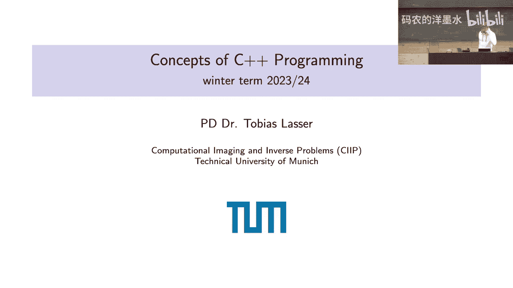

Sorry for the slight delay。 I ahead in setting up streaming。Today's tweetback session is。

It's that one U A， And some of you have already found it， which is cool。

We will now take about 15 minutes。嗯。For you to， because you hopefully have read the announcement。

 there's a cost evaluation by the Fsha MP E going on。

should be running for most of your courses that you're visiting here at tom。

It's also running for this course， and we are asked to provide you with 15 minutes in the class to fill out the evaluation forms。

😊，It's an online evaluation， so you should have received a link by email for this course。

 once you click it， you should get to some forms to fill out。

We will start the actual lecture at 1430 so in about 13 minutes from now。

Unless I get a sign from you here in the auditorium that you want to start earlier because you already filled it out or you are done filling it out。

So。Let's take the chance to do the course evaluation。 It's very valuable to us。

 It gives us feedback about the course。Of course， feedback is also welcome in any other channel at any time。

But this is the official one that's used for various purposes。

 so please give your feedback if you can。Right， so I'll shut up and leave you to fill out the thing until 1430。

Feel free to ask things or write things in tweet。 Meanwhile， I'll be checking。So， right。

 according to my clerk， it's 2，30。嗯。So they're going to start。With the course， as you've seen。

 I've read your tweet by comments， and I also forwarded the。Homework 7 feedback through David。

 so that we。Do it better in the future。Right。

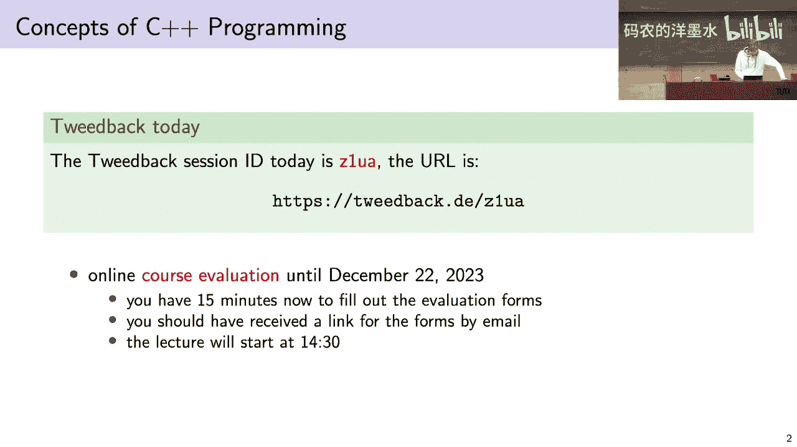

So as promised today， let me open the correct window here。Right。So today。

 we are going to finish the chapter about object oriented programming， as promised some time ago。

We talked about resource management， copying， moving， ownership， all this stuff。Last time。

 which was two weeks ago， and today we are gonna to finish the object oriented chapter where we talk about inheritance。

 polymorphphy virtual functions， and a few extra things that pop up when talking about classes。

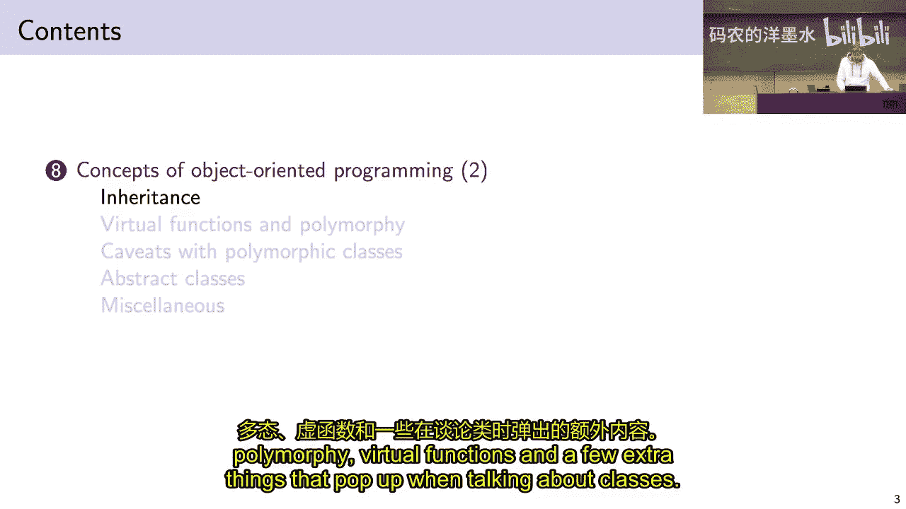

So as you've seen quite a few times already in the course and probably also in your exercises。

You can derive classes。 So we have classes astruct or class keyword。

 and we can derive those from other classes。 And we call those classes that we derive from base classes。

And in terms of syntax， it's fairly simple。 There's a colon after the class name。

 and then you specify which classes you derive from。Right。

C pluspa allows you to do multiple inheritants， so it can inherit from。

As many classes at once as you want。嗯。We' are not gonna cover this。In detail， in the course。

 we are gonna use it here or there。 But in general， multiple inheritance leads to issues。And。

My guidance， at least。 And I think that matches a lot of other people's guidance is to not use it by default。

Unless you really， really need it。 And if you really， really need it。

 you probably know how to do it properly。So。Yeah， so I' not talk about multiple inheritance too much。

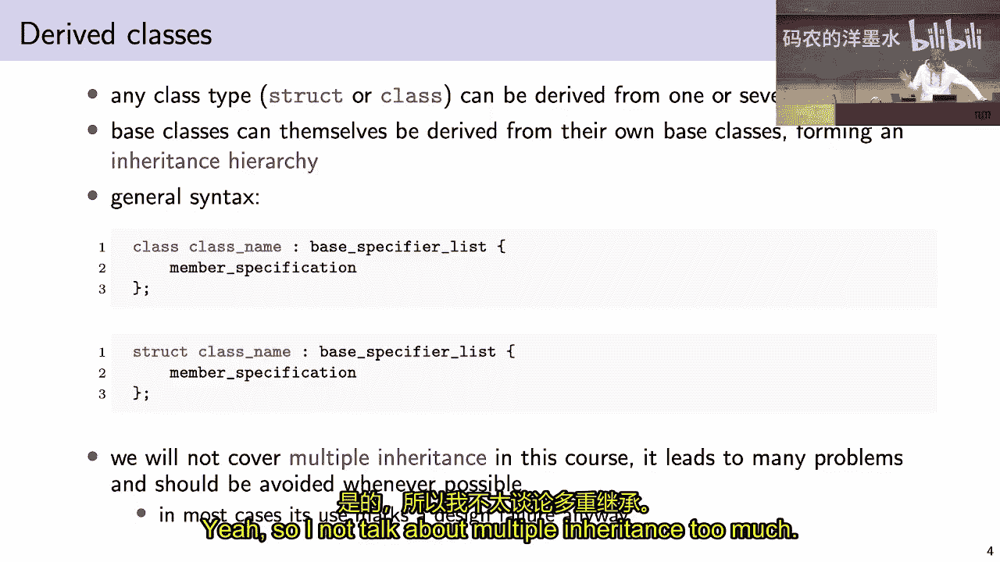

So， as I mentioned here， in the base specify list， where you say， okay。

 this is where you're deriving from。

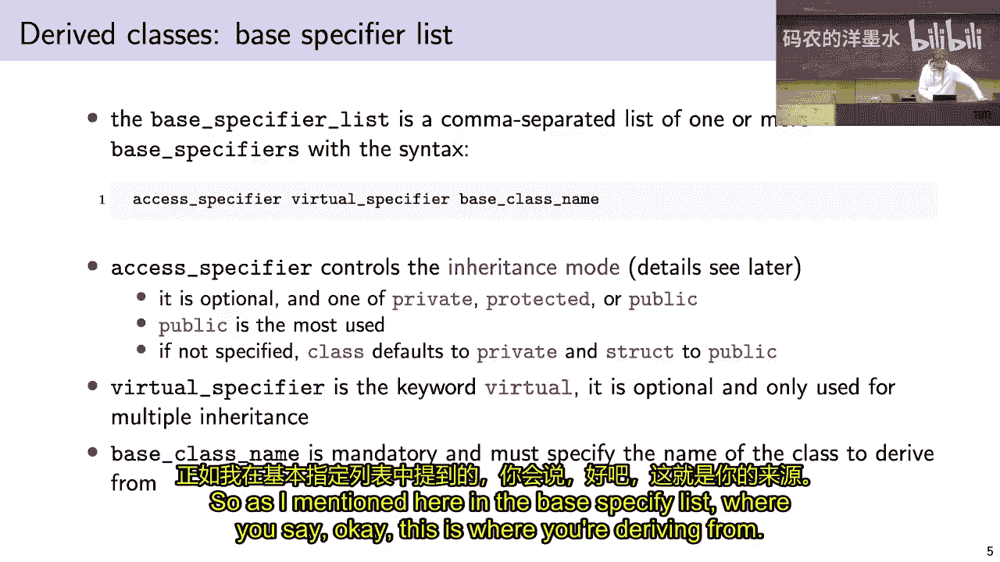

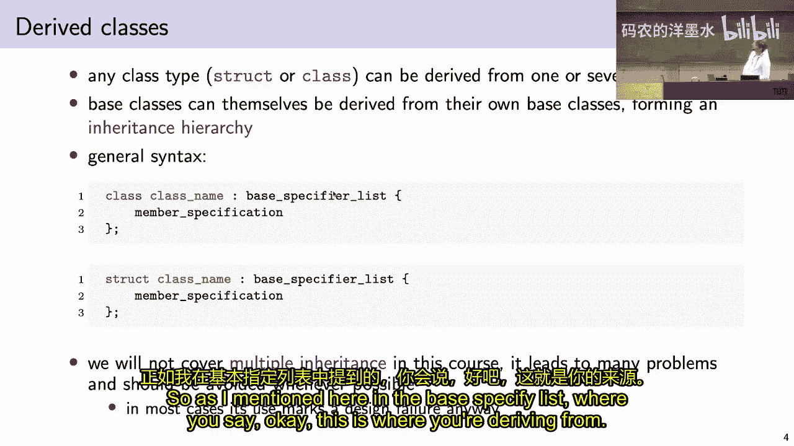

You can have a lot of stuff。 So there's access specifiers for the inheritance mode that could be public。

 private or protected。Most of it that you will use is public。

 the other ones well will talk about briefly later on。 And， of course， in most of the cases。

 you don't even see it because we have the defaults for class， As usual。

 the default access modifier is private and for it public。There's virtual inheritance， which you。

Can use and actually will only use with multiple inheritance。 So I will not further talk about it。

And yeah， essentially， you can have this repeated again and again as a comma separated list。

 so you can inherit from as many classes as you want。

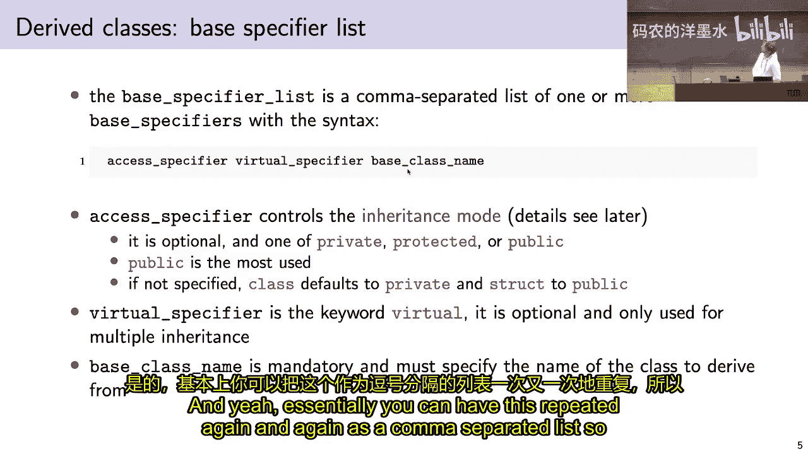

How does this look like an actual code， Let's say we have a base class as a class or the default access modifier。

It's private。We derive from this base class by putting it as a public base class behind the colon in a new class definition that we call derived 0。

And we can do the same again with a class derived one， where we do a private inheritance。

Which I'll talk about in a few slides， what that actually means。Right。

Multiple inheritance is the same， except that you specify several。Things separated by a comma。

 So if you see it， you know that this class derived two is inheriting from the base class and from the derived one class。

Which is， of course， a bit weird because the derived one class is already inheriting from base itself。

So you already can imagine that there might be a few issues there。嗯。So yeah。

 but we are not gonna talk about these in any more detail， because in most cases。You don't。Need it。

Right。So before we talk about。

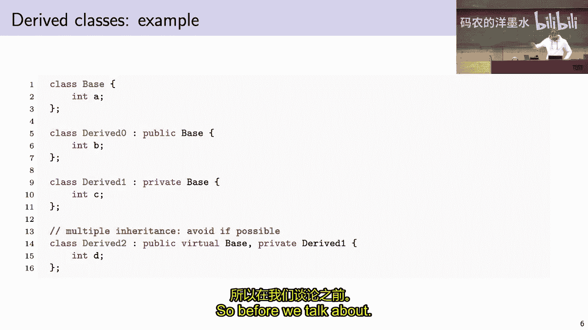

This excess modifiers， let's briefly talk about what this derivation means。

I'm pretty sure all of you know what object or in the programming means。

 So essentially I'm not going to talk about that and just talk about the specifics in C plus plus。

 and one of the specifics we have here are constructors。They are special functions for each class。

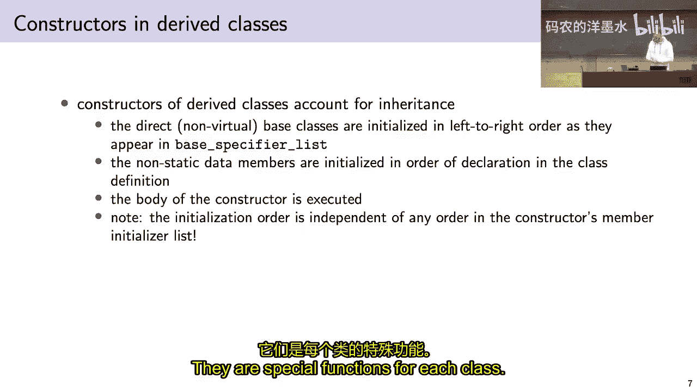

And。Essentially， based classes are somehow treated like members。

 except with higher priorities than members。

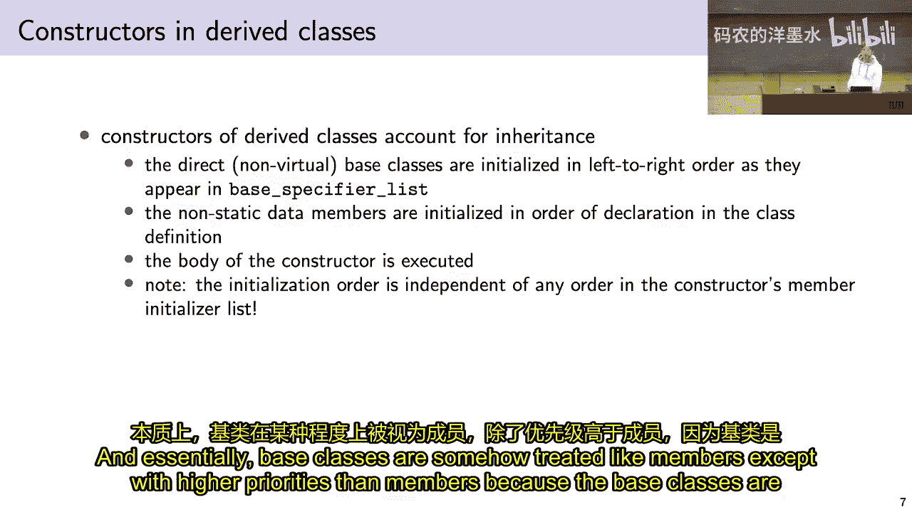

Because the base classes are initialized in left to right order。 So the order。

 you put them in the specify list matters。 But since you're not gonna do multiple inheritance anyway。

 there's only gonna be one。So that is the constructor that's going to be called first。

 then you will have your data members that might will be constructed。

 then the body of your constructor of the derived class will be executed and so on and so on。So yeah。

 it works as expected。 And basically， you can think of as base classes as high priority data members。

 more or less for the purpose of constructors。嗯。The base classes will invoke their default constructor by default。

 That's why it's called the default constructor， unless you specify otherwise。

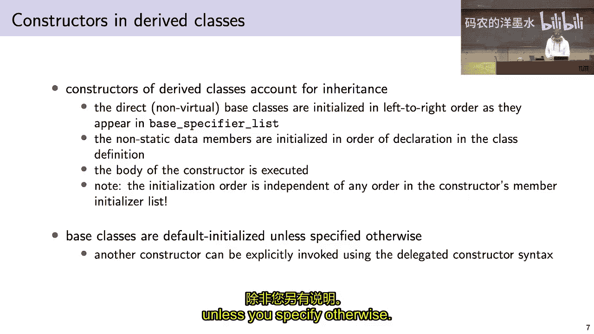

And you can do this with a delegated constructive syntax。

I remember having a question about this a while ago。 So let's take a look at this again。

 So here we have a base class with a data member。We have a default constructor that initializes the data member to some value in the initializer list of the constructor。

And just for good measure， we are outputting。Something to indicate that this constructor was caught。

Then we add a converting constructor with an integer argument。 We make it explicit。

 So there are no implicit conversions。 We've talked about this。

And we initialize the value with the provided argument and output something else。Right。

 then we derive a class from the space class add another data member。So that the default constructor。

 for example。Could just deal with that additional data member。

 because all the rest from the base class will be dealt with by the base class default constructor。

 right， But what we could do is we could have another constructor in the derived class that now takes two arguments。

 One is intended for the A from the base class base class。

 One is intended for the B from the derived class itself。

And we can delegate this to the constructor of the base class to initialize a and do whatever else is supposed to be done。

 So this explicit converting constructor will be invoked by this constructor and derived。

And then we initialize B directly。Right， so this is how it could look like。 And this is。Yeah。

 the delegating construct syntax， when we put it into the initializer list。Notowe it。

Note that the order， you can put this in any order you want in the initial list。

 but what will actually happen is that the base class constructor is called first and then the data member construction things in the order of declaration of the data members。

So in order to keep consistency， it's good to put it in the order that the compiler put it anyway so that there are no surprises。

If you do mess it up， usually the compilers give you warnings。So if we now use this derived class。

With the default constructor。And with the two argument constructor。

 what will happen is the following。 The default constructor calls the default constructor of the base class first。

 and then the default constructor of the derived class。 If you go back。

 you see that the default constructor of the derived class。

Doesn't do any explicit calling This happens implicitly。

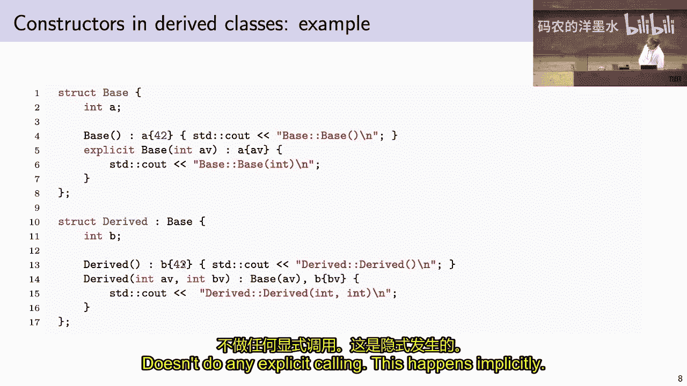

For the second construct， we do delegation。And there， it happens as expected。 First。

 the base class constructor with the one argument is invoked via delegation from this constructor in the derived class。

 and then。The body of the derived class is。Executed。So for des。

 we have a very similar situation just that the order is switched because we destruct the things first that got constructed last and then proceed in the other。

Or。

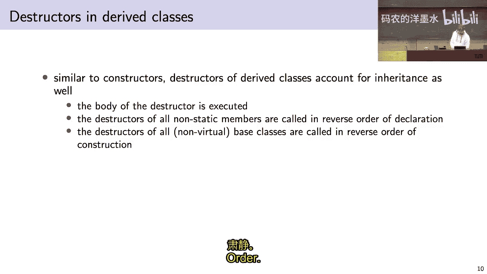

So I'll skip over this。 Yeah， so examples base class de。Another base class with a deor。

 derived class at this time has multiple inheritance just to illustrate that the order here。

Mes with its own deor。 And now this gets default constructed。 And once main ends。

 the deors are called and surprise， what happens is the derived deor is called first。

Then the base1 de， because it was last in this。Base spec class specifyifier list and the base0 will be distracted as the last step。

Right。In the live stream， your image overlaps with the corner of the image。Yes。

I think that's how it's been for。Or the lectures so far。

There was a tomb live feature for separate streams。For the presentation and your image。

I can check this out。I didn't know about it。Why explanations in man so bad。That's a good question。

 actually。You will notice that the main pages are mostly。About open source tools。

And you will notice that the documentation。嗯。Of most of the open source tools is。

Not particularly awesome。It's often very complete。 It tells you about everything somehow。

 But what it doesn't tell you。嗯。Is why what's happening， When do you need this？

 Here's an example why you would want this。嗯。That's one of the reasons why stuff like tech overflow and so on got so popular。

 because there， those answers are。As those questions are answered。So， the main pages are just。

A reference。And the reference is， as you've noticed。

 not particularly useful if you don't understand what's going on and need to understand this。

 So typically， you want tutorials or stuff like that。But I have to say。

 in the case of most open source software， this part of the documentation is very weak。

 if nonexistent and why。Well， it's open source software。

 most likely some guys writing this in their spare time as a hobby project in a few cases。

It's companies funding their development， but not in that many。嗯。And one of the other things is。

 I don't know if you've tried writing documentation before。It's hard。 And most of us。

 computer scientists are not language gurus。 I mean， programming language is yes， but， you know。

 spoken language。And in order to communicate well。What you're doing， what the intent is， and so on。

 You need to be able to。Communicate well into to teach。 And that's where our kind， let's say。

 usually。Isn't that awesome？Yeah。That's just how it is。 That's why often we in companies。

 for example， we have technical writers doing the documentation。 So not the people writing the code。

 but someone else who has qualifications that are better suited to write。

 actually write documentation。So， yeah， that's a persistent problem。 You will find it anywhere。

And you will also find it in closed source stuff。If you've read any of the API documentation of close source things。

 they are often just as bad。It's just a thing。 Good documentation is rare because it's hard to do。

Right， and what I actually do recommend， I'm also using dash on my computer。 It's， it's a tool there。

 there's also tools for for Linuxux it's a Mac only tool。

 but there's tools for Linux and Windows where you basically compile an offline version of some documentation like the C plus plus reference。

And you have it as a。What's it called？Something packed。 I forgot what it's called。

It's an open standard。 So it's you can have it anywhere。 Whats it call doet， right， Douxet。

 You can have a doet， essentially for everything。 have that in your app locally。

 So you don't have to wait for the web server to respond。 So it's quicker and easier to handle it。

 So get the do sets that are relevant for you。 for example， the CPP reference will be useful。

For anything and have them locally on your computer。 So you get really quick  clries。

Once you need them。Right。T destructors are called by default。

When would I be interested in defining one。That's something we talked about in the resource chapter。

 you will need a instructor if you're managing a resource or anything that needs cleanup。

So then you want a distractor。 if you don't， you probably don't need a distractor。

 So in many classes， you won't see。Destructors。Right， I love your new new hairsyle。

 That's the hairstyle of getting rained on while walking the dark this morning。😊。

Being too sick to care about appearance。 and yeah， anyway。 But thanks。Right。

So let's talk about name look up。We had namespaces already， and Cos， scopes。And essentially。

 the class namespace or the class scope introduces。Another scope where you can have names。

And inheritance like here， you're inheriting from class A。 And if you redefine。

The same function here， you're hiding the function from the base class。

 just like you're hiding a variable or something like this because we are in a different scope。Right。

 if you want to be explicit， you can by using the， the， the scoping operator。 So you can。

 if you have an instance B of B， and you want to call it the a from the A class that is part of B。

 since it's inheriting from A。😊，You can invoke it like this。It looks cumbersome。 It is cumbersome。

 And， of course， it's not a good idea to do stuff like that。Right。

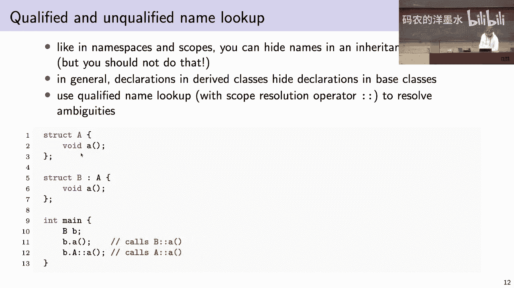

So。Just have to be sure。嗯。About the inheritance modes， I promise to talk about this in a moment。 So。

 yeah， and actually， this is something I have to mostly read of because I never use it。

 So public means。嗯。That the base class members that are public will be public in the device class。

And the protected members。Will be protected。 The private members of the base class will not be。

In the derived class。Protect it。 So the public， that's a default。 That's what you usually do。

 And that's what makes most sense。Protected if。Means that the public and protective parts of the base class are treated as only accessible for the class member or friends。

And derived classes of the class we are currently talking about。

 and private essentially makes it private to that class and。Not available。

 even to derived classes from this。Both of these are very special cases that you most likely won't。

Neat。At all， ever。So public inheritance is the one you typically use。

 Because why would you actually want inheritance， Because we want to model relationships that are and is a relationship。

 I have a graphical object default example for， oh programming。

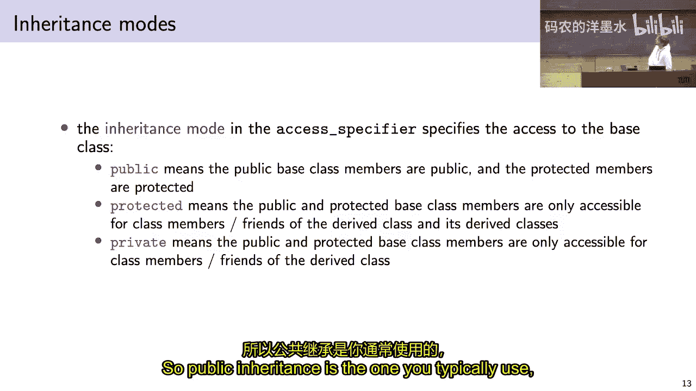

A circle is a graphical object that I can draw on the screen。

 A square or a rectangle is an object that I can draw on the screen。

 If I want to just have a collection of drawable objects。😊。

Then I will store pointers or references to base class objects， and then basically。

I can treat different things。In。The same way。 So we have the subtyping thing where the is a relationship is modeled。

 and this is essentially。The use case for which you want inheritance。Right。And as I said。

 private and protected inheritance is essentially not done。嗯。Any dark pictures。

 I'll see if I can pick some out。

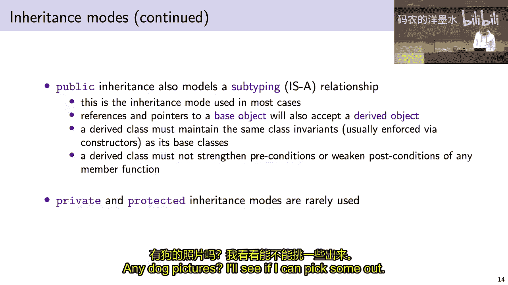

Right。So one of the major reasons why you're doing theheritance is this is a relationship。And。

For this， you typically want a polymorphphy。 So let's say。

 let's stick with a graphical object example that is drawable on the screen。

 Maybe you want to actually draw it on the screen。 So you want to have a collection of pointers to these kind of objects。

 We are the base class that has a function called draw。And now you have derivatives of this class。

 four circles， four rectangles， four other shapes。And。You want to call draw on all of them。

 Since you're invoking this， via the base class。 You want to have a mechanism that calls the actual correct draw function。

 And this is what polymorphphy does in virtual functions。Oh yeah， I should move on here。 So yeah。

 one thing to note is that polymorphphy doesn't happen by default in C plus plus as opposed to other programming languages。

 you need to actively do stuff to make polymorphphy happen。

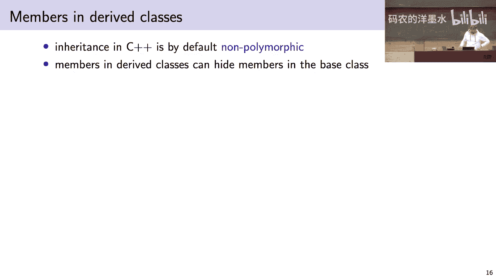

So just as an example。That we've seen basically before with the method H of more explicit here。

The full function that gets。Hidden by the derived class by redefining it in this scope。

It's just hidden。 There's no polymorphphy going on。 So if you instantiateiate re arrive class D。

And create a reference to that derived class D of type B of of a type base。

 You can do that because it's an is a relationship。

 So anything that is an derived class from your base class can be accessed via a reference or a pointer to the base class。

 That is fine。😊，However， if you call F， we are the actual derived D。

 you will get the F from the derived class。Whereas if you call it B Fu。

 even though the actual object it's referencing is of type derived。It will call the base class fo。

 So this is non polymorphic by default。

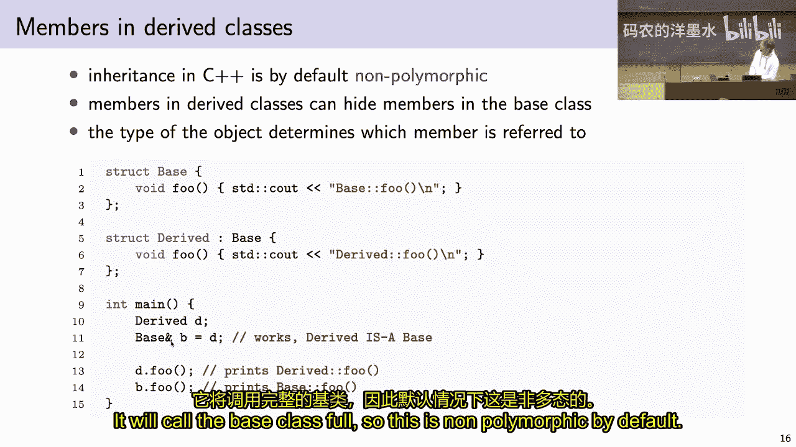

So if you w to have polymorphphy。You need to make member functions that are supposed to act polymmorphically virtual。

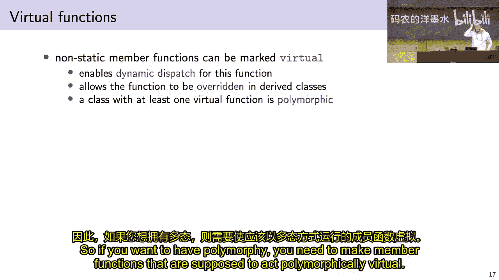

Which enables the dynamic dispatch， which is necessary to make this work and allows it to be overridden and not just hidden in the derived classes。

And as soon as you have one virtual function in your class， we call the class polymorphic。

In the base class， you need to market as virtual in the class where you're overriding that virtual function。

 you don't have to。 And， in fact， you shouldn't。Market virtual。 instead。

 you should mark with a keyword overr。 This is unfortunately optional， but you should have it anyway。

 just to make sure。That people understand what you're doing。 You're not hiding。

 You're not redefining anything。 You're overriding a virtual function from the base class。

So make your intent explicit。And。Now， the functionality that you wanna have。

 if you have a reference to a base class object and you invoke a method of the base class。

 the actual correct overwrittendden method of the actual object will be called once you do that。

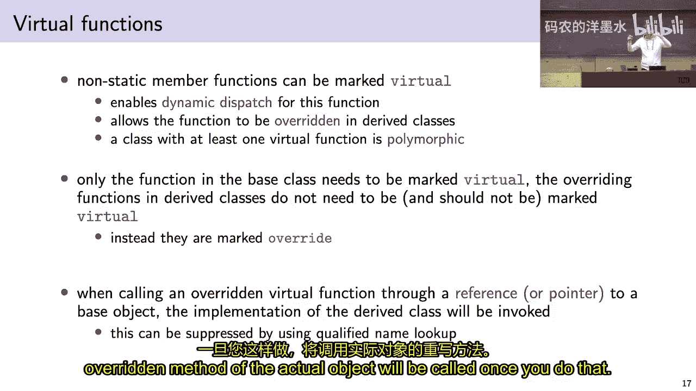

So example， same example as before。 But this time， we add the virtual keyword in front of the function fo in front of the return type in the base class and in the derived class。

 we add the override keyword after the parameter list， but before the function body。

And now we have polymorphphy dynamic dispatch。 And now， if we。Let's， let's expand the scenarios here。

 So first， let's say we have a base class instance P。At derived instance， D。

And we have two base class references that refer to be the base reference and to D， the D reference。

So now， if I call it D fo， then obviously， the derived fo is called。If I call it via the D reference。

 it's also called。 But the interesting part of now， what happens。If I call it。Well， no。

 that was always interesting。 Okay， sorry， the de reference is of type base。

 but it also calls the correct function because of dynamic dispatch。Now。

 you can make it explicit and say， I wna call it the base fool， Then you can do that。

 And if you use a base class reference。To an actual base object， then， of course。

 the base function will be invoked。So this is working chest as intended。

Can I get attributes of the derived class if I use a basic class reference。Oh well。

 you mean if you can access data members。Of the derived class。

 if your reference is of type of the base class， No， you cannot。

Because the bath class doesn't have those members that you define in the derived class。

 This only works for the。V sort of functionss。You will need to do a cast。

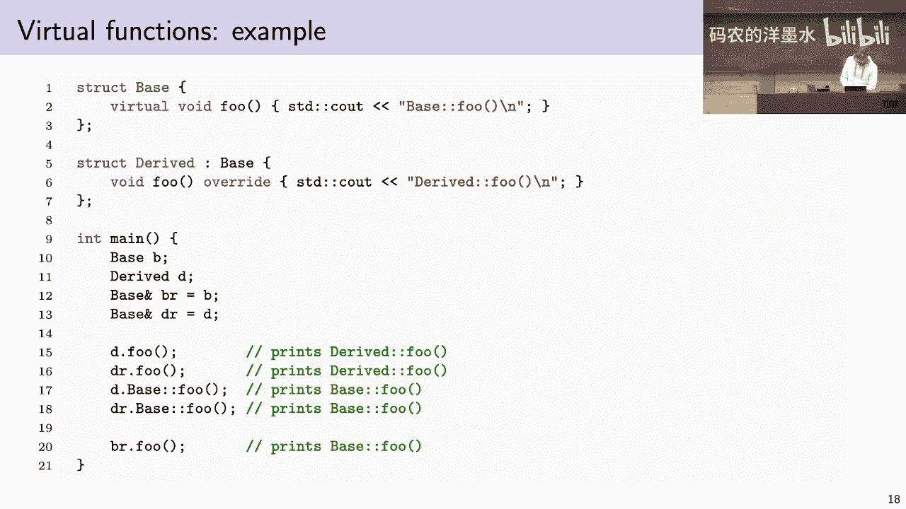

Right。Okay， so a function is overridden。 Let's be a bit more specific here。 if the ver。

Base class function。And the overriding function have the same name， the same parameters。

 and the same qualifiers。So the name needs to be the same， obvious。

 the parameter list needs to be the same。 You can't change it and the qualifiers。

 which are sometimes a bit of a surprise。If the function is cons in the base class。

 it needs to be consed in the derived class。 Otherwise， it's not gonna override the base class thing。

The return type is a bit special。 It should be the same or covariant。

 And this is something we talk about in a bit。If you mess anything of this up。

 slightly misspell the name or by accident， change the parameter list or forget about a qualifier。

The compiler will accept the function。 It will think， oh， that's a new function you wna have。

 That's very similar to the one in the base class， but it's not the same。 So it's not an override。嗯。

So， yeah。This doesn't happen if you write overrite and there's a mistake。 the compiler will tell you。

 oh， you're trying to override something that cannot be overridden。Right。嗯。

If you override a function， it itself will automatically be virtual again。

 and you can override it again in a further hierarchy down below。

And you don't need to add the virtual keyword again， in fact， you should not。

So virtual keyword in the base class override keywordt in the derived class。

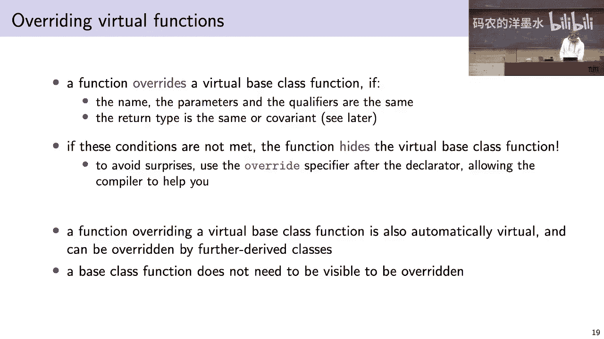

So let's look at a few examples where the override keyword， which is unfortunately optional。

 should be mandatory， but it's not why backs compatibility， it got introduced in C plus plus 11。And。

 of course， if you made it mandatory or the code before that wouldn't compile anymore。

 So it's optional。Right， so let's say base class has a method4 with an integer parameter and a method bar with no parameter。

Let's say the base cl， the derived class is inheriting from base and tries to override the full function。

 but you mess up the parameter and make it afloat instead of an in。

If you don't write the over keyword， the compiler would accept it。And think， oh。

 you wna hide the function full from the base class。 If you write override。You tell the compiler， oh。

 I wanted to override a function in the base class， but the compiler will say。

 there is no function like this in the base class or something is wrong。And the same here。

 a bit less obvious for the function bar。 because here， I mark it as const but in the base class。

 it was not marked as const。So it's also not overriding。

 and the compiler will tell you about it if you put the keyword overr。

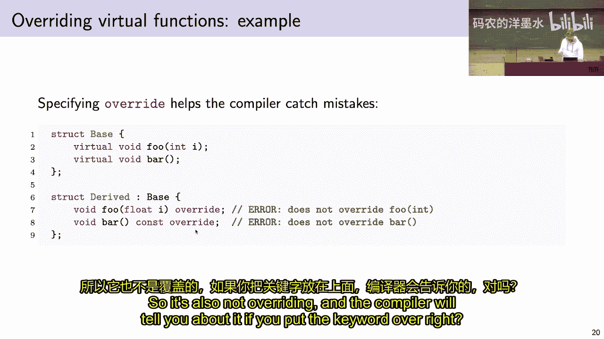

Let's give an example of why you should be using override keyword。Base class with a function power。

 That's private。And a public function fool。 both of them are virtual derived class that redefines both。

But doesn't put the override keyword。 So what's actually happening is the bar function is actually overriding。

The private function from the base， because the signature is the same。

The full function has a different signature because it accepts some parameter。

 so it doesn't override it， but it hides it。So yeah。 And then stupid things can happen。 So。

 for example， if you try to invoke the full function of the derived class D without a parameter。

There will be error。And if you invoke。If you try to invoke the virtual full function。

 which you might have thought gets overwritten in the derived class。

 it's not invoking the derived full function because it's not overriding it。

 If you had put override here， the compiler would have helped you。Find the mistake。

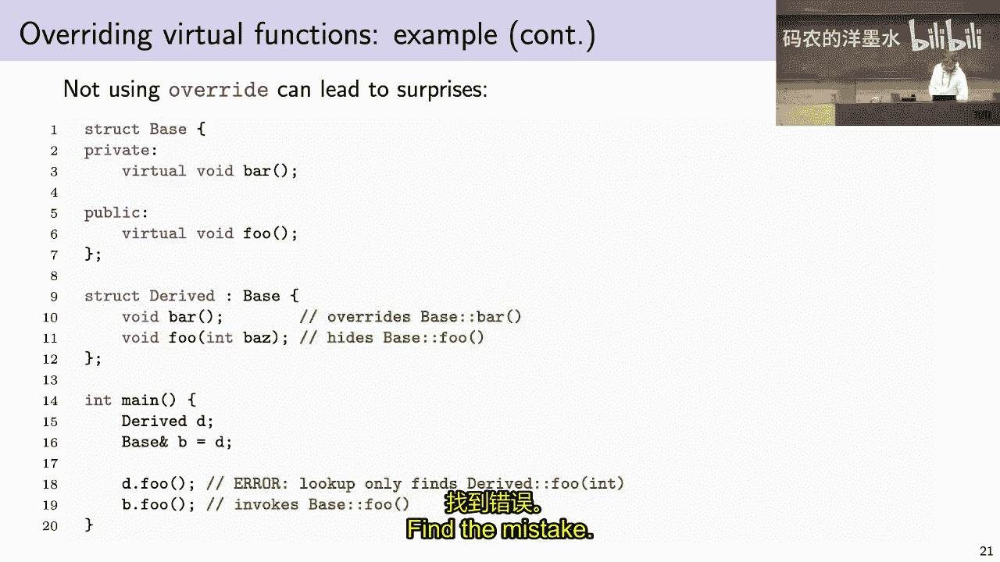

So I have a few more examples for the。Overr， so here， base function。

 base class A with three functions， fo bar and bass。All of them are virtual， all of them simple。

Class B is overriding foo and bar， but not bass。 And class C that's inheriting from B is only overriding foo and nothing else。

 And now you can already guess what's gonna happen。

 If you instantiate an object of type C and handle it via a reference to the base class A。

If you call Fo， via the base class reference。Fo is a virtual function that gets overridden twice。

 So it will call the most recent one。Bar is overwritten only by B， but not by C itself。

 but that's the most reason one。 So that bar is gonna be called。

 and bars is only defined in the base class。 So it's only calling that one。

If you do the same for an object of type P。The same will happen except that fo， obviously。

 we will use the one of P because that is an actual。Clas。B。

Are you required to override virtual functions？ No， you're not required， but。

If you're not overriding virtual functions， why are you having virtual functions。

That's their purpose。If you have over virtual functions。

 you want them to be overriden in derived classes。So you don't have to， but that's kind of。

The use case for them。Why does line 18 on slide 21。

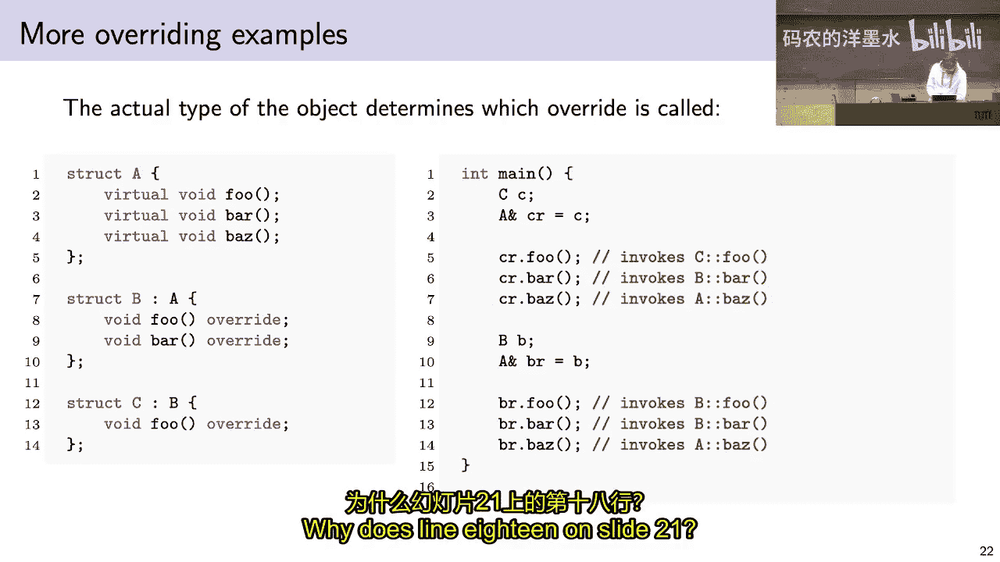

Not call。The base full。Well， because。The bass fool。Is a virtual function。ItsNo parameters。But。

The derived class fo is hiding it。And the U class4 is requiring a parameter， so。

That's why you get an arrow here。Can virtual functions have a function body。 Yeah， Of course。

 I'm just not putting one because of slight length limitations。Will overload it function。

Functions be overri in the base class。 Oh， if you wanna mix overloading and overriding。Don't。That's。

So overloading is， if you have the same function with different parameters。Overriding if。

Dynamic dispatch in polymorphic classes。 So don't mix and match。 It's， it's gonna hurt。

Oh that should you prefer static polymorphism to dynamic polymorphism， No。

 the answer is definitely no。Why， and first， we didn't talk about static polymorph yet。

 We will do so in one or two weeks。嗯。Well probably not two weeks because there's Christmas holidays。

 But you know what I mean。Sthetic polymorphism is faster。And I talk about。Why in a moment， actually。

But it's a lot more cumbersome。 So know that default should be dynamic polymorphism。

 unless you really， really need static polymorphism。Right， so there have too many questions。

 I will answer the rest that I haven't answered yet when I'm back in the office。

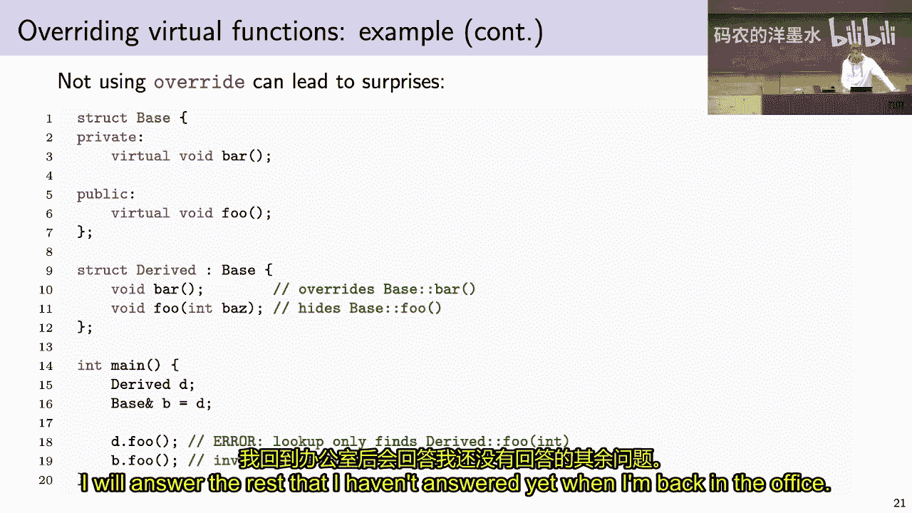

Right， so c and return types。 Let's talk about this briefly。

So the return type of overwrittendden function have to be the same unless it's covariant and what does covariant mean。

It means it has to be a single level reference or pointer， meaning just 1 m percent or star symbol。

And the referred type。Or referenced or pointed to class。In the base class function。Must be something。

That is the base。Of the return type in your derived class。So there needs to be a relationship。

 And typically， this relationship is the same as。The base class， whether the derived class。

 So you might return a base class reference in the base class function。

 and you allow to change that to a derived class reference in the derived class。

 That is a covariant return type。 It also works for pointers。嗯。

Have to have the same constant qualification in all of them。Yeah， and there's a few use cases。

One of them。喂。That's not the use case。 I think I'll come to it later。 But essentially， the idea is。

Let's say here you're returning a base class reference in the base class in a virtual function。

 You're overr it in the derived class， and you w to change it so that it returns a derived class reference。

 This is allowed。 This is a covariant return type。And this is fine。

Any other changes like going from a base class pointer to something else， which is， I mean。

 what would be valid is a derived class pointer that would be fine That would be another cover and return type。

 But doing something else like an integer。Is not valid because that's not a covervarit return type。

Are there generics， Yes， most definitely， we will get to this。

 templateemps in C plus plus are really cool。😊，Just keeping them for a bit later。

 because they are complex interfaces。嗯。🤢，Not explicitly。 We'll talk about this today。Right。

 what else can we do the mandatory stuff， You can mark stuff as final。

 so you can mark virtual function as final， so it can't be overwrittendden。

 Why you would do this in the base class and then market virtual as weird， but why not。

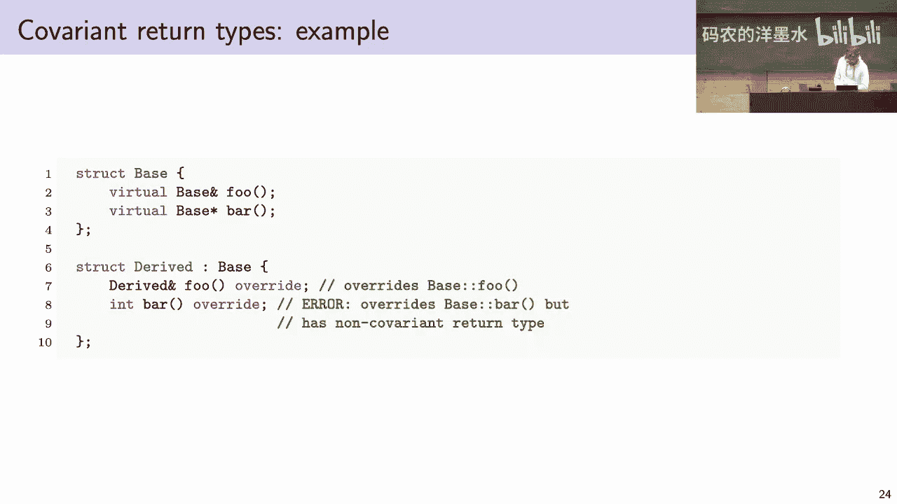

You can mark the enter class final so that you can't derive from it。

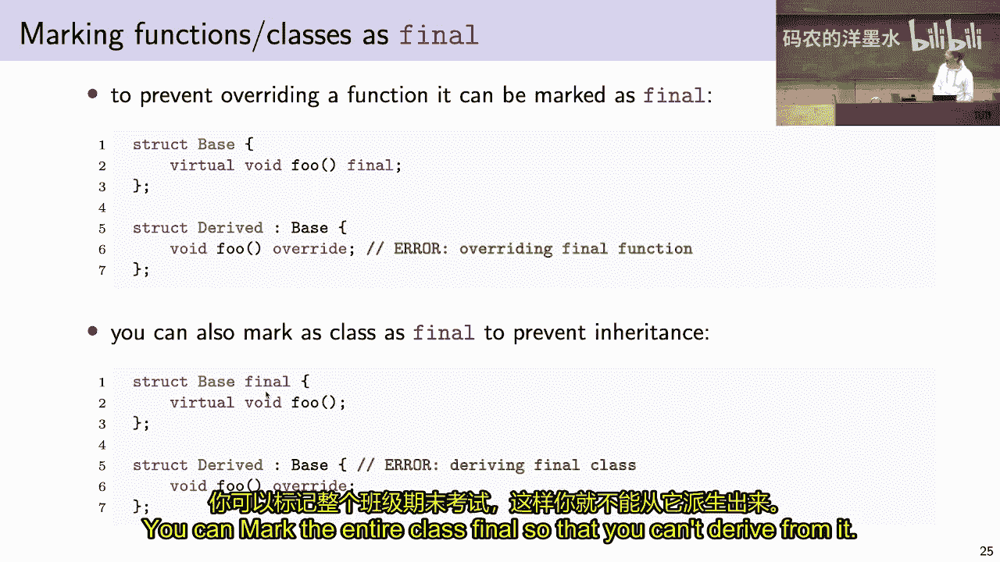

Okay。And oh yeah。 And that's basically all I wanted to say about。Inheritance。And poly Mufi。

What remains。Some weird things。And as it C plus plus， they ask quite a few weird things。Coming up。

 So I have a few caveats about polymorphic classes。 I have briefly talk about abstract classes。

 and there are some miscellaneous points which didn't really fit anywhere else。

 but kind of fit into this chapter。 So I'll talk about them as well。Before I do that。

 I want to answer the exam question。So the exam signup has been opened for a few weeks now。 And， yes。

 we have around 680 signups or so。And are there any decisions made。

 whether the exam is on premise or online。No， because I'm currently in contact with the pres or how I can do that。

In a legal way。And the proof our shows has。Email letter， email answer， Let C of one to two weeks。

So I'm writing a message。 and if I'm lucky， I get a response in one week。 If I'm not lucky。

 I get a response in two or three weeks。The latest conversation。

I think it's already two and a half weeks ago now。So yeah。

 I w to have it sorted out before Christmas so that you know what expects you and what is expected of you in February。

But I also want to have it signed off by the proofings our shows。 So that's gonna be a bit difficult。

So I will probably revert to telephone terror this week。 But the thing is。

 if the relevant people are not sitting in the office or seeing my number， oh。

 this guy is calling again。 I'm ignoring him。Yeah。So as you might have noticed。

 our administrative section。Has suffered a lot since the school thing happened。

And this is one of the things， why。Yeah， I still haven't done a decision。 But my idea is basically。

 if I don't get an answer by this or early next week， I'll just make a decision myself and。

Communicate it to you and see what happens。But， of course， the call for you is still。

If you'd intend to attend the exam， please sign up。 If youd signed up and change your mind。

Please unsign， because the number of sign up is。One of the main factors is on whole。How。

 how we can how we can do the exam with three people， right， with' David with your us and myself。

Right， responses for Mars are clicker， indeed。Why did the school thing even happen if you don't know about it。

 there used to be a faculty of informatics。 There used to be a faculty of electroationnic and a faculty of math。

Our。Awesome president had the genius idea that we should merge these three together into the School of Computation。

 Information and Technology。😊，So that we have a title。That nobody knows。 What is it about。

 Comp information and technology is that。What does that comprise？And that for some reason。

 it would be cool to match all these different cultures that have been going for decades。😊。

Together into one。And the， yeah。If this were a company。

 we would get extra resources for the transition to make sure that the transition transition happens smoothly。

Being an elite university， what we didn't get is additional resources。 In fact。

 some resources even were moved。And the result is that we have the same number of people。

Like in the prevos as or in the student office doing things。No。For that bigger audience of students。

And what happens is that quite a few of these people have quit because they said。

 why should I do more work for crappy pay。That's not even well organized。

 And then the remaining people have an even bigger。Pile of work to deal with。 And， yeah， overall。

 this is quite the catastrophe， from my perspective。And I think some of you already noted things。 So。

 for example， if you were expecting a ranking in computer science。Stent ranking。

 like which rank are you in your cohort。Hasn't happened this semester。

 hasnn't happened last semester。 One of the reasons is that is a triage measure。

To keep the student office alive at all。 So they're kicking everything that's not， not。

 not essential。Yeah。Where is the petition to sign for you to get more money for tutors。

I have asked many places， and the answer was either no answer at all。Or no。Because obviously。

 we need to save money。We're spending too much on universities。 and yeah。Well， anyway。

Enough ran about this。 It is what it is。 Well make the best out of it。 And yeah。

 there's not much more we can do。Right， caveats with polymorphic classes。嗯。You have to be careful。

About virtual functions， Because why the constructor。And these structure are running。

The functions aren't virtual。So if you rely on。Functions acting in a virtual manner。

You can't do that in the constructor。 So， for example。

 if you have a base class constructor that calls a virtual function fool。

It's always gonna call the base fo， even though the function here is marked virtual， and you might。

Have expected that it will call the derived one when you actually。Insteniate a derived class。 But no。

 virtual functions are not virtual for purposes of constructors and deors。

It makes sense if you think about it， but it's just something to be aware of。

Another thing you need to be aware of。If。Handling virtual classes through base class pointers。

If you have a pointer， that means you're manually allocating things。

You have to allocate the resource， for example， with new and then also with delete。Right。

That's why you would be using pointers。 Of course， since youre。

 since you're indocrinated by me to do modern C plus， you're not gonna use raw pointers， right。

 You're gonna use smart pointers。Fine， but even with smart pointers， you will have the same issue。嗯。

The pointer will go out of scope at some point， The smart pointer。

 So it will delete the resource associated to it。But if the smart pointer is a pointer to the base class and not to the actual。

Dives class， what the structureor will be called。Right， and if the distractor itself isn't virtual。

Bad stuff will happen。 And bad stuff is called undefined behavior N C plus plus。

 That could be anything from a crash to a memory leak or other things， so。What you have to do in。

Classes， base classes of virtual virtual class hierarchies。

What you have to do in base classes with virtual functions is you have to either。

Make the de public and richer。That's the default。Or if for some reason。

 you want to disallow destruction of your class， make it protected or private and non virtualr so that it can't ever happen that somebody tries to distract the class via a base class pointer。

So this is what you should be doing and the default should be virtual。Bs class instructor。

And one of the things that's a bit weird， if you do a base class instructoror that's virtual。

 you have to add a function body。And that's typically empty because the base class usually doesn't do anything in the distractor。

Right， and now if you do stuff like this， if you handle it the。Okay， there's naked pointers here。

 So that's what you never should do， right， But if you do that for some reason。

 maybe because you're using a library that's doing it like this。 Q T。嗯。😊。

Then this is how would it would work， right。You create an object of type derived hand via base class pointer。

 You remove it。 The distractor gets called。 since it's virtual， the correct deor is called。So。

If you do this inheritance thing with the is A subtyping and virtual functions and polymorphphy answer on。

 you need to handle。嗯。Then， via references or pointers。Otherwise， there might be surprises。

 Let me show you what surprises can happen。Here's a class A with a data member X。

 Here's a class B that derives from a add a data member y。Now we instantiate an object of type B。

You do another object of type A， and you initialize it。 You copy。

 initialize it with an object of type B。That works。The compiler compiled this。

But what happens is since it's a class of type A。It only contains a data member X。

 It doesn't contain a data member Y。 So in this assignment。

 basically half of the B class here is lost。This happens implicitly。

 and you might be surprised by this。 This thing is called slicing because you are essentially slicing off。

A part of your class。More。Weird example。Same thing class A with data member X。

 class B derived from a with data member Y。 So no changes here。 I'm just changing how I'm using it。

 So I had to create two instances of B of the derived class。

 So we have two data members X and Y here。 two data members， X and Y here in B1 and B 2。

 Now I'm handling。😊，B2， via a reference to the base class A。And handling。

Base classes via references or pointers most fine， right， So it should be fine。

So now what I'm doing is I'm assigning B1。To this reference to a。Which is， actually。

An object of type B。Now， this is going to be very weird because B2 already has states。

 So it has certain values for x and Y， right。And I'm assigning the values of P1 to this。

Reference that points to be，2。So you might assume that I'm just transferring the values of x and y of B1 to B2。

This is not what's going to happen。Because what's gonna happen is the A part of B1。

 So the X will be assigned to B 2。But the Y part of P2 will stay the same because， yeah。

 it's an a reference。This is also slicing。So the， the root problem of both this。

And this slicing example。Is copying。So。The default of what you should be doing in any。

Polymorphic class hierarchy。 You should disallow copying。For example。

 by writing down the copy constructor and writing equals delete。

 writing down the copy assignment equals delete because traditional copy in Cpl doesn't make any sense for polymorphic types。

Still， you might be willing wanting to actually copy your type。 but in a way that。

It's not that stupid copy like here， but like the actual copy。 So if you。

So what you would really like to happen here is， of course。

 that the entire contents of B1 is stored into B2， right， So if you wna that， wantan to do that。

 we need a cloneable。Which we'll talk about later。

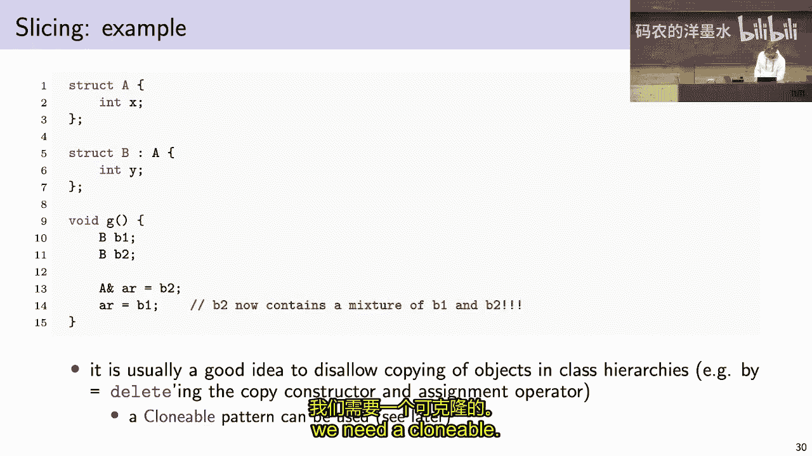

But now we come basically to one of the most important parts here。The rule of five。

 you remember it from lifetime， right， If you're managing a resource。

 you probably want all five things。Teth structure。Copy and move constructors。

 copy and move assignment。 oops， discounted 5。嗯。For polymorphic based classes。

 what you should do is you should have a virtual distractor。That's required， right。

 You can default it。Because typically in the base class， the instructor isn't doing anything。

And you should delete， copy and move operations， all of them。The bit verbo， as you see。

 it's an entire block of text that you need to write down。

 basically by rot for every polymorphic based class。But this is how you should do it。

To prevent slicing from happening。To prevent these copy operations。Now。

 if you actually wna have a useful copy operation。We need， essentially， a virtual。

Copy assignment or move assignment or move constructor or copy constructor。 Unfortunately。

 those special functions cannot be made virtual。

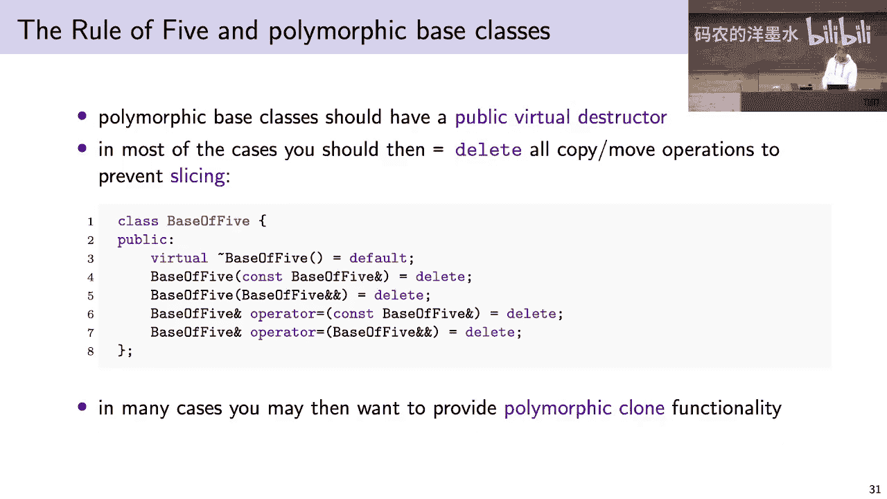

So the only thing we can do is so called polymorphic cloning。And this is by introducing。

Method that's called clone。Which does the job。 And its virtual returns a pointer。To。De base class。

 and you somehow generate a new object of type A。 that is an actual copy。

And since it's a virtual function。That you override in the derived classes。

 It will know how to create an actual copy of the real type。 And that way， you can。

Create copies of your polymorphic objects。 Even if you're handling them。

 via the base class reference or pointer。It's a bit ugly。Yeah， I mean， look at this。

 This is how our polymorphic based class usually should look like。Basically，1，2，3，4。

5 useless lines of codes because they should be default。 but you need them。

 plus another line that takes care of copying。 and you have to do this manually。 Yes， E。

 and you have to write this in you all your derived classes。

 you have to overwride this clone function for this to work properly。It's an annoyance。

But that's how it is。 It's C plus plus， right。嗯。That's a curiously recur recursive template pattern to make this。

More beautiful。And easier。But the code you write will be even more ugly， yeah。It's what it is。

One thing you might note here also is that even。So we， we， we are doing this correctly， right。

 We are returning， not a raw pointer because we wouldn't know who's owning the pointer and who's responsible for dealing with the pointer。

 For example， for deleting it。 We are returning a unique pointer。 So a smart pointer。

 So it's clear that if you return this out of clone。

 whoever is gonna get that unique pointer is gonna own it。

 and the unique point itself will take care of releasing the resource。The bad part is。

A unique pointer doesn't isn't considered a covervarit end return type。

Do to breakfastt compatibility。 la la， la， la， you shit。

So you can't actually return a unique pointer to B in the clone of the class B。That'啊。Well you like。

 what the faculty plus plus， right？ But that's how it is。So there's quite a few questions。

 considering I still have some content to go through。 I'll answer them afterwards， after the lecture。

Let me see if there any。How often do you declare your classes final。嗯。Basically， never。

Becauseuse most of the classes I do are classes that are obviously not used to be derived from。

 So I dropped the final because nobody would think of deriving them anyway。嗯。And the other case。

 I want to have some class hierarchies。 So I want derivatives。But yeah。

Can astruct inherit from a class。I'm pretty sure， yes。

Because the only difference between aing our class is the， the default access modifier。

I don't understand the return statement in slide 32。Oh， the return statements。 Well。

 I didn't want to write the actual operation to create an a a copy of an a object here。

 because that would be a bit lengthy。 And， of course， we don't have any data members。

 So a bit pointless for this。 So you would be creating a copy of this current a instance here。

 And here you would be creating a copy of the B instance here。 Since none of these have any data。

 It's kind of pointless here。 But， of course， in practice， these classes will have data。

 and you will somehow have to create a copy in these things。But since you're overriding this。

You know， you are in the B class。And you know what to do with in order to copy a B。Right。

So of course， like this， they are a syntax arrow because they don't return anything。

 So you would have to fill the comment with some extra statements。

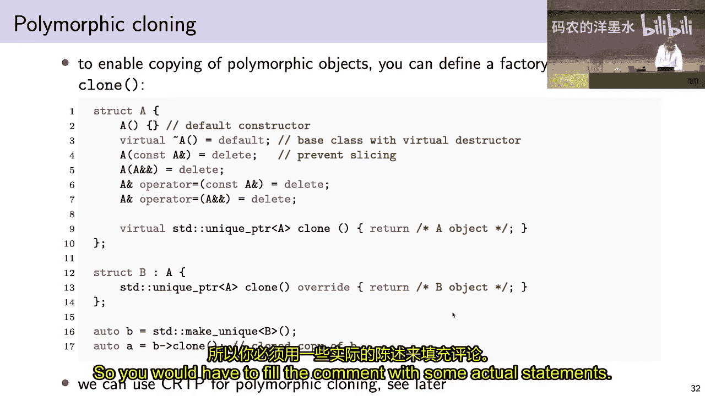

Right。So what often happens in an inheritance hi hierarchy， as we've just seen。

 but also in other cases， is that you get a pointer or a reference。To。Let's say， a base class。

But you want to convert that to the derived class。Because you actually wan to use features of the derived class that the base class doesn't have。

 like data members， like one of you asked earlier。So what he can do here is as a safe cast for doing this in an inheritance hierarchy。

 It's called dynamic caste。So it can take any expression， well， not any， but any useful expression。

And convert it to a new type。 And for this to work。The type needs to be a reference or pointer type。

 and it needs to be in a class hierarchy， right， so if。If this is of a base class type。

This needs to be a derived type。Right，And if it's not， you will get runtime exception。

But if it works， then you get that kind of reference or pointer that you're looking for。

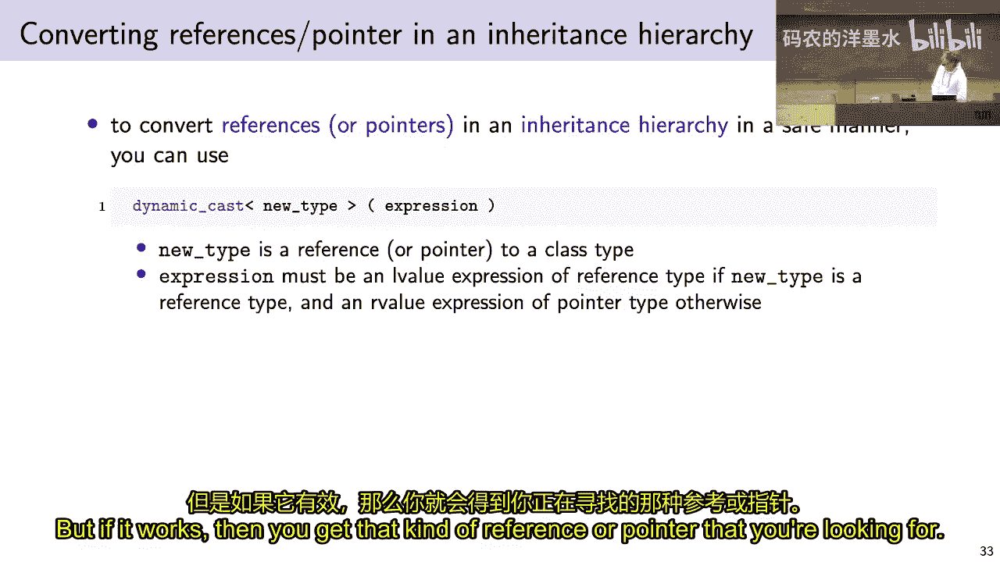

So the most common use is save downcasts， basically。

 to see if you can go down in your class hierarchy。

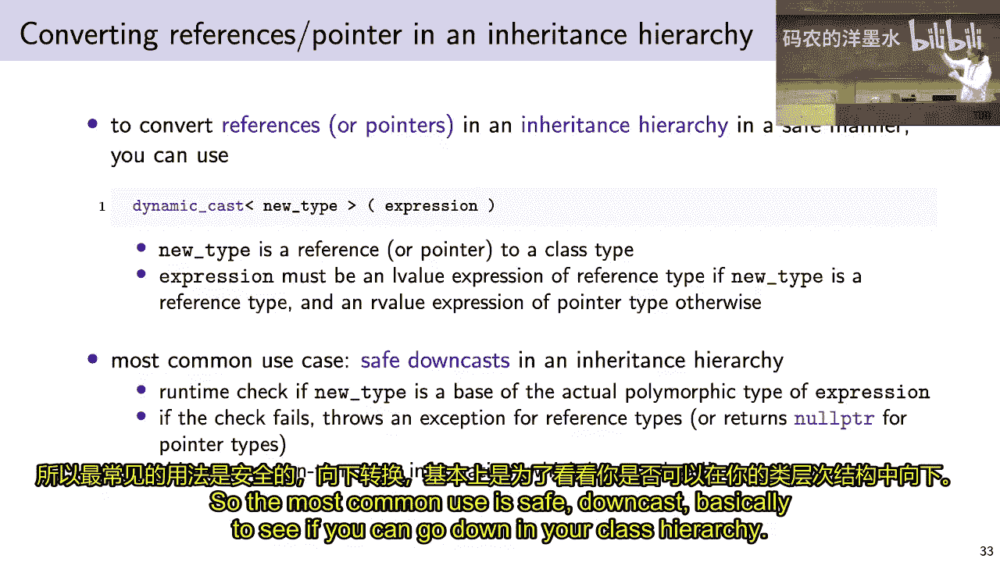

Right。Be aware that this only works with so called runtime type information。

That means the compiler needs to add additional stuff to your classes so that these casts are even possible。

That means there's some overhead in memory。And， of course， once you actually do these checks。

 they cost a bit of time， but you explicitly calling them。 So you want them。

 So there's a bit of overhead in this。

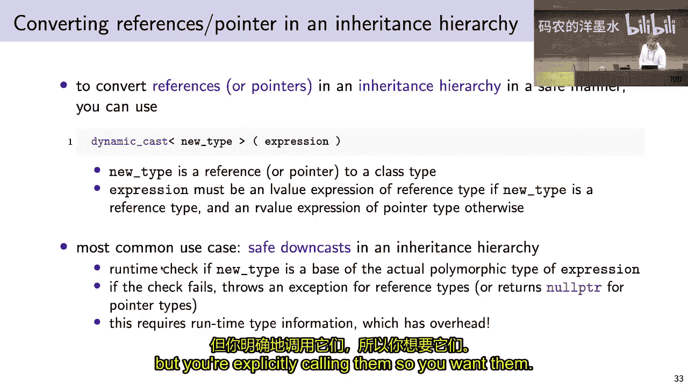

Here's an example。Let's say， we have。A base class A with a virtual instructor。That I said to 0， why。

 why am I doing that here， It's， it's kind of pointless， but whatever it。

 it makes the class abstract。 but we'll talk about this in a moment。I'm deriving from this。

 defining a function fool。 I'm deriving from this again， defining a function bar so far， okay。

It's badty sign， but nevertheless。So let's say I have a function bus that's accepting a pointer to the base class。

And now， now I want to see if this pointer is actually a pointer to B or C， because if it is。

 I want to invoke fool， if it's a B or bar， if it's a C。Of course， that's a horrible design。

 But nevertheless， you could do it like this， and you could take the pointer to the base class。

 try to convert it to。Poiner to B。And if it's successful。

You get a pointer that is not the null pointer。 So the if statement will be true。

And then you can use it like an actual pointer to B。 And since it's a pointer to B， you can call fo。

And the same fory。Right， what do you we need to be aware of。For casts with pointer types。

 you can evaluate the result for Nll pointer to see if the cast worked out。

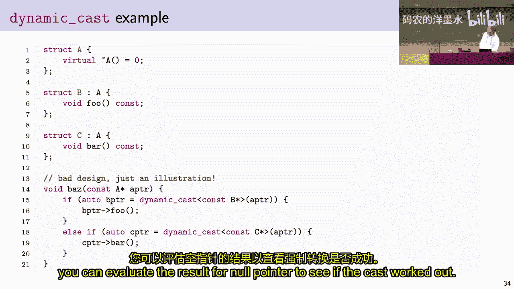

If you do this for reference types。Which is what you will mostly be doing because you're not using raw pointers。

 right。嗯。You will get an exception。Why， because obviously， a reference cannot be a nu reference。

 That's not allowed。 So the only way to get out of this is。An exception。 So in this case。

 if you would do this with references， instead of the easy check， checking for null pointer here。

 you would have to wrap it and try and catch and then do something about it or not。

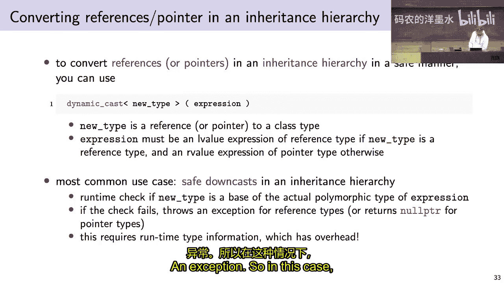

Can I enforce， Oh， that's a good question。 Can I enforce that a method is overridden in the derived classes。

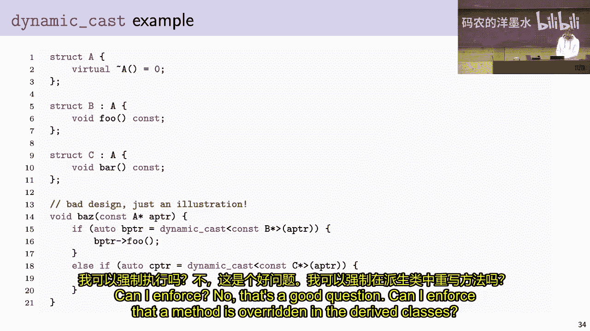

No。And of course， that's a particular bummer。If you do this clone thing。

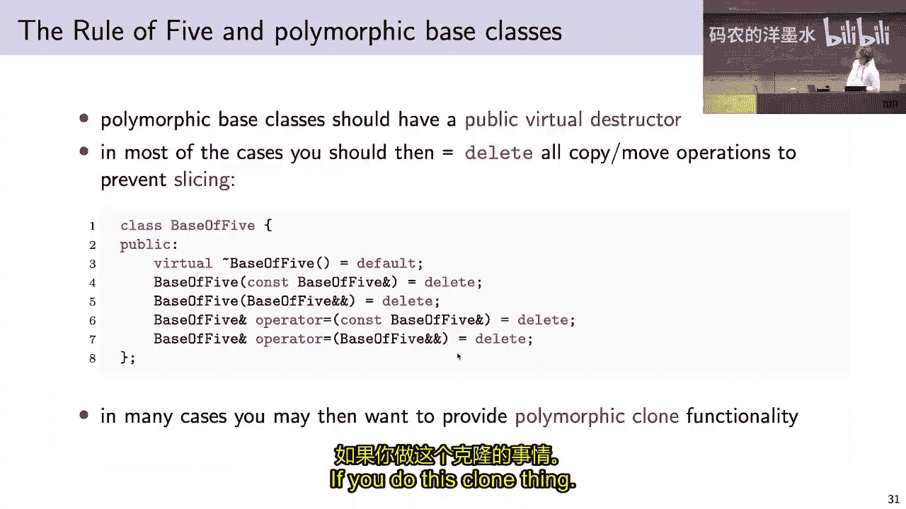

Because for this to work， every class has to override it。But theres no。

 no mechanism in Cpl that tells you you have to override it。 You only can。However， there is a C TP。

 you can。A to generate an override kind of。 So well， we'll get to that。

 But it requires a lot of weird stuff。

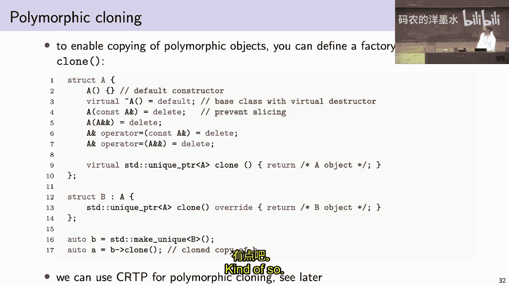

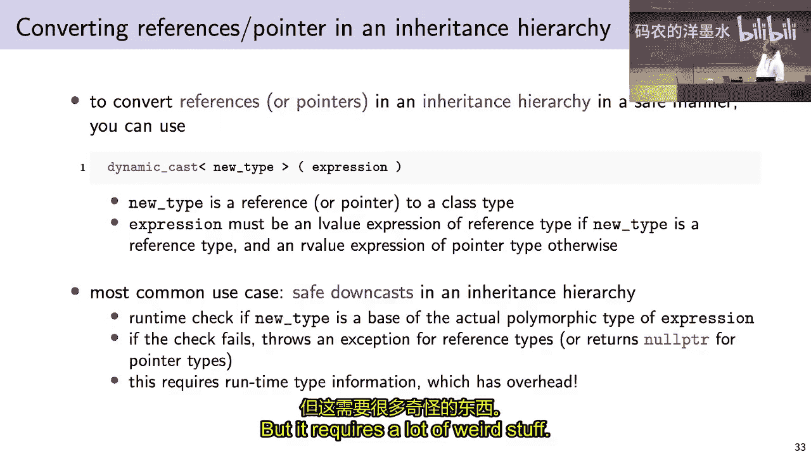

That we'll do in a week or two。Right。Why would dynamic ca fail， Well。

 we are trying here to convert this pointer to a to B。

But whatever is pointed to here might be an actual A。 So that's when the you know I cast would fail。

 or it's a C。Which is also of type A since C inherits from A。 So， yeah。

 this might also be a reason why a car cast to B fails。

What's the difference between static and dynamic cast。

 A static cast is a cast that happens at compile time。That's why it's static。

 dynamic cast is a cast that happens at runtime and requires runtime type information to work。

 So there's some overhead。 and it only works for class hierarchies。

 It doesn't work for converting anything else， and it only works for pointers or references to these types from a class hierarchy。

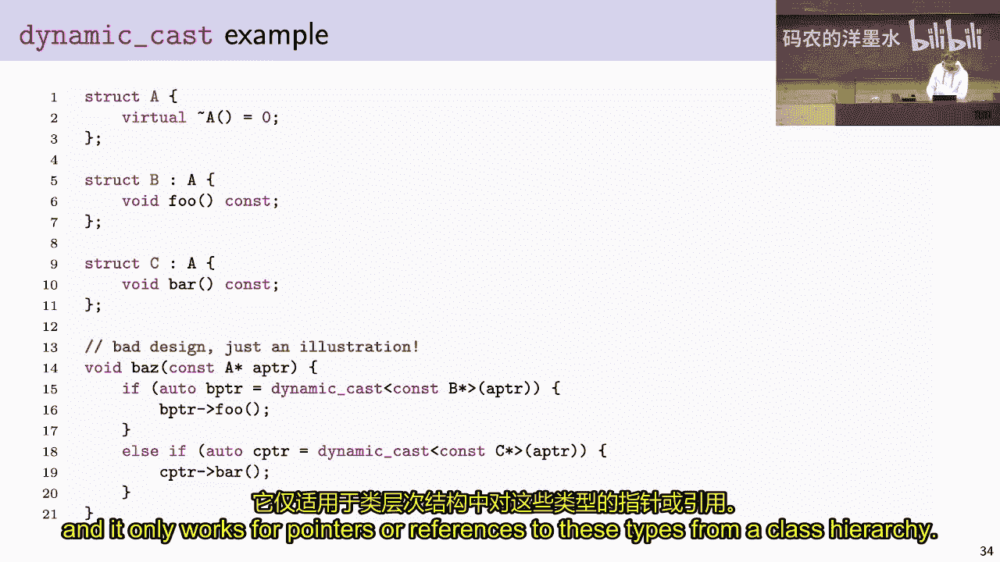

Now， let's come to a typical interview question。 if you're gonna apply for any。

company that wants to hire you as a C plus+ programmer。 One of the default questions is。

 how does this polymorphphy actually work in C plus+。Doesn't come for free。

 Dynamic dispatch has to be implemented somehow。 But the thing is， of course。

 the C plus plus standard doesn't tell how to do it。 But nevertheless， all the major compilers。

Use so calledled V tables。And I remember back then。

I think there was 2007 or 8 when I was just doing my PhD。

One of my colleagues who was already finished with this PhD was like， oh。

 I interviewed with this company and they asked me this question。

 How are virtual functions implemented。 I'm like， oh， that was an awesome question。 Very easy， right。

 Everybody knows it。 And he was like， no， I didn't know。 It was so stupid。It's like， yeah。

 what' the fuck。 So I have to include it here。V tables。So how does this work， Actually。

 let me skip the blah， blah。 Let me show the example。

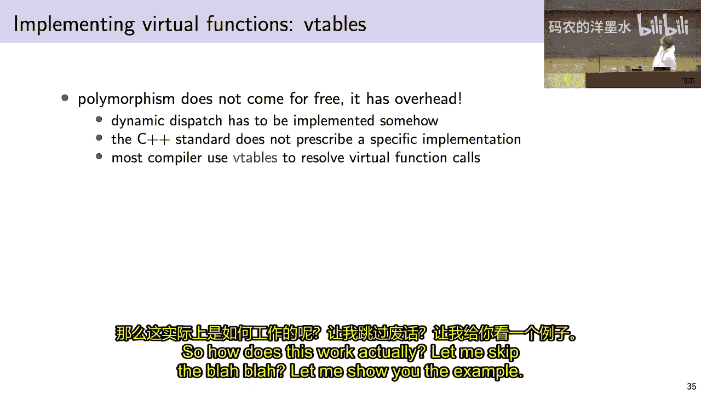

So we have two classes here， base and derived， two virtual functions， Fo and bar。

 and F is actually overridden in the derived class。Right。And now， if we have。A base class instance。

 a derived class instance。 I can handle the derived class instance via a base reference。

And if I call full via that base reference， I expect the overridden function to be called。

How can we do this。But。We have a so called V table。For each class。 And that contains。An entry。

 It's a table with rows， and each row contains basically a function pointer。2。

 the functions that this class defines。And this is only done for the virtual functions， obviously。

 because for the other functions， you don't need this。So fo and bar are functions in base。

 and both of them have implementations that are referred to。This pointers。 So these。

The code for fo and bar in the base class live somewhere in memory。

 And you store pointers in the base class in the derived class。

There is a function fool from the base class that is overridden by the full in the derived class。

 So in the first entry。We will refer to our own fo。Not the base class fo。 for the bar function。

 which is not overridden， We can refer to the base version of the bar。 And now。

 the idea is that this table here is always in the correct order。 So fo's always first bar a second。

And essentially， you just stick to the order so that the compiler knows which entry of this table to check when there's an actual call to who。

And now， now， for example， you have a derived object D on the stack。 You created it here。

You're referring to it via base class reference。But you're invoking foo。

 What will happen if you will not directly invoke fo， But rather。

 your object will have a pointer to the V table。It's always in the same place for each object。

Of that type hierarchy。And that V table pointer will， of course。

 point to the V table for the derived class。 And if you invoke full。

 it will invoke the correct method via this double indirection。 So first。

 the indirection to the actual V table and then the indirection via function pointer to the actual。

Code of the full function that you wanna call。AndNow。

 if you add more derived classes or more functions， you just expand this key。

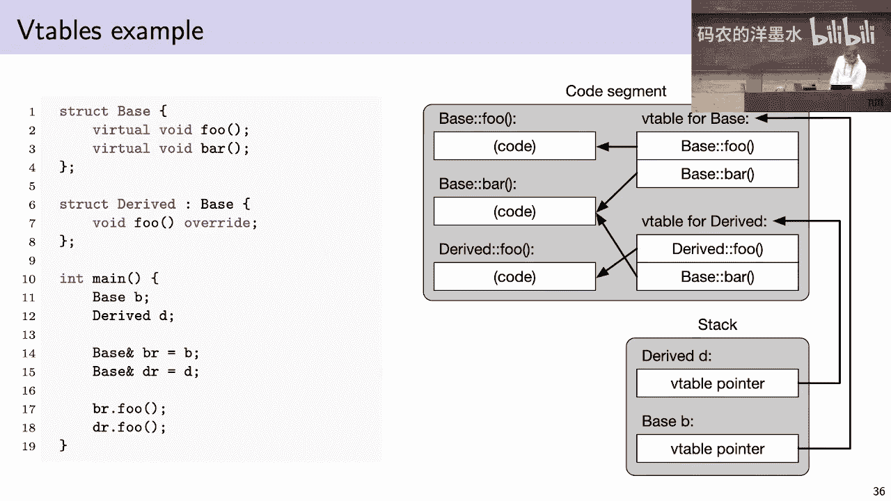

Right。There's costs associated with it， obviously， right。First， you have runtime cost。

 If you call a virtual function， you're not directly calling the function。

 You're going to the V table。 You're checking the pointer to the function you actually want to call。

 and then you call the function via the pointer。So， that's。A memory access and a pointer interaction。

That costs you a little bit， right， It's not too much。But you're also jumping around in memory。

 right， you might be here in memory， you call to your function， but now you go to the V table。

 which is probably somewhere else。 So you get a khem and then you jump to a function that might be somewhere else again that might need to add another km。

 So if you're calling a virtual functions very often like million or billions of times。

There's an overhead in runtime compared to regular function calls。

It's actually not as bad as it sounds。 So I just recently yesterday。

 I looked at some benchmarks with modern compilers。It's a very modest overhead， but it's there。Right。

 and there's a memory cost。 why， because you need a V table for each polymorphic class。

To store the pointer to the V table。 So each there needs to be the V table itself in memory。

 but that needs to be there only once per class type。But for each instance of the class。

 you need a pointer to the V table。So the cost of the pointer is added to each polymorphic object。

Typically， this would be 8 by in a 604b architecture。

 And that means that the base and derived class here that are empty that have no data members。

 just functions。 They still occupy memory because you need this V table pointer， and that's。

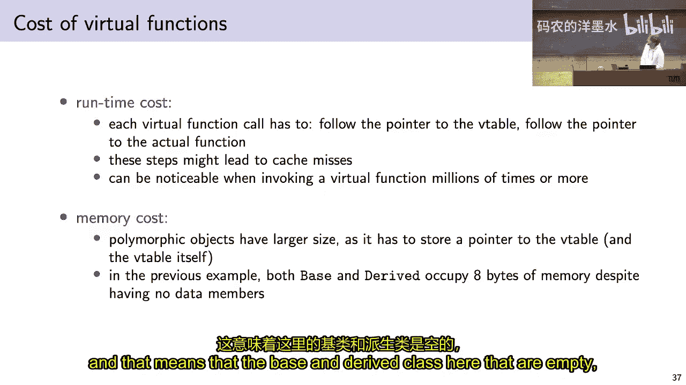

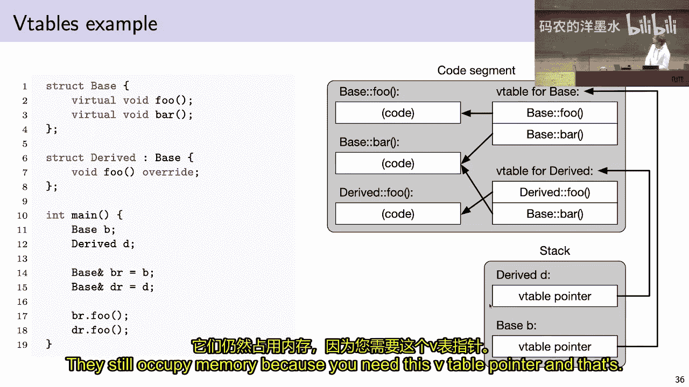

A pointer， right。So there's a cost associated to the virtual functions。Oh。

 the friend got a cool job after all。 So don't worry。

 It's just not that one where he apply interviewed for。H。

 and I have to use a library that uses raw pointers。

 Can I safely use them in my code and put them in unique pointers or something。😊，That's the thing。

 You don't know。The library might hand out raw pointers， but keep ownership itself。

 so then you can't put it into unique pointers because they take ownership。

So you need to study the documentation of the library。 if you can take ownership or not。 if you can。

 then yes， you would start in a unique pointer or something if you cannot。

 you just treat it as a raw pointer。 But that's the thing you don't see from the pointer itself。

 You have to check the documentation and the documentation。we talked about documentation idea， right。

 it can suck。Do you have OMC S wheels on your M 2， I no longer have an M 2。 I sold it this year。

And I had。Not the C S wheels， but I actually had them before the C S was using them， so。There you go。

Why does Ba and derived of exactly 8 B because of this pointer to the V table。 Where my mouse here。

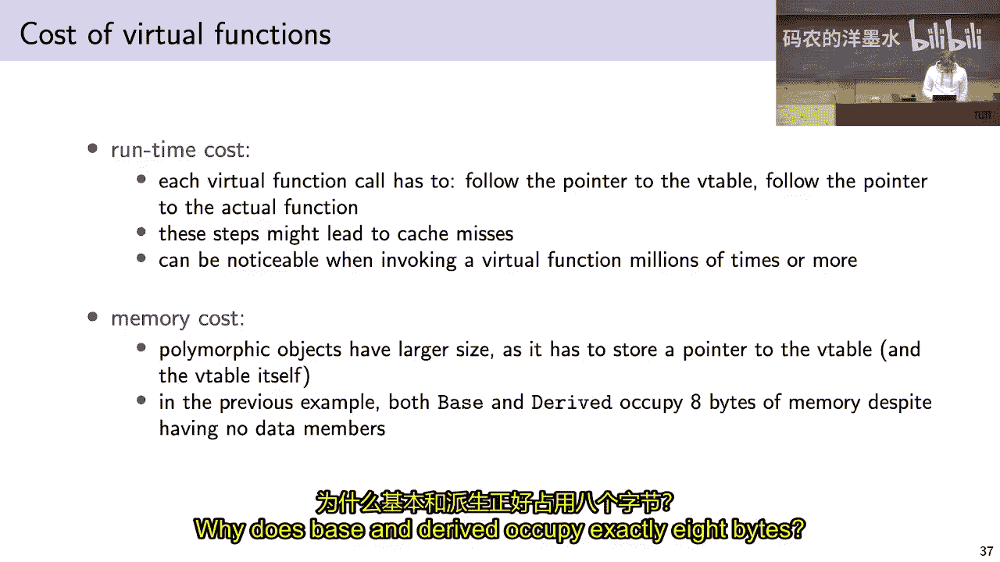

And in a 605 architecture。A pointer is 8 by。When calling a virtual function often。

 But I know that the input type will always be the same。

 Can I somehow resolve the lookout beforehand， yes。

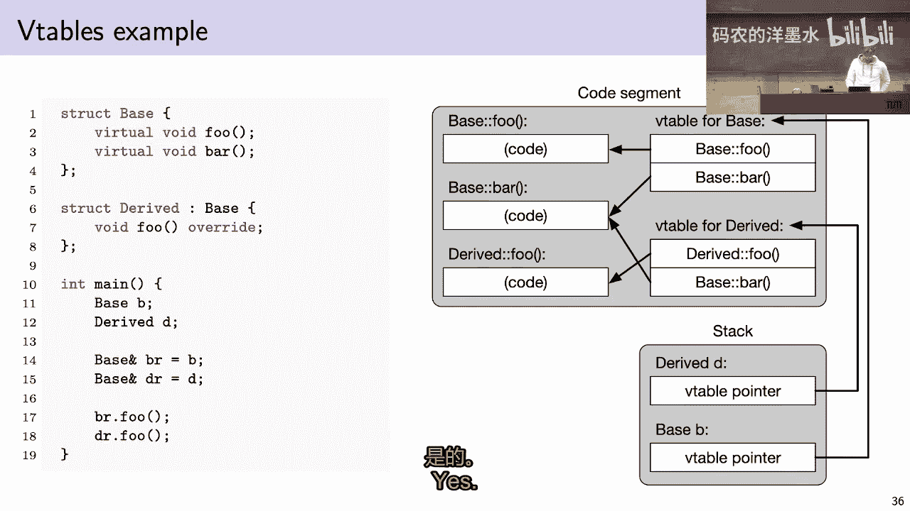

You can use a dynamic cast， for example。Outside your hot loop so that you have。

An actual reference or pointer to that class type。 And then you can just invoke it。We have the。

G fully qualified lookup。 So basically， you call it via the reference and then specify this class function4 is gonna。

Supposed to be called。 So， yes， you can avoid the virtual calls。But let's put it like this。

 The compilers are really good at doing virtual function calls these days。

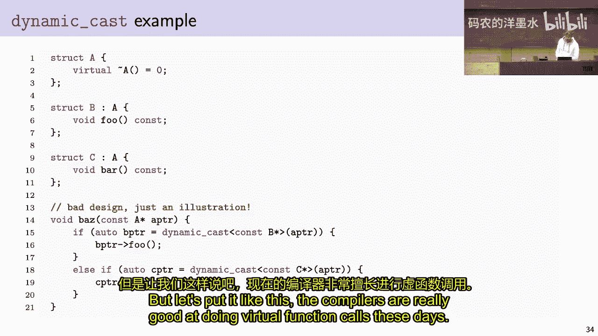

So don't worry too much。 Only worry about this cost。

 If you see that the overhead that you get is too much for your purpose。

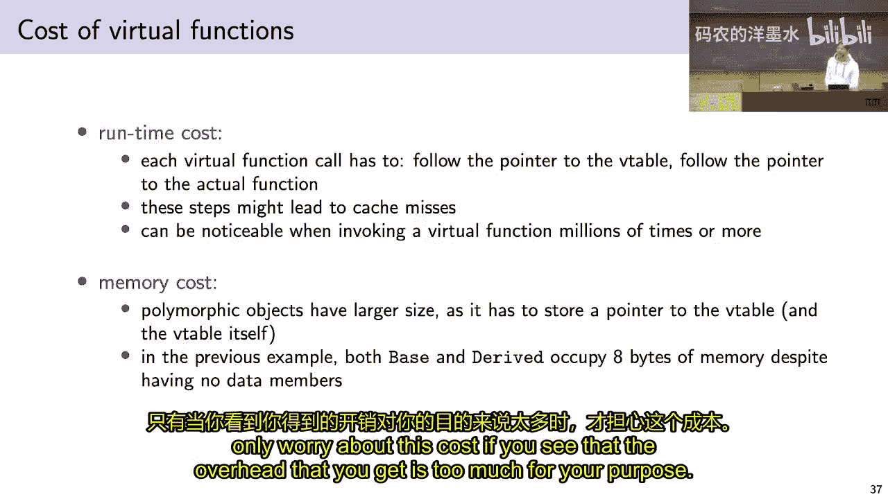

How kind a store different derived classes in a vector。 Good， good question。 They would get sliced。

 yes。Unless you handle them via reference or pointer。To the basic class。Eedward work。Right， okay。

 let's take classes。You can mark a function as pure virtual by adding equals 0。

 We've seen this already in an example。 I was a bit early on that。

 And as soon as you have a pure virtual function， we call that class abstract。Why are they special？

 You can't create an instance of those abstract classes。

 but you can use it as a baseit class and typically we use mechanism to define interfaces。

 which for some reason， don't exist in C plus class。 So it's a bit dirty。

 but that's how you do interfaces mostly。You can use references or pointers to abstract classes。

 You just can't create an instance of abstract classes。

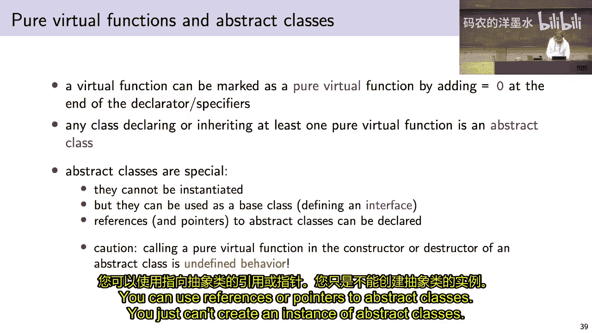

Oh yeah， calling an actual pure virtual function。In the construct or deor of an abstract class is undefined behavior。

So you already saw that calling virtual functions is not a virtual call in constructors and deors。

 And for pure virtual functions， it's even undefined behavior。

So how does this look like。We make a virtual function market equals 0。

 That's a pure virtual function。Makes the base class abstract。

 Since the abstract base class can't be instantiated。 This fails， gives you a compile error。

But you can derive from it， override the function， in fact。Yeah， you can override them。

 and then you can call them E， and you can even handle it via base class reference。 That is fine。

 You just can't directly instantiate a base class。Instance。That's the funny thing about。

Pure virtual functions。You would think they would always be empty， right。

 because they are kind of pure butcher。 But no， you can actually provide an out of line definition of that function to do stuff。

And the idea is， of course， that this is shared code， which will then be called in the derived class。

Somehow， to use the shared code。So it wouldn't be invoked directly by the user because you can't instantiate the base class and you can't call the function directly。

 but you can call it from the derived classes in the overrides。Explicitly like this。

 So it can have share code。 This is a bit weird， but it's possible。You can also mark a instructor。

 as P Vicher。And that is useful if you wantan to make a class abstract。

 but you don't really have a function in that class。And in that case。

 you have to provide a definition。 And typically， that's gonna be empty。

 And since you have to do it out of line， it's a bit。Stupid， but yeah， that's how it is。

Can we talk more about pointers， no。We talk about references and smart pointers and stuff like that and iters。

 but not about raw pointers because you're not supposed to use them。Why did he sell the M2。

More space for kids and dog。Right。Do I have more examples for this。Yeah， well， let's， let's get that。

So whatever there's two more things I want to talk about。

 One of them is relevant for the next homework assignment。嗯。

You might be tempted to create shared pointers。Of your class in a function of your class。

So you would probably do it like this。Right very best my most partner here。 you would do a class。

And in a method of the class， you would return a shared pointer to that class that you create from this。

 So from this instance， you create a shared pointer， hand it out。This is a problem。Why。

Imag that you're doing。And she had pointer。To a class S， and you store it in S P1。

So there already is a shared pointer instance of this particular instance of the class。Now。

 what you're doing is by calling this dangerous function。

 you create a new shared pointer of the same instance of the class。 So now you have one object。

 but two shared pointers referring to it。And what's going to happen is。

Both of these shared pointer will go out of scope。 Their reference count will go to 0。

And at the end of the main function， both of them will try to distract the object and free the memory twice。

That will give a crash in most compilers。 So I tried this in the recent G C。 It gives you a crash。嗯。

So how do we avoid that。

Well this is where the standard library part that's called enable shared from this comes from。

You have to derive from this。Enableable shared from this thing。

And then you can call shared from this。Which creates a shared pointer。

From this instance of the class。And now， you can do。ASd pointer。

To the class and create another shared pointer。To the same instance of the object。 But this time。

 it's fine because since you inherited from this。This color shared from this basically already knows what to do。

And internally， that's the correct thing。The problem with this approach is， however。

 this only works correctly If you first create a shared point that adds where to this class instance。

 and then you called the not dangerous function。 If you called it not dangerous function first。

Undefined behavior。Yeah。What can you say， It's C plus plus， sorry。And finally， my last point。

And that you already talked， that we already talked about a little bit。

 Why would he even use inheritance。Why would you have a class hierarchy？There's an entire argument。

 There's entire papers and books written about this。 I'm just gonna talk one slide about it。嗯。

What you probably wanna prefer is composition。In most of the cases， you only want。Inheritance。

 if you really， really have and is a relationship。In many of the other cases。

 you rather have a has a relationship。 So as an example。A car has an engine。And it has wheels。

 and it has a steering wheel。 and it has seats， stuff like that， right。

 So there's a lot of has relationships for a car。You could have an is a relationship to say， oh。

 a car is some kind of vehicle so it can transport you from A to B in a certain speed。Right。

 this is what you would actually do with inheritance。But， you wouldn't inherit。

Car from an engine or engine from a car or the other way around， right。And the thing is。

Before you do， before you design an inheritance hierarchy， you should consider composition。

 So that has a relationship first。Because while you create dependencies， of course。

 if a car has an engine， it needs to know about the engine。

It's a loser relationship than if you actually inherit。Right。嗯。And in many cases， you will need both。

 but you should make sure that you only use inheritance where you actually need it and don't use it just by default。

Right。This covers everything that I wanted to say。 I'm glad my voice whole held up that long。😊。

Thanks， and I will answer all the remaining questions when I'm back in the office。 See you next week。

