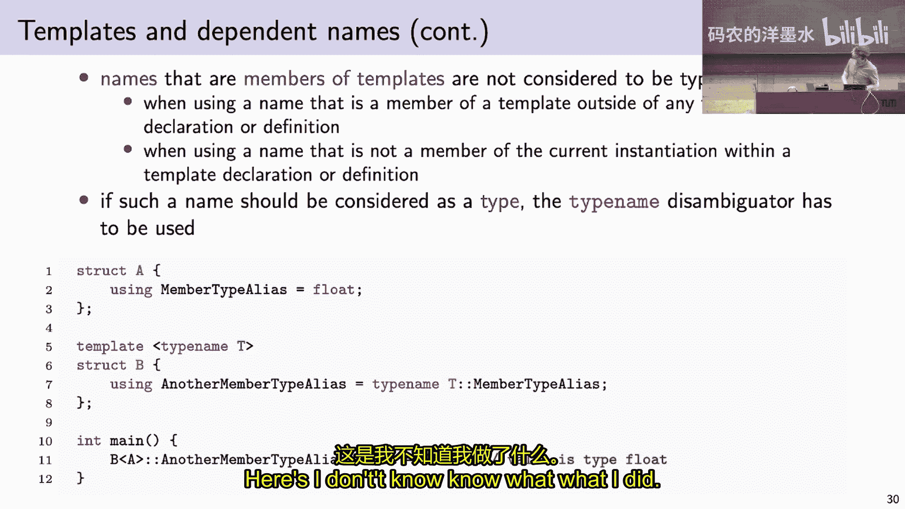
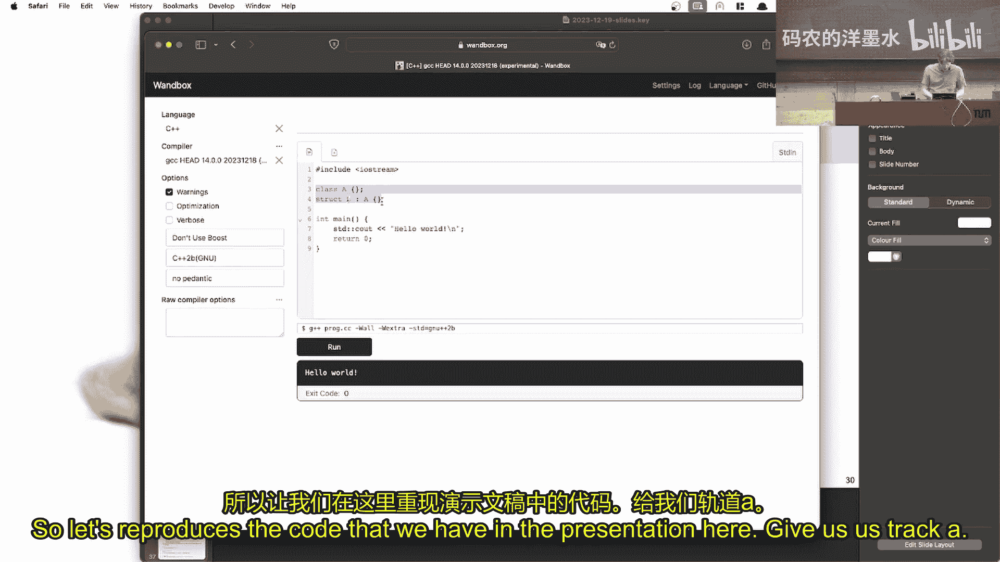
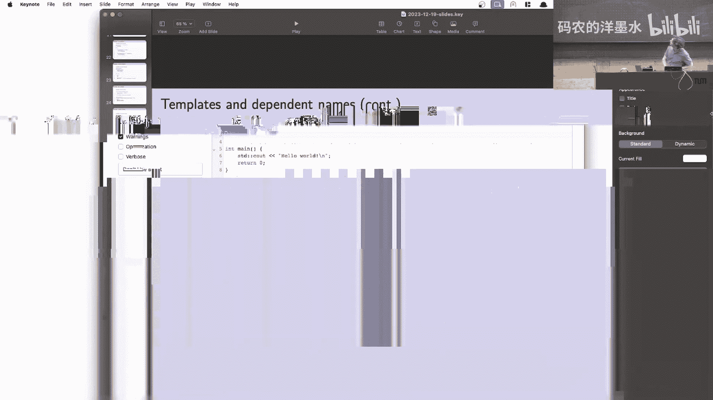
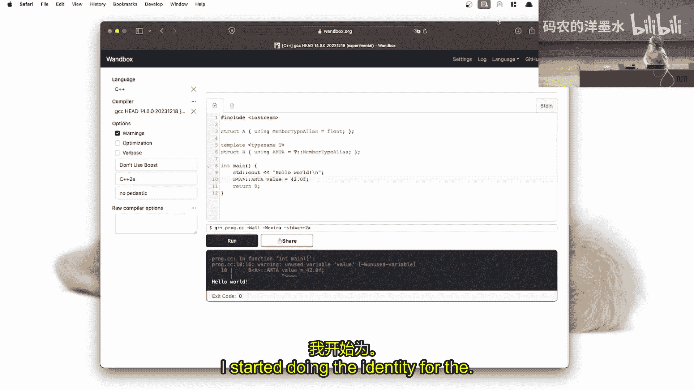
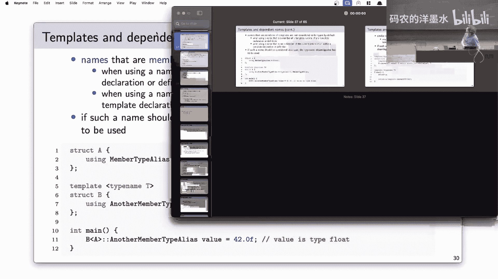
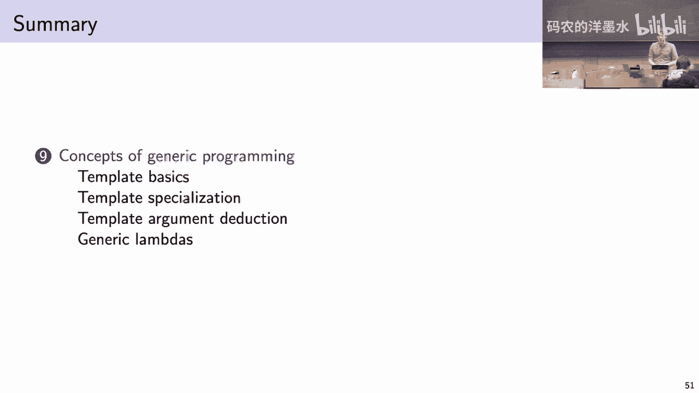

# 【全集 2024版】慕尼黑工业大学 C++编程概念 IN2377 中英字幕 p08 Lecture 8 - 模板与泛型编程 -BV1gDqwBmEuC_p8-

是。Distance is working。That sounds like nope， eft，ft。some streams happening。Dty dustty。

There some streams happening。Oh I'm not forward dating。对对对。It want the。Oh， and I'mating。

But sorry for that， that's was stupid to figure out the is actually working T killing。Soello。

Get ready to start。First thing， first digital our I today is that one M。And some of you already。

Now before we move to today's topic， lets briefly talk about some administrative issues or issues。

Do pick。So first about the。A evaluation is still running until at end of this week。

 So if you haven't fulfill out yet， please take the time to do so。

 because the evaluation is really important for us。And everybody add to the no。

Whether this course is， whether you can get better and and so on， and so on。So我 do do the call if看。

Second。So then there's criticism of holiday days coming out So then the next following the next two weeks。

There is no。Of courseour， stuff happening that excludes our architecture here。

And just to give you an idea， it will resume in the week of January 8。

So the next lecture after this one knew to be on January 9。 That's a Tuesday。

 and then the next exercise session after this Thursdays， it happens to。

So December 21t is the exercise session related to this lecture today。

And then the next one will be in three weeks from that， on January 11。What来。And finally。

 the last item， I haven't announced anything officially yet， but since。All the AM， but since the。

A number of participants in the exam， at least those that are registered。And actually。

 type part of this another question。It's very high。We will have to in a hybrid fashion。

 sort of idifier that it's online。 the automaticomic exam。

 And if you don't have the option of having a quiet that room you can come with a secure computer lot of the and sit it there and to quiet it。

Have eat work。嗯。I we up the day tomorrow or the day after tomorrow。 So definitely it is this week。

 So you would know on February  22。 the time remains。S up。It will be online。

Or is the determine sensitivity， it becomes computer in。만잖。But。嗯嗯。That's it for。呃。

We still have a few buildings to go。 So of top buildings。To today， baby we was a finally lazy。

That is today， you do continue this And then the next session。

 So after Christmas and then then reduce this that to compile it time prorate anything。

 which just really people cool。And then we continue with the that probably a week。It。

And at the end like thats specific。But like it。In terms of the performance words。

 you don't know that will have 12。 I think the current one none if it correct， will to be。It is 8。

 on the Thursday。 then the next column work that we come out on on Thursday or Friday day。

 you will to have a additional at a time and due to the business break， but not be。

Be assignment amendment。It would be。完了个这个。Regular variations have two more to additional of time。

Right。How。那个去嗯。and expected come important things that we in the。They。That。我 like t。But。But yeah。

 look at the of in the lecture and then missing during the assignment is fair。

We don to be the robot of the SL。If you talk about a product and adapt to view product。呃。

So you don't need to have bit in your hat。 The important part said understand。 what's going on。

And the pit of city。Right and and exam。嗯。嗯。If would access so。Yeah I think that note。Yeah。个讲怎一定。

It's you can Google， you can and use。line and effectively right we to all。and。And all the other。没。

I don't know keep。呃。Oh assume be。I actually with。Second a star and various to up。呃，这改。喂来这。Okay。

The basis for a lot of compile time programming can do programming。

 that's all the kinds of things you can do and a lot of the power of programming。Of course。

 another language it just happened generic programming， too。

 communicate in the that that something many case。ButBut idea。

 if you't about generic programming yet， of as。Or generic the time like containers uses for different times second the the actual uses this for。

as ，74。We't care。if you' have to swap the anything and then into。And the effective tour。퍼버3 세컴。

The typical is the of financial implementation implementation this value of the parameter that in the contemporary。

For。In the very that。Ifs to do with this in India assignment operator and the overloaded for user defined。

But doesn't care about the。 So the couldn't it as a function of the the same name is of the vector。

 vector store numbers the store。Po class object don't care。 it's generic。呃。

So not the code for different types one engineering for at the TV and then beginning replace it the TV the。

Re respect if in situation that be use it for。哎当。E exists。 then you write write the library。 uses。

 uses it defines so type or type。看。It define different for classes and for the type this and the variable is a lot of bit be。

 but does' for that。And permit to try进行查。그를。And。speed。And then name first。

And the very least is the predicted predicted。This is a collection of the annoying I'm talking about I have。

It。So the users， if have to a for one of those。Then there will be substitute for parameters similar compile created an actual code of the that were written for particular of the time。

And that is an important thing to here。The the compiler create ci code the appointed office authentic。

嗯。That's a few's happening time。And。That it's cool most。 that means。There is the。

Yeah started out attendance to get of surprise。But was also has to be sorted of time。

 So the decision at run amount time， don't really dis into。So of fruits， example。

And an example right， So if try to really implement the amendment that the TTT vector。

And probably but the in。Bbecca you docca。You you put introduce type like a class T。

And whatever the vector is going to do is operate on type T。

 So for have a function that detect I have any reference type T except and then the store in vector。

The because this vector has its own of own and。 Some would to pass it in bed ideal move。

And the then you can actually use this a vector for examples as's a10 prono。

 and then you can get an vector ofgers。 if you can use it use it defined type A， I didn't。 this type。

 but actually a comp here， because it's no longer we be able to take anything with the sinus of A here。

嗯。Buts a difference go appointment。 get to that a few slide。 def for later。不不不是这份分。没到。

So that the rich thinking something that something that0。The a more。Com on something。

And then our arbitrary ability is something the time be moved to tomorrow the less。

That's something overlap the overlap。 And see if we can go look up the， the figure。

You dont really need to very too much about。我不是。呃，How different generic other language。

 whether they have standing purposes。The can at times。 So might be different than language。

But otherwise， if you have by attention exist。这慢慢的再这下下面。The，Ex。呃，And also， this is the time again。

 the high number of participants in the exam， the exam may be quite different from the last years。

 it's balanced。So wouldn't have。It beginning， potentially musically in the direction which the。

But don't， if you do our ideas assign and we prepare a little bit of negative content be。

For and the wanna。Haved。You have3D of parameters separated lift any of3 parameters。The can be。

something didn' talk about old style C。You would you use in an STTT variant we just talked about that。

1。呃，这个哎。Sos talk about the types of se parameterss that there are most common this is the type。

of course。And say the the the class and then the name these two are theres no。

So sometimes really think that there's two two versions。From the meeting meaning。

 I'd like to prefer to type the name because it's more explicit what what it mean means。Some。

But the doesn't mean。You can the names， so we can then do format like this1 play to10 parameter called the。

You can make the music it。 you give a bit of the name and then use it for your。

The the in this that it uses T and。So here。 you have no idea， but the TV actually。

P only thing that you this is obvious and an of that type can be edititive to and。那个就责认了。But don。

 because this will only to get checked one actually uses the concrete parameter。

And the end the compile check is。And then it's product obviously the and then。less common。

 But if youre seen for example within theT library type。

 it is essentially a of form valid view of the certain type。You can't use everything in value。

 you have to。number。滴滴溜。Po at the time。That is really， area because in the end。

 that the pointer is itted and as a number one right it。In radiation to type。

 that it is more a common， because in relationship to type， edit。If the meditation level is。

Or you in fact， I have to say， I have never seen in this before。

 So nobody even sure if there's any this I should remove I've never seen。So how is it。

 How is it going years is a the， is。Here' is an type。Yeah， number。And it's the number。

 and call it the end so they， for example， defined class happens the fixed size of storage as a determined when in the。

 And you seen is forD' exactly howD does it。And checked the operator indicated operator。

 the operator I check and to check index actually。The size of。这边没意。By拜。And， finally。

The least commonly sending1meter。嗯。走走看看。这原。哦不是3张证理有就是。I would like to have I have never seen。呃。

这个这这个这个。그 you。So if this is a templated collapse。I'm only same that in my mind。

ThatThat a financial whatever， I don't want use a sampling of T。And。Yeah， that's I mean。

 this at the time something。I will T the places order something in the user that。

The number was a lot of appointment and then the home re for character。 Yeah， yeah。

 the delete back to how straights。嗯我。呃，我们。Right is there way to enforce us the time。

And you using for example I this the。 This is decision。Yes， there talk about in。2 weeks4 weeks。

 maybe three weeks weeks I and another。Well they doing with the concept very have。

But conditions on the， which really allows to talk's 555 those 6 degrees。呃这他看没。这个事。So， and you。어。

And then give introduced to years tasks of。1不块钱。So you can also default， you to template minutes。

I to。If you have here with T and time like capacity T， you can to them a minutes like。

And here we would obviously specify a number here you would specify type like of。

And if you specify the5， incentive thet want to specify any argument values are used。呃这我喂。

To the parameter for the 4 cases。这这这他这个里就是什么。And the future is also like for。

 whether you use it you start providing default from the back to to the product。And。I看 give你的问。

By really interestingOkay，Right， you're using the N by well's it's entertaining the if it's。

Are you using type areas， Are you using that areass。

And what you have to do this is not only by the name attempt。 same with the aular。我没卖几0。

And the arguments by。I think the court was a sittingist。P asked。 if the thinking it that。

Only need the start you the the menu you created class。Only the dynamic of specialization created it。

 Only the dynamic compile we look at it code luck in the parameters used and actually teach generally the code for。

order prove obviously3， satellite checks have to be， like to provide to the argument elements。

 you need to any meetings have 3D the argument elements。That' actually be anymore over。

 but need to be。嗯等下下。How ever。There was exception some needed to specify the argument。

We this my mind。SoLets say maybe have a type plus。De graph， with this is a lot ofron。

Here is this on TV the second TV2 on TV3。And the last21 the first one， that doesn't have a。

So how depends to say。So in for the T。T automatically specify in an of class。嗯。大不对。

is the same for an 18 column type A。A is' class A't class A H or it can do。Yeah。For a。

 ands I' not points。You can the same for a point to。No， it's not。

s the point at the type that is uses for which T1。这你。You get5 then T3。Right and as expected the mono。

From easy N。这。This this works， It means Thiss 4 to2 S the number to M and then in。YeahYeah。

 that'sSo that is here needs be be value that very time of the program that it has to be expression。

You you to talk a little bit more about comments and expression are in detail detail upcoming many weeks of a course。

literature example it unciigned theres a to you so that that there is no implic conversion happening。

 in fact， that was to be implic conversions for example from an assignment， which2 unscied。Right。

You you cannot have from London accepted that the programming is introduced。I。Right finally， do。喂喂就是。

What would look like this first， you would have to have to。 for example， like this array。D array。对呃。

Re like。嗯。The can use。And for the which have specify uses it。So yeah， but do it。

 And then we could use example of。This is use could you useTD。我 don发。嗯，Yeah。This would be rare。不是。

operation。Then then you have to provide all need demands。

 and then can you use as it for and array data。So otherwise， it's cold。

Why write the public again a example。My I did if you。T threeT。Right。Why they don't give like this。

 whether the first work work and。So idea can be the time。So的。This isIt giving you number this is of。

behavior。You're referring to do that。The large part numbers be the but。刚这个。But's that is。

 So lets look use political example right this thats understand the meaning better。

 So let's say okay， this I that we talked about before。 is story the type T and。

So the2 parameters something that you specify as a user you instant a class type my memory is specified that the type of footage that should be in arrayoff and then you specify how many elements you want in fixed。

And look at the half。 Oh's E C here。 E C。 that's actually the one place sentence the half like that。

 you don't to location， do it like this。And then then can provide it an access operator that deter everywhere reference to whatever type。

 So the T。And it you the storage to chat in in the next。 Yeah， That's a。This not uncommoncon。

 So you can use this system system to actually science to do it。

 And then provide that comments over the Lord over the same。The of obviously be， about。

So by writing this class here， it's totally diagnosticgnostic of what type of theory that actually is that it iss currently to be used for because usually't care。

嗯，那么持。You。But you don't have to know it。 Then because to。呃这个标是房关承的。Here6 is the problem solve。Right。

 it doesn't care。You carry about just to do do the things of the saving。

So is two references comments should of them。And then we do this， it explained。

 storing one in the temporary area of type T。You this move。 that a move of operation。

Very efficient because of it just stealing representation any move the。Then an a later on。

 is in an undefined。把拉个。呃。啊发到这个。It determine because we of。Or actually move it over1。

So we move to B to A。 and then then we move the temporary to B， and then we have stopped B。

of and this in we don't care what。Thatll be together and half。I to。

Ident if you find the slot of the final。 and then you uses as the slot of the final。A这。

Even know no not。Inter can turns the compile the of argument。 So in this case。

 do not have to specify the because the compile。So that magnetic more media than users to template edit for functions。

I can not really to tell that the following weeks be heard。那那这这是的的确确是。😡。

Right to do because would from in fact， a。But。If you know that is integrated type， is。To the test。

这这个报告。That doesn'。ButIf you go to。But let's say you have very for some reason then you have。

And you totally lazy easy to say this。 sometimes the thing is extremely needed necessary。

So what you do is you could do an areas。So this something does the handler。And also to attend here。

 can already be  physics。Aas argument this pass to the of this argument specializing the second argument to avoider。

Yeah， I usually。Anyway， you begin use having here having something that before that argument。

那这这是上他他乖胎太在。Why the first assignment an in line at 15。But does sign the amendment。

And don't see any a sign amendment within25。Another treasure。Right， and finally。There's。

Very very this very but there are cases， for example， like this， very very。 can half。

A very look called pi that has a very defined value that the is satisfying there is aig theory。

 but we not to many。嗯。And don't TT。隔个哔lo。YeahCould even be something like a half float depending what kind of。

It would be the I have only to have one constant pi for a lot of data。

And functions like completely the area doesn be using learning performance you will do actually。

Preposition do you want the area of the variable you would have to pre。

The process certainly makes sense if you provide in enough to work for the。Right。Not continue have。

Temp if you contemplate in classes。 So members of classes be contemplate。8。And when you uses them。

 like this is a rate type。 you have to I' give the list。However， if you call that is， this。 I give。

嗯那个一告。Oh， here's some how to。It's by editing that they not。

 And then then doing some abstract or by doing x scores。嗯。那个车的。My。I think manage to。

Right interesting thing。What about happen。包括了他分之。So are。😡。

Because the templateulated the that been liked。Yes。's notIt's actually not really。

And then more importantlyportency， no code is generally related from the attempt a definition initiative。

Why， because totally need to be generated when actually use the template。

 but created it sentence of class the by the proper and the related not list。

The then start to peculiar。The compile the generally did the extra the product the code it needs。

 But at that time， they had to be there。But the forward than that could particularly the that is specific。

And thetro this。You might be right。And long have you been done if French she hated it。

A lot ofpi arrow evolved turned up。The because compile little template。

 essentially the only de if the thats。 And if theres in the cases nothing。Or。

And only actually start using the by。 So this is something you need to get users to do。

And then the fact that many of the developer the recommendation it is to have instant to create those specials very early detached or the errors。

外不打。That for particular。That。And there is implicit in officially uses a September sayD array of whatever economic created and is。

对对对。A a the same argument and in。This is a specialized information control code generated my department。

 yes。That' why the binary size below if I use to many contemplates。

 the that themselves don produces any unique gold。I。All any the cost for  tens of thousands of types。

 you have 10。In instanceence to this negative had would have the。So that's no had in that。Where。

 this is not overhead had， this isnt total of relationship to targets。喂。

Because if you could create template in in the different room of population in your unit。

If compile compile or you use。You created。And that。要。That's from the main reasons。Okay I look at the。

The editor then after that the court was。O they compile discard gun1。Yes。But。

 you don't need to be worry about actual code size。Could by， because it's essentially。

But could be used error but have the same。If need take。

ProSo if you in situation because to provide you do tests very want to do test or。need。

You a library read。But don't it。The D actually not like degree， all open。我不要继诉楚。

That that probably bear， but that's。他这这。And what you really have to do there。

We will have thement detective res。You will have the definition of the templated bit code。

 like the bodies。 You can will remove the only you distribute the head of filing the detector re is private。

爸爸。The means if you don't distribute to the source。

 you can no no longer create instant sentence of to attempt to types。

Because those are are only uses the program。So how to together around business you have to create explicit instance of for types they put into the library and to the users。

The is actually should the talk to the leading。抓 this。

It is forgets or particular type or a particular。得我滴滴在这。So you have to be。

And lot of pche do no users like to use as a。 that's why libraries actually do the source because that allows to use before or whatever items。

By，d class name and then provide the argument and And then you will create particular argument。

It specify the specific of the final question。Make argument here4。If explicit。be just generated。

 And yeah，And then it's essentially。来。You have regular A，And before sitting。

And the explicit is the s of a forward to the type of the literature so that the compiler of agen rate or the code of the class。

4 T whether the substitute TV with an。And then you can do the same for the。

 So that the be deter to type and then that argument and then。

But this is how long you forward of past for product。And then we can。

But the major case imp in the happens once you're startcus it of you it once。

 if you use it again later on the sentence used so that。

And necessity do that completely have instance one those the link curve link together should be。

By this like same in class A as4， using A this be doing expect。I don the that you。 it is。

You only need to generate anything with code that compile needs right it can see that there is no definition for the bar。

 Its it's not there， right so。If you the that if you this the。But actually。呃 particular。

Yeah but not doing。Po jurisdiction that don't be require a fully instant situation at the time of A。

 So in fact。Because the'm thinking is the point right， it doesn't care I'm thinking is。So that。

And seconds。have very be generated。嗯。And then you can use even if the， the designer didn't of。

 you have to provided every typically files of， but all implementations functions functions every uses it。

一这来。😡，But can below attendance quite。 And if you have。

We bigger project project the times of 10 minute，100 minutes，130 minutes fast system are not。

Very rare They happen。 And that they happen is。1。Explit library。Oh on。You if cat related definitions。

 which you't have to provide that。But is the， of course。If you only haves， you use it only the most。

 you no createdlic。 if you hide the。This is generally should parallel the system compile editor。

Pro give me the you use every resources on your computer。Don't number worry about that。

Does have really research a topic and the pile of banana。 I'm really good at it。There are a few。那么。

Mean。My is as good as the algorithm efficient as the algorithm is an essentially。

If you provide the then minutes if you type。 that's the it's the。嗯，喂。Pro。Yeah So one。

P the the is especially for or for templated code。Do you use a specify of define of here or of Do you to do specific in line。

 So right there。The recommendation is。Right because to repeat the every time。

 you' have to call A referring to that。Only after the the W start。

 then I'm referring to A actually should be。So that's a bit more of a proposal。

 And if you have ever this。For first attempt from the。

 second the from the and recommendation even the definitions ofanna allow。

because the user wants to see the your line probably bit。 And if you the line， the get read。

So recommendation to this to do it。But slide 266 the meaning。sure。

Have to provide everything to the user you trying to sell certain of everybody copy。

And the other visit literature is， you have to provide it the code。

 So all the users have to compile it themselves。 and then that that means compile timing the users go up。

You don't care a few hundred lines of。 You be care if you have a care。嗯。对。user。

the users not be able to if you pretend for its own。into something。My no，一下你这个。哦，这日子在发 topic。嗯。

But about。So beginning know what peculiar。A， Why it。逼。Why do have this。

But the interest is thinking for foreign。I don't need to do anything qualification for this and the particular A referring to do。

But it's fine because society that they class's。 it's1 to the T。

And also write the as would write usually， even though it's its fine， you don't have to write it A。

Angular。拿到。😡，Here is very。I actually repeated this because。Yeah， I not。 if you have。

That's the numbers the pass of the numbers like the this here here。That hasn't a remember， but。

And it's in 8 years。To that areas in。So if you try it to be referred to anything thinking。

Of the the is the。And then if you can't specific the name it is。At the time is。

So the compiler has no way of annoying this case to the compile this name and you use it as name。

And then you actually do with it。 and then you created an instance。

specific of that of then provide that and A a very of referring to。Does come from  trying00。

 does the deter more often than anyone would expect。But I usually give with。AndI like to。But。

And half。Temp definitions you have。that at the evening。A。 I'm the of a for billion。

 and then the then。And I'm calling that the。After that the。 the itself is。😡，I that using environment。

But for some reason that the is not to do this。If I remember。

 andm I didn't as well as the power issue。This is give number project that may make necessary。

I'm not remember I think that that's and you're like。退掉。

Syly you using might have to say explicit name here。I think youre be referringing to that in your。

That type remember。Not very。But。It's a an， using。哦。嗯。Yous I don't have。

So what do we have。We the here。TheSt is so that's produce code that we be have presentation us product a。

그。喂。这个。As a technical that a test。です。No。That。That's thing。

 And then the second thing was the a attempt that I edit。呃，这个是。B， that is。You。嗯。T。啊。

My number like this。My because'。By。so let us see this works a G。没得。Oh works。Yeah，太。X。

I learn anything something new at the。我。Probably I didn't get this error long anymore。

This started for years no， Okay。

不。

So the't。嗯那慢慢开开。This was that the you to have。呃。References to。And then sentence here。

 you get4 sentence。What2 to4 does the sentence mean。

 whether we don't have a meaning this if have more than twos。It essentially3。

 if you have an reference an reference， it's going to be reference to if you have 3 for5 or whatever you can get in reference。

What。あます。这嗯。A answer after the lecture， because I didn't have a few slide。 talk about so。

But happens4 parameters。 But you also do is can for a particular attack。

But generic generic algorithm for whatever type that have comparisons to the function。

 little be sort。And then you have a very very efficient unit， So algorithm that there only be int。

So you would would make success realization， then it be become an active for foreigns。

So specialized specialized in implementation for arguments do argumentsization。

If it's there if you just do it for part of the。how do you do that let's I have a container。For。

And then they could create the specializations for long。

Because have some particular thinking that can move for long you will do by theT packets。

And then then as specific finding that the time you're doing this。

And if you use container something that is not long。 It use such generic implementation。

If you use it if follow along， if you it that's special implementation。这这对对不。

You take on us to do this。P special control。You can only do this for class to template。

 not to template or to。 So this is only be works for classes。But for you don't really need it。

So say class the， I think agree with a for generic。

And presumably T is the type of value are looking for。那。

I tend to create a specificacization for particularly like a container at the time。

 Why are you keeping the time parameter for actual better use of a good container intact。

But this is the of specialization America， but specialize the other can even do in terms of that。

Then that I attempt to provide that very specific finding action that。

SoSome reason can assume that the is sort and then。The way people can have a very good。

 and my one for the specific having of a specific。呃。这这这这是长他们是还呃，有这是。어。

I'm a little bit of example for that。So' bit about about。You shouldProb。But。

 the current product this is not。And computer。So many the have to provide the full。

P the list detect parameters system。But sometimes cases compiler。 So even that before。

 skip implementation here， the compr knows already both arguments are in in here。

So TV the type problem T here isn。And the means I don't have to do specify here in because be able to at all。

And那再这个拖。For for country， the， it is。because have arguments And from the a the compiler the a match here。

嗯。But。This is Roberts， a particularly lady with a about this。So he here let's say math。Okay。

 I'm doing I'm doing。The compile say， sorry we can't do that that because I already required the same the T。

 And then you2 different。 I don't know what to do do。

And if this is conversion don help because would like I convert the to long or the gives an error。

If you do the max of the same type， its fine if you do with As， it's good。 or if you say， oh。

 I want the in version of max。But long arguments。Or right。

 I can the same they maybe this as long and have have an imp con。这这是哎。So don't allow。我我滴财B滴。😡。

那到那那边个个。This is。 So this is and the the dependent on the parameters。 so they combine do。嗯。

What about classes， class dont really have a way to reduceuce this sort of。

 And necessarily using constructs。 And then construct， also uses the related types。So the the。

And if you call depends structure。This is try。The same in provide the5 literature。

That something happen。 when I write it。 So if you couldn't have a vector。

 theres an initial life element，You're not specifying the type of the vector， because theization。

 it's clear the vector ofs。That that's上。脑爷一出来。😡，The an instance。So this。

And use negative of negative of id because the initial one element。Or the。

So there's two options here the standard ifization is that thats。So the of。

So that it comes that it isn't protected。So this is where what in。7。

The compile better and the better the that they can deduce their own。However， compile。

For year evidence。对 that。Or to the magnetic reductions order to specific and any that might be broken。

Sos for some reason which doing arbitrary and2。As the architecture。

 international analysis but also at the of with perspective that uses of X and。

So I that actually sure， I have to compile again。I tell。

So if you could create a might be parallel like this。发到这个工门牌来了。

That the beliefs are artificial strings as the arguments of this。

Depending here with this streaming for T 1 and string T T2 this X ising and string the class T 1 and the T2 or TT string。

So provide。And the at attempted5 10 list。the name of your class。is。 And in this case。

 it is the con structure of my class that it has two arguments T11 T T2 changing the list。

And then that means if you have such a be to do， September arguments T11 T22。So compiler。就。

Be ability to do this stay minute with this is out Ex' template parameters here。You have。

 And you will be able to test the in your own。嗯。It isn't a level different convert that are。

Just idea of de of the de。So get to create example。嗯。They think' a standard。

And the spec that might not know And the construct that initializes itself from beginning copy range ofs vector。

So is architecture。Is。I right CC。But now Ohio， if you look at the use case。

 example the behavior here， you have a set first numbers and then you would want to the the of set into the vector now specifying the type of the vectors of can be from the its。

And if we remembered the it not。Part of lecture， they are。No no problem。

But the editorerators thank fully。So door their own type and then can access this video as a sort called trades。

 which we' be talking about lot in more detail in the next key here。the next session。

And then the you can access the value that this need to add。Actually really cool completely。嗯。

the vector structure this 28 met damages。The disability do as a vector。

This is the from the deterator asks that the deduced satellite of what the vector is。The middle of a。

 theresarrow attending here and no class word， nothing， such as the name and the parameter。

And then kind of what kind of。But problem do this V。This is how attraction guide from America。

 And it's pretty， but its。嗯，你讲想。他3份据居可的。That。But talk I'll join again。I doesn't why go。

 but I remember。嗯。If you remember something。Right， for example， instead。It over one， he。

That far bit to where。It's very done an。 Not wants to do that。

 But I don set that to you right it could at the beginning。

 from your map already to test a compiler what would be deter。And in fact。

 this is is the same that happens argument。So this how it uses attempted argument direction。

You don't have to provideifiers for auto。 So that if you have or reference or if you get。

 you have point， right This is kind hidden in auto。

But understand should you want to there and to there should there。 So for example if you know。嗯。

it in。 no。say， oh yeah。 That's to be aer。 So you should be doing if you know what's be to say it becomeser。

We we referring it。So you can this。ButThen that attention actually kick error。A lot of the care。

 this is fact。巴爸的。What wast that happens。People know that I didn't talk about about references here because they have their own page。

 But the same of a function to determine， common reference。The I say auto to to the store。呃等还给七清。

A it only be A not。That the is not actually and a copy of whatever fool wed1， you have to say。

 this is how should be doing。If it is talking。But I still have one thing。嗯。嗯。Okay， for。Yeah， yeah。

 essentially address。嗯。그。Instead of the type of a computer parameter。And the beginning。

For that parameter and then can call it to this or whatever。The of。And in effect happen。

 the closure that become internally to generate， but I actually the operate。

So that you can provide any time have。That's。If you have parameters， which you parameterst not。

arbitrary arbitrary types for arbitrary。可。So the things my to do for kind of any different container。

Or we could have the dilem for an affect。这是开个。这证明。Now， the left closing tonight。

Do you think that that's my last one。Re， the't have it too I can do that。

But I instead of you have an order to reach to find it。You're already have the list。But have。

And created the of F 1，144 U， which be instantated for to our code。More。If you have no idea give。

开开MBBB。You free of them can be to hack specific things together to。 This probably really one of。这そか。

In fact， they making use use statistics for all parameters of training versions， uses contentcept。

 And something India we're gonna to talk about in a few weeks after the。 And something very。买卖开子。

So it。Have a married Christmas Smith。 Have have a good happy year。

 and then to see you on January no again。大概就。

