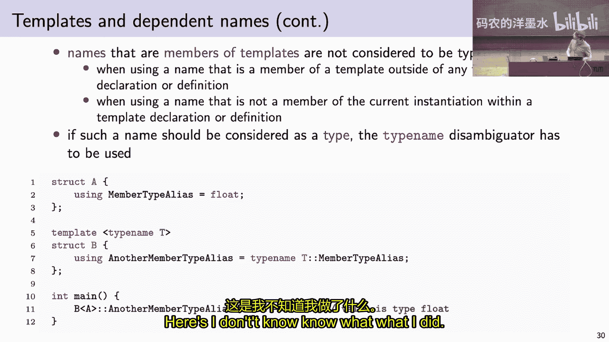
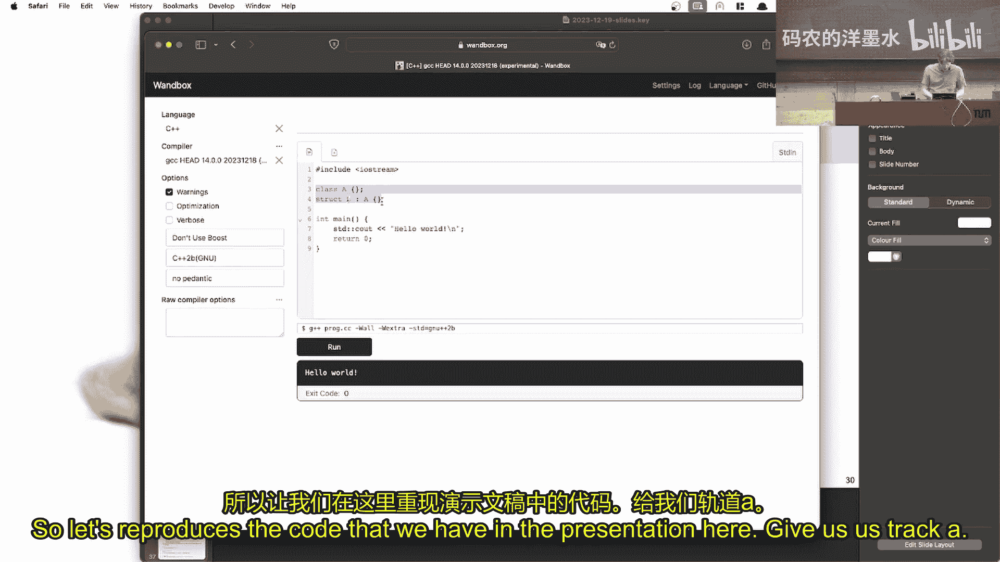
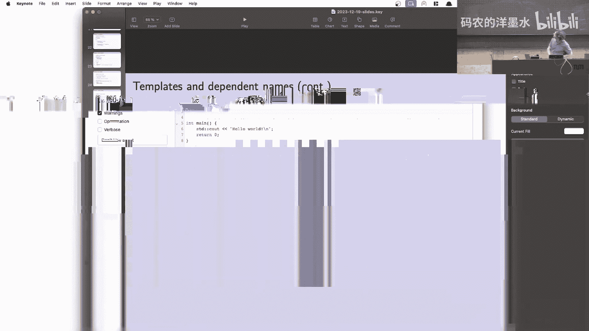
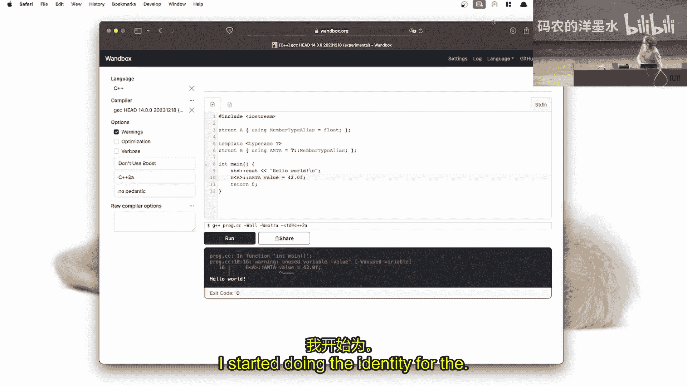
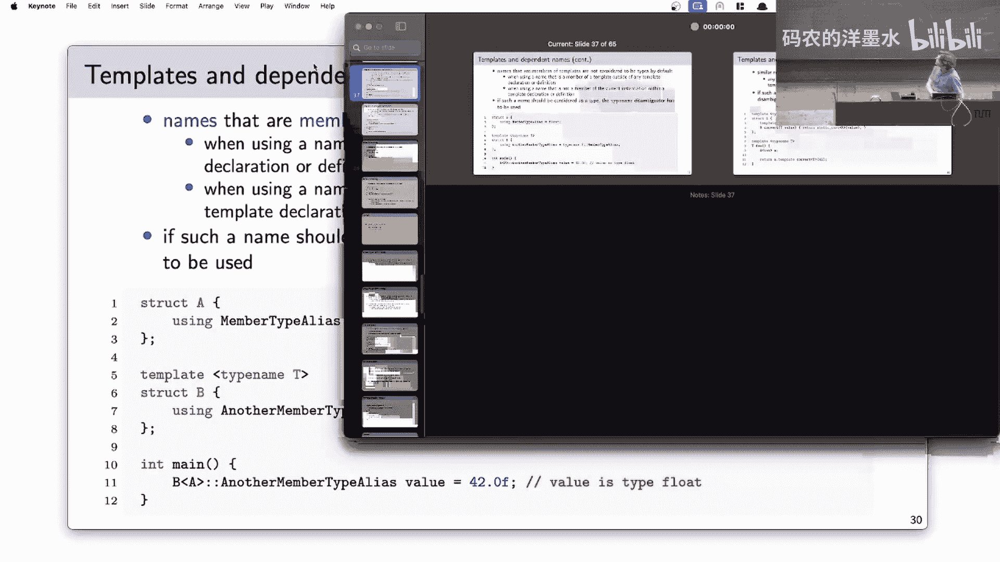
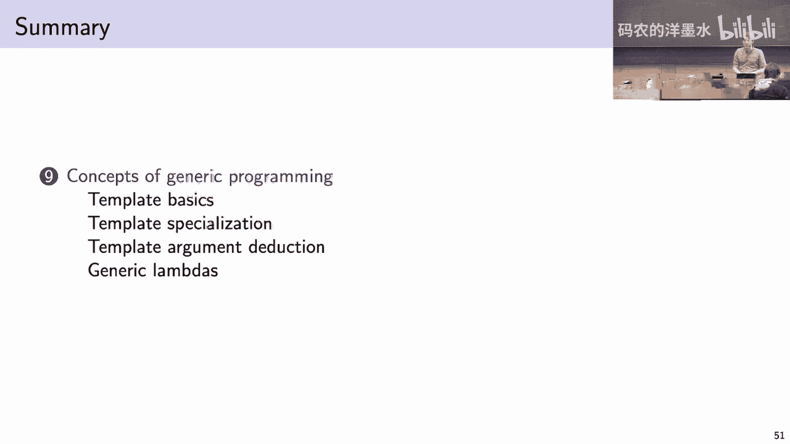

# C++编程概念 IN2377：第8讲：模板与泛型编程 🧩

在本节课中，我们将要学习C++中一个非常强大的特性：模板与泛型编程。模板允许我们编写与类型无关的代码，从而实现代码的复用和抽象。我们将从模板的基本概念开始，逐步深入到其工作原理、参数类型、实例化过程以及一些高级用法。

## 概述 📋

泛型编程的核心思想是编写不依赖于特定数据类型的代码。例如，一个用于交换两个值的函数，无论这两个值是整数、浮点数还是自定义类对象，其逻辑都是相同的。模板机制使得我们可以只编写一次这样的逻辑，然后让编译器为不同的类型生成具体的代码。

上一节我们介绍了运算符重载等面向对象特性，本节中我们来看看如何利用模板实现更通用的编程。

## 模板基础

模板是C++支持泛型编程的基础。通过模板，我们可以定义函数或类，其中的某些类型或值是参数化的。

### 函数模板

一个函数模板就像一个蓝图，编译器根据这个蓝图和实际使用的类型来生成具体的函数。

以下是一个简单的函数模板示例，它交换两个值：

```cpp
template <typename T>
void swap(T& a, T& b) {
    T temp = std::move(a);
    a = std::move(b);
    b = std::move(temp);
}
```

在这个例子中，`typename T`（或等价的 `class T`）声明了一个**类型模板参数**。当调用 `swap(x, y)` 时，编译器会推断 `T` 的具体类型（例如 `int`、`double` 或 `MyClass`），并生成一个处理该类型的 `swap` 函数。

### 类模板

类模板允许我们定义可以处理多种数据类型的类。标准库中的 `std::vector` 就是一个经典的类模板。

以下是一个简化版固定大小数组的类模板示例：

```cpp
template <typename T, std::size_t N>
class FixedArray {
private:
    T data[N];
public:
    T& operator[](std::size_t index) {
        // 边界检查（此处省略）
        return data[index];
    }
    // ... 其他成员函数
};
```

这个 `FixedArray` 类模板有两个参数：一个类型参数 `T` 和一个非类型参数 `N`（数组大小）。

## 模板参数类型

模板参数主要有三种类型。

### 类型参数

这是最常见的模板参数，使用 `typename` 或 `class` 关键字引入。它代表一个尚未指定的数据类型。

```cpp
template <typename T> // T 是一个类型参数
```

### 非类型参数

非类型参数是值，而不是类型。它们必须是编译时常量表达式，例如整数、枚举、指针或引用。

```cpp
template <int N> // N 是一个非类型整数参数
template <typename T, T Value> // Value 是一个类型为T的非类型参数
```

一个常见的用例是指定容器的大小，如上面的 `FixedArray` 示例。

### 模板模板参数

这种参数本身是一个模板。它相对少见，但在构建高级的泛型库时可能用到。

```cpp
template <template <typename> class Container>
class Adapter {
    Container<int> storage; // 使用传入的模板容器来存储int
};
```

## 模板实例化

模板本身不是完整的代码。只有当代码中使用了模板，并为所有模板参数提供了具体参数（或编译器能推导出参数）时，编译器才会生成具体的代码，这个过程称为**实例化**。

### 隐式实例化

当代码中使用模板时，编译器会自动进行实例化。

```cpp
FixedArray<int, 10> intArray; // 实例化 FixedArray<int, 10>
swap(a, b); // 实例化 swap<int> 或 swap<double> 等
```

### 显式实例化

我们可以强制编译器为特定的模板参数组合生成代码，这称为显式实例化。这在分离编译和构建库时很有用。

```cpp
// 在头文件中声明模板
template <typename T> void myFunc(T t);

// 在源文件中进行显式实例化
template void myFunc<int>(int); // 显式实例化 int 版本
template void myFunc<double>(double); // 显式实例化 double 版本
```

**重要特性**：模板的实例化是惰性的。编译器只生成那些真正被用到的成员函数的代码。如果一个类模板的某个成员函数从未被调用，那么该函数就不会被实例化，即使其中包含语法错误也可能不会被发现。

## 模板代码的组织

由于模板需要在编译时看到完整的定义才能进行实例化，传统的将声明放在 `.h` 文件、定义放在 `.cpp` 文件的方法通常不适用于模板。

常见的做法是将模板的**声明和定义都放在头文件**中。这样，在任何使用该模板的编译单元中，编译器都能看到完整的定义并进行实例化。

另一种方法是使用显式实例化（如上所述），将定义放在 `.cpp` 文件中，并列出所有需要支持的类型。这种方法适用于已知且有限的类型集合，常用于库的发布。

## 模板实参推导

对于函数模板，编译器通常能够根据函数调用时传入的实参自动推导出模板参数的类型，这大大方便了使用。

```cpp
template <typename T>
T max(T a, T b) {
    return (a > b) ? a : b;
}

int x = 5, y = 10;
auto m = max(x, y); // 编译器推导出 T 为 int
```

然而，推导要求类型必须精确匹配或能进行标准转换。例如，`max(5, 10.0)` 会导致推导歧义（`T` 是 `int` 还是 `double`？），从而引发编译错误。解决方法是显式指定类型：`max<double>(5, 10.0)`。

对于类模板，在C++17之前，构造对象时必须显式指定模板参数。从C++17开始，引入了**类模板实参推导**，编译器可以根据构造函数参数来推导类模板参数。

```cpp
std::pair p(1, 3.14); // C++17: 推导为 std::pair<int, double>
std::vector v{1, 2, 3}; // C++17: 推导为 std::vector<int>
```







## 特化与偏特化





有时，对于特定的类型或参数值，通用的模板实现可能不是最优的，甚至无法工作。这时，我们可以提供**特化**版本。

### 全特化

为模板的所有参数都指定具体的类型或值。

```cpp
// 通用模板
template <typename T>
class MyContainer { /* 通用实现 */ };

// 对 T = bool 的全特化
template <>
class MyContainer<bool> { /* 针对bool的优化实现 */ };
```

### 偏特化

只为一部分模板参数指定具体类型，或者对参数施加一些限制（如指针类型）。

```cpp
// 通用模板
template <typename T, typename Allocator>
class Vector { /* ... */ };

// 偏特化：当第二个参数是 SpecialAlloc 时的版本
template <typename T>
class Vector<T, SpecialAlloc> { /* ... */ };

// 偏特化：针对指针类型的版本
template <typename T>
class MyContainer<T*> { /* ... */ };
```

**注意**：函数模板不支持偏特化，但可以通过重载实现类似效果。

## Lambda表达式与泛型

C++11引入的Lambda表达式也可以写成模板形式（从C++14开始支持泛型Lambda）。

```cpp
// 泛型Lambda，参数类型为 auto
auto generic_adder = [](auto a, auto b) {
    return a + b;
};

int sum_i = generic_adder(1, 2); // 调用 int 版本
double sum_d = generic_adder(1.5, 2.5); // 调用 double 版本
```

编译器会为每个不同的参数类型组合生成一个独立的闭包类型。这为编写简洁的泛型回调函数提供了极大便利。

## 总结 🎯

本节课中我们一起学习了C++模板与泛型编程的核心概念：
1.  **模板基础**：使用 `template` 关键字定义函数或类模板，实现类型无关的代码。
2.  **参数类型**：模板参数可以是类型参数、非类型参数或模板模板参数。
3.  **实例化**：模板在使用时由编译器生成具体代码，可以是隐式或显式实例化。
4.  **代码组织**：模板定义通常需放在头文件中以确保编译器可见。
5.  **实参推导**：编译器能自动推导函数模板参数，C++17后也支持类模板实参推导。
6.  **特化**：可以为特定的模板参数提供定制化的实现，包括全特化和偏特化。
7.  **泛型Lambda**：使用 `auto` 参数的Lambda表达式，方便编写匿名泛型函数。



模板是C++强大抽象能力的基石，也是理解标准库（STL）工作原理的关键。掌握模板能帮助你编写出更灵活、高效和可复用的代码。