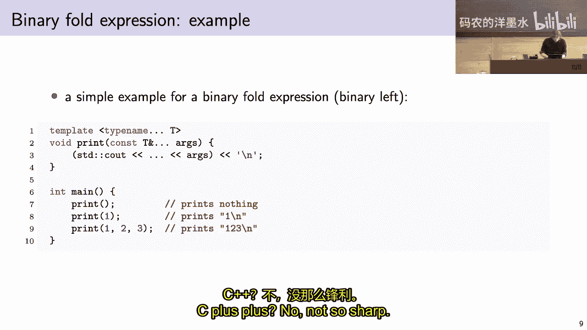
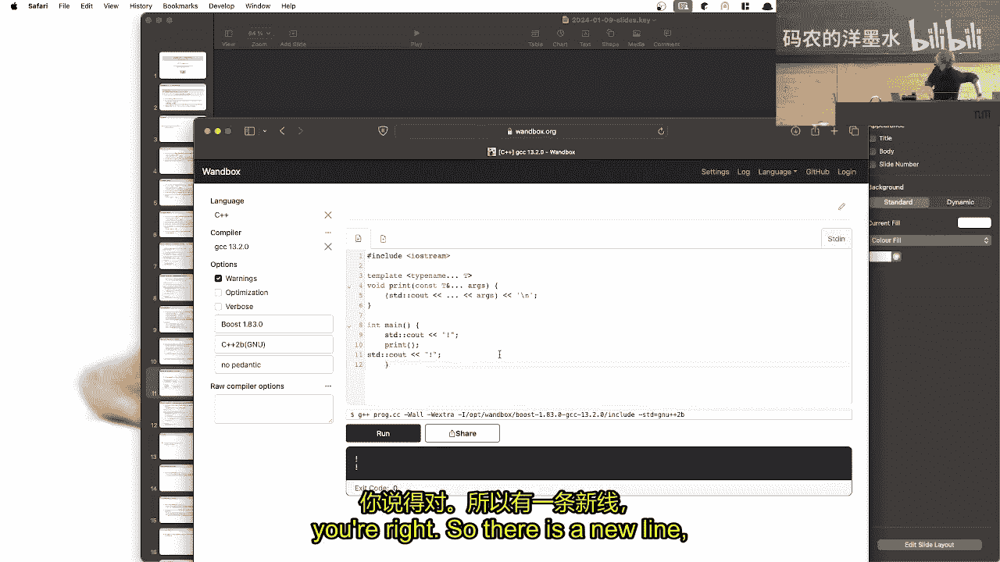
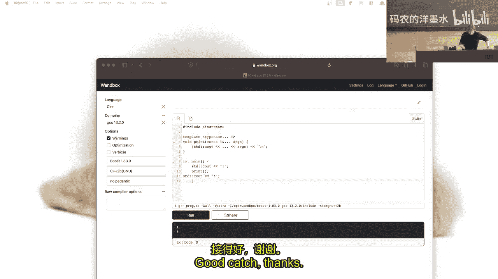
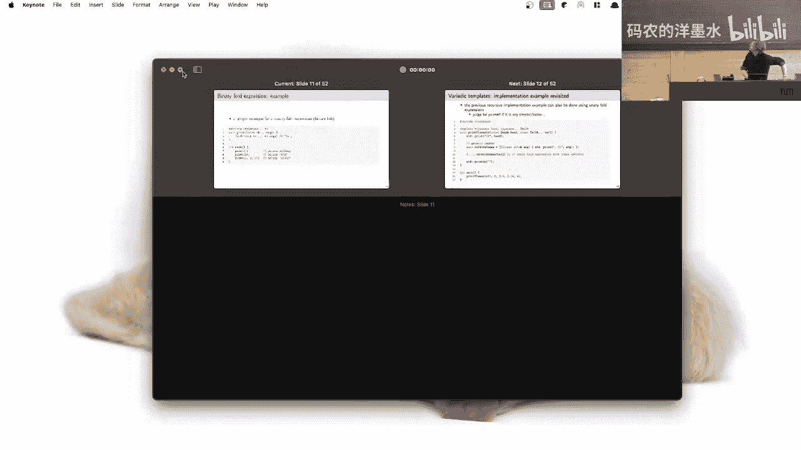
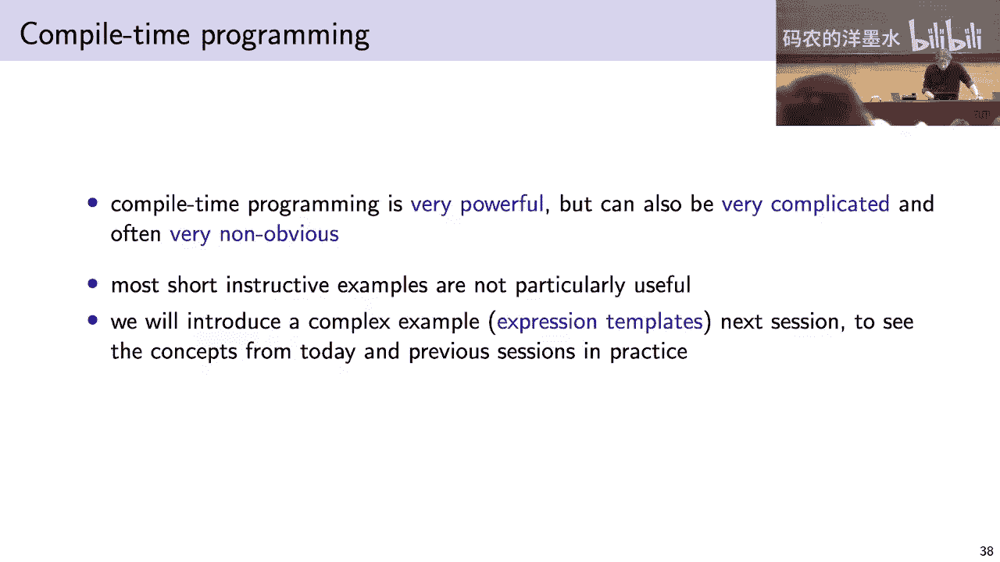

# 【全集 2024版】慕尼黑工业大学 C++编程概念 IN2377 中英字幕 p09 Lecture 9 - STL与迭代器 -BV1gDqwBmEuC_p9-

So test 1，2，3。2，3。Test， test again。2，3。Test， test again， works great。There we go。 So welcome。

 everyone。Happy New Year 2024。 I hope you had a good holiday period or that you actually had holidays。

😊，I had the user thing。Two weeks of holidays。 And I spent all of them sick so。Just got healthy again。

 yesterday。Just in time for you to deliver you this lecture。Right， today's feedback is， that Q D 6。

And as you can see， also from the announcement yesterday， via Moodle， you hopefully already read it。

The exam is now fixed to be online。嗯。😊，Will take place at the same time。 So 1600 until 703，1730。嗯。

We will do it via atomic exam。 If you've never done a submission via atomic exam。

Please come to the test run， which will happen on February 6。And probably not at 1400。

 but probably at 1430， but we will announce this next week。

So we can arrange that that So in place of the last lecture in the last week of the term。

We will have a test run with to exam and the BB exam supervision。

 So you will need some kind of device， some kind of computer or tablet where you can download a P D F from a website。

Fill it out using keyboard， pen， whatever， everything should work。 This is not a math exam， so。

You will be need to be able to take crosses and write some stuff。

 so it should be fine with keyboard and uploaded the edited P D F again。

We will try the technical workflow in this test run on February 6。

 if you've never done it with T Ex before， please join。

 it will be short you can try out the technology just to make sure there's no surprises when the actual exam takes place。

Supervision will happen via B， B， B。 That's the same thing you use for the exercises。

 You would need to have some kind of camera pointing at you。Be it a smartphone。

 be it a webcam or whatever。If you don't have that or if you lack a quiet space to work for these one and a half hours of the exam。

 you can come into the auditorium in the machine phase in 2001。It has around 200 spaces for you。

 which is probably enough。 If it's not enough， we have other audit another auditorium below that with another 150 spaces。

 But I presume that most of you will probably do this from home or some other safe and nice place。

Right。You will be able to do it with a keyboard。 As I said， there's no math formulas。 There's text。

 askI text and crosses。So pen and keyboard should be equivalent， whatever you're more familiar with。

嗯。In terms of materials， that actually changed。 previously。

 we said no materials at all for the impression exam。 Obviously。

 that's stupid for an online exam because it doesn't work。So it will be allowed to use all materials。

So， you can use。Whatever I D E of your choice， you can use books。 You can use websites。嗯。

Whatever material you can come up with， obviously， the exam will be designed in such a way。

That you can't spend all your time looking for solutions。 And， of course。

 we know that there are things that are called that have the letters G P T in their name。

And various other things that are similar。So。We take care that you can't just enter it into chat GT and solve the exam。

Of course， you are not supposed to get help from third persons。So don't sit together。

 don't cheat if you have suspicions of cheating。We will follow up on those suspicions and take the appropriate measures。

If you managed to cheat without us catching you。Fine， whatever。嗯。It's your loss， not ours。

 And in principle， I don't think you will need to cheat。

 The exam is very doable for anyone who participated in this course。Right。

 so sorry about this late switch to online。 We now。

 have 800 something registration for the exam that would require about 25 people to do the exam supervision。

 I have three。 And if I go begging around in the department， Ill probably get another 10。

But that's less than half of what we need。So yeah， this is why it has to be online。

Will it be more hard than an in person exam since you can use all materials a little bit。Obviously。

 because， yeah， but still the intention is that it's easy for anyone who has actively participated in the course。

Right。One thing I want to highlight， and it probably doesn't。

Concern you that you are here and that you are currently actively listening。

 But I'm saying it nevertheless， just so it's on record。The submission deadline。Is fixed。So， if you。

So let me explain this to you once。 So I have explained it also per voice and not just we are writing on Mole。

Working time starts at 1600。 You will be able to download the P， D F， read it， edit it。

 And the end of the working time is 90 minutes afterwards， at 1730。

And you will have a grace period of 15 minutes， during which that's an extra 15 minutes where you can。

Upload your result， the P D F that you've edited， right。

Anything that happens after 1745 will not be accepted。I mean。

 maybe if there was an avalanche at your location or an earthquake or something like that。

 maybe then yes， but otherwise。If you didn't read the clock properly， if your computer hung up。

 if your Internet connection dropped， that's something we can't compromise on。

 It has to be submitted be before 1745。So there Ive said it。From experience， there will still be。20。

30，40 people who won't manage to submit， and then。呃。Yeah。Will have。

Take up my time discussing that we don't accept submissions after 1745 so。

Be done at 1730 and take the 15 minutes to upload it。And of story， everything's fine。

Do you have all the exams， Yes， we have。嗯。Is it enough to see the face in B B， yes。It's enough。

Can you use jet GT， you can， But that's considered cheating。

So if you manage to do that without no us noticing。More power to you。But then， again。

It won't be necessary。Multiple submissions possible。 Yes， you can submit as often as you like。

 So you like committing to Git， you can commit early。

 Sub early so that you kind of if as you keep working on the assignments。

 you could upload the current version of the P DF again。 And again。

 the last one before the deadline will count。So yes， upload early。 You're all computer scientists。

 You will be able to upload things on a website， right。Okay。Enough about the exam stuff。

 Take the time to attend the test run。If you have any doubt whatsoever about anything。Because then。

 you can。Actually， test it out in a live scenario that will be exactly the same as in the actual exam。

Right。走。What's on the menu today， it's a continuation of last time， which is now three weeks ago。

If I'm counting correctly， it was about。Generic programming， and most particularly about templates。

You already had your first homework assignment of our templates as well。

And you some of you already encountered some of the peculiarities of templates。

And they will continue。Right， so what we talk about today's martic templates。

 That's a fairly short section。 And then afterwards。

 we start a new chapter about compile time programming， which relies on templates。

 So that's why we do it in this。😊，Order。So。What are meic templates。

 Vaic templates are templates that use parameter packs。

And what are parameter packs that are template parameters that accept0 or more arguments。

 And they are denoted with this triple dot notation。And like for any other template parameter。

 you can have this as a non type。Parameter， a type parameter or a template。Template parameter。

 This works for class functions and aliases。 It doesn't work for variables because it doesn't make sense for them。

And if you have at least one parameter pack as a template argument， we call this avariatic template。

嗯。Yeah， and I， I'll skip over the text。 I'll just show you examples。 I think that's。Easier to， to gr。

 So here's the vertic class template。The difference here。It's the pe not。

So it's like a regular template with a type name and a name of the type name。 Let's call it T。

And the only difference here is the tribut dots。And what it says that this template parameter can be substituted by nothing。

By one parameter， by two parameters。Or by however many you want。

It's the same for a function template， but slightly different because， of course。

 the only way a function template makes sense is that the parameters of the function use that template parameter。

So here's a slightly different syntax of the type name triple dot thing is the same as for classes。

 but you have to use it again。In the argument list。 And here， for example， we are accepting。

Some kind of tuple， which is conveniently the class we just declared before as a very template。

And there we expand the argument。 So basically， we take the template。Parameter T， put it there。

And to indicate that this is a pack that should be expanded here。The tri dots are append。

And what happens if you provide this template with a few arguments。嗯。Like here we have a table。

 That's the thing we defined here with three parameters， for example。

That's fine because it's caught by this parameter pack。 It could be one parameter。 It could be 10。

 Anything is fine。 It's basically an arbitrary amount of parameters that this catches。😊。

And if you then call the function print tappper。You can invoke this with a tuple。 And here。

 you don't even need to specify the parameters because they're deduced from the tuple。Right。

 but effectively， you're passing a type with an arbitrary amount of template parameters to that function。

 And that's how you do it。Then the last example is doing a bit more directly here。

 We had an indirection。AF that takes an argument that itself is a very template。

 So what you can also do is you can take an arbitrary amount of parameters for your function。

And you can do this directly by again， taking a parameter pack。And expanding that parameter pack。

In the argument list。 So the only confusion that can happen here is that where do you place the ampersand。

 And in this case， you place it before the triple dots and then come the triple dots。

 But this is syntactic sugar。 The， the compiler will tell you which one is correct。

And then as you can see， you can invoke this in an arbitrary number of parameters。

 You can also specify 5，10，20100 as much as you want， and it will work。So this is easy enough。

 The tricky part here， aside from getting used to the tri dot notation。

 is to actually implement those things。Right。So how do you implement these functions。

 The types are usually not that critical， because well。

There are usually some form of tablet because what else has an arbitrary amount of parameters。

 plus variations of it。 But implementing the functions is a bit more。Involved。

 one of the typical ways of doing it is tail recursion。So essentially。

 you iterate over the parameter pack。 You split one off。In the front and you take the rest。

 So you split take the entire pack， split off the hat and pass on the tail， right。

And then eventually， you reach the base case where no argument is left。 And for the base case。

 you need to provide。ESpecific implementation。Which， since it's the base case and has no arguments。

 even doesn't need to be a templated function anymore。And in its case， since we want to print stuff。

 the base case prints nothing except a new line， which this print L N statement does。

So the recursive part。We print the hat。Because that's the part we split off。Ignore this for now。

 And then we call recursively the print element function again on the tail。And since the tail is。

 again， a parameter pack， we need to expand it with a triple dot notation like we did in the argument list。

So to repeat， we split the parameter pack into head and tail。

Specify those as arguments as we had before。 And then we work with a hat and call the same function again recursively for the tail。

 This will happen again and again and again until the parameter pe is empty。

 which then resultss in this print elements call， which will only print a new line。

And there's a little trick in there。Since we want to print comm after the elements to have some delimiter。

We can check。If there is still anything left。And， of course， if we are at the last element to print。

 we don't no longer want to print a comm。 So we check if there's anything left。

And only then print a comm。 And how do we check this。 We can call the size of operator。

 which by default for built in types like int or double tells us the size in bytes。Of the。

EOf the built in type。 But in this case， if you apply it to a parameter pack with a triple dot thing。

 the size of triple dot operator tells you how many elements are entailed。

And the coolest thing about this。This is template parameters。 Temps are a compile time mechanism。

And that means。That all of this happens at compile time。So， the compiler。We'll do a recursion。

But the actual code that comes out of it won't be recursive。So no worries about efficiency here。

 It's audit compile time。This is not audio feedback from my microphone。

 I don't know where this sound is coming from。Yeah， it's definitely not me。

 even when I turn everything off。 that's still happening。 So。

 and what you see here is something new that we haven't talked about yet。

 but we will talk about later today。 This is a compile time， if。

So that the compiler at compile time can evaluate all this。

 So this basically doesn't end up in like this in the actual code。

 But the compiler will basically translate all of this into these print statements of all the elements。

And nothing else will be generated if you call it like this。 And as you can see。

 you can also invoke it with different types。 It doesn't matter。

 You accept an arbitrary amount of whatever。Right， so as you can see， this is a bit more involved。

 So specifying。The declarations is fairly easy and straightforward。 Once you are used to templates。

The implementation is a bit nasty。Because in the end， you typically need recursion。

If you stick to traditional template programming。Thankfully， C plus is a developing standard。

 I think I've mentioned this often enough。 C plus plus 17 introduced the so calledled fold expressions。

😊，That make dealing with parameter packs a lot easier。

Because what you can do is you can write down Tri dot。

Some kind of binary operator like plus or minus or multiplication or whatever。

 And then specify the pack and what this does， It expands the pack like this。

 So in a left associative way。It will evaluate the binary operator with all the elements of the pack without you having to write an explicit compile time recursion via template tail recursion。

And you can do the same associivity to the right by putting the triple dots to the right。

 and you can also add initializers at the left or at the right via this binary or formulation。

 where you put an initializer in front of the operator， then the triple dot， then the operator again。

 and then the name of the pack or the other way round to have it right。

This is fairly cool and powerful。 It's sometimes not the most intuitive code。But some of the stuff。

Like this one here， this is a templated function called reduce sum。

That takes an arbitrary amount of arguments。Called arcs。Right。Has a return type R。

And returns the sum of all the arguments via this fold expression。

this is a unary right fold expression in this case。 So let's go back。

 Uniary right is's the second case where it's associative from the right。

 But since this is an addition， we typically don't care about assoivity here。Right。So， this is。

Makes implementing vic templates a lot easier。And then you can invoke it like this。

And as you see do need to specify the return type R here explicitly because it cannot be deded like this。

But we don't need to specify anything for the actual pack because the compiler will just put the types in as required。

Now， obviously， there's options， variance from this where you don't specify the return type explicitly。

 You could specify it with a trailing return type and then say， deco type of the fold expression。

Also works， but I didn't want to distract from the actual fold expression here in this example。

 But there's multiple ways to。Do it differently， right。And yes， you probably， you can also use auto。

What would happen on slide 8 if it were strings？ Well， what does the plus operator do for strings。

Concatetates them。fine。And yes， this is kinda amazing。 But I can also tell you。

 this quickly produces code where you're scratching your hat。😊，A little bit。

 Let me give you a different example that makes this a bit more obvious。

Here is a print function that it， accepts an arbitrary amount of arguments。 Of course。

 since C plus plus 23， we have that print function in the standard library， right。

 with a python kind of motivation behind it。 But if we wanna kind of simulate something similar。

 we could do it like this。Parameter pack as a template argument。

 taking it as an argument for the print function。And then now we have a fold expression。

That takes an initializer。A binary operator， the output shift left operator。The parameter pack。

The triple dot notation， the operator again， and the name of the parameter pack。

And this works because if you look back the binary left。EEx evaluates to initializer。Operator。

 first element of the pack。 our initializer is SDC out。 So the output console， the console out。

 right， The binary operator is the output operator to the console。

 and the first element will be output to the console。 And then what you get。

 as a result of that output operation as a reference to the output console again。

 So you can again apply the binary operator to output more。

 So if you use the left version with the initializer。😊，This actually works。

Even though it looks maybe a little bit weird and takes some getting used to。

And then you can call it with an arbitrary amount of parameters，0，1，3，10，100， whatever。Right。

There's a few more。Things you can do like the previous example we had like this one here with a tail recursion。

We can， of course， do this with。Fold expressions， as well。I wrote it down here。So， we have。Also。

 we split， also split up the head。Right。So we do essentially recursion again。

 but we do it via the fold expression， but not via explicit compile time recursion。

 So we do the same split in the arguments。 We output the head as before and now ignore the lambda for here for now。

 now， we do。A fo expression with a comma operator。Right。

There's a unary fold expression that the comma operator。 comma is a binary operator。

 It has the lowest priority。 It does nothing except basically， you know。

 executing the statements in order。And then we'd apply it to the tail。

 And to make sure we have the comma only between the elements of the sequence and not at the end of the sequence。

We do the trick with this lambda that accepts whatever and prints it with a comma in front to the output。

And that way， you get the same functionality。 If that is easier。

 than the template recursion like here。Up to you， I think it。Comes down to what you're familiar with。

Is it more concise。No， I think it's the same lines of number of lines of code。 It's essentially。

 you have。10 lines of code for the functionality。 And here we have 3，6，7，8，9，10。 So it's the same。嗯。

Whatever floats your boat。There's a question。哦。Oh， good question。Yeah， probably it print a new line。

Oh， what happens for the empty case。Well。Let's call van parts。And this time， I'll type it here。

 So it's a bit quicker。Where's a function。诶。Print。See， plus， plus， no， Nazi see sharp。 So hold on。

 let's。

So here， I typed it now in advance。 So I don't have to type with my。Had turned。yeah， shits。

 We need to。Have a bit more debu output here to notice what happens。Com on。No。Okay， yeah。

 good enough。Nothing。Oh， it is a new line。 You're right。 Yeah， yeah， you're right。

 So there is a new line。 So actually， the slide is wrong。

Good catch， thanks。

I'll fix the slides。就。Or， basically， after the lecture。

， wrong window， sorry。Here we are。Too many winner us。There we go。 Good catch， though。Right。

That tail recursion reuse the stack frame。But this is compile time recursion。

 at least in this example。 So it doesn't use the stack at all。

Because the compiler does it for you and then outputs the code that's done。 That is a result。

 essentially。What does this。呃。Curdy braces without anything in between。

 do Not sure where do we have curly braces without anything in between。

 Not sure what you're referring to。Oh， here。This just is the placeholder for whatever comes here so that it's printed。

 That's the syntax for the print statement。Can you explain the fold up with the comma again， yeah。

So you have to think the comma operator， basically， if you have an operator in front。

 comma operator in the back。The first statement executed first， the second state is executed。 Second。

 That's all there is to it。 And what we do is basically call this lambda。

 which outputs the comma with the argument。Again and again and again。With this phone expression。

Right。嗯。That's essentially all that I wanted to talk about Vatic templates。

 You won't need them that often。How often do you write generic functions that take an arbitrary amount of parameters。

If not very often， I can tell you。If you do， there's mechanisms to do it。

But it probably won't be that often unless you're a library implementer that does this for a living。

But it's handy to have。 And in the case， it's very needed， it's really neat。

So there are a few more questions。嗯。That I wanna briefly。Answ that are still about the exam。

 Are there representative questions in the test run。I don't know it。

 they will be representative in terms of what you will have to enter。

Not necessarily in terms of contact contents。Thus， using chat GT for general questions constitute as cheating。

That depends。If you ask Cha GT a certain question， you get the answer， you understand。

 and then you produce your own answer in the exam， fine。

If you just copy and paste the chat GBT solution there， not fine。

Do you already know how many points the exam will have。No。

But it will be in the ballpark of around 40， I think。That was the plan。 We haven't done the exam yet。

 so we don't know for sure。Once we know， we will tell you。

Do we still have enough time for the remaining three assignments？ Yes， no problem about that。Oh。

 we used another raw point in the homework。 And because of that。

 I watched that tutorial about raw pointers。F。To be like turtles。系。They arere nice and cute animals。

 but they are very slow。Would that work with a universal reference。Yeah， why not。

So variety these templates with universal references。 Why not works as regular references。

 So it would also work with universal references。Right。Okay。

 so now we come to the cool part of this lecture， or at least the part that I like the most compile time programming。

😊，It's a bit of。Matric。But then again， it's not。Right， I mean， the idea is。

If there is something you can do at compile time， it doesn't have to be executed at runtime。Right。

 and you can still write code。That is very readable。And。Maintainable。

And that's what compile time programming is about。 If you can shift computations， calculations。

 anything from run time to compile time， you gain performance。😊，During run time， of course。

 you lose the performance during compile time， but then typically compiling。

Is something where you have time， right， or where you make time。

So that's why compile time programming is cool because it allows a lot of cool things。😊。

The things we're gonna talk about today is constant expressions。

 because that forms the basis of compile time programming。

 We talk a little bit about template meta programming， how we compile。

 combine templates and constant expressions to do cool things。😊，And。

Kind of the best part of the lecture will be next week。

 They will do a bit of a bigger example that has actual applicability to a lot of contexts that uses all this ra templates。

Constent expression， template me programming， compile time programming in short for a big gain。

 which is something that is fairly unique to C pluspa。 Of course。

 there's other programming entries and that can do similar things。

But this is actually one of the reasons。Why I really think C pluspa is and will remain relevant for quite while。

So what is this about？And there's also a caveat。 Comp programming is also something。That is standard。

Developers are the people who propose the new features of the new standards and so on care a lot about。

 because it， it's kind of a bit of a unique selling point of C plus plus。

So that's also an area that develops quite a bit over the last few compiler C plus plus language versions。

 So C plus plus 11， edit the basics， C plus plus 14， added more C plus plus 17， added even more。😊。

20323， I mean， you can guess the scheme。 They all add more features for compile time programming。

 So some。Things got easier。 More things got possible， and。Yeah。I did not cover everything。

From C plus plus 23。That changed most of it was minor things。But here and there， it might pop up。

But I think the main stuff you'll use is at least C plus plus 17 and a bit of sprinkling of C plus plus 20。

So。Constant， we've already seen constants， right， with a constant keyword that's put in front of an object or a variable。

 And that tells us we can't change the value of the variable anymore one after initialalization。

This works for variables。 You can add a con qualifier for member functions。

 You can even overload member functions with a con qualifier。And。Yeah。

The second thing we didn't really talk about yet is the so called constant expression keyword or constant expert or whatever you wanna pronounce it as。

And they。Key of this is this is not something that cannot change。As opposed to const。

 But this denotes something that you can evaluate at compile time。And that is， of course。

 what compile time programming is about。And， of course。

 compile time programming requires something that's independent of the user input。

 And this is called a constant expression。So we have the word constant has been overloaded a lot in C。

 plus， plus。For con variables and member functions。For constant expressions。

 which are something else， those are expressions that are basically that can be evaluated at compile time。

And then there's the constant expression keyword， which marks stuff as being able to evaluate it at compile time。

So what does a constant expression mean， It's an expression。

That uses only values that are known at compile time。 Obviously， it can't be user in the user input。

 It can't be input from the network。 It can't be input from any other runtime source。

 quite obviously。So what are these values that we can have at compile time， for example， literates。

The value，42。A string lit， all these lit that we talked about at the beginning。

And this also works for the user defined find lit that you can specify。Right。

 you can define your own litals in essentially C plus plus 11。 And these are also litals。 Obviously。

 the name gives it away。 Then you can combine these litals with operators and functions that are constant expression。

And the only thing you cannot do is you can't have side effects。 so you can't allocate memory。

On the heap。You can。呃。You can actually do。Kind of stack allocations。

 They are not real stack allocations， obviously， because it happens at compile time。

 but just to give you an idea， you can， for example， use an SDD vector in a con expression。

Certain subset of functionality， obviously， not the full functionality。 And actually。

 this is also no longer true。 C plus plus 23 or it 20 allows a subset of exceptions to be used at compile time as well。

But in general， anything。That traditional runtime code would do network traffic。

 screen output or stuff like that。 Of course， won't work。But anything that you can beat out of。

Literals and operators and functions， which is quite a lot， can be done at compile time。

The key to this is the constant expression keyword。

Which allows you to declare a variable or a function as something that can be used at compile time。

K here is can。So constant expression variables and functions can also be used at runtime。

 if you want。 there are still regular functions。 There are still regular variables。

 You can access them at runtime。So it's not exclusive， but they can be evaluated at compile time。

And the only thing that's sometimes a bit。Stupid is。

 if you wanna be sure that it happens at comp time。How do you check。And thankfully。

 C plus was 23 included an extension to that。 so you can actually check。But then again。

 the rules are fairly clear。 So typically， you can also make sure yourself。 And if。

 if you're really in doubted， go to Godboard， look at the assembly that is produced by your code。

 and then， you know， for sure。So。Cons expression variables need to be of literal type。

 What does it mean， That means built in stuff， references to built in stuff or user defined are also allowed。

 assuming the construct and deor， if there are any。Our constant expression。

And that's how an SD vector， which is a user defined type by the standard library。

 can be used in a con expression because they have con expression constructors and deors。And。

 of course， if you have a variable that is constant expression。

 you have to immediately initialize it somehow because otherwise， it doesn't make sense， right。

For functions。The arguments in the return type need to be lit types again。

 so you can use it at compile time。And some things aren't allowed。

 Your favorite go to statement isn't allowed。Variable definitions of nonde types or anything Well that basically has a runtime effect。

 So ortho staticatic and threat storage duration doesn't work。That's a whole。

Long list of what you can do and what you cannot do。 But in general， the， the， the。

 the rule of thumb is， if it's literal or con expression， you can use it。

And any operators or functions operating on those， You can use it if it has any side effects。

 like printing on the screen， doing traffic or whatever。 It doesn't work。So the comma operator。

 I'll answer it again after， after the lecture by， by typing because I need to spend the time on this compile time stuff。

Here in class。A turtle in the corner of the slides would be really cute。ok。Sure， how about a bunny。

Or a cat。Or do。Anyway， no an on my flight， currently。

I recently read an article about the explosion of compile time in recent C plus standards due to heavy use of templates and headers。

 correct。Do you think compile time programming is still worth it， yes。嗯。Why is it worth it。

Why do you use C plus plus。And not Python or。在吧。Because you care about performance。

 And if you can shift your runtime performance to the compile time， you do it， right。

 because you might have restrictions at runtime。 You might be running on a very resource restricted device。

 like a smartwach or some tiny embedded controller。

 while as you can compile on as big as a machine as you。Can't afford， right。So， yeah。

 one of the reasons Cpl compiles very slowly is because of templates。

 regardless of compile time programming， templates， you know why not by now， hopefully。

The good thing is， C plus plus 20 modules。Alleviate a lot of this。

 So the standard library stuff essentially can be compiled a lot quicker now due to modules。

 And also your code using templates will be a lot quicker to compiled using modules。

The problem is that modules are still not quite supported yet， but there's big progress being made。

 Cm added module support very recently or proper module support recently。 Kang。

 I think with Cm now works somewhat GCC。I think was 14。

 So the release that's coming early this year will work very well。

 And I think Vi Studio works pretty well， so。Once modules are state of the art and actually usable。

 a lot of the compile time considerations will go away and anything you lose。

By compile time programming is probably worth the trade off。

Because he care about runtime performance in most of the cases。

If you care about compile time performance。Use an interpretcred language and you don't have to compile anything。

 right。So Kst， where's this K expression。Let's look at a few examples。

So here's a function F that takes an argument。And returns the square of the argument。

Heres the same function called G that adds the constant expression keyword in front to mark that this is a function that can be used at compile time as well。

 can be used at runtime， but also at compile time。Now， let's look how we can use this。

There's an integer variable initialized with a literate。That is marked as const。

So we cannot change it anymore。This is a constant variable。But。The7 here is illiterate。

 So the 7 is also a constant expression。Because it's a lital， right。

Heres another variable Y inter true which mark constants。

 So we can't change it after initialilization， but it's initialized with something that is not a constant expression because we call a non constant expression function F。

On an argument。That is a constant thing that was initial with a constant expression。

 but the F is not a constant expression。 So the entire thing is not a constant expression。

If you do the same， but call the function G instead。

 that is a constant expression function because of the constant expression keyword。

That is a constant expression。 So the initializer of this set is a constant expression。So now。

 if we use this。X， Y and Z， to try to initialize an explicit constant expression integer variable。

 So that's an integer variable。That's supposed to be used at compile time， or usable at compile time。

It works for x because x is initialized with a constant expression。

 so it can use it in a constant expression。It doesn't work for Y。

 because calling F is not a constant expression。 So this is also not a constant expression。

 And you can't use a non constant expression in a constant expression。

And that finally is fine because there we invoke G， which is their con version function。

So I hope this kind of gives you some idea。嗯。What const and constant expression mean。

The cool thing is that you can also use。Library types。Like S TD vector or STD string。

In constant expressions， because they have constant expression constructors and de structuress and。呃。

Right， where did I have the text。嗯。Oh yeah， user defined types。 This constant expression。

 constructors and deors are so calledled literal types。Right， and that means you can do this。

With your types as well， if you want to。 But the standard library does it since C plus of 24 SD vector and SD string。

 which makes it handy because now we can use strings in constant expression settings。However。

Business， as usual， this is， for some reason， something that。Not all compiler support， yet， fully。

Go knows why。Right， constant expression functions。 We've seen an example already。

 They can't have side effects， no go to， no non lital types and so on。

Exceptions actually can be used since C plus was 23。But then， again。

You probably don't need them in compile type code。To make your user defined class a literary type。

 you need to have a constant expression。Destructor。

Or a trivial one that does nothing before C plus was 20， But since C+ was 20。

 needs to be constant expression。And you need to have at least one con expression constructor that is not copy or move。

Right， and you can also make member functions constant expression if you want。

 it's separate from making the member function con。

 So the member function can both be con and constant expression。

 Con expression means you can invoke it at compile time， but also runtime。

Cont means it doesn't change the state of a if it's invoked at runtime。

 It can't change the state of a， obviously， if it's invoked at compile time， right。Okay。

 slide 14 has a few questions as expected， Question 1。

Is there a difference if x or set are just int instead of constant int。Yes。If there's no con。

 you can't use them to initialize a constant expression。So yes， there's the difference。

Thus the compiler do evaluation at compile time without the constant expression keyword， if possible。

In extremely trivial examples， yes。But in many cases， in most of the cases， no。

 because the compiler would have to fully understand your code if there's any side effects whatsoever。

 So only for the most trivial code will it do。Optimization。And do stuff at compile time。嗯。

But the thing is， with these constant expression functions。

 you can basically generate arbitrarily complex code。

 and the compiler knows because you say so that you can use it at compile time。And， of course。

 it enforces the rules of comply time code。Why is line 11 of slide 14 an error， Well。

 because you are trying to initialize a constant expression。With a non constant expression。

 because y is constant。 Yes， you can't change it after initialization。

 but the initializer is non constant expression because you call F。

 which is a non constant expression function。Ifs there is some reason to make a function。

 not constant the expression， if possible。No， so if you can make your function。

 It doesn't have any side effects， feel free to put the keyword cons expression in front of it。

 Make your intent clear。But a lot of functions are not constant expression because they， for example。

 rely on user input。So basically， all math code that relies on user input or device input or something。

Can't be constant expression。Right。Oh yeah。 Now there's something new N C， plus plus 20。

That's called constabletable。So constant expression functions are functions that can be called at compile time or runtime。

So if you wanna be sure that whatever you do in this function can only be done at compile time。

 you need to put the conivval keyword in front of it。So here is an example， cons。

In square that computes the square of the argument。

 And this is a function that you can use only in a compile time context。Otherwise。

 the restrictions of constant violent constant expression are the same。

And you can't mix constanttableile and constant expression。

 And that's pretty clear why constantstableile is compile time。

 only constant expression is compile or runtime。And if you need con constable only then well you。

 you can't do it。So， some more examples。Its square square function at run time。

 square function at compile time with the constableval keyword。

Qure function that is run or compile time with a constant expression keyword。Now。

 we can look at different invocations。 All of these invocations here use a literal as an argument。

And try to put the result into a constant expression。

That doesn't work for the runtime version because that function isn't constant expression。

So this is an  error。The second line here works because it's a compile time function。

That stores its result in a con expression， fine。And this is a con expression function that is compiled or runtime。

 In this time。 In this case， it will be compile time that stores its result in a con expression。Now。

 we can do it the same with a non constant expression。And call it with a。With a constant expression。

 but a non constant expression。X。This works for the runtime。 Obviously。

 this is how we do regular code， right， This does not work for the compile time code because the variable X。

 even though it has a constant expression initializer， a literal。

X itself is not a constant expression。 So this doesn't work。 And the constant expression function。

 you can invoke it。 But this time， it will be at runtime。

 most likely unless your compiler is quite clever because X is not a constant expression。

And what's this example。 Oh， yeah， here。We are storing。 We do the same again as up here。

 but we are storing the result not in a con expression。

 but in a regular integer without con expression。So this will be at compile time because it's a compile time function。

 That's fine。 So you're initializing this integer with a compile time constant that is computed by this function here。

😊，And here。The compiler can decide。 It can decide to do this at runtime。

 If it's a bit more clever compiler。 Or if you enable optimization levels。

 it probably will do it at compile time for such a simple function。But the thing is， you don't know。

 it could be either or。Why even use constantant expression。

Is it not just useless code when you can just write down the solution yourself。Good point。Yes。😊。

Essentially， a constant expression， a constantile function is something that you can write down yourself。

But， of course， the idea is to use it in contexts where there's something that's not easy to write down yourself。

 but where it's easier。To basically write the code for it and have the compiler evaluated for you。

Does the constant expression member function without con make sense。

Because it's not allowed to have side effects。 It does make sense。Because the object itself。

Could be use， could be a literal type。 And if it is， you can use it in a compile time context。 So。

 yes， you could still change the state of the object。Even though you use it at compile time。

 that's essentially what。STTD string and SDD vector do。So there's a lot more questions。

 I think most of them I will address after。嗯。The course， because they have very detailed things。

Right。Actually， let me answer this。 Can you overload this constant expression and constable。No。

You can't because overloading means you have different arguments。And decide from the argument list。

 which version to call。Consttable value and constant expression are kind of markers。

 what a function can do and cannot do and in which context it can be invoked。

 And that is not taking part in overload resolution。

Can we use a con expression function inside a constantile function， Yes。

 because a con expression function can be used at compile time。 And inside a constantile function。

 it will be forced at compile time。If adding constant expression does no harm and I should ever。

 wherever I can， why doesn't the compiler just figure it out。Because the compiler isn't all knowing。

If it were。Then in the best case， you wouldn't even have to write code anymore because you just tell it。

 solve my problem。Right， but we are not at that stage yet。Even chatd GT can't do that。um。So， yeah。

 except for very trivial problems。 So， yeah， that's not happening yet。

So you have to decide yourself if your function should be marked as con expression or not。

 Plank tidy and stuff like that will help you。 obviously， So have you。

 if you have it enabled in your I D E automatically， it will give you hints。 Oh。

 this function could be marked as con expression because you don't do anything nasty。Sure。

 you get help， but the compiler。Doesn't just do it for you。P 7 is guaranteed to be at compile time。

 Yes， the initialization of P 7 is guaranteed to be done at compile time。

 but you will still have a runtime variable P 7 that you can then use in runtime code afterwards。

It's just inization that will happen at Comp。Bless you。

Should he use Kant's expression for string lits。You sometimes have to。Unfortunately。

Try because what you， what you're showing is an example， I presume of a member。Member， the data。

 member of some class。Where you have default in its in default inization for some kind of string。

Pre C plus plus 20， that was the only way of doing it。

 Now with C plus plus 20 and having literal SD string， it actually works。

With STD string and not a child pointer。 But， yes， you need the con expression。Okay。

 the rest of the questions I'll answer later in my office。Right。

 so we've seen already this if constantant expression in one of the previous examples。

 I kind of glossed over it。 Now， let's talk about it in mid more detail。

This is an if statement that can be evaluated at compile time。 And it's like any other if statement。

 You can have an initialize a statement that's optional。 You have a condition。

 And then you have the statement that's executed in the true case or the one that's in the false case with an else before that。

Now， the interesting part here about this constant expression， if。

Is that it can be evaluated at compile time， obviously。And the other thing is。

Depending on the condition， which has to be able to be evaluated at compile time。

 That means the compiler can already tell why compiling if the condition is true or not。

 And that means one of these two statements can be discarded。And will be discarded。 So， in fact。

 if the condition is true， for example， the false statement will never turn up in your compiled code。

That allows you to save code， size of your executable。 But that's not the main purpose。

 The main purpose is that you can make compile time decisions based on some conditions。

And this allows you also to have code here， for example， in the false or in the true statement。

 that doesn't make sense if the condition is false or true。That wouldn't even compile properly。

 Of course， it still has to。Forulfied some rules。 So it has to be proper syntax， but it's similar to。

Unused templated code that's only compiled actually compiled。 Then you instantiate the template。

 And in this case， basically， the code is just there。 It needs to fulfill the basic syntax stuff。

 but it doesn't have to fully compile。 And that allows you to put stuff in here。That otherwise。

 wouldn't workk。Stupid example。You wna get。 So let's look at the application First。

 You have a pointer to an integer。Totally use this pointer， but we have it。And you w to know。

Access the value of that pointer。Right， and you wantna have a function that does it for you。

 And you don't want to care if it's a pointer or not， because， you know， this point is。

 you would have to de referenceence the pointer first to access the value。

 or if you have an iterator， you would have to dereence the iterator to get the value。

 If you don't want to care about the de referencing。You could do it like this。

 You can define a get value function。That is templated with the argument， obviously。

 for it to make sense。 And then you have a con expression。 If that checks， if that type T。

Is a pointer。And if yes， it does a point that you referencing。And if no。

 it just returns the value as is。 And that allows you to use the get value function with a regular integer the same way as you would use it with a pointer。

This is not the most useful example。 Yes， I know， but it's the one that fits a slide and illustrates what a constant expression。

 if could be useful for， because the de referencing statement for any type that's not a pointer or pointerlike that doesn't have a de referferencing operator。

 This statement wouldn't compile。If you call this with an integer like this call here， get value I。

This statement would be a compilation error。But since it's a con expression if that's evaluated at compile time。

 this will be false。So this statement won't even be fully compile， so it will just be discarded。

 and this one will be done。So this is a very efficient function because it doesn't do an if at runtime。

 It does it at compile time and basically replaces whatever you， you do there。Yes。

 you could have done this yourself by just putting the star operator here。In front of the Cha， right。

 the D reference could have done it yourself。 but this makes it more convenient。

And what you see here， this is a so calledled type trait。Which is a part of the standard library。

That basically allows you to check if the type that you put here is a pointer or not。这呀。

The discarded statement is not fully ignored， so it still needs to have valid syntax。 And so on。

 you can't use variable names that don't exist。And interestingly enough。

 some compilers and that in this case means visualsual Studio doesn't do this correctly。 So actually。

 there might be code that Viual Studio compiles and other compilers like GCCR Cla don't。

But that's why you develop this multiple compilers in parallel。

 usually just to make sure that you catch these scenarios where one compiler is slightly different from the other。

There's also another difference。To the compile time， if。

The compile term if doesn't have short circuiting。So if you remember the runtime。

 if the regular if statement does short circuiting for the end and or operators。

 So if you have the end operation， the first opera evaluates to false。

 the second one isn't even evaluated because the result is already clear。 samee for the or operation。

嗯。And this short circuit thing doesn't have， doesn't happen for the compile time。 if so that's。

Just a fact。And you can also use compile time if outside templated code。

But the main purpose of it is， of course， for templated code， as you've seen in the previous example。

What is an example of an in statement， initializing some variable and then using it to test the condition like like previously。

 we we had plenty of examples for this。Does its point I recognize。啦啦啦。

That's what the reference is for。 Check it。Right。Another example for a K expression， if。

That's a bit more fancy。It's， I stole it from Nicholas Chauts。

 like so many examples in this lecture because he writes cool books and cool articles。

This is a function call。That， essentially。Calls。Some callable up。

This an arbitrary amount of arguments。So， let's。嗯。Do I have an invocation of this。 No， I don't。

 But the idea is basically， you provide a callable， like STD function， a Lada， whatever， a fun。

To the function call。 And it calls this function with an arbitrary amount of arguments。 So for this。

 we have a template parameter for the callable itself， so。Could be SD function， could be a a Lada。

 could be any class that has our calling operator。And a parameter pack。

 So it's a very template that accepts any amount of arguments。No。What we want to do。

If we wantan to make sure。That we don't return anything if the callable doesn't have a return value。

Because we couldn't return the value if it doesn't have a return type。 If it the return type is void。

 So that's why we need a con expression if to check if。

 And now there's some fancy lework with type traits from the standard library first。

It tries to get the result from the callable when it's invoked with this kind of arguments。

And then it checks if that return type is void。Yes， if yes， then this condition evaluates the true。

 And then we call the operator， the the callable。And we forward the arguments using the SDD forward function。

 which is doing basically perfect forwarding。 If it was an L value reference。

 it will be an L value reference If it's by value， it will be by value。

 If it's an R value reference or an universal reference， it will be a universal reference。

So it's a fairly handy function to just forward stuff exactly as it was。Why do we need this forward。

 Why don't we just provide the arguments to up directly。

That's the issue that you might remember from the move operators。

 move constructors and move assignment operator。Once you move something。

Into the argument of a function。Inside that function。

The thing that was moved in is no longer an R value reference。

 It's an L value reference because now it has a name。So in order to keep its R value reference nest。

 you basically need to do fancy networkwork to determine voices and R value reference before passing it into the function。

 And if so， pass it on this SD move。 And that's exactly what STD forward does for you。

 It detects if any of the arguments in this parameter pack where R value references and basically invokes SD move on them to keep them。

Our value references。Right， and since theres no return value， we just return nothing。

And this means the return type of this will be voido。In the8 branch。

We determined that the return value of the callable is not void。

 So we store the return value in an auto variable called the operator。

 the callable forward the argument and return that return value。Now。

 this wouldn't work without the con expression if because we have an auto return type and two differing return statements。

 This here returns the type of the return value， which is whatever the up returns and this returns void。

 So with a regular if statement， this wouldn't compile because the compiler would complain that these and this doesn't go together since it's a con expression if。

 which can actually be evaluated at compile time， because the type of the callable and the type of the arcs are known at compile time when you invoke this call function。

Can be evaluated at compile time。 And either of these statements will be discarded。

 So there's no ambiguity for the return type。This is something。

You could do without templates and very big templates and this constant expression。

 if by just having。Your special case， everywhere by hand。

But this can make a lot of code a lot easier。 And you will see next week that this type of code is actually required for some functionality to work。

And I really like this example because it's simple。 It fits a light。

But it's also quite complex to understand what it's doing。嗯。And it's。

Illustrates one of the cool things of C， plus plus。It's a bit wherebo compared to other languages。

 Yes， I know。 But then again， I also think it's pretty clear what happens。

Why don't we just check if return value is void。You mean， why don't we have touched these two lines。

 Well that is impossible， because if the return value ver void， you couldn't store it。

 There is no variable of type void。So this statement wouldn't compile if you invoke it this an operation that returns void。

 It wouldn't even compile。 So that's why you need this magic with a con expression if here。And yes。

 this here is obviously， this is not a con expression function。 This is a template。

 so you can invoke it at one time， right？ I mean， it works for compile time code， too。But， yeah。

And yes， the auto。Always is figured out at compile time， all the time。Right。

 so if you wanna know if your statement is executed at comply time or not。

 C plus plus 23 introduced the if constable statement。That's another type of if statement。

 But without a condition。 So there's no parentesis here。 There's just a block。

regularg block and the else block。Yes。嗯。Or， you mean basically， if you can do a trailing return type。

Yes， you probably could。Do。What do you need to do。You could use tackle type of。Up SD forward are。

 so basically tackle type of， of， of this statement should work。So do the trailing return type。

 and then do a decal type of this statement。 But then I'm not sure if ST TD forward works for that。

Probably does。I would have to test it， but my gut feeling would be， yes， it should work。

But then again， this is what we have auto for to make things easier。Right。Good question， though。

Right， so if you wan to know if you're in a constant evaluation context。 So if youre at compile time。

 you can use this if constable。There's the else statement doesn't need to be there。 It's optional。

 but the braces， as opposed to all the other if statements， they have to be there。

I am mandatory for this。How would this look like， This is an example I stole from the presentation of。

Mark， was it Mark， Mark Gregwarr， who did a talk at the C plus plus Now conference just a few weeks ago。

 And this is from his slides， essentially。Here's a contable function F that does nothing useful。

And he has a con expression function G， and con expression functions can be evaluated at runtime or at compile time。

 So you don't know。But here you can check using the if constable statement。 If it's compile time。

 then we invoke the constable function， F I and。Add one for fun。Otherwise， we。Do something else。Now。

 this allows you to differentiate you if your constant constant expression function G is invoked at compile time or not。

 And depending on if it is or not， you could choose。Specific algorithm or not。 the。

 the example that's currently in the C plus reference for this is if you wna compute the power of a number。

You can do this at runtime with a standard library function， SD power。But that's not very。

 that doesn't work at compile time。 There are compile time exponunciation algorithms that you can write yourself。

 and that you can then， with a switch of， if constant will invoke for compile time programming or invoke the runtime function for runtime。

 because there are some algorithms which work better for runtime or for compile time。

 And that that way， you can select。 Of course here it's just a stupid example， that's。

Focus is on the main thing。 Obviously， it doesn't do anything useful。

The difference here between the function G and the function H is that H is contable。

 So it's always compile time only。 And that means you can just invoke the compile time only function from that without any issues。

Whereas here， you have to check for constable。 Otherwise。

 this wouldn't even work because you couldn't， without this， if constable。

 you couldn't invoke a constable function from a con expression function。Right。

 lambmbdas can be constant expressions。And， in fact， the compiler will， in this case， for Las。

 it more or less does it for you。So if you have a Lada like this that could be evaluated at compile time because it's a simple Lada。

 you can use it in a compile time context。 And， of course。

 the parameter of an STD array has to be known as compile time because it's fixed size。

But that's fine here because the Lada will have an implicit constant expression there。

 So for lambda function， the compiler cleverer than for regular functions。😊，嗯。

If you w to make sure that your Lada is constant expression。

 you can explicitly make it constant expression by adding the con expression keyword after the argument list。

 but before a trailing return type。So。Last but not least， this was enough about constant expressions。

 now become come slowly to the more fun and fun part。😊，Template meta programming。Templates are。

Instaniateated at compile time。We know that already。

 so they can be used for compile time programming。This is also called template meta programming， TMP。

The cool thing about it， these templates are actually a touring complete sub language of C plus plus。

😊，And there are a lot of tricks using template meta programming。

 combined with the compile time programming that I showed you before with the ifcon expression and on。

嗯。That can do pretty cool stuff。Now， for the non coolol stuff， I show it to you today。

 The really cool stuff I show you next week， because I will need more time to show you an actual application example where it makes sense to do this。

😊，These are the traditional book examples， Comp time， computation of a factoria。

You can do it with templates， recursive templates。 So you define。

Non type template with a non type template parameter。That returns a constant expression。Value。

That is determined as n times the recursive call of the factorial value。

And then you have to specify a base case， which in this case， for the viia is 0， where it's just one。

 And then you can。Compute the factorial of whatever。Number at compile time。 Of course， at some。

 if you use really big numbers， some compilers will say， no。

 I'm not gonna do this at compile time too much recursion。But in general， you can do any number here。

 And now we come back to the point， why is this more convenient than just writing out the number。

You could compute factorial of 20 and write out the number and then write in a comment。

 This is the factorial of 20。 But this way， it's more。You don't。

 you won't make a mistake when repeating the digits of the long factorial。

 there's no chance to make a mistake。 And it's also more explicit what you actually want here in code。

 not just a comment。Right， another example， Fibonacci。

 the other thing that's always shown in the context of template media programming。You can also have。

Specialization。Like we had here， here was partial specialization for 0。

 You can have several specializations，0 and one for the Fibonacci numbers。

 which are the previous number plus the number previous to the previous number。

 So you need two base cases。 and yeah。T， networks at compile time。

This is recursive programming here with templates。 And as you probably guessed。

 you can also use constant expression if to put this into。

A shorter notation without explicit template specializations。

 So here you can just query the non type template parameter with a con expression。

 if do recursion or not， depending on if you are in the base cases or not。This， I would say。

 in this case， the con expression If code is a lot more readable than this。Because here。

 it's basically the template specializations are by nature。Indi scopes。Essentially。

 or at least the codes are in different scopes。 And here you have all the code that belongs to the computation in one scope thanks to the con expression。

 if。Can this also be called lazy evaluation， Not quite。

 but we will get to exactly that part next week。We haven't even talked about spinner yet。 Yeah。

 I will do so in a moment。 And there is a static exc that can help you find out things at compile time。

 So it's basically an assert that happens at compile time。

 Let's skip over that because it's pretty clear。 typepe traits。Sorry。嗯。Right， type traits。

 we talked about those。 This is information about types at compile time。

And there is a lot of type traits in the standard library。 You can also do your own type trades。

 This would be a type trade that detects if your template argument is unsigned or not。

 You do a general template where you say， oh。No thoughts。

And then do a partial specialization for an unsed type like unsed charm where you set the value to true。

 And then you repeat this specialization for all the other unsed type， uns short， uns in uns long。

 la， la， la。 And then you can use it。To check in a content。In a constant expression， if， for example。

To check if your type that you have in your templated function is unsigned or not。

You don't need to do this yourself。 The standard library has a lot of type traits already included。

 Here's just a few examples。 You can check for integral types for functions， for L value reference。

 You can check if a class is polymorphic or if an integer is signed。

If your class has a virtual constructor or is the same or is a base off or if something is invocable。

 you can convert stuff to make a sign type out of whatever you get and so on and so on。

 That's quite a few。 This is just a bit of a teaser。

Check the standard library if you need type trades。 That's quite a lot there。

And now we'll get to this thinner thing。Substitution failure is not an error。What is this。嗯。

The thing is， what you do if you do templates， you can plug in。

Certain arguments into the template parameter， right？ And in some cases， if you plug in something。

 the code that would result from the template is nonsensical because it wouldn't compile。This case。

 here' is a very simple example。Here's a template that。Returns the negative of something。

Via the unary minus operator。And returns。A value type that has to be existent for T。Right。

So T would be some kind of user defined type that has a member that's called value type。

 That is a type that would correspond to the value type that you would want to return from the unary minus operator。

So obviously， if you do this for a built in type， this would result in a template specialization that doesn't make sense because this is an integer lit。

So int value type doesn't exist。 So this wouldn't compile。But the cool thing is。

Spfinner means that if you have a template insiation that doesn't make sense。

 The compiler doesn't say， oh compile error abboard everything。 It will just say， oh。

That's a nonsens good candidate。 I'm just discarding it。 I'm not caring about it。 And in this case。

 since we provide an overload for regular ins。This is what will be called， and not the template。

This is an example that I stole from Bennas Ka because Bennas key or you pronounce that。

Because it's so short and easy。It's useless， yes， but it's illustrator。Now， the cool thing is。

 you can use this。Together with a so called helper called S TD enable if to restrict template parameters。

So if you w to have， for example， that your template parameter T。

Should be something that supports arithmetic。Because。You will be doing arithmetic with it。

Like multiplication， addition， subtraction， and so on。

 You can use the standard library type trade is arithmetic。

And you can add basically another template parameter to your template that's。A type name。

 type template parameter using this SD TD enable if。That defaults to true。And the cool thing is。

 what happens here is if your type is arithmetic。😊，This will be a bull。

That is set to true by default， and it's fine。 If it's not an arithmetic， the type here won't exist。

So this would be something that wouldn't compile。 And do to S V A。

 This is just a candidate that the compiler will discard。

And this allows you basically to put restrictions on your template parameters。

You can do it also slightly differently。 You can。Use it like this as well。

 So you don't even give the type template parameter a name。

 You just default it to the enable if type。 So the Anaazee is the difference here。嗯。

But that's something you can actually get around with by specifying。A non default value。

 And then this template would be selected anyway。 So this is the safer version。

There's also another version。 You can use it as a return type。嗯。But again。

 I think this is probably the most useful and mostly used version of it。

I know that if you see this the first time， you'll probably be like， what the fuck。嗯。

And this won't change with me repeating the same thing again and again。

 What I'll show you now is how you could implement this S TD enable if yourself。 And， in fact。

 this is most likely of the implementation your standard library has。And using this。

And the previous slide。Go over this a few times。 Maybe hack it yourself into your mailbox or your other。

 your compiler that you have locally and get used to it。 It takes Im getting used to。

 But once you do， it's fairly easily understandable。So here， what we do。

 SD enable if could be implemented like this。Template with two parameters， a Boolean expression。

This will be the type trade that we evaluate to true or false。And。Some other type。That by default。

 this class is empty， doesn't do anything。 So if you try to access the type of it， it will fail。

 and this template candidate will be discarded。Then you do a instantiation for a specialization of this template for the true value of the first parameter。

And there you define the type that you will use， and it will be exactly the T that you specify here。

And then you can also do some shorthand notations to enable if an T is just a short for type name。

 enable if B T type。And then。You can use it basically like this。

 If you place it in the ST TD namespace。The type trade will be evaluated。If it's true。

 the type will be equal to the second template argument， which in this case， is Boolean。

And the Boolean will be set to a default true value。 and you won't use it anywhere else。

 It's just there to discard the function template from the compiler。 If the type trade is not true。

 because if it's not true， there's no type in this enable if And then setting something nonexisting to true won't work。

And， of course， you can combine thinner， fold expressions， veryic templates， and so on。嗯。For example。

 like this， you can have。Is homogeneous function that checks if all the types of your parameter pack are the same via forward expression。

嗯。You can do this as astruct with aesthetic static bo value， con expression pool value。 So you see。

 you can combine quite a few of these compile time techniques as you'd like。Now。

 one thing I have to add， and this just fits into the lecture today。

 this SD enable if thing is a bit of a collage。Right， it looks ugly。 It's hard to understand。

It's weird。But this， this is something that worked even in premod C plus plus times。

So this is why you see it quite a lot in code。See， plus plus 20 finally said， this is ugly。

 Let's do it properly。Actually， the proposal for concepts， I think， was even around in 2011 already。

 but it took a long while to get into the standard。

 because what you can do now is you can directly make requirements on your template type T。

 You can say it requires that it fulfills the concept called S TD integral。

So you know no longer need to do some thinner trickery with， with with an enable if。

 but you can explicitly express your intent here， which is a lot more readable and also matches other programming languages more closely。

😊，It being C plus plus there， of course， multiple versions of everything。

 So you can do a required statement after the template parameter list。

 You can have it after the function argument list。 you can have put it instead of type name。

 which I personally like a lot。So you don't waste the type name letters。 but instead say， oh。

 my T should be something that is an integral type。I think that is very。Very readable。嗯。

Now you see the unconstrained auto， which I was alluding to a bit earlier already a few weeks ago。

 Now， instead of just saying auto， you can prepen the auto with a concept like this S TD integral。

This is something we'll talk about in 2 or three weeks in a bit more detail， because today。

 I'm out of time。 But just to get an idea instead of this enable if thing。

You probably wan to be using concepts。Assuming you're using a current compiler。Right。

 so to summarize， compile time programming is very powerful。But it can also be very complicated。

 And some of the code is very none obvious。Most of these examples that I've shown you were。

Useless just there to illustrate the concept。 So in order to show you a really cool use case where compile time programming and all the stuff that I showed you today is comes into play in something that's really useful for actual applications name the expression templates。

 That is something I will dedicate next week's lecture to。

 because that is a bigger example that I will need a lot of time to introduce to you。

 But I'm looking forward to it， because I think it kind of culminates the entire C plus+ experience in something that most other languages cannot do。

😊，So， yeah， thank you very much。 And I answer all the other questions。Back in my office。

