# 【全集 2024版】慕尼黑工业大学 C++编程概念 IN2377 中英字幕 p10 Lecture 10 - Lambda表达式 -BV1gDqwBmEuC_p10-

Onhamma and test test and。Onh and test test and。So welcome everyone。Welcome to the Cplta course。

Month more。

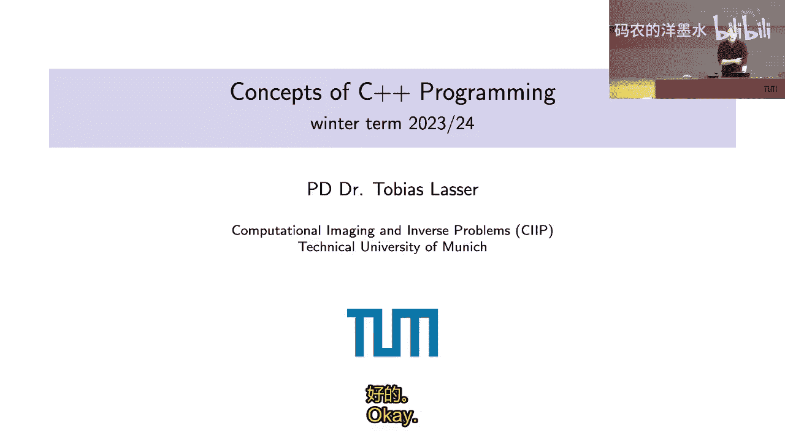

Today， we are gonna use feedbackback again。Momentous occasion。

 the first letter switched from set to U。It's been a wide。So， UF K 6。And， yeah。

There's no other news that we can focus on。

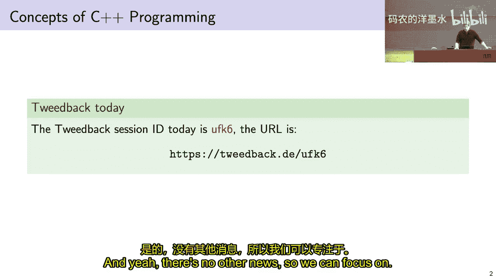

On the actual content of the course today。 And it's one of my favorite parts of this course this session today。

 because I get to talk about expression templates， which I personally think is very cool thing。😊。

And we'll also talk about the curiously recursing recurring template pattern。

 as well as polymorphic cloning。嗯。Right。So as promised。

 this is part of the kind of actual application example of where compile time programming is really cool。

😊，And we spent basically half of the session on the expression templates， maybe a bit more than half。

 and the rest。On the curiously recursive recurring template pattern and polymorphphic clo。So。

 let's dive right in。The application that we' are going to look at is one that I like。

It's an America linear algebra。What do you do there。Well， you have vectors that， for example。

 represent signals like an E G signal。Heartbeat， an audio signal。

Or it could be images like a video image that you currently get streamed via a live RB G live。

Or it could be a medical image， it could be a CT image of my body or an MR， whatever。

And the thing is， most image and signal processing in the end。

 turns out to be in numerical linear algebra。And that's why it's so important for many things。 Also。

 I think actually， the idea for doing these expression templates in this way came from a talk about high frequency trading in finance。

 I'll give you the reference later。嗯。So yeah， there's plenty of application opportunities for America in the algebra。

 So basically dealing with vectors。Of arbitrary size。Could be  three dimensional。

 could be 1 billion dimensional。And mates that also can be of whatever size。

 just to give you an idea the typical matrix sizes that we deal with。

 And my research group is on the order。Of a few pet to a few exabytes。So， fairly large matrices。Okay。

 what can you do with matrices and vectors， The most complex operation is matrix。

 matrix multiplication。And incidentally， that is also one of the operations that's used most in neural networks。

 for example， and that's one of the very big cases where GPU programming can give you huge gains and where it has gone so far that AI accelerators these days have dedicated hardware for matrix matrix multiplication。

But before we drift off road， let's look at simple numerical linear algebra。

 where we have two vectors。 Let's say one vector is x。Could be representing。

An image of an auditorium that's empty。And a vector Y。

 that could be an image of an auditorium as it is now。Not quite half。um。Right。

 and then we have scalarrs。 So what is a scalar。 It's just a number， for example， a real number。

 And then we can add these two vectors together and scale them individually by these scalar。

 C 1 and C 2。😊，Right， and the result， we store it in a new vector that we call that。

So a fairly simple but also very standard operation that happens a lot in。Be it an autonomous car。

Trying to do autonomous driving in。Object， recognition on navigation of a robot in medical image processing in deep learning。

 This happens everywhere。Right， so how do we do this in C plus plus。 Well， the standard solution。

 obviously， is use a library that does this。One of the prime examples for this is eigen。

This is a very popular library， that。Just was introduced when I。

I think one or two years before I started my PhD。 So in 2004， if I'm not mistaken。

 so it's quite an old library already by today's standards， but it's also very， very popular。

Because it's used as part of some of the big deep learning frameworks like TenorF。

So eigen is a very important di。Another very important one is boost U B。

 You may be aware of the collection of libraries that is boosted。 I mentioned it a few times already。

It's。Yeah， it's。It has a library for basically， everything。

And a lot of libraries from Booost have ended up in the C plasma Standard library。

And you B is basically the answer。To eigen。 But actually。

 it's the other way around Bo Gils was around before。 It was too slow。

 So the people who developed eigen， that were two PhD students。Gel Gunibot。

 I think was if a name and the other one was。Jacob something damn， I forgot。Anyway。

I can set out to develop development because U blast was too slow。

 I don't know how the situation in terms of performance is today。

 because both libraries have developed。 both have。A huge。

Target audience that is awesome They are open source。 So people also do pull requests and stuff。

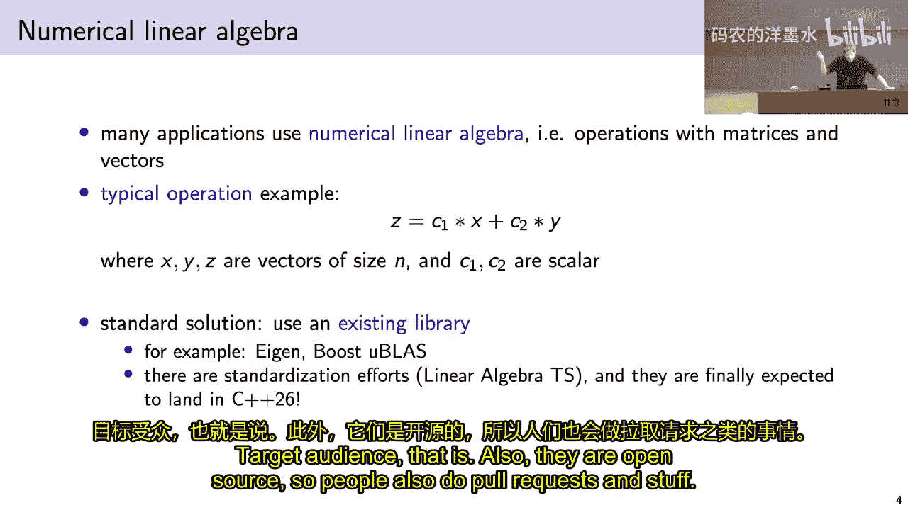

Yeah， and interestingly enough， for many years， I think almost 15 years has been standardization efforts。

Because in America in algebra is so important。So the standard library also said， well。

 we should provide something on our own。 It was called for the longest time， linear algebra Tech。

Specation T S。嗯。And finally， a few months ago。The current version of that document。

 I forgot to include the number。Was finally accepted to be included in C plus plus 26。

Which is very cool because it's a culmination of many， many years of effort。嗯。

It's also a bit disappointing。Because it's fairly basic。 It focuses on the blast area。

 So on exactly these vector matrix applications and not of the rest of the linear algebra。

 like solves or matrix decomposition and so on。 So eigen and Ublast will still exist after C plus was 26。

 because the linear algebra T S is only standardizing the lower layer。

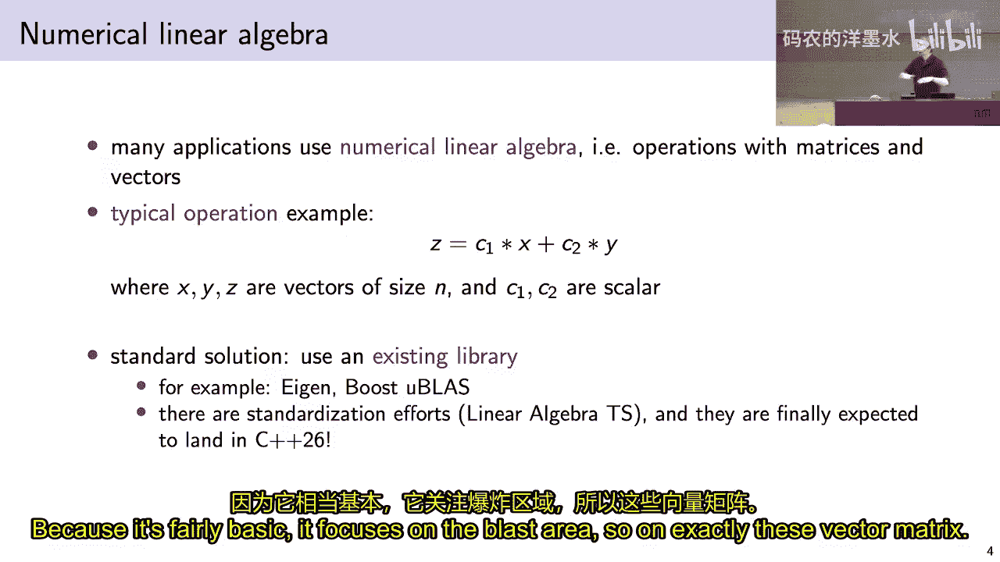

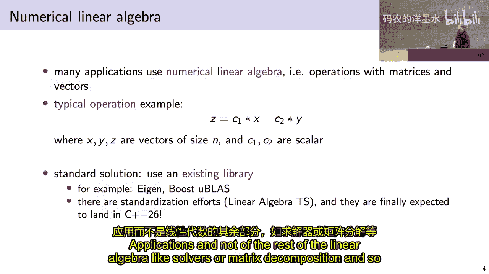

But。Better than nothing， right。Isn't all efficient the algebra stuff implemented on GPus。 Very good。

 We will learn how to do it on GPus today。Well， not quite。

 I won't show you the GPO code because that's not related to C plus plus。

 but I will show you where to put the kernel so that it is efficient And that the user of your library doesn't even notice that it's running on the GPU。

So， yeah。Do you have to download a lot of Ram for those big matrices you use。

Would be nice if you could do that if I could say， oh。

 I'm going in the Internet and I'm downloading a few more terabytes of Ram。 Sure， no。

 that's not how it happens。 But we actually do because we can't store these big matrices in Ram if we look at them in parts。

😊，With GP， obviously。Right。So。Let's say we have the simple operation。

Of adding two vectors that are scaled by constants， C 1 and C 2。

If you would be doing C style programming。It's fairly simple。

 we would do a four loop over the size of the vectors。And then index the entries of the vectors， X。

 Y and Y， I。And multiply it with the constants and store it in set I。So you do it component wise。

 row by row of the vectors。That's how C would be doing it。

 And that's incidentally how a lot of other languages would be doing it。

I should have made this an audience question， but you can probably guess how C plus+ would do it。

We can overload operators， right， So since we can overload operators。 That's what we're gonna do。

 We are gonna define a user defined type for a vector， a class vector。

You're going to define operator plus for adding two vectors。

And we're gonna define and operate a star for a scalar multiplication。 So a scalar with a vector。

And then， we can define。Some other operations as well。 But for this example， we only need these two。

And then we can write down the formula basically exactly like the math looks like。And isn't。

 isn't this neat and cool。Right， thanks to overload operator overloading。

 we can write down the math basically exactly， exactly like it is。Awesome。Yes。

Is there a way to change operator precedes no。It's fixed。

 You've seen the overview slides that I brought at the beginning。 You can't change that。

But it's for math， it's pretty fine because， I mean， the operator precedes in。

 in C and C plus Per and most of the other programming languages come from math。So it's it。

 it's usually fine。So what is the problem here， Why isn't， Why am I not done here。

The problem is that while this looks cool。

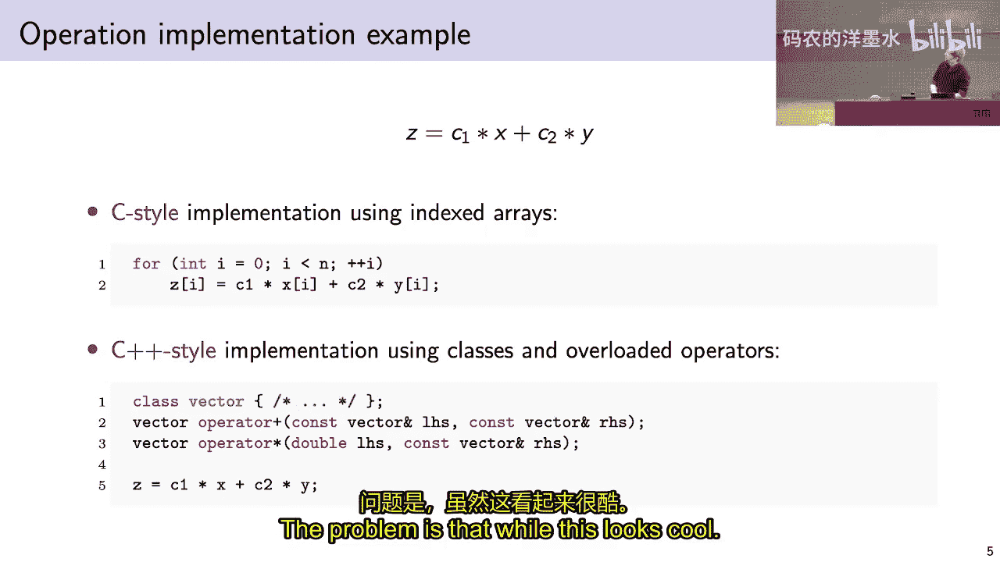

It's slow as fuck。And you don't program N C plus+ because you want to have slow code。

 If you want to have that， you would do Python or Java or something like that， right。嗯。

So the problem here is that the Z plus style implementation is a lot slower。

 I made a toy example yesterday because I wanted to know what the factor is on my machine。

 which is a fairly current machine with a very powerful processor。

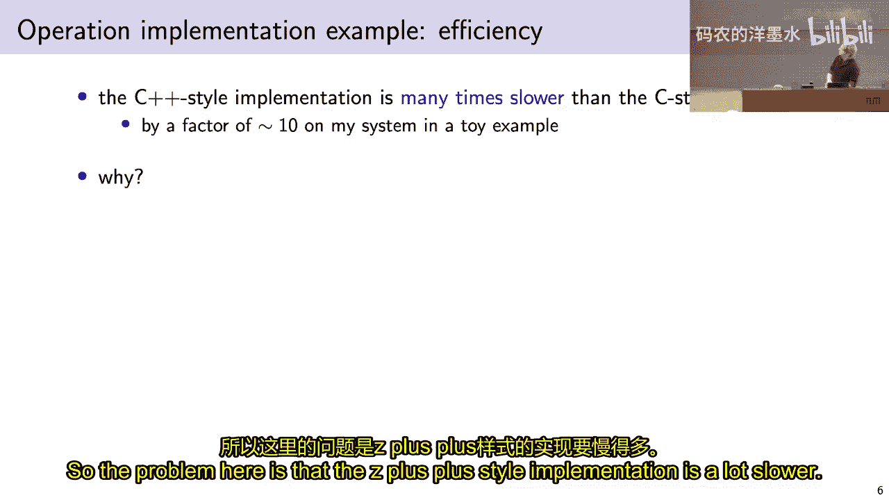

嗯。Yeah， it's a factor of 10 still。This nice code here。 if I implement it。

The way that you would expect it to， the operator plus is doing a full loop inside。

 adding to vectors。 operator star is a full loop that is multiplying as a con scalar with a。

E vectorect element。So I didn't do anything fancy， but totally stupid implementation，10 times slower。

Why。Any ideas。Yes。Yes， that's a very good answer。 So the answer was that we can't basically condense or coales。

 which is yeah， okay， let's use coales。 all the operations into one， like we did in the C style loop。

 Yes， that's the essence of it， because what happens internally。

 We have these single operators and what the compiler does。

 It essentially computes the the result of the first scalealar multiplication stores it somewhere。😊。

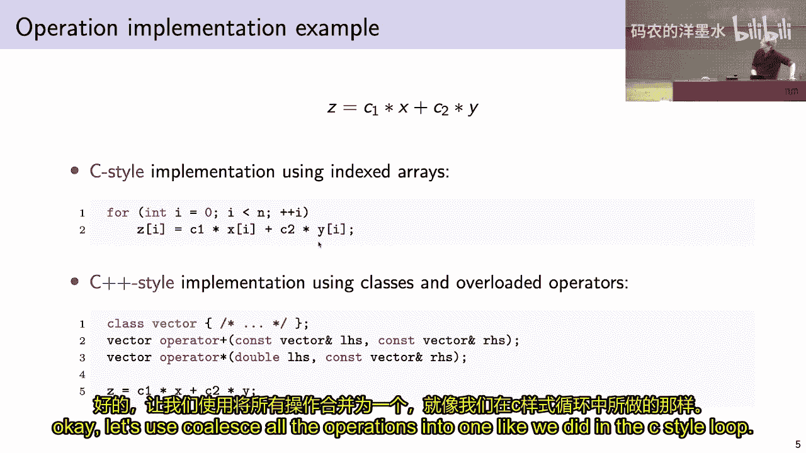

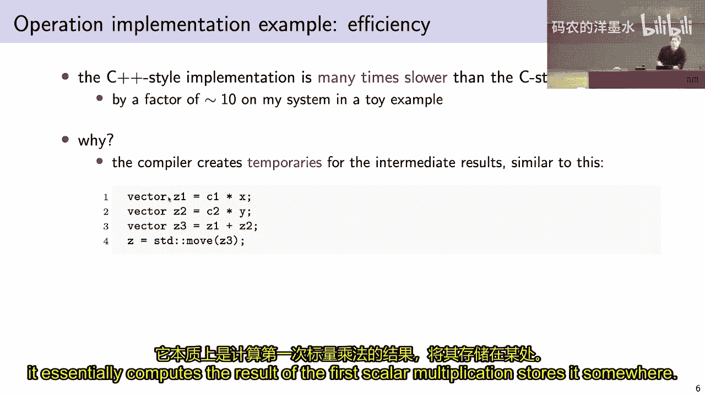

Because。That operator here returns a vector。 So the result has to be stored somewhere。

The same for the second scalum multiplication。 And then once we have these two temporaries。

 we add them up and store the result in the resulting vector。

 So this last thing is not really an overhead。 We can do this directly in Z。

 the compiler will optimize this way。 but these two temporaries。 They will be there。

And that's what gives you the performance deficit。And Ive。

 I believe when I did these slides the first time a few years ago， the factor was even higher。

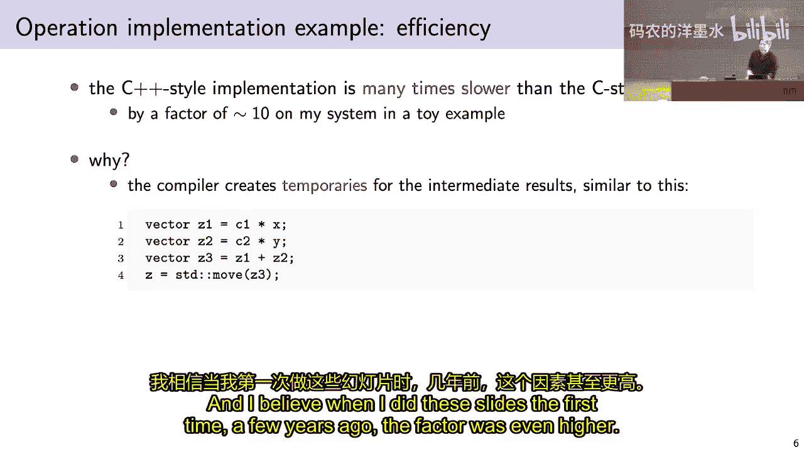

Right， so yeah。 and the other problem is consider that your vectors are really big。Let's say。

 they are。40 gig peak each。That means。

Of course， if you do the original formula， if this is 40 GB， then you all let's do。Let's do 15 GB。

 right。No， that also doesn't fit。 Let's do 10。 Okay， let's do 10 here，10 here。

 and then you need 10 for the results。 So you need 30 GB in total to do this operation for the C plus style thing。

 you need 20 additional GB。 So you need 50。 Now， consider you have a graphics cards with 40 GB。

 which。

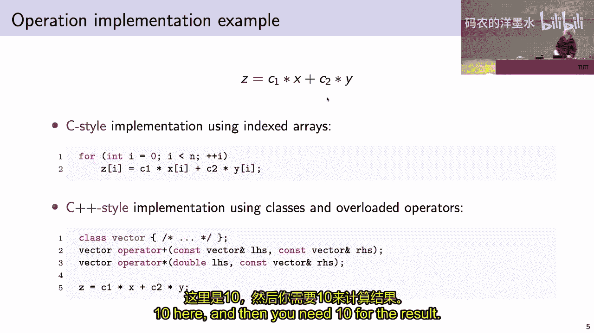

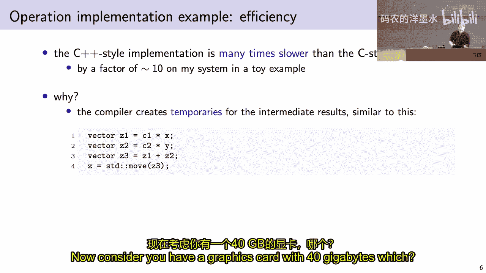

By today's standards， is fairly decent。One version fits into the graphic art memory。

 the other one doesn't。

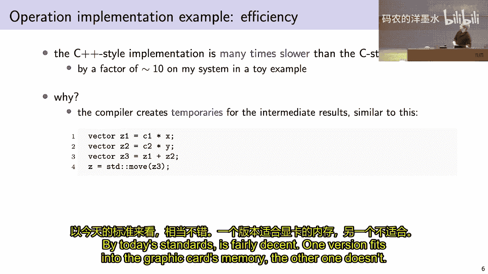

Simply because of the temporary。 So it's also the memory。And yeah， this is a huge。Issue。

 and also the memory allocation itself is this one of the major sources of this factor of 10 because you have to allocate this memory。

That takes a while。 And this is performance。 you lose。About slide 6。

 won't the compiler deforest the results like what's happening in functional programming， no。

In this case， we have an operator。 This is with optimization。

 This is all optimizations enabled to still get effect factor of 10。

 The compiler can't get rid of these intermediate values here。 There's no way to do this generically。

 This is not a functional programming language。 This is C plus plus。

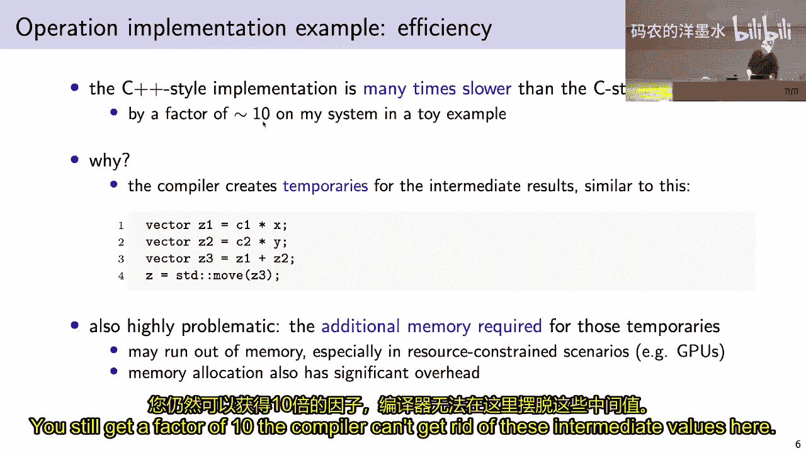

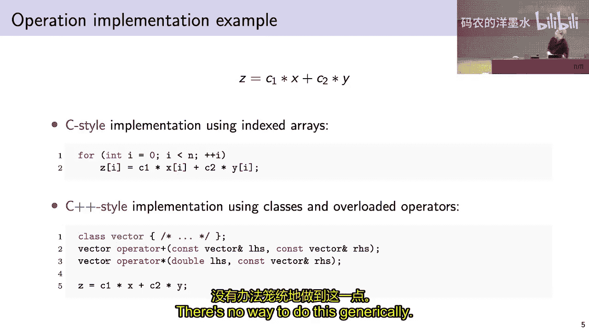

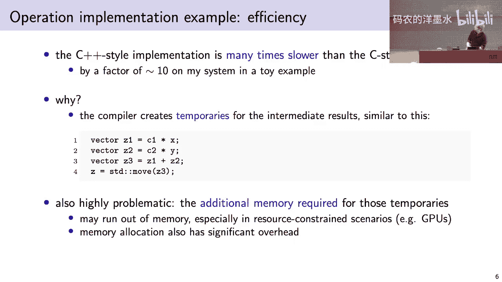

So， the question is。Can we have the performance of this not so nice coat。

 Sea style code with the elegence that we would really like to have。😊，And the answer。Its， of course。

 yes， because otherwise I wouldn't be talking about it today， right。And the other thing is。

 can't we even potentially gain even more performance， Can't we be faster than C。😊，And the answer is。

 yes。Yes， we can in certain circumstances。And the answer is， we use expression templates。

W whichch is a compile time programming scheme to basically transform the C plus plus style code that we want to have on the user side into the C style code on the back end and potentially add extras like automatic vectorization。

 using S IMD instructions， automatic parallelization or spawning GPU kernel straight away without the user even noticing。

😊。

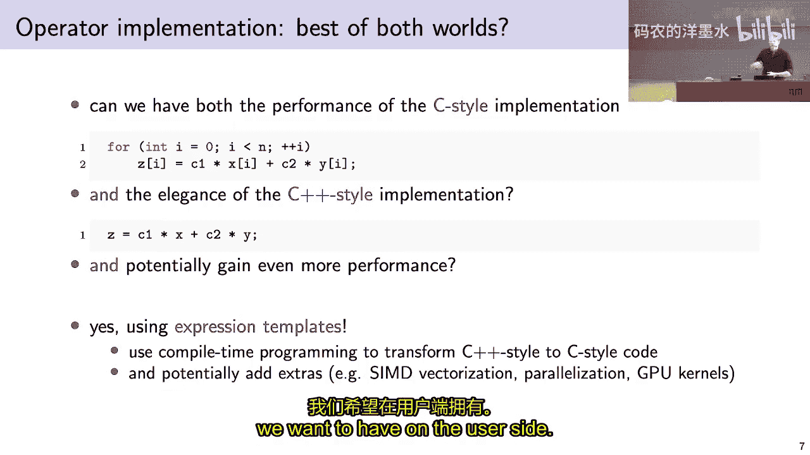

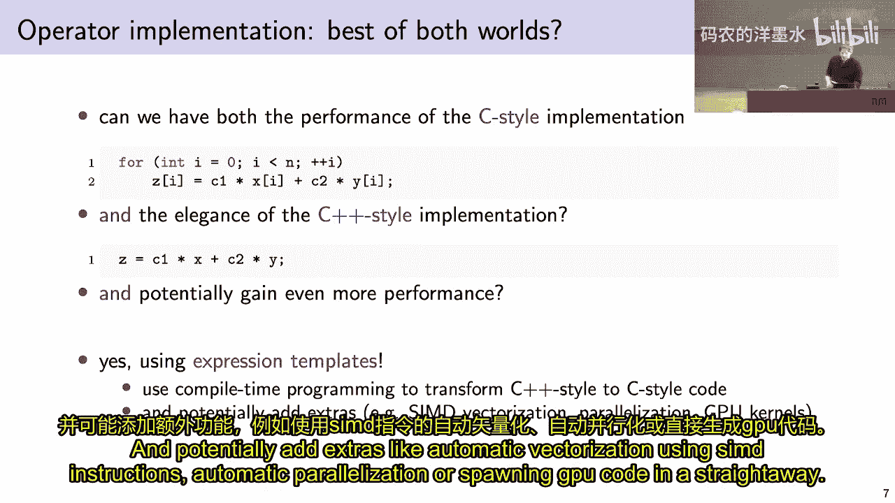

And this is all enabled by expression templates。 And yeah。This is a fairly cool thing。In my eyes。

 I hope that after you've seen it， how this works， you're also of the same opinion。

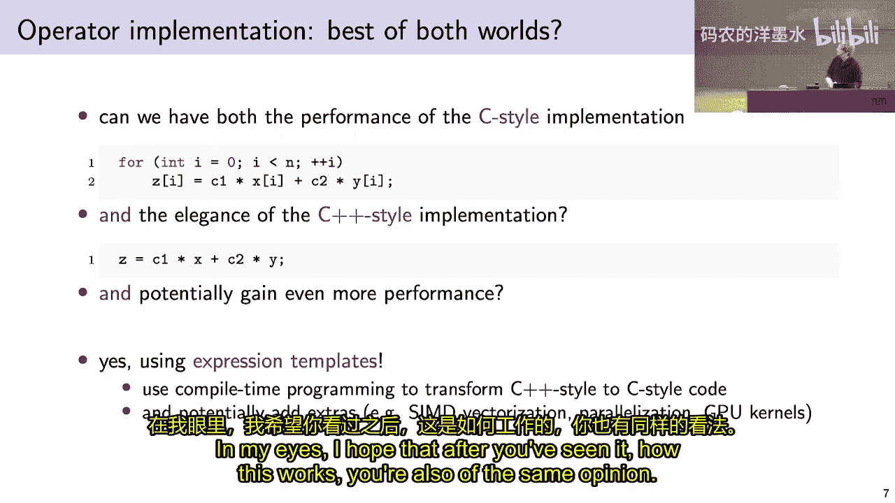

The idea of expression templates can be summarized as a lazy evaluation。

 Maybe you've heard about this before。 So instead of computing。Each step， as it happens。

We build up an expression， first。And then only when we assign the result。

 we do the actual computation。So， basically。Instead of doing the result of the first scaleum multiplication and the result of the second one。

 and then the addition。We store it first， somehow as an expression， for example， in a tree。

And then once the assignment happens。We evaluate the tree all at once。

 And there we can then even use。Victorization， parallelization or GPU programming as we want。

 And this is what you generally call lazy evaluation。This is possible in。Basically， all languages。

This is also what happens if you use， for example， jackx and Python。It basically。Hjacks。

 Ny inserts its own code so that basically this type of stuff happens。But the difference with Js is。

Check status at runtime。While in C plus plus， you can do this at compile time。Of course。

 what checks can do in run time is it can do some very。

 very fancy optimizations of the resulting expression tree。And it's a very complex program。

 It's also very cool。嗯。But anyway， we are here for， for， for C plus but' not。Python。So yeah。

 there's various way you can implement this。 But the most efficient one is using compile time programming。

 And that's why this example is here。

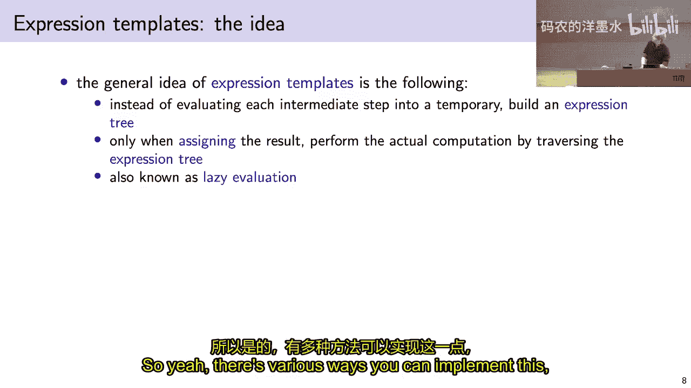

The Eigen Library that I quoted is actually doing that。😊，However。

 it's doing it the C plus plus 98 way to be compatible with compilers from back when E was developed。

 which was in the 2000s。 Even C plus plus 11 wasn't around back then。

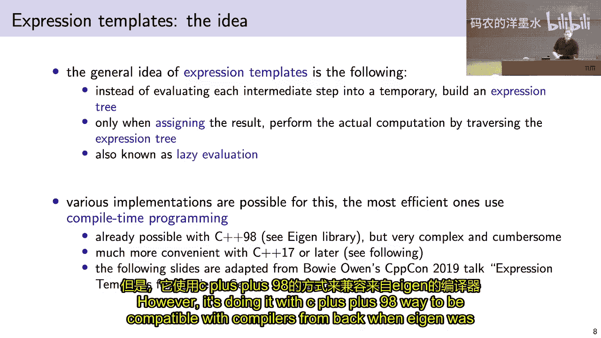

Yeah。It's a lot easier to do now that C plus 17 or later is around。

 And this is the version that I will be showing you。And。

This is based on Bowie Owens's talk from 2019 CPPcon。

 and this was for high frequency trading finance code。

 V was the deployment processing in our library for quite a while。

 and it looks basically exactly like what I'm gonna show you now。

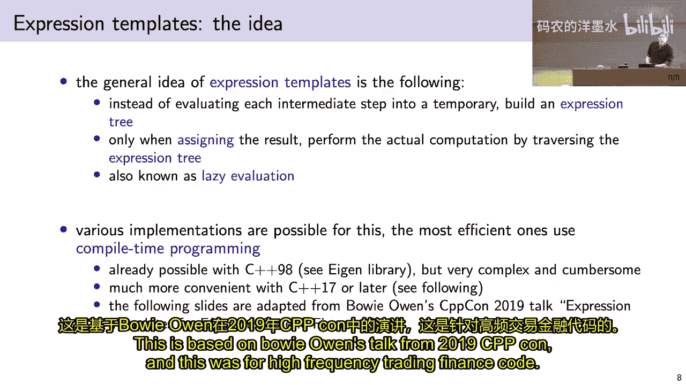

So， the main idea is。To build up an expression tree。Out of the arithmetic operations。

And then once you do the assignment to the result， then you do the computations at compile time。

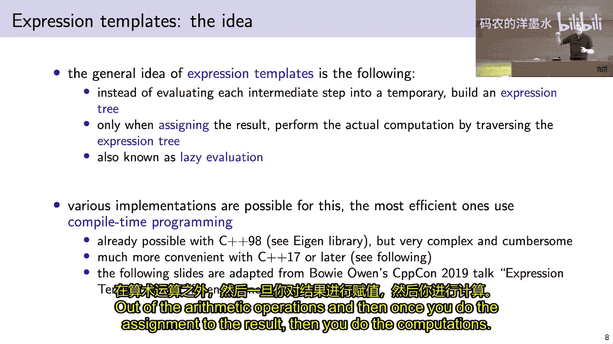

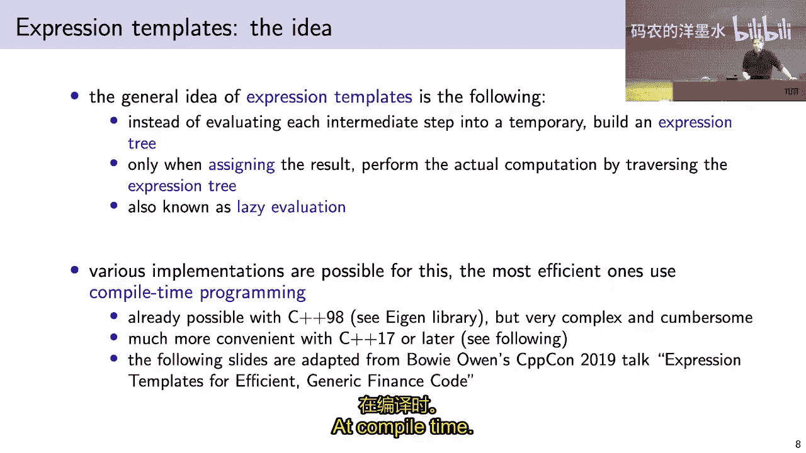

So let's look how this can be done。So first off， what we need is an expression class。

That stores what kind of operation we are doing，1 template parametermeter。

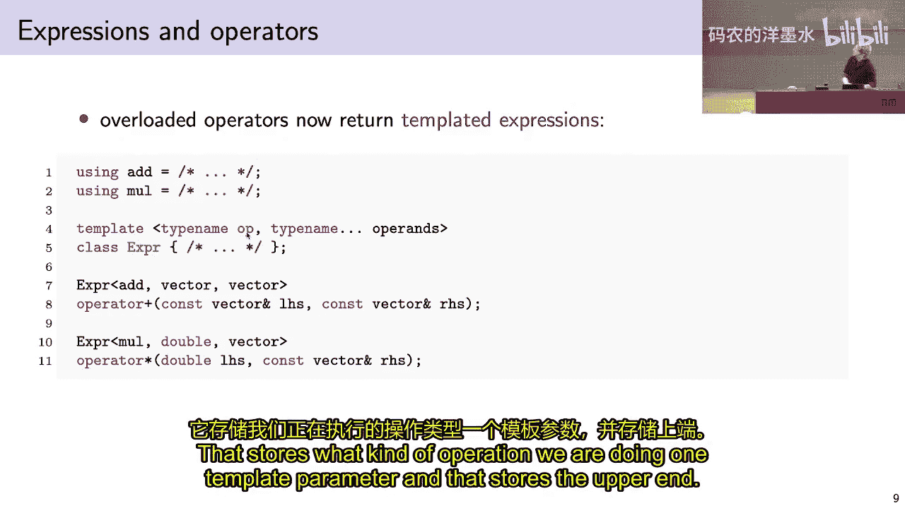

And that stores the upper。Of what the operation is working on。As a veryic template parameter pack。

So we won't care about the details right now。Because they are not relevant yet。

We also have the operations like addition and multiplication and maybe some others， which again。

 I'm not specifying right now because it doesn't matter。We will do this later。

 But what matters is now that the operator plus is not returning a vector as a result， but rather。

 it's returning an expression。That is compile and parameter， and addition。Of two vector types。

W is exactly want， what we want this operator to do。 So instead of actually computing the result。

 it just stores the expression， and the result of that expression will be computed later。

And we do the same for the scalar multiplication。 It's the same operator star。

 but it now returns an expression with a multiplication of a double and a vector。

That's the gist of it。So， these expression。Templates。

 that's why this technique is called expression templates。

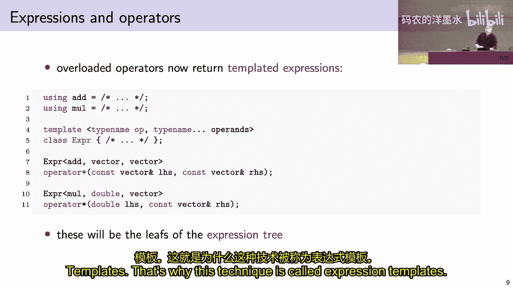

They will be the leaves of the expression tree that we will later on evaluate。

And the cool thing is we don't even need to build this tree explicitly。

 The compiler will do it for us through the invocations of these operators。😊，Right， if you。

 for example， say， okay， no， I have。The scalar C1 and a vector X。 if I multiply them。

 the result should be an expression of a multiplication of a double with a vector。

And I do the same for the other scalar multiplication。 And then I add these two together。

 So I have an add expression where the two operas are expressions themselves。😊。

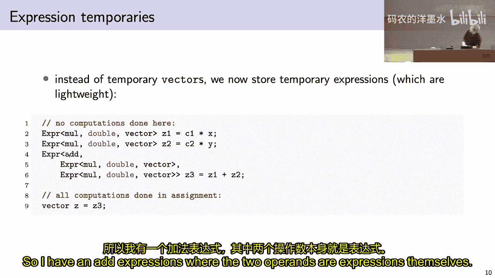

And thinth。The expression is taking these opera as a template prominent pack。

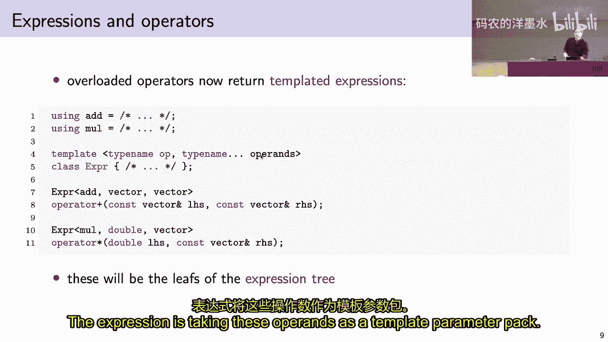

That's fine， right。So this is exactly how the compiler will build up the expression tree for you by you writing down these formulations。

And then。You assign the result from this big expression。To the final result。

 And that' in this operator， in in this assignment operator。

 this is where the actual computation will happen。And， of course， we can now combine this into one。

Right， we don't need to do this in steps。 Like here， this was just for illustration purposes。

 We can do this at once。 And the result of this will be this。Same kind of nested expression。 And。

 of course， instead of writing down this expression， explicitly。

 what we would be doing is we would write auto。Because we don't actually care how the expression looks like as long as it's evaluated later on in the assignment。

But， of course， I'm not writing auto here so that you see what the expression will look like in this particular case。

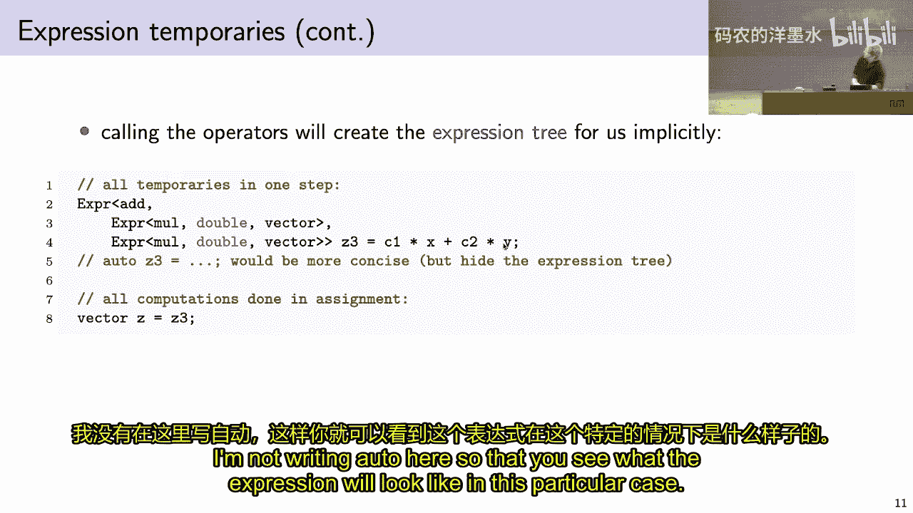

Right， the assignment has to do all the work。 And that is why it's called lazy evaluation because the evaluation is deferred from the actual calling of the operators to the assignment。

 which can be at any point after that。

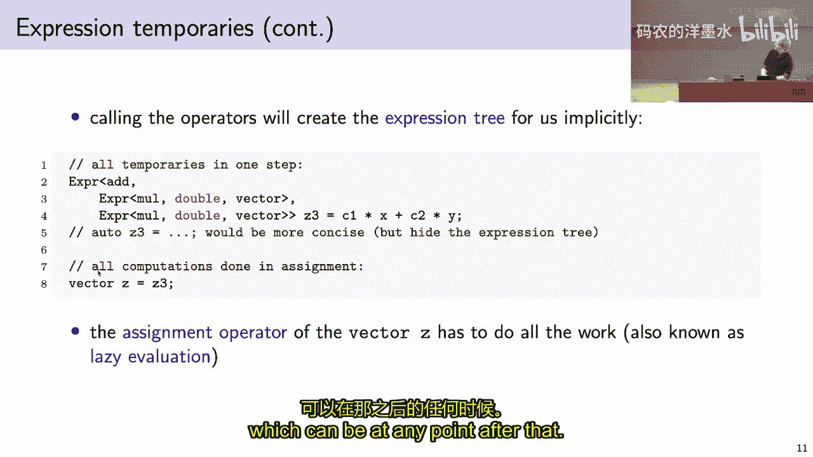

So regular code would look like this vector set equals z1 times x plus E2 times y。

So we are back to the C plus plus style of code。But due to the expression templates and the implementation of them。

 we will get the same performance as the C style code or even better performance， if we then put in。

Stuff like vectorization or parallelization。Right。One thing， however。

 that you need to be careful with。Expression templates in general， regardless of where you use them。

 So here you see if I wrote auto。

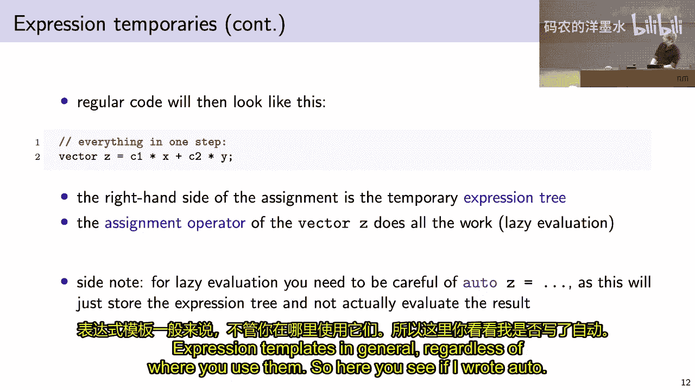

This auto would store the expression tree。But it wouldn't evaluate the result。

 That only happens if you explicitly request the assignment to a vector。

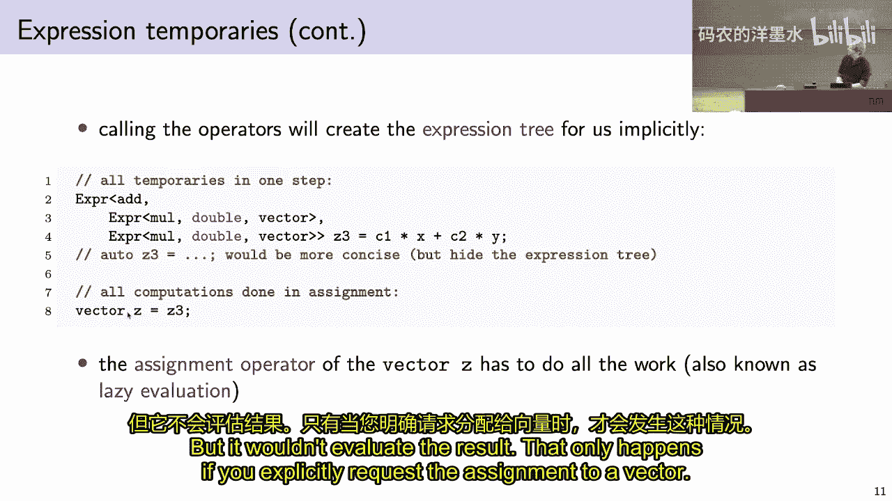

Because the result that the compiler deduces from this is this expression tree。

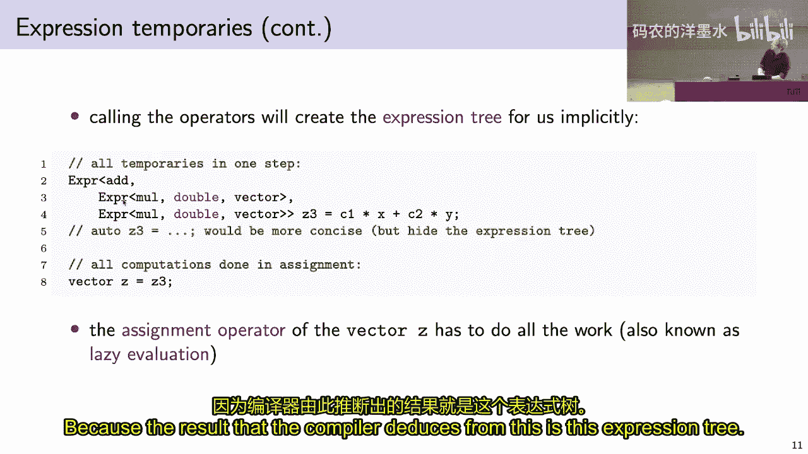

So if instead， you would write down auto that equals the thing。

 and you would expect that this does the computation。 It would not。

 It would just store the intermediate expression。So that's a caveat here that you need to be aware of。

 if you do。Expression templates like this。 The keyword auto can have。Yeah。

 can can give you unexpected results if you don't keep in mind that you are doing expression templates。

Can the expression be of type constable， Constable is not a type。Constable is。

An annotation for functions。What we're doing here right now。

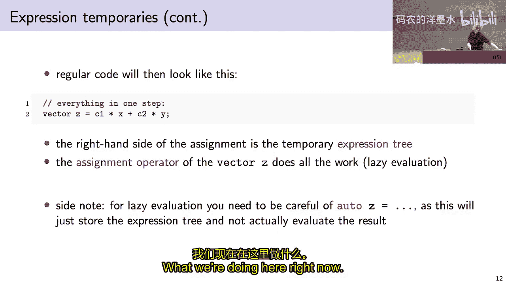

Is templates。These are types。Types are by default， and particularly templates are compile time。

 So first off， you can't make them contableile because you can't。

 you can only do con violent functions。But。They are already a compile time construct。

 Temps are instantated at compile time。 There's no runtime stuff happening here。

 except at this assignment where the actual computations are done。

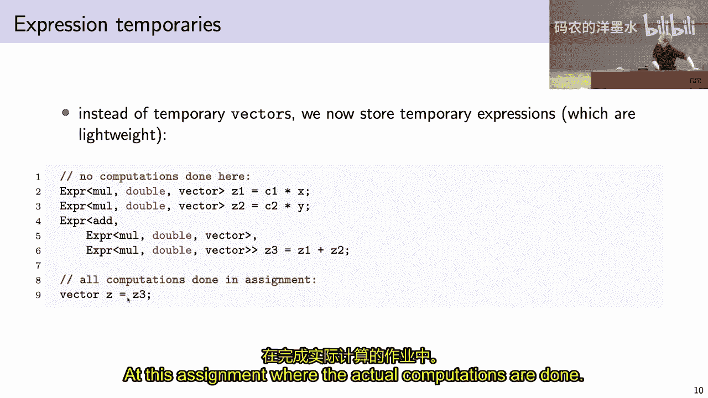

Right。On slide 12， why is that of type vector。And not expression。

 because we actually want to have the result， because the result will be done in the assignment operator of the vector class。

 So youd give an expression to it。And assign it to a vector。

 That's where the actual computation will take place。 If you write down the expression。

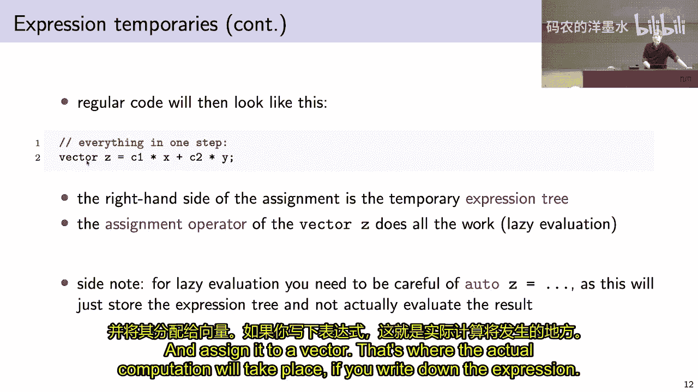

Like we did here。No computation will take place。 This will only store the expression  tree。

 and nothing else。

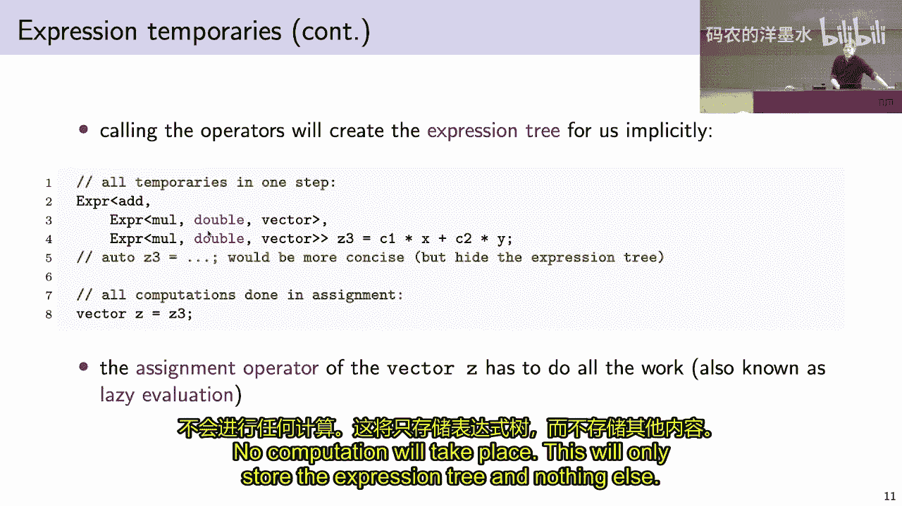

Right， so how do we do this。

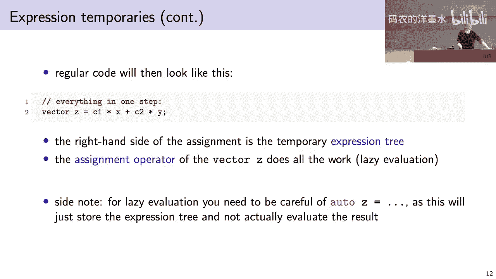

Let's start with the expression itself。 The expression needs to store。The operation。Addition。

 multiplication， what on。 And we will store it as a callable object。

 So anything that can be called like a lambda， a funor， an SD TD function or whatever。

And we need to store references to the opera。 and these opera can be anything。

 It could be other vectors， other expressions or scals， and so on。So how do we do this。

 One way of doing this that we just directly store the callable。

We know it's type due to the template parameter。 so we cant just store it。And for the opera。

 there's an arbitrary amount，0，1，2，3，4，5， depending on the operation。 we don't know。 We don't care。

 We just put it into a tapu this constant references because we don't need to have right access。

 We just need to have read access。 So a constant reference is fine。

Then we have a constructor that takes a callable and the opera and just stores it in the local variables that we have in this class。

How do the， How does the expression tree make。I are。 I'll make it faster。It doesn't。

 It makes it as fast as the sea style thing in the way that I'm showing you。

And I'll show you the location where you can place。

Vecterization of parallelization primitives to make it faster。

Why not write a special function that does all the calculations at once。 Well， you can。

 That's how sea coded it for decades。 And then you will have spaces everywhere that will look like this custom for loops for various things。

😊。

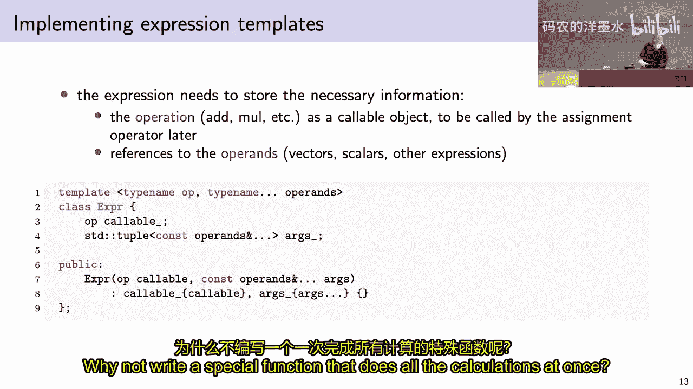

If you prefer that over code like this。Feel free。😊，But the thing is， the code is a lot more readable。

If you write it like this and you have the chance to have hidden somewhere in the expression templates to have GPU code。

 S M I D code， parallelization and so on all the hard part。

 And it's encapsulated in a nice user interface。 If you want to have S I MD instructions here or parallelization here。

 you need to do it for every single occasion you use that。😊，Not so nice。

The expression magic wouldn't work for SD vector。No， because we can't change it retroactively。 Yes。

 that's correct。But we can use an STD vector as our vector class， as data member of our vector class。

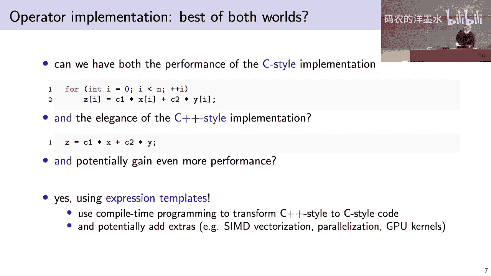

Right。So， here we are。Right。

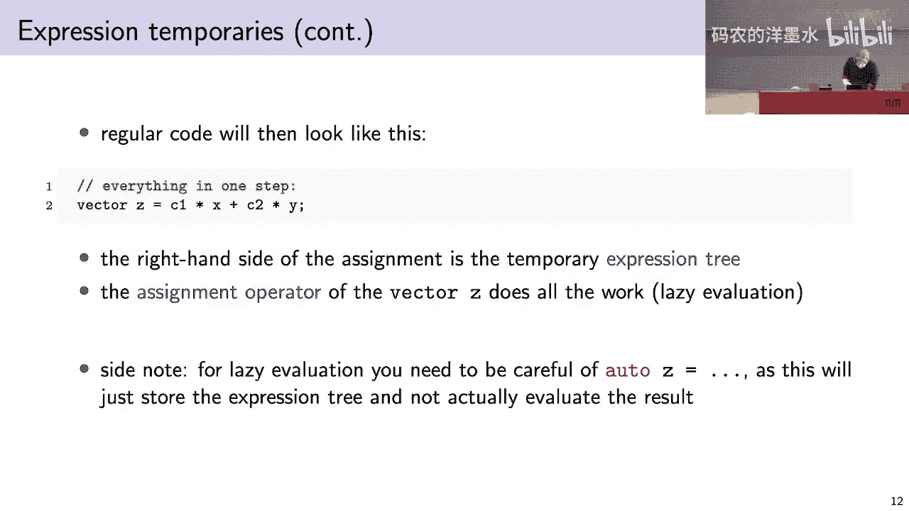

So now we can actually write down the operators。

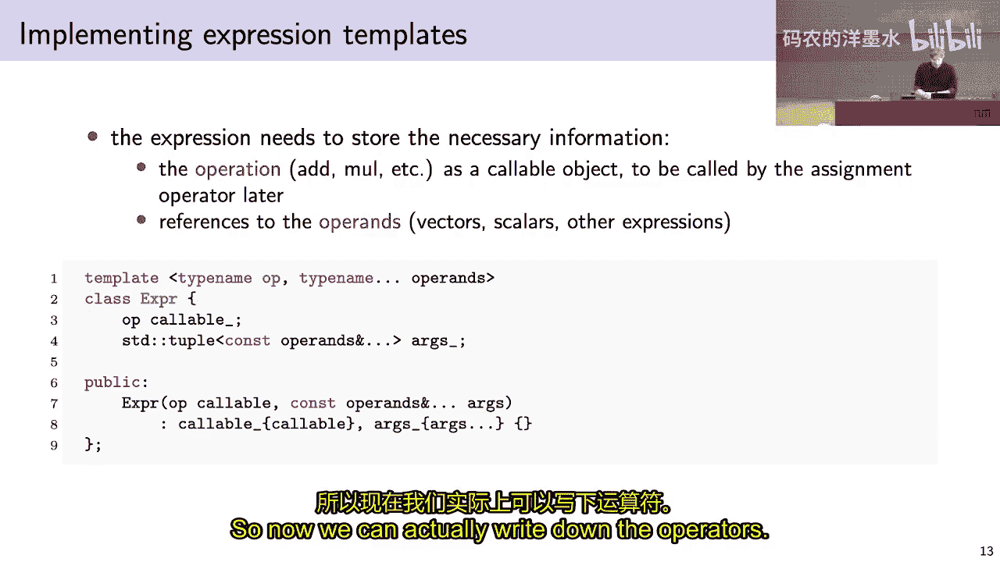

Right。The operators are also templated。 They take an arbitrary left hand， and arbitrary right inside。

And auto result。 So we don't need to take care about the actual return type。 And， of course。

 what it will return is an expression。With an operator。

 I get to that and the two opera that we get the left hand and the right inside。

So it doesn't do any actual work。 It just gives you an compile time construct。

 namely this expression template。Now， for the operator。

 this is a lambda that takes two elements and returns the product of the elements。At first glance。

 you should be sitting there If you've seen this the first time you should be sitting there and like。

 what the heck。Isn't this kind of an endless cycle。

 So you want to multiply stuff and you put a Lada in there that calls the multiplication operator。

Isn't that an endless cycle。 No， the idea here is that this operator does it on the elements of these vectors that you get as arguments。

That's why it makes sense。 So you kind of defer。The kind of element wise operations to the element wise operator here。

 stored in a Lada。But again， you're not doing any actual work yet because you're not calling the Laza。

 You're simply storing it in the expression here。 We will use it later in the assignment operator。

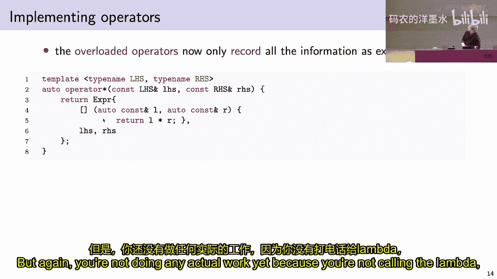

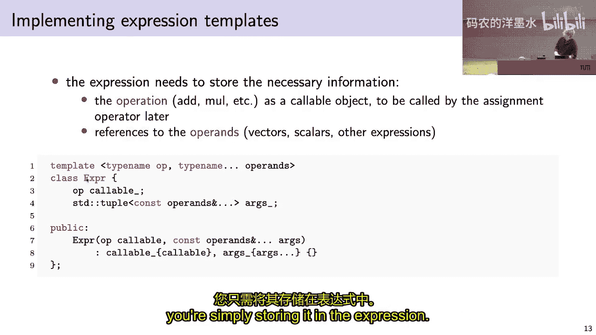

Right。For the scale of multiplication， left and side would be double and right and side would be the vector。

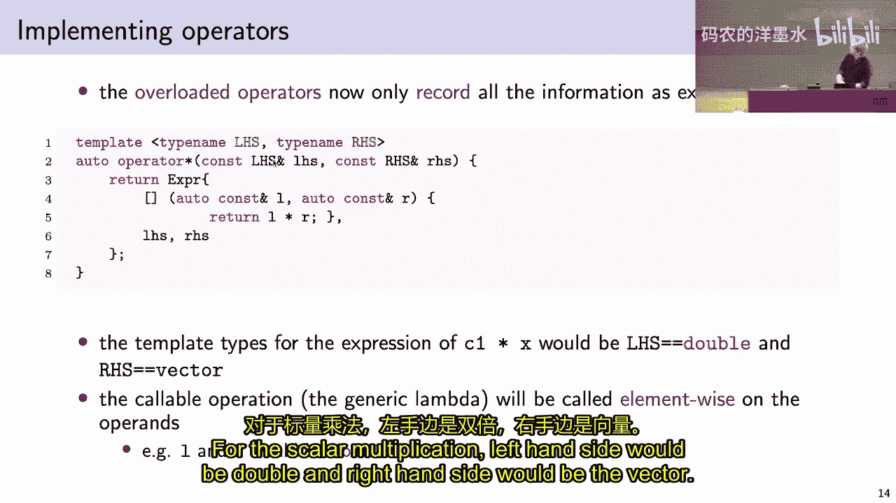

So the types of L and R in theda would actually be resolved to double and double。

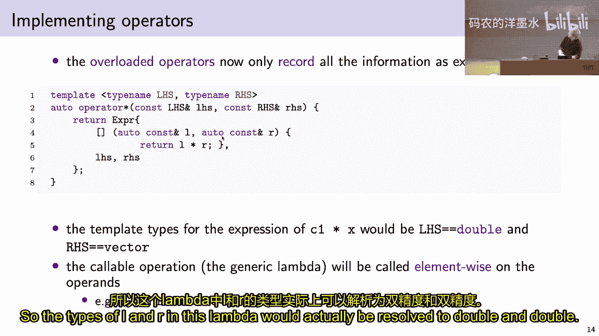

Right， so let's take a look at the assignment operator。 right。

 This is where the lazy evaluation defs the computation to。 So it has to be done somewhere。

And we will do it element wise in our vector class that， as you see。

 uses an STD vector as storage of the coefficients。 Why not。😊。

No need to do data management If FTD vector can do it for you。And then you will have an operator。

 a si operator。That returns a vector reference， name the itself。

It's usually for an assignment operator。 And the argument is。Something that is templated。

Why is this templated because it has to be able to accept any kind of expression at any nesting level。

 S single level expression， an expression that's 10 levels deep has to accept everything。😊，So。

That's why we do it as a template argument， and then we have a for loop。😊，Basically。

 the for loop that you have in the C style code。 you have it once here in the assignment operator。

 you iterate。Over the vector。And assign the result to the storage。 So that's the result。

And you access each element of the source。Now， the interesting part is， actually。

 we are still not doing any work here， right， We are just assigning stuff。

So the actual ver happens in the。ESubscript operator of our expression。

So we need to write this subscript operators for our expression。

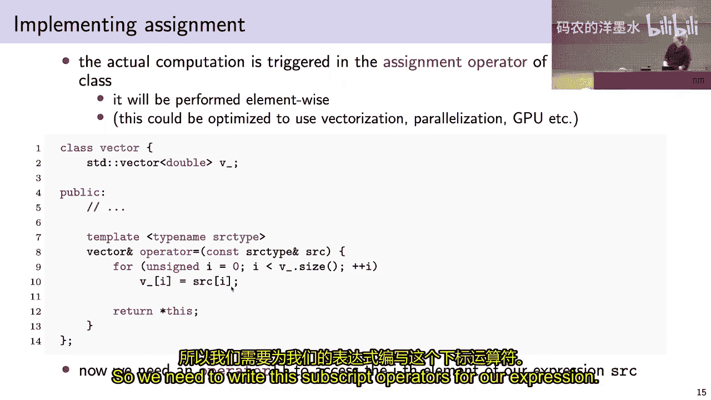

Of source。所以讲。That means we go to our expression。 We already store the callable。

 the tuple for the operas。 I'm not repeating the constructor。 We've seen this already。

 I'm just showing you the operator that does the subscript。

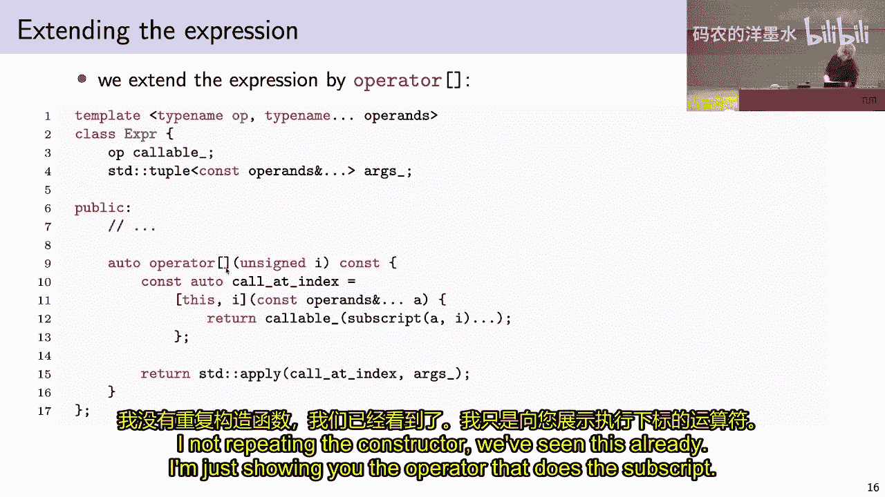

So it takes an argument， an index。Usually unsigned， Why not。

 It's a constant operation on the expression because it doesn't change it。

And the return type is auto because we don't actually know what the return type will be。

 It depends on the operator and the arguments。So what we will do ignore the Lada for now and what we will do。

 essentially， we will， I can't quite ignore it。 So let's， let's jump to the important part here。

 We will call the callable。With the arguments。But we can't do this directly。

For reason that I will show you in no that I can explain now。

 because what can you have in these expression templates as opera。Victorious。Other expressions。

 but you can also have scals like a double。Vctorors and expressions support subscript operations。

But as Kala doesn't。And what we want to do here in the subscript operator。

 we want to access the subscript， the I location of the opera。

But if one of these opera doesn't have a subsequent operator that will fail。

 that will give you a compilation error。 So in order to get around that。We do another a lambda here。

 call at index。This Lada captures。The expression itself。 So that this pointer， plus the I。

 that's the argument of the subscript operator and takes as an argument。 a parameter pack。

 which is just operate parameter pack as。And then it invokes the coliber。And now。

 instead of calling the subscript operator of the arguments， it's calling the function subscript。

Of the argument with I S the number of the subscript and expanding the parameter pack。

 And then we use the S TT apply function from the standard library that calls this Lada with this parameter pack。

So why do we not do directly invoke callable on the I subscript of a。Well， because。

Some of these opera might not support the subscript operator。

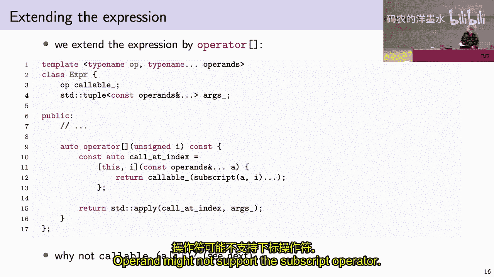

So what we will have， we will define a free function subscript。 that's again， templated。

 depending on the operant type， It takes an index I。And it does an if constant expression， you know。

 a compile time if to determine if the opera end is a vector or expression。 So in other word。

 does it support a subscript， If yes， it will do the subscript operation。And， if not。

It must be as kar。 So I'm just returning the kar。Cause otherwise， if you wouldn't do this。

 this would be a compilation error。 sorry， this would be a compilation error for any scalealar。

And this is vector expression is a type trait that we are gonna define for ourselves so that we can use it in the con expression if statement。

And that's fairly simple。 We've looked at。Type type trade last time already。 So we can， for example。

 de from the standard library class files type。 That is basically nothing。G。

 so the general template is false， essentially。And we do a specialization for the vector type。

 which has the true type。We do it for expression the same way。 So if you have an expression。

 then it's a true type， and then we can combine it in a templated constant expression that says is vector or expression where you just or together these two type traits。

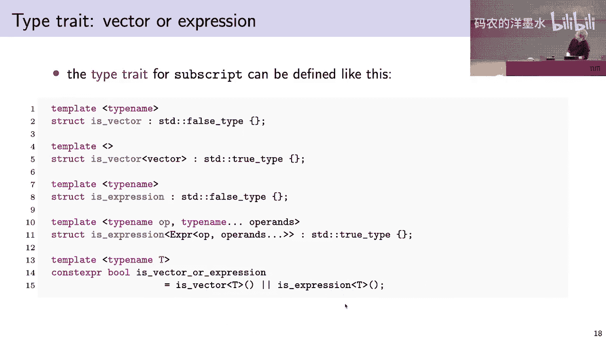

Thus， we have constructed a new type trait is vector or expression。

 which we can use in our subscript operation in the compile time if here。

Right， and essentially。That's it。

Let me step through this once more。Behalf， the expression。

Which stores the operation and the operations for later use。

We have the overloaded operators that instead of doing the actual operation。

 we turn this expression with a Lada for element， for the element wise operation that we w to do。

 in this case， It's a multiplication for other operators。 It would be subtraction。

 addition and so on。😊。

Right。Then we have the assignment operator。Which when it's triggered。

 takes the expression on the right hand side， or in the right hand side for you。

That's the computation， and assigns it。Into the result。 And it does so。Element by element。

And the actual work is actually done， not in the assignment operator， but in the。

Subscript operator of the expression。 because there we call the actual operation that we stored for the arguments with this minor trick to make sure that our type that were using it on half a subscript operator or not。

As it is。This essentially。Reproduces a C style code that we saw in the very first slides。

Using the C plus style code。Yes， it's a bit of。It's a bit complicated to get there。

But then you do it， you do this once， and then you use it all the time in all of your code。

 So it's worth doing it once。 And， of course， in most of the cases。

 it's not you doing that expression template， but someone else is doing it。

 And then you use the library。Sim D， wheres the S I M D。 Choose your fighter。O k。

We will use multi threading later on to make it faster than see。 Well， actually。

 we are not using it here in this。Example here。But， of course。

 you can now imagine that when you do this assignment here。

You don't have to do a full loop。You could unroll this with vector vectorized instruction and accordingly adjust the subscript operator to give you chunks of data。

You can spawn GPU kernel here。Instead of doing the computation on the CPU。嗯。

Or you could distribute it over multiple computers with open with MPI or whatever。 I mean。

 you can basically。

D determineterine for yourself what kind of acceleration you wanna implement here。

And the cool thing is， this can be as ugly as you want it to be because it's complex。 And， you know。

 if you distribute it over multiple GPUus on the same computer or several nodes， it gets very ugly。

。But the thing is， the user doesn't give a fuck because the user。

Does this。And if it then runs on multiple GPUs， automatically fine。So有。This looks so complicated。

 respected to a sea style for loop。 Yes， but it also has a lot of benefits。

Do I understand correctly that we now reduce temporary vectors to temporary doubles。 So， yes。

 we switched from having anti vectors as temporaries to just having entries as temporaries。

 which is exactly the same What you have in the C style code。😊。

Why does the compiler not do that automatically。喂。You see that it's a lot of work。

 and you might not want it in all of your coat。But some optimizations are done in the compiler。

 but this kind of stuff is not done。Willll be a front time overhead。 No。

 all this expression template stuff。

Note here。Expressions。Tempd expressions。 So compile time。To templated expression Comp time。

And so on and so on。The constructor has actually no overhead because actually。

 this is standard compile time。

This expression is generated at compile times。 So no actual code is generated here。

 The only code that you have is this for loop with the assignment。

 And there you will probably have an in line call to the。

sububscript operator， which in itself， is again。Compile time construct here， Tu templated tu。

 So no overhead here。 And this is a compile time if， which is， again， no overhead here。 So actually。

 the code that you generate with this。

Is。At least as efficient as a C style loop。No runtime overhead。

Can the compiler take care of checking if an expression is valid。Very good question。

Let's get to that。

So。sorry。Right， so。Obviously， we want， don't want us for everything。

But the thing is， our multiplication operator and our addition operator， if you do it like this。

 should have repeated it here。 it accepts everything。

It's a freestanding multiplication operator that accepts everything。

So you can no longer multiply anything at all。Except via these expressions。

 as soon as you include that in your program， that's a bit inconvenient。

 So we have to restrict our code to just do this type of stuff on the types where we actually want it to happen。

 namely vectors and， and numerical algebra stuff。 right？ So again， we use type traits。

ETo do that。 So if we have some kind of concept expression， is binary operator okay。

Then we would restrict our。Mulipplication operator using， for example。

 S Vner using this SD enable if。If the binary operation is okay for these two opera。

Or if you're using modern C plus plus C plus plus 20， you would use concepts and formulate it as， oh。

 this template requires that the left hand right inside fulfill the trait is binary up。 Okay。

 this is a bit more expressive than the enable if thing。And yes。

 we will talk about concepts a bit more， but not today。

Right， so the only thing we need is this kind of type trait。 So let's do it。 It's fairly simple。

First， because the standard library already has a type trade that tells us if anything is arithmetic。

 so essentially。Is it， is it double in or something like this。

And then we say binary operation is okay。 If our left hand side is a vector or expression。

And the right inside is a vector expression。It's also okay if the left inside is a vector expression and the right hand side is arithmetic。

 or if the left hand side is arithmetic and the right hand side is a vector expression。

That's our type trade for is binary expression， okay。

And then。This restricts our multiplication operator， either your concepts orphna。

To only the operations， we w to use it on。 and for everything else。

 we will have the standard operations。

So， yeah， now we have this beautiful syntax and the user code。😊，Slightly convoluted。

 templated and compile time code in the library side。 But that's fine。 You do it once。

 and then it works。There's no runtime overhead。Compared to the sea style implementation。

There's no extra memory required compared to the sea style implementation。

And if you take the chance in your assignment operator to implement vectorization。

 parallelization and so on， you will get faster code than the C style implementation。

And that's， basically。My application example for why Comp time programming is really， really cool。

This defined multiplication operator works seamlessly for scalar times vector。 Yes。

 and it also works for pointwise vector times vector multiplication， yes。😊，The operator overloads。

These are freestanding operator overloads。 You don't do them in the class or so， but you do it。嗯。

Anywhere。So it's a freestanding operator overload。Why is it compile time。

Because it's based on templates and compile time code。That's why。Right。

 so if you wan to see this in action。

You can check out the Eigen Library。It's a very， very standard library for numerical American in algebra。

I would even go so far as to say， it's the standard library。So check it out。Read the source code。

 it's open source。And if you understand what a does。YouF mastered C plus， plus， and much more。

I can tell you， if I look at the eigen code now， most of it， I won't understand。

And I've looked at the iconen code plenty of times over the years。The thing is。

 they are doing it the C plus plus 98 way。 And this is。Fucking， horribly complicated。 It works。

But the code to get it done is。A lot uglier than what I showed you。

So what I showed you is already the nice version。There's Amailou that does something very similar。

 There's U B that also uses expression templates inside。 So there's quite a few。

 there's a few more examples。 but these are the main ones。

That I wanted to mention last year， I was also showing our own El library as an example for where be using exactly these expression templates。

 But actually this year， we kicked them out because we had to change our memory management。

To interact better with Pythch and these other Python libraries。

And since our expression templates did automatic GPU code。

 the GPU code of Pythtorch and our library was interfering。 So for now， we removed it。

So you can't look check it out anymore， except if you go back into our commit history。

Does Cplpa support software prefetching。What is that。I don't understand。

Would C Shap be the superior language， if not for Microsoft。It dependspens on you。

 C sharp is basically。Microsofts implementation of Java， So I would say no。But then again。

 that's my opinion， US might differ。How would we implement S I M D GPU interaction。

 Let me highlight this again。 You would do this。

In the。Assignment operator。 So here， instead of doing the plane fall loop。

 you would unroll the loop to do S IMD。

Or you would。call a TU components here。So yeah， this is the spot where you would do the magic。

Right。Do you have traits of traits， sure。You can combine them at whatever。

 What do you think of flatter dart。I've heard about it。 I think it's some kind of web。

 whatever thing。So for web stuff， I'm sure it's cool。

For any kind of number crunching where you go through petabytes and exabytes of data。

 I'm pretty sure they suck。Because that's not what they are made for。But then again。

 I have no detail， no idea about the details of these languages。 but if we are。

Talking about high performance computing。The plus plus is where it's at。 maybe rust。

But definitely not any of the Web languages。Can you enforce prefeting data into the cache。

That is typically CPU specific。Instruction， if it exists。

 So since you can call assembly code from C plus， yes， obviously， you can。

 but it's not a C plus plus feature because that's not。That's actually， at a lower level。

Since you have not managed to master Eigen， can we expect this to be a part of the exam。No。

Think should be pretty clear that anything I have not mastered myself。

 I will not be asking in the exam of you。Oh， that's a good question。

 But if you have a function that takes an operator pack and doesn't know whether it will be evaluating as k times vector or vector times vector。

 how can it be at compile time。It's a parameter packet。 It's a template parameter。

 It has to be known as compile time， and the compiler will know。

Because if you call this operator here。The compiler already knows from the court side what the types of the arguments are。

That's why it's a compile time mechanism。Right。Are there alternatives to expression templates。Yes。😊。

Right， theres。You can， for example， use views from the range of library。

 They are also a lazy evaluation construct。 That's part of the standard library。And， in fact。

 you can implement linear algebra operations。Using the range of library。It's a bit cumbersome。

 but in theory， it works。 in practice， it doesn't work that well yet。

But in a few years， when the standard has caught up and the implementations have caught up as a standard。

 it should be possible to do the same thing with ranges。

 I wouldn't necessarily call it better or easier。Just a different way。

Coal routines is something I'm not sure we will be talking about next week。 They basically。

A way of calling functions on demand to produce results， not all at once， but step by step。

 And this sounds like lazy evaluation。 And it is。It's baked into the language since plus 20 in a very rough fashion。

 So I may cover it， but strictly speaking， you could also do an Americanline algebra using cold routines。

Both look very promising。But both currently are not in a state， very keen。Expect to use them for。

Actual implementations that are useful in practice。所啊。

Do expression templates require knowledge of een no。

 I only mentioned Een as an example that's also implementing expression templates in a different way in a lot harder way than I talked about here。

 So obviously， yes， for this course， these expression templates that are showed you that you plus 17 expression templates。

 those you need to know。😊，And that are perfectly understandable， I have to say， at least to me。

 And I hope to you， too， eventually。But Eigen is on a different level of complexity。

 Have a look at the source code。If you w to see complicated code。That is actually used in practice。

 in a lot of places。In the example， you return a Lada that explicitly called the multiplication operator element by yes。

If a class contains members where we want to add the first pair and multiply the second can。

 you can make your multiplication operator do whatever its whatever you want it to do。up to you。

I showed you the。The example where it makes sense for linear algebra。 If you wanna do something else。

 feel free。Will we look at co routines when we discuss multi threadreading next week。

 I don't know yet。It's an ugly topic。 It's， it's a cool topic， but it's very ugly so far。

 And I'm not sure if I want to talk about it。In this state， as it currently is。In 2023。Right。

 the rest of the answers I will answer in writing after the course。

 because I wna get through the curly because cur template pattern and polymorphic cloning still today。

 So let me get started on this。 and all the other questions for expression templates， I will。

Answer them later。

And right。Right， so。We've heard about polymorphphy。Which is。Dynamic polymorphine， plus， plus。

With virtual functions。 And you've also heard that the virtual function dispatch。

Which typically is done using V tables。Have a runtime cost。Because you have the indirect。

 We have the V table。 There can be no inlining and so on and so on。

 So there is a runtime overhead that you have over the regular function calls。But also。

 just a caveat here， there is an overhead。And if you really determine that this overhead is a problem for you。

 then you can look at the stuff that I'm showing， you know。

 Na me that you can do static polymorphphy using compile time techniques using this CR TP。嗯。

But you can also use CTP for other things。 But let me just say， don't premature really optimize。

Really make sure that this is an actual bottleneck for your code。Because what you will see。

 the CRTP is。

Beird。Right， and introducing this into your code。You only do that if it's really necessary。

If you wanna have polymorphism。Do dynamic volumemorphism first。See if it's fine。 and if it's not。

 then you can rearrange your program to include static polymorphphy。

But the cool thing is you can。 You don't have to， but you can see plasmas enable this to have basically polymorphphy at no additional runtime cost。

 The only thing you do pay is that your code looks a lot more complicated。😊。

The way to do this is a curiously recurring template pattern， CR，TP in short。

 and CRTP is a generic technique that can be used for many things。

Sttic polymorphphy is one of them。 And I also show you polymorphphy clone as another one of them。

So what's the idea of CR TP。Is that you inherit from a templated class。

 and the derived class will be the template parameter。So you define a base class that is templated。

And then you define the derived class， and use。The derived class as a template parameter for the base class。

That's it。 I mean， strictly speaking， that's all there is to say about the CRTP。That's the basic。

 Of course， now I need to show you why this makes sense and what you can do with this。

 But that's the generic idea， idea。Deriveve a class from a templated base class， and use。

The derived class as the template parameter for the base class。 Why would you do this。

 It looks weirdard， right， So it's why it's called curiously。Recurring。

 and the idea here is that if the derived class is a template parameter of the base class。

 then the base class knows。About the direct class， right。And that's pretty cool。

Because what we can do now。Seriously。So what we can do now is， for example。

 have a function in the base class。That takes this。Pointter。Casts it。出。

The template parameter and the template parameter is a derived class。 So basically， we can cast this。

To the divide class。 And then use。This。Now we call it derived。Like it were inside the derived class。

So， this is essentially。Doing polymorphphy the static way。Why is it static。

Because it via template parameters， though， this is all a compile time construct。

So there's no runtime overhead。 So if you call it do something。

And this， in turn， invokes a function from the derived classes call can be in line。

 And then there is no overhead。And this works because the base class knows about the derived class via the template parameter。

And that's why it's called the curiously recurring。Template。Pattern。So。The thing is。Advers。

But it's a bit tricky to use。And you can have a lot of errors using this that are not obvious。

So one of the things。You might think that it kind of works sinces static polymorphphy。

 it kind of would work like。It would work like polymorphic virtual function， right。

 But there's no overriding。 So if you define a do something method in the derived class。

 and we already had one in the base class， there's no overriding happening。

You're hiding it。 So if you're calling a derived class via a derived。

And。It will call that do something and not that one。 And that， of course。

 will defeat your polymorphphy。So you need to really take care。

What you do。 So you can't do poly the same way。As you would do it。With with dynamic polyography。

So the guideline here is really only use it when necessary。And do it in performance critical code。

 And exactly here， the eigen library turns up again because that's actually how the eigen library does expression templates。

 We are the CR T P。And that's why the code of eigen is so fucking horrible to understand。

And there are some other special use cases。 One of the main important ones that I show you is polymorphic cloning that will come afterwards。

So。Let's look at a simple example。Let's say I have a base class that's called Mount。

That somehow represents。I don't know why。So I hadn't my， my microphone wasn't even turned on。

 So it's。Some feature of the auditorium， I guess。Sorry about that， as usual。

 welcome to the Leta University here。Right， so anyway。

 what I wanted to show you is the example of CRTP。嗯。

You have a class that is representing an amount of something。And you have a function get value。

That will return。The value of the amount that you're presenting。 And now。

 think of it as this would be a polymorphic based class， and get value would be a virtual function。

F thick。And what you would typically do is you would override this get value function in the derived classes。

 So now we do static polymer P。 So what we actually do is we define get value only in the base class。

Well not just in the base class， but basically what we do now is we use a template parameter to cast our this pointer to that type。

And then call get value on that。 So in a sense， we are kind of。Doing what the V table does。

 but at compile time。Right， and then we can do an implementation of this。

So a constant 42 that is just returning the value of 42 would then derive from the amount class。

 This constant 42 is a template parameter。Implement cat value this way。

And the only thing you need to take care of， of course， if you call get value for a constant 42。

 it will directly call the get value。 But if you call it via the base class。

This cat value function will be called。It will cast this pointer to constant 42 and call the get value of that directly。

And this， since this call can usually be in line by the compiler。

 there's actually no runtime overhead。

And then you can do another implementation of this， another derivation of the base class。

 a different implementation。 this time。 it's a variable where you store the value somehow and then return the value。

 And that's how you have。

Static polymorphphy。Using it is a bit different。Because typically。

 what you would do you would do it via base class reference。 Well， you do the same。T here。

 kinda as well。 So it's a base class reference just that you need to add a template parameter to your function to be able to cover that template parameter。

😊，And then you just call amount， get value and。Automatically， the correct one will be called。

 So if you have a constant 42 and call print， it will print 42。 If you have a variable with 43。

 it will print 43。So， this is compile time。Plimorphfi。Has no runtime overhead。

The only thing you pay for it。嗯。Is that you now have templates basically everywhere you wan to use。

That class hierarchy。Why is that bad？嗯。Well， because air templates， right， you have。 the problem is。

 where do you store the templates just in the header file with the implementation。

Do you store part of it in the source file and compile it into a library？Com on。

But if you store templates in a library， you have to do exp instantiations。 la， la， la。

 So templates come with a bit of bit of drawbacks。 So you don't want to do this for code where you don't need it。

Throwing flashback sounds like counter strike。 That's still a thing， these days。

What happens if T isn't derived from the bath class。Well。

 then probably this call of cat value will fail。Right， because the cast。2。The type happens here。

 So this is a template。 So this will get compiled。 And so this will get instantiated and compiled when it's used。

 So if you use it the first time with a type that doesn't allow the steady cast。

 you will get a compile time error here。所痒。Why do we cast to a constant reference here。

 Because this is at this point， we dereence it。 So we casting to a reference because we w to call that particular get value of this particular this object。

 So if you could just cast it to a value， that wouldn't work here。

Right。Interesting thing is， C+pa is the language that develops。

 The C T P has been around for a long time。😊。

But what you can do now is see plus past 20， there's concepts so it can make things a tiny bit easier。

You can define a concept。That says has value， which requires the type T to be able to call a function get value that returns something that is convertible to bull。

 W， sorry， not bull。This is a concept。This is new C plus 20。 Most compilers implemented by now。

And then you can use that concept directly in the template parameter。 So you can now have。

 do your templated amount。By particularly requesting that the template parameter T has to have a has value。

And that is a bit more explicit than what we did before。

 And it actually doesn't have to have any content in here。

And implementations then would look like this。 There's no more inheritance that you need to do。

So it's actually easier to implement。

But in terms of using it。It's。Pretty much the same。

 You still take a constant reference to the base class， essentially， or to the kind of concept。

Using that concept has value， the only thing that has changed a little if you use it like this is that you have to instantiate the base class explicitly with the concept that we want to use for the has value。

 So it looks a tiny bit different in the use case， I would say on the implementation side。

 it's a lot easier and a lot clearer。

There's no。Derrivation happening here。 There's no curiously recurive template pattern。

But on the user side， it's slightly less。嗯。Convenient because you have to write down the base class and the concept explicitly in all cases。

This is still static polymorphphy。

Because everything happens at compile time。 It's templated code。

 So all of this stuff happens at compile time。

So it's just as efficient。

It's just。A cleaner implementation。 fits one slide。

And yeah。So that's a funny thing。See， plus， plus。Develops。

 and some of the concepts that get added in this case。Concepts。Helps streamline code。 That was。

A little bit ugly before。

Right， finally。Let's use the CRTP for polymorphic cloning。

You might remember this from the session about object oriented programming。

If you had。A virtual based class or an abstract based class with a virtual function that's abstract。

And， of course， it should have a virtual de， right， So there should always be there。

And then you inherit from that base class， override the abstract function。

How do you then create a copy。Of an object of this class hierarchy。

 when you get past a reference to the base class。For the virtual function calls， it's fine。

 It works perfectly。 Everything's fine。 But if you want to create a copy。😊，Offf that thing。You can't。

Because you don't know。 iss this a。 Well， it's definitely not an instance of the abstract class because that is abstract。

 So it can cannot be instantiated。 but what kind of derivation is it， Of course。

 here there's only one derivation， But in practice， there will be several。 Otherwise。

 you wouldn't be using polymorphic based classes。 So you have no way of knowing how to create a copy of the actual type that this abstract reference is representing。

That's why。In polymorphic class hierarchies。We would delete， copy and move operations。

 So remember the rule of five in polymorphic based classes that would mean virtual virtual de deleting copy and move operations。

So， but the problem is， okay， now you've prevented slicing from happening。

But you still can't copy things。

And this is where I promise to you that there is a solution to do this。

 which is called polymorphic cloning。

Because what you do。And by convention， you call this a clone。You could call it whatever you like。

 but the convention is somehow to call it clone。 If you introduce a virtual function。

 an abstract function in your base class。That is called clone and gives you a pointer。

To the abstract based class。And the idea is that this clone function is overridden in the derived classes。

And does an actual clone。 And since this is a virtual function。

 the correct clone will be called for each actual invocation of that。 So in the concrete class。

We would override this clone function， return a pointer to the concrete。EClas。

And do a new concrete from this， which would then， of course， call the copy constructor。

Of the concrete class。 So in this case， you actually。

 what you should have is you shouldn't delete the copy constructor， but you should make it private。

So that the clone function can access it， but nobody else。And the cool thing is。

 you can use cover end return types。 So the clone of the derived class will return the correct type here。

😊，As opposed to the base class pointer。Now， you probably see the problem here。Pointers， raw pointers。

 naked news。And raw pointers。Who is responsible for freeing this concrete pointer。Nobody knows。

And that's bad。 So that's why we don't do it this。 This is a classical solution。 And， of course。

We don't do it that way anymore。But before we go to how we do it in modern C plus plus， let's。

Just look how we would now implement our function F that gets an abstract base class reference。

 be called clone from the base class reference。 This is now a virtual function。

 so it will invoke the clone of the actual type that a is storing。And that way， you get a correct。

Copy of whatever a was representing。 And you're still referring to it via the base class。

 Now you're referring to it via naked pointer。And that's a signal for your code that that your code is bad because nobody even know how to take care of that pointer。

So。Memory management and ownership is here a problem。 So， of course。

 what we will now do is we will use smart pointers and resource acquisition is inization。

Like the unique pointer to make sure that this problem goes away。But first， for you to understand。

 of course， this gets a bit more complex。

As usual。 So first for you to understand， here's the basic idea。Okay， no snee。 After all。

 the basic idea is here。 you had have a polymorphic clone function abstract in the base class that you override and all the derived classes to do an actual copy。

Of the time that， you know that you are in right now。

So that way， this clone call produces a copy of what actually should be copied。

So the convenience of using the assignment operator or the copy constructor goes away。

 But the clone function gives you the functionality back。What does this equals0 do。

 It makes a function purely virtual。 Check out the object oriented programming chapter。Right， okay。

 so naked pointers evil。

Let's replace the pointers， with unique pointers， and be happy。So now we do our clone function。

 Let it return a unique pointer to the abstract based class， make it virtual， make it abstract。

 Its con because it doesn't change the state。 And now the clone function。

 the derived class is the same。 It overrides a previous one called make unique of the concrete class of this。

 This called the hopefully private copy constructor for this class。😊，And we return a unique pointer。

To the abstract class。嗯。That's a bit of a bummer， right， I mean， it's not really a problem。

 You can still cast the pointer inside the unique pointer2 that derived class， if necessary。

 but it's an extra step you would have to do if you need it。The problem is。

This is a user defined type， unique pointer。 It's not a built in type。

 and covarit end return types only work for raw pointers and references。 This is not a raw pointer。

 This is a smart pointer from the standard library。 So covervarit and return types don't work。Shit。

Business， as usual in C plus plus， we have a fancy new techniques that fixes problems of old。

Of OL C plasma style code。But it introduces new ones。So what do we do in thepl， of course。

 we layer on other techniques to make those problems also go away。 And in the end。

 we get a convoluted mess that maybe that's what we wanted it originally to do。

And， of course， this is the point where you say， well， if I had proper language， let's say like rust。

 which is new， we would get rid of all these problems and bake it into the language， right。So yeah。

 this， this is what we don't do。 We have C+ plus， so we have to fix C plus plus using C plus+ techniques。

right。So we can do it with a trick。So we keep the clone function in the abstract based class。

 But what we do。If we defer the work to a clone imp function。So the implementation of the clone。

 which we make private and abstract。Adverure。But note， the extra clone function is no longer virtual。

It always calls。The clown empire。The abstract。Now， what we do is we do a non virtualr clone function that derived class that does the same thing。

 but with a。Nice with the correct type of unique pointer。And this this time。

 it works because it's no longer a virtual function。

So we don't have the problem of covarient return types。And since it's no longer a virtual function。

 What we are doing here is we are just hiding it。RightSo we are just hiding the function here。

Which in this case， is fine。And then we call the clone imp of this here。 And that clone imp。

 that actually uses the naked new pointer。 So essentially， what we do is we kind of。

 we still have the nasty stuff。 But now it's private。 Nobody sees it。 It's private， right。

 It's under the desk and。😊。

Now we can have the cover end return type。 put this into a unique pointer and expose only that clone interface to the user。

Did our code get prettier。For the call， maybe。For the implementer of these classes， definitely no。

 because now， instead of doing one clone method and having to override it in each derived class。

 we have two clone methods。

The， the， the ugly one that is doing the hiding and the kind of。Old style old style。

 naked point of one where we do the actual work。And we have to do this in every derivation of abstract class。

 And if you forget about it， things break。So as I said。

 fixing C plus plus problems with C plus plus language features， incurring other problems。

And of course， the solution for that is yet another C++ technique。

And then we get to something that is actually fairly decent。So， first questions。

Right。Slide 37。

Why can't we use cover end return types here， Because covert end return types only work for raw pointers or references。

 This is。A class， unique pointer is a class from the standard library。 It's not a raw pointer。

So doesnt work。Why is the copy constructor assignment not delegating the call to the derived class。

Because constructors and assignment operators can't be virtual。That's how C plus plus vast design。

 sorry。Any reasonable language would do it like that。And you can do the same thing。

 obviously with Sha pointer。 but that's essentially the same。 You just have to make sure。That。

That you do enable shared from this。So that it does doesn't have problems。 So， right。

So we are fixing a C plus problem。

With the+ techniques here。But wecur encountered a new problem that now every class has to do these two clone methods。

 And if you forget about it， problems ensue。

So。What we do now， we use another simple technique， C TP。

 to automatically define those two functions in any class that we derive from our base class。😊。

So what we do there is we introduce a class that we call cloneable。

That's providing the interface for cloning。So it has a virtual deor that has to be there。嗯。

We do the clone function that will be hidden by the derived classes。

 exactly the way we did it before。And we have a clone input thing that is called by the clone function。

 which is virtual and abstract。Pure rich making the class abstract。

If you wan to do the same thing with Sha pointer， you have to。Take extra care。

To use enable chat from this essentially。 But you've encountered this already in the homework。

 So I won't talk anything about that more。Now， what you now do is you do a C TP class that's call it clone inherit that takes two template parameters。

1 is the class that you're gonna actually derive from。 And the other one will be the derived class。

That it will derive from the base。This will hopefully make sense in a moment。So also here。

 we introduce the clone functionality。Where we cast。

The results to the derived class of the clone input and make a unique pointer to the derived class and return that unique pointer to the derived class。

Whereas the clone input， that's the covarit return type and the actual work， again。

 casting that this pointer to the derived class in returning are derived。

New pointer to the derived class so that it can be stored。In the unique pointer。

 you need all these path to the derived class。To make this work。

 But since you know the derived class at compile time because of the template parameter。

 all is perfectly fine and shiny， right。😊。

So what you would then do if your concrete class would inherit from the clone inherit。

Saying concrete is what I'm myself。 That's a C TP parameter。

 And it would also specify the cloneable interface， which is that class year。😊。

As the class that clone inherit would inherit from。

So essentially， your concrete class has to inherit。From clone inherit。

 which in turn will inherit from cloneable。And the clone inherit。V C。

 O TP will implement the clone functions for the concrete class。So your actual user code。

 then it's fairly easy。 You can create a concrete class。 You can call clone， and everything is fine。

😊。

And works as intended。 The only ugly thing is you have to write the clone inherit class。

 You have to write the cloneable thing， and every derived class has to derive from this clone inherit。

And from there， we are the cloneable and do this C T P thing with itself。It's a bit weird。

 But once you understand what's happening。It's actually fairly cool。

So fixing Cpl problems with Cpl techniques， introducing new problems。

 fixing it with the other techniques。And then you actually arrive at a state that's fairly okay。

 So the only ugly thing remaining on the user code here is doing this weird inheritance here。

 So instead of deriving directly from your base class， like Chable or so。

 you have to derive via an intermediate here T P class。

W whichch then injects automatically this clone functionality inside your code。

 And since it knows about the actual derived type， it can do compile time polymorphphy to implement this properly。

Right。The bad thing that you have， you have to remember to do this if you don't。 it doesn't work。

 obviously。And。The other thing is， if you rely on class hierarchies and， for example。

 having constructors called the constructor from the base class。Well。

 this doesn't quite work anymore because instead of inheriting from the base class directly。

 you're inheriting from this clone inherit that is injecting you the clone functionality。

So you have to take extra care to call the actual base class that you wanted to be the base class。

 but it's no longer the base class。Yeah， you can't have your cake and eat it2 in C plus plus if you wanna have it switch to a different language。

Right。But then again， I have to say this is， this is kind of， this is， the expression templates are。

 I think， cool without any reservation。 And this is something that is very typical for Z plus+ to be able to do。

 to do extremely cool performant， efficient elegant code that does something useful that。😊。

Almost no other language can do。At least not at the scale。

And then you have these things where you use a lot of cooly plasma techniques to fix issues of the language。

 and you get to a solution that's like。嗯。Almost there， but not quite。And you're like。What the fuck。嗯。

So yeah， but that's how it is。

That's why。You will occasionally left the plus， and occasionally hate it。But the good thing is to。

Even today， even in 2023， almost 50 years after the not quite 50 years after the C plus plus invention。

It's still a relevant language。You will do high performance code essentially with C plus plus and all these fancy techniques。

And if it's the same way in five years， Who knows， Maybe rust will have taken over maybe carbon or something else。

 Who knows？ Maybe everything will be Pythson， and you will have clever framework like checks below it to make sure it actually runs fast。

Who knows。But nevertheless， C pluspa is here today， and it's gonna be there in the next few years。

And if you know it very well。You will be a very asked for personality in certain companies doing high performance computing。

Al right， that's it for today。 Thanks a lot。 and see you next week。

