# 【全集 2024版】慕尼黑工业大学 C++编程概念 IN2377 中英字幕 p11 Lecture 11 - 现代C++ -BV1gDqwBmEuC_p11-

Audio test， test。Audio test， test。Oh。Okay， hello， everyone。😊，It's time for another C++ lecture。

So welcome。First thing first， today's feedback I D is UFJ K。And some of you have already found it。So。

Yeah。Before we start with today's chapter， let me just mention that this is the next to last lecture that we will have。

 So next week is the last one。And then afterwards， we will have the test run of our exam using the toomic exam system on February 6。

 And then on February 22， it will be the。Real thing。 The real exam。

So there's not that much more content to come。 And before you ask。Yes， everything we do also today。

 also next week is relevant for the exam。Right， so today。We are。

At a chapter that's called parallel programming。You might know that there's entire lectures and books about that topic or subtopics of parallel programming。

 So what we are doing here today in these 90 minutes or a little bit， less's than 90 minutes。

Will be a very， very short。Yeah， summary of what you can do of apart what you can do with C plus plus in terms of parallel programming。

C plus is not a parallel programming language per C。 So doing parallel programming。

It's not the most beautiful thing in C plus， plus。As so many things are。嗯。But yeah。

 then on the other hand， parallel programming is also。A very， very difficult topic。

And while I was walking here to the auditorium， I actually was thinking about my early days。

When we had single core CPUs， and then I had to look up when。When the pentium was first introduced。

 it was actually in 1993。 I think I got my first one in 1995， if I'm not entirely mistaken。

And that had a separate second pipeline that could execute a very limited set of instructions。

Under very limited circumstances。 But back then， this was quite revolutionary to have a single process of being able to execute two things at once at the same time。

I mean， of course， the big iron also did it back then。 But for the consumer market。

 this was very new today， of course， we have。68 core processors in， in， in。

Freing mobile phones that basically have the power of a supercomputer of 20 years ago。

Laptop CPUs have8 cores， more or less by default。And desktop CPUus have migrated to 16 cores or more。

 If you move to the server CPUs， there easily CPU is 128 cores。

 There's even some data center CPUus coming online last year。That I think are in the 300 something。

 I forgot what exactly that are actually starting to cause problems with some of the operating system schedulers because there are so many cores。

And。So， yeah， if you see， why we are still making progress in terms of singer core performance。

Over the years， slow and steady。The gains are limited。

 All the big gains have happened from parallel computing。 And if you look at。

Where all the crazes happening now， basically in deep learning and artificial intelligence。Yeah。

 that is using massively parallel computing with 1 of thousands of course next to each other on GPUus。

Or multiple GPs or entire data centers of GPUus so that you have millions of course or even more。And。

 of course， the main issue。Of that is that the hardware is extremely cool， well。

Cool in a metaphorical sense， obviously， in the real sense， they are not really cool。

 They produce a lot of heat while running and computing， which is its own problem。😊。

But the problem for us as programmers is to actually use the performance that is available。

From the low6 core in a smartphone to the 16 core in a desktop computer to the hundreds of core in a server thousands or 100 of core in GPus。

That means we need algorithms for that。Which is not part of this lecture。嗯。

And we need some sort of programming， language support for that。Unfortunately。C plus plus support is。

Could be improved。 Let's put it like this。um。Yeah， and if you look at one of the main programming languages。

 So to speak used for massively parallel computing today， that's Kuda。From Nvidia。That's even worse。

 because that's essentially C plus。Some extensions。So from a programming language standpoint。

 things are quite horrible。But then again， that's what we have。 That's。

That's what we need to work with。So。😊，Enough。Talking about general things。How does C plasma support。

Paraallllled programming， not very well。At the beginning， but there are some things。That are there。

 that are useful， and that are quite。Yeah。Quite nice。

And a theme that you will see here is that most of the stuff that has been added for parallel programming is from modern C plus plus。

 Everything I'm gonna show you is from C plus plus 11，14，17 or 20 or even 23 in some of the cases。

 Before that， there was essentially nothing。So， yeah， that's why。Theport is quite sketchy。Right。

So one of the things， or basically， the core idea is that we have multiple threats。嗯。

As many as you want， essentially， that ideally map to the hardware。

 But that mapping is happening by the operating system。

 not by the programming and language or the runtime。

And one of the main things we need to take care of is accessing memory from multiple threats。

Reads from multiple threads are usually fine， but where it gets problematic are as soon as you add writing to that memory。

Because if you start writing to the same memory location in parallel from several threats。

 you will have conflicts。And a lot of what I'm going to show you is meant to manage these conflicts。

So essentially， what you need to do is you need to synchronize you write excesses so that only one thread is currently doing the writing and that everybody else is essentially paused or doing something else until the result is in。

And there's many ways of doing this。 There's quite a few in C plus plus。 I will show you mutixes。

 but there's are the some ofpho Laches barriers and whatnot。 conditioned variables。

 some of them I'll show you today， others， I will refer you to the literature。

 and the other thing that we have are atomic operations。😊，Where it's guaranteed that nobody else。

Excccesses that piece of memory that you're using while it's doing its thing。

 The cool thing about atomic operations is that in many cases。😊，The hardware also supports those。

 so they are fairly efficient。Because， of course， if you have thousands of threats or let's。

 let's start small。 if you have dozen of threats in the CPU case or hundreds。

 maybe or thousands of threats in the GP case， of course。

 the first thing you can do is stop all the threats to wait for one pitly right to the memory and then resume actions。

 That， of course， costs a lot of performance。 But in some cases， you can't avoid that。So。

Doing unynchronized access is an issue which can call data races or whatever you want to call it conflict。

There are deadlocks， when you try。To synchronize， but don't do it correctly。 basically。

 one thread is waiting for the other and the other thread is waiting for that thread。

 And then deadlock because they're essentially waiting for each other。And， of course。

What else could it be， Anything like that in C plus plus is's called undefined behavior。

 like so many other things。 So essentially， C plus plus tells you。Well。

If you have any of these issues， it's your own fault and the compiler and the language doesn't help you。

So as I said， I'm gonna show you only a few parts of what C plasterers can do in this area。

That's more。You can fill entire books。 And one of the books， if you do want to read more about this。

 is rhino grimm's concurrency， this modern C plus plus。It's a fairly nice book。 and it's on Le pub。

 meaning it gets updated a few times And Ran Oroddu is actually。 So yeah。If you want to read more。

Have a look there。 Unfortunately， I have to say， since most of these techniques are fairly novel4 C plus plus。

 there's also not a lot of good documentation out there。

 The CPP reference for most of these things is essentially useless unless looking up the number of parameters and so on because it doesn't tell you a lot about how it's supposed to be used。

And there's not much more。 I'm， I'm afraid。 So that's just very few literature that's pretty good。

 And Reinina Gm's book is one of the ones that is fairly decent。

And you will probably notice that a few of the examples that I'm showing today lifted essentially straight from his website or one of his books。

Throw the base。Parall processing construct that we have is the threat。And since C plus plus 11。

 we also have a threat in C plus plus。 It's called S TD threat。 It's defined in the head a threat。

 Everything totally surprising。And the good thing about it is you can platform independently regardless of it's a Windows or a Linux or Mac or whatever。

Spawn threats。With a very simple statement， like， for example， here， threat， whatever。

That is gonna execute a function that you defined previously。

And specifies in parameters that the function will be called with。

And that essentially was argue you a separate threat。Which we run the function。 And when it's done。

 well return to the main program。You can do this with Lada functions or essentially any callable object。

 as you like。An FTT function， or。A funncor。You can use whatever you want。And a threat responds it。

The cool thing is， that looks quite simple， right。But there is nothing essentially about synchronization。

 Those are different features。And the other thing is， there's also no return mechanism。

 So if your function that you would be calling here with the thread returns anything。It's lost。

 The threat doesn't offer you a way of returning values。Yes。😊，You mean this Lada here。

W you mean why are these parents either here。Oh， this。Okay， oh yeah。

 So this is a special case of alumna that doesn't have any parameters。

 And if you don't have any parameters， you can omit them。

That's that was one of these special cases when we talked about them thus it's very rarely used。

 But yeah， here there's obviously no parameters。 So why not drop it。So yeah， if you have threats。

 then the usual synchronization or the usual communication mechanism is shared variables between the threats。

 And， of course， right accesses to those need to be synchronized。

 And that's what we' be talking about in a bit today。Right。You have to join threats。

 So what does it mean that means you have to call it the function join on that threat。

Because that essentially makes sure the threats execution has finished。 Everything is。

Destructed and torn down properly。 And you have to call this function join exactly once for each thread。

If you don't call that and your threat goes out of scope， your program will crash。Or well。

 it's not crashing， but it's terminated。 and that is effectively is a crash。嗯。Yeah。

 that's a bit of an annoyance。U。But then again， the standard up people back then said， well。

 if you spun a thread， you will probably also w to ensure that it finishes executing。

 So you have to call this join。Right， what you can also do is they can call the detach method。

Which essentially。Tes the threat。 Well， do whatever you want。

 The main program is also doing whatever it wants。 And if。You' finished before I'm finished， fine。

 If you're not finished before， I'm finished other fine tough luck for you。Might be useful。

 in some context。Because it this is somewhat weird。 And also， this is， you know。

 this sounds like exactly the drop of a distractor， right。

 The distractor is called when the object is done， goes out of scope。 and it's called exactly once。

 So why not have the language take care of it。Finally， N C plus 20。

 the standards committee saw reason and said， yeah， well， that probably makes sense for threats。

 So they introduced a new thread class J threat that automatically joins in its de。

That makes threats a little bit more。Yeah， intuitive to use in modern C plus plus。

 why they didn't do it in C plus plus 11。Who knows R A I， I was a thing back then already。

So it's quite， yeah。Surprising， they didn't do that。But anyway。

 you can still explicitly join the chain thread if you really need to。It is okay。

 There are some use cases where you wantanna do that。 But otherwise， it does its thin。

 And there are no bad surprises。 If you happen to forget to call a specific function on that threat after starting it。

Right， let's have a brief look at the questions。 Why does this lecture have to be in this auditorium。

Because there was no other available。How many people have completed 100% of the homework。

I don't know。 You'd have to ask David， or。Un they can compute the stats。

 I only receive them when everything is done。So， no idea。

Is it possible to use two different screens for the exam。Yeah， whatever。嗯。You work on your exam。

 you have whatever as a camera watching you。If you have10th crs， if you have two， if you have one。

 we don't care。Will this course be offered in the next semester or next vendor term。

Definitely not next term， because I'm usually doing this in the V term。And from a current standpoint。

 also probably not the next window term。 So now it's your chance。

Will we discuss multi processing and modern C plus plus。

Depending on what you understand in under the term multi processing。

 that's what we are doing right now。Hello， tuurtle guide。Zukeeper。

 is there stuff like zookeeper and C plus。 That would mean I would have to know what zookeeper is。

 So I have to Google that， and then I will give you an answer after the lecture。Right。So， yeah。

 Cha threats， it failed a little bit。Too little to just introduce another thread class that just joins in the distractor。

 So what they did， they also added a separate。Fac。To support interruption signaling。 So basically。

 you don't kill the threat， but you signal it。 So hey， I might like you to pause for a bit。

 via the so- calledled stop token。 And I'll show you an example of how that works later on。

One thing that's pretty clear。 you can't copy threats。 It wouldn't make sense。

 So just like unique pointers which own the memory， the threat classes are owning their threat。

 That means you can't copy them， but you will be able to move them。Basically。

 handing over control to a different thread object。 But， of course， once you did this。

 the original threat is yeah， no longer。A thing， really。You can use threats in containers。

 You can do threat pools using， for example， a vector of threats and then。

Do things with the threats in your pool。That's quite a few other things。Supported for threats。 So。

 for example， there's sleep functions， which basically allow you to。

Susspend execution for a certain amount of time。You can also sleep until a certain point in time in the future。

 You can tell the operating system。 Oh yeah， I'm not doing important stuff right now。

 schedule some other threats with a yield function。 And if for some reason。

 you need an I D of your threat， that's typically operating system specific。

 you can get that as well。Oh， yeah， And here's a promised example of co interruption。

So what we have here is a thread， a chinable thread， obviously。

 because using the regular thread is essentially obsolete since J threat。And it has。

 as a parameter of its Lada that's being executed， a stop token。

This is a particular standard library type that is used to signal。That a stop is requested。

 So essentially， what this thread will have to do， for example， in this infinite loop here。

 it will has to， it has to carry the stop token。 if a stop was requested。 And if yes， do something。

 in this case， it just stops its own execution。And that means， if you， for example。

 then start a thread here。Let it run for a second。And here you see one of the fancy things that the Chrono library added。

 you can use lits for durations， so you can do microseconds。

 millisecond secondsds and use those for specifying length durations。Yeah， and then you can say， oh。

Dear threat， please stop。And then if your threat is actually carrying that stop token repeatedly。

 it will then do some， do something。So essentially， what this program will do。

 you can test it on your own。 It will output interruptible every0。2 seconds。

 And then after one second， approximately， it will stop because the stop was requested。

This is cooperative interruption。If you need it， it's neat。

You could have rolled your own because essentially any kind of Boolean flag would have done the same。

 But this is now in the standard library。 And yeah。What do。Right。

 so now we can spawn as many threats as we want。 We can interrupt them if if we want to。

 But the thing that's missing is how do we coordinate them。

 How do we particularly coordinate right excesses since you can't return any result from a threat。

Anything you do compute or or get as a result of the threat has to be stored somewhere that is accessible from the main program or the other threads。

 And that means you need to coordinate accesses to it because otherwise。

 you would have these conflicts。On the rights。So one of these concepts。

 how to do this is so called mutual exclusion。Which is a fairly basic concept。So called new text。

That basically is an object。Where you say。Okay， before I access a certain piece of memory。

 I query if the mut text is free。Or in the lingo of Mutex， if it's unlocked。If it's unlocked。

 I will lock it myself。 That means I now。Acccess， whatever is synchronize， I want to synchronize for。

 Once I'm done， I unlock the mut text in basically every thread。

Has to do the same thing to in order to ensure that the excesses are synchronized。

What the mutex does not do。It doesn't actually force synchronization。

It's just a helper object that you can use。As a synchronization。Pmitive。

The standard library implementation， you can be sure that it's。

Decent and fairly efficient and so on la， la， la。 And that it has a fixed interface。

 But strictly speaking， this doesn't enforce anything。 If your code doesn't。

 if there is a mu textex and some of your threads， but the other threads don't use the muttex。

It's pointless because then you have unsynchronized excesses。

 So the mus is just a help structure for you to synchronize your excesses。

There's three types in the standard library。 One is called Mutex， which is the basic mutex。

 and there's two versions， the recursive and the shared mutex。

 which I'll show you where you would like to have those。And since we are doing modern C plus plus。

 we have our A I I wrappers for locking and unlocking those mutexes this unique lock。

 a shared lock and scope lock， which I'll also briefly show you what they do。

 But let's start with a regular muttex。 It's a so- calledled ex exclusive synchronization primitive。

You call lock。It says it's blocking all other threads。

But it's not actively blocking any other thread。 It's just saying。

 if another thread carries a mut text， it will say， oh， I'm locked。

So the other threads have to actively query the mut text。 Nothing else is happening。

 It's not like calling the lock function is actively telling all other threads in your program。

 stop doing what you're doing or don't do this or don't do that。 It's that's not what's happening。

 It's just the mut text itself。 And if you don't carry it in your other threads。Game over。So yeah。

 unlock will unlock the mutex。 and， of course， you need to match lock and unlock holes because otherwise it doesn't make sense。

And now， now the blocking makes sense。 So if you call lock from one thread。And this thread is first。

 and you try to look it from another thread。Then this thread blocks some mutex until it's done and calls annox。

 And then the next block will succeed。That's the only thing the Muix does。

And if you wanna know if the Mutex is available now， and if it's available， get it。

 you can call trilock， which essentially does a short query without waiting to see if you can lock the mutex。

 If yes， then it does lock it and returns true。 Otherwise， it returns false。

So be aware that calling lock might block your thread until the other threats are done with the mus。

Right， and， of course， in order for this to make sense。

 all of these three functions have to be able to be called simultaneously from different threats。

 because that's the purpose。So， for example， if you want to synchronize output to the standard console。

Should have updated this to print line， right， anyway， So it's a C out of a variable。

 And this is a function wrapper that makes its threat safe。Because obviously。

 writing to the console is a right access。And if you have multiple threats doing the right at the same time。

 you will get a garbageble mess in the output。Try it， Spwn a few threads。

 have all of them output various things。 And if things work nicely。

 you will get a nice garbage output。So in order to avoid this， you could define a mut text somewhere。

 for example， here， a global variable called print muex。

That is locked every time before the actual output happens。 And then once the output is done。

 it's unlocked。And if you now channel all your outputs， via the save print function。Yeah。

 output will be synchronized。But， of course， if you directly call STTC out in some other piece of code in another thread。

 it will just。Mix with the other outputs， because the mutex is an optional thing that you have to actively use in order to make synchronization happen。

Right。So。If you have your mut text and you lock it in your code。And then instead of calling unlock。

 for some reason， you lock it again。You've written code。 that won't terminate。

Because the first lock locks the muex。 the second lock。 Well see， oh， the muex is locked。

 so I will wait until it's unlocked。But that means， of course。

 now your problem is now your program is deadlocked and won't terminate。

That's why there are recursive muttices。That allow the same threat to lock it again。

 Why would you want to do that， well。If you do recursion。Right。

 because then you have the same function that might lock the muttex again。

So this is what the recursive mutex offers you。Obviously， there's a cost that you pay。

 So you don't do this for any mutex。 You only do this for recursive ones。

And here' has a simple use case。 That's not actually even recursive。

Let's just say you have several functions that do output。Not just one， like the safe print here。

 there's just one。 So you don't have the problem， But let's say we have two functions that output stuff。

And， of course， they do the lock for the mutex。To be nice， then do the output and unlock。

 and the same happens here。 But before you unlock， you call fo。

And now that's basically a recursive call on the same new text。

 And if you didn't have a recursive new text， the second lock would lock forever。

And using a recursive new text， nothing happens。 And you're still basically fine because this is a recursive call in the same thread。

Right。And then a little bit different is the shared new text。

So the shared Muex basically has two types of locks。

 One is the exclusive lock that the regular mutics has。 And the other one is a shared lock。

And the idea is basically， if you w to write。You need to use the exclusive lock。 If you want to read。

 you can use a shared lock。So basically， if you have something that needs to be synchronized for write and reads。

 But a lot of them are only reads。 you use the shared log。

 which is weaker because you can have multiple threads， basically， you have。

The shared lock and for the rights， you will need the exclusive lock。

 And for this there a shared mut text which has lock and und like the regular mut text for exclusive locks and lock shared and undoc shared for shared locks and the trilock and trilock shared。

For trying， if there's something available。So， for example， how。

 how does this look like in a very simple example， Let's say we have some global value that we need to synchronize access for。

 Let's say we have this shared new text and a vector of threats that we call a threat pool。So。First。

We add threats to the pool。Which are alumnus that do oh capture everything by reference。

This is just laziness。 This is not what you should do in your production code。And。

We do a shared lock to print the value。 And yeah， the safe print。 we've already seen that， right。

And now， we have writers。That。Update the global variable value that we also add to the threat block。

 And for that， we use the exclusive lock because that is actually writing， so。Here。

 safeprint itself has a separate mut text。For guarding the right access to the console。

 But what the shared lock here does is reading the value。From this global variable。

 So here we coordinate this with shared locks。 so we can have several threads at once have this shared lock on the read access。

 But for the right accesses， you need the exclusive lock。Right。这 is。Actually， leave。Fly simple stuff。

 The only difficulty here is for the standard library to assure that you can call lock and unlock and everything And there's everything is well defined and so on。

 Otherwise， you could roll this on your own fairly easily as well， yes。Of course， yeah。 Yeah， yeah。

 yes。And it will probably be more efficient and easy to read。

But well get to atomic types in a moment。Right。So actually， I， I got lost by all the exam questions。

 No， we don't need know what percentage you need to par reach to pass exam。 I haven't made the exam。

 I haven't made the points， and。How would I know how many points you need。

Gues probably a bit less than half or around half。Maybe are homework points required for 1。0。 Yes。

 I mentioned this from the start。A we so unlikelyable that you don't want to do the lecture next winter term。

No， definitely not。 But then again， if you're sitting here now or listening here now。

 you will probably。Not do the course again next term， right， So let's be honest here。

 And the other thing is， I might probably not be here at to next in term。

 So that's why I probably won't offer the lecture。It's luck atomic。Good question。

I don't think lock itself is atomic， but you are allowed to call it from as many threats in parallel as you want。

 So how it does it internally。 I don't know。 Not sure if the standard。Require them to be atomic。

I don't think so， to be honest， but it has to work in an atomic fashion。

Say we have some data and threat thread one checks for the new text， but threat 2 doesn't。Exactly。

That means your muex is essentially useless because thread 2 will do write and read access whenever at once。

 While thread 1 will play nice。 But if one thread is not playing nice， then。Came over。

Can you explain again why safe print produces a safe behavior。But imagine you have several threats。

Outputting， hello。In parallel。If they're running perfectly in parallel， that means。At roughly。

 at the same time， they will output H。To the console and then A and then L。Actually， you know what。

 I don't know if I have the time for this today， but I'm just doing it anyway。嗯。

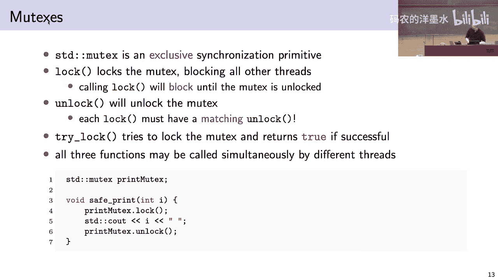

唉。

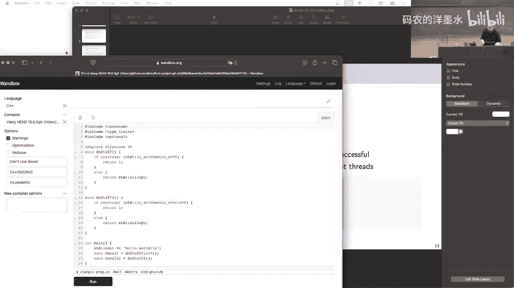

嗯。Oh， here you see， I was。Ting some stuff with type traits。Last time。 so let's just say。okay。

T typing like this sucks。嗯。Right。Let's have a few threads。That dude just。Hello。

So now let's do this a few times。 so I will not do this in an nice way。

 I will just do copy and paste and let's see what happens。So I。

 I don't know if Nbox actually ex executes this on a multico machine， what。Okay。

 so the head does probably changed threat。Aam it。No。哎。Okay， whatever。What am I using here， Kang 18。

 That should have J thread。And I'm not joining them so the program will terminate afterwards。

It doesnn't even print anything， crap。Let's have CD this。Threat。Deleep。One second。Okay。

 this is really dirty。 The usually you probably would do it a lot nicer， but just to see。Okay。

<|OTHER|>I think names，space， litals probably need to include something again。Unknown lits。 Yeah。

 SD lits， thanks。So you see by having a nice I is good。 It suggests you what to。Sleep 4。Right。

T her in slide。Forterinating da you。city3。Why can't I use join。 Okay， okay， let me look this up。

 This is pissing me off。W is J3 and which header is J3。

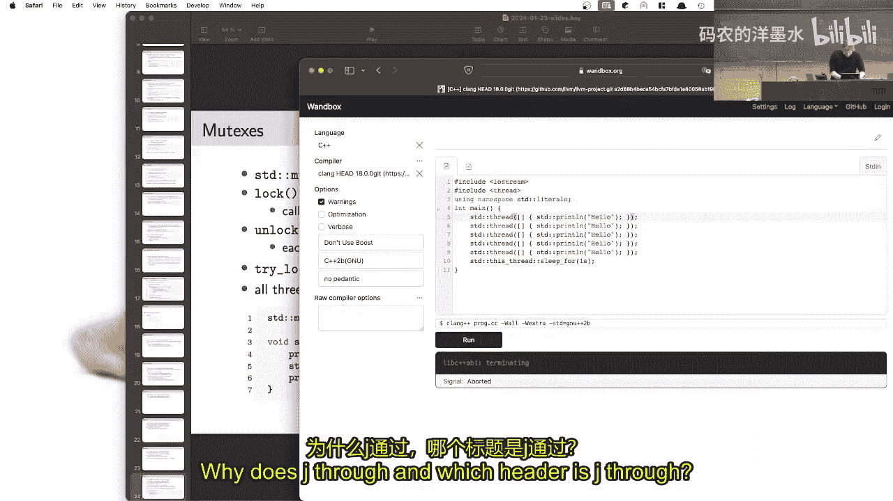

No， don't， don't check for updates。 Now， come on。

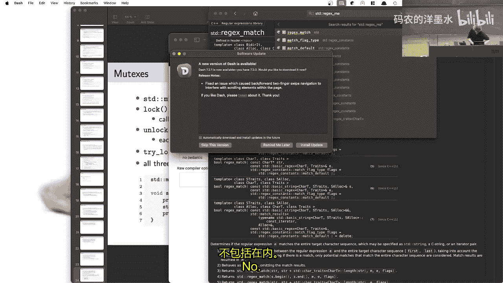

嗯。Cha threat is in threat。ok。Why didn't it work then。Oh， I probably I I， okay， that's。Give it names。

Okay， this is getting ugly now。Yeah， okay K thread。

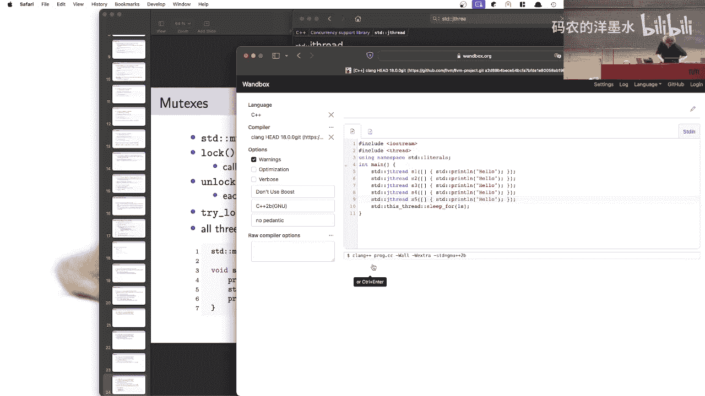

Still complaining。Yes， I'll come on。Not a name。Why I thread not in。

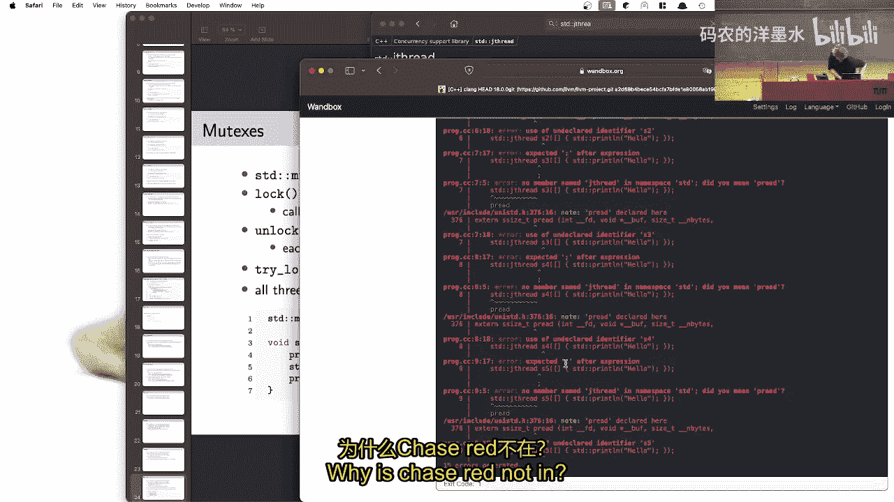

SD。Okay， anyway， so what you should be seeing here， I'm not sure why it's not working now。

 what you should be seeing here is basically outputting H， H， H， H， E， E， E， E， L， L L L L L L， O O。

 O， And since execution won't be perfect。Some threats will output hell。

 and then the other one will insert H E。 And so basically， it will be a big mess。 and nobody will。

 and you won't be seeing hello， hello， hello， hello， hello， what we might be expecting。

 So if you synchronize this。

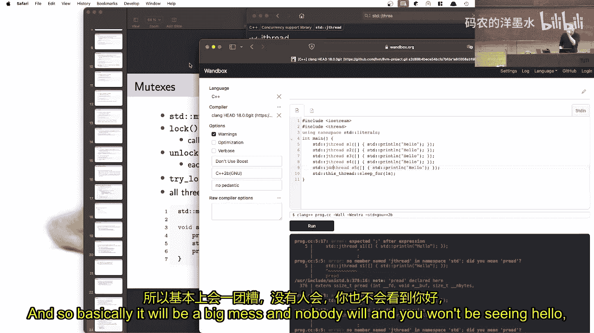

Using a mut text， like in the safe print function。Then。That doesn't happen。

 And you will get full hello outputs that are basically synchronized。Okay。

 the last two minutes summed up this course really well。 Yeah， welcome to C++ programming。😊。

Get a good I D E。Right。Yeah， okay， I'm looking at the wrong browser window。On slide 14。

We we even at the flight voting。 Oh yeah。 So is there a concurrent ride possible between line 12 and 13。

No， the Mutex is still， iss only unlocked in 13。 So other threats。

 if they take care of the Mutex won't be able to do anything。

This live program feels just like when I do errors out the Baoo， yes。But usually my。

 my fancy I D E catches most of the errors before I hit compile。Right。

Anyone buying those weird apple glasses。 Well， if you shit money in my direction， maybe。Otherwise。

 it's too expensive。Why do we need different locks for reading and writing。 Well the idea is。

 and that's where where the shared new is that you can you have less restrictions for reading values so you can have shared locks that can be acquired several times and exclusive locks for right accesses。

Why you would May want to make it that explicit。Who knows。

Might even work without a alock if the reads are unproblematic。Right。

 so one of the things you might already have noticed is that using the muttics。

 this requires you to use lock and unlock。In precisely， that order in the same thread。 So， of course。

 what we would really like to do to make this less error prone is to have wrappers that use our AI I so that they actually lock in the constructor and unlock in the deor。

These rappers are there。 and yeah。I'll show you in a moment。

One thing you need to take care of is deadlocks。Which essentially happens if。The mutex is。

If you have two mutexes and basically one thread weights for this one and the other one for the other one。

 But both of these threads have locked them already。 and then you wait， basically。For， for them to。

 to， to unlock。 and this can lead to deadlock scenarios where nothing happens anymore。

 So you need to take care that this doesn't happen。And。Yeah。So， for example。

 lock and unlock are non con functions on the mutex because they change the Mutic state。

 quite obviously。So if you're using them in con member function。

Which would be a bit weird because youre using that to synchronize right excesses， right。

 So and they probably aren't cons， but well。Your also might be using them to synchronize。

Network output or some other things， so。Yeah， there might be constant functions where you do use locking of mutticexes。

 So you need to make sure that， yeah， so a constant function doesn't allow you to change a member mut text。

 obviously， but lock and unlock are noncon function。 So in order to make this work。

 you have to make at the keyword mutable。To the muttex in your class。But as mutable do。

 I mentioned this already， it basically allows you to change a variable of the class。

 a class member variable。In the constant function。That is kind of cheating。 But for these cases。

 it's necessary。 And， of course， that's the only cases where you should be using it or。In， in。

Let's say you're doing some， some local caching inside a private part of your class。

 That might also be something where you use mutable。Right。So for these R AI wrappers。

 we have the unique lock， which essentially calls lock in the constructor and unlock in the de。

 So your favorite way of using a mutex should actually look like this。😊，Have a mutex here。

 have a unique lock locking that mutex when it's constructed。

And have it automatically uned when it goes out of scope。Right。That's。

Then you have the same for shared mutex as sharedd lock that is used for log shared and unlock shared。

 If you wanna use the exclusive lock of the shared muttex， you use a unique lock， obviously。And。

 finally。If you have multiple mutices to synchronize different things， right。

The order in which you lock them matters。And you might remember that the constructor arguments。

Initialized as things。In order of definition。That。Might change between threats。 So in order。

 if you want to make sure that the locking order is always the same， you use a scope clock。

 So instead of declaring several unique locks for the three mute access that you might have。

It's not defined which one will be actually locked first in this way。

 So if you wanna ensure that they are locked in the same order in in order to avoid that dead locks。

You use a scope lock， which can lock multiple mutices at the same time。In a defined order。

 And if you use scope dos everywhere， you avoid dead logs。It's writing atomic， no。

That's the most important thing to remember， any rights that you do， any changes of variables。

 any calls to noncon functions。They are potentially rights， and rights by default， are not atomic。

Why， because atomic ride are expensive， regular ride are a lot faster。

So in order to give you the option to choose how to do your synchronization or if you're writing a single thread program。

 you don't need synchronization anyway。That means you have to do the synchronization by hand。

 using muttices， or as you can see later on， by using explicit atomic operations。

 but they are not supported for everything。Right， would we still need muttes if every thread wrote to a unique point in memory。

 no。Mute access and all the other stuff is really only needed if you need to synchronize。Threats。

So in the ideal case， each thread is doing its own thing， writing to its own memory location in that。

In that case， you don't need any synchronization。So in a shared mutex， you can lock。

 even if another thread has a shared lock。Yes。holdold on。Yeah。

 one of you is giving the correct answer。If it's locked， exclusive locked， nobody can get the lock。

 but if it's shared lock。You can get another sharedlock。

How's the order of locking specified in a scope block。I don't know if it's specified at all。

 but the thing doesn't matter。 It's you call it。You specified it in whatever order。

 and it will always do the same。 So regardless of how you arrange the mutes here。

 the order internally that scope lock will lock them in will always be the same。I don't know。

 I don't know if that's well defined or not or specified in any fashion。But yeah。

What does atomic mean， I'll talk about this in a moment。Why won't you be a term next winter term。

Because I will be working somewhere else。And I'll give you a hint。

 It's a company that does parallel programming a lot。And I will be doing parallel programming。

V C plus， plus。And some other language that's used for massively parallel processors。No， not Java。

Right， so what else is there， There's a few more things。 I put them in no particular order。

 I basically put them in the order。Encountered them。 And so here， for example。

 something I've never used myself。 I've never used condition variables。 They be introduced in。

Or shit。 I think C+ was 17。They can be nice for some things。嗯。So I' show you a use case here。

 This is picked from Reinina Gil's book。This is another synchronization， primitive。

And this is not to synchronize rights， but rather kind of for events， synchronizing through events。

 if any kind of condition becomes true， then， yeah， threat becomes active。

And we use condition variables use mutxes explicitly。 So you need a mutix as well。

And threats can wait。For a notification， and， of course。

 average threat can notify that threat so it can say， oh， yeah， something happened。收有。

That's a few weird things。About how， who has to hold the mut text on who has to lock it。

 And the other thing is that。If the threat thinks that it got a signal。That was notified。

 It still needs to check explicitly because spurius wake up。 So basically it could wake up anyway。

 You still have to check the condition。So actually， let's keep the blah， blah。

 Let's look at the example。 I think this is more intuitive than the previous slides。 So， for example。

 here， this is a use case that I found if you have work cues of threats that do stuff。

And you want to insert a task and notify the verka threats that there is a task。

 So please do some work。So here on the left， we have a mutex。This condition variable thing。

And a task queue， and。I want ask for this example consists of an inte， which could be an idea of。

Something else。 But yeah， we don't care what the actual task is here in this example。

So if we were to add a task， that means we add this integer to our vector of tasks。

 That would mean the push。This task to ourQ。And in order to make sure this is a right access。

 a push is a right access to this global variable to in order to make sure that this is synchronized。

 we do a unique lock on our mus， push the task。 and the unique lock is in a separate context in a separate scope inside this function so that it is unlocked immediately after the pushback。

😊，And then we call the condition variable and say， notify the other threats that there is something to do。

Now， let's look at one of the vca threats。 So this is probably a function that will be executed by several threats in parallel。

It has。Unique lock that is locked at first。Then， it starts。Then it has an an infinite loop。

It checks the task queue if it's empty or not。If it's not empty。

 it will get the last entry in the task queue and pop it。

So these are especially the pop here is a right access。 These two here are read excesses。

 but you don't want the queue to change。 So that's why you lock the mut text first。 and then。

After you have your entry from the task queue， you unlock the mutex， then you。

Do whatever with the integer that he got as a task。Do the task。

 And then before you go back into the infinite loop and query the queue again。

 you lock the muts again。Right， and then again， before you go back to the start of the Q。

 you call a condition variable weight on that unique lock。

And the condition to check is if the task queue is not empty。

So the idea is basically that this will run all the time。But actually。

 will not run all the time because all the time it will spend waiting and in the waiting。

 it will essentially do nothing and always hear it。The CPU to。To other tasks， to other threats。

 But once there is a task and once it the condition variable was not defified by another threat。

It will say， okay， my conditionary got changed。 I got a notification， so I will unlock the thing。

I will not unlock the thing yet。 I will check if the condition is true。 If it's true。

 then I will basically stop waiting。 And then our endless loop will。Do stuff。Right。

 and what's basically not so intuitive to me， at least， is when you have to lock。Your lock。

 the unique lock。 So essentially。It has to be locked when you call it weight。That's the thing。

And you should always have separate condition aside from the weight。

 because the weight can basically wake up without actually getting an notification。

Pretty sure that's an implementation reason to make it def or something。

 So you should always check for a condition to be true because if it's not true。

 it will go back to waiting。Right， and essentially， this is what the interface has。

 It has the weight and the notify one。 And there's a notify all function that notifies all waiting threats。

Yeah。And while you call the notify， you don't need to hold the mutex。Right。

 that's essentially what a condition variable is。嗯。If you have jobs like that， where basically。

 you have a queue of workers that best stuff， and you occasionally push push tasks to it。

I guess it's。Perfectly fine。And right， the， the kind of weird thing is that you have to lock。

Before starting to wait again。That's， that's the kind of， to me， un intuitivetu thing。

You only unlock it when you actually do the work。Otherwise， it stays lockedlocked。

This is a producer consumer thing， right， yes。Condition variables are not irrelevant for the exam。

 We might ask something about it。Personally， I've not used them。Ever yet。

 because basically all my tasks， I'm running are things where the workload is decided before you actually spawn the threats working on them。

So there's no threat waiting for work。 They all have their work set out。

 and then they run until work is done。 This is basically always the case。 In image processing。

 I think this is more something for。User interfaces or network driven event based things or whatnot。

Right。Okay， now you were asking about atomic operations， here they are。嗯。You can synchronize。

Accesses to a particular。Variable。We this atomic operation。 So what is an atomic operation。

It essentially makes sure。That while it's happening this atomic operation。

 nothing else can happen to that part of memory that is being accessed atically。

So an atomic operation is something that cannot be interrupted by anything else。

An inefficient way of implementing atomic operations。

Is by essentially inserting a mutex everywhere and making sure that everybody has to lock the muttex before accessing a certain resource。

Atomic operations are different because they kind of hide that。

And there are efficient hardware implementations that are more。

 that are faster than using muttixes for the same purpose。So if you have an atomic variable。

Operations on those atomic variables are guaranteed to be atomic。But only a single operation。

 if you do two operations on that atomic variable， they are two operations and not atomic。So。

Let's say， you have a function。That atomically adds。A value I to the variable P。What you can do then。

 you can have threats。 So this is a right access。 obviously， right。

 the value of P changes by adding I to it。 So if it's an guaranteed atomic operations。

 you could call it from as many threats as you want。

 and it would be guaranteed that each of these ads happens without interruption from any of the other threats anywhere。

And the reason why it's so efficient is because it's limited to， to just a simple operation like a。

To a simple object， like an integer。And that way， hardware can do the synchronization for you。

 And that's typically faster than a mutex bike quite a bit。Right so。

There is an atomic operations library in C plus B。 It's called Atomic。 And there are several classes。

 The most important one is the ST TD atomic class。 That's a templated class that basically represents an atomic version of whatever T is。

😊，There's a very limited interface。 You can load the value。You can store the value。

And you can exchange the value。With a new one。嗯。Yeah， so the desired object is stored in the， in。

 in the variable， and the old value is returned。And then there's compare exchange。

Actions that basically compare values and swap them， if necessary。All in an an atomic manner。No。

This is for generic type T。 This also works， essentially for。Your user defined types T。Right。

 but it does only load and store and exchange and compare and exchange。

So there's actually not that many useful operations that he can do in an atomic manner。嗯。

If T is an integral type， then you can do a bit more。 So if it's an integer of any type。

 then you can add stuff to it， fetch the value。Add the argument to it and return the old value。

 You can sub and or or X or。 You have plus equals， operators， minus equals and or an X or。

 and increment the decrement。 That's it。There's nothing else。 There's no multiplication。

 There's no other mathematical operations。 So these atomic operations。嗯。Are yeah， a simple。

 fast way to do synchronized excesses。The most useful atomic operation that you have are for integral types。

 but they are very limited。And the reason that day I limited is why they can be so efficient， right。

 if they were more generic， like a mutex， then it would be more expensive。

There's another guarantee for these atomic operations。

The modifications of an atomic object are in a well defined order。So， for example， if you have。

An atomic variable I。That you are incrementing and decrementing， essentially by 1 and -1。

It will never happen。So the order of the operations is sunset。 It will always be A B， A， B， A B。

 regardless of how many worker threats are working in parallel。

This modification order is also guaranteed， and that means you will never encounter the situation where two threats have done the increment。

 So you get a value of 2。If you start from zero。And then do the decrement。 So it will always be A， B。

 A， B， A B。Yeah， that's what the modification order guarantees for you。Right。

 you can use atomic for references， but it won't do what you expect。

 It will actually create a copy of the of reference。 So I， let's say we have a value here。

We create a reference to this value and then wrap it in an atomic of the reference。

 What it will do it will copy the value of the referred variable and then create a new atomic variable of that。

 So if you really want to have a reference， that is atomic， you have to use atomic ref。

 which was introduced in C plus plus 20。怎呀。That's also atomic smart pointers。嗯。That guarantee。

Atomic operations on the smartPo itself。Shard pointer by itself already guarantees that the internal reference counter as atomic。

 but the managed resource， obviously not。 So if you wan to wrap that in an atomic operation。

4 pointers， right， then you get， you can do this with atomic F head pointer and weak pointer。

And then interestingly enough， there's an atomic flag。

 which is essentially a boion that you wrap in atomic with a slightly different interface。And here。

 the interesting part is it's guaranteed to not use muttic as as an implementation。

 because for the other atomic operations。The standard library that you use a new system could be using mut text as to implement this。

 This one here is guaranteed to not use a mut textex。

And it has only two functions essentially test well three functions。

 Test to return the current value test and set。To basically。

Test if it was true and make it true and clear to set it to false。Right， so this is very similar。

To a condition variable， because it also provides this weight。

 notify one and notify all interface that a condition variable has。Right。

Everything sounds cooler with the vert atomic edits。

Is the queue threat safe or why don't we have to lock it for popping。Okay， this was before we did。

 this was the condition variable example。 You will note that all the time。You come to the。

Start of the blue body， the lock is locked。Here， at the beginning。

 because the unique lock is locking it and because we lock it once we've done all actual tasks。

 So the cube will always be basically protected by the Mu text。 So all the empty calls。

 back calls and popback calls are synchronized。Why are we not talking about multi processingces。So I。

 I definitely have to go it now。 I I， am I missing something here。What is multiprocess？

Something else。 And I expect， oh， many， okay。But。Let's say， you have。

A machine that has several processors。We have one， for example。

 We have one that has two M D epic processors with 128 cores each。

 So the entire system has 256 cores。If you're using threatres。You don't care。

On which process of the threat is executed， the operating system takes care。

Of assigning the threat to the processor。So in a way， yes， this is multi processing。

 What you see here。 If you're talking about multi processing as having one computer。

Do the same task as another computer together。There's no mechanism in Cpl plus to do that for that。

 you will have to use something like MP I。To。Jointly have several computers work on the same task。

 but what we are looking at here， threats are basically the building block on single processor systems with one core。

 single processor systems with several cores， which are most computers these days。

 most consumer computers on multiproor computers with several processors that themselves probably have several core again。

That's just the same。 And if you think about working on a GPU。All the GPs work with threats。

 Their threats might be grouped on different modules in the GPU。But they are with threats。Of course。

 most GP U threats are not used with SDDD threats or a threats， but rather a different mechanism。

 like， for example， in Quda。Can you explain， lookguard。

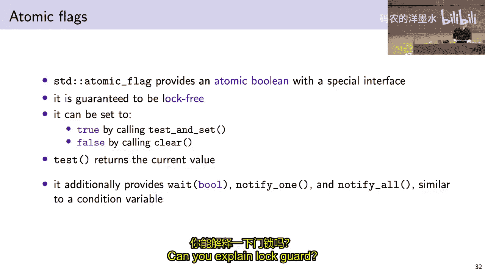

嗯。Where's my dash。 move it back to my screen， please。嗯。What is a look guard。

So you see I I don't know anything by heart。Lock art， I would say this， is the unique lock。

 essentially。What's the difference？From what I see， the lockout is exactly the same as。Unique look。

第二。Ms President。 Oh yeah， here's the program。

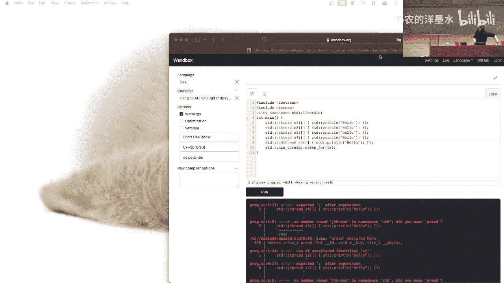

Let me see， Emma， what's the time。Let me get this back， whyhy is this not working？嗯。Okay。

 I have to fix it some other time。Otherwise， it boring for you。 Where's my。Presentation gone。Hello。

Where are you。

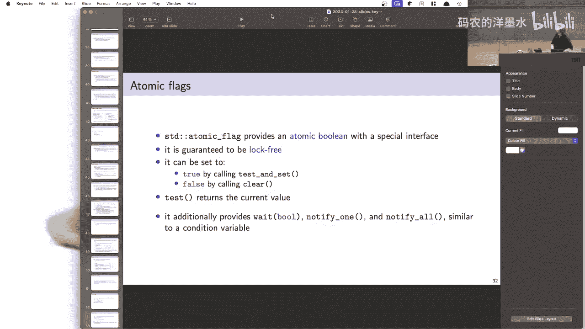

跟。There you are。O。So there's two more things that I want to talk about。

1 is parallel algorithms in the standard template library。So。I'm not sure if I used Lvert before。

 Stan a template library。It's essentially the part of the standard library that has the containers and algorithms because it started life as a so calledled standard temperate library back then in the 80s or 90s。

And then got basically merged into the。standardand library of C plus plus。

 So we've seen already quite a few algorithms。In our standard library chapter。

 we didn't look at all of them， but there are more than 1 hundred0 in there。

 like sort or accumulate or finding max elements。Doing binary research and stuff like that。Right。

 in C plus 17。嗯。69 of these algorithms got overloads for parallel execution。

And there were 8 new algorithms edits that support。Perdent execution。

 And this happens via tax that are in additional argument for these tasks。 And essentially。

 there's four of these tag。 One is sequential execution， which is basically the standard execution。嗯。

Parallel for parallel execution on multiple threats。 So essentially， you tell SDD sort， parallel。

 blah， blah， sort this range。That means sort this with using multiple threads。 Do it for me。

 I don't care how you do it。Then there is two other things。 One is。P unsc。

 which basically means you can use parallel execution in multiple threads。 It allows you to。

 It allows the library to interleave some of the loops it might have inside the algorithm。

 and it also permits to use S IMD vectorization instructions。

Inside the implementation of the algorithm。And then C of 20 added unsec。

 which essentially is the same as here， but doesn't allow the inter leaving of loops。

So the important part is。These are permissions。 So if you say I。

Use unsec to allow parallelization and vectorization of my algorithm。That's a permission。

 The standard Library doesn't have to do it。Of course， in the ideal case。

 it will do it because it's why it's there。 But for example， if the problem is too small。

 it might not even use more than one thread。So how does it work。

 Let's imagine we have a little vector of some numbers， and you call sort on it， which， of course。

 he has pointless because it's already sorted， but whatever。

 So the standard sort would well begin and and and sort the range here。

You can call it with the execution tax sequential， it will be the same essentially here。

 just that you specify attack， you can get parallel execution using the parallel tag or parallel execution。

 allowing us of vectorization with the uns attack。Right。

This is actually a very cool idea because a lot of the work that you do， like， for example。

 the expensive algorithms like sorting and log N， right。😊。

You wouldn't like to parallellyze them yourself。 You would like to have a Senate library that has them parallelzed for you。

 and automatically gives you the fastest， basically implementation that there is。

Theres a few drawbacks of this。The first one is， if there is any exception during these algorithms that are executed with one of these tags。

The program will be terminated。Because essentially， they said， well。

 if we have parallel execution and there's exception in one of the threats。

 how the fuck would we deal with that， We can't。 So we terminate。

 So if you have the chance for exceptions to happen in your algorithm。

You shouldn't be using a parallel execution policy。

Because if you use the standard algorithm without such attack。

 you will have a regular single threat algorithm that can handle exceptions regularly。But then again。

 if you're sorting。And an array like this， there won't be any exceptions， right。The other thing is。

These algorithms won't do any locking for you or any protection， synchronization or whatever。

 They will only do whatever is necessary for their execution。 But if you need locks。

 because sort is rearranging the vector。Well， then you need to lock the sort yourself。 So yeah。

 it won't do that for you。And the first part， this was introduced in C plus 17。 So six years ago。

7 years ago， almost now。嗯。There is basically no decent implementation of this。

Klang has exactly nothing。Which is a shame， GCC。And Emma the Microsoft visual Studio compiler have some basic support for parallel policies。

 not all of them， not the， I think only for the parallel， not the un ones。And no S I M D support。

This is annoying because this is one of the greatest features of C plus 17。

 and it's still not available in general。😊，For the cases， where it is available。 So there。

 there were some benchmarks。 Hynam， for example， did some of them。They。

 you got the results that you were expecting。 So if you sorted something this parallel policy on a compiler that actually supports it。

It will use all of your course to make things faster。And that's， of course， cool。Right。Bless you。

Once， once per lecture， right。It's the S， I M D， API， N C plus plus the same as N C。

Strictly speaking。S IMD is not part of the C O C plus+ language。Compilrs might support intrinsics。

 They might support putting assembly right there to use S ID instructions of whatever your system is。

You might be using libraries that encapsulate that support and whatever mechanism you use and see you can use。

A similar one in C plus plus， there's no direct support。In either language。

Will the utilization of multiple cars also work on non M IMD systems。

 I'm really bad with abbreviations。 What is non M IMD。Multiple instructions， multiple data。

 What is a non M I M D system。I don't know。 I have no。

Could we see the pan for one last time next lecture。I see if I can take a picture at the weekend。

But the pen got brothers and sisters now， and they used very often。Right， so。

Since I didn't cover everything， I wanna give you a brief outlook on what's out there as well。

And I could have covered more because apparently， Im misjudged my timing today， anyway。

C plus West 20 in particular， introduced a few more things that I haven't shown yet。

One of the most important one is so calledled cold routines。

One of the reasons I haven't shown them here。Is because C plus 2。

20 introduced keyver language keywords for core routines。And not much more。

 So essentially N C++ 20 core routines were more or less unusable。

See plus 23 was promised to also deliver this matching standard library types。 It under delivereded。

 but it did deliver。 So that's finally a generator class。嗯。But it's still very underwhelming。

 So the concept is cool。 You can now write a function。😊，That can basically suspend execution。

And resume whenever you wanted to from where it was before。Now。

 you might wonder what is the context here in terms of parallel programming。Well。

 because essentially， these routines execute whenever they want。Wherever， and ideally， of course。

 in a different threat or processor。Now， the standard example for doing this is， for example。

 half a generator that generates numbers from one to infinity。

You don't ever actually want it to go to infinity， and you can't。But what， what you might want is。Oh。

 give me the first 10 and then the next and then the next and then the next。

 and basicallyical routines provide this。Unfortunately， the interface to use them is so fucking。

 ugly and horrible。You don't want to use it with C plus plus 20。

 only got better for generators with C plus plus 23。 But guess what。 No compiler implements it。So。

 yeah。Yet。So that's why I left them out。 even though they are pretty cool。

 and other languages do very cool things with co routines。😊，Right， that's counting semaphos。

Which are a certain type of synchronization for shared resources。

There's ledches and barriers to coordinate threats。Again， I haven't seen a use case yet。

To use these over mutexes， all the examples that I've seen were a bit contrived。

 So that's why I opted to not show them here。 But they are there。

 And if you need something like this， it's available。嗯。Cooperative interruption。

 you've seen this for Cha threat。 This is also available basically in a bit broader scope。

 We are the stop tokens。 You can also specify callbacks and sources。嗯。But again。

 I have to say documentation here sucks。And very useful examples of using that。Well。

 the most useful example I found was the one that I showed you with J thread。Yeah。Oh yeah。

 and in fact。You can synchronize output streams via O sync stream。

I haven't looked into the details yet。 It's again。I think most of your use cases that you will encounter will be a mut text that guards access to the console。

 And how often will you actually print stuff to the console for multiple threats。

 Probably not that often。So yeah， there's a few more things that got added that has kept here in this lecture。

Yeah。As I said， I mean， the overall support of parallel programming N C plus plus is。你。

Not that great。 And in most of the cases， what。Seriously。

I was almost thinking that we would be having。I was almost thinking that we would have one lecture without。

Without any of the noise。Anyway， what I wanted to say in almost all of the cases where you do parallel programming in C plus plus。

 you will most likely be using a library that does it for you。

All this explicit stuff that I showed you。Some of them you will be using in your own libraries。

 like atomic operations。 Maybe you will use condition variables in some of your library code where you do consumer producer thing。

 Maybe you'll use some threats in mutt。 But in most of the cases， at least those that I encounter。

The really heavy lifting will be done by libraries that do this via other mechanisms。And， of course。

 today， if you have real compute intensive stuff， that means you're using GPus。

Be it integrated GPus like in these laptops here， be it explicit GPus or data center， GPs。

 A AI accelerators and all of those。You use them via libraries that does this。

 either operating system libraries that provide you， for example。

 deep learning routines or certain operations that are already optimized for whatever architecture you're running on。

Or libraries like Pytoch， jacks， Tensorflowlow that again。

 encapsulate various architectures that enable massively parallel execution。

So if you're working on libraries like those。You might need Steve。

If you're working on libraries like that， you might need some of these things。

 But I would say in your regular everyday programming。You're probably gonna use higher level stuff。

So that's why I cut this relatively short。 There's a lot to do， a lot to say。 But I would say。

 if you really need this stuff， you will probably。Have to spend a lot more time than I can offer in one session here。

Right， so as a brief outlook for next time， I have a bit of a potpry of topics。

 I w to talk a bit more。About Vers Pla is headed looking at the situation now and in the upcoming years。

 and what I also promised and didn't yet deliver is talking about concepts。

 We used them in some of the homework assignments already， but I want to talk。

 and I showed them in a few examples。 but I want to talk a bit more in detail about them。

 and that will be next week。Thank you very much。 So I'm making up for all the minutes I lost in the last lectures。

And see you next week。

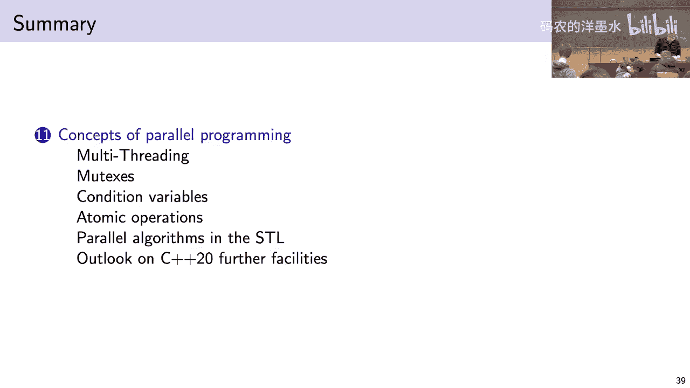