# C++编程概念 IN2377：11：现代C++并行编程 🚀

## 概述

在本节课中，我们将学习C++中的并行编程基础。我们将探讨如何利用现代C++特性来创建和管理多个线程，并学习如何安全地协调它们之间的操作，以避免数据冲突和死锁。

---

## 并行编程简介

现代计算机硬件，从智能手机到数据中心服务器，都拥有多个处理核心。为了充分利用这些硬件的性能，我们需要编写能够同时执行多个任务的程序。C++本身并非专为并行编程设计，但自C++11标准以来，它引入了一系列特性来支持这一领域。

并行编程的核心挑战在于管理多个线程对共享内存的访问。当多个线程同时写入同一内存位置时，就会发生冲突。因此，我们需要同步这些访问，确保数据的一致性。

---

## 线程：并行执行的基本单元

上一节我们介绍了并行编程的背景，本节中我们来看看C++中并行执行的基本单元——线程。

自C++11起，标准库提供了 `std::thread` 类，它允许我们以平台无关的方式创建和管理线程。你可以通过传递一个可调用对象（如函数、Lambda表达式或函数对象）来创建一个新线程。

**代码示例：创建线程**
```cpp
#include <thread>
#include <iostream>

void my_function() {
    std::cout << "Hello from thread!\n";
}

int main() {
    std::thread t(my_function); // 创建并启动线程
    t.join(); // 等待线程结束
    return 0;
}
```

线程对象本身不提供返回值机制，线程的计算结果需要通过共享变量来传递。此外，每个 `std::thread` 对象在其生命周期结束前必须被 `join()`（等待其完成）或 `detach()`（分离，让其独立运行）一次，否则程序将异常终止。

C++20引入了 `std::jthread`，它在析构时会自动调用 `join()`，使用起来更安全、更直观。

---

## 互斥锁：协调共享访问

我们知道了如何创建线程，但如何安全地让它们协作呢？本节中我们来看看最基本的同步原语——互斥锁。

互斥锁（Mutex）用于实现“互斥访问”。线程在访问共享资源前先锁定（lock）互斥锁，访问完成后解锁（unlock）。在此期间，其他试图锁定同一互斥锁的线程会被阻塞，直到锁被释放。

C++标准库提供了几种互斥锁：
*   `std::mutex`：基本的互斥锁。
*   `std::recursive_mutex`：允许同一线程多次加锁，用于递归函数等场景。
*   `std::shared_mutex` (C++17)：支持共享读锁和独占写锁，适用于读多写少的场景。

**代码示例：使用互斥锁保护控制台输出**
```cpp
#include <thread>
#include <mutex>
#include <iostream>

std::mutex print_mutex;

void safe_print(const std::string& msg) {
    std::lock_guard<std::mutex> lock(print_mutex); // 自动加锁，离开作用域自动解锁
    std::cout << msg << std::endl;
}

int main() {
    std::thread t1([](){ safe_print("Hello from T1"); });
    std::thread t2([](){ safe_print("Hello from T2"); });
    t1.join();
    t2.join();
    return 0;
}
```

为了避免手动调用 `lock()` 和 `unlock()` 可能导致的错误（如忘记解锁），应优先使用RAII包装器：
*   `std::lock_guard`：简单的作用域锁。
*   `std::unique_lock`：功能更丰富的锁，可延迟加锁、转移所有权。
*   `std::scoped_lock` (C++17)：可同时锁定多个互斥锁，避免死锁。

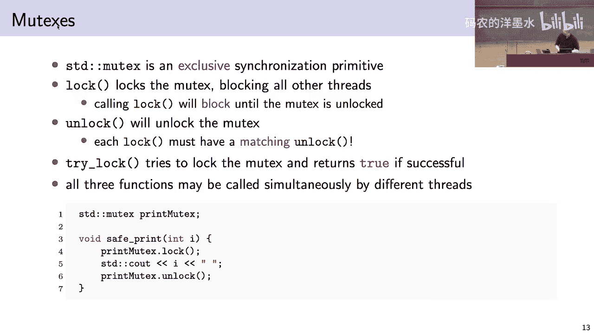

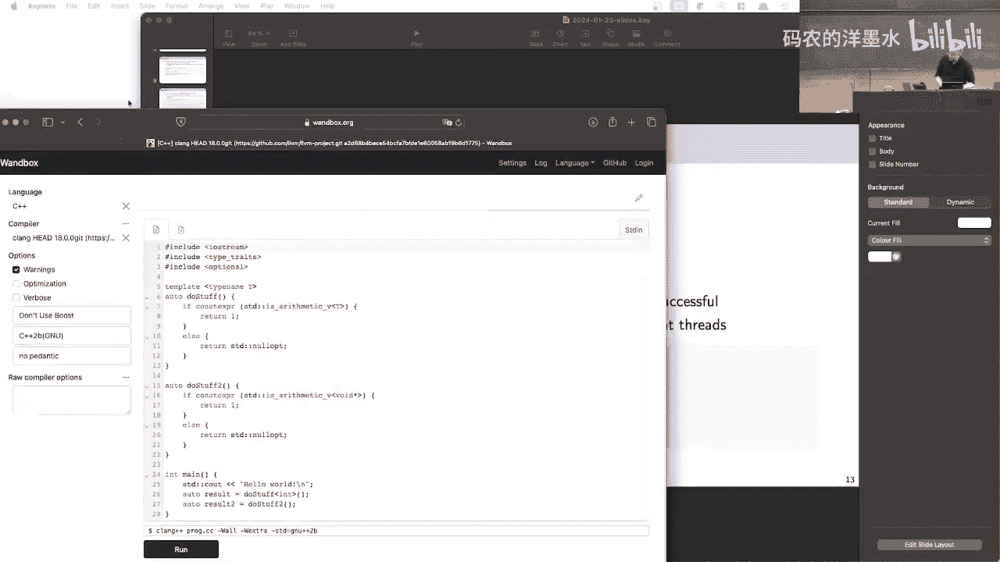

---

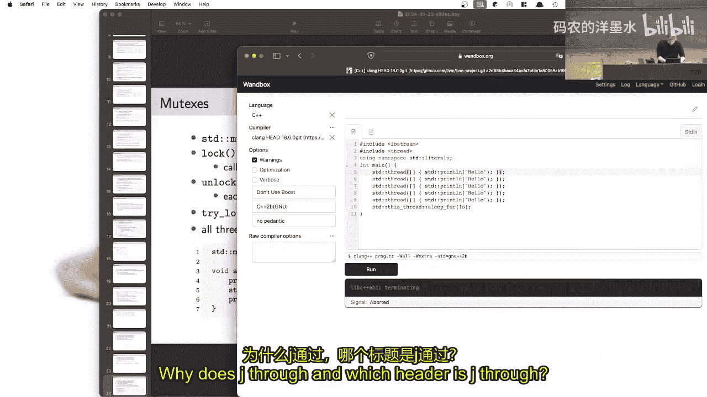

## 条件变量：基于事件的线程协调

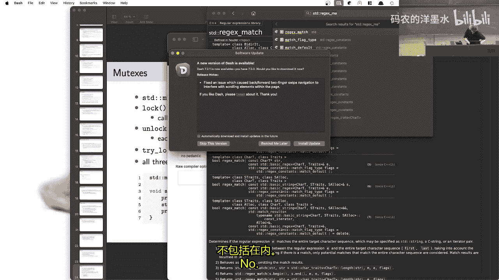

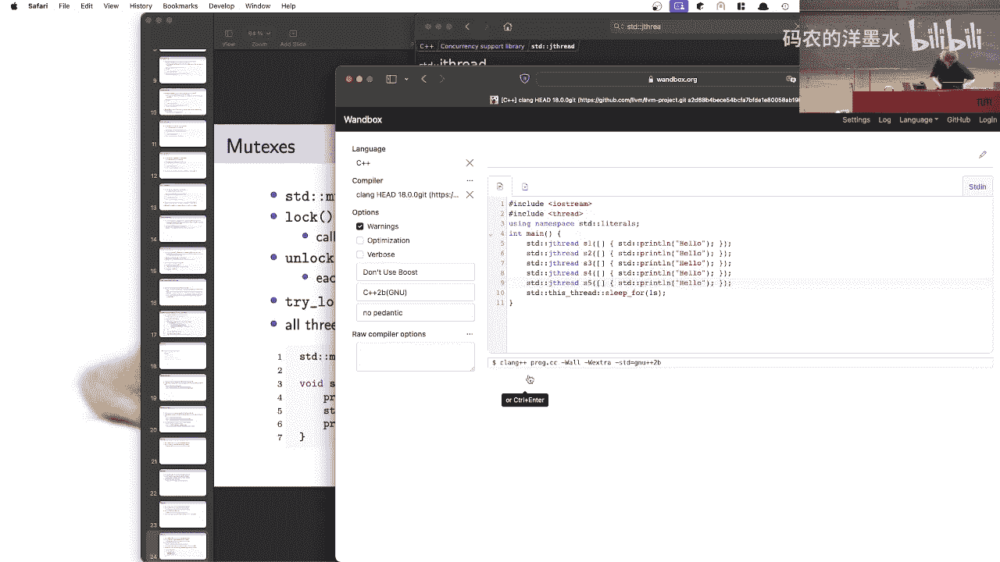

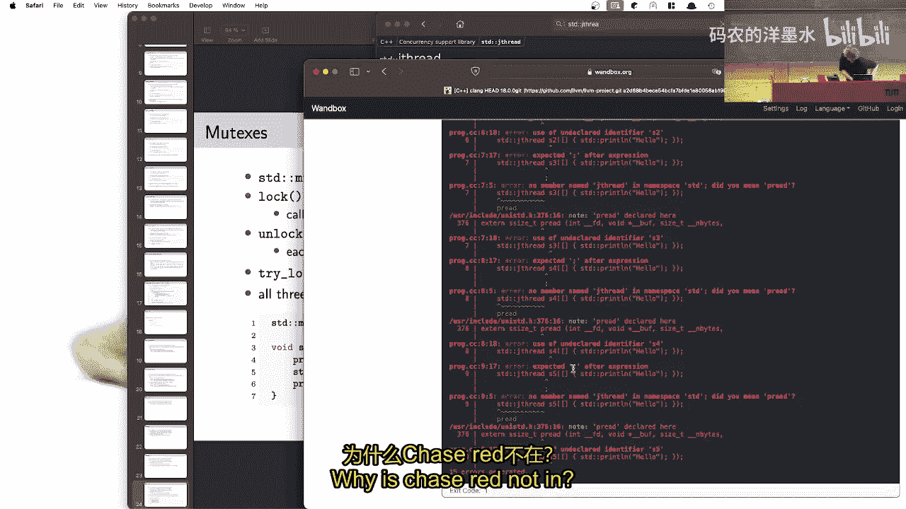

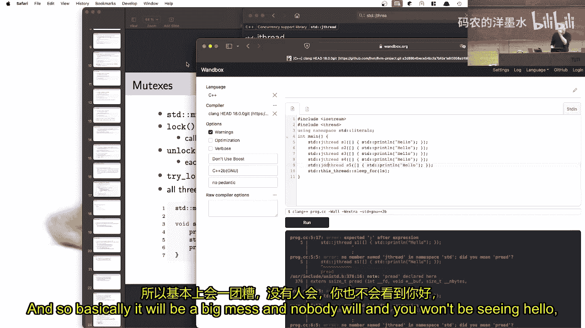

互斥锁解决了数据访问的冲突，但线程间有时需要基于特定条件进行协调。本节中我们来看看条件变量。

条件变量允许一个或多个线程等待某个条件成立，而其他线程可以在条件成立时通知等待的线程。它通常与互斥锁一起使用。

**核心工作流程**：
1.  等待线程：获取互斥锁 -> 检查条件 -> 若条件不满足，则在条件变量上等待（`wait`），并原子地释放互斥锁 -> 被唤醒后重新获取锁并再次检查条件。
2.  通知线程：修改共享状态 -> 通知（`notify_one` 或 `notify_all`）条件变量。

**代码示例：简单的任务队列**
```cpp
#include <thread>
#include <mutex>
#include <condition_variable>
#include <queue>
#include <iostream>

std::mutex mtx;
std::condition_variable cv;
std::queue<int> tasks;
bool finished = false;

void worker() {
    while (true) {
        std::unique_lock<std::mutex> lock(mtx);
        // 等待条件：有任务或工作结束
        cv.wait(lock, []{ return !tasks.empty() || finished; });
        if (finished && tasks.empty()) break;
        // 处理任务
        int task = tasks.front();
        tasks.pop();
        lock.unlock(); // 提前解锁，让其他线程可以操作队列
        std::cout << "Processing task: " << task << std::endl;
    }
}

int main() {
    std::thread t(worker);
    // 主线程添加任务
    {
        std::lock_guard<std::mutex> lock(mtx);
        tasks.push(1);
        tasks.push(2);
    }
    cv.notify_one(); // 通知一个等待的线程
    // ... 添加更多任务
    {
        std::lock_guard<std::mutex> lock(mtx);
        finished = true;
    }
    cv.notify_all(); // 通知所有线程结束
    t.join();
    return 0;
}
```

---

## 原子操作：无锁同步

对于简单的共享变量（如计数器），使用互斥锁可能开销较大。本节中我们来看看更轻量级的同步工具——原子操作。

原子操作保证了对某个内存位置的读写是不可分割的，即在该操作执行期间，其他线程无法观察到中间状态。对于基本数据类型（如 `int`），原子操作通常由硬件直接支持，效率很高。

C++标准库提供了 `std::atomic<T>` 模板类。

**代码示例：原子计数器**
```cpp
#include <thread>
#include <atomic>
#include <iostream>
#include <vector>

std::atomic<int> counter{0};

void increment(int n) {
    for (int i = 0; i < n; ++i) {
        counter.fetch_add(1, std::memory_order_relaxed); // 原子加1
    }
}

int main() {
    std::vector<std::thread> threads;
    for (int i = 0; i < 10; ++i) {
        threads.emplace_back(increment, 1000);
    }
    for (auto& t : threads) {
        t.join();
    }
    std::cout << "Final counter value: " << counter << std::endl; // 输出 10000
    return 0;
}
```

`std::atomic` 为整数类型提供了 `fetch_add`, `fetch_sub`, `++`, `--` 等操作。对于泛型类型 `T`，主要支持 `load()`, `store()`, `exchange()`, `compare_exchange_strong/weak()` 等操作。

---

## 并行算法：标准库的并行化

手动管理线程和同步是复杂的。幸运的是，对于许多通用算法，C++17及以后的标准提供了并行执行策略。

许多STL算法（如 `std::sort`, `std::for_each`, `std::reduce`）现在接受一个额外的“执行策略”参数，指示算法可以并行或向量化执行。

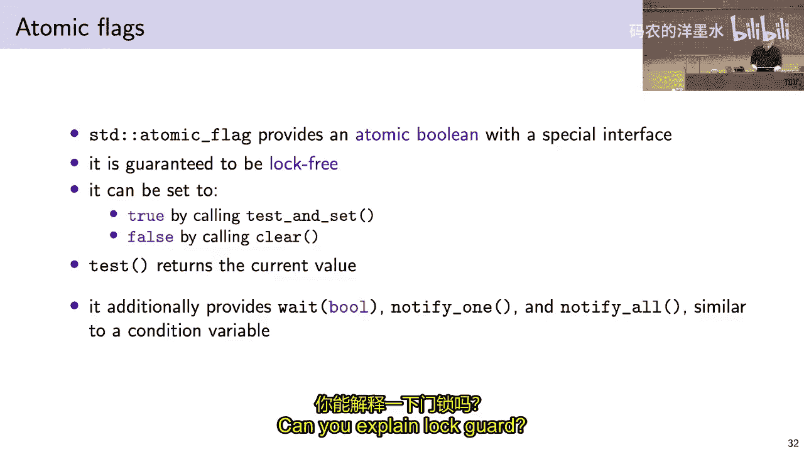

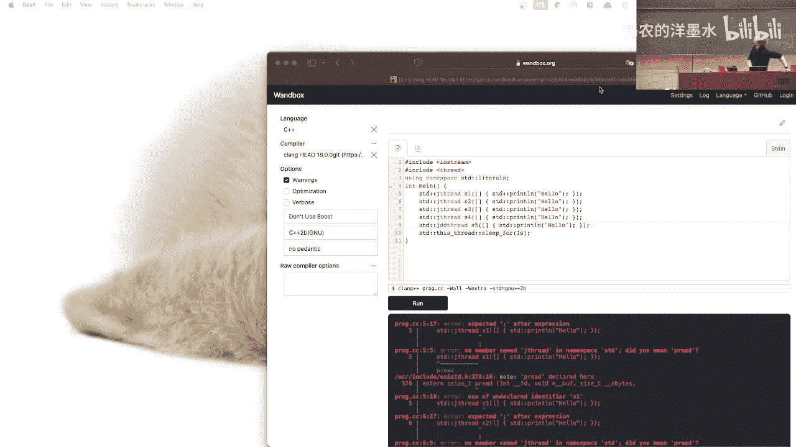

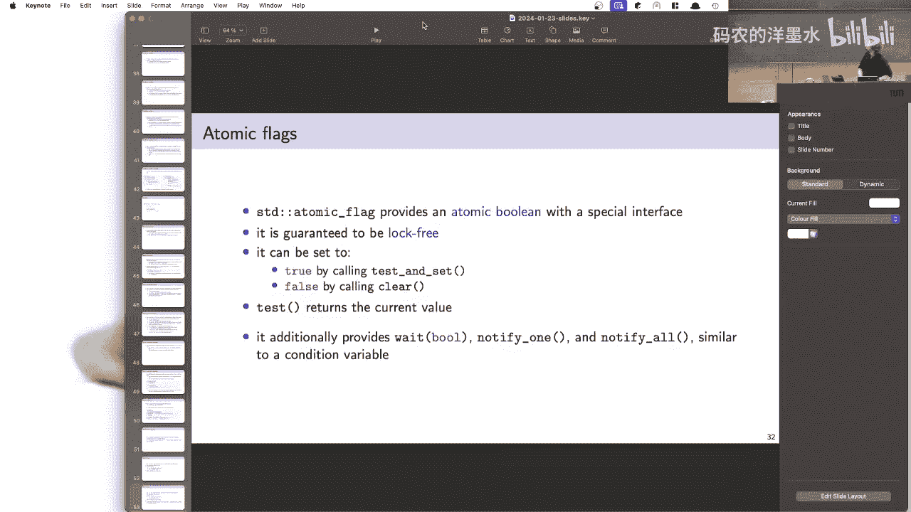

**可用的执行策略标签**：
*   `std::execution::seq`：顺序执行（默认）。
*   `std::execution::par`：允许并行执行。
*   `std::execution::par_unseq` (C++17)：允许并行和向量化执行。
*   `std::execution::unseq` (C++20)：允许向量化执行。

**代码示例：并行排序**
```cpp
#include <algorithm>
#include <vector>
#include <execution>

int main() {
    std::vector<int> data = {5, 3, 1, 4, 2};
    // 使用并行策略进行排序
    std::sort(std::execution::par, data.begin(), data.end());
    // data 现在为 {1, 2, 3, 4, 5}
    return 0;
}
```

**重要注意事项**：
1.  **异常安全**：使用并行策略时，如果算法内部抛出异常，程序会调用 `std::terminate()`。
2.  **同步责任**：算法本身不负责同步你传入的数据容器。如果容器可能被其他线程访问，你需要自行加锁。
3.  **编译器支持**：此特性对编译器实现要求较高，支持程度不一，使用时需检查你的工具链。

---

## 其他并行工具与展望

除了上述核心机制，现代C++还提供了其他工具：
*   **信号量 (`std::counting_semaphore`)**：控制对有限数量资源的并发访问。
*   **闩锁 (`std::latch`) 和屏障 (`std::barrier`)**：用于协调多个线程在某个点同步。
*   **协程 (C++20)**：支持可挂起和恢复的函数，为异步编程提供了新模型，但目前生态和支持尚在完善中。

在实际项目中，对于复杂的并行任务，我们通常会依赖更高级的库（如线程池、OpenMP、MPI或用于GPU计算的CUDA/OpenCL库），它们封装了底层的线程和同步细节。

---

## 总结

本节课中我们一起学习了现代C++并行编程的基础知识。我们从**线程**的创建和管理开始，探讨了如何使用**互斥锁**和**条件变量**来同步线程和协调它们的工作。接着，我们了解了轻量级的**原子操作**用于无锁同步，以及如何利用STL的**并行算法**来简化通用计算的并行化。最后，我们简要浏览了信号量、屏障等其他工具，并认识到在实际开发中，高级并行库的重要性。

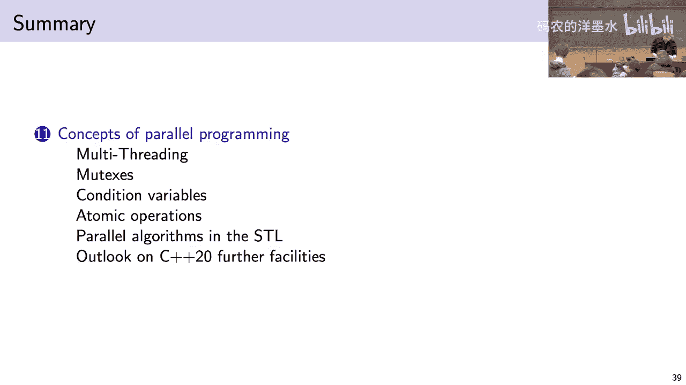

掌握这些基础概念是理解和构建高效、正确并发C++程序的关键第一步。