# 【全集 2024版】慕尼黑工业大学 C++编程概念 IN2377 中英字幕 p12 Lecture 12 - 多线程基础 -BV1gDqwBmEuC_p12-

Test， test。 and， right。And right。Great， it looks like it's working。I was ready to go。Right， so。

Welcome， everyone。Online and welcome everybody here。

This is our last session of the concepts of Cpl programming course。嗯。So yeah， welcome to that。

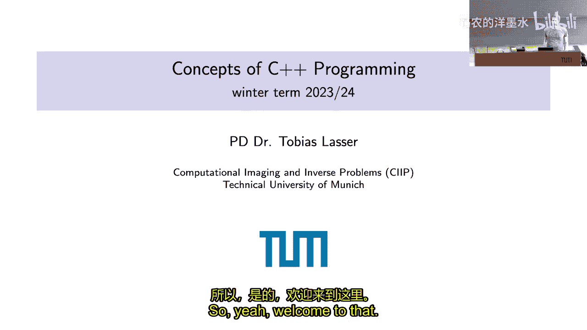

We have another treat type session。 It's UK 8 P。And。Yeah， there。

 there's some administrative information here。First off， this is the last lecture。

 There won't be any lecture next week。 The same is true for this week's exercise session。

 This will be a last one， and it will be a special one by Jonas。About some of the nuts and bolts。

 so not strictly speaking about the lecture content of today。

So this is the last of the program for this week， next week， we will。Have the test run for the exam。

 using to exam。It will be on during the lecture slot。 So on February 6， that's Tuesday next week。

 and we will start most likely at 1430。I still have to set up quite a few things for this to work。

And you will get some detailed announcements on， for example， how youll find the link for this。

Probably not today， but maybe tomorrow or day after tomorrow。So， yeah。This will be sent around。

 Watch Mo the general announcement from the instructors for this。And， of course。

 the real exam is going to take place on February 22 online via to exam as already announced。

 starting at 4 o'clock。Yeah。So for all the exam details and questions。

 I would like to refer to Moodle。 and， of course， we will be available。嗯。

We are Zullip and the other communication channels until the exam。 And， of course。

 after the exam happens as well。Regarding the homework points。

 you will get a summarizing issue after the last deadline。嗯。This will happen maybe this week。

 maybe early next week。 But yeah， you have the issues for the。

Homework assignments from the last few weeks already。

 So you will know if you have those points or not， and the same will be true for this week。

 and we probably do a separate issue or something similar for the sum of the points。

You shouldn't be too afraid to fail the exam， if you have。Almost all of the homeworkbu points。

 you will need very few points from the written exam。And。

If you know C plus a little bit after taking part in the course here， you should be fine。

 You don't need to be afraid of failing。And yes， there will not be a retake。 And yes。

 for the foreseeable future， this course will not be offered again， at least not by me。Right， and。

 in fact， yes， this might be the last meeting of。My pan fan clap。嗯。For the foreseeable future。

 this will be the last lecture I give at home。周阳。Let's see how this works out。Anyway， so today。

 I have two points on the agenda。

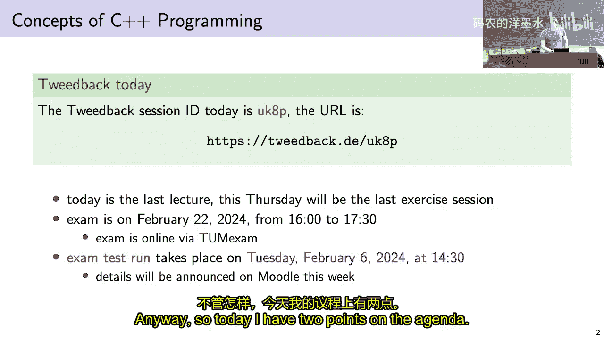

One is an addendum that I didn't quite manage to fit。In the other chapters。 But if I had fit it。

 it would have fit into the compile time programming stuff。 right。

 So we are going talk a little bit more in detail about concepts。

Which is a bit annoying because the title of the lecture is concepts。 Well， right。

 So so that's why there's a clarifying C plus plus 20 concepts here。Right。

 so I'll talk about this a little bit。Because it's a really cool thing。

 And most of the compilers now support it fairly decently。

 think you already used a little bit in it in some of the homeworks。

 And you saw a few of the exams in the slides。 So this is just going into a little bit more depth。😊。

And the second part， which isn't on the slide yet， will be to talk a little bit bit about the language evolution again。

 I know I did this in the start at the very beginning of the course。

 But I want to do this now that we've talked about a lot of the content of C plus plus。Right。So。

 let's get rolling。Concepts。Conscepts are essentially。A replacement for this Finer and SDD enable if。

 It allows you to specify requirements on template parameters， which is cool because by default。

 template parameters can be anything。😊，And if something doesn't work。

You usually find out by getting a very weird compiler error message。So here you can now。

Really specify requirements in a very nice and concise form。

 This allows you to make your code more clear for the user。 and， of course。

 also more clear for the compiler because then it knows what to expect and can also provide reasonable error messages。

😊，You can overload functions based on these concepts。

 and you can also specialized templates based on this。 But this is。Very much a template technique。

 So if you're not using templates in your code， this will be irrelevant to you。Yeah。

 and so many things， a lot of the material from my slides are。

Have been inspired or more or less trade outlifted from various books or other lecture slides。

Or in this case， it's a chapter from Ginina Kim's book， C plus plus 20。And yeah。

 it's a fairly good book。 So I advise you to take a look。So as I said。

 concepts are about template parameters。 So that means you can use them in templates。

 class templates， obviously， function templates。And yeah。

 if you have any kind of generic member functions。And basically， anywhere you've used auto so far。

 you can also use a concept。There are predefin concepts from the language or more more。

More specifically from the standard library， or you can also roll your own。

 And this is what you will see how to do today。

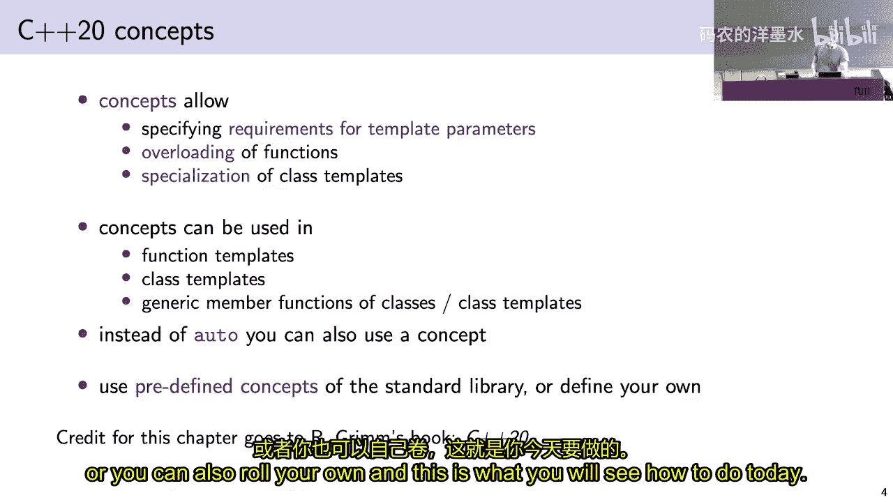

So what you've seen already is how to use these concepts in the most basic form。

 if you write a regular template and then you insert a require statement after the template and the template parameter。

Im adding。Some kind of predicate like， okay， type T should be integral。

 which is expressed via the type trade or in this case。

 concept of the standard library that's called SD TD integral and basically gives you true for any type T that is somehow interpretable as an integer and false otherwise。

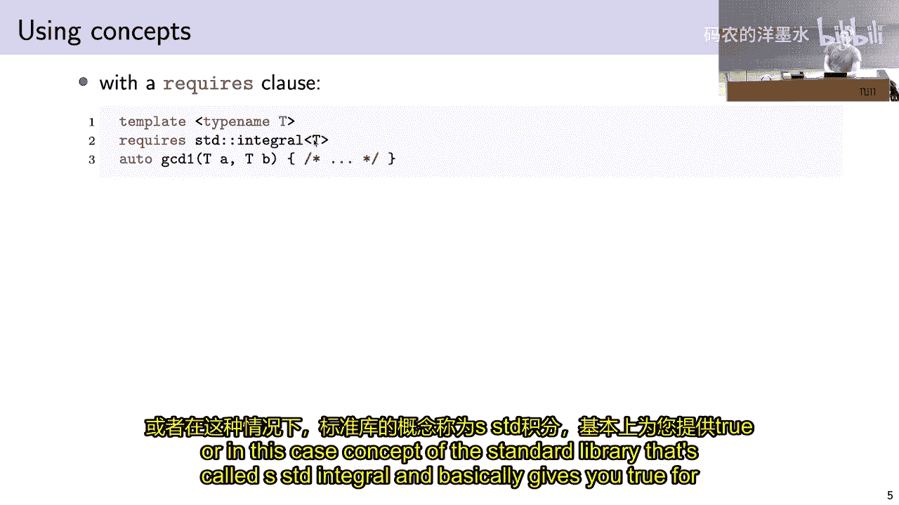

Right， and then you do your function。With a deduced return type and two arguments of this type T that fulfills this concept。

It wouldn't be C plus plus if you couldn't do this in different ways。

 So there is another way of doing things。 You can also write the require statements。After。Basically。

 the parameter list of the function。 So similar to a trailing return type。

 you can also have a trailing requires clause。And I think one of the most clear things for me。

 is this。That instead of writing the type name， which is a bit of。Redundant letters， right。

 instead of writing this type name， you can directly put the concept you want to have for this T。

 namely ST TD integral。 This is very short and very intuitive。 I have to say。

 So this is typically my preferred version。Using an abbreviated function template。

 that is the last option that you can do。 This is a bit different， though。

 It's not exactly equivalent to these three， because what you can do is you can write auto and put the concept name in front of the auto。

 This is a constrained auto。That's what it's called。

 And what this declaration or definition of the function here will produce is a template internally。

 like， for example， generic Ladas internally produce a template。😊，嗯。But it's easier to write。

 You don't have to write template explicitly。 You don't have to write these brackets。

 You don't have to write the type name。 You don't have to invent another letter。

 You can just say into whatever concept auto。As the parameters and the compiler will create the template stuff for you。

This is pretty cool。 There is a functional difference， though， because here。😊。

In all these three examples， using one type name P。

Enfors that both arguments of the function have to be the same type。

Or at least implicitly convertible to the type T。Here we use integral auto。

 that means these two types here can be different as long as they fulfill the integral concept。So。

 this is。Not quite the same， but almost。Is this relevant for the exam， yes。

Will there be coding questions in the exam。Depends on what you define as coding questions。

 But since C plus+ is about coding。It's gonna be a about coding somehow。Right。

 so this is using concepts。 So let's。

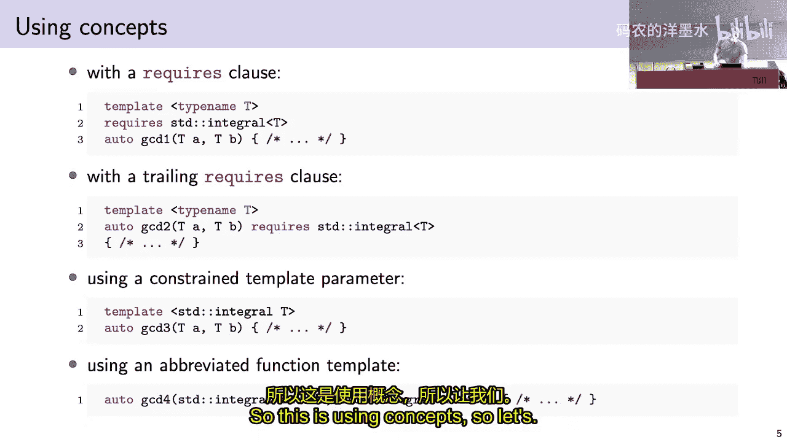

Yeah， let's look at the details。 So we have to requires clause。 What can you put there， obviously。

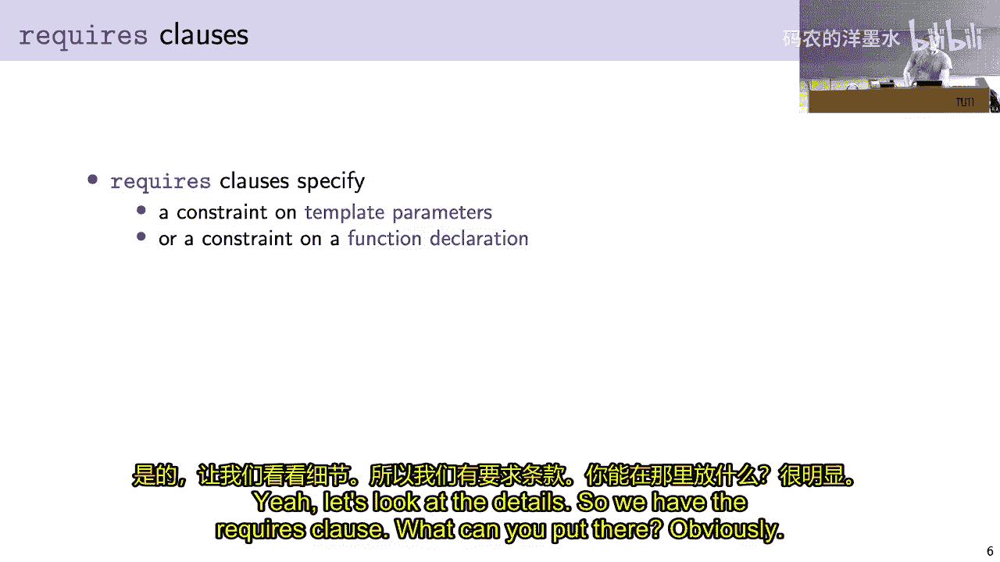

You can put it on template parameters。 just like we had in the previous example。

 You can put it on a function declaration。 But what can comes after。

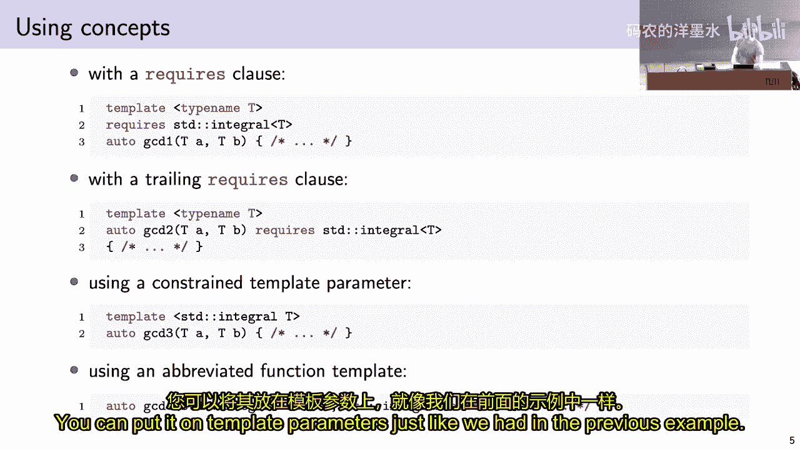

There is a。There's a few things what you can do。 You can put a concept， as in the example。

That could be a concept that you define。 There could be a concept on a standard library。

 You can do a conjunction or disjunction and or of several concepts together。

And you can do a requires expression。In the requires clause。Yes， it's C plus plus。

Even the new stuff is， obviously。See， plus plus， because you can have a requires expression in the requires clause。

Couldn't be nicer anyway， so。

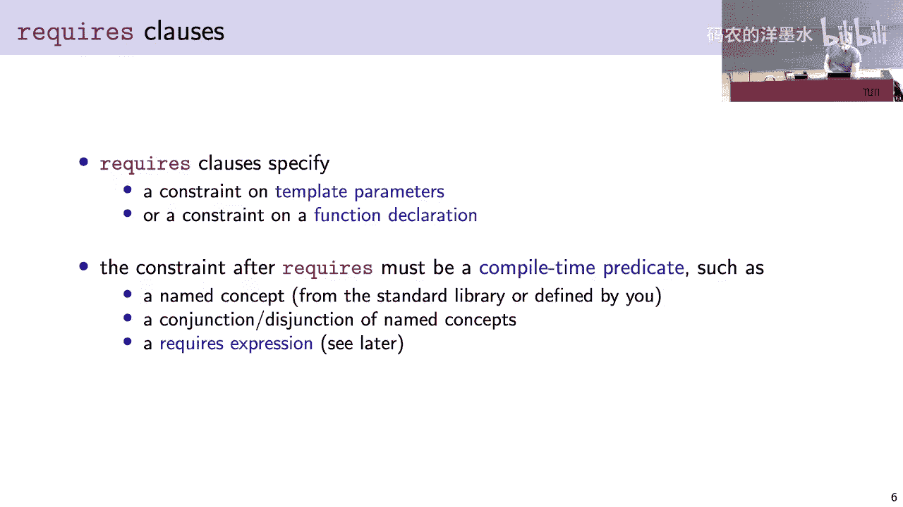

嗯。We'll get into details in， in， in a little bit。So。If you w to do return types with concepts。

 you can do it with auto and S T T in。

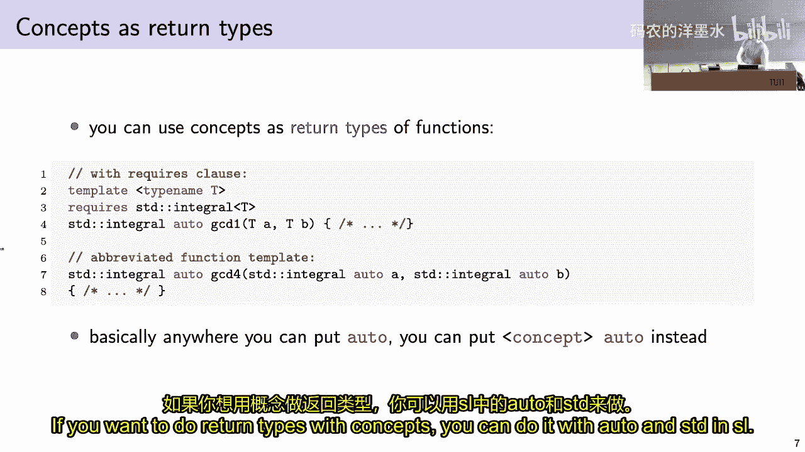

Right， as you would expect。 So instead of auto， you write the concept and then auto。

 So a constrained auto。

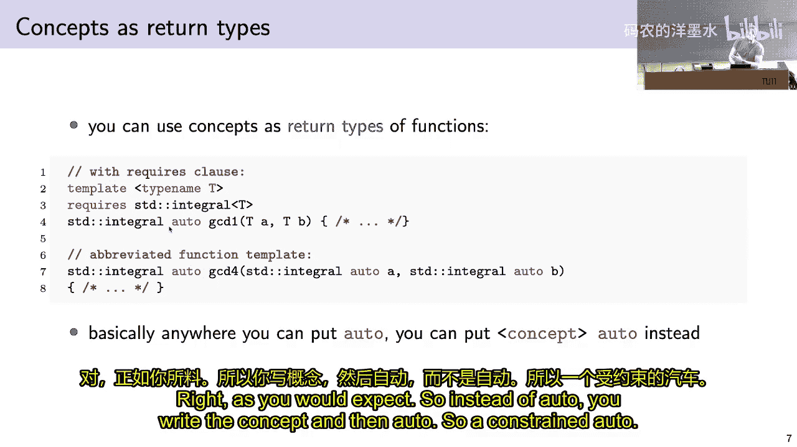

Similar to the abbreviated function template where we already had this。

 And the idea is basically anywhere you can put auto。

 you can put a concept auto where here you have to replace an actual concept。

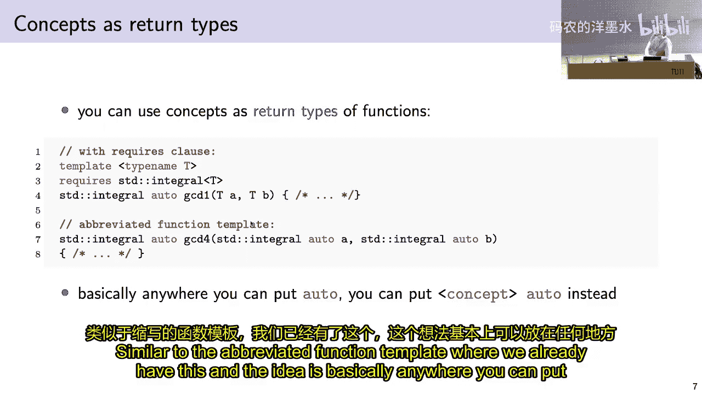

There。And， for example， you can then do funny stuff like this。

 You can define a class that is not copyable because you're deleting the copy constructor。So， yeah。

 copy construct。 You know， the thing that takes the same argument。

 the same class as a con reference argument。 you delete it。 So it's not copyable。

And then for whatever reason， we define our own vector class。 We don't use the standard library1。

 and we explicitly ask for the pushback function。That whatever thing we are pushing back into the vector should be copyable。

Because pushback creates a copy of that element， right。So。If you do this for integers， this works。

 right。If we do this for our non copypyable class。This doesn't work。

Because the compiler will then complain， look， your class non copyable is。

 doesn't fulfill the concept S TD copyable。Right， this is a standard library concept， obviously。

 that already exists。 It。 You can find it in the concept header。And this way， you get a lot more。

Reasonable error messages， of course， presuming that you call your concepts reasonable names， right。

 If you don't， then， of course， the error messages will suck。

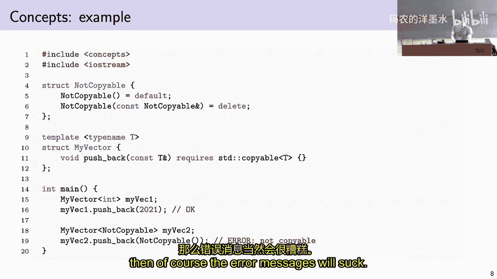

Right， you can do fancy stuff with these concepts。 You can have aatic templates。

So we can have template parameter packs。With these concepts。But just putting instead of type name。

 you put the concept， then you have the triple dots。 You give the name to it。

 And then you can have a function like this here。That takes this template parameter pack as an argument。

 And then you return a fold expression。hit。 this left fold or right fold。

 I always forget which one it is。 Anyway， It's a fold expression with the end operator。

 and it basically ends together all of the arguments。Then you do any。

Which is essentially the same except you do an or。And then， you do none。

Which essentially doesn't oar and then followed by anot。

These are incidentally also in the standard library。 So， of course， not for the integral concept。

 but the standard algorithms。But yeah。 and then you can do stuff like， yeah。

 I call it all four different values that get expanded into these wheretic。

 in these template parameter packs。And。Since an integer Boolean values are all integral values。

 They fulfill these concepts。 So these get called。And you get the expected values。

All of these are not true because false is obviously not true。 So this is false。 Any of them is true。

 Tru is true。5 is true。 So this is true。 and none is also wrong because yeah。

 there is two that are true。

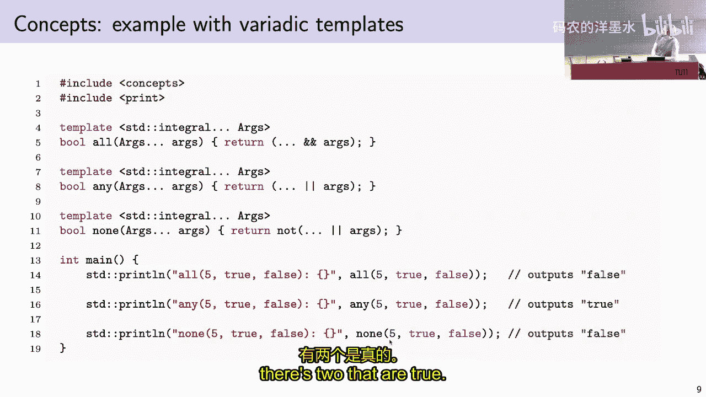

You can overload。Oh， okay。 but slide 9 use short circuiting。

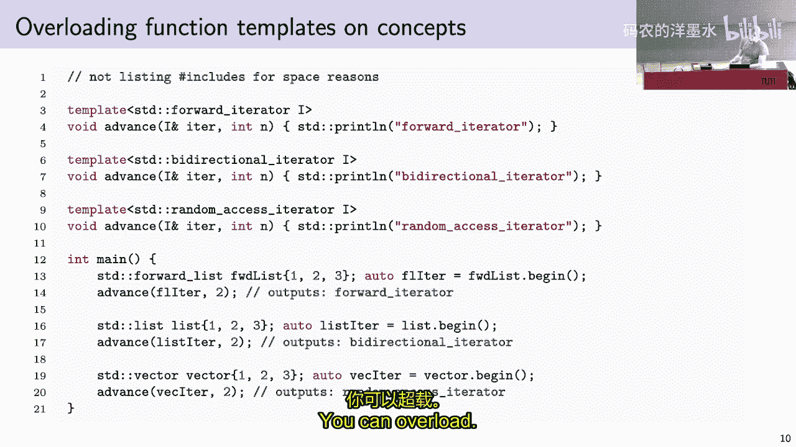

No， this is not the binary operator here。 This is a fold expression。

 So it's definitely not gonna of short circuit here。This only happens for， for conditions。

There you have two opera。

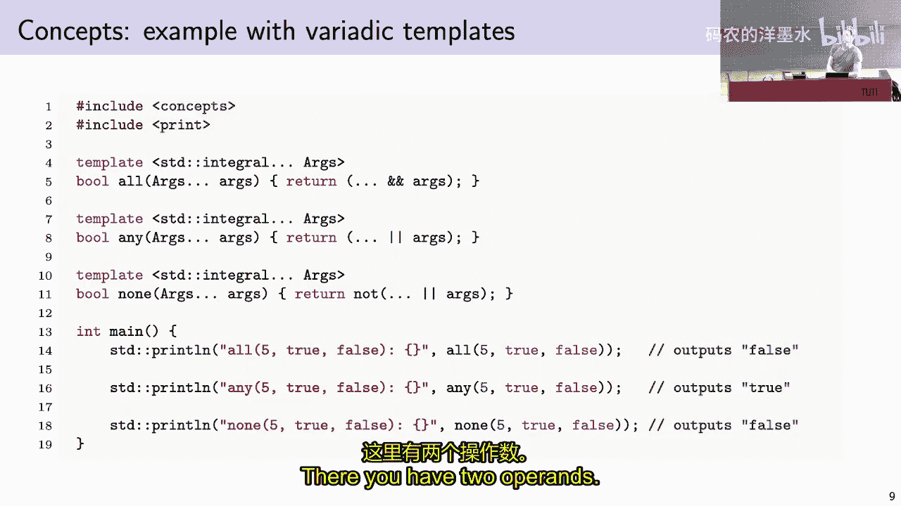

Right。You can overload functions。 So here in this case。

 we had varietyic templates with differently named functions here。

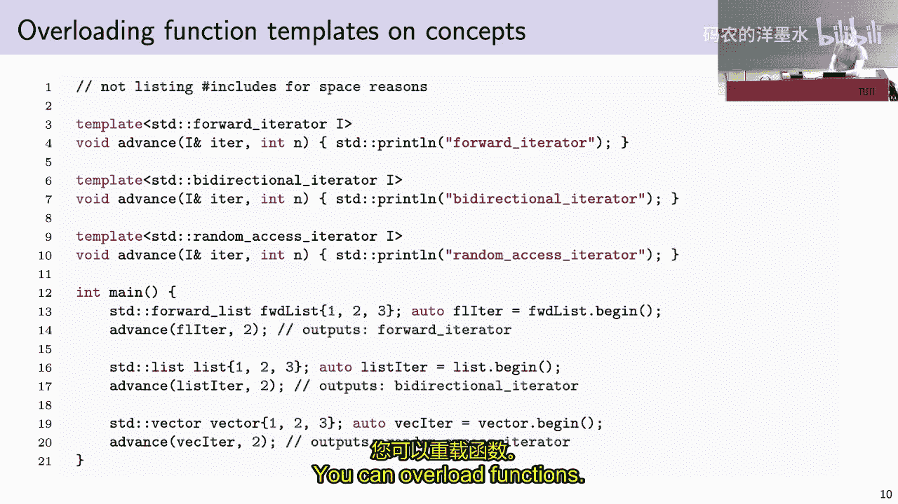

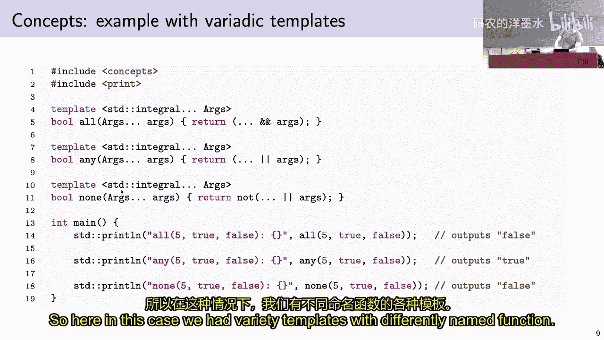

We have nonvari templates， but we are overloading the function advance， which incidentally is， again。

 something that's actually inside the standard library。Or we were just doing our own thing。

 For example， here， we require the standard library concept for what iterator。Like。

 if you have a singlely linked list， you can iterate through it in a forward manner。

So the forward iterator fits。To singly linked list。 Then we have a bidirectional iterator， which。

 for example， fits to a doly linked list where it can go forward or backward in whatever yeah way you want。

 And then we have some random access iterator that， for example。

 fits for as or vector whereby indexes， you can randomly jump around。Right。

 and we overload this essentially through the， the parameter list， and we use the concepts。

To overload this。Right， and then if we call it for a forward list or a list or a vector and call it advance。

 then we get the appropriate output as expected。We can also specialize。

 So this was overloading of functions， right， This was not template specialization。

 but we can do template specialization using concepts as well。 So instead of the generic type name。

 we can have， for example， the concept SD regular from the standard library This sounds a bit weird。

 but it actually means the type is copyable， movable， vpable and default constructable。

 thats semireular。 And if you also add quality comparable， it's regular。 So essentially。😊。

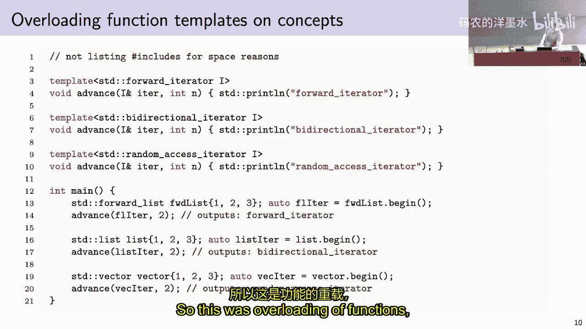

If it behaves nicely， right， So like a bit in type， then it's regular。And now。

 if you do a vector of a be in type， this will do the regular specialization。

And if you do it on something else， which， of course， doesn't make sense because。

Can't really store references in a vector。 but， but the heck， then it would use。

EThe generic template， because， of course， the reference is not copyable。

Osproable or default constructable and all of these things， right。嗯。So， in a way。

Concepts are more than just。Some type traits that are restricting templates parameters with SDDD enabled if the syntax is obviously different。

 but you can do more with them。 You can overload。 You can partially specialize， and so on。

And it fits very nicely into the language， I must say。

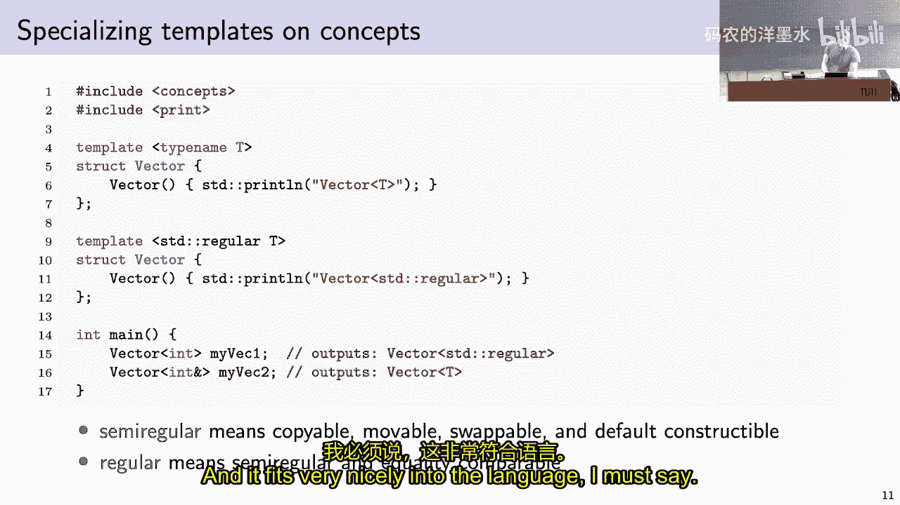

Right， if you want to use more than one concept。You can do that and you can do this in multiple ways。

 So， for example， one of them is to have a required statement just after the template statement that requires one concept。

 like it should be an interput iterator。

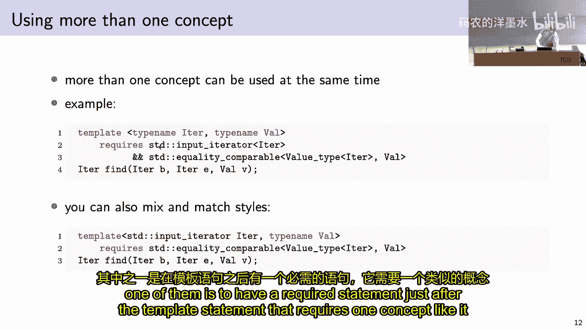

And then you do a logical expression like the and equality comparable。And yeah。

And then you check basically the value type of the iterator and the actual value you are trying to compare to。

 And that this way， you could， for example， define the function from the standard library。

If you wantna mix in match styles， you can do that， too。 For example。

 you can encode here that this should be an input iterator。 and additionally， request。

 we have the required statement that it's equality comparable。And in fact， this my。

 this variant here might be more readable because it's immediately clear。 Okay。

 it's about input iters。And there's an additional requirement。That is equality comparable。

Which you maybe wouldn't want to put here as a concept into the template state。So yeah， in a way。

 what I complained about earlier that there are so many syntaxt versions of how he can use concepts。

 It's actually not bad because in some cases， it does make sense。

 So here I would say this is really good。You can also overload these abbreviate function templates or the fourth option where you do the concept auto thing。

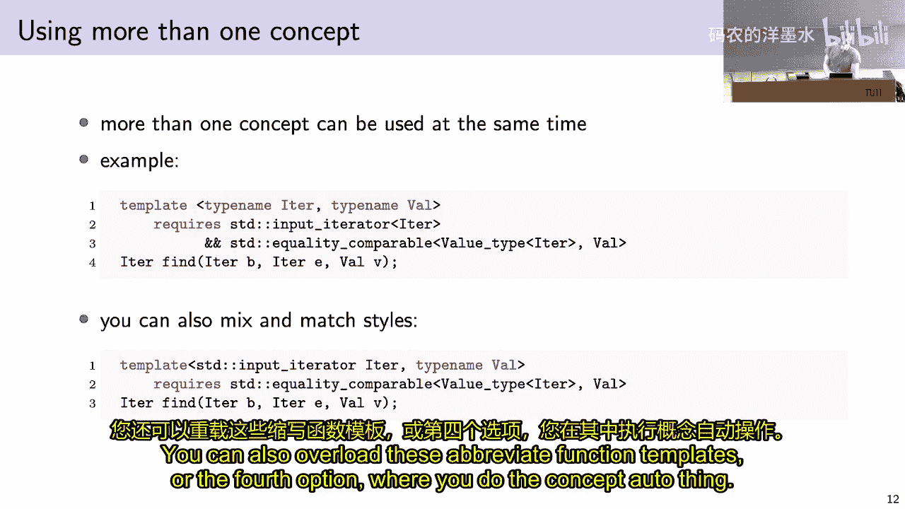

So we can have， for example， a regular。Unconstrained auto function overload。

And another function called overload that has a constrained auto。

And you can have a regular low overlapload not taking any concept or templated thing at all。

 It's just accept a straight long。And then it happens exactly as you would expect。

Calling overload with 3。14， that's a float or a double。 actually。 it's a double literal。

 So this would go to the most generic version and print auto。 if you enter an integer literal。

 it will go to the integral overload。 and if you enter long， it literal。

 it will go to the long overload。So， yeah， this participates and plays nicely in the overload resolution。

Will the mock exam have similar questions like the exam。In style， yes。

 So you will be able to practice all the types of input that you need in terms of content， no。

The test of the setup， Nothing more。But please， be ever。We won't accept apologies。

In the real exam where， he said， oh， I couldn't upload it because my combination of。

Computer operating system， web browser， P D F editor and。We didn't work together。 We would say， well。

 you should have tried this in the test run。 so please do so。嗯。

It's your last chance at attempt to make everyone happy with an easy exam。😊。

I will probably mostly oblige to you because we have the issue that I've mentioned a few times already that we have almost 900 exam participants。

And there's Eunos， David and me。So， yeah， we won't do questions where you answer very long answers。

 because correcting that。Will not work fast。What if my turtle ate the test。

 If your turtle is dining on bits and bys。Sure。嗯。Would be a cool turle。

Will there be frying pans in the exam。Maybe I would put a frying pen emoji there or something。Thanks。

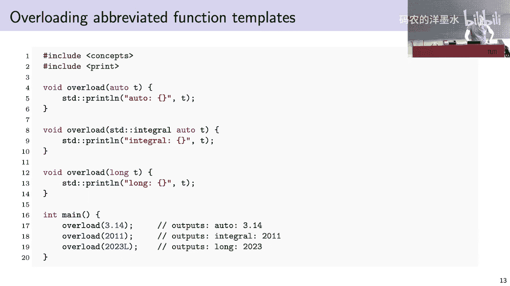

Right。Okay， concepts， what concepts are there？There's a lot of predified concepts in the standard library in the concepts header。

 I'm just mentioning a few of them。 I think I already mentioned a few of them in one of the last。

Last sessions about type trades。But， for example， you can check if a type is the same as another type。

 You can check if it's derived from something or if it's convertible to or assignable from swappable integral sign unsigned floating point。

 We've seen this before。

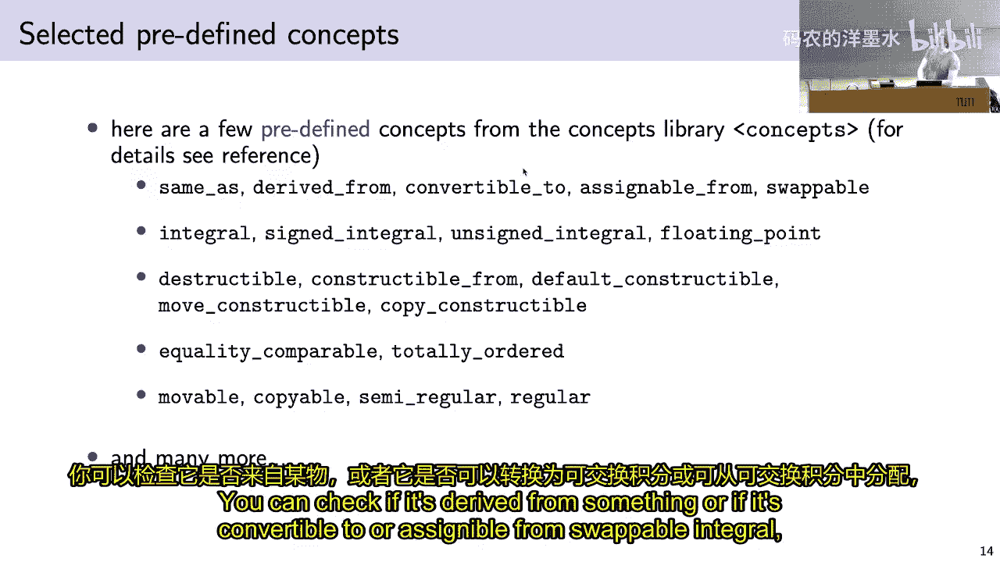

If it's destructible， constructable from default constructible， if you can move or copycon it。

 if you can compare it if the comparison is totally ordered or not。Regular。

 semi regular and so on and so on。 There's quite a few concepts in the standard library。Yeah。

That's quite a lot more。 but I'm not listing all of them here because essentially。

 you will need them， when you need them and when you need them。

 you will know to check the reference which one。

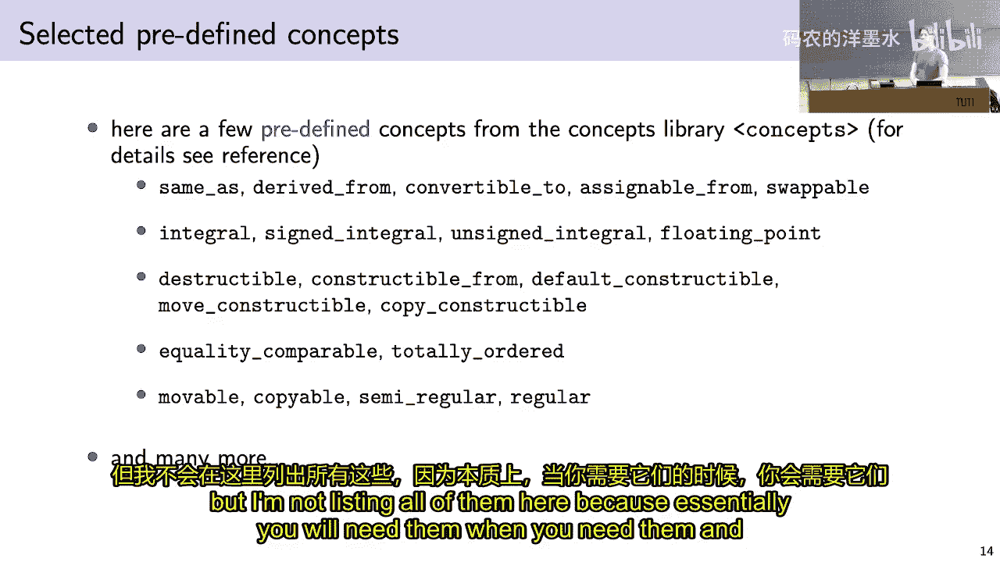

You want。 And then if you find out that the standard library doesn't have the concept you want。

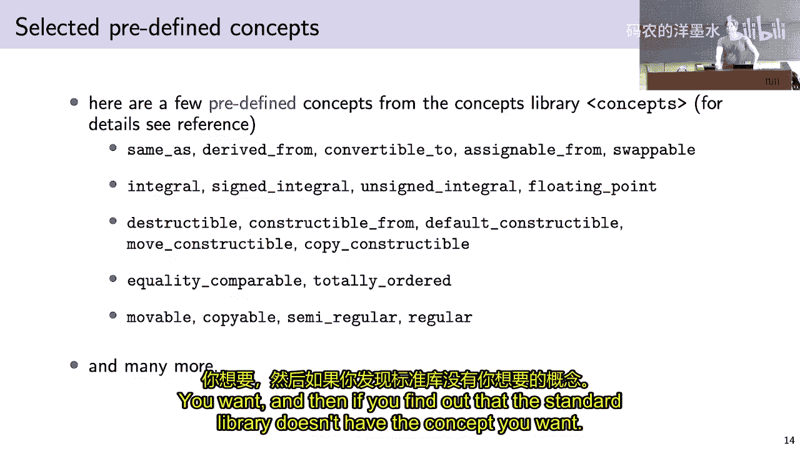

But then， you roll on。So how do you do that？There's a new keyword。 It's called concept。

And essentially， it looks like a template declaration。

So you do a template with a template parameter list， and then you write the keyboard concept。

 then you give it a name， and then you have an equal sign and then follows an expression that basically defines what the concept is supposed to be。

So this constrained expression is typically a logical combination of other concepts or compile time prediccateates。

 so。Essentially， anything that returns a booleion。At compile time， is fine。Or a requires expression。

Which is something I either before already。Because it requires clause can never requires expression。

 That's the same requires expression。Which mostly makes sense when youre defining concepts。

 and we look at a few examples of those。嗯。There are simple requirements。

 which are exactly what you would expect。 There's type requirements。

 compound requirements and nested requirements。 And we look at examples of all of them。

What is the advantage of using SD Same as over template overloading。

I wouldn't say there's any advantage。 There's， you wanna do template overload and。For some reason。

 you want a half。A concept that evaluates to true if two parameters are the same。

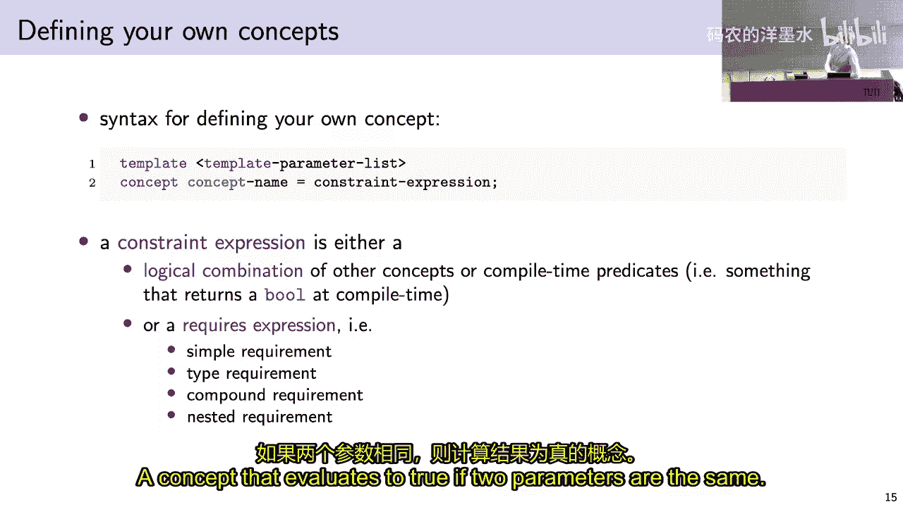

So I don't have a use case currently for the same as， but I'm sure there are。

Because most things that end up in the standard library do have a proven use case。

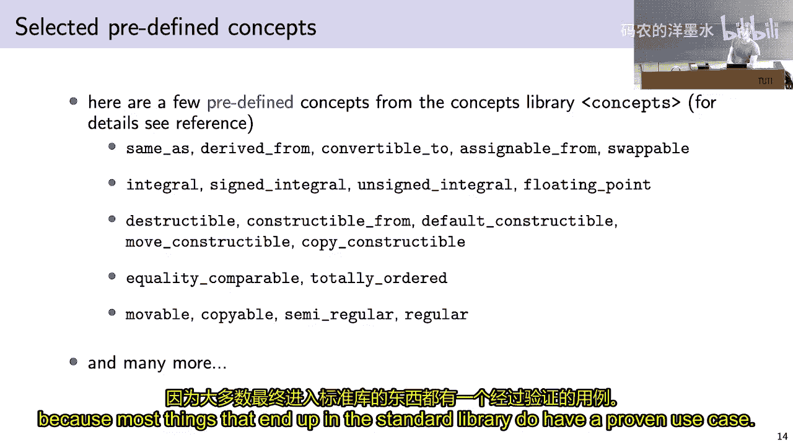

Right。Okay。What if youre specializing templates with concepts and the concepts intersect。For example。

 integral and signed integral。 Is there a hierarchy or partial ordering of concepts。

 So there's definitely not a hierarchy。But as we will see， for example。

 signed integral is most likely implemented as the integral concept plus a check for the sinness。

So implicitically， there's a hierarchy， But I think what happens。 And this is from gut feeling。

 not because I actually know10 percent。 I haven't tried。

 but I would expect that this is simply a compiler error ambiguous。Yeah， template specialization。

Okay， now I have a question。 What is。The collapse stool。ok。Anyway。So the pan choke well。

I think the short version is， of it is that back at the time of。Got in 22， I think。嗯。

I was explaining what an algorithm is and what an algorithm is not。 And， for example， to me。

 a cooking recipe is not an algorithm because it's not。Specific enough。Not deteristic enough， and。

I happened to mention that I don't own a pan。 didnn't own a pen at that point in time。

 And then a week later， students presented me with a pen and then kept pestering me to show a photograph。

 I'm actually using this pan to cook。 for example， scrambled eggs。Which was the recipe in question。

So， yeah， I didn't manage in that term。I didn't learn to cook。

 and I still really haven't learned to cook yet。Either。

But I am capable of using the pen for simple jobs。发养。That's the pan。So。How do we do。Constraints。

 here's exactly the example we were just talking about。You can define your own concept integral。

 using the type trait。Right， so this is the type trade that we used in template me programming。

 right。STD in is integral B。And this type trade is a compile time expression that evaluates to true or false。

 right， So we can use that to define the concept integral。And then the s integral， for example。

 builds on the integral concept that we just defined。And requests that it signed via， again。

 a type trade that was already in the language before concept。Or in standard library。

 And then we do the same for unsigned， for example， doing integral and not signed integral。And。

 in fact， if you look at the standard library concepts， integral sign， integral and so on。

That's essentially how they are defined， in most of the cases。I'm not W。Oh， there should this money。

 too。 It's been a while since I watched that。 But yeah， now I remember， thanks for the refresher。

Right， so requires expressions。 Those are the weird ones。Right。

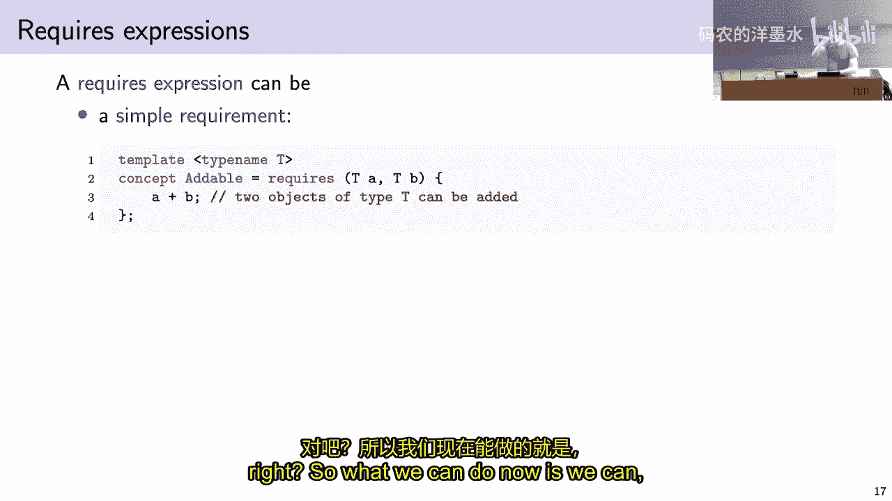

What we can do now is we can。 I mean， this is a very simple concept， right。

 We are relying on type traits and we are combine combining them via logical expressions。 So fine。

 easy， simple and not a problem。 The most interesting ones are these with the requires expression where we say the concept is something that requires。

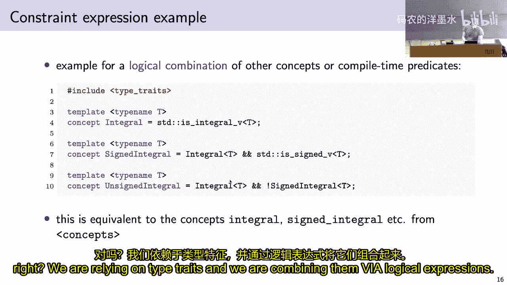

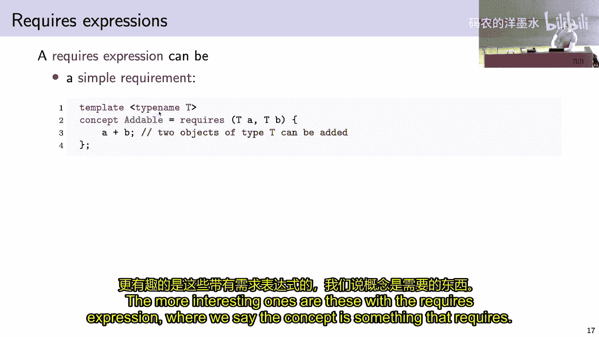

No， that requires a statement。 what it has has a parameter list。Which basically declares what。

What kind of ingredients it uses。 It's not an invocation。

 It's not a function call or a function definition of something。 It's a required statement。

 And the only thing that para Paraist does。Is to list， okay。

 I'm gonna use the variable A in the body of this required statements and the variable B。

 And both of them are of type T， which is incidentally the template parameter here。Right， and then。

 for example， then I can put a simple requirement there that says， oh。

A plus B should be a valid expression。So if I have a from type T and B from type T。

 I should be able to call operator plus for these two。 I don't care what happens。

 I don't care what the result is。 I just care that operator plus is a valid expression。And this。

 I wrap into a concept called edible。It's bit boring。

 but illustrates the point of a simple requirement。Now， you can have a type requirement。

Aage requires。This again， require statement and a body This time。

 I don't need a parameter list because I don't。 I'm not using any， any kind of names like this here。

The only thing that I require is， for example， that T contains an nested thing that is called value type。

 and that value type is a type name。And this， I express as type name。T double colon value type。

 And that means I require of the type T that it has a nest type value type。And what I can also do。

 for example， I can add another requirement after the semico to say， oh。

I should also be able to instantiate this class other or this template other with that particular type T。

😊，And this makes sense， right， These concepts are there to indicate what the template argument should fulfill。

If in my templated function or class， I'm using operator plus or a value type or in trying to instantiate another class with a templated argument。

 Well， these are exactly the requirements that I can now write them down explicitly。And hopefully。

 group them into something that has a usable names。 I mean， this name here is stupid。

This name here is a bit more useful。So that when the compiler detects。

 you're trying to instantiate your template with something that doesn't fulfill this concept。

Then it can give you a useful error message。Right， you can have compound requirements， which are。

Well， essentially thrust several statements。 So strictly speaking。

 this already was a compound requirement because it was too followed by semi Cols surprise。

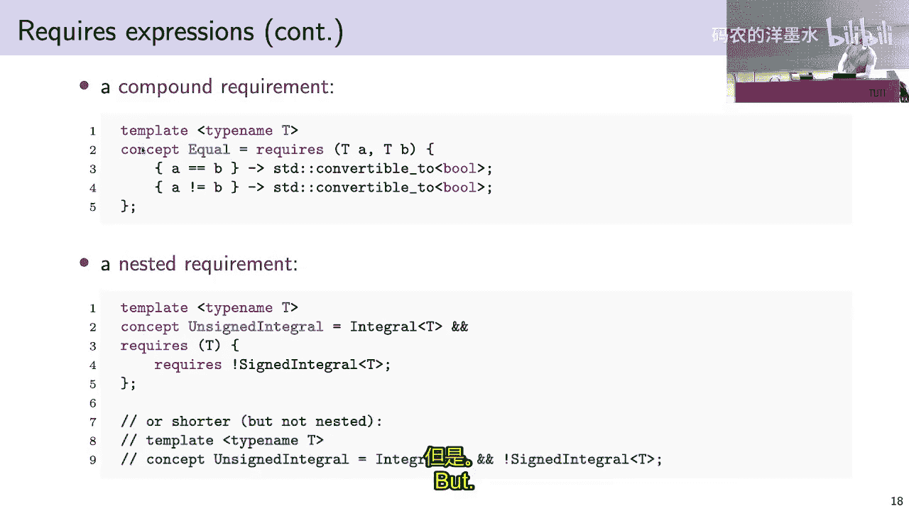

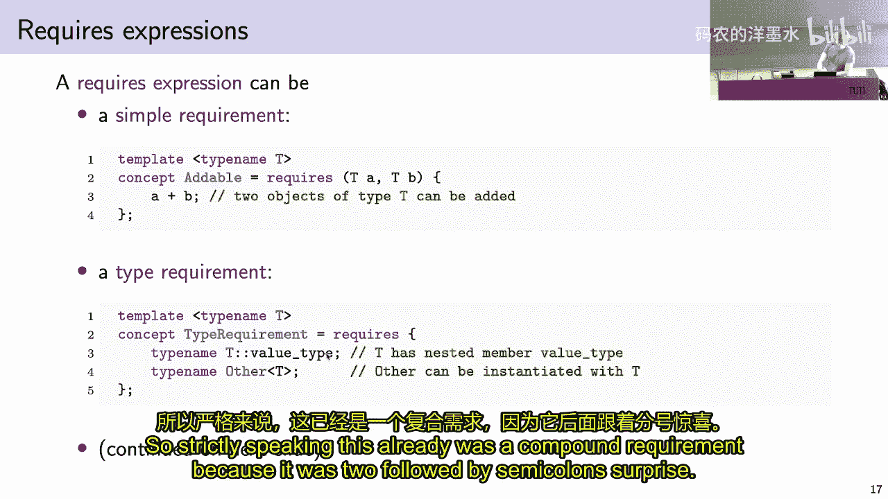

What you can also do here is is a little bit。 So this gives you a little bit more of the syntax。

 So again， have a parameter list。E2 parameters A and B of type T。

And I'm supposed to be able to compare A and B with the equals equals operator。

I don't care again what it does。 But now I'm writing down that the result。

 that's why I'm putting it in cur braces and with a trailing return type syntax。

 that the result of this operation should be convertible to bull。

You could also write that it should be Boolean directly。But， of course。

 convertible to bull is usually enough。For purposes。 And then the same is true for。

Not equal comparison。 Yeah， this is a compound requirement。And now， we can have。Nested requirements。

Which in this example is weird， but we will make。More complex example later on where it's not that weird。

 So here we require， for example， unsigned integral that it's integral and requires。Using。T。

 but not any particular variable of T and requires that the concept not sign integral is true。

This is very st。 Nobody would write it like that。 You would write it like you did in the earlier slide。

 integral and not sign integral just to be clear。 but just to illustrate。

 you can have nested required。Requires statements。Right， so let's look at a more useful example。

 So This is actually。Pretty much the thing that's in the standard library or should be in the standard library in more or less this fashion。

 So this is a concept of a random access iterator。 So this would be an iterator for containers like vector or array。

So we want to be a bidirectional iterator。On the type name， I。Which is clear because， of course。

 the random access iterator can go backwards and forwards。 No problem。

We've wanteded to be derived from a generic eater concept thing。

 That is something in the standard Library， hopefully。EWith the random access itererate tag。

 So this is， of course， very specific。嗯。To the implementation。

 So in an actual standard library implementation， it will probably look different。Yeah。

 but that's one way。 Then you want to have totally ordered。

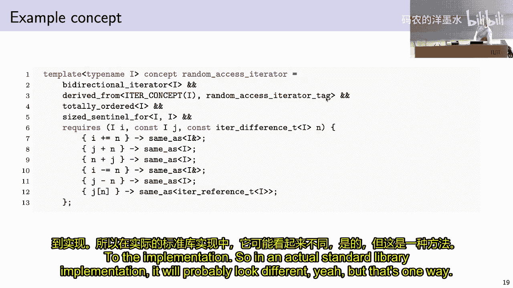

So that you can actually compare these well all of these values， I。

You wna have a size Sinel for the end iterator。嗯。And now the re nest that require a statement。Well。

 I mean， it's， it's not actually a nest that requires faith。 it's just， yeah， it requires。

Statement in the concept expression。So these were basically fulfilling other concepts in a the specific mix。

 And now we are requiring certain operations to fulfill certain expectations。 And for this。

 we declare a few variables。I as a regular I， J as a constant I。

 an Eta difference of this I called n。 And then we ask for the addition of I plus equals n to work and reoppola return the same as a reference to I。

 And here you see a use case of the same as concept from the standard library because it makes sure that whatever is returned from here is essentially。

A reference to I。And so on its own for all these operations， Inter one here is probably this one。

 Direct indexed access， because it's a random access iterator should also work via the operator。

 a bracket operator， and the result should be a reference to I。😊，Now， the question is why。

Does it say eat a reference here。Wheresus a direct reference to I here that I actually don't know。嗯。

Anyway， this could be the concept for a random access iser。 And probably this will be。

More or less similar。In the standard library that you use。And， for example。

 if you now try to call the sort algorithm on a list。

And sort requires a random access iterator on the list。

 You will get a compiler message that will basically say， well， your list is not。

Does not fulfill the concept， random access iterator。

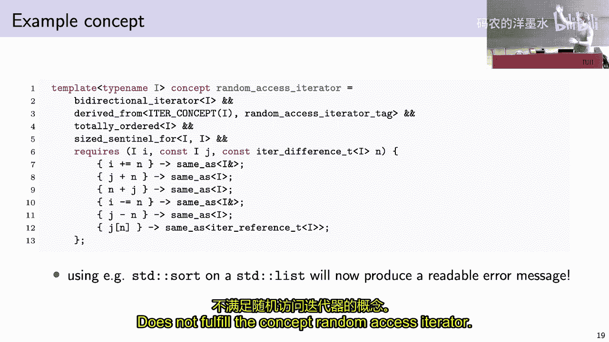

And that is fairly clear。 error message compared to what previously C+ standards would have created as an error message。

 Actually， I should include a slide。

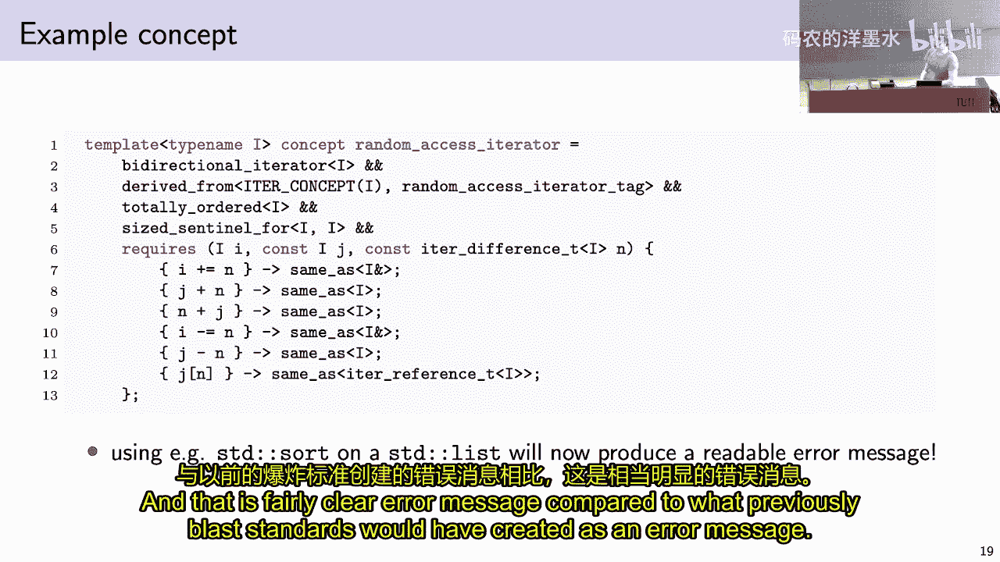

With before and after error messages of the compiler。 Sorry， I forgot about that。Yeah。

But try it on your own， and you will notice that it's a huge improvement。

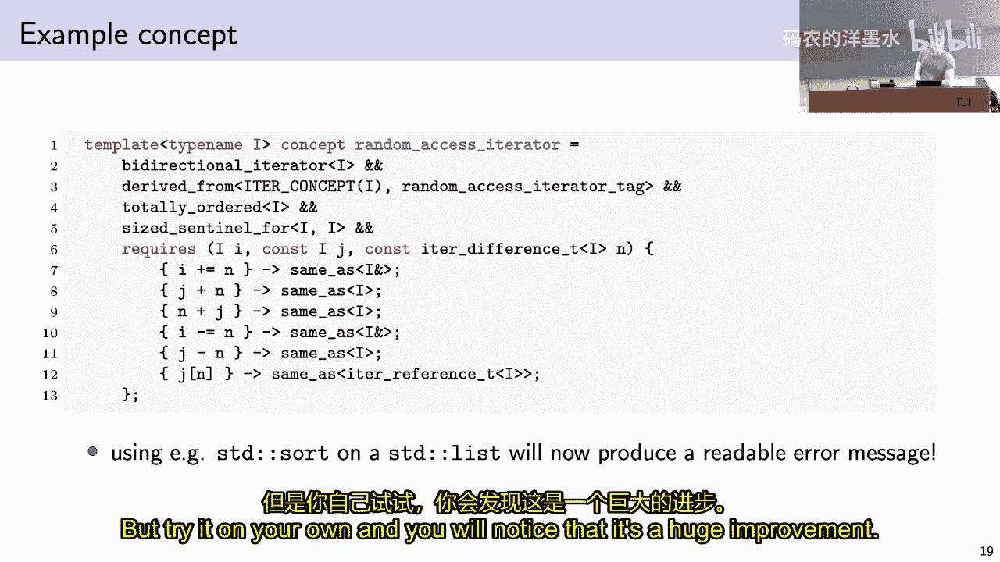

And， of course。You remember K expression if， right， and you can combine this。

 This requires expressions。 So， for example， you can have a templated function。

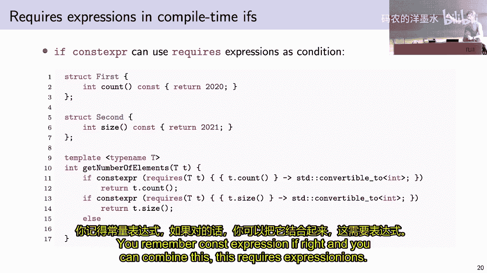

That checks requirements on its template parameter。 and depending on what the requirement is。

 does something or something else。Or something else。 So here in this case， we have too stupid。

Classes first and second， The first one implements a account routine。

 The second one implements a size routine。Just a stupid example。 So it fits a slide。 But essentially。

 what you can do now， you can at compile time， do an if。

That checks the requirement on this parameter T from the template。

To see if there's a function count that you can call and that returns something that's convertible to int。

If yes， we call it。And return the result。And that's it。Then we do another constant expression。

 if to check if there's a size function。 If yes， we call it and otherwise。We return the truth，42。So。

And due to the con expression， if this compiles， right， Because even when you instantiate this。

For particular types， T， like first and second， that don't provide account or a size function。

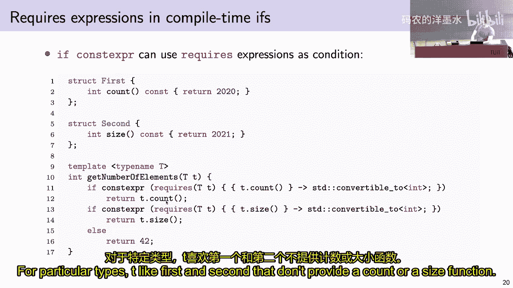

Right。That's because of the con expression， if， and then the requires allows you to check what your type supports。

It's not。It's probably not the best solution to do it this way， right？

 This is could be handled differently， like implementing an inter common interface or so。

But nevertheless。This illustrates that you can combine these compile time constructs like the con expression。

 if and concept。

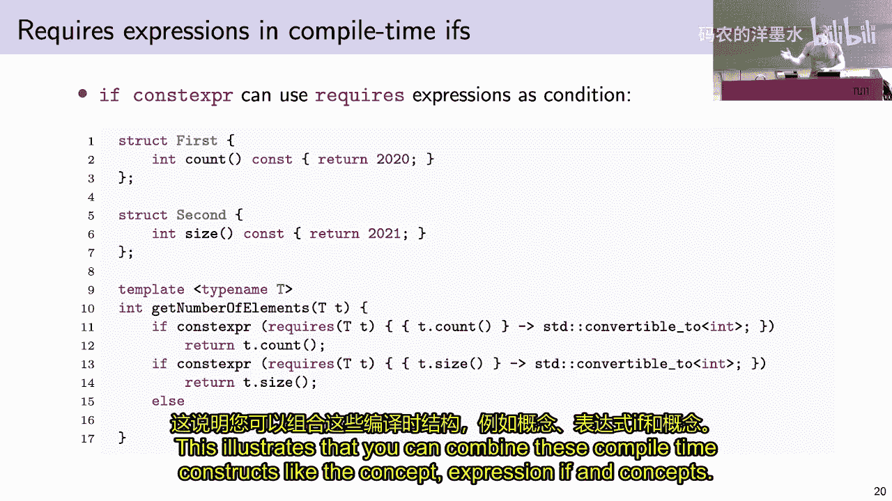

So， yeah， as a summary， concepts allow you to write generic code。

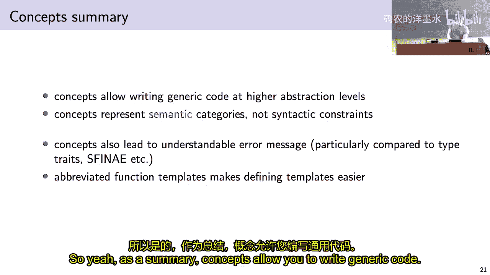

At higher abstraction levels than before， because now you can explicitly codify what your template parameters should support。

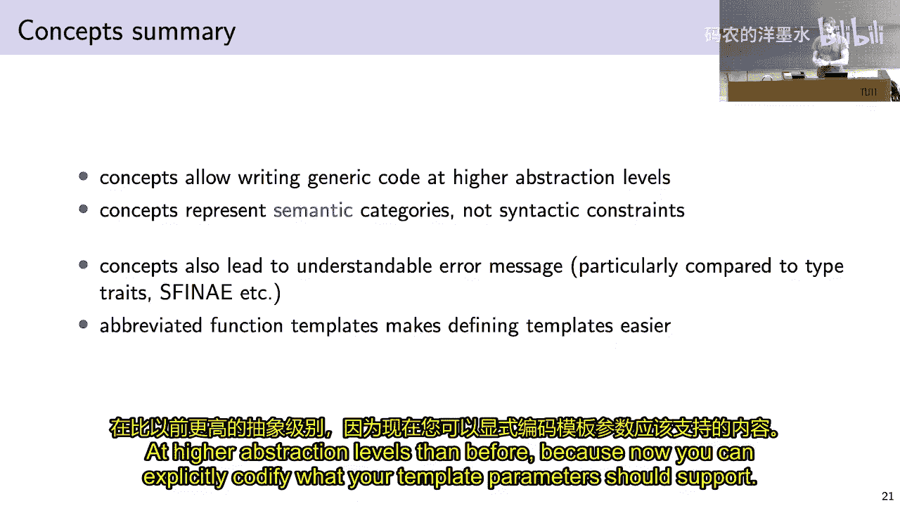

The idea is that this represents semantic category categories， right， So we have concepts like。

 this is a random access iterator。 It does care about details， right， and syntax， in a way。

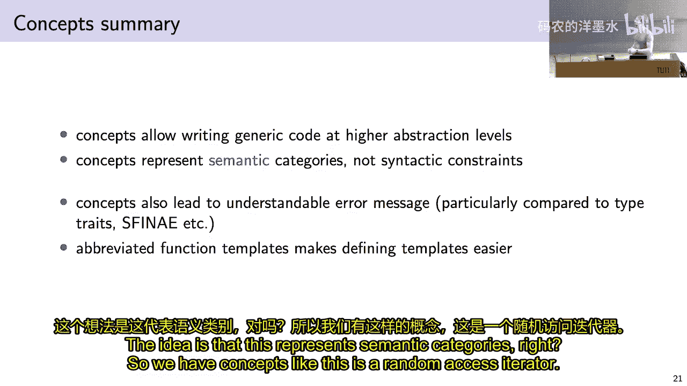

But the main idea is that it's a semantic concept like， oh， yeah。

 you can iterate over this in a random fashion。Right。So this is what concepts are supposed to be。

 Of course， you can use it for syntactic checks as well。 But the idea for it is to have semantics。

One of the major advantages。It sounds like a week。Reason for a Cpl major Cpl feature。

 But it is a very important one。Is。Did you get useful error messages。And。In particular。

 if you compare this to type trades and spinner， that was what you had to do before C plus 20。

And last but least， we have these abbreviated function templates with the constrained auto that gives you templated functions without actually having to write templated code。

 just using the keyword auto and concepts。 So for some。

 this might be easier to do templates and maybe take a bit of the fear of doing complexity e plus+ away because it's it's just an auto parameter easier as pie。

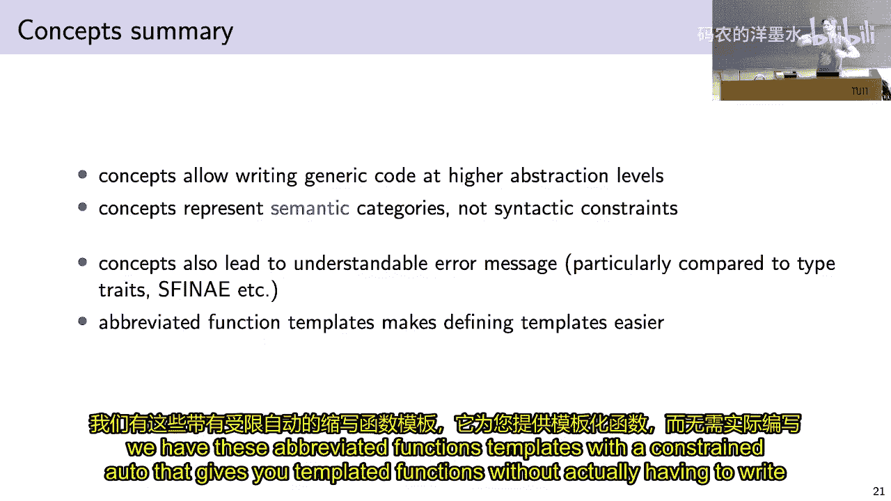

So interestingly enough， that's actually something I discovered。Today or yesterday， I don't remember。

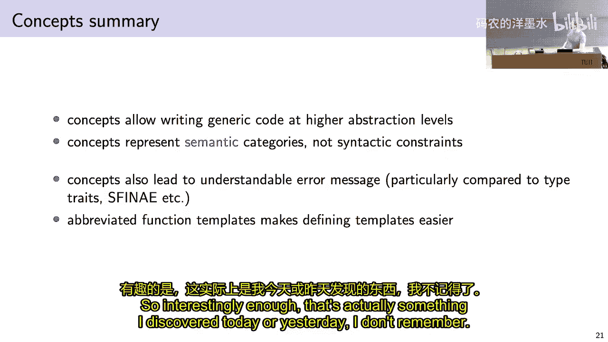

嗯。You might know that a very famous software product， The Linux kernel， is written in C。Right。

 and I think。We already talked about this once or twice， that。The kernel maintainer， line of toilets。

Doesn't like C plus plus。For very good reasons。There's quite a few very good reasons。Likehy。

 this is the case in that they prefer C for the Linux kernel。Recently。

 they introduced rust to the lineux kernel。 So there' are some new parts that are going be developed in rust。

 And now you might ask yourself， why aren't they doing C plus plus。And， in fact， I， I。

 discovered a post on the Linux kernel mailing list yesterday or today。

 I don't remember from early January this year that actually。Put up a discussion， again。

That there should be a C C plus plus 20 subset that should be usable for the kernel and should make things a lot nicer。

And there's a discussion hass been going on for a few days。 Linus Tos hasn't said anything yet。 But。

 of course， the arguments， a lot of the arguments that Linus Toals has been using in the past are gone with C plus plus 20 and newer versions。

 So there's a good chance that in the upcoming years。

 not just rust will make an entry into the Linux kernel。😊，But maybe I was say plus， plus。

And one of the reasons actually， for this is concepts。So， that's。By mentioning this here。So。

Second part of today， and I'm good in time for once， is I want to talk about future C P standards。

 And before doing that， I briefly talk about previous ones。And what's in the cards for the next ones。

So。Let me see of your questions。 Is there any chance that we will see you at to again sometime in the future。

I don't know。 Po yes， Maybe no。 who knows。In the near future， I will not be there。

How do I use concepts which depend on the interaction between multiple template parameters。

We had this already， I think。Oh no。Right， I mean。Essentially。

 you will have just an additional template parameter。And you can use it in the required statement。

 and。Do whatever you wan to do with it。 So let's say you have two types here。T， S and T。

 and you require T to have a value type， and you require S and T to be edible。

 Then you would just write it down like this。 You can combine these S you want。

About a month into the term， I had an idea about how a type system could work。 Now。

 the concept seemed to be largely identical to my idea。What are you doing here。

 Why aren't you developing the fancy new language。Anyway， it's cool。 if， if you think about things。

 and then in the end， it turns out that other people have done something similar as you thought up。

That's actually a very good sign that you're。Thinking about these things realistically。 So， yeah。

 keep， keep up the good work。 That sounds， sounds great。No okay， this is。

We when this probably refers。To this here。 Oh， okay， yeah。

So why don't I have a parameter list like T A here as well。 And then I do type name a value type。

Well，That's。Because what we require for a type name。A type names。 And this is， if it's a nest type。

 you need the name of the class， double colon and。The name of the nesttype。Whereas here。

 you're calling and， or at least you're saying that the operator plus should be callable This instances of that type。

So there might be implicit conversions happening and so on and so on。 But having an instance。

 which is what you need this parameter list for， versus looking at the type itself。

 those are two different things。 So that's why we don't have。

A parameter listed in the second example on this slide。

Is there a way to distribute template source code in a protected manner。

 But if you're distributing the templated source code， then it's obviously not protected。

The main thing what you can do is you can have the interface。 So the template declarations。

Your classes， your function declaration， and so on in a head of file。

Or maybe an S Cclass 20 module at some point。嗯。And then have the implementation in a CPP file which you don't distribute。

 Of course， in order to make that work， you need to distribute a compile version of this。

And you need to have explicit templates in siation in that。

So that there's actually anything to link to。So that means you need to know what types you want to instantiate those templates for。

 if this is an exhaustive list and you can do that fine。

If the user is supposed to be able to instantiate that later on for his own types that he defines on his own。

Yeah， out of luck and it won't work。 So for templated source code。It's a bit of a shit show。

C plus 20 modules as supposed to improve this。But I actually haven't tried this myself yet。

So I don't know how it's actually gonna work。 but hopefully， sometime this year or maybe next year。

 it will be fully working。 And then we can check it out。

Its three days enough to prepare for the exam。That depends on the level you're starting from。

If you're fluent， and plus， plus。I would say you can browse briefly browse through the lecture slides and。

2 hours。4our hours， I mean， depending on a reading speed。And that's it。

 So I would say less than a day。If the only thing you've done so far is P， GDP and Java。

And you've never programmed otherwise。 then it's definitely not enough。So yeah， it's。

 it's up to your background， right， And of course， it's also up to you what result you want to achieve in the exam。

If you wna try your best and see how you can fare without any preparation。Be my guest。

 If you wanna have an excellent grade。Then it depends on your background。

Can you give any tips on how to best prepare for the exam。The best thing was to。Do the homeworks。

So if you haven't done so， maybe do it now， even if you don't get any points for it anymore。

 except for the last one， which is still running。Go through the lecture slides。

 If you need someone talking to the lecture slides， listen to my recordings。 If I'm talking to S。

 beat them recordings up。If you like me， I hate watching videos。

I like to go over things at my own speed。 So I usually just look at flights。

But that depends on you how， how how you work， I would say。嗯。

Do a mixture of some hands on work and some traditional preparation for an exam by looking at slides。

That should be fine。Can we get one last iconic sneeze from sneeze sky today。I can't comment on that。

Can we have a music outro today。I'm not clicking random YouTube links。 I'm sorry。是。

Should have had to prepare this beforehand。 What happens to Jononas and David as I leave。

 So Jonas will hopefully finish its PhD in a few months。David is gonna。Do a similar thing to， as。

 as I do。Im probably leaving tomb。So， yeah， let's see。What the future brings。Okay， Im。

 I read your comment about canoe Linux and canoe plus Linux and， and so on。

You're right that there is a distinction between the kernel and an operating system and where the lips come from and all that stuff。

嗯。But for all intents and purposes， usually， you understand me perfectly fine if I talk about Linux and not the particular components。

Why are so many departing to right now。You might ask our president。He had a glorious idea on how to。

Restructured to。And。I would say that quite a few people leaving tells you how good the restructuring is working。

Actually， I mean， this is only。This is probably not the reason why a lot of people are leaving。

 I mean， in some of the。Non scientific positions maybe be this for the scientific positions。

 of course， it's always。

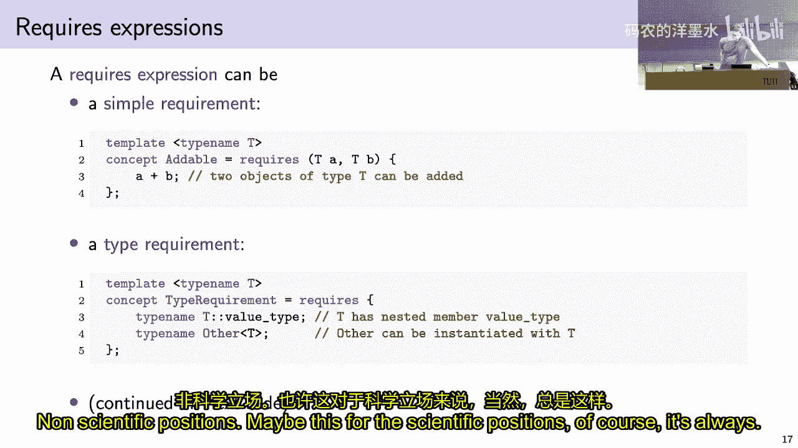

A matter of。Yeah， but， what can you do in your career， right， academia is very limited。

 You might be aware that。That for your PhD， you have a maximum of six years where you can be employed while doing your PhD。

 And after your PhD， you can have another six years of being employed at any German university。

So if in this time period of 12 years， you don't manage to catch a professorship position。You're out。

Forever。Yeah， and that， of course， means that at the state of just after the doctorate until a professorship position。

 you're in a situation。Where you're probably 30 years old， or older。

 maybe want to have some kids or have a family。 And you're only getting contracts that are one year or less。

Maybe two years if you're lucky。So， of course， most of the people then leave university and say。

 well。I'm not accepting the low salary plus the low contract duration and the shit work situation where I' is essentially exploited。

I'm gonna go to industry。This is what a lot of people do after their PhD。

 because working in industry makes more sense for their life situation。

Some professors have left for industry as well。 There's multiple reasons why this could happen。

 One of them is that you earn a lot more at the industry。嗯。But yeah。

That's usually very individual cases。 And in my case， I had a permanent position。

 or I have a permanent position。 And I'm still leaving There several reasons for that。

 And one of them is， indeed that our。

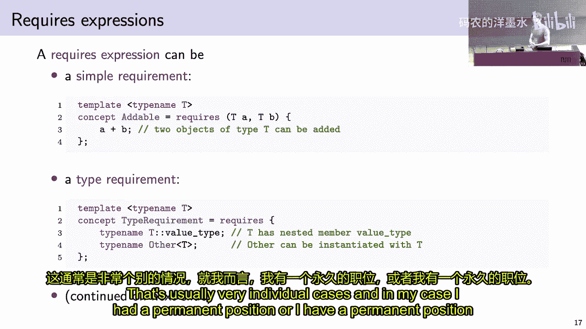

Administration is not improving over the last few years。And yes。

 I'm leaving for a company with a green logo。Right， and that also ties back to lead those towards。

Anyway。So talking about C plus+， which is actually exactly what I'd be working on。

 not the C plus+ language itself， but using C plus+ for various purposes。

Mostly for high performance computing， which is exactly what I've been doing for a lot of years。

Here at tome。Let's talk about the language。We've seen this before。So early say， plus， plus。You know。

 when Piianist Hosrop developed it in the 80s was standardized in 1980，1998。

That was the first I standard。 There was a minor revision in 2003， and then。

This was C plus for a long period of years。 Then finally， C plus 11 came around， which was a very。

 very major revision of the standard， introduced a lot of new things。Then there was C plus plus 14。

 which solved a lot of issues that cropped up with C plus plus 11。

C plasma 17 then was a medium revision introducing a few things。 You've seen some of them。

 like fold expressions。 C plus 20 was a major revision where some of the stuff that was kind of penned up in the previous releases。

 but didn't quite make it， got put in。And as you've seen。

 it was so major that some of the things even now in 2024 aren't not。Aren't available yet。Fully。

 for example， C plus modules， C plus10 modules are still。Not quite usable。 It's almost getting there。

So， we are not。Not quite there yet， I would say overall， but it's fairly close。

 And some of the other things are also lacking。 For example， as C plus 17 feature is lacking。

 As you heard last week， Kg， for example， still doesn't have parallel execution algorithms for a standard template library。

So some of the features are still not there even many years after the standard was adopted。So yeah。

 as you've seen every three years as a new release of the standard。

 this is good because now the time is planable， the compiler vendors， standard library vendors。

 users， various companies， and so on， all of them can count on this cas。😊，What。Right。

And this is how it has continued。 So C was 23 came out。 Well， and that's actually the question。

 I don't know。 It was finalized in February last year。

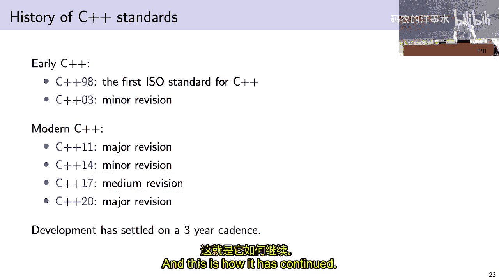

So a year ago， okay。If wantna call me， I have a regular phone。Anyway。

 so the feature freeze for the P 23 already happened in 22 mid of the year。

So no major features were added anymore。 After that， it was basically just bug fixing。

 clarifications and so on。But what I'm actually wondering， I was searching yesterday。

 I thought it would have been published already because， for example。

 the C B was 20 was published as a standard by IO in December 2020。😊。

But I haven't found the Io C+ plus 23 standard yet。 So probably it's not published yet， but it。

 I guess it will be published anytime now because it's done。 But， you know。

 paperwork and so on might take a while。C plus plus 23 was kind of medium revision。

There very few things like deducing this。 We haven't really talked about this a lot。

 That's if constable。 I think I mentioned that briefly。That's the liter suffix for size T。

 which I definitely mentioned， because I love it。嗯。Has multiple dimension of subscript operators。

 which I'm not sure if I mentioned it。And a lot of language clarifications。

Like throwing garbage collection away， doing some unicode things。

 doing some parsing things that have been undefined for a long while。

So it wasn't major features in terms of language， So of handful of medium ones。

There were a lot of my library extensions， library modules。

 which almost no compiler has implemented yet。 flat maps， which are new types of maps。

 So hatch maps essentially associative containers。 M D span， which is really cool。

 I've used it already a few times。😊，Which essentially is a spans So a nonowning view of a multiple dimensional data。

 which is， of course， cool because I work with 2D，3D，4D data。😊，So， I love that。

Generative for Co routines。 This is what I didn't talk about， because it's still。嗯。That's so cool。

There's a tech trace library， which is called for debugging and， and library vendors。

 And what you've seen in all the slides and in almost all of the slides is the print facility。So。

 in fact， due to the print print， the standard Hello word example。

Changed how it looked like in C plus 23 after being the same for several decades。 So in a way。

 it was a major revision， right， because now some of the example code changed。But then in the end。

 the actual features were kind of on a medium scale， I would say。

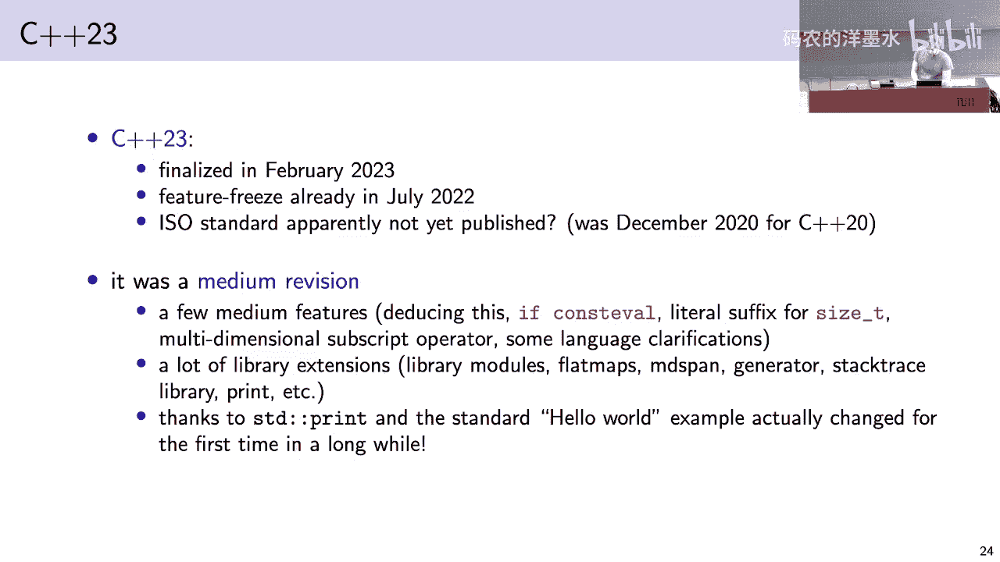

So as I said， in terms of adoption， some of the stuff of C plasma 20 still isn't there。

And a few of the C plus20 standard library features are still also not there in also major compilers。

If you remember last week， I was trying Van box to do a J threadread example of unschronized output to the console。

 The reason why I failed， which I figured out afterwards。

 is that Kang doesn't support J threadread yet。Which I was like， what the fuck， How can this be。Yeah。

 but that's how it is， right？ I mean， standard library developers have。

Although the same 24 hour workdays as we have， Well， actually。

 more like 8 to 10 work hour workdays if they have a reasonable life。

And that means you need to focus on what you develop and some of the things they've prioritized higher than others。

See plasma 23， since it had only very few medium changes。

 most of the compilers already have are the language features。

Because they are usually very quick to implement。The library features。A few more。 And yeah。

They will probably take a while， as usual， Some of the easy events are already there。

 Kang 16 implements as no， Ks 17。I was a click 16。Anyway， playing recent version implements print。

 for example， GCC 13 does not， but GCC 14 does， but GCC 14 isn't released yet。

 it will be released in March。So也一是。What can you say。Let's put it like this。 If you want to be。

A developer relying on good feature support。In 2024。

 you could probably say C plus plus 17 is a safe standard to use because basically every compiler supports it more or less fully。

You could argue that maybe most of C plasma 20 is there， as well。And you would be fine。

And probably in 2024， it's too early to rely on C plus 23 because most compilers don't support everything yet。

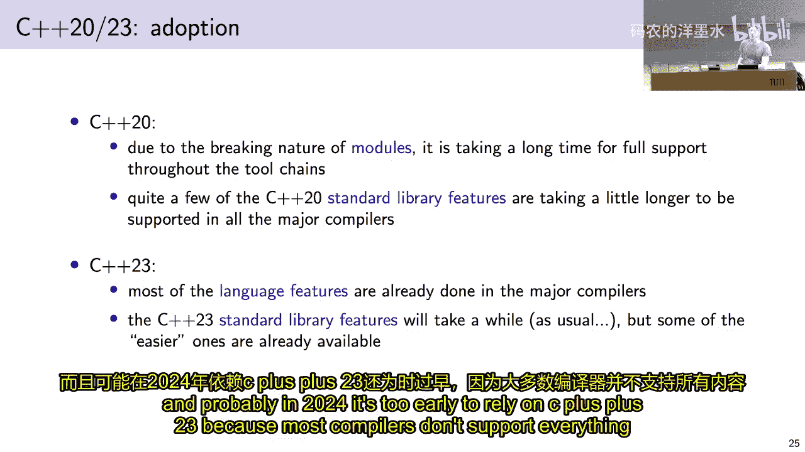

So you have the situation where the standard is going on and is being kept developed。

 but the implementers are still catching up。Right， so let's talk about future standards。

Since C plus West 23 was finalized。 and that still the paperwork going on。

 the standard comm standardization thing。But the actual standard kind of as the committee of C plus plus is considered。

 was already done last year。It's just the paperwork that's being finished。

 So the last meeting of the C pluspa Standard Committee。

 I think this was in November last year already discussed things。 And I mentioned this already。

 There will be the Linear algebra Library。Which is major news because that has the idea for that has been around for many years already。

And finally， it will be there。One of the other things that already got approved as well is that you can now do indexing of template parameter packs。

So remember the parameter packs， typically， you have to do some kind of recursion， cut off the hat。

 deal with the rest， cut off the hat， deal with the rest and so on。

 Now you can actually index them like you would an STD array。W just sounds a cool。That's contracts。嗯。

That are basically gonna define pre and post conditions for functions， like kind of what。

Conditions should the parameters fulfill。 What conditions will the result fulfill afterwards。

 which is very good for verification。This also has been around。

 This idea has been around for a long while and finally made it into the standard。

 So it will be N C plus was 26。What is on track， Fsy plus plus 26， which is actually a big surprise。

 I have to say， is reflection。And it's not the full fat reflection thing that has been。

Around for a few years as well。 But it's looking good。

 especially with the target of writing easy bindings for other languages。 most importantly。

 bindings to Python， which these days， I think is the most relevant。

 but there are other bindings to Trascript。What might be in C plus plus 26。Its executors。

That are essentially rules about where， when and how to run a callable。

And the intention of executors is to be there for the network library。

 which will implement support for lower level network protocols like TCP， UDP， D，N S。

I P V 6 and so on and so on。 It won't do the higher level protocols like H T TP or SMMTP。

 but the lower level stuff。And the thing， the funny thing here is these have been around for a while as well。

 Circuits were maybe thought to be in C plus 17 the no。

 than they were supposed to be in C plus was2 no than they were supposed to be in C plus was 23。 no。

 so they might be in 26。😊，And actually， they have pretty。

I think reasonable expectation that will actually happen。The network library。

 they already told us that might not make it in 26。Which is a shame， because。

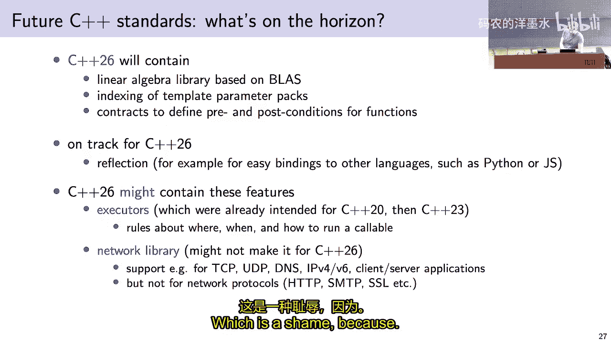

It's important， right， Networking is important these days。 Anything is。

 everything is basically networked。 N C plus lacks networking。

But， well， it's C plus plus。 It's moving in its own pace。

What's also interesting is you might have noticed this。 There are some。

Legislation efforts going on to make software more safe。For example， for critical applications。And。

This is， of course， one of the reasons why you would leave towards rust。EFrom C plus plus。

And the Cpl pass Senate committee has kind of realized this。I mean。

 a lot of the individuals on the committee have realized this a long time ago。

 but now they've channelised their efforts into actually defining safety profiles。

Similar to kind of rust， safe and unsafe mode， right。So， yeah。

 things are gonna proceed in that direction。 And I'm pretty sure they will make sure that something will end up there。

Just to be able to slap a certain。Government regulation batch on， on C plus plus for 26。

So this is also very interesting。 And that's actually also one of the reasons why I Cpl is back in the running。

 or at least being discussed for being back in the running for the Linux kernel。😊。

Right， what can you do。um。If you're already familiar with the Cpl that I've taught you here。

Then you can check the C plus with 23 features。You can check the experimental C plus of 26 features。

 The best option for this is actually the compiler Explorer。

 I hope you've used it before because it has a lot of compilers there。 B box is a little bit。😊。

Less feature rich。 I like the user interface face better。

 That's why I'm using it for most of my things。But it also has less compiler options。

 but it does have， I think the nightly builds of Kang 18 and G C C 14。

 So you can try out a lot of things there as well。So play around。 I mean。

 this is really a good way of getting things。 And， of course。

You only really learn programming by doing it。 You don't learn。Well。

 you learn a little bit by talking about it and hearing about it and listening to it and reading slides。

 watching presentations， watching videos from C plus+ conferences and so on。

But most of the stuff comes from actually doing things。 So do a project。

 do a student project as part of your studies here in a practical course or as a heavyav job。Anyway。

Do a guided research project， do anything that you can do or contribute to an open source project that uses C plus plus。

Do an internship at a company that uses C plus plus， get hands on things。

 Iment a toy project using C plus plus， get your hands on， get them dirty and do stuff。Oh。

 a lot more things。Where are you living to。Industry。

Company that does a lot of C plus plus coding in the context of massively parallel computing。

 green logo。Do your own conclusions。And no， it's not Heineken。

I don't think they do massively parallel programming。 but who knows。I'm also leaving my masters。

 Thanks for asking。Well， I hope that you're completing your masters。 And that's why you're leaving。

 So congra congratulations in that case。Starbucks。Not starboard。What's a pint， Po， what's a pint。

 Okay， yeah， you see that's a Fian slip。 What's the point of all the tea types。

 What makes them special。Well， the underscore T thing in the standard library predcateates。

 for example， are type traits is just to indicate basically that， yes， this is a type。

And then there's also these underscore B things that tells you， oh， this is a value。So for example。

 if you were using the type traits from the standard library。

 if you use Annaosor T thing and you require a Boolean value， you have to add colon colon value。

If you don't want to do this， you use the underscore score V version， which was added in C plus 17。

I wish you the best。 Thank you。Oh， the to president is calling。 Yeah， I guess。

Should use different means of communications。Can you make GP U cheaper。

 I'm pretty sure that's not gonna happen。嗯。At least while theyre booming like they are currently。

 I don't have another kidney left。That's bad。Don't fail your only kidney。

How would you recommend honing your CPP skills after the course。Do stuff。Whatever floats your boat。

 if you always wanted to write a simple compiler yourself， do it。 if you wanted to write。

Fectal generator。 do that。 If you want to write your Web server and C plus plus， instead of rust。

 do that。 I'll write it in rust anyway。嗯。Do we have to know stuff about specific versions for the exam。

没笔记。Maybe， but I don't think I will ask any question like this piece， of course。

 like the example here， this feature was introduced in。C plus plus， whatever that that's boring。

 You can look this up。 You don't need to know this by heart。Should one switch to Microsoft Vis。

 the Microsoft compiler， C+ compiler， as they appear to be far faster at implementing the standards。

The answer is， unfortunately。That put it like this three years ago。 I would have said， hellll， no。

 I you stupid。Since Her Sa basically took over at Microsoft for other Cpl efforts， the answer is。

 yeah。The topic is， of course， you would have to be using Windows， which is。No。So， yeah。

The Microsoft compiler has grown to be really， really good。 and the standard library even better。

They really shaped up the game。 And it's really a case of going from full out。

 horrible verse compiler on on Earth to， to going to be basically the best。

And that's really commendable。But the Windows dependency is kind of sucks。

 So if you can stomach that Windows dependency， go ahead and use visual Studio。

 is's probably the best choice right now。What is a pre and a post condition。

Consider this square root function。It accepts an argument。And the number。

So let's say it accepts a floating point number， and it returns a floating point number。

 This is something you can。Write out N C plus plus code。 float square root function。

 accepting a float parameter。

But it， what you cannot say is that the square root function is not defined for。Negative numbers。

Unless you move to complex numbers， But you're doing floating point， which are not complex。

 So it's not defined。 So it can defined as a precondition that your number has to be。Not negative。

And that's what you can do as a precondition。 This can automatically be checked and makes your program more correct。

 And the same you can do for post conditions。First， because， for example。

 other the result of the square would will be bigger or equal than 0。Okay， let， let me read this。

Toby is moving on。 And so I be， we are all getting old and losing the spark in our eyes。 No。

 I don't hope so。I know I am getting old， sorry， but you are definitely not。 You're still very young。

And we are not losing this spark in our and our eyes。 No， that is still there。

Bere gaining valuable life experience or not so valuable life experiences， yeah。

It's bitterwe and meonic， but that's just life。 I wish you all the best of luck for your future studies and life。

😊，That's nice。 Thank you。 And I think that applies to all of you。😊。

I definitely also wish you the best of luck for all your future studies and life。Right。

Are you leaving Tom after this semester already， yes。

Don't you think that some things like network are better left to third party lips like boost to avoid something like S TD rex。

 which is pretty bad and is usually replaced by third party alternatives。

That's actually a good thought。Right， and you can expand this to not just reex。

 You can expand this to the format lip。 You can expand this to the rangers slip。

 These are all examples that are actually lifted either from boost or from。

 from other open source libraries that got drawn into the standard， but by。

Being drawn into the standard got cut down in features。Limited。And， of course。

 that is usually not so great。 So in the end， currently， for example。

If you w to do a lot of things with rangers。You're most likely better off to use the range B3 library from Eric Niier directly instead of using the range implementation of your compiler。

But that's the name of the game。嗯。Is it better to have it in the language。Yes。

 because then every compiler will have it eventually。But， of course。

 third party libraries will always be more agile。 There will not be a standards committee filled with members of。

Many companies and other institutions that take ages to agree on anything。

It will always be more agile and will have more features and will be cooler。 So。

 but that doesn't mean it shouldn't be in the language。 They can coexist。

 And the best example for that are boost libraries that have been along for a long， long time。Right。

 final advice for the general career。I think the only advice I really have is。Don't plan too much。

Let things happen in a way。 have some planning， of course， but also。

Don't slavishly stick to the plan because it narrows your perspective。

 Keep your mind open for opportunities that turn up。And I think one of the most important things。

 at least for me， it was think about if you're gonna be happy doing things。Right， if you know you。

 it's gonna destroy your soul。Doing a certain job。Then don't apply for it if you have other options。

 right。Just have to give you an idea。Over the years， I had。Various options of going somewhere。And。

I declined all of them because I thought it would be cooler to be here and be free to teach and do research。

Now， I decided that it's maybe cooler to work an industry for a while。And maybe come back for。

 for research later。 But that always depends on your life situation， Right， what you want to do。

 how the situation currently is in this job and how the situation is in the other job。

And one of the examples was， like。That， there was a chop。

Doing high frequency trading of cryptocurrencies。Which。In the thing I would have thought is awesome。

 I mean。😊，High frequency trading， even if it's just in regular finance and not in cryptocurrency。

 it's， you need to do really cool things as a programmer to make that happen， right。

 And that's interesting and cool。 High performance stuff is always always something I love。😊。

But doing it for high frequency trading is a moral no， no for me。

And particularly for cryptocurrencies is a absolute no go for me， right， for you。

 that might be different。 But for me， I said， no， I'm not gonna do that。 It's， it's。

Nothing I would enjoy。 It would probably destroy my soul。Or， or at least I would be like。

 if somebody asked me， where do you work， And I would be like， yeah， I'm doing。

 I don't wanna talk about it because I find it morally reprehensible。 So don't do that。

 If you have anything， very you say， oh， I don't wanna do that， don't do it。

Do you advise doing a Ph PhD。嗯。That depends again on you。Doing a PhD is an experience， definitely。

Some positions require a PhD。Most positions in academia do require one。

 So if you want to stay in academia， you have to do a PhD。If you。

Want to have certain jobs in industry。That are but research oriented。

 You might most likely will also need a PhD。 So in terms of requirements。

 you have to answer yourself。 Is that a career that you want to do。And if the answer is yes。

 then you should take a look at doing a PhD。Then on the other hand。

 what you will do if you do a PhD is you will think three years of your life into it。

 maybe more for me。 took five。For other people， it took three， for other people， it took 6。

4 anything。 So it's a couple of years where you will not earn a lot of money。

Compared to doing a regular job in industry。And。Most people。I mean， there。

 there's a graph illustrating your PhD career。 You start on a high because the topic is cool and you're motivated and then you go to a low because you're not getting anywhere。

 you're not getting your publication that you need。 You get rejected。

 you get rejected at the conference。 you rejected for a general publication。

And then maybe it goes up again when you get your first thing accepted。 And then it goes down again。

 and you will。Actually， I have to say one of the main qualities。 you will。

You will prove by having a Ph D is that can you suffer that you can suffer through years of。This。

Research situation where you try to develop something new that's cool。 and that's really awesome。😊。

And then it doesn't work。 Or people don't think it's cool and awesome as much as you do。

 And then it gets rejected and rejected and rejected again。 And you're like， oh， shit。

 what am I doing with my life。 So if you're fine with living through situations like that。

 consider doing a PhD。If you already know that this is not a thing for you， then don't do it。

 If you already think the master thesis is a long thing and was bad enough。Don't do a PhD。Right。

So in the end， think about what you enjoy doing， think about things that you like where you think you can be happy。

 try them out。 but also don't be afraid to change if after a while， you find out。😊。

Maybe not the best I could do。So。Stay open。And stay focused。And， of course。呃。

Thanks for attending this class。 I wish you all the best for the exam。 And， of course。

 I also wish you all the best for your future studies and whatever you do after your studies。

 Thank you。😊。

