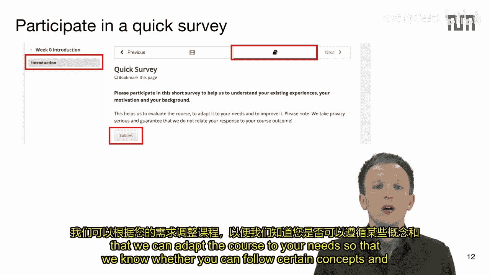

# 001：课程介绍 🎯

在本节课中，我们将学习《软件工程基础》这门在线课程的总体介绍，包括课程动机、目标受众、课程结构、所需工具以及如何开始学习。

大家好，欢迎来到《软件工程基础》课程的介绍部分。我是Stefan Krusche，我与我的课程团队成员——Bernd Brügge教授、Andreas Seitz和Alexander Knapp——共同设计了这门关于软件工程的在线课程。此外，还有多位助教协助我们规划、组织和实施这门课程，你们很快就会认识他们。

## 学习动机 🤔

你可能会问自己，为什么要成为一名软件工程师？我们为你准备了五个理由。

以下是五个关键原因：

1.  **世界日益复杂**：如今，单打独斗的英雄已无法发明全新的解决方案。团队合作比以往任何时候都更重要。没有良好的沟通和建模技能，就无法实现优秀的软件。
2.  **创新**：软件开发者在各个领域为常见问题创造解决方案，并运用新技术简化人们的生活，开启新的工作和共享方式。
3.  **灵活性**：软件工程领域有多个可专精的方向，例如设计、测试和管理。公司通过先进的基础设施提供灵活的工作时间，开发者可以在家办公，实现更好的工作与生活平衡。
4.  **认可度**：虽然纯粹的开发者通常是内向的，更倾向于私下而非公开的认可，但软件开发者建立了一种文化，人们会定期向工作者表达感谢。随着电脑和智能手机在我们的日常生活中变得越来越重要，他们的贡献也得到了认可。
5.  **机遇**：这里有众多不同的成长、创新、每天学习新概念、改善人们生活、实现有价值目标、进行实验、运用创造力和智慧为地球上最重要问题创造新解决方案的机会。

## 课程目标与内容 🎯

在本课程中，你将学习并应用开发软件所需的方法论、技术、工作流程和工具。你将学习如何将客户给出的问题描述，转化为各种**一致**的UML模型，并将这些模型映射到源代码，最终将代码打包成交付给最终用户的应用程序。

这个过程——从问题描述到软件——适用于复杂的大型软件项目，它独立于具体的应用领域和开发环境。无论你想在汽车行业还是金融行业开发软件，无论目标是桌面应用、移动应用、嵌入式设备软件还是Web应用，这套流程都适用。

## 课程前提与受众 👥

本课程假设你有动力学习如何开发那些无法由单个开发者轻易编程完成的复杂软件系统。

如果你是慕尼黑工业大学的学生，可以将此课程作为硕士学习的衔接课程。如果你不是，同样欢迎你加入，请告诉我们你来自哪里并分享更多关于你的信息。

所有课程参与者都应具备一种编程语言（如Java、Python、Swift或C#）的基础经验，并且必须拥有自己的笔记本电脑来参与课程的在线练习。没有笔记本电脑，你可以观看视频并参与部分练习，但无法完成全部。

如果你具备UML建模的基础知识，或者已有软件开发的实际经验，那么学习本课程可能会更容易。但即使你在这两方面都没有基础，你也能完成课程，因为我们将教授你关于建模和软件开发的所有基础知识。

## 课程结构与安排 📅

本课程为期八周，每周都有一个特定主题。

以下是每周的主题安排：

*   **第一周**：项目组织与管理
*   **第二周**：软件配置管理
*   **第三周**：面向对象编程
*   **第四周**：需求获取与分析
*   **第五周**：系统设计
*   **第六周**：对象设计
*   **第七周**：基于模型的测试与质量控制
*   **第八周**：构建与发布管理

前两周侧重于项目管理以及如何启动开发。接着，我们进入面向对象编程，讨论其原则，如**继承**、**封装**和**多态**。第四周，我们将教授需求获取与分析的概念，学习如何从问题描述中创建最初的UML模型。第五周，我们继续学习系统设计，你将完成从问题到解决方案以及目标软件架构的过渡。第六周，你将学习如何在对象设计中将创建的模型映射到源代码。第七周专注于基于模型的测试和质量控制，学习如何修复之前引入源代码中的错误。最后一周，我们将告诉你如何通过构建和发布管理（重点关注持续集成和持续交付）将软件交付给用户。

## 学习形式与练习 📚

每周包含多个简短的视频讲座，我们会教授你需要理解的知识、理论和概念。除了像现在这样的幻灯片视频讲座，我们还将有讲解视频，使用更多动画来解释问题，由软件工程过程中的真实角色展示特定概念的实际运作方式，并展示我们所介绍工具的屏幕录像。

你将在不同的在线练习中实践这些理论，理想情况下，在观看视频后应立即完成。练习包括多项选择测验和拖放测验，以测试你是否理解并记住了理论。你还需要针对给定问题编写源代码，以展示你能应用所学知识。在建模练习中，你需要创建UML图，以证明你能够分析问题并找到解决它的模型。建模练习采用同行评审方法，你需要评估并创建其他学生的解决方案。

在所有练习中，你可以赚取练习点数以通过课程，获得即时反馈以反思你的学习体验，并衡量你在特定主题上的进展。

## 沟通与工具 🛠️

沟通是软件工程中最重要的非技术技能之一，尤其是在大型复杂项目中。它在教育中同样重要。只有与我们沟通，你才能学到东西；只有与你沟通，我们才能进行教学。因此，我们希望与你保持联系，这就是我们将使用Slack的原因。Slack是一个免费的聊天服务，你可以与团队成员、朋友和同事联系。你可以在Q&A频道发布问题，与其他学生、助教或讲师取得联系，并获得所有问题的答案。

本在线课程还需要一些特定工具。

以下是所需工具列表：

*   **版本控制客户端**：你将在第二周学习更多关于版本控制和软件配置管理的知识。我们推荐使用Sourcetree，这是一个带有图形用户界面的Git客户端，是我们与其他开发者共享版本的首选工具。你将使用Git访问练习代码并提交编程练习的解决方案。
*   **集成开发环境（IDE）**：IDE帮助你编译代码、查看编译错误并执行测试用例。我们将在第三周关于面向对象编程的课程中详细介绍。我们推荐使用Eclipse，但你也可以使用其他IDE，如IntelliJ或NetBeans。

## 教材与课前准备 📖

本课程基于Bernd Brügge教授和Allen Dutoit所著的《面向对象软件工程：使用UML、模式与Java》（第三版）。该书涵盖了更多细节和示例，并包含额外材料。因此，如果你在视频中没有完全理解某个概念，查阅这本书总是一个好主意。

即使介绍周很短，我们也有一些作业给你。请阅读你可以在edX课程讲义部分找到的“大学应用”问题描述。许多示例和练习将基于此问题描述，所以我们会经常提到它。请在Slack上与助教和同学讨论这个问题描述。此外，我们要求你参与一个快速调查，你可以在介绍周的第二部分找到。请在观看此视频后填写调查并点击提交，以便我们可以匿名使用你的信息来分析现有经验、动机和所有学生的背景。调查只需一分钟，能让我们为你提供最佳的学习体验，以便我们根据你的需求调整课程，并了解你是否能跟上某些概念和练习。

## 总结 🎉

本节课中，我们一起学习了《软件工程基础》课程的总体介绍。我们了解了学习软件工程的五大动机，明确了课程的目标是教会我们从问题描述到交付软件的全过程。课程为期八周，涵盖从项目管理到发布管理的完整知识体系，学习形式包括视频讲座和多种在线练习。我们知道了需要使用Slack进行沟通，并需要准备Git客户端和IDE等工具。最后，我们收到了阅读“大学应用”问题描述和完成背景调查的课前任务。

让我们开始吧，祝大家在这门在线课程中学习愉快！我们希望你有动力去了解更多关于软件工程这个迷人世界的知识，并提升你的沟通、管理和开发能力。

下次在第一讲视频中再见。