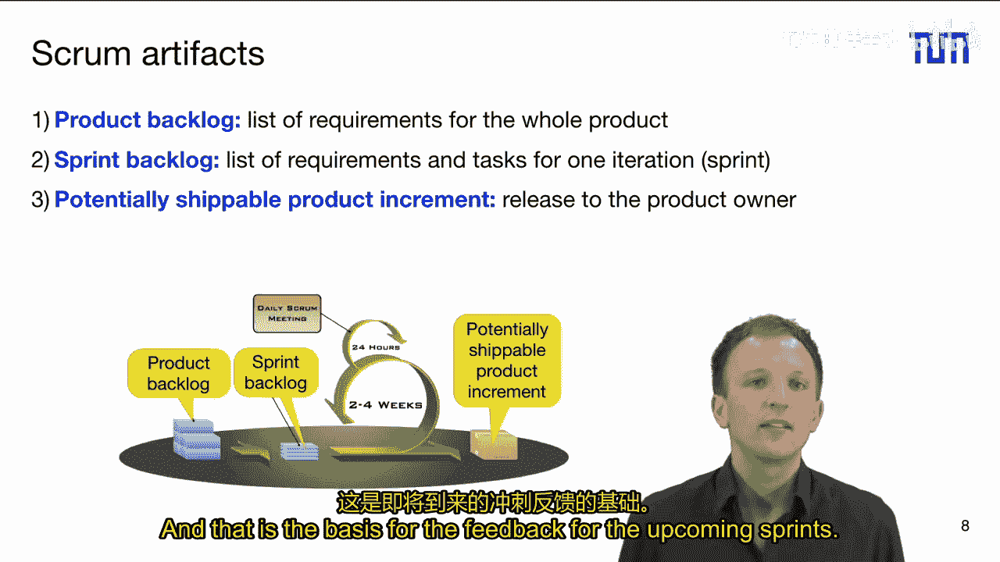

**软件工程基础：1-4：Scrum 🚀**

在本节课中，我们将学习两种不同的过程控制方法，并深入了解最流行的敏捷方法之一：Scrum。我们将探讨其核心概念、角色、会议和产出物。

---

在上一节中，我们介绍了定义式过程，如瀑布模型、V模型或螺旋模型。定义式过程是预先计划好的，类似于生产线，人们等待特定的活动，完成后下一个活动才能开始。开发者遵循严格的规则，避免偏差，偏差被视为需要解决的问题，以确保生产线正常运行。

与之相对的是经验式过程控制，它并非完全预先计划。你有一个粗略的计划，知道目标方向，但不会计划每一个微小的活动。相反，你通过回顾或评审来检查活动，然后根据情况调整活动。就像图中所示，如果遇到大浪，所有人可能会移到船的右侧，以防止船倾覆。

Scrum就是经验式过程控制的一个例子，它实际上是最流行的敏捷方法。这张幻灯片展示了其概览：我们从包含粗略需求的产品待办事项列表开始，将其放入冲刺待办事项列表，并为之工作两到四周。我们每24小时举行一次每日站会，在每个冲刺结束时，我们得到一个潜在可发布的产品增量。

Scrum是一个管理和控制过程，专注于早期风险管理，因为在每个冲刺结束时的评审中，我们会审视已完成的工作，并规划接下来两到四周要做什么。开发者以增量的方式交付可工作的软件，这意味着每个冲刺后我们都会为软件添加功能，并且经验性地在需要时调整过程。它是一个促进有效团队协作的简单框架。

大多数项目始于一位产品负责人和一份粗略的需求列表。这些需求在项目启动会议上呈现给团队。在那一天，每个粗略需求都会被录入产品待办事项列表，该列表包含了所有理想情况下应该实现的内容。

在每个冲刺开始时，团队会召开冲刺计划会议，将产品待办事项列表中的条目分解为详细任务。其中一些任务被分配到冲刺待办事项列表中，而其他任务则留在产品待办事项列表中供未来的冲刺使用。在冲刺期间，开发者将实现冲刺待办事项列表中的任务，并在冲刺评审会议上向产品负责人展示。

团队还会单独举行冲刺回顾会议，提供关于团队如何协作的反馈。总结来说，你有一个包含粗略需求的产品待办事项列表，它被细化为冲刺待办事项列表，在两到四周的周期内实现，并最终集成到潜在可发布的产品增量中。

---

Scrum冲刺是一个有时间盒限制的活动。在此期间，团队创建一个潜在可发布的产品增量。

冲刺在项目期间具有一致的持续时间。它们以冲刺计划会议开始，以冲刺评审会议结束，然后在前一个冲刺结束后立即开始一个新的冲刺。因此，我们发布产品增量，然后开始下一个冲刺计划会议，再次进行冲刺，举行冲刺评审会议，发布产品增量，依此类推。从这张幻灯片中你已经可以看到，很可能会将冲刺一评审和冲刺二计划会议合并举行，以节省团队成员的时间。

---

Scrum团队由三种不同的角色组成：

*   **开发者**：他们组织成开发团队。开发团队是自组织的，这意味着他们主动领取任务、估算任务并决定他们做什么。开发团队也是跨职能的，这意味着我们拥有不同的专家，如分析师、开发者、测试人员、发布经理等，这些都是项目成功所必需的。开发者负责产品增量，他们真正实现冲刺待办事项列表中的条目，并将其转化为潜在可发布的产品增量。
*   **Scrum主管**：他是一位调解员，负责解决障碍，并确保开发团队遵循Scrum框架。他会询问团队是否朝着正确的方向前进，但他不是传统的项目经理，不会决定一切、估算一切或强迫团队处理特定任务。
*   **产品负责人**：他是与外部世界（所有其他感兴趣的利益相关者）的联络人，负责收集所有信息来定义产品，通过优先级排序来定义某些需求的重要性，并对项目成果负责。你也可以将他视为需求工程师，因为他必须获取所有需求信息。

---

在Scrum中，我们有不同的会议，我们想快速在Scrum概览中向你展示这些会议：

*   **项目启动会议**：我们共同创建并确定产品待办事项列表的优先级。
*   **冲刺计划会议**：我们创建冲刺待办事项列表以启动冲刺。我们细化来自产品待办事项列表的需求，为其添加更多细节，并选择两到四个最重要的待办事项条目，与产品负责人协商选择多少条，然后将其放入冲刺待办事项列表。
*   **每日站会**：在冲刺期间，我们每天举行15分钟的站立会议，分享状态、讨论障碍，并承诺在下一次会议前解决的任务。
*   **冲刺评审会议**：开发者向产品负责人演示已实现的待办事项条目，产品负责人提供反馈并决定这些条目是否已完成。我们还会识别变更，发现新的需求，然后将其放入产品待办事项列表。
*   **冲刺回顾会议**：有时在冲刺评审会议之后，我们还会举行冲刺回顾会议（这实际上是推荐的）。我们检查这个冲刺，并为下一个冲刺寻找改进点。

---

Scrum也有产出物：

*   **产品待办事项列表**：是整个产品的需求列表。但这些需求没有详细定义，它们被保持得较为粗略，以降低需求获取的工作量，因为我们不想陷入分析瘫痪。
*   **冲刺待办事项列表**：是一个迭代（一个冲刺）的需求和任务列表，其详细程度足以让开发者拥有实现需求所需的所有信息。
*   **潜在可发布的产品增量**：在冲刺结束时发布给产品负责人，也可能发布给软件的最终用户。这是为后续冲刺获取反馈的基础。

---

在本节课中，我们一起学习了定义式与经验式过程控制的区别，并学习了一个现代的软件生命周期模型——Scrum及其概念、会议和产出物。

下节课见。