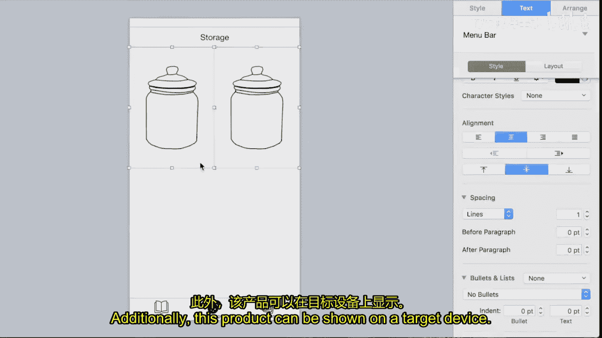
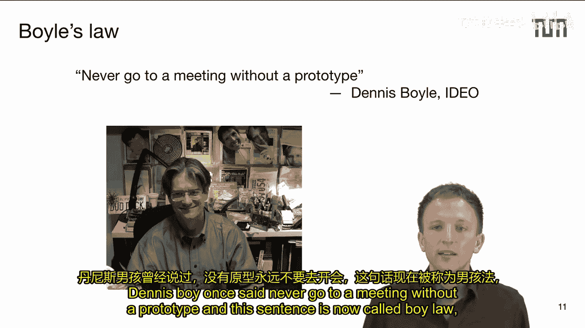

# 005：原型设计 🎨

在本节课中，我们将要学习原型设计在软件开发中的重要性、迭代式原型设计流程，以及不同类型的原型。

## 概述

软件工程处理的是复杂系统。为这些复杂系统设计用户界面是困难的，因为开发者与用户不是同一个人。开发者可能对系统有不同的理解，并且可能不理解用户的真实需求。由于软件工程师主要与其他开发者沟通，他们很少直接接触用户以了解其真实需求。然而，用户界面开发的核心是与用户沟通，即使开发者不直接接触他们。一方面，用户总是对的，因为他们是软件的使用者和潜在购买者；另一方面，用户并非设计师，因此他们不一定知道软件在用户界面中应如何表现。设计出优秀的用户界面需要大量的开发工作。事实上，研究表明，大约50%的设计、实现和维护工作都投入到了用户界面的开发中。

## 迭代式原型设计流程

上一节我们介绍了原型设计的必要性，本节中我们来看看具体的迭代式原型设计流程。

原型设计是一种迭代式方法，用于设计优秀的用户界面。它帮助我们与用户沟通，理解他们的需求，并获取反馈以改进用户界面。开发者首先从低保真原型开始，以感受用户界面的概念并理解其导航流程。低保真原型通常绘制在纸或白板上，易于制作，因为它们不需要包含所有细节。开发者向用户或客户展示低保真原型，获取反馈，并利用反馈改进低保真原型。如果开发者就主要的用户界面概念达成一致，他们就会转向高保真原型。这些原型看起来像真实的系统，并专注于细节，例如按钮的位置、使用的颜色或用户界面元素的对齐方式。如果所有人都同意高保真原型，开发者就可以基于这些原型开始实现实际的应用程序，这些原型充当了开发者、用户和客户之间的协议。

以下是低保真与高保真原型的示例对比：
*   左侧是纸上的低保真原型示例。
*   中间是使用Basalmiq等工具将低保真原型转换为可在目标设备（本例中是移动应用）上直接执行的原型。
*   右侧是相应的高保真原型，它具有相似的布局，但在许多细节上与左侧的低保真原型有所不同。

## 低保真与高保真原型的比较

现在我们来比较低保真和高保真原型的优缺点。

以下是低保真原型的优点：
*   **易于制作**：因为它们不关注所有细节，可以快速在纸上绘制草图。
*   **获得更多反馈**：用户和客户感觉他们仍能做出很多改变，因为原型看起来不像最终系统。
*   **减少设计决策**：开发者或设计师无需做出太多不同的设计决策。

以下是低保真原型的缺点：
*   **无法复用**。
*   **忽略重要细节**：因此无法获得关于颜色或特定元素对齐方式等重要细节的反馈。

以下是高保真原型的优点：
*   **更真实、更详细**：可以识别出更多问题。
*   **更具吸引力**：客户可能比看起来更粗糙的低保真原型更喜欢它们。

以下是高保真原型的缺点：
*   **开发工作量更大**：需要更多努力才能达到如此令人印象深刻的状态。
*   **可能获得较少反馈**：客户和用户可能认为系统已经完成，他们的更改会导致大量开发工作，即使你只是绘制了高保真模型图。
*   **导致高期望**：特别是如果你有交互式原型。

## 原型的其他分类方式

除了低保真和高保真原型，我们还可以根据其他维度对原型进行分类。

以下是原型的不同分类维度：
*   **使用时长和阶段**：原型可以用于内部受众（如其他开发者或设计师）或外部受众（如客户和用户）。
*   **制作媒介**：可以是数字化的（在计算机上绘制）或物理的（如纸张或泡沫板）。
*   **演进方式**：分为演进式原型和抛弃式原型。演进式原型可在应用程序的增量开发中进一步复用，例如极限编程。抛弃式原型则在使用后被丢弃。
*   **范围**：分为水平原型和垂直原型。

## 水平原型与垂直原型

上一节我们介绍了原型的多种分类，本节我们重点看看基于范围划分的水平原型和垂直原型。

让我们考虑一个例子：我们有四个不同的功能需求，并在三个层次上实现我们的系统：底部的数据库层、中间的中间件层和顶部的用户界面层。

**水平原型**采用水平分层的方式。例如，我们可能首先完整实现数据库层，只有在完成后，才去实现中间件层，然后是用户界面层。这是一种自底向上的方法，当然也可以采用自顶向下的方法。水平原型展示了广泛的需求范围，这通常用于传统的、更线性的开发流程中。直到项目结束，我们都没有需求的完整实现，因为只有在所有水平层都实现后，我们才拥有完整的系统。

**垂直原型**则采用垂直切片的方式。同样有四个需求和三个层次，但我们不是完成整个水平层，而是将一个功能需求在所有不同层次（用户界面、中间件和数据库）上完整实现，从而创建一个可执行的原型。这个原型甚至可能已经可以交付给用户。然后，我们随时间推移添加更多功能需求，以增量方式增加软件功能，并产生更多原型。这也被称为垂直集成。垂直原型展示了小范围的需求，但因此展示了这些需求的完整实现，用户已经可以试用这些需求并提供反馈。我们主要在敏捷流程中使用它们进行垂直集成。

## 原型设计实践演示

在下一部分，你将看到一个解释视频，展示如何实际创建原型。在这个视频中，我们向你展示低保真和高保真原型的样子，以及原型开发过程的不同阶段。

现在我们将看到客户和开发者之间关于未来产品的第一次会议。

（会议对话内容展示了从需求讨论到低保真原型展示、获取反馈，再到创建高保真原型的完整流程。高保真原型看起来像已完成的应用，但实际上缺少所有功能。此外，该产品可以在目标设备上展示。）

## 总结与博伊尔定律

在观看了这个关于如何创建原型的解释视频后，我想用一个建议来结束本单元。丹尼斯·博伊尔曾说过：“永远不要不带原型去开会。”这句话现在被称为**博伊尔定律**，你应该遵守它。

在本单元中，你学习了原型设计对软件项目的重要性，能够解释从低保真到高保真原型的迭代式原型设计方法，并且能够比较不同类型的原型设计，例如水平原型和垂直原型。下个单元再见。