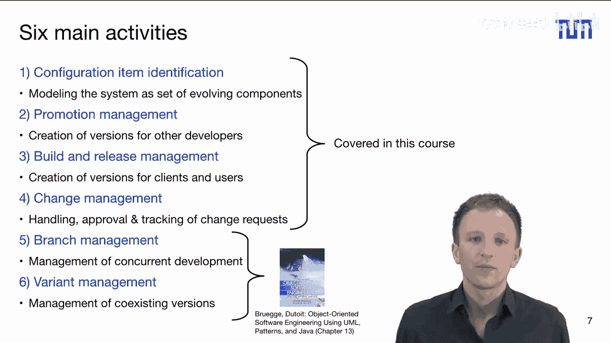

**软件工程基础：2-1：软件配置管理（第一部分）** 🛠️

在本节课中，我们将学习软件配置管理的基础知识。你将了解为什么在软件开发，尤其是大型项目中，配置管理至关重要。我们将解释版本、发布和修订之间的区别，并介绍软件配置管理的核心活动。

---

### **为什么需要软件配置管理？**

为了理解软件配置管理是什么以及它如何工作，我们必须先明白为什么它在项目开发过程中必不可少。

让我们看一个例子。我们将向你介绍玛丽亚和芭芭拉，她们是两位共同开发“烹饪应用”的开发者。玛丽亚正在开发一个创建自定义食谱的新功能，现在她想将自己的代码与芭芭拉正在处理的食谱界面代码进行集成。

玛丽亚使用最新的U盘将代码交给芭芭拉，并询问她是否能将其与当前版本的代码合并。芭芭拉同意了，但不幸的是，她们都在修改同一个文件。芭芭拉需要重写和重构大量代码才能使整个项目重新编译。

玛丽亚离开办公室去参加客户会议，而芭芭拉则承担起让项目重新正常工作的挑战。当玛丽亚从客户会议回来时，她带来了一个新的变更请求：客户现在希望以完全不同的方式展示食谱。而芭芭拉，她仍然没有解决合并问题，希望她能回退到最新的可编译版本，以便有一个稳定的基线来开始新功能的开发。

即使他们有一个可编译的项目，他们也无法发布给客户，因为负责发布流程的同事本正在休假。正如你所见，玛丽亚和芭芭拉在开发工作流程中遇到了很大困难。

**这正是软件配置管理发挥作用的地方。**

---

### **软件配置管理的作用**

软件配置管理帮助你跟踪版本。例如，当多人协作开发同一个代码库时，记录每位开发者的所有变更历史非常有用。如果出现问题，或者有人想回退到之前的版本，这些变更可以轻松定位和撤销。

此外，它允许多人在同一文件上工作，而无需花费数小时来合并变更。变更管理帮助处理变更请求。当团队决定向客户发布时，构建和发布管理可以自动化软件的创建和交付过程，使其可重复且可靠。

让我们看看软件配置管理如何帮助玛丽亚和芭芭拉的工作，并改善他们的工作流程。

当芭芭拉完成工作时，她将变更提交到中央代码库。玛丽亚完成工作后，也可以将她开发的功能合并到代码库中。即使他们需要实现新功能，也可以轻松回滚变更或保存当前状态。一旦某个版本完成，他们可以轻松地将其发布给客户，因为他们利用了构建和发布管理的优势。

玛丽亚和芭芭拉同意从现在开始利用软件配置管理的所有方面。

---

### **核心概念与定义**

当项目中有多人协作处理软件制品时，必须能够存储该制品的多个版本，尤其是当这些制品频繁变更时。开发者会修改源代码和文档，并希望恢复特定版本或比较多个版本之间的差异。他们希望能够多次发布软件，这些软件可能运行在目标环境中不同的机器和操作系统上。

总而言之，**需要进行协调**，这就是软件配置管理的核心。它管理不断演进的软件系统，并控制对这些系统进行变更所涉及的成本。并非对系统的每一次变更都是有用和有价值的。如果你开发高质量软件，但在小版本更新中引入了错误，或者你引入的变更导致应用程序崩溃，你的用户会非常不满。

在我们开始详细介绍不同活动之前，让我们先定义什么是软件配置管理。

**软件配置管理** 包含了启动、评估和控制软件项目工作产品变更所需的规程和技术。它需要在项目期间进行，甚至在软件项目进入维护阶段、最终用户已经开始使用应用程序后也需要进行。它也被称为**项目职能**，这意味着它贯穿项目的整个生命周期，从开始到结束。其目标是使技术和管理的活动更有效，并且可以通过多种方式实施：在整个公司范围内组织级实施、针对特定项目定制、在多个项目成员之间分布式实施，或混合这些方式。

存在一个IEEE标准828-2012，描述了系统和软件工程中的配置管理，本单元的概念基于此IEEE标准。

---

### **关键术语**

以下是软件配置管理中的一些关键术语：

*   **版本**：一个版本是所谓**配置项**的一个特定实例。配置项可以是源代码文件、硬件以及项目中拥有的任何其他项目。通常，版本带有时间戳和其他元数据以唯一标识该特定版本。不同版本具有不同的功能或不同的内容。例如，一个应用程序可能在版本1中只支持一个功能需求，而在版本2中支持多个功能需求。
    *   **公式/代码表示**：`版本 = 配置项 + 时间戳/标识符 + 特定内容/功能集`

*   **发布**：发布是已批准版本的正式分发。当配置项的版本达到定义的质量标准时，可以分发给外部利益相关者，如最终用户或客户。

*   **修订**：修订是对版本（通常是先前已发布的版本）的微小更改。修订通常只纠正设计或源代码中的错误，而不会影响额外的功能。

*   **基线**：基线是经过正式评审的工作产品。在此评审之后，只能通过变更控制流程或变更工作流来更改它们。这允许团队确保定义的质量，因为团队中的某个人（例如变更经理）必须决定变更是否有价值以及是否应该引入。

---

### **软件配置管理的六大活动**

软件配置管理包含六项主要活动：

1.  **配置项标识**：涉及将系统建模为一组不断演进的组件（软件、硬件以及软件项目所需的任何其他内容）。

2.  **晋升管理**：处理为团队内部其他开发者创建版本。当开发者完成任务并创建了一个配置项后，可以将其“晋升”，以便团队内的其他开发者能够访问它。

3.  **构建与发布管理**：处理为外部利益相关者（如客户和用户）创建版本。它定义了团队发布的频率以及如何创建发布并使其对用户可用。

4.  **变更管理**：涉及处理、批准和跟踪变更请求，以确切了解为什么需要进行某项变更，以及谁实际参与了更改特定配置项。

还有两项活动：
5.  **分支管理**：处理并发开发。
6.  **变体管理**：尝试管理共存的版本，例如，基于相同基础组件为不同客户提供的产品的多个版本（可以想象针对学生、家庭用户或公司的不同Windows 10实例）。

在本课程中，我们主要关注前四项活动。你可以在 Bernd Bruegge 和 Allen H. Dutoit 所著的《Object-Oriented Software Engineering Using UML, Patterns, and Java》第13章中阅读更多关于后两项活动的内容。

---

### **总结**

在本单元中，你学习了为什么软件配置管理很重要。你现在可以解释版本、发布和修订之间的区别，并且了解了软件配置管理的六项主要活动。我们下个单元再见。