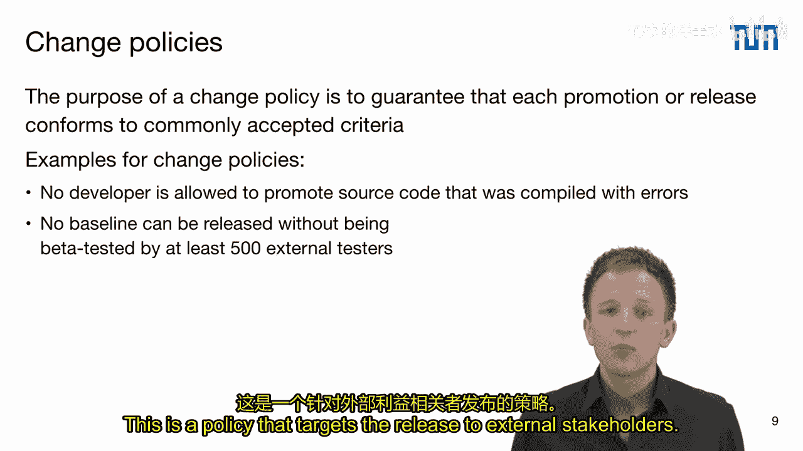

**软件工程基础：2-2：软件配置管理（第二部分）**

在本节课中，我们将学习软件配置管理中**配置项识别**、**晋升管理**与**变更管理**的核心概念。我们将了解内部晋升与外部发布的区别，并描述一个典型的变更请求工作流程。

---

### 配置项识别

上一节我们介绍了软件配置管理的六项活动，本节中我们首先来看第一项活动：配置项识别。

一个**配置项**是软件、硬件或两者的集合，在软件项目中被视为受控项。这意味着我们能够更改这些项并为它们创建版本。例如：
*   源代码文件
*   驱动程序
*   测试用例
*   在项目分析或设计阶段创建的不同文档（例如，可能处于配置管理下的用户手册）

你还需要知道在发布中使用了哪种系统配置，例如，使用了哪个编译器、哪个操作系统以及哪个开发环境。

然而，并非所有实体都需要一直处于控制之下。配置项识别处理两个问题：
1.  **选择哪些元素进行配置管理**：即，什么应该处于配置控制之下。你真的想为开发过程中创建的所有东西都存储版本吗？
2.  **何时开始配置控制**：在软件工程的早期，这是一项活动，开发人员在项目中想做或必要时才做。如今，它是一个项目职能，开发人员和管理者必须从项目开始到结束都处理它。

但这并不意味着从一开始所有东西都处于控制之下。你也可以在项目期间更改受控内容，但应该从一开始就选择工具、技术和工作流程，并思考你想要控制什么以及不需要控制什么。这在大型项目中尤其重要，因为会产生成千上万个需要唯一标识的实体，并且有许多不了解其他开发人员工作细节的开发者参与。

如果在项目中过早开始控制配置项，可能会引入官僚作风。例如，对于一个文档，可能没有必要控制其中每个单词的每次更改。如果开始得太晚，在文档完成后才开始，则可能导致混淆甚至混乱，因为人们无法确定某个文档或该文档的某个版本属于哪个软件版本。

---

### 晋升管理

接下来，我们看看本单元要讨论的第二项活动：晋升管理。

一个**晋升**是提供给其他开发人员的版本。例如，当开发人员将更改提交到版本控制系统时，这已经是一次晋升，因为其他开发人员可以访问这些更改并将其应用到自己的工作副本中。

相比之下，一个**发布**是提供给外部利益相关者（例如用户）的版本。晋升可以成为发布，这就是晋升管理与发布管理相互关联的地方。

例如，发布可以是Scrum冲刺结束时展示给产品负责人的、潜在可交付的产品增量。它表示一个配置项已满足某些质量标准（通常由质量控制团队定义），并可用于审查发布是否满足这些质量要求。

如果你将软件发布给Beta测试者以发现更多故障并评估系统的感知质量，你可能能够发现并修复这些故障，然后可以创建小的修订版并将其包含在最终交付给最终用户的正式发布中。

晋升管理则定义了何时以及如何创建晋升的工作流程、活动和最佳实践。我们将在“分布式版本控制”单元中更详细地介绍。

---

### 核心概念模型

让我们快速回顾一下目前学到的概念，并将它们放入一个对象模型中。作为软件工程师，我们使用模型进行沟通，这也是一个很好的练习，可以帮助你理解是否正确地掌握了术语及其关系。

我们从一个**受控项**开始，它可以是多个受控项的聚合，也可以是单个配置项。我们使用组合设计模式来建模，表示我们可以有任意宽度或深度的多个聚合。一个聚合可以包含其他聚合。可以想象操作系统中的文件夹结构，其中包含其他文件夹和文件。

每个受控项都可以有一个**版本**。一个版本可以是：
*   **发布**：正式交付给外部利益相关者。
*   **晋升**：提供给团队内其他开发人员。
*   **修订版**：通常处理发布中的错误和小问题。

将这些术语放在一起，我们就得到了对象模型，可以更轻松地作为软件工程师进行沟通。

---

### 变更管理

我们跳过了第三项活动（构建与发布管理），因为它将在后面的单元中介绍。因此，我们继续讨论变更管理，即变更请求的处理。

让我们考虑一个示例性的变更工作流程：
1.  **需要变更**：例如，用户通过反馈请求变更。
2.  **创建变更请求**：首先需要识别哪些受控项需要更改，以创建一个变更请求（简称CR）。这可以非常正式（使用包含许多属性的变更请求表格），也可以非常非正式（例如，在客户表示想要更改用户界面中一个按钮的电子邮件中）。
3.  **评估变更请求**：根据需求、项目约束对变更请求进行评估，并可能由某些团队成员审查，以确定它是否完整，以便我们可以初步调查需要完成哪些类型的更改。
4.  **审查与批准**：变更经理（简称CM）随后审查团队是否能够实际实施这些更改，以及变更请求是否可以在接下来的某个开发迭代中处理。有两种情况：我们可以**拒绝**变更请求并通知请求者目前无法进行更改；另一种选择是**批准**变更并将其分配给开发人员。
5.  **实施与测试**：开发人员设计、实施并测试变更。
6.  **审计**：实施后，应进行审计以控制更改是否符合定义的质量要求。如果不符合，开发人员需要修复审计中发现的问题。
7.  **创建新基线**：如果审计通过，则创建一个新的**基线**（一个遵循定义质量要求的版本）。请记住，这个基线只能通过变更管理程序（例如我们刚刚在本幻灯片中看到的程序）进行更改。

为了控制变更请求，需要**变更策略**。其目的是保证每次晋升或发布都符合团队中定义的公认标准。每当执行晋升或发布时，都会应用一个或多个策略。

以下是两个策略示例：
1.  **代码编译策略**：不允许任何开发人员提交编译带有错误或警告的源代码。这同样是分布式版本控制的最佳实践。
    *   **代码示例**：`if (compileStatus.hasErrors()) { throw new PromotionNotAllowedException("Code contains compilation errors."); }`
2.  **Beta测试策略**：任何基线在未经至少500名外部测试人员进行Beta测试之前，不得发布。这是一个针对外部利益相关者发布的策略。
    *   **公式描述**：`Release Candidate → (Beta Testers ≥ 500) ∧ (Pass Rate ≥ Threshold) → Official Release`

---

### 总结

在本节课中，我们一起学习了如何区分内部晋升和外部发布。我们还介绍了配置项识别，并讨论了一个典型的变更管理工作流程示例。理解这些概念对于在团队中有效管理软件配置和变更至关重要。