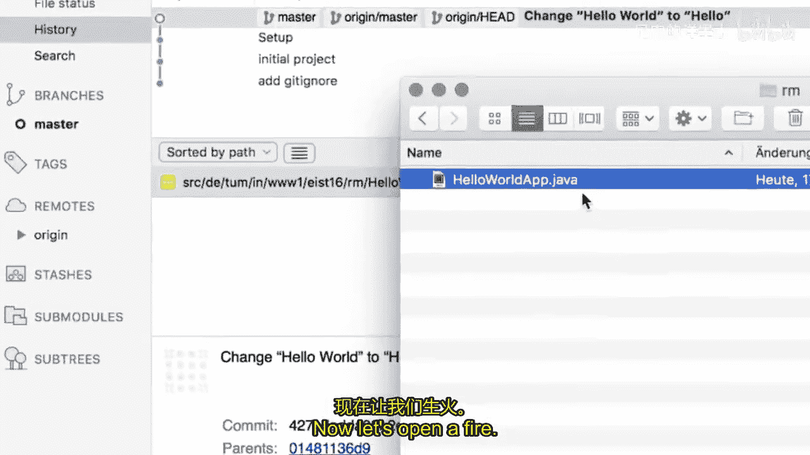
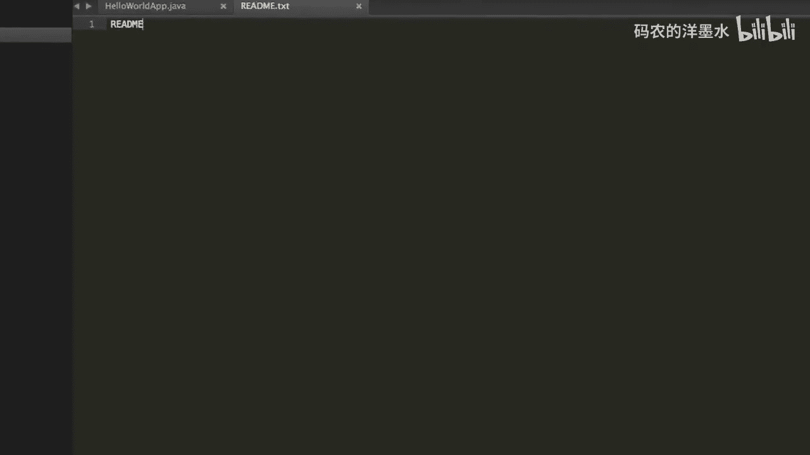
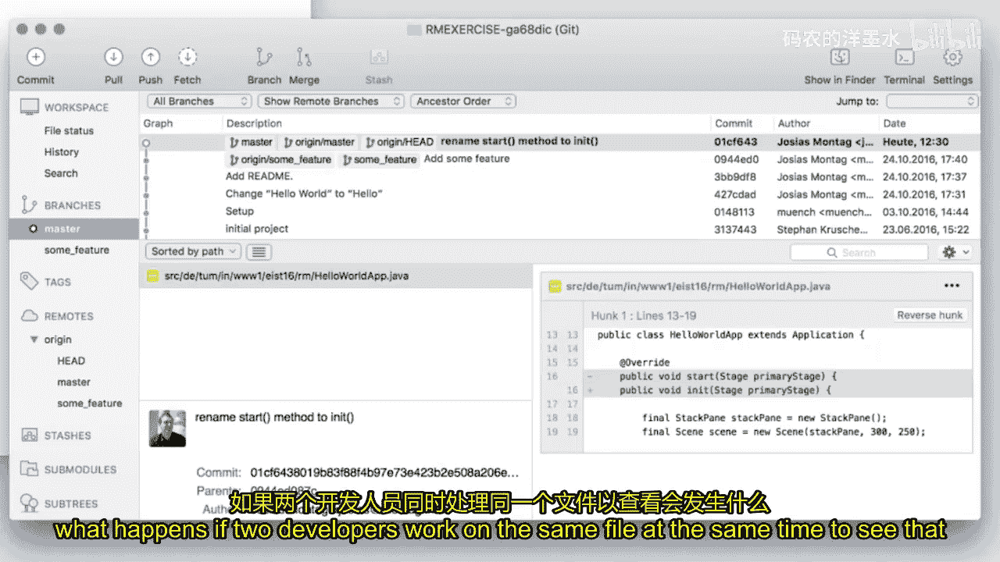
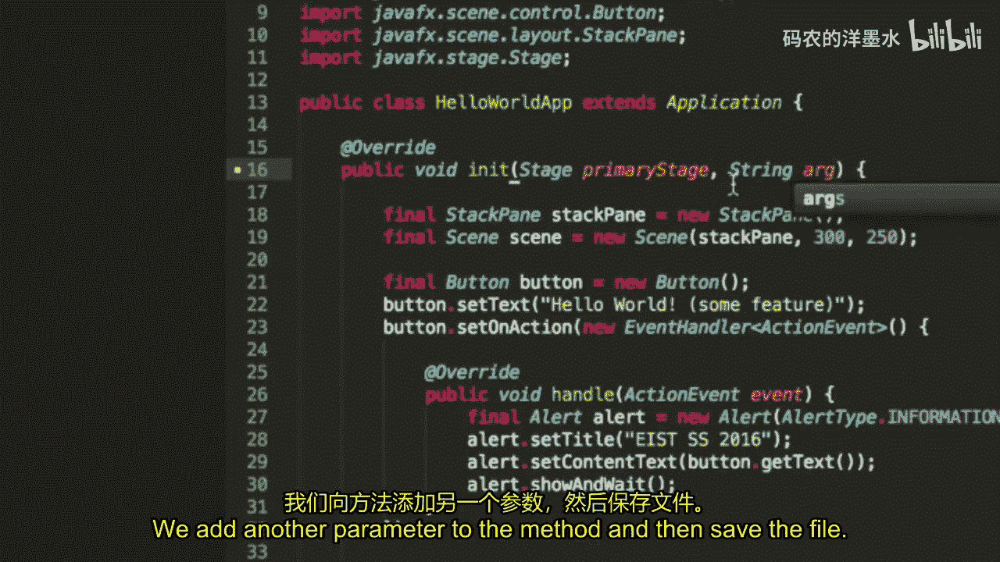
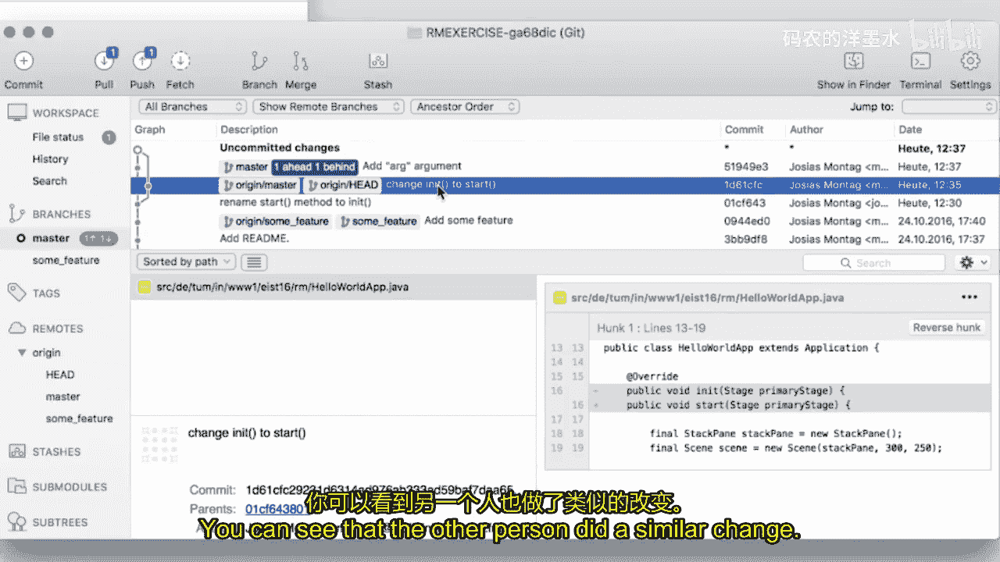
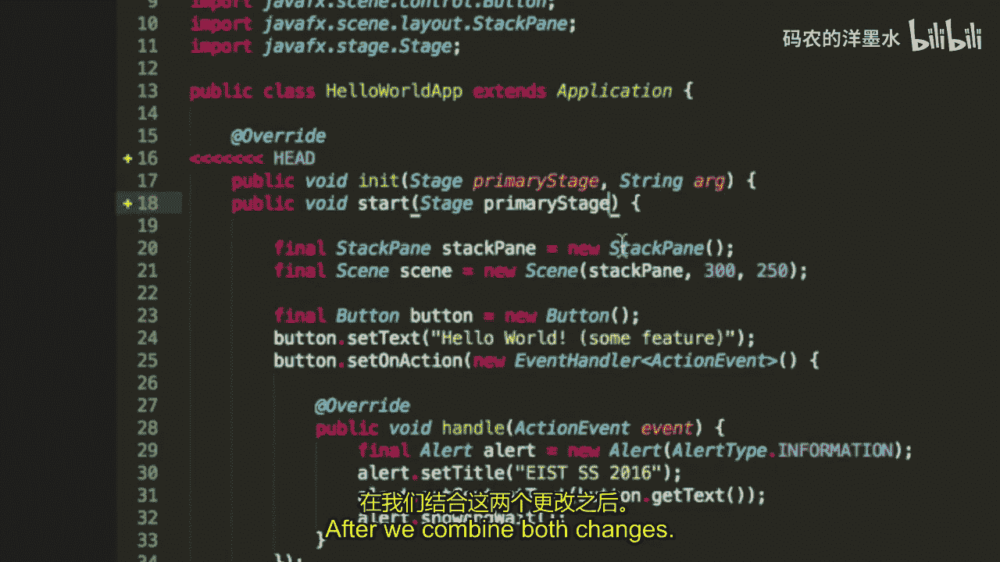
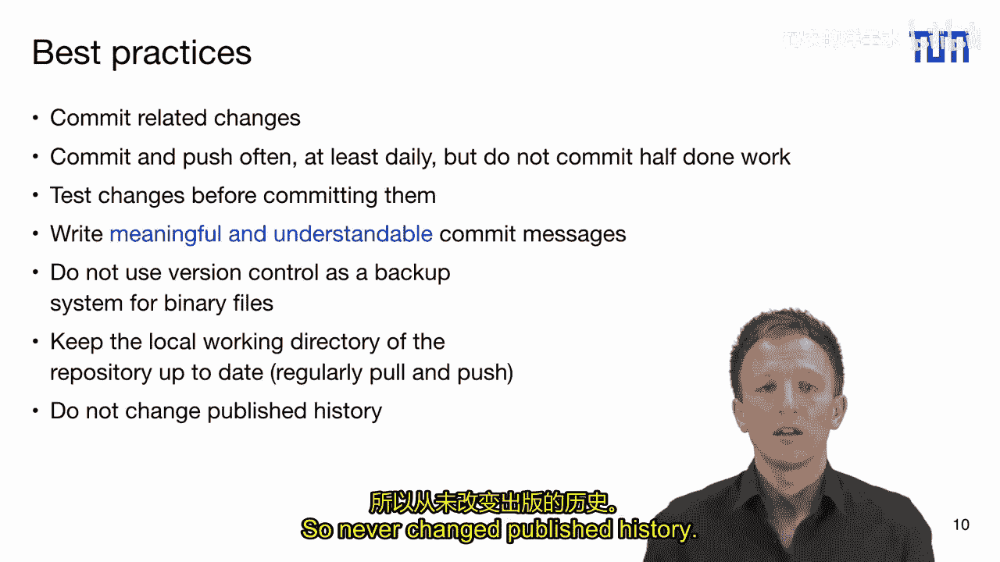

# 010：分布式版本控制 📚

在本节课中，我们将学习分布式版本控制的核心概念，并了解如何使用 Git 工具 SourceTree 来应用这些概念。我们将介绍关键的 Git 命令和最佳实践。

## 分布式版本控制的工作原理

分布式版本控制系统允许多个开发者在不同的计算机上协作。系统中存在一个远程仓库，开发者们各自拥有一个本地仓库。他们通过本地仓库与远程仓库交互，以获取或上传文件变更。其他开发者同样通过他们的本地仓库连接到远程仓库，从而实现文件与变更的交换。此外，像 GitHub 或 BitBucket 这样的平台通常提供 Web 界面，允许开发者在浏览器中访问甚至修改文件。

上一节我们介绍了分布式版本控制的基本架构，本节中我们来看看具体的 Git 命令。

## Git 核心命令详解

当开发者想要分享他的变更时，他首先需要在工作目录中创建新文件，然后将其存储到本地仓库。为此，开发者需要将工作目录中的变更提交到本地仓库。一个 `git commit` 包含了从前一个版本到当前版本的所有变更。

在提交之前，开发者需要选择工作目录中想要提交的变更。这通过使用 `git add` 命令将文件或文件的部分内容添加到暂存区来实现。之后，执行 `git commit` 命令，这些变更就被提交到了本地仓库。然而，此时文件尚未与其他开发者共享，因为它们仅存在于本地仓库中。

为了最终共享已提交的变更，开发者需要将存储在提交中的变更推送到远程仓库。这会将变更提升给所有有权访问该仓库的开发者。之后，其他开发者就可以看到这些变更，并将它们下载到自己的本地仓库和工作目录中。

以下是 Git 中最重要命令的概述：

*   **`git add`**：选择工作目录中的变更，并将其添加到暂存区，标记为待提交。
*   **`git commit`**：创建一个新版本，并将暂存区中选定的变更应用到本地仓库。
*   **`git push`**：将所有新的本地提交上传到远程仓库。这仅在远程仓库不包含更新的提交时才有效。
*   **`git pull`**：这是一个组合命令。它首先执行 `git fetch`，从远程仓库下载所有新的提交到本地仓库；然后使用 `git merge` 命令，将这些新提交中的变更应用到工作目录。

在最简单的情况下，变更会直接应用到工作目录。然而，如果存在冲突，开发者需要选择使用哪个版本的变更。当两个开发者独立修改了同一文件的同一行时，总会发生冲突。通过良好的沟通和保持每次提交的变更量较小，可以避免合并冲突。

合并成功后，本地仓库会包含一个额外的合并提交。开发者需要将这些变更推送到远程仓库，以便其他开发者访问。

当开发者加入一个项目时，他们与 Git 的第一次交互是克隆远程仓库。`git clone` 命令会初始化一个本地仓库和工作副本，它也是一个组合命令：首先获取远程仓库的所有提交以创建新的本地仓库，然后 `git checkout` 命令通过添加所有文件和文件夹的最新版本来创建工作副本。

了解了核心命令后，我们来看看如何在 SourceTree 中实际操作这些命令。

## 使用 SourceTree 进行版本控制实践

这是一个关于如何使用 SourceTree 的简短教程。

首先，克隆远程仓库。点击“从 URL 克隆”，粘贴仓库 URL，可选地更改仓库的本地路径，然后点击“克隆”。在主窗口中，你可以看到仓库现有的提交历史。

现在，你可以在系统上的工作副本中打开和编辑文件。在主窗口中，你可以找到“获取”按钮。“获取”会将远程变更下载到你的本地仓库，但不会将它们合并到你的工作副本中。例如，你可以看到其他人向远程仓库提交了变更。点击提交，你可以在左侧看到更改的文件，在右侧以“统一差异”视图看到文件内的具体变更。前面带减号的红色行表示从文件中删除，前面带加号的绿色行表示添加到文件中。

在提交历史中，你会看到本地仓库落后远程仓库一个提交。使用“拉取”，你可以下载变更（相当于先获取），然后将它们合并到工作副本中。这意味着远程仓库中的变更会与我们的本地仓库和工作副本同步。

现在，让我们打开一个文件并进行一些更改。保存后，我们还创建一个新文件。切换回 SourceTree，你会看到它检测到了未提交的变更。在“文件状态”选项卡中，你可以看到更改的 Java 文件和新建的 readme.txt 文件。点击文件前的复选框，可以将文件“暂存”。暂存的文件是标记为要提交到本地仓库的变更。你可以暂存文件中的单个变更或所有变更。

现在，我们想提交这些变更以与其他开发者共享。因此，必须输入提交信息。提交信息应始终有意义，并尽可能全面地描述变更，以便其他开发者立即知道发生了什么变化。如果我们现在切换到“提交历史”选项卡，可以看到我们的本地仓库领先远程仓库一个提交。使用“推送”，我们现在可以将提交上传到远程仓库。之后，你可以在提交历史中看到远程和本地仓库已同步。

你可能会问，如果两个开发者同时处理同一个文件会发生什么？为了看到这一点，我们打开 Java 文件来更改 init 方法。我们为方法添加另一个参数，然后保存文件。我们暂存变更并用有意义的提交信息进行提交。通过下方的复选框，我们可以直接将提交推送到远程仓库。现在我们收到一条错误信息：我们的提交被拒绝，因为远程仓库包含一个额外的提交，而我们尚未拉取。这意味着在我们实施更改时，另一位开发者推送到了远程仓库。远程仓库无法同时处理两个提交，因此拒绝了第二个。要解决此问题，我们必须先拉取另一位开发者的远程提交，这会自动将它们合并到我们的本地工作副本中。如果没有冲突，你不需要手动合并。然而，在这种情况下，自动合并没有成功，我们收到错误信息。这意味着我们必须手动合并。

我们可以查看提交以了解哪些变更实际导致了冲突。你会看到另一个人做了类似的更改，他重命名了我们更改的同一个方法。如果你再次打开 Java 文件，我们会看到冲突：我们的更改是添加新参数到方法中，另一个人的更改在下方。现在我们的工作是手动合并冲突并整合双方的更改。在我们整合了双方的更改后，可以保存文件，在 SourceTree 中继续合并提交，并最终推送到远程仓库。至此，我们已经涵盖了 SourceTree Git 客户端最重要的功能，并成功解决了合并冲突。

在通过 SourceTree 实践了与 Git 的交互后，现在让我们定义一些与分布式版本控制工具交互的最佳实践。

## 分布式版本控制最佳实践

以下是使用分布式版本控制时应遵循的一些关键原则：

*   **提交相关的变更**：开发者应提交相关的变更，以便其他开发者能轻松识别更改内容。这意味着不应生成一个包含工作目录中所有变更的大型提交，而应创建多个可以单独撤销的小型提交。例如，一个类中的所有变更可以合并为一个提交，或者对一个特定功能需求的变更可以合并为一个提交。开发者可以在本地仓库中拥有任意数量的提交，然后一次性将所有小型提交推送到远程仓库。
*   **频繁提交和推送**：开发者应频繁提交和推送变更，以便其他开发者能立即使用这些变更。这可以避免多个开发者处理相同文件时产生复杂的合并冲突。
*   **不要提交未完成的工作**：开发者应测试其本地变更是否能编译通过，以及所有测试用例是否通过。否则，他们的同事将面临严重问题，因为他们可能无法理解变更，也无法修复编译和测试错误。如果编译被破坏，其他开发者可能无法继续工作。
*   **编写有意义的提交信息**：编写有意义且易于理解的提交信息非常重要，因为这是其他开发者在想将提交的变更应用到其工作副本时首先看到的内容。如果他们无法立即从提交信息中识别出实际更改的内容，就需要浏览所有变更来理解更改了什么以及这可能如何影响他们的工作，这可能会很繁琐、耗时并导致错误。
*   **不要将版本控制用作二进制文件的备份系统**：对于二进制文件，应使用如 Maven 或 Gradle 这样的依赖管理系统，因为二进制文件会产生大量的存储变更，并且你无法比较这些二进制文件的多个版本。
*   **保持本地仓库为最新状态**：这意味着定期拉取其他开发者的变更，并定期推送自己的变更，以便其他开发者也能保持其本地仓库为最新状态。
*   **切勿重写已发布的提交历史**：像 Git 这样的分布式版本控制工具可能允许你重写远程仓库中已发布的历史，但你绝对不应该这样做，因为如果其他开发者已经将这些变更应用到他们的本地仓库，这肯定会导致严重的合并冲突。

## 总结

本节课中，我们一起学习了如何在 SourceTree 中与 Git 交互，并了解了最重要的 Git 命令。我们还解释了与分布式版本控制交互的最佳实践。希望这些知识能帮助你在未来的项目中更有效地进行版本控制。