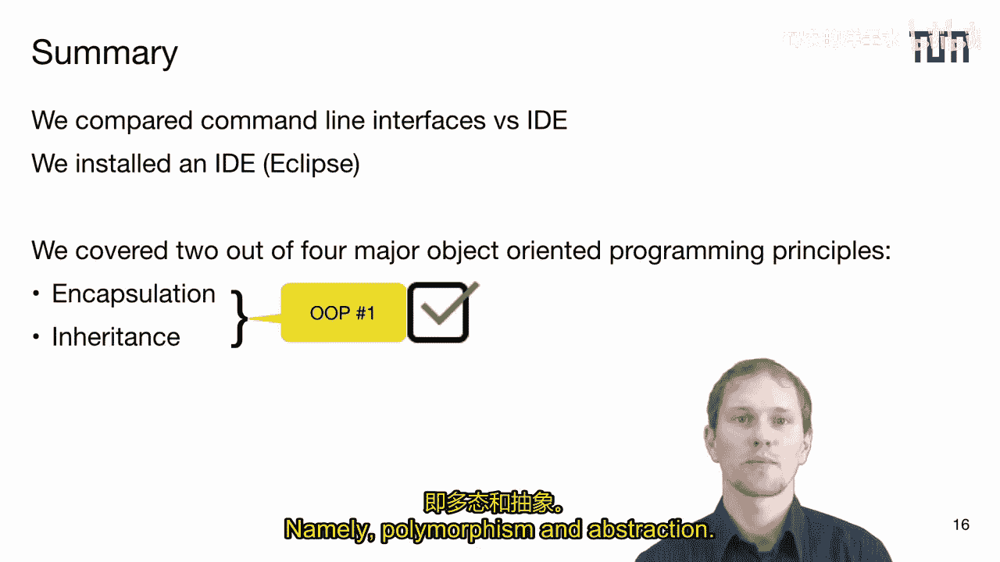

# 011：面向对象编程基础（第一部分）


在本节课中，我们将学习面向对象编程的基础知识。首先，我们会介绍如何安装和使用Eclipse集成开发环境。接着，我们将深入探讨面向对象编程四大原则中的两个：封装和继承。课程内容将使用Java编程语言进行讲解，并通过实例展示如何应用这些原则。

## 为什么需要集成开发环境？

上一节我们介绍了课程概述，本节中我们来看看为什么需要一个集成开发环境。

如果你曾尝试手动编译一个包含多个源文件且分布在不同的文件夹或包中的项目，你很可能知道处理可能出现的类路径问题或确保编译时使用所有依赖项是多么困难。此外，使用没有语法高亮、编译和错误检测或自动补全功能的编辑器会阻碍你快速高效地开发。

以下是集成开发环境有益的几个主要原因：
*   在开发过程中更容易检测错误。
*   团队协作变得更加容易。
*   重构和构建代码结构更加方便。

## 安装与使用Eclipse IDE

上一节我们讨论了IDE的重要性，本节中我们将学习如何安装和使用Eclipse。

这是一个关于如何使用Eclipse并启动第一个Java项目的简短教程。

Eclipse是一个IDE，即集成开发环境，广泛用于Java项目。

以下是获取和设置Eclipse的步骤：
1.  访问eclipse.org，为你的平台下载最新的安装程序。
2.  首次启动Eclipse时，系统会提示你设置一个工作空间。工作空间是存储所有项目的地方。
3.  启动Eclipse后，首先看到的是欢迎屏幕。你可以使用“导入现有项目”将现有的Java项目导入到工作空间。这是打开本课程编程练习的推荐方式。

现在，我们想创建一个新的Java项目。

以下是创建和运行一个简单Java项目的步骤：
1.  选择一个项目名称，Eclipse会自动在我们的工作空间文件夹中创建一个项目文件夹。
2.  Eclipse初始化项目并为源文件创建一个文件夹。由于我们尚未创建任何类，该文件夹为空。
3.  在创建类之前，我们想创建一个包。使用工具栏中的包图标。Java包是用于组织一组相关类和接口的命名空间。对于编程练习，你可以选择任何喜欢的名称。Eclipse将在我们的源目录中创建一个包文件夹。
4.  现在创建第一个类。使用工具栏中的类图标。我们想创建一个名为`Student`的公共类，因此保留所有修饰符不变。你可以看到Eclipse为我们创建了`Student.java`文件并初始化了一个空类。
5.  接下来，向类中添加代表学生姓名的属性，并添加一个打印学生基本信息的方法。每次你输入一个点号，Eclipse会建议可能的自动补全方式。选择一个，只需按回车键。这些建议有助于找到你不确切知道名称的方法。
6.  如果Eclipse检测到编译错误，它会警告你，在语句下划线，并在出错的行旁边显示一个红色的X。将鼠标悬停在其上可以获取有关问题的更多详细信息。在本例中，这是一个简单的语法错误，我们只需添加一个分号即可修复问题。
7.  `Student`类目前没有任何构造函数。当然，我们可以手动编写一个，但Eclipse可以帮助我们并生成某些代码部分。点击菜单项“源代码”，然后选择“使用字段生成构造函数”。在窗口中，我们选择要通过构造函数初始化的属性，Eclipse会自动为我们生成构造函数。
8.  Java项目需要有一个`main`方法才能执行。因此，让我们创建一个包含`main`方法的类，并将其命名为`App`。在对话框中，你可以看到自动生成空`main`方法的选项。
9.  在我们的`main`方法中，我们想创建一个新的`Student`实例，分配姓名，并执行`printOutInfo`方法。我们项目的第一个版本现在应该完成了，我们需要测试一切是否按预期工作。
10. 要运行代码，需要按下绿色的“运行”按钮。但不幸的是，我们会在控制台得到一个错误。原因是Java不知道`main`方法位于哪个类中。要配置这一点，我们使用“运行”按钮旁边的小箭头，然后点击“运行配置”。Eclipse会自动为我们生成一个新的配置。我们唯一需要做的就是选择我们的主类，在本例中，它叫做`App`。
11. 现在再次运行代码，这个小项目会按预期运行。

在这个讲解视频中，你学习了如何使用Eclipse并执行你的第一个项目的基础知识。

## 为什么需要面向对象编程？

到目前为止，你应该已经成功安装了Eclipse IDE并运行了你的第一个应用程序“Hello World”。在接下来的时间里，我们将重点讨论为什么需要面向对象编程。

但首先，我们想从一些关于一个重要原则的背景信息开始，这个原则也适用于软件开发：分而治之原则。它可以作为一种政治手段，也可以作为战争中的战略工具。孙子描述这一原则时基本上是说，如果敌军规模是你的两倍，你应该能够分割这支军队以在战斗中获得机会。

那么，我们如何将其应用于软件工程呢？在软件工程中，我们将要构建的系统分解为更小的子系统，这样它们实际上可以由单个开发人员或团队来实现。

面向对象编程范式通过使用四大原则帮助我们分而治之地构建系统，即封装和继承（将在本单元中介绍），以及多态和抽象（将在下一单元中介绍）。

## 封装

上一节我们介绍了分而治之的思想，本节中我们来看看第一个面向对象原则：封装。

封装意味着我们能够将待开发软件的特定结构和功能分组到单个元素中。这些元素被称为类。

Java通过使用类来支持封装，类包括用于其结构的属性和用于其功能的方法。

让我们看一些类和代码示例。这里我们有一个`Student`类，它包含`majorSubject`、`minorSubject`和`courseList`属性来构建学生。我们还有像`joinCourse`或`dropCourse`这样的方法，用于描述其功能。

可以说，对象是类的具体实例，因此类可以被视为创建具有特定初始化属性的对象的蓝图。

为了创建这些具体实例，Java使用一种所谓的构造函数方法。构造函数是一种特殊的方法，它没有返回类型，并且名称与类名相同。

假设我们有一个`Student`类，我们想创建一个具体的`Student`实例或`Student`实例，即`Dave`和`Matt`。首先，我们创建构造函数方法。记住，构造函数方法没有返回类型，并且包含类的名称。

所以构造函数看起来像下面这样：
```java
public Student(String majorSubject, String minorSubject) {
    this.majorSubject = majorSubject;
    this.minorSubject = minorSubject;
    this.courseList = new ArrayList<>();
}
```
它没有返回类型，构造函数的名称叫做`Student`。它接受参数`majorSubject`和`minorSubject`来初始化这两个属性的值。它还为`Student`实例创建一个空的课程列表。

默认情况下，每个创建的类都有一个所谓的默认构造函数，它是隐式的。然而，它通常不会做你期望它做的事情。为什么？因为它不会初始化你的任何属性的具体值，你需要指定自己定义的自定义构造函数来正确初始化所有需要的属性，如前一页幻灯片所示。

## 继承

上一节我们学习了封装和帮助我们初始化类对象的构造方法，本节中我们来看看今天的下一个原则：继承。

继承允许我们通过将一个类指定为另一个类的超类，来重用现有类的属性和功能。

让我们看看这样的超类与子类层次结构。让我们看一些更真实的例子。每辆汽车都是一种交通工具。每辆摩托车也是一种交通工具。因此，汽车和摩托车都可以被视为子类，而交通工具类可以被视为它们两者的超类。

因为它们都共享相同的结构信息，例如车轮。它们也共享相同的功能，例如移动或启动引擎。但两者都可以拥有超类没有的额外属性或功能。通过超类，我们试图找到子类的共同点，以尽可能多地重用代码，但我们并不局限于这些元素。

那么它在Java中是如何工作的呢？Java通过创建超类和子类的继承层次结构来支持继承。在Java中，每个子类只允许有一个超类。我们使用关键字`extends`来建立这样的层次结构。

让我们看看相应的UML图及其特定的Java代码。这个UML图将继承关系表示为一个关联上的空三角形。三角形指向的类是超类，关联起始的类是子类。

在Java代码中，这看起来像下面这样：
```java
// 首先，我们定义超类及其所有属性和方法
public class Vehicle {
    private int numberOfWheels;
    public void startEngine() { ... }
}

// 然后我们定义具有额外属性和功能的子类（如果需要）
public class Car extends Vehicle {
    private int numberOfDoors;
    // Car 继承了 Vehicle 的属性和方法，并可以添加自己的
}
```
首先，我们定义超类及其所有属性和方法。然后我们定义具有额外属性和功能的子类（如果需要）。最后，我们使用`extends`关键字链接这些类。

为了重用超类的属性，我们必须将现有属性的初始化从子类委托给超类构造函数。我们使用`super()`构造函数调用，并将值从子类传递给超类。

所以首先，我们创建`Person`类，它是我们的超类。然后我们创建一个`Student`类，它是我们的子类。记住使用关键字`extends`来构建类层次结构。

现在，当我们调用`Student`构造函数时，我们将把值传递给`Person`构造函数。在这里，你的值被设置。之后，我们将在`Person`实例中设置额外的值。

子类可以访问相应超类的非私有属性和方法。如果子类没有声明一个方法，Java编译器会尝试在超类层次结构中查找这个方法。

让我们再看一下我们的`Person`和`Student`示例。我们声明一个`Student`实例以及一个`Person`实例。访问`firstName`对于`Student`实例和`Person`实例都是可能的，因此`Student`正在重用超类`Person`的`firstName`属性。访问`printPersonalInformation`方法对于`Student`类和`Person`类也是可能的，因此`Student`也正在重用超类`Person`的`printPersonalInformation`方法。

在“面向对象编程（第二部分）”单元中，我们将通过引入一个称为方法签名的新术语，更详细地介绍这种机制的确切工作原理，敬请期待。

关于面向对象编程原则继承，还有最后一件事。请注意，继承关系只在一个方向上成立。这是什么意思？在我们的例子中，每个学生都是一个人。但并非每个人都必须是学生。这意味着，只能从更精确或更专门的类型（即子类）赋值给更通用的类型（即超类）。

## 总结

在本节课中，我们比较了命令行界面与集成开发环境。你学习了如何安装Eclipse并启动第一个项目，还学习了应用面向对象编程范式中的封装和继承。

在下一单元中，我们将介绍面向对象编程的另外两个重要原则：多态和抽象。




以上就是面向对象编程基础（第一部分）的全部内容。感谢观看，下次再见。