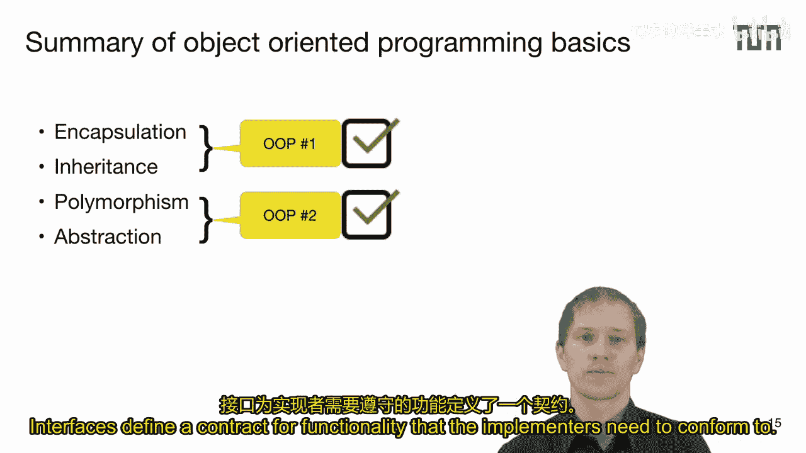

软件工程基础：3-2：面向对象编程基础（第二部分）


在本节课中，我们将学习面向对象编程中最后两个核心原则：多态和抽象。我们将了解它们的概念，并学习如何在代码中应用这些原则。

上一节我们介绍了封装和继承，本节中我们来看看多态和抽象如何扩展这些概念，使代码更加灵活和结构化。

### 多态

多态建立在继承的基础上，它不仅允许子类复用父类的属性和方法，还允许子类修改父类的功能，这是通过**重写**方法实现的。

在深入应用多态之前，需要理解一个重要的概念：**方法签名**。

方法签名用于唯一标识一个方法，确保编译器知道要调用哪个方法。在Java中，方法签名由**方法名**以及**参数的类型和顺序**共同决定。

以下是方法签名的几个示例：
*   `printPersonalInfo()`：无参数。
*   `printPersonalInfo(String name)`：一个字符串参数。
*   `printPersonalInfo(int age, String name)`：一个整数和一个字符串参数，顺序固定。
*   `printPersonalInfo(String name, int age)`：一个字符串和一个整数参数，顺序与上例不同。

这些示例展示了**重载**的概念：在同一个类中使用相同的方法名但不同的参数列表。需要注意的是，在同一个类中，不能定义两个方法名和参数列表完全相同的方法。

然而，在不同的类中，或者在类的继承层次结构中，重新定义相同的方法签名是允许的。这个概念就是**多态**。

让我们通过一个例子来理解多态。假设我们正在开发一个应用，首先创建基类 `Person`。`Person` 类有 `firstName`、`lastName` 和 `birthday` 属性，以及一个打印个人信息的方法 `printInfo()`。

接着，我们区分两种人：`Lecturer`（讲师）和 `Student`（学生）。它们都拥有 `Person` 的所有属性。此外，`Student` 还有一个 `semester`（学期）属性。我们不希望重复编写代码，因此让 `Lecturer` 和 `Student` 都继承自 `Person` 类。

现在，当我们打印学生的信息时，除了基本信息，还希望知道他的当前学期。为此，我们在 `Student` 子类中**重写**了从 `Person` 继承来的 `printInfo()` 方法。这样，调用学生对象的 `printInfo()` 方法时，会得到比调用讲师对象更具体的信息。这就是多态。

具体来说，当调用一个对象的方法时：
*   如果触发 `lecturer` 对象的 `printInfo()` 方法，编译器会先在 `Lecturer` 类中查找该方法。由于未找到，它会向上到父类 `Person` 中查找并执行。这体现了**继承**。
*   如果触发 `student` 对象的 `printInfo()` 方法，编译器直接在 `Student` 类中找到了重写后的方法并执行。这体现了**多态**。

多态允许根据上下文（例如，对象的具体类型）来正确解释相同的符号（例如，方法名）。如果尝试调用一个对象不存在的方法（例如，在 `Student` 对象上调用 `study()` 方法），编译器会沿着类层次结构向上查找，如果始终找不到，就会报错。

让我们再次对比继承和多态：
*   **继承**：子类复用父类的现有行为。当调用子类对象的某个方法时，执行的是父类中的实现。
*   **多态**：子类重写父类的方法以修改其行为。当调用子类对象的该方法时，执行的是子类中重写后的实现。

在Java代码中，我们使用 `extends` 关键字建立继承关系。要重写父类方法，只需在子类中用相同的签名（方法名和参数）重新实现该方法。可以添加 `@Override` 注解来明确表明这是重写。

要使用父类的属性和方法（无论是继承的还是重写的），访问方式与继承时相同。这里需要区分**静态类型**和**动态类型**：
*   **静态类型**：变量在编译时声明的类型。
*   **动态类型**：变量在运行时实际指向的对象的类型。

例如：
```java
Person student = new Student(); // 静态类型是 Person，动态类型是 Student
Person lecturer = new Lecturer(); // 静态类型是 Person，动态类型是 Lecturer
```
当通过这类变量调用方法时，编译器会首先尝试在对象的**动态类型**（即实际类）中查找方法签名。如果找不到，则回退到其父类（静态类型）中查找。

### 抽象

抽象是另一个核心原则，它允许我们定义包含公共状态、属性或行为的抽象结构，这些结构可以在具体实例中被复用。

一个现实世界的例子是 `Shape`（形状）类，它包含各种几何形状的通用信息。但“形状”本身并不具体存在，它总是三角形、矩形等具体形式的抽象表示。在Java中，我们可以定义**抽象类**来强制只能使用其子类，而不能直接实例化抽象类本身。

在Java中，使用 `abstract` 关键字来创建抽象类。此外，还可以定义**抽象方法**。抽象方法只有声明（方法签名），没有具体的实现（没有方法体，以分号结束）。定义抽象方法会强制其子类必须重写（实现）该方法，这可以看作是一种“契约”。

以下是一个示例，展示了一个以抽象类 `Person` 为超类的继承层次。即使 `Person` 类不能被实例化，`Student` 和 `Lecturer` 子类仍然可以通过 `super()` 调用其构造器来设置属性。在UML图中，抽象类通常用斜体表示。

除了抽象类，Java中实现抽象的另一个概念是**接口**。

接口指定了**必须实现什么**功能，但不定义**如何实现**。类似于抽象方法，接口定义了一组方法签名（契约），具体功能必须由实现该接口的类来提供。

在UML中，使用 `<<interface>>`  stereotype 来表示接口。例如，一个 `Updatable` 接口可能声明了一个 `updateCourseList()` 方法，那么实现该接口的 `Student` 和 `Lecturer` 类就必须提供此方法的具体实现。

在Java中定义和使用接口涉及两个新关键字：
1.  `interface`：用于定义接口。
2.  `implements`：用于类声明实现某个接口。

具体步骤是：首先用 `interface` 关键字定义接口及其方法签名；然后在类声明中使用 `implements` 关键字表明要实现该接口；最后，在该类中重写（实现）接口中声明的所有方法。

### 总结

本节课中我们一起学习了面向对象编程的四个基本原则。
*   首先，我们回顾了**封装**（用于组织代码结构）和**继承**（用于复用代码）。
*   其次，我们深入探讨了**多态**，它允许子类重写父类方法以修改功能，是对继承的扩展。如果子类没有重写方法，则默认使用继承的行为。
*   最后，我们学习了**抽象**。抽象类允许对类进行抽象规范以实现通用化，但其本身不能实例化，需要依赖子类。接口则定义了一组必须实现的功能契约，由实现类来具体履行。




这些原则共同构成了强大而灵活的面向对象编程范式的基础。