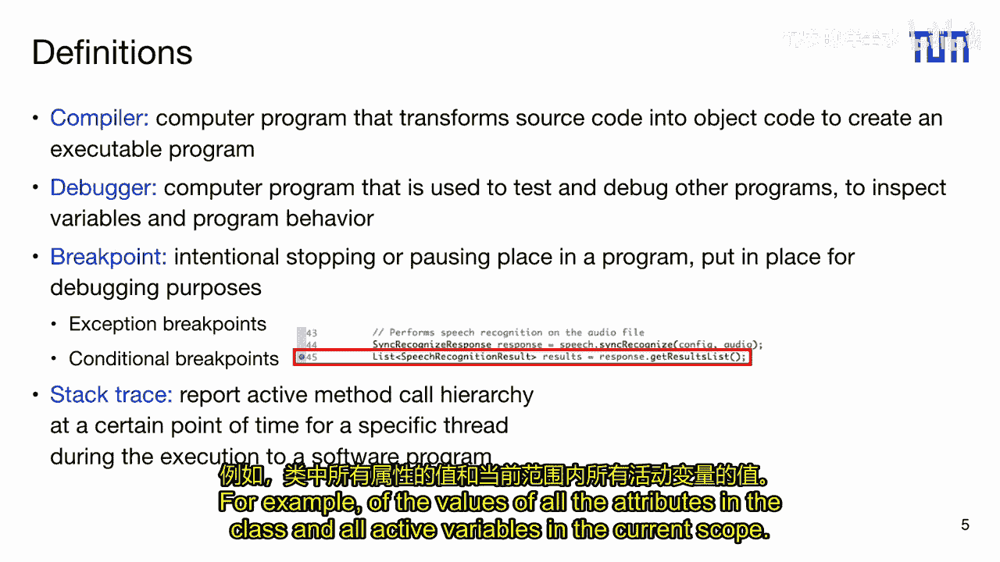

# 013：调试 🐛

在本节课中，我们将要学习什么是调试，以及如何在 Eclipse 集成开发环境中使用调试工具来查找和修复程序中的问题。

---

## 概述

调试是一种在源代码中查找程序问题和意外行为的技术。术语“Bug”（错误）和“Debugging”（调试）的流行可追溯到20世纪40年代的格蕾丝·霍珀。如今，集成在IDE（如Eclipse）中的交互式调试工具使调试过程变得更加容易。

## 调试的起源与定义

“Bug”或“调试”一词的流行归功于20世纪40年代的格蕾丝·霍珀。当时她在哈佛大学操作Mark II计算机，她的同事发现一只飞蛾卡在继电器中，从而阻碍了正常运行。

调试是一种在源代码中查找程序问题和意外行为的技术。早期调试过程繁琐，但现在，随着集成开发环境（如Eclipse）集成了交互式调试工具，调试变得更容易，软件使用和测试用例的执行可以被监控和追踪。

## Eclipse 调试环境实践

上一节我们介绍了调试的基本概念，本节中我们来看看如何在Eclipse中使用调试环境。我们将使用面向对象编程练习中的几个函数进行演示。

我们首先创建一个随机日期列表，启动合并算法并打印到控制台。像往常一样，我们点击Eclipse中的运行按钮来执行它。但这样做时，会抛出一个解析异常，你可以在控制台中看到。

打印出来的信息称为调用堆栈。它显示哪个方法调用了抛出的异常。我们看到主要的初始入口点是主方法的第90行，因此我们在那里设置一个断点。

为了追踪，我们通过点击调试图标并确认切换到调试视角，在调试模式下运行代码。

在这个窗口中，你可以看到用户代码、大纲和底部的控制台，以及顶部的调试控件。在左侧，你可以看到所有活动线程，可以展开它们查看各自的调用堆栈。在右侧，你可以看到当前代码中所有活动的变量及其值。

你还可以通过选择主线程来查看代码中配置的所有断点。

我们现在可以逐步执行代码。顶部的按钮功能如下：
*   **恢复**：继续执行代码，可能直到下一个断点。
*   **终止**：完全关闭执行。
*   **步入**：进入当前绿色高亮行的函数内部。
*   **步过**：执行当前行的函数但不进入其内部。
*   **步出**：跳出当前函数。

我们继续通过“步入”进入`createRandomDateList`函数。

我们现在可以“步过”几行代码，并观察右侧变量是如何更新的。

在初始化日期格式对象后，我们注意到了错误。日期格式对象是用点号实例化的。当我们解析最低状态对象时，它使用的是反斜杠，这就是抛出解析异常的原因。

我们现在可以简单地修复错误并保存代码，这称为热替换，Eclipse会自动从函数中退出到重置状态。尽管如此，我们仍可以继续调试并再次步入该函数。

请注意，我们现在可以步过之前抛出异常的那一行代码。

为了说明差异，我们将在下一行保留错误。你现在可以看到解析异常是如何在`SimpleDateFormat`类中抛出的。

我们终止执行，切换回正常的Java界面，修复代码，然后再次运行它。你现在可以看到日期如何按排序顺序打印到控制台。

## 核心概念定义

让我们回顾一下解释视频中已经学过的定义。

*   **编译器**：编译器是一个计算机程序或一组程序，它将用一种编程语言（通常是源语言）编写的源代码转换为另一种计算机语言（目标语言）。目标语言通常具有二进制形式，或被称为目标代码。转换源代码最常见的原因是为了创建可执行程序。
*   **调试器**：调试器是一种用于测试和调试其他程序（即目标程序）的计算机程序。调试器提供更复杂的功能，例如逐步运行程序、在某个事件或通过断点指定的指令处停止，以及跟踪每个变量的值。一些调试器甚至能够在程序运行时修改程序状态。也可能在程序的不同位置继续执行，以绕过崩溃或逻辑错误。当然，调试器会引入额外的延迟和内存消耗，从而降低系统性能。因此，它可能不适合检测性能关键系统中的问题。
*   **断点**：断点是程序中为调试目的而设置的故意停止或暂停点。有两种不同类型的断点：异常断点和条件断点。在实践中，断点由一个或多个条件组成，这些条件决定程序执行应在何时被中断。
*   **堆栈跟踪**：堆栈跟踪是在软件程序执行过程中，特定时间点针对特定线程的活动方法调用层次结构的报告。每个方法都记录其状态，例如类中所有属性的值以及当前作用域中所有活动变量的值。

---

## 总结

本节课中我们一起学习了“调试”和“错误”这两个术语，演示了如何在Eclipse IDE中使用调试环境，并介绍了测试中一些最重要概念的定义。掌握调试技能对于识别和修复代码缺陷至关重要。