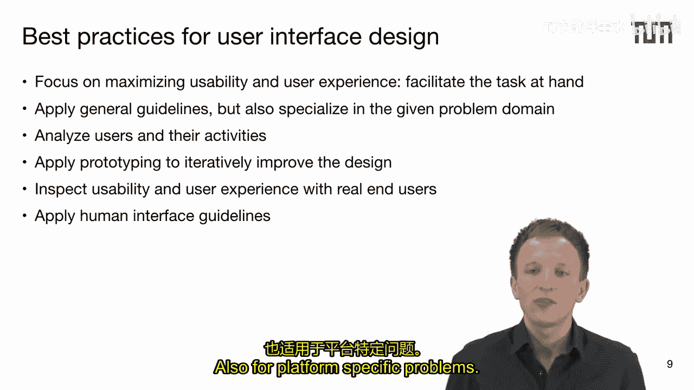
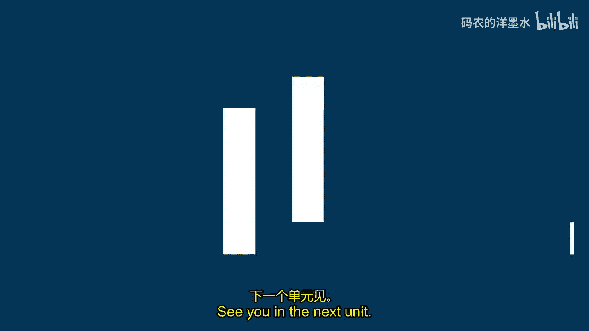

# 014：用户界面设计 🎨

在本节课中，我们将学习用户界面设计的基本概念，包括边界对象、如何使用Java FX设计简单界面，以及用户界面设计的最佳实践。

## 为什么用户界面设计很重要？ 🤔

用户界面设计对于任何由软件控制硬件的系统都至关重要。一个设计不佳的界面，例如一个布满杂乱按钮的汽车仪表盘，会严重影响使用体验。研究表明，用户界面相关的代码通常占整个系统设计和实现工作量的一半。开发一个既复杂又好用的软件是一个难题，需要借助多种技术和实践来解决。我们不能指望用户为了获得不同功能而使用十个不同的系统，因此必须开发一个能满足其所有需求的统一系统。

## 从失败中学习：迭代设计 🔄

听起来可能有些矛盾，但要让用户界面设计得正确，失败是有帮助的。设计是一个迭代的过程。正如亨利·佩特罗斯基（Henry Petroski）所指出的，失败的设计（如一座倒塌的桥）比成功的更能提供有价值的信息，因为它们会促使人们分析问题并寻找更好的替代方案。如果没有失败，人们容易满足现状，不再创新。佩特罗斯基有一句名言：“工程的成功是由其失败定义的。”只有在失败中学习，未来才能成功。这种文化在软件工程，特别是用户界面设计中非常重要，“成功的失败”这一术语就描述了这种理念。

## 原型设计：及早发现失败 🧪

原型设计是一种在软件项目早期识别用户界面设计失败的技术。原型受系统需求影响，并可通过用户评估来找到最合适的界面表现形式。需求导向最终的软件系统，而原型可以作为用户界面的基础。它向用户隐藏了软件系统的复杂细节，使软件易于使用并提供良好的用户体验。

## 边界对象：用户与系统的桥梁 🌉

为了获得良好的可用性和用户体验，我们需要理解边界对象的概念。边界对象代表了用户与系统之间的交互，是用户界面的一部分。例如标签、按钮、表格和列表，它们通过不同的布局约束被组织在视图层次结构中。标准库和框架提供了丰富的标准控件（例如按钮），开发者无需从头实现，可以复用现有边界对象的实现，并配置其属性和行为。

以下是边界对象交互的一个示例流程：

1.  **实例化**：开发者实例化一个按钮对象。
2.  **配置**：开发者可以更改按钮的大小、颜色、阴影等属性。
3.  **定义行为**：开发者通过实现所谓的“动作”或“回调”方法来操纵其行为。
4.  **事件触发**：主事件循环等待用户在实际硬件上点击按钮，然后调用按钮对象的 `click` 方法。
5.  **回调执行**：按钮将此调用转发给应用程序视图控制器中的 `handleButtonClick` 方法。
6.  **功能响应**：视图控制器随后对点击做出反应，并触发软件的特定功能。

这个例子很好地说明了框架的行为：它们允许定制，然后在需要某些操作（如响应按钮点击）时调用应用程序代码。

## 使用 Java FX 进行界面设计 💻

Java FX 是 Java 的一个标准库扩展，提供了丰富的 UI 控件。它集成在 Java 8 中，并包含一个名为 Scene Builder 的应用程序。这个可以集成到 Eclipse 和 NetBeans 中的应用程序，允许通过拖放方式创建用户界面，并生成一种称为 FXML 的文档。FXML 使用一种类似于类图的面相对象模型在后台描述界面。在这个文档中，你可以描述使用了哪些界面元素、如何配置它们，以及应用程序中的哪些类会响应用户界面的操作。Java FX 功能强大且灵活，允许使用类似于 HTML 网页中 CSS 的语法来控制应用程序的设计，这对许多开发者来说很熟悉。

在接下来的讲解视频中，你将看到 Java FX 和 Scene Builder 的实际操作。

**（视频内容概要）**
在讲解视频中，我们演示了如何使用 Java FX 和 Scene Builder 创建用户界面：
1.  安装 Java FX 和 Scene Builder。
2.  在 Eclipse 中创建新的 Java FX 项目。
3.  创建 FXML 文件并用 Scene Builder 打开。
4.  在画布上添加并排列标签和按钮。
5.  修改主类的 `start` 方法以加载和显示 FXML 界面。
6.  创建一个控制器类，包含处理用户交互的功能（例如，增加标签数字）。
7.  使用 `@FXML` 注解将控制器中的属性与方法同界面元素连接。
8.  在 Scene Builder 中将按钮的点击动作和标签的 ID 与控制器代码关联。
9.  运行应用程序，验证按钮点击能更新标签数字。
10. 演示在 Scene Builder 中配置 UI 元素属性，例如将按钮文本颜色改为红色。

Scene Builder 不仅提供了向视图添加 UI 元素的可能性，还具有配置这些 UI 元素的能力。

## 用户界面设计的最佳实践 📚

用户界面设计（或称用户界面工程）是为机器和软件（如计算机、家用电器、移动设备和其他电子设备）设计用户界面，重点是最大化可用性和用户体验。目标是使用户的交互尽可能简单高效，以完成用户目标，这也被称为以用户为中心的设计。好的用户界面设计有助于完成手头的任务，而不会将不必要的注意力吸引到界面上本身。

界面设计涉及广泛的项目，从计算机系统到汽车再到商用飞机等等。所有这些项目都涉及许多相同的基本人机交互，但也需要一些独特的技能和知识。因此，设计师倾向于专攻某些类型的项目，并拥有围绕其专业领域的技能，无论是软件设计、用户研究、网页设计还是工业设计。

在开始开发第一个原型之前，进行用户和任务分析可以让开发者理解用户活动的具体问题和工作流程。原型设计则允许在项目早期从界面设计的失败中学习，并迭代改进用户界面。可用性检查有助于理解用户对现有系统及其界面的问题，并找到改善用户体验的替代方法。人机界面指南描述了针对一般可用性问题以及平台特定问题的最佳实践。

## 总结 📝

本节课中，我们一起学习了边界对象的概念，并应用 Java FX 进行了用户界面设计实践。最后，我们还讨论了用户界面设计的最佳实践。希望这些知识能帮助你创建出更友好、更高效的软件界面。下节课再见！