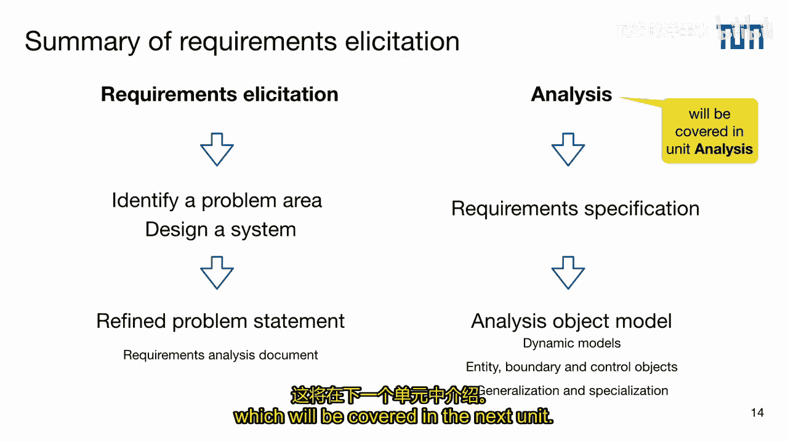

# 015：需求获取 📋

在本节课中，我们将学习软件工程中一个至关重要的初始阶段：需求获取。我们将了解什么是需求获取、为什么需要它，以及如何通过一系列具体活动来系统地收集和定义软件系统的需求。

## 概述

需求获取关注于描述和定义待开发系统的目的。客户、开发者和潜在用户共同识别一个问题或问题领域，并定义一个系统来解决该问题。这个定义被称为需求规格说明，它作为客户与开发者之间的协议或合同。

## 为什么需要需求获取？

需求获取专注于描述和定义待开发系统的目的。客户、开发者和潜在用户识别一个问题或问题领域，并因此定义一个系统来解决已识别的问题。这样的定义被称为需求规格说明。它作为客户与开发者之间的协议或合同。需求规格说明在分析阶段被结构化和形式化，它基于一个在需求获取阶段描述的所谓问题陈述。

## 理解问题陈述

首先，我们必须理解什么是问题陈述。最初的问题陈述很可能在项目启动期间甚至之前生成。因此，它是由一个不一定是开发者的人创建的，但他或她有一个可以在未来开发的想法。所以，第一个真正的问题陈述甚至可能只是对要构建系统的一个粗略或薄弱的描述。

问题陈述描述了多个子系统中的需求分解，并提供了解决特定问题的通信基础设施。问题陈述还描述了当前情况、支持的功能以及系统应部署的环境。它还定义了客户期望的交付物，连同交付日期和一套验收标准。问题陈述还可能指定开发环境的约束，例如要使用的编程语言。通常，它由项目经理和客户共同制定，作为对系统要解决问题的共同理解。

然而，问题陈述并非系统精确或完整的规格说明。相反，它是两个待开发项目文档的高级摘要：需求分析文档和软件项目管理计划。

## 需求的分类

需求可以分为两大类：功能性需求和非功能性需求。

功能性需求由多个功能组成。一个功能可以描述为一组输入、系统的行为及其给定的输出。它们应该是精确的、正确的、完整的、一致的和明确的。

非功能性需求是系统不直接与其功能相关的方面。它们可以涵盖从用户界面外观到特定响应时间要求以及其他安全问题的许多问题。同时要注意，非功能性需求应与功能性需求同时定义，因为它们对系统开发和成本的影响与功能性需求一样大。

以下是功能性需求的例子，来自我们的大学应用问题陈述：
1.  搜索课程。
2.  查看课程详情。
3.  更新学生个人资料。
4.  添加评论以开始或参与讨论。

可以看到，其中一些需求尚未完全精确或完整。这是因为需求获取是一个迭代过程，因此会发现新的需求，其他需求可能会被细化，有时甚至会被移除或更改。

## 非功能性需求与约束

非功能性需求通常被称为质量需求，因此它们不关注系统的功能，而是关注其在许多不同方面的质量。由 A.M. 定义的缩写 HERBS 列出了非功能性需求的四个主要代表：
*   **可用性**：系统实际使用起来有多容易？在文档、一致性和系统使用方面，用户获得的支持如何？
*   **可靠性**：系统是否真正实现 24/7 可用？在给定的特定运行时环境中，系统会产生多少错误？
*   **性能**：我的系统实际有多快？或者系统是否高效？例如，在电池使用方面。
*   **可支持性**：我的系统实际可维护性如何？是否易于测试？集成和修改的灵活性如何？

以下是来自我们大学应用问题陈述的非功能性需求例子：
1.  直观易用。
2.  符合指南。
3.  目标平台。
4.  后端系统。

可以看到，这些需求也尚未完全精确或完整。

除了 HERBS 模型，还有所谓的约束，也称为伪需求。它们涵盖了实现、与遗留系统或其他系统的接口、操作、打包要求或法律方面的需求。不要被“伪需求”这个措辞误导，根据应用领域，这些需求可能对正在开发的软件系统起主要作用。

## 需求获取的主要活动

既然我们已经涵盖了不同的功能性和非功能性需求以及约束，让我们更仔细地看看在需求获取期间将涉及的不同活动。

为了创建待构建系统的适当描述，我们有多项活动来收集和存储关于我们未来系统的信息。

**1. 识别参与者**
在此活动中，开发者识别未来系统将支持的不同类型的用户。

**2. 识别场景**
在这些活动中，开发者观察用户，并为未来系统提供的典型功能开发一套详细的场景。场景是未来系统实际使用的具体例子。开发者使用这些场景与用户沟通，并加深他们对应用领域的理解。

**3. 识别用例**
一旦开发者和用户就一组场景达成一致，开发者就从这些场景中推导出一套能完全代表未来系统的用例。场景是说明单个案例的具体例子，而用例实际上是描述所有可能情况的抽象。在描述用例时，开发者确定系统的范围。

**4. 细化用例**
在这些活动中，开发者通过详细描述每个用例，并描述系统在出现错误或异常情况下的行为，来确保需求规格说明的完整性。

**5. 识别用例间的关系**
在此活动中，开发者识别用例之间的依赖关系。他们还通过提取公共功能来整合用例模型，这确保了需求规格说明的一致性。

**6. 识别非功能性需求**
在此活动中，开发者、用户和客户就那些对用户可见但不直接与功能相关的方面达成一致，正如前面幻灯片所述。

## 场景与用例详解

场景通过提供用户和客户都能理解的沟通工具来增强需求获取。作为软件工程师，您可以通过观察用户或向客户提问来识别场景。

场景描述了用户与系统之间的交互，并侧重于特定实例和具体事件。它们包括对用户（作为参与者）在尝试使用系统时所做和所经历的叙述性描述。场景是从参与者视角对系统功能的具体、聚焦和正向的描述。

场景通常按以下方式构建：
*   **名称**：使我们能够明确地引用它。
*   **参与参与者**：指示哪些参与者参与此场景。
*   **事件流**：逐步描述交互序列。可以分为参与者步骤和系统步骤。

例如，描述“加入课程”的场景：
*   **参与参与者**：简。
*   **事件流**：为了加入课程，简选择该选项，然后从系统显示的课程列表中选择“东课程”。系统随后显示该课程的一些详情和描述。简阅读所选课程的描述，并决定她确实想加入它。

场景非常具体，不应包含任何抽象。然而，构建系统需要抽象。因此，软件工程师将场景转化为用例。

用例描述一个功能的所有可能情况，并可以用多个场景实例化。因此，用例是场景的抽象，以更抽象的方式描述所有可能的事件流。用例涉及所描述的功能，不包括例子或具体实例。用例侧重于完整性、明确性、一致性和正确性。它们还包括**入口条件**、**出口条件**、**不变量**和**质量要求**。

*   **入口/出口条件**：使开发者能够描述调用用例的一系列条件的抽象。
*   **不变量**：在整个用例期间可以依赖的状态条件。
*   **质量要求**：也称为非功能性需求和系统属性。

## 总结

在本节课中，我们一起学习了需求获取。在需求获取期间，客户、开发者和用户识别一个问题领域，并设计一个系统来解决这个问题。这是通过创建问题陈述来完成的。然而，这个问题陈述既不是精确的也不是完整的规格说明，而是一个高级摘要。它包含了需求分析文档的内容。

在下一单元中，我们将涵盖分析。在分析中，我们从用户的角度描述系统的定义。在需求规格说明期间，开发者确定用户需要的功能，并找到一种可用的方式来交付它。成果是所谓的分析对象模型，它由动态模型、不同的对象以及泛化和特化的概念组成，这些将在下一单元中介绍。

这就是需求获取单元的内容。感谢观看，下次见。