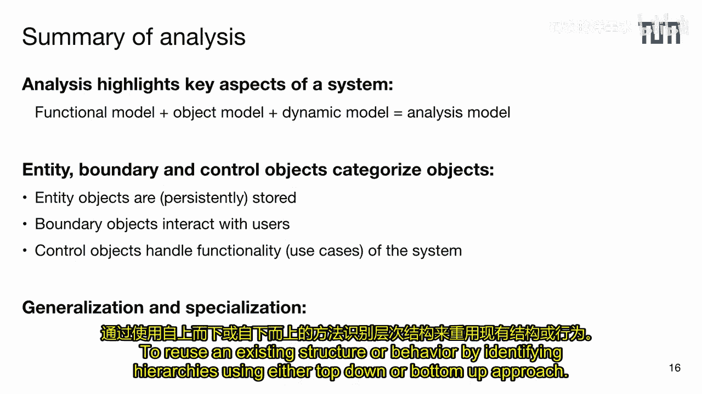

# 017：分析 📊

在本节课中，我们将学习软件工程中的“分析”阶段。我们将了解分析的目的、核心概念以及具体的分析活动，以构建一个正确、完整、一致且可验证的系统模型。

---

## 分析的目的

上一节我们介绍了需求获取与规格说明。本节中，我们来看看分析阶段的核心任务。

分析的主要目的是消除歧义，为待建系统创建一个清晰的模型。这个模型被称为**分析模型**，它必须是正确、完整、一致且可验证的。我们从需求出发，通过分析创建动态模型和分析对象模型，这些模型可以作为讨论的基础，并用于精化已有的需求模型。

## 沟通的挑战

在需求获取和分析阶段，信息沟通最具挑战性。相关利益方背景不同、期望各异。例如，用户、客户和开发者拥有不同的专业领域，并使用不同的词汇描述相同概念。此外，他们在定义系统时目标也不同。开发者需要主动发起沟通，以确保信息共享和问题及时上报。

以下是促进有效沟通的几点指导原则：

*   **定义清晰的职责**：包括分配特定角色。例如，分析师是应用领域专家，负责建模当前系统并与客户沟通；架构师负责统一用例和分析对象模型，并负责开发者内部的沟通。
*   **定义明确的目标**：客户和开发者需要在需求分析文档或问题陈述的客户验收标准中，定义清晰、可衡量、可验证的目标和成功标准。
*   **进行头脑风暴**：将所有利益相关者聚集一室，快速生成解决方案和定义，可以消除沟通障碍，并有助于定义支持沟通的共享符号。
*   **使用精确的结构化符号**：开发者使用用例和分析对象模型与其他开发者沟通。统一建模语言（UML）作为一种标准化符号，有助于在建模层面消除歧义。可用于分析的UML图包括用例图、类图、状态机图和序列图。

## 分析的核心概念

在了解了分析的目的和沟通挑战后，我们来深入探讨分析的三个核心概念。

### 1. 分析模型

分析模型由待建系统的**功能模型**、**对象模型**和**动态模型**组成。

### 2. 实体、边界与控制对象

在对象模型中，我们可以将对象分离为三个主要类别：**实体对象**、**边界对象**和**控制对象**。

*   **实体对象**：代表系统中需要持久存储的实体。
*   **边界对象**：代表系统边界外的参与者与系统本身之间的交互。
*   **控制对象**：负责处理用例的实现。

### 3. 泛化与特化

我们学习了分析对象模型以及实体、边界和控制对象的分离。最后一个核心概念是**泛化**与**特化**。

*   **泛化**：是从较低层次概念中识别出抽象概念的建模活动。例如，从“学生”和“讲师”类中，可以识别出一个包含“姓名”属性的“人”类。
*   **特化**：是从较高层次概念中识别出更具体概念的建模活动。例如，先识别出“人”类，然后意识到存在“学生”和“讲师”，它们需要额外的功能（如打印学号或工号）。

## 分析活动

掌握了核心概念后，现在我们来学习在分析阶段需要应用的三大主要活动。

### 活动一：识别对象（使用Abbott技术）

Abbott技术是一种强大的启发式方法，通过词性分析来识别类、关联、属性和方法等。

以下是Abbott技术中词性与模型元素的对应关系：

*   **专有名词** -> 对象实例（例如，“Alice”）
*   **普通名词** -> 类（例如，“学生”）
*   **动词** -> 操作/方法（例如，“创建”、“提交”）
*   **形容词** -> 属性

**应用示例**：
分析功能需求：“学生可以查看其主修和辅修专业本学期所有课程，能够加入课程（保存到其课程列表中），也可以退选课程。”

应用Abbott技术，我们可以识别出：
*   “学生”（普通名词）-> 类
*   “课程”（普通名词）-> 类
*   “主修/辅修”（形容词）-> 属性
*   “加入课程”（动词）-> 方法
*   “课程列表”（“拥有”关系）-> 关联
*   “退选课程”（动词）-> 方法

### 活动二：识别关联、聚合与属性

识别出实体、边界和控制对象后，接下来需要检测这些对象之间的关联。

每个关联都有**名称**、**角色**和**多重性**。

以下是发现关联的启发式方法：

*   检查动词短语来发现关联（例如，“学生**有**课程”）。
*   为关联和角色使用精确的名称。
*   消除可以从其他关联推导出的冗余关联。
*   避免使用过多关联，以免模型难以阅读。

识别关联后，可以开始识别聚合。我们需要密切关注依赖对象在生命周期上对整体的依赖程度。

我们区分两种聚合：

*   **组合聚合**：部分的生命周期依赖于整体。例如，“地球”由“山脉”、“海洋”和“森林”组成。没有地球，这些部分也无法存在。UML表示：`Earth ◄◆─ Mountain`
*   **共享聚合**：部分的存在是独立的。例如，“汽车”包含“发动机”和“轮胎”，但轮胎可以被拆卸并用于另一辆车。UML表示：`Car ◄── Tire`

接下来，我们也可以为单个对象识别属性。属性有**名称**和**类型**。

识别属性的启发式方法包括：

*   在识别属性之前，尽可能多地识别关联，以避免混淆属性和对象。
*   只考虑与系统相关的对象属性。
*   一种有效的方法是先建立关联，然后再插入属性。

### 活动三：应用泛化以消除冗余

最后，我们应用泛化来消除分析对象模型中的冗余。

如果多个类显示出相同的属性或行为，则可以将它们合并到一个超类中。

例如，“学生”和“讲师”都有“名”、“姓”和“出生日期”属性，这些可以合并到“人”超类中。而“打印个人信息”方法的功能未被复用，因此“学生”和“讲师”类可以提供自己更具体的实现。

这体现了面向对象原则中的**继承**（`Student extends Person`）和**多态**。

---

## 总结 🎯

在本节课中，我们一起学习了软件工程中的分析阶段。

我们首先了解了**分析模型**，它由功能模型、对象模型和动态模型组成。接着，我们学习了将对象分离为三个主要类别：**实体对象**（持久存储）、**边界对象**（用户交互）和**控制对象**（处理系统功能）。最后，我们探讨了**泛化与特化**，通过自顶向下或自底向上的方法识别层次结构，以重用现有的结构或行为。

我们还介绍了三大分析活动：使用Abbott技术识别对象、识别关联/聚合/属性，以及应用泛化关系。这些活动帮助我们构建出一个清晰、无歧义且可验证的系统分析模型，为后续的设计和实现阶段奠定坚实的基础。