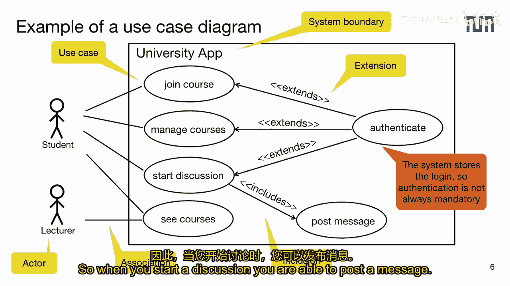

软件工程基础：4-4：UML用例图 📊

在本节课中，我们将学习UML中的用例图。用例图帮助我们将客户以场景形式提出的需求，转化为结构化的用例模型。我们将了解其核心元素、图形化表示方法以及如何构建一个用例图。

上一节我们介绍了需求工程中的场景，本节中我们来看看如何将场景转化为更结构化的用例图。

**什么是用例图？**

用例图的核心是**用例**。一个用例关注系统的行为，并从外部视角来描述系统。这个外部视角的组件被称为**参与者**，它通常是启动用例的实体。

*   **参与者**：一个外部实体，可以是用户、另一个系统，甚至是系统的物理环境。
*   **用例图**：将多个用例、参与者及其关联关系组合在一个单一的图表中。

**用例的表示形式**

用例有两种主要的表示形式：图形化表示和文本化表示。本节课我们主要关注UML的图形化表示。

文本化表示通常包含以下元素，与图形化表示相对应：
*   用例名称
*   系统参与者
*   前置条件
*   事件流
*   后置条件

**UML用例图的图形化元素**

现在，让我们深入了解UML用例图的图形化表示。一个用例图主要由以下几个部分构成：

1.  **系统与系统边界**：用一个方框表示，内部是系统的功能。
2.  **用例**：用椭圆表示，代表系统的具体功能。
3.  **参与者**：用小人图标表示，代表与系统交互的外部角色。
4.  **关系**：连接各元素，描述它们之间的交互。

以下是主要的关系类型：

*   **关联**：连接参与者和用例，表示该参与者会使用系统的这项功能。关系线通常是实线。
*   **扩展关系**：表示一个用例的行为**可能**在特定条件下（例如异常情况）被另一个用例的行为所扩展。关系线上标注 `<<extend>>`。
*   **包含关系**：表示一个用例的行为**必须**包含另一个用例的行为。这意味着被包含的用例是基础功能的一部分。关系线上标注 `<<include>>`。

**构建一个用例图示例**

让我们通过一个具体的例子来实践。假设我们要为一个“大学应用”系统绘制用例图。

首先，我们画出系统边界，并命名为“大学应用”。

接着，我们识别并添加参与者。例如，“讲师”和“学生”。

然后，我们在系统边界内添加不同的用例，即系统提供的功能。例如：“加入课程”、“管理课程”、“发起讨论”、“查看课程列表”。

现在，我们需要通过**关联**线来指明哪个参与者可以使用哪个功能。例如，“学生”可以关联到“加入课程”和“查看课程列表”；“讲师”可以关联到“管理课程”和“发起讨论”。

最后，我们添加扩展和包含关系。例如：
*   “加入课程”、“管理课程”和“发起讨论”这三个用例都可能**扩展**一个“身份验证”用例，因为在进行这些操作前，通常需要先登录验证身份。
*   “发起讨论”用例**包含**“发布消息”用例，因为发起讨论的核心动作就是发布一条消息。

通过以上步骤，我们就完成了一个基本的用例图构建。

**总结**

本节课中我们一起学习了UML用例图。我们了解了用例图用于从外部视角描述系统功能，其核心元素包括系统边界、用例、参与者以及关联、扩展、包含三种主要关系。通过一个“大学应用”的例子，我们实践了如何一步步构建出一个清晰的用例图，从而将用户需求可视化。