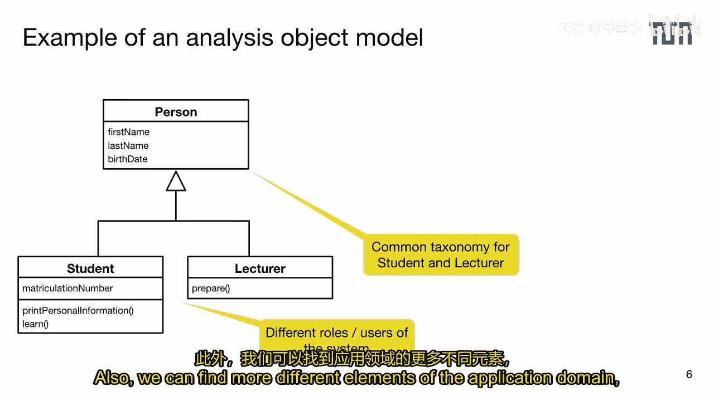

软件工程基础：4-5：UML类图与分析对象模型 🧩

在本节课中，我们将学习分析对象模型。分析对象模型通过UML类图来表示，它提供了待构建系统结构的信息。我们将深入了解UML类图的用途、属性及其核心元素。

---

### 概述

分析对象模型用于对应用领域中的各个概念进行建模，可以将其视为用户可见主要概念的视觉化词典。它不包含编程语言选择等解决方案领域的知识，这些信息将在软件开发生命周期的系统设计和对象设计阶段加入。为了降低复杂性并隐藏解决方案细节，分析对象模型有意不包含属性的可见性和方法签名。

---

### UML类图详解

上一节我们介绍了分析对象模型的基本概念，本节中我们来看看其核心表现形式——UML类图的具体元素。

**类** 是具体实例（即对象）的抽象表示。类封装了属性和方法，因此承载了系统重要元素的结构和功能。在图中，类显示为一个带有特定类名的矩形框。类名下方可以用一条线分隔，列出属性；其下另一个独立区域可以列出方法。

**关联** 用于描述类之间的连接。存在不同类型的关联：

以下是主要的关联类型：
*   **继承**：表示超类与子类的关系。子类可以使用超类的属性和方法而无需重新定义。
*   **聚合**：表示“由……组成”的关系（is composed of）。例如，汽车由发动机和轮胎组成。单个组件可以独立于聚合体存在。
*   **组合**：表示“包含”的关系（consists of）。例如，地球包含山脉和海洋。组成部分不能独立于整体存在。

**多重性** 可以表示一对一、一对多或多对多的关系。

---

### 分析对象模型示例

了解了类图的构成元素后，我们通过一个具体示例来看分析对象模型的应用。

分析对象模型的一个目的是找出从应用领域归纳出的分类体系。例如，在一个系统中，我们可能有“学生”、“助教”和“讲师”这些不同的用户角色。

我们可以为“学生”和“讲师”找到一个共同的分类，即“人”。此外，我们还能找到应用领域的其他元素，例如“课程”或“讲座”。

---

### 总结

本节课中，我们一起学习了分析对象模型。我们了解到它通过UML类图来可视化应用领域的核心概念，并探讨了类、关联（包括继承、聚合和组合）以及多重性这些关键元素。分析对象模型专注于问题领域，为后续的解决方案设计奠定了基础。