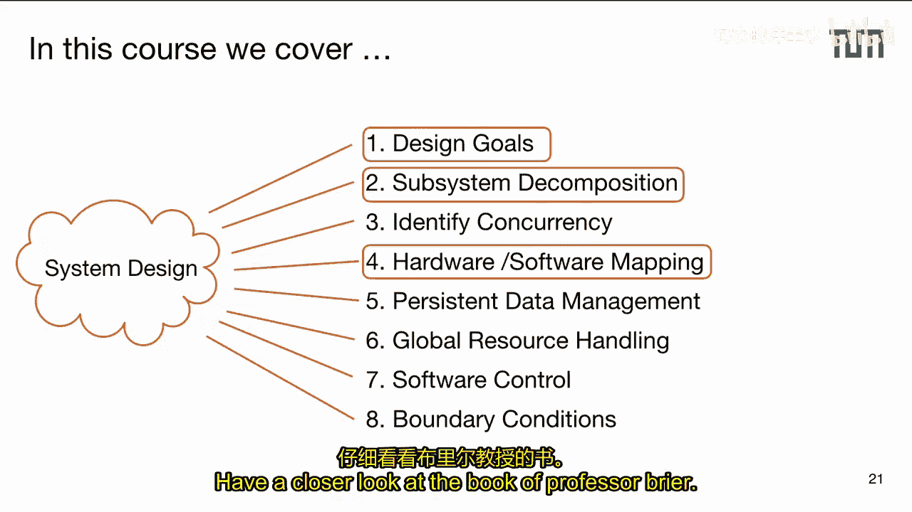

# 020：系统设计 🏗️

在本节课中，我们将学习系统设计。我们将了解如何从需求分析阶段过渡到系统设计阶段，并重点探讨系统设计中的三个核心活动：设计目标权衡、子系统分解以及硬件软件映射。

## 概述

系统设计旨在弥合“问题”与“解决方案”之间的鸿沟。在分析阶段，我们关注应用领域和待解决的问题；而在设计阶段，我们转向解决方案领域，将分析模型转化为可管理的系统设计。本节将介绍系统设计的八个核心议题，并深入讲解其中最重要的三个。

## 从分析到设计

上一节我们完成了需求分析。本节中我们来看看如何将分析阶段的成果映射到系统设计。

分析阶段的工作直接影响设计：
*   **非功能性需求** 成为 **设计目标**。
*   **功能模型** 直接转化为 **子系统分解**。
*   **对象模型** 是 **硬件软件映射** 和 **持久数据管理** 的基础。
*   **动态模型** 帮助我们识别 **并发性**、**全局资源处理** 和 **软件控制**。

## 系统设计的八个议题

以下是系统设计需要解决的八个核心议题：
1.  **识别设计目标**。
2.  **将系统分解为子系统**。
3.  **识别并发性**（识别并行进程和线程）。
4.  **硬件软件映射**（估算硬件需求、描述权衡、分配进程、定义物理连接）。
5.  **持久数据管理**（将持久对象存储在文件系统或数据库中，定义内存或二级存储的数据结构）。
6.  **全局资源处理**（访问控制）。
7.  **软件控制实现**。
8.  **定义边界条件**（描述初始化、终止和故障发生时的行为）。

本课程将重点讲解前三个议题中的核心部分：设计目标、子系统分解和硬件软件映射。

## 设计目标与权衡

首先，我们来探讨设计目标。设计目标指导着整个系统设计活动，主要来源于分析阶段获得的非功能性需求。此外，利益相关者也会提出其他目标。设计目标通常使用设计方法学、设计度量和实现目标来表述。

设计目标之间常常存在冲突，因此我们需要进行权衡。

以下是典型的设计目标权衡示例：
*   **功能性与可用性**
*   **成本与健壮性**
*   **效率与可移植性**
*   **快速开发与功能性**
*   **成本与可重用性**

让我们通过一些例子来理解这些权衡。

**例子1：功能性与可用性**
一个拥有100个功能的系统真的可用吗？未必。有些应用即使只有两个核心功能也可能难以使用。以Foursquare为例，其核心用例是“签到分享位置”和“查找附近最佳地点”。部分用户不愿分享位置。因此，Foursquare将功能拆分到两个独立应用中：**Foursquare**（专注搜索地点）和 **Swarm**（专注签到功能）。

**例子2：成本与可重用性**
假设我们在两个类之间建模一个“一对一”关联。这易于编码和测试，成本较低，但可重用性不高。如果将其改为“多对多”关联，编码和测试的投入会增加，但可重用性也提高了。这类似于一次性塑料袋（成本低，可重用性低）与棉布袋（成本高，可重用性高）的对比。

> 设计模式有助于解决这些权衡，使我们能够以较低成本实现较高的可重用性。

## 子系统分解

了解了设计目标后，现在我们转向子系统分解。我们将系统拆分为不同的子系统、层次，并应用架构风格。

**子系统** 是类、关联、操作和事件的集合，它们彼此紧密相关。分析阶段对象模型中的类是子系统的种子。

**服务** 是由子系统提供的一组外部可见的操作集合，也称为子系统接口。其他子系统可以通过这些接口进行交互。功能模型中的用例是服务的种子。

> **总结**：对象模型中的类是子系统的种子；功能模型中的用例是服务的种子。

### 子系统的耦合与内聚

我们的目标是在允许变更（变更是唯一不变的因素）的同时降低系统复杂性。如何实现呢？

*   **内聚** 衡量子系统内部元素（类）之间的依赖程度。
    *   **高内聚**：子系统内的类执行相似任务，且通过许多关联相互关联。
    *   **低内聚**：包含大量杂项和辅助类，且几乎没有关联。
*   **耦合** 衡量不同子系统之间的依赖程度。

良好的系统设计应追求 **高内聚** 和 **低耦合**。这样，一个子系统内的变更就不会影响到其他子系统。

如何实现高内聚和低耦合？
*   实现高内聚：确保大部分交互发生在子系统内部，而不是跨越子系统边界。
*   实现低耦合：调用类无需了解被调用类的内部细节。请记住我们已学过的 **信息隐藏** 概念。

### 架构风格

为了实现恰当的子系统分解，软件设计中有 **架构风格** 和 **软件架构** 的概念。在子系统分解过程中，我们识别子系统服务及其相互关系。可以应用架构风格，它代表了子系统分解的一种模式。软件架构则是架构风格的一个实例。你将在“架构模式”单元中了解更多相关内容。

## 硬件软件映射

现在，我们进入硬件软件映射环节。

硬件软件映射需要解决两个问题：
1.  应该如何实现子系统？应该使用硬件还是软件？
2.  如何将模型映射到选定的硬件或软件上？

以下是映射时的考量：
*   **控制对象** 需要映射到特定进程。我们需要定义计算速率是否对简单进程要求过高，或者是否可以通过将对象分布到多个进程来获得加速。还需要定义需要多少进程来维持稳态负载。
*   **实体对象** 映射到内存。我们需要询问是否有足够的内存来缓冲突发请求。
*   **边界对象** 是硬件软件映射中的输入/输出设备。

### 可视化工具：UML图

为了可视化硬件软件映射和子系统分解的结果，有两种UML图可以帮助我们：

1.  **组件图**：用于说明设计时、编译时和运行时组件之间的依赖关系。请参阅“组件图”单元以深入了解。
2.  **部署图**：用于说明运行时这些组件在并发进程上的分布情况。部署图使用节点和连接来描述系统中的物理资源。

> **区别**：组件图是硬件或制造商无关的，而部署图则具体绑定到实际的硬件和软件。请参阅“部署图”单元以深入了解。

## 总结

本节课中，我们一起学习了系统设计。系统设计旨在缩小问题与现有系统解决方案之间的差距。

我们定义了设计目标，它描述了重要的系统质量，并作为评估不同设计方案的价值标准。我们展示了一些设计权衡并提供了示例。

我们探讨了子系统分解，通过运用内聚和耦合原则，将整个系统分解为可管理的部分。

我们介绍了硬件软件映射，描述了如何将子系统分解中的子系统分配给硬件和现成组件。

关于系统设计的其他五个议题，可以参考Bruegge教授的相关著作以获取更详细的内容。

本节关于系统设计的内容到此结束，下次再见。