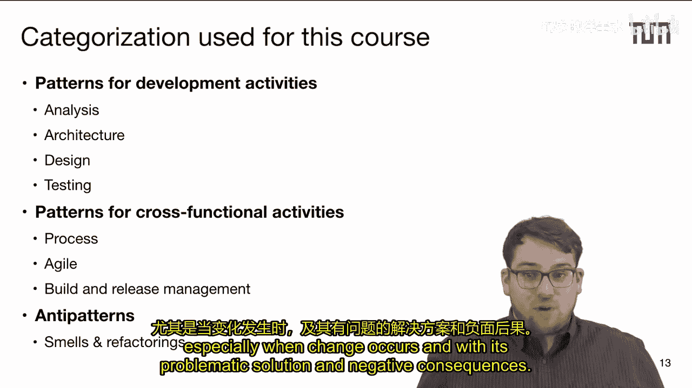

软件工程基础：5-2：模式 🧩

在本节课中，我们将要学习软件工程中的“模式”这一核心概念。我们将了解模式是什么，它与算法的区别，以及为什么它在构建复杂且需要频繁变更的软件系统中至关重要。

---

### 什么是模式？

模式是一个基础概念，有助于管理软件工程知识。模式是有用的知识片段，通过**降低复杂性**和**隔离变更**，帮助我们在频繁变更的背景下构建复杂的软件系统。

完成本节学习后，你将能够：
*   理解模式在软件工程中的用处。
*   分析模式与算法的区别。
*   记住本课程中使用的模式分类。

---

### 模式与算法的区别

首先，我们来看看算法与模式的区别。

**算法**描述了一种使用**有限的、明确定义的指令序列**来解决问题的方法。它从一个初始状态开始，经过一系列连续状态，最终终止于一个最终状态。关键在于，它使用一个**有限的序列**和**明确定义的指令**来解决问题。

**模式**则描述了一个在我们的环境中**反复出现的问题**，并描述了解决方案的核心，使得你可以无数次地使用这个解决方案，而每次的实现方式都不尽相同。这是由克里斯托弗·亚历山大提出的。

这里的核心区别在于：模式**描述问题本身**，而非解决问题的具体步骤。这个问题会反复出现，而解决方案的核心虽然相同，但具体实现总是不同的。

为了澄清算法与模式的区别，可以观看一个解决魔方的视频。其中包含一系列预定义的、有限的步骤，你必须按照特定顺序转动方块来解决问题。

---

### 模式的起源：克里斯托弗·亚历山大

回到定义了模式的克里斯托弗·亚历山大，他指出模式是一个三部分规则，表达了一个**特定上下文**、一个**问题**和一个**解决方案**之间的关系。

那么，克里斯托弗·亚历山大是谁？他并非软件工程师，而是一位真正的建筑师。他1936年出生于维也纳，完成了超过200个建筑项目，并撰写了《建筑模式语言》一书。

他的哲学是：建筑必须由非建筑师的用户来建造，并能使用数千年。用户比建筑师更清楚他们需要什么样的建筑。好的建筑基于一套可以用模式语言描述的设计原则。因此，亚历山大的模式并非关于软件工程，而是关于真实的建筑规划，但我们也可以将他的概念应用于软件工程。

---

### 软件工程中的模式定义

让我们看看软件工程中模式的形式化定义。

一个模式由两部分组成：首先是**问题**，其次是**解决方案**。

我们可以进一步拆分问题，从**上下文**和一组**作用力**的角度来阐述它。

关于解决方案，它通过**收益**和**后果**来解决这些问题作用力。

要被视作一个模式，如定义所示，该解决方案必须适用于**多个特定问题**。解决方案通常会产生后续问题，这些后续问题同样可以从上下文和作用力的角度来阐述，并可能引向应用更多甚至其他模式。

---

### 模式的描述框架

有三种描述模式的框架：
1.  **亚历山大格式**：源自建筑学和克里斯托弗·亚历山大。
2.  **四人组格式**：围绕埃里希·伽玛，在《设计模式》一书中定义，包括名称、意图、别名、动机、适用性等。
3.  **五人组格式**：围绕弗兰克·布什曼，其描述模式的基本框架与四人组相似，但有些名称不同，并增加了动态行为描述。

---

### 模式的分类

对于本课程，我们将介绍以下三种分类：
1.  **开发活动模式**：涵盖分析、架构、设计和测试。
2.  **跨职能活动模式**：包括流程与高阶方法论、构建与发布管理。
3.  **反模式**：包含其“坏味道”和相应的重构方法。

模式在发生变更时，如果其解决方案存在问题并导致负面后果，就可能转变为反模式。

---

### 总结

本节课我们一起学习了软件工程中的模式。我们介绍了模式的概念，初步了解了如何描述模式以及为什么应该关注它们。在后续的单元中，我们将更深入地探讨设计模式和架构模式。