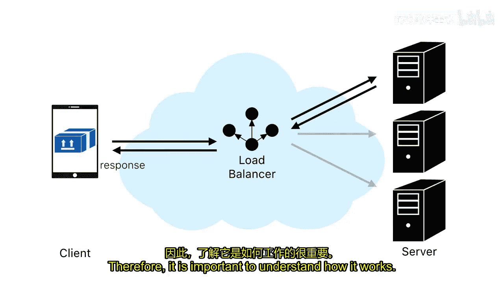

# 022：架构模式 🏗️

在本节课中，我们将学习什么是架构模式，以及如何在系统设计过程中应用它们。我们将介绍分层模式、客户端-调度器-服务器模式以及模型-视图-控制器架构风格，并了解它们的结构与应用场景。

## 什么是架构模式？

架构是一门艺术。要发明一种新颖的架构，需要高度的创造力。例如，悉尼歌剧院的屋顶具有特殊形态，华盛顿纪念碑的屋顶在当时也具有创新性。要发明这样的架构，需要了解现有作品并拥有丰富的经验。

现在，让我们看看传统的美国房屋。最初是牧场风格，基本上是一个简单的方形房屋。后来演变为T型牧场风格，并进一步扩展为高架牧场风格。在选择风格时，主要组件和布局就被定义了。建筑师根据客户的需求决定应用哪种风格，然后根据客户的具体要求调整细节。因此，建筑师复用已确立的工程知识，从而节省时间和金钱。

我们将这种方法也应用于软件和软件架构。

## 术语：架构模式与架构风格

关于术语，我们需要仔细区分“架构模式”和“架构风格”。Bushman和“四人帮”认为这两个术语存在以下区别：架构风格仅描述应用程序的整体结构框架，而架构模式则定义应用程序的基本结构。风格之间相互独立，而模式则依赖于更小的模式。模式比架构风格更面向问题。

在本课程中，我们将“架构模式”和“架构风格”这两个术语互换使用。我们的定义是：它本质上是系统设计期间用于子系统分解的模式。对我们而言，术语“软件架构”是架构风格或架构模式的一个实例。

## 软件架构的要素

首先，我们有所谓的**组件**，也称为子系统。它们代表具有指定接口的计算单元，例如过滤器、数据库、层或对象。

其次，我们有**连接器**，负责组件之间的通信。协议定义了这些组件如何交互，例如简单的方法调用、管道、广播或共享数据。

请始终牢记良好架构的特点：我们需要在面对变化时具有弹性，因此我们希望实现**低耦合**和**高内聚**。架构应指导整个产品生命周期，并且我们希望复用这些已确立的工程知识。

## 模式导向的架构分类

“四人帮”提出了模式导向的架构，并为其创建了一个分类法。他们将模式分为**架构模式**、**设计模式**和**惯用法**。由于我们目前处于关于架构模式的单元，我们将只关注这个子类。

从结构上看，一切都与分解有关。例如：
*   **分层模式**：每个子系统由一个抽象层表示。
*   **管道-过滤器模式**：每个子系统是一个特定的处理过程，表现为一个过滤器，这些过滤器通过管道连接。

关于黑板模式，子系统代表知识专家，他们共同协作来解决一个没有已知解决方案策略的问题。

在分布式系统领域，系统在不同进程上协作运行。例如，**代理模式**，其中分布式系统通过远程服务调用进行交互。

对于交互式系统，我们有两个例子：**模型-视图-控制器**和**表示-抽象-控制**。我们稍后将更详细地了解MVC。

最后但同样重要的是，我们有适应性系统，即随时间演化的系统。例如，**微内核模式**，我们有一个最小的功能核心，它是可扩展的；以及**反射模式**，其中自我意识提供有关系统属性的信息。

这是模式导向架构的总体概述。现在，我们将深入探讨一个非常著名的架构模式：分层模式。

## 分层模式

为了让你对分层模式有一个概览，请看下图。在左侧，你可以看到客户端；在右侧，是分解为若干层的应用程序。我们从底部的第0层开始，一直到第N层。客户端使用最顶层的层（在我们的例子中是第N层），而第N层调用其下方的层。

这种分层模式的一个非常著名的例子是**OSI模型的七层**，它基本上是所有网络连接的基础。

分层模式的概念早在1968年就由Dijkstra引入。他定义了系统的层次，其中“THE”代表“Technische Hogeschool Eindhoven”。Dijkstra认为操作系统是一个层次结构，每一层只使用较低层提供的服务。对于操作系统，他总共定义了五层：
*   **第0层 - 调度器**：负责操作系统的多道程序设计方面，例如决定哪些进程分配给CPU。
*   **第1层 - 分页器**：负责为进程分配内存。
*   **第2层**：处理操作系统与控制台之间的通信。
*   **第3层**：管理所有输入和输出设备。
*   **第4层 - 用户程序**：处理用户程序的编译、执行和打印的进程。

分层模式有两种变体：**封闭式**和**开放式**。它们的区别在于：
*   在**封闭式架构**中，每一层只能调用紧邻其下方的层的操作。通过应用封闭式架构，我们可以实现以下设计目标：**灵活性**（可以轻松地用另一个层实现替换某一层的实现）、**可测试性**（只需测试成对的层）和**可维护性**。
*   在**开放式架构**中，每一层可以调用任何其他层的操作。开放式架构的设计目标主要是**运行时效率**。

分层模式有其优点和缺点。
*   **优点**：我们可以复用层（尤其是在封闭式架构中）；可以实现标准化（因为标准化单个层非常容易）；实现了低耦合（这是良好架构的目标之一）；并提高了可测试性。
*   **缺点**：较低层的局部更改可能迫使较高层进行更改；并且效率可能较低。

## 模型-视图-控制器架构风格

现在，我们转向非常著名的**模型-视图-控制器架构风格**，你会经常遇到它。

MVC架构风格将数据访问（我们的实体对象）与数据呈现（我们的边界对象）解耦。子系统被分为三种不同类型：
*   **模型子系统**：维护领域知识。
*   **视图子系统**：向用户显示信息。
*   **控制器子系统**：管理与用户的交互序列。

模型子系统的开发方式使其不依赖于任何其他视图或控制器子系统。MVC非常适合交互式系统，尤其是当需要同一模型的多个视图时。MVC也可用于维护分布式数据的一致性。

以下是MVC架构风格的工作原理：
1.  视图需要来自模型的数据，因此视图调用 `getData()` 方法。
2.  假设我们有一个学生个人资料的视图，学生想要编辑他的个人资料图片。视图将用户操作（在我们的例子中是学生的新图片）传递给控制器。
3.  控制器验证数据（例如，检查图片格式和大小是否正确）。如果一切正常，控制器将新数据设置到模型中。
4.  模型也可以更新控制器，控制器再转发给视图；或者模型也可以直接更新视图。请注意这里的多重性：多个视图可以依赖于模型的数据，因此我们可以确保显示模型在多个视图之间保持一致。

## 客户端-调度器-服务器模式

回到概述，我们现在进入分布式系统领域，并通过添加**客户端-调度器-服务器模式**来扩展“四人帮”的分类法。我们认为这是一个非常重要的模式。

分布式系统面临哪些挑战？
1.  **连接性**：当系统分布时，它们必须找到彼此并进行通信。解决这个问题的一个方案就是客户端-调度器-服务器模式。
2.  **异构性**：例如，系统可能使用不同的编程语言、运行在不同的平台上或使用不同的协议。为了克服这个挑战，可以应用代理模式或使用微服务。本课程不涵盖异构性挑战。
3.  **安全性**：涉及访问控制、身份验证和加密。本课程同样不涵盖此挑战。

如前所述，分布式系统必须相互通信。在设计分布式系统时，必须确保有通信机制。基本上有两种解决方案：
*   **解决方案A**：组件自己实现通信机制。缺点是客户端需要知道服务器的位置，导致紧耦合，因此设计不佳。这种模式的一个例子是简单的客户端-服务器模式。
*   **解决方案B**：将通信机制置于一个名称服务器中。我们从而将客户端与其服务器解耦。解决方案B（我们稍后称之为客户端-调度器-服务器）的优势在于，名称服务器提供了**位置透明性**，因此客户端无需知道真正的服务器实际在哪里。

为了让你更深入地了解客户端-调度器-服务器模式，我们准备了一个小例子。

让我们看看大学应用程序中的客户端-服务器通信是如何工作的。如果用户尝试使用应用程序加入课程，则应显示课程列表。该列表存储在服务器中。服务器是一台为其他计算机（客户端）提供特定服务的计算机。这些服务包括托管网站、提供文件以及访问数据（例如存储在全局数据库中的数据）。客户端是通常由最终用户使用的软件组件，它消费服务器提供的服务。由于我们讨论的是分布式系统，客户端通过网络消费服务以检索课程列表。

在我们的例子中，大学应用程序（客户端）向服务器发送请求。服务器接收请求，处理它，并返回包含课程列表的响应。这种请求-响应消息传递机制称为客户端-服务器。这种机制是异步工作的：客户端等待响应，但用户界面不应被阻塞，以便在请求量大或网络延迟长的情况下，用户仍然可以使用应用程序，而不必等待。

虽然请求通常会成功，但也可能失败并导致错误。例如，如果用户点击查看个人资料但尚未登录，服务器会拒绝其请求并返回身份验证错误，客户端必须先登录，然后请求才能成功。

服务器可以接收来自多个客户端的请求，但服务一次只能处理有限数量的请求。客户端必须知道服务器的位置才能发送请求。为了通信，所有组件必须有一种共同语言，并且必须遵循规则，以便客户端和服务器都知道如何处理请求或响应。因此，客户端和服务器是紧耦合的。

一个更好、更常见的解决方案是所谓的**客户端-调度器-服务器模式**。调度器组件充当客户端和服务器之间的中间层，以解耦客户端和服务器。调度器允许客户端通过名称而不是物理位置来引用服务器，从而实现位置透明性。

其工作流程如下：
1.  服务器向调度器注册自己。
2.  客户端使用服务器名称作为标识符请求连接。
3.  调度器定位相应的服务器并建立连接。
4.  服务器接受连接，调度器在客户端和服务器之间建立通道。
5.  客户端然后可以向服务器发送其请求。

例如，如果你在浏览器的地址栏中输入 `eds.org`，这个标识符会通过域名系统映射到服务器的IP地址，然后调用服务器请求的服务。

如果太多客户端同时消费单个服务器的服务，他们的请求将被排队，客户端必须等待更长时间直到其请求被处理。为了防止响应时间过长（如果数百个客户端同时访问一个服务器），服务需要具有可扩展性。如果有多个服务器，调度器还可以在服务器实例之间充当**负载均衡器**。负载均衡器然后确定哪个服务器实例队列中的请求数最少，并将请求转发给该服务器实例。负载均衡也可以遵循不同的策略，例如随机选择或轮询。

客户端-调度器-服务器模式（许多人简称为客户端-服务器）是最常用的架构风格之一，并被广泛采用。因此，理解其工作原理非常重要。

## 总结

本节课中，我们一起学习了架构模式的概述，并深入了解了分层模式、模型-视图-控制器架构风格以及客户端-调度器-服务器模式。这些模式为构建灵活、可维护且高效的软件系统提供了重要的设计蓝图。