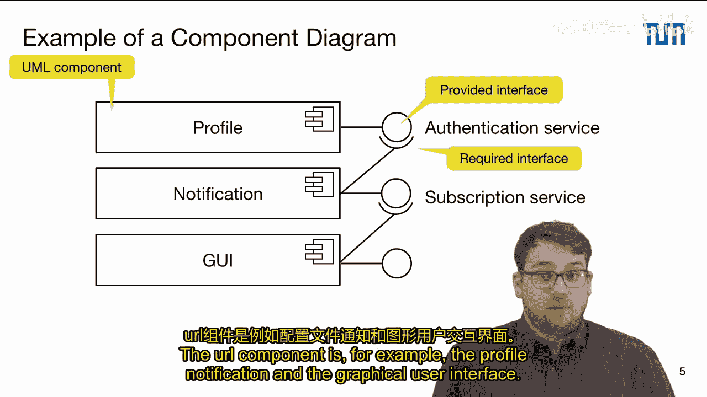

**软件工程基础：5-4：UML组件图 🧩**

在本节课中，我们将要学习UML中的一种结构图——组件图。我们将了解其用途、核心元素以及如何用它来描绘系统设计的高层视图。

组件图是一种结构图，在系统设计阶段使用，其主要目的是：**以组件及其间的依赖关系来为系统设计建模高层视图**。

---

### 组件与连接器

上一节我们介绍了组件图的基本用途，本节中我们来看看它的核心构成元素：组件和连接器。

*   **组件**：使用一个带有图标的方框表示，方框内写明组件名称。图标用于标识这是一个组件。
    *   示例：`[组件图标] Profile`
*   **连接器（依赖关系）**：表示组件间的依赖关系，在图中以带箭头的虚线表示，箭头从**客户端组件**指向**服务端组件**。依赖关系的类型是语言特定的。

组件和连接器共同构成了一种架构风格。组件图也常被非正式地称为“软件接线图”，因为它展示了应用程序中各个组件是如何“连接”在一起的。

---

### 接口与端口

了解了基本的组件和连接器后，我们来看看UML组件图如何更精确地描述组件间的交互。这主要通过**接口**和**端口**来实现。

UML组件图使用所谓的**UML接口**来描述组件间的依赖和连接。这些接口用“棒棒糖”和“插座”来表示。

*   **UML接口**：描述一组操作（而非单个操作），这组操作由UML组件**提供**或**需要**。
*   **提供接口**：使用“棒棒糖”符号表示。
*   **需要接口**：使用“插座”符号表示。一个“插座”可以适配一个“棒棒糖”。

此外，我们还有**端口**。

*   **端口**：规定了组件与其环境之间明确的交互点。
*   **表示**：在组件的边界上用一个小方块表示。

---

### 应用示例

理论部分已经介绍完毕，现在让我们通过一个简单的例子来看看这些概念如何应用。这个例子是我们大学应用程序的一部分。

以下是该示例中的三个UML组件：
*   `Profile` （用户档案）
*   `Notification` （通知）
*   `Graphical User Interface` （图形用户界面）

在这个模型中：
1.  `Profile` 组件有一个**提供接口**，名为 `AuthenticationService`（认证服务）。
2.  `Notification` 组件有一个**需要接口**，它使用了 `Profile` 组件提供的 `AuthenticationService` 来进行身份验证。
3.  `Graphical User Interface` 组件与其他组件也存在交互关系。

通过这个图，我们可以清晰地看到 `Notification` 组件依赖于 `Profile` 组件提供的认证功能。

---

本节课中，我们一起学习了UML组件图。我们了解了它是一种用于系统设计阶段的结构图，能够展示系统的高层组件结构及其依赖关系。我们掌握了**组件**、**连接器（依赖）**、**提供/需要接口**（棒棒糖与插座）以及**端口**这些核心元素的表示方法和含义。最后，通过一个大学应用的示例，我们看到了这些概念如何结合在一起，描绘出清晰的软件架构“接线图”。