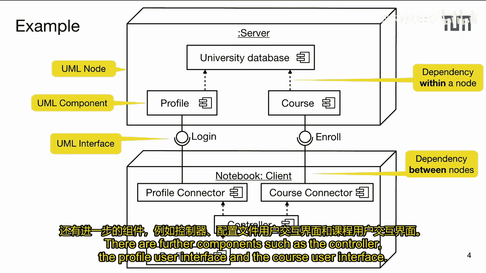

软件工程基础：5-5：UML部署图 🖥️

在本节课中，我们将学习UML部署图。我们将了解什么是UML部署图，以及如何、在何处应用它们。

UML部署图是一种结构图，用于系统设计阶段。它的主要作用是将软件组件映射到实际的硬件和软件环境上。当我们完成了系统设计决策，考虑了不同的设计目标，分解了子系统，并审视了并发性和软硬件映射之后，就可以使用UML部署图来呈现最终的设计方案。

---

### 部署图的基本构成

部署图由节点和连接构成，这些连接被称为通信关联。

*   **节点**：在图中以三维方框表示，代表一个运行时存在的计算资源实例，例如一台服务器或一个客户端设备。按照惯例，实例名称会带有下划线。
*   **连接**：节点之间的连接用实线表示。

节点内部可以包含组件。这是我们本课程中使用的一种约定。

---

### 部署图示例解析

让我们通过一个例子来具体理解。假设我们有一个客户端-服务器系统。

我们有两个节点：一个**客户端**（例如一台笔记本电脑）和一个**服务器**。

在之前的组件图中，我们可能定义了`Profile`（用户档案）和`Course`（课程）等组件。在部署图中，我们将这些组件放入相应的节点。

*   在**服务器**节点中，运行着`Profile`组件。该组件提供了一个名为`login`的服务，在图中以“棒棒糖”接口符号表示。
*   在**客户端**节点中，运行着`Profile`组件（可能是客户端部分）和`Course`组件。客户端组件需要使用服务器提供的`login`服务，这通过一个“套接字”符号来表示依赖。
*   服务器节点中的`Course`组件提供了一个`enrolled`（注册）服务，同样被客户端的`Course`组件所使用。

节点之间的依赖关系用实线描绘。

---

### 添加更多细节

我们可以继续丰富这个图。

例如，我们可以在服务器节点中添加一个`UniversityDatabase`（大学数据库）组件。`Profile`和`Course`组件都依赖于这个数据库组件来存取数据。

**节点内部的组件之间的依赖关系，则用虚线来表示。**

此外，系统中可能还存在其他组件，例如`Controller`（控制器）、`ProfileUserInterface`（用户档案界面）和`CourseUserInterface`（课程界面）等，它们都可以被放置在合适的节点中。

---

### 总结

本节课我们一起学习了UML部署图。我们介绍了部署图的外观和标准表示法，解释了为何以及如何使用它们。简而言之，部署图是一种强大的工具，用于在系统设计后期，清晰展示软件组件如何部署到具体的硬件节点上，以及这些节点之间如何相互连接和通信。