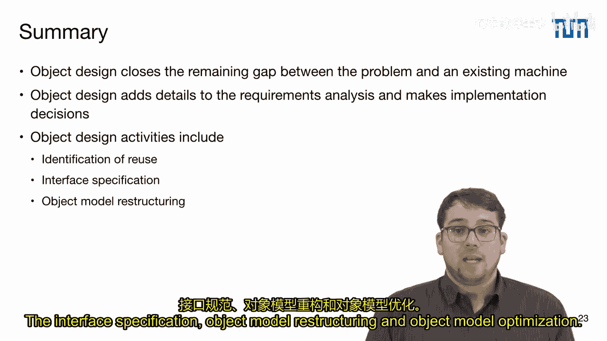

# 025：对象设计 🎯

在本节课中，我们将学习对象设计。对象设计是软件开发过程中的关键环节，它填补了需求分析与实际实现之间的空白。我们将探讨对象设计的必要性、核心活动以及如何通过重用现有组件和知识来高效完成设计。

## 概述

在开发过程中，我们从问题陈述开始，通过分析获取功能性和非功能性需求，并创建了功能模型（包括用例）和分析对象模型（包含分类）。随后，我们进行了子系统分解，并确定了系统的组件和硬件节点。最终应用程序将在目标环境（例如学生的笔记本电脑）上运行，并使用Java等语言实现，这些语言提供了运行时环境和现有组件（如用户界面或客户端-服务器通信机制）。我们重用这些组件，因为无需从头构建一切。这些组件也称为COTS（商用现成品）组件。

我们现在面临的问题是，分析与实际在学生笔记本电脑上运行的应用程序之间仍然存在差距。那么，如何填补这个差距呢？答案就是通过对象设计。我们比实际实现领先一步，并为此做好一切准备。我们利用在分析阶段得出的系统模型，结合已做出的设计决策，对其进行转换和优化。我们识别多种实现可能性，并自问是否应该构建或购买特定组件。我们研究实现模型的各种替代方法，并始终关注设计目标，例如最小化执行时间、内存或其他成本度量。对象设计是即将到来的实现的基础。

在本节之后，你将能够理解对象设计的必要性，可以应用对象设计期间的不同活动，并记住不同类型的重用。

## 填补差距

设计意味着填补差距。我们想举一个自然界如何填补差距的例子。圣安德烈亚斯断层是加利福尼亚州的一个大陆转换断层。它是太平洋板块和北美板块之间的构造边界。那么，我们这里有什么呢？我们有一个子系统1，即来自内华达山脉南部的岩石材料，它正在向北移动；我们有一个子系统2，即旧金山湾区，它正在向南移动；在这两者之间有一个间隙，实际上这就是我们的子系统3。大自然用圣安德烈亚斯湖的水填补了这个间隙。

在面向对象的软件工程中，有四种活动可以用来填补这个差距。首先，我们有重用、重用、再重用。你能重用的越多，你就能越快地在现有机器和你的问题之间填补差距。利用继承、现成组件以及设计模式使我们能够重用现有的软件工程知识和已经可用的组件。

第二个活动是详细的接口规范。越来越多的开发人员将参与到项目中，他们将细化并更改许多对象及其接口。详细的规范是为了让开发人员能够清晰、精确地沟通系统日益低层的细节。

第三个和第四个活动是对象模型重构和优化。这些活动转换我们的模型，使其更清晰、更具可扩展性。在这些活动中，我们同样关注非功能性需求，并努力满足它们。

活动1和2侧重于重用和规范，而活动3和4则更侧重于将模型映射到实际代码。

## 重用

我们的问题如前所述，我们希望填补设计差距，并且有以下目标：我们希望重用现有的类，重用现有的接口，以及重用以往经验中的设计知识。

有两种技术可以实现这一点。首先是组合，即通过聚合现有类来创建新类，新类提供现有类的聚合功能。这也称为黑盒重用。第二种技术是继承，即通过子类化创建新类。新的子类重用超类的功能，并可能提供新功能。这也称为白盒重用。

让我们看一个组合（也称为黑盒重用）的例子。我们在顶部有需求分析，在底部有对象设计。在分析期间，我们使用应用领域的语言；在对象设计期间，我们使用解决方案领域的语言。在分析中，我们提出了一个`Comment`类，用于讨论中学生可以添加评论。当我们查看对象设计时，一个评论实际上由一个图像、一个文本字段和一个标签组成。因此，评论可能看起来像这样：我们可以看到发布评论的用户的图像，用户实际可以插入其评论的文本字段，以及代表用户姓名的标签。

让我们看看继承的使用。我们使用继承来实现两个不同的目标：首先是分类法的描述，其次是接口规范。分类法的描述在需求分析期间使用，我们识别在层次结构中相关的应用领域对象。目标是使分析对象模型更容易理解。当我们查看接口规范时，它在对象设计期间使用，我们识别所有包含对象的签名。我们应用它来提高可重用性，从而增强可修改性和可扩展性。

有两种方法可以发现继承关联。首先是泛化。泛化意味着发现两个类之间的继承关系，其中子类先被发现。例如，这常用于科学和工程领域。例如，在生物学中，我们首先发现个体动物，如大象、老虎或狮子。然后我们发现这些动物实际上具有共同的属性，我们给这些共同属性命名，即哺乳动物。特化意味着发现两个类之间的继承关系，其中超类先被发现。给你一个物理学的例子，夸克理论假设了某些粒子的存在。在理论提出后，人们开始寻找这些粒子并找到了它们。

我们提出了一个继承模型，如前所述，继承在分析期间以及对象设计期间使用。这常常令人困惑。我们在分析活动中创建分类法，而在对象设计活动中进行重用性继承。我们将更仔细地查看规范继承和实现继承。首先，我们仔细看看不同的术语。实现继承是从一个实现进行子类化。实现功能可以在超类中找到，我们重用这个实现功能。我们给你一个例子。我们有一个已经实现的类，它几乎与我们想要的类做同样的事情。例如，我们有一个`List`，但我们需要一个`Stack`。`List`类已经实现，那么从`List`子类化`Stack`并使用`add`和`remove`的实现来实现`push`和`pop`怎么样？嗯，似乎是个计划，但实现继承可能会带来问题，因为继承的操作可能表现出不想要的行为。`add`和`remove`作为公共操作的存在可能会引起问题。

看看委托，委托是什么意思？捕获一个操作并将其发送到另一个已经实现该功能的对象。关于重用，我们在另一个对象中实现功能。简短的例子：委托是一种使组合在重用方面与继承一样强大的方式。委托涉及三个对象：调用接收者的客户端、将请求发送给委托者的接收者，以及执行请求的委托者。接收者的存在确保客户端不能滥用委托对象。

让我们比较委托和实现继承。继承通过新操作或重写现有操作来扩展基类。委托捕获一个操作并将其发送到另一个对象。在左边，我们看到委托。在右边，我们看到从`List`到`Stack`的继承。那么，你认为哪种方法更好？嗯，在这种情况下，我们认为继承不是正确的选择，我们会选择委托，因为它更清晰，并且我们不会面临关于`add`和`remove`方法的问题。

委托有一些优点：它很灵活，因为任何对象在运行时都可以被另一个对象替换。但不幸的是，委托效率较低，因为对象是封装的。继承也有几个优点：它使用简单，并且得到许多编程语言的支持。此外，在子类中实现新功能很容易。但也有缺点：继承将子类暴露给其父类的细节。父类实现的更改会迫使子类更改，这需要重新编译。

回到术语，还有一件事：规范继承。它是从一个规范进行子类化，其中规范是一个抽象类。在这个抽象类中，所有操作都被指定但尚未实现，因此我们重用超类中指定的功能。这我们在关于面向对象编程的单元中已经介绍过了。

## 对象设计活动

看看对象设计的活动，我们涵盖了继承的使用，以及如果有任何现成组件可以填补设计差距，则无需实现。我们可以用已经存在的组件解决我们的问题。设计模式的使用在关于设计模式的单元中涵盖，我们现在转向接口规范。

当我们查看开发人员时，开发人员可以扮演三种不同的角色。首先是类使用者、类实现者和类扩展者。对于不同的类，他们都有不同的用例。类使用者实际上是调用类的人。例如，我们有一个`Lecture`类，有人使用它并调用`Lecture`类上的方法。我们有类实现者，他负责实现这个类。他是真正实现它的人。类扩展者细化类，所以我们有一个超类，例如`Person`，类扩展者扩展一个子类`Student`。

为了澄清这一点，我们举了一个例子。我们从分析对象模型中提取，并比较使用者、扩展者和类实现者。因此，负责实现`Person`的开发人员称为类实现者。例如，如果你想在一个人输入他的生日后计算他的年龄，我们有一个计算年龄的方法。这个方法可以是私有的，并且这个方法可以将计算出的值设置到适当的属性，例如`age`。当我们查看`Student`时，负责实现`Student`的开发人员是`Person`的类扩展者。他必须确保可见性信息是受保护的，这样`Student`就可以访问这些信息，因为它是受保护的。没有其他人，只有子类可以获得关于年龄的信息。当我们查看`Course`时，负责实现它的开发人员是`Exam`的类使用者，以便为考试设置参与者。例如，`Exam`需要一个公共方法来设置参与者，该方法可以由`Course`调用。

如何精确描述这个接口，你将在关于对象设计的UML图单元中学习。请查看并学习如何将分析对象模型转换为适合对象设计的类图。始终牢记开发人员的不同角色，并相应地设计你的接口。

虽然活动3和4在本课程中没有涵盖，但我们建议查看Brugeger教授的书，并查看网站sourcemaking.com的重构部分。

## 总结

本节课中我们一起学习了对象设计。对象设计旨在填补问题与现有机器之间的剩余空白。对象设计为需求分析添加细节并做出实现决策。对象设计活动包括识别重用机会、接口规范、对象模型重构和对象模型优化。