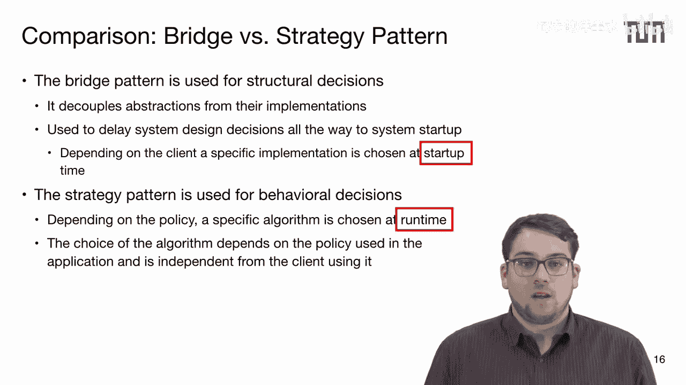

# 026：设计模式 🧩


在本节课中，我们将学习设计模式在软件工程中的重要性，特别是在对象设计阶段如何帮助我们应对变化。我们将了解不同类型的设计模式，并深入探讨桥接模式和策略模式。

设计模式之所以重要，是因为它们处理非功能性需求。在本节中，我们重点关注**可重构性**这一非功能性需求，并展示如何通过桥接模式或策略模式来实现它。

## 为什么设计模式是好的？

设计模式是对现有系统中详细设计知识的概括。它们为开发团队提供了共享的词汇表。例如，当一位团队成员说“我们可以用策略模式来实现这个”时，你应该立刻知道如何应用策略模式、其模型结构以及能获得什么好处。设计模式主要通过**多态**和**委托**来提供可复用的设计。

## 设计模式的类型

“四人帮”（Gang of Four）描述了三种主要的设计模式类型，我们也将沿用此分类：

1.  **结构型模式**：旨在减少两个或多个类之间的耦合。它们通过引入抽象类来支持未来的扩展，并封装复杂的结构。
2.  **行为型模式**：允许你在算法之间进行选择，并将职责分配给对象。它们简化了难以遵循的复杂控制流。
3.  **创建型模式**：简化复杂的对象创建过程，使系统独立于对象的创建、组合和表示方式。

以下是设计模式的分类图示：

```
设计模式 (Design Pattern)
├── 结构型模式 (Structural Pattern)
│   ├── 桥接模式 (Bridge)
│   ├── 适配器模式 (Adapter)
│   └── ...
├── 行为型模式 (Behavioral Pattern)
│   ├── 策略模式 (Strategy)
│   ├── 观察者模式 (Observer)
│   └── ...
└── 创建型模式 (Creational Pattern)
    ├── 抽象工厂模式 (Abstract Factory)
    ├── 建造者模式 (Builder)
    └── ...
```

简单来说，结构型模式关注类之间的通信，行为型模式关注类和对象的组合，而创建型模式关注类的实例化。

## 深入桥接模式 🌉

在介绍了设计模式的基本概念后，本节我们来看看桥接模式。桥接模式允许我们将设计决策推迟到系统启动时。

### 为什么需要桥接模式？

许多设计在编译时就已经固定下来。然而，我们常常希望将这些设计决策延迟到运行时。例如，我们想支持两种不同类型的客户端：`Client1`使用一个算法的旧实现，而`Client2`使用其现代实现。桥接模式允许我们将接口与其实现的绑定延迟到系统启动时，编译器无需决定使用哪个算法，这个决定在启动时完成。

### 桥接模式的结构

以下是桥接模式的官方UML图描述：

```
[抽象部分 (Abstraction)] ---委托---> [实现者接口 (Implementor)]
       |                                      |
[具体抽象A (RefinedAbstractionA)]    [具体实现者A (ConcreteImplementorA)]
[具体抽象B (RefinedAbstractionB)]    [具体实现者B (ConcreteImplementorB)]
```

*   **抽象部分** 和 **实现者接口** 通过委托连接，这实现了动态绑定。
*   左侧的层次结构（具体抽象A/B）属于**应用领域**的类层次。
*   右侧的层次结构（具体实现者A/B）属于**解决方案领域**的类层次。
*   这样，我们就可以根据客户端在启动时重新配置系统。

### 桥接模式示例

为了更好地理解桥接模式，我们以SEECX课程及其练习为例：

*   **应用领域**：`练习`（如测验、编程练习）是应用领域的元素，由学生完成。
*   **解决方案领域**：练习完成后需要被评估。评估工作不由练习本身完成，而是由`评估算法`或技术完成。
*   **桥接的好处**：桥接模式解耦了实现，使其不是永久绑定的。即使练习已经创建好，评估算法也可以在运行时更改。

桥接模式使用**封装**、**聚合**和**继承**将不同的职责分离到不同的类中。就像一座桥连接两岸，应用领域和解决方案领域可以独立发展，但始终通过桥（委托关系）连接并相互通信。

## 深入策略模式 🎯

上一节我们介绍了用于结构决策的桥接模式，本节中我们来看看行为型模式中的策略模式。

当针对特定任务存在不同的算法解决方案时，就需要策略模式。例如，我们有一个学生列表，需要按姓名或专业进行排序。我们有不同的排序算法：冒泡排序、快速排序或归并排序。这些算法在空间和时间效率上各有取舍。根据当前上下文（如列表大小），我们能够在运行时选择合适的算法实现。

### 策略模式的结构

以下是策略模式的UML图描述：

```
[上下文 (Context)] ---持有---> [策略接口 (Strategy)]
       |                               |
[客户端 (Client)]              [具体策略A (ConcreteStrategyA)]
[策略选择逻辑 (Policy)]        [具体策略B (ConcreteStrategyB)]
```

*   `策略接口`定义了通用接口。
*   `具体策略A`、`B`、`C`实现了具体的算法，并遵守策略接口。
*   `上下文`类持有一个对策略接口的引用。
*   `策略选择逻辑`负责设置上下文应使用哪种具体策略。
*   `客户端`调用上下文的方法来执行算法。上下文则委托给它所持有的策略对象来执行。

代码流程示意：
```java
// 策略选择逻辑 (Policy) 设置策略
context.setStrategy(new ConcreteStrategyA());

// 客户端 (Client) 触发执行
context.executeAlgorithm(); // 内部调用 strategy.performAlgorithm()
```

### 策略模式示例

在一个大学课程表应用中，我们需要按日期对课程列表进行排序。我们希望在课程条目多时使用快速的**快速排序**，在条目少时使用简单的**冒泡排序**。

我们可以使用策略模式来实现：
1.  定义 `SortStrategy` 排序策略接口，包含 `performSort()` 方法。
2.  创建具体策略类 `BubbleSort` 和 `QuickSort`，实现该接口。
3.  在上下文（如课程列表对象）中，根据列表长度（策略选择逻辑）决定使用哪个具体策略。
4.  客户端（如用户界面）只需调用上下文的排序方法，无需关心具体算法。

这样，排序算法被封装起来，并且可以在运行时根据策略（如“列表长度>10”）轻松切换。

## 桥接模式 vs. 策略模式

最后，我们来比较一下桥接模式和策略模式：

| 特性 | 桥接模式 (Bridge) | 策略模式 (Strategy) |
| :--- | :--- | :--- |
| **类型** | 结构型模式 | 行为型模式 |
| **目的** | 处理**结构**决策，将抽象与实现解耦 | 处理**行为**决策，封装可互换的算法族 |
| **绑定时机** | **系统启动时**。根据客户端的特定需求，在启动时选择实现。 | **运行时**。根据应用程序中定义的策略（如数据状态），在运行时选择算法。 |
| **关键区别** | 关注**连接两个独立的类层次**（抽象和实现）。 | 关注**封装一族算法**并使它们在运行时可互换。 |

简单来说，桥接模式在**启动时**选择算法实现，而策略模式在**运行时**根据策略选择算法。

## 总结



本节课中，我们一起学习了设计模式的基础知识。我们了解了设计模式在提供共享词汇和应对变化方面的重要性，并介绍了三种主要类型：结构型、行为型和创建型。我们深入探讨了两个具体模式：
*   **桥接模式**：一种结构型模式，用于将抽象与实现解耦，允许在系统启动时进行绑定。
*   **策略模式**：一种行为型模式，用于定义一族算法，并使其在运行时能够根据策略相互替换。


理解这些模式是每位软件工程师的基础。若想深入学习更多模式，可以参考Gamma等人的《设计模式：可复用面向对象软件的基础》一书。