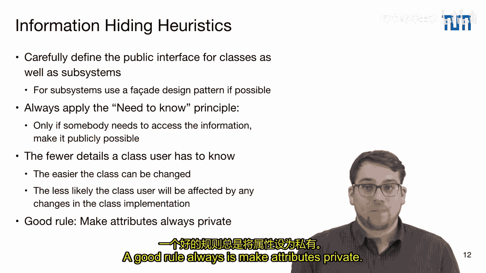

**软件工程基础：6-3：UML类图**


在本节课中，我们将学习如何在对象设计阶段，将分析阶段创建的对象模型转化为对象设计模型。我们将重点探讨如何通过添加实现相关的细节来丰富UML类图。

---

上一节我们介绍了对象设计的基本概念，本节中我们来看看如何具体地使用UML类图来支持对象设计。在分析阶段，我们使用类图来描述问题域中的概念及其关系。而在对象设计阶段，我们需要重用这种图表，但意图转变为描述解决方案的详细结构。我们不会覆盖图表的所有符号，而是聚焦于其在对象设计中的特定用途。

我们将介绍两项主要活动来丰富对象设计阶段的类图：
1.  添加解决方案域特定的类、属性和方法。
2.  指定接口，包括方法签名和属性/方法的可见性。

---

### 添加解决方案域特定的类

正如在对象设计单元中提到的，我们需要用解决方案域特定的类来扩展分析模型。

例如，在分析模型中可能只有一个 `Comment` 类。但在对象设计中，为了在用户界面中表示学生的评论，这个类可能会被扩展为四个类：`Image`、`TextField`、`Label` 和 `Comment`。这表明，一个分析类在对象设计中可能演变为多个实现类。

### 添加解决方案域特定的属性和方法

除了添加新类，我们还需要为现有类添加实现所需的属性和方法。

以 `Course` 类为例。我们可能会添加一个 `ID` 属性（类型为整数），用于区分名称相同的课程。同时，我们添加一个 `update()` 方法，该方法将在学生注册课程后被调用。这些新增内容都是为了满足具体的实现需求。

### 应用设计模式

在对象设计中，我们经常应用设计模式。例如，应用**状态模式**来管理对象的状态。

一个课程可以处于不同状态（例如，“开放注册”、“进行中”、“已关闭”），根据其当前状态，学生可能被允许或禁止注册。为此，我们创建一个 `CourseState` 接口，并实现三个具体状态类：`OpenForEnrollment`、`Running` 和 `Closed`。只有当课程处于 `OpenForEnrollment` 状态时，学生才能注册。

通过这种方式，我们向对象模型中添加了一个接口和三个类，使分析模型逐步演变为详细的对象设计模型。

---

上一节我们介绍了如何通过添加类和应用模式来丰富模型，本节中我们来看看如何精确地定义类的接口。

### 指定类型签名信息

在分析阶段，我们虽然会列出属性和方法，但通常不指定其具体类型或参数。在对象设计中，这是必须完成的步骤。

再次以 `Course` 类为例。在分析模型中，我们可能有 `enroll(student)` 方法。在对象设计中，我们需要为其添加完整的签名信息，例如 `enroll(Student s): void`。同样，对于属性，如 `requiredSemester`，我们需要指定其类型为 `int`。

在UML中，这表现为在属性和方法后标注其类型。

**代码示例：分析模型 vs. 设计模型**
```
// 分析模型（概念性）
class Course {
    requiredSemester
    enroll(student)
}

// 对象设计模型（具体化）
class Course {
    - courseId: int
    - requiredSemester: int
    + enroll(s: Student): void
    - update(): void
}
```

### 添加可见性信息

可见性定义了其他类如何访问某个类的成员。在UML中，有三种主要的可见性：
*   **公有 (`+`)**: 任何其他类都可以访问。
*   **私有 (`-`)**: 只有定义该成员的类内部可以访问。
*   **受保护 (`#`)**: 只有定义该成员的类及其子类可以访问。

这与开发者的角色相关：
1.  **类使用者** 关心公有接口（`+`）。
2.  **类实现者** 处理私有成员（`-`）。
3.  **类扩展者** 关心受保护成员（`#`）。

UML的可见性符号可以很容易地映射到Java等编程语言（除了包级私有等细微差别）。

**映射示例：UML 到 Java**
```
// UML 类图
class Course {
    - courseId: int
    + enroll(s: Student): void
    - update(): void
}

// 对应的 Java 类
public class Course {
    private int courseId;
    public void enroll(Student s) { ... }
    private void update() { ... }
}
```

---

### 信息隐藏的启发式原则

在分析阶段，信息隐藏不是重点，但在对象设计阶段至关重要。以下是一些有用的启发式原则：

以下是应用信息隐藏的一些关键原则：
*   **精心定义公有接口**：仔细设计类和子系统的公有接口。尽可能应用**外观模式**来提供简洁的接口。
*   **遵循“按需可知”原则**：仅当其他类确实需要访问某些信息时，才将其设为公有。类使用者需要知道的细节越少，类的内部实现就越容易修改，且修改对使用者的影响也越小。
*   **将属性设为私有**：一个好的通用规则是，默认将**所有属性设置为私有**，然后根据需要谨慎地提供公有的获取器或设置器方法。



---


本节课中我们一起学习了如何将分析对象模型转化为对象设计模型。我们探讨了如何通过添加解决方案域特定的类、属性和方法来丰富UML类图，并详细说明了如何指定方法签名和成员可见性以精确描述接口。最后，我们回顾了信息隐藏的重要原则，为接下来的实现阶段做好了充分准备。