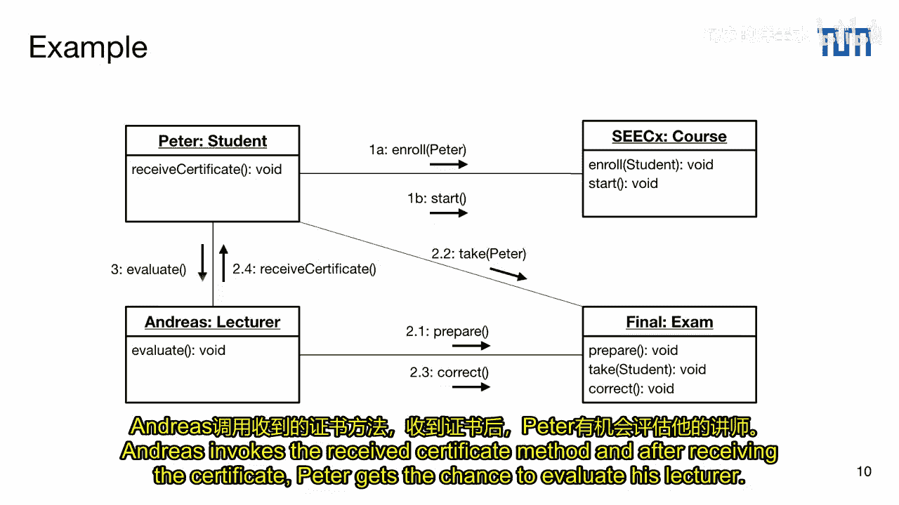
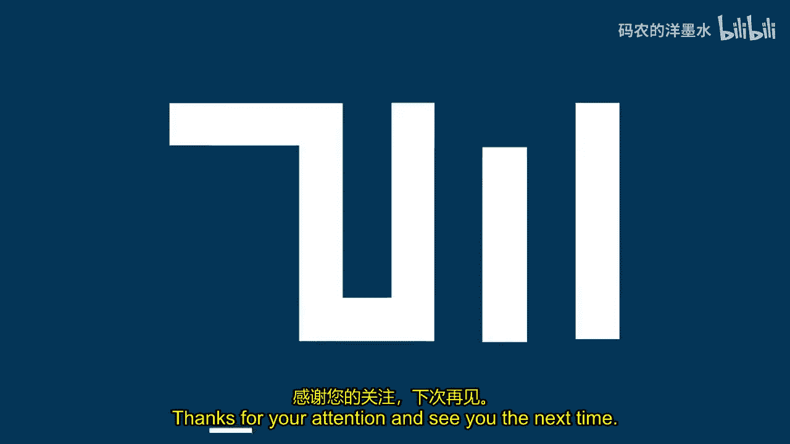

软件工程基础：6-4：通信图 📡


在本节课中，我们将学习如何将静态的类图转化为动态的通信图，以展示对象之间如何通过消息进行交互。

---

上一节我们介绍了UML图的不同分类。在SEECx的UML图分类中，左侧的结构图（如类图）与右侧的交互图（如通信图）具有不同的意图。本节中，我们来看看如何从类图转换到通信图。

类图展示了类的布局及其关联关系，而通信图则展示了多个对象之间的交互。对象是类的实例。通信图使用与类图相似的布局，来描绘对象之间消息的流动。

需要提及的是，UML序列图（使用生命线）不在本课程范围内，我们更倾向于使用通信图。

---

### 从类到对象

以下是如何从类创建对象。我们从一个名为 `Course` 的类开始，它包含属性 `name`、`times` 和方法 `enroll`、`drop`、`start`。

现在，我们创建它的一个实例，即对象。其可视化方式如下：
*   首先，在标题 `Course` 前加上一个冒号。
*   其次，名称带有下划线。
*   可选地，可以为对象命名，例如 `:Course` 可以命名为 `:SEECx Course`。

**代码示例：**
```
// 类定义
class Course {
    String name;
    Time[] times;
    void enroll() { ... }
    void drop() { ... }
    void start() { ... }
}

// 对象实例化
Course seecxCourse = new Course(); // 对应通信图中的 `:SEECx Course`
```

---

### 通信图中的消息类型

在通信图中，我们使用三种不同类型的消息来展示交互。

以下是三种主要的消息类型：

1.  **顺序消息**：消息按顺序依次执行。
2.  **条件消息**：仅在特定条件满足时才执行的消息。
3.  **并发消息**：可以并行执行的消息。

与类图不同，通信图中所有类型的关联都转换为简单的连线，不显示多重性。

---

#### 顺序消息

首先，让我们看看顺序消息。学生 Peter 想注册 SEECx 课程，因此他调用 `enroll` 方法。箭头指示了通信的方向。过了一段时间，Peter 决定退出课程，于是他调用 `drop` 方法。

**图示流程：**
`Peter -> :SEECx Course: 1. enroll()`  
`Peter -> :SEECx Course: 1.2 drop()`

---

#### 条件消息

接下来是条件消息。这类消息意味着只有在满足特定要求时才能调用某个方法。例如，要参加 SEECx 课程，学生必须至少是第四学期。因此，Peter 只有在满足此条件时才能调用 `enroll` 方法。

**公式描述：**
`if (student.semester >= 4) then invoke course.enroll()`

---

#### 并发消息

最后是并发消息。在通信图中，并发消息可以并行执行。例如，Peter 可以同时执行操作 1A（注册课程）和操作 1B（课程开始）。

**图示表示：**
`Peter -> :SEECx Course: 1A. enroll()`  
`Peter -> :SEECx Course: 1B. start()  // 与1A并发`

---

### 从类图到通信图的转换步骤

了解了消息类型后，我们来看看从类图生成通信图的具体步骤。

以下是从场景事件流出发，创建通信图的系统化步骤：

1.  **列出事件流步骤**：从某个场景的事件流中提取所有步骤。例如，“Peter 加入 SEECx 课程”。
2.  **实例化参与对象**：识别并实例化参与交互的对象。例如，`:Student Peter` 和 `:Course SEECx`。
3.  **为消息编号**：为事件流的每个步骤分配消息编号。
4.  **检查并完善类图**：检查消息接收者（对象对应的类）是否拥有对应的方法。如果没有，则需要返回完善类图，为接收者添加公共方法。例如，若 `:SEECx Course` 需要响应 `enroll` 消息，则 `Course` 类必须拥有 `enroll()` 方法。
5.  **绘制消息箭头**：从发送者（如 Peter）到接收者（如 SEECx 课程）绘制带编号的消息箭头。

---

### 综合示例

为了让你更好地理解，我们来看一个更复杂的故事示例。



故事流程如下：
1.  Peter 想加入 SEECx 课程，因此他注册了该课程。
2.  当他注册时，课程也同时开始。
3.  讲师 Andreas 开始准备 Peter 需要参加的考试。
4.  准备完毕后，Peter 参加考试。
5.  Andreas 批改试卷，以便为 Peter 生成证书。
6.  Andreas 调用 `receiveCertificate` 方法。
7.  收到证书后，Peter 有机会评价他的讲师。

这个流程可以通过一个包含多个对象（`:Student Peter`， `:Lecturer Andreas`， `:Course SEECx`， `:Exam`， `:Certificate`）和一系列顺序、并发及条件消息的通信图来清晰表示。

---



本节课中，我们一起学习了UML通信图。我们展示了如何从结构化的类图转换到动态的通信图，后者通过消息来表现对象之间的交互。掌握这种转换，有助于你更全面地描述软件系统的静态结构和动态行为。