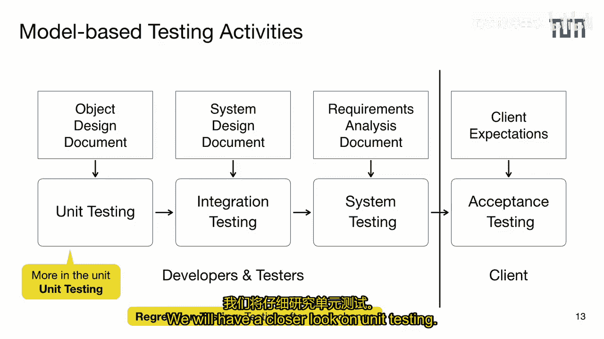

# 029：软件测试入门

在本节课中，我们将要学习软件生命周期中“测试”的含义。我们将理解故障、失效和错误之间的区别，并了解故障处理技术的分类。同时，我们也会初步了解单元测试、集成测试和系统测试这些测试活动。

## 概述：为何需要测试软件？

历史上有很多例子表明，充分的测试本可以避免许多问题。其中一个例子是F-16战斗机。在一次测试中，飞机在穿越赤道时发生了翻转。原因是系统无法处理负纬度值。

这件事之所以发生，是因为工程师复用了火箭的自动驾驶软件。对于火箭而言，方向并不重要，但对于F-16战斗机则至关重要。在最好的情况下，飞行员穿越赤道时可能只会感到头痛，但希望不会发生更严重的事故。你可以在链接的网页上找到更多关于故障、失效和错误的故事。

## 故障、失效与错误的区别

尽管“错误”和“失效”这两个词听起来有些相似，但在软件测试的语境下，它们有显著的区别。

*   **失效** 是指观察到的行为与规定行为之间的任何偏差，例如系统崩溃。
*   **错误** 是指系统处于一种错误状态，任何进一步的处理都可能导致失效。
*   **故障** 是导致错误的机械或算法原因，换句话说，就是程序缺陷或Bug。

例如，我们来看铁轨。规格说明规定轨道应支持火车运行。然而，如果一列火车到达并在A点前停下，系统就处于一个错误状态。任何进一步的移动都必然导致脱轨，从而引发失效，因为我们规定轨道应支持运行中的火车。那么故障在哪里？在这种情况下，故障很可能存在于工人之间的沟通中。

## 故障处理技术分类

我们接下来介绍故障处理技术的分类。

*   **故障避免**：使用方法来降低复杂性；使用配置管理来防止不一致（正如在软件配置管理单元中所见）；应用验证来防止算法故障。
*   **故障检测**：涉及测试和调试。**测试** 是以计划的方式引发失效的活动。**调试** 意味着找到并移除观察到的失效的原因。测试可以进一步细分为单元测试、集成测试和系统测试这三个活动。
*   **故障容忍**：涉及异常处理和模块冗余。

上一节我们介绍了故障处理的基本分类，本节中我们来看看其中的核心活动——测试。

## 深入理解测试

测试常被视为一项繁琐的工作。但要编写有效的测试，测试人员需要具备几样东西：对系统、应用和解决方案的深入理解；测试技术的知识；以及有效且高效应用这些技术的技能。

测试最好由独立的测试人员完成。这也是为什么组织会建立独立的测试团队甚至将测试外包的原因，因为“四只眼睛比两只眼睛能找到更多错误”。我们在这里遵循单一职责原则，即每个人只应承担一项责任。

问题在于，开发者常常形成一种思维定势，认为程序应该以某种方式工作，而实际上并非如此。开发者常常固守那些能让程序运行的数据集，并抱有“别搞乱我的代码”的心态。程序在别人尝试时常常无法工作，所以你常能听到“在我机器上它能运行”这句话。

测试人员和开发者的目标是一致的：为客户提供高质量的产品。但他们的思维方式不同。他们并非不同，而是通过不同的路径实现同一目标。开发者思考：“我如何构建这个应用？”测试者思考：“我如何破坏这个应用？”一个好的测试者应能从容面对冲突。很多时候很难精确定位错误的来源，它可能是编码错误、文档错误、设计错误，或者根本不是错误。但报告每一个错误是测试者的工作。一个好的开发者应以积极和建设性的态度接受反馈，诊断问题并修复它。但开发者常常回避冲突，这会造成障碍。

我们来看一个例子。一位开发者在他的机器上实现了一个用于输入用户信息的表单，它运行得非常好。测试者发现了一个错误：用户可以在不输入任何信息的情况下提交表单。尽管问题陈述中没有定义这种行为，但开发者应该明白，在表单提交前必须验证用户输入。开发者辩称验证工作量大，但最终同意了测试者的意见并实现了缺失的部分。为了创造积极的结果，测试者和开发者必须共同努力。

## 什么是成功的测试？

当测试揭示了失效时，它就是成功的。测试的目标不是拥有一堆通过的测试用例。重要的测试用例是那些首先失败并最终使系统更健壮的用例。测试者不应局限于标准情况，还应研究边界情况，并尝试意外的行为。例如，测试者在表单中输入错误的日期，观察系统如何反应以及是否能处理错误的输入。

有两种方式来表达测试的成功：
*   **选项A**：测试是成功的，因为它产生了失效。我们认为这是一个好的测试，当测试变红（未通过）时，我们可以看到代码中存在问题。
*   **选项B**：测试是成功的，因为它没有产生失效。我们指的是测试通过的情况，但我们认为在这种情况下它不是一个成功的测试，因为它没有产生失效。
这两种表述经常被混淆。

## 测试模型与基于模型的测试

现在我们来探讨测试模型。我们使用“测试模型”这个词类似于“系统模型”，它是一组类和关联，其工作实际上是执行测试。测试模型将所有与测试相关的决策和组件整合到一个包中，由测试用例组成。测试用例是对要执行的测试活动的描述，它们源自我们在分析阶段所做的场景和用例，也简称为测试。

我们还有**测试驱动**，它是执行测试用例的程序。**输入数据**是测试所需的数据。然后**预言**发挥作用，它将预期输出与测试的实际输出进行比较。当我们谈论**测试工具**时，我们指的是允许我们在不同条件下运行测试并监控其行为和输出的软件组件或框架。这个测试工具也常简称为测试框架。

从测试模型出发，我们转向基于模型的测试。基于模型测试的理念是测试完全基于模型。你拥有从分析中得出的系统模型，包括用例、动态模型以及对象模型。从这个模型，你生成你的测试模型。因此，基于模型的测试技术是利用系统来生成测试模型。

另一个你需要知道的定义是**被测系统**，简称SUT。它通常是系统的一部分，而不是整个系统；它可以是一个单独的类，也可以是一个作为子系统的类的集合。如果被测系统由整个系统模型组成，我们实际上进行的是系统测试。最后是**测试驱动开发**，我们将其反过来：我们在实际创建系统模型之前先创建测试模型。

基于模型的测试有一些我们想要利用的优势：首先，我们可以提高测试的有效性；我们可以降低成本并实现更好的维护；我们重用我们在分析、系统和对象设计期间已经创建的工件（模型）；并且我们可以追踪我们的需求，从需求规格说明一直到实际的实现。

## 测试活动概览：单元、集成、系统与验收测试

我们已经提到了测试驱动开发。现在让我们更深入地了解测试活动，我们将涉及单元测试、集成测试和系统测试。

*   **单元测试**：也称为模块测试。我们测试单个组件、类或子系统。目标是确认组件或子系统被正确实现编码，并执行了预期的功能。单元测试的基础是我们的对象设计文档。
*   **集成测试**：测试子系统的集合，最终是整个系统。目标是测试这些子系统之间的接口。集成测试的基础是系统设计文档。
*   **系统测试**：测试整个系统。目标是确定系统是否满足需求分析文档中描述的功能和非功能需求。
*   **验收测试**：评估由开发者交付的系统。我们想要演示系统，并证明系统满足客户的期望并已准备好使用。

单元测试、集成测试和系统测试由开发者和测试人员执行，而验收测试由客户完成。

那么**回归测试**呢？回归测试是一种软件测试，用于验证先前开发和测试过的软件在更改后是否仍能正确执行。因此，我们将在每次更改后执行所有之前提到的测试，这就是回归测试。

## 总结

本节课中我们一起学习了为什么测试软件很重要。我们澄清了关于故障、失效和错误的术语。我们介绍了故障处理技术的分类，并快速了解了测试驱动开发。我们还介绍了四种测试活动：单元测试、集成测试、系统测试和验收测试。