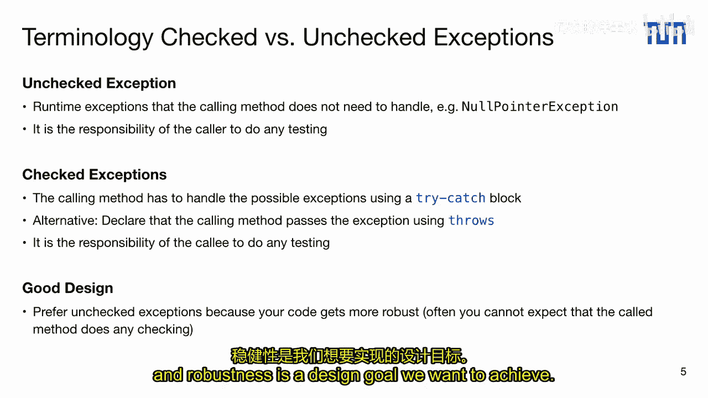

软件工程基础：7-2：异常处理 🛡️


在本节课中，我们将要学习异常处理的概念，了解其重要性，并掌握在Java中实现异常处理的具体方法。

---

上一节我们介绍了错误处理的分类，本节中我们来看看异常处理。在故障处理的分类中，异常处理是容错技术的一个子类。异常处理是一种机制，系统通过它来处理异常。

在计算机世界和现实生活中，偶尔会出现问题。当问题出现时，你需要采取行动。最简单的情况是，你可以停止程序并返回一个错误码。但问题在于，发现错误的程序部分并不总是知道如何处理它。当某个例程发现错误时，它需要通知其调用者，而调用者可能会将错误沿调用链向上传递。在许多语言中，使用特殊的输出来指示这种错误。Java有一种更好的方式：异常。

异常机制更好，因为它将正常处理逻辑与错误处理逻辑清晰地分离开来，这使得程序更易于理解。作为开发者，我们面临的挑战是必须预见故障，并因此编写异常处理代码。操作系统、虚拟机或服务通常只生成通用的异常，这些异常必须被处理，例如除以零的异常，或者非常常见的空指针异常。

---

让我们看看如何在Java中处理异常。

首先，考虑一个没有异常处理的糟糕示例。我们有一个`Account`类，它有一个私有字段`balance`和一个方法`withdraw`，该方法接收参数`amount`。`withdraw`方法实际做的事情是：如果`amount`大于`balance`，则返回一个错误码`-1`；否则，从`balance`中减去`amount`并返回`0`。它为什么返回`0`？因为这个整数值相当于一个错误码，所以该方法在取款无效时返回`-1`，有效时返回`0`。

以下是该方法的代码描述：
```java
public int withdraw(int amount) {
    if (amount > balance) {
        return -1; // 错误码
    }
    balance -= amount;
    return 0; // 成功码
}
```

---

现在，让我们看看如何用Java正确地处理异常。我们仍然有`Account`类、`balance`字段和`withdraw`方法。不同之处在于，我们声明`withdraw`方法会抛出一个`BalanceException`。这意味着当`amount`大于`balance`时，它会抛出一个新的`BalanceException`。

让我们比较这两个例子。在第一个例子中，`withdraw`方法的返回值是一个整数，这基本上就是我们的错误码。而新的`withdraw`方法没有返回值，它返回`void`，这样更清晰。

如何调用这个会抛出`BalanceException`的`withdraw`方法呢？我们使用一个`try-catch`块。在`try`块中，调用账户的`withdraw`方法；在`catch`块中，捕获`BalanceException`并打印“资金不足”。例如，银行客户调用`withdraw`方法。那么，谁实际负责处理这个错误呢？银行客户负责处理这个异常，因为它是一个受检异常。

以下是正确使用异常处理的代码描述：
```java
public void withdraw(int amount) throws BalanceException {
    if (amount > balance) {
        throw new BalanceException();
    }
    balance -= amount;
}

// 调用方式
try {
    account.withdraw(amount);
} catch (BalanceException e) {
    System.out.println("Not enough money.");
}
```

---

那么，什么是受检异常，什么又是非受检异常呢？

首先是非受检异常。非受检异常可以通过在`try`块中调用方法并在`catch`块中处理异常来处理。当我们谈论非受检异常时，我们指的是运行时异常，调用方法不需要处理它们，例如空指针异常。进行任何测试是调用者的责任。

以下是处理非受检异常的示例：
```java
try {
    // 可能抛出非受检异常的代码
    someMethod();
} catch (RuntimeException e) {
    // 处理异常
}
```

---

再看看受检异常。调用方法必须在`try-catch`块中处理可能的异常，就像我们在之前的账户示例中所做的那样。另一种选择是，我们使用`throws`声明调用方法会抛出该异常。因此，进行任何测试是被调用者的责任。

这对于我们的设计意味着什么？我们如何才能做出好的设计？更推荐使用非受检异常，因为这样代码会更健壮。通常，你不能指望调用方法会进行任何检查，而健壮性正是我们希望实现的设计目标。



---


在本节课中，我们一起学习了异常处理，了解了它为何有用以及在Java中如何实现。我们还向你展示了受检异常和非受检异常之间的区别。感谢观看，我们下次再见。