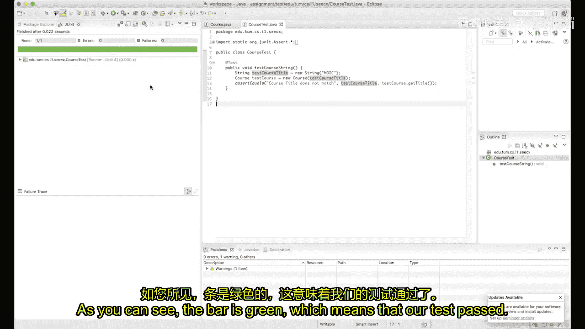

# 031：单元测试 🧪


在本节课中，我们将学习单元测试，并了解如何使用测试框架 JUnit 来编写和运行单元测试。

## 概述

单元测试是故障检测的一个子类，其目标是发现代码中可能存在的缺陷。我们的目的是确认组件或子系统被正确实现，并执行了预期的功能。对象设计文档是进行单元测试的基础。

上一节我们介绍了故障检测的基本概念，本节中我们来看看如何具体实施单元测试。

## 使用 JUnit 进行单元测试

JUnit 是一个用于编写和运行 Java 单元测试的框架。它由测试用例、测试套件组成，并提供了一个测试运行器。JUnit 最初由 Kent Beck 和 Erich Gamma 编写，它采用“测试先行”和基于模式的开发方法。JUnit 是开源的，你可以通过其官网或 GitHub 找到它。JUnit 使用注解来控制测试用例的执行，并通过断言来验证预期行为与实际行为是否一致。

接下来，我们将深入了解 JUnit 中的注解和断言。

### 注解

注解是一种可以添加到 Java 源代码中的语法元数据，在 JUnit 中被广泛使用。

以下是 JUnit 中一些重要的注解：

*   **`@Test`**：标识一个测试方法。
*   **`@Test(expected = Exception.class)`**：测试方法是否抛出指定的异常。
*   **`@Test(timeout = 100)`**：如果测试执行时间超过 100 毫秒，则测试失败。
*   **`@Before`**：在每个测试方法执行前被调用，用于设置测试环境。
*   **`@After`**：在每个测试方法执行后被调用，用于清理工作。
*   **`@BeforeClass`**：在所有测试方法执行前被调用一次，通常用于执行耗时的设置（如连接数据库）。
*   **`@AfterClass`**：在所有测试方法执行后被调用一次，通常用于执行清理工作。

### 断言

断言用于比较预期结果和实际结果。以下是 JUnit 中一些核心的断言方法：

*   **`assertTrue(condition)`**：断言条件为真。如果条件为假，则测试失败。
*   **`assertFalse(condition)`**：断言条件为假。如果条件为真，则测试失败。
*   **`fail(message)`**：直接使测试失败，并显示给定的消息。
*   **`assertEquals(expected, actual)`**：比较两个对象或基本类型的值是否相等。
*   **`assertNull(object)`**：断言对象为 `null`。
*   **`assertNotNull(object)`**：断言对象不为 `null`。

> 注意：`message` 参数是可选的，如果测试失败，该消息将作为输出显示。

关于断言的更多细节，请查阅 JUnit 断言文档，其中包含了许多其他有用的断言方法。

## 实践：在 Eclipse 中编写 JUnit 测试

上一节我们介绍了 JUnit 的核心概念，本节将通过一个解释性视频的要点，展示如何在 Eclipse 中为“大学应用”的一个功能创建第一个 JUnit 测试用例。

以下是创建和运行测试的关键步骤：

1.  **创建测试文件夹和包**：首先，在工作区创建一个类型为“源文件夹”的测试文件夹。然后，在该文件夹中创建一个与开发包名对应的 Java 包，以分离实现代码和测试代码。
2.  **创建测试类**：在新建的测试包中，创建一个名为 `CourseTest` 的 JUnit 测试用例类，用于测试 `Course` 类的行为。在创建向导中，选择要测试的系统（`Course` 类）。
3.  **选择测试方法**：在向导中，选择你想要测试的方法，例如带有课程标题参数的 `Course` 构造函数。
4.  **编写测试逻辑**：Eclipse 会生成一个默认的测试方法，其实现总是失败。你需要将其替换为自己的测试逻辑。例如：
    ```java
    @Test
    public void testCourseConstructor() {
        String testCourseTitle = "MOOC";
        Course testCourse = new Course(testCourseTitle);
        assertEquals(testCourseTitle, testCourse.getTitle());
    }
    ```
    这段代码创建一个新的 `Course` 对象，并断言传入构造函数的标题与从对象中获取的标题一致。
5.  **运行测试**：可以通过点击顶部的运行按钮，或右键单击测试类并选择“Run As -> JUnit Test”来执行测试。
6.  **分析结果**：如果测试失败（红色条），可以查看错误信息来定位问题。例如，错误信息可能显示预期值为“MOOC”，但实际值为“null”，这表明构造函数可能没有正确设置标题属性。
7.  **修复代码并重新测试**：根据错误信息，修复实现代码中的缺陷（例如，确保构造函数正确地为成员变量赋值），保存文件，然后重新运行测试。绿色条表示测试通过。

## 总结




本节课中，我们一起学习了单元测试以及 JUnit 框架。我们介绍了 JUnit 的基本概念，包括用于控制测试流程的注解和用于验证结果的断言。最后，我们通过一个实践示例，演示了如何在 Eclipse 中创建、编写和运行一个简单的 JUnit 测试用例，以验证代码的正确性。掌握单元测试是确保软件质量的重要步骤。