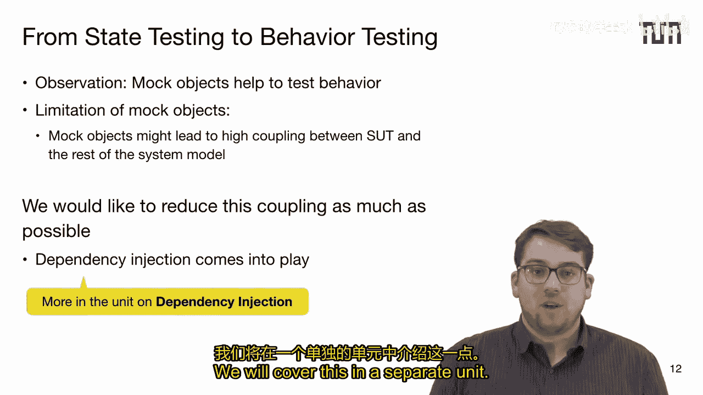

# 032：模拟对象模式 🧪

在本节课中，我们将学习面向对象测试中的一个重要模式——模拟对象模式。我们将了解为何需要模拟对象，如何应用该模式，并通过一个大学应用系统的例子，结合EasyMock框架进行具体演示。

---

## 概述

上一节我们介绍了单元测试，它主要用于测试被测系统的状态。然而，当被测系统需要与其他组件交互时，我们就需要一种不同的测试方法。本节中，我们将探讨面向对象的、基于模型的测试，并重点学习模拟对象模式。

---

## 什么是面向对象的、基于模型的测试？

我们从一个系统模型开始。系统模型包含我们想要测试的被测系统（即类或组件）。被测系统并非孤立存在，它会与系统中的其他对象（称为协作者）进行协作。

在基于模型的测试中，测试模型是从被测系统派生出来的。为了能与协作者交互，我们需要向测试模型中添加对象。这些对象被称为**测试替身**。

测试替身的作用是在测试期间替代真实的协作者，让被测系统误以为它正在与真实的协作者对话。“替身”这个名字来源于电影，特技替身会在危险场景中替代演员。在软件工程中，当系统模型中的真实协作者尚未实现、使用不便或存在风险时，就应该使用测试替身。

---

## 测试替身的分类

以下是测试替身的一个分类：

*   **Dummy（虚设对象）**：通常用于填充参数列表，但实际从未被使用。
*   **Fake（伪造对象）**：包含“捷径”的工作实现，不适用于生产代码。例如，使用内存数据库替代磁盘数据库。
*   **Stub（桩对象）**：为测试期间的调用提供预设的答案。它总是返回相同的响应，例如，一个总是返回3的随机数生成器。
*   **Mock（模拟对象）**：能够模仿真实对象的行为；它们知道如何处理预期会收到的特定调用序列。

在这四种替身中，只有模拟对象**强制要求进行行为验证**。其他替身可以（并且通常）使用状态验证。

---

## 模拟对象模式

现在，让我们具体看看模拟对象模式。首先，良好的设计对于应用模拟对象模式至关重要。真实对象或子系统必须通过接口来定义，并通过类来实现。

让我们回到大学应用系统的例子。我们想对注册服务进行单元测试，它就是我们的被测系统。注册服务依赖于`Student`和`Course`类。问题是，`Course`类目前尚未实现，因此我们无法正确测试注册服务。

模拟对象测试模式的核心思想是：用模拟对象替换系统模型中与协作者的交互。这些模拟对象可以在测试设置阶段创建。显然，我们之前的设计不够好，因为我们没有为`Course`类定义接口。现在让我们来改进它。

---

### 模拟对象模式的定义

从一个接口开始（正如我们上一张幻灯片所做的），这就是模拟对象模式的基础。

一个**模拟对象**（协作者模拟）替代了称为**协作者**的真实对象的行为。我们想要替换真实对象行为的原因有很多：

*   单元测试需要测试具有非确定性行为的对象（例如，当前气温）。
*   特定的行为难以触发（例如，网络错误）。
*   对象具有用户界面，或者对象本身就是用户界面。
*   最常见的原因之一是：真实对象尚不存在，因此无法测试。

模拟对象可以在启动时通过工厂模式创建。我们将使用一个框架来创建模拟对象，因此无需关心工厂的具体实现。

模拟对象既可以用于测试最终对象的状态，也可以用于测试对象之间的交互，因为它们模仿了真实对象的行为。它使我们能够测试被测系统与其协作者的交互，并检查其行为是否符合预期。

---

### 录音-回放隐喻

模拟对象的使用基于**录音-回放**隐喻。这是什么意思呢？想想磁带录音机：我们先在磁带上录制一些内容，然后可以播放它。

模拟对象模式使用了这个比喻。假设你想排练一场需要合唱团和管弦乐队的音乐剧。大多数时候，管弦乐队在合唱团练习时无法到场，因为成本太高，但合唱团排练时需要管弦乐队演奏的音乐。那么该怎么办？管弦乐队提前将音乐录制下来，这就是我们所说的“模拟”。当合唱团排练时，就使用这份录音（即模拟对象）进行播放。这样我们就可以排练音乐剧了。

将其置于模拟对象模式的上下文中：
*   管弦乐队是一个尚不可用或设置成本高昂的类，它是我们的模拟对象，是测试模型的一部分。
*   合唱团是我们想要测试的类，即我们的被测系统。

为了正确测试，我们需要遵循五个步骤：
1.  创建模拟对象（管弦乐队），并指定其行为（让它演奏并录音）。
2.  让录音准备就绪，可供播放（使模拟对象进入可回放状态）。
3.  执行被测系统（合唱团练习），并使用模拟对象（播放录音）。
4.  比较观察到的行为与预期行为（检查合唱团的演唱是否与管弦乐队的演奏匹配）。

---

## 应用EasyMock框架

让我们将管弦乐队的例子和模拟对象模式应用到我们的大学应用中。

我们需要一个`Course`来测试`EnrollmentService`，因此我们虚拟地引入一个遵循`Course`接口的`CourseMock`类。我们只需要它的`enroll`方法，因为这是将被`EnrollmentService`调用的方法。`CourseMock`是测试模型的一部分，不会存在于我们的系统模型中。

我们将使用**EasyMock框架**在Java中实现这一点。

EasyMock是一个用于Java的开源测试框架，它利用了模拟对象模式。它可以动态生成运行时模拟对象，而无需手动实现它们。EasyMock使用注解来定义被测系统和模拟对象：
*   `@TestSubject` 注解标记正在被测试的类。
*   `@Mock` 注解标记我们想要模拟的对象。

要指定模拟对象的行为，EasyMock框架提供了`expect`方法。例如：`expect(mockObject.foo("example")).andReturn(42);`。
要让模拟对象准备就绪，需要调用`replay`方法。

---

### 测试注册服务的五个步骤

回到我们的`EnrollmentService`测试：

1.  **定义被测系统**：使用 `@TestSubject` 注解。
2.  **为每个协作者定义模拟对象**：在我们的例子中是 `Course`（类比管弦乐队）。我们在这里创建模拟对象。
3.  **指定预期行为**：通过 `expect` 方法完成。
4.  **让模拟对象准备就绪**：通过调用框架的 `replay` 方法，并传入我们的模拟对象作为参数。
5.  **执行被测系统**：本例中是调用 `EnrollmentService` 的 `enroll` 方法。
6.  **比较观察行为与预期行为**：本例中，我们断言学生在成功注册后，所修课程数量增加了1。

这和我们为排练音乐剧引入的五个步骤完全相同。在应用模拟对象模式时，请记住这个音乐剧的比喻。

---

## 模拟对象的局限性与展望

我们仍然处在从状态测试到行为测试的旅程中。模拟对象帮助我们测试行为以及与协作者的交互。

然而，模拟对象也有一些局限性。例如，模拟对象会导致被测系统与模型其余部分之间的**高耦合**。为了尽可能减少这种耦合，我们正在寻找替代方法。**依赖注入**的概念应运而生，它可以帮助我们降低耦合度。我们将在单独的单元中涵盖这个话题。

---

## 总结

本节课我们一起学习了模拟对象模式。

*   单元测试允许测试对象的状态。
*   模拟对象是一种能够模仿真实对象行为的测试替身。
*   因此，模拟对象模式使我们能够测试状态和行为。
*   主流编程语言都有可用的模拟对象框架，我们介绍了EasyMock的基本用法。

模拟对象是进行有效单元测试、尤其是在处理依赖和未实现组件时的强大工具。