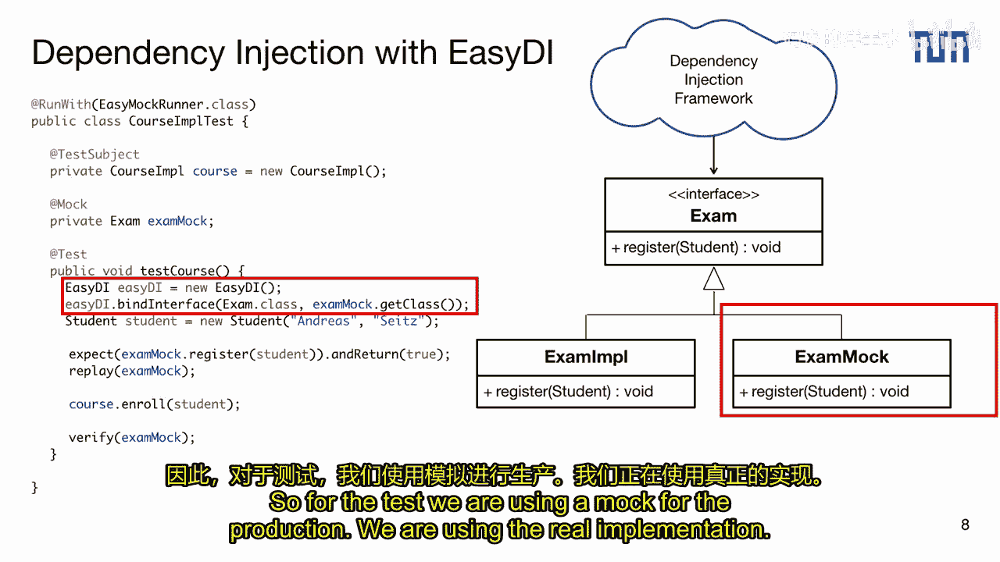

软件工程基础：7-5：依赖注入 🧩


在本节课中，我们将学习**依赖注入**的概念，这是一个用于降低代码耦合度、提升可测试性的重要设计模式。我们将通过一个具体的课程与考试的例子，理解其原理，并介绍一个名为**EasyDI**的简单依赖注入框架。

---

### 概述

上一节我们介绍了行为测试和模拟对象模式，以克服状态测试的局限性。然而，当在类的构造函数中直接使用 `new` 关键字创建依赖对象时，我们仍然面临高耦合的问题，这使得在测试和生产环境间切换依赖实现变得困难。本节中，我们来看看如何通过**依赖注入**来解决这个问题。

依赖注入的核心思想是：一个类不应该自己创建它所依赖的对象，而应该由外部框架或容器来“注入”给它。这样，类只依赖于接口，而不依赖于具体的实现，从而实现了松耦合。

### 面临的问题

假设我们有一个 `Course` 类，每个课程都有一场考试。在最初的实现中，我们可能会在 `Course` 的构造函数里直接创建 `Exam` 对象：

```java
public class CourseImplementation {
    private Exam exam;

    public CourseImplementation() {
        // 直接依赖具体实现，耦合度高
        this.exam = new ExamImplementation();
    }
}
```

这里的问题是，`CourseImplementation` 类**紧密耦合**于 `ExamImplementation`。如果我们想对 `CourseImplementation` 进行单元测试，并希望使用一个模拟的 `Exam` 对象（`ExamMock`）来替代真实的考试实现，这是无法做到的，除非修改 `CourseImplementation` 类的源代码。

### 依赖注入的解决方案

为了解决上述问题，我们需要移除 `CourseImplementation` 对具体 `Exam` 实现的直接依赖。我们希望有一个机制，能让我们轻松地在不同的 `Exam` 实现（如真实实现和模拟对象）之间切换。

以下是实现依赖注入的关键步骤：
1.  **依赖接口，而非实现**：`CourseImplementation` 类只应知道 `Exam` 接口。
2.  **移除 `new` 关键字**：不在 `CourseImplementation` 内部实例化 `Exam`。
3.  **由外部注入依赖**：具体的 `Exam` 实现由外部的依赖注入框架实例化并“注入”给 `CourseImplementation`。

### 一个生动的比喻

为了更好地理解“注入”，我们可以想象一个果酱甜甜圈。
*   **传统方式（高耦合）**：就像为了把果酱放进甜甜圈，你把甜甜圈切成两半，塞入果酱，再合上。这破坏了甜甜圈的完整性，并且过程混乱。
*   **注入方式（依赖注入）**：使用一个注射器，通过一个小孔将果酱注入完整的甜甜圈内部。这样既完成了任务，又最大程度地保持了甜甜圈的原有结构。

在软件中，依赖注入框架就像是这个“注射器”，它通过一个定义好的“接口”（小孔），将具体的依赖对象（果酱）注入到需要它的类（甜甜圈）中，而不需要类自己破坏内部结构去获取依赖。

### 代码实践：使用 EasyDI 框架

我们将使用 **EasyDI** 框架来实现依赖注入。其他流行的框架还有 Google 的 Guice 等。

以下是改造后的 `CourseImplementation` 类：

```java
public class CourseImplementation {
    private Exam exam;

    // 构造函数接收一个注入的 Exam 对象
    public CourseImplementation(Exam exam) {
        // 依赖由外部注入，而非内部创建
        this.exam = exam;
    }
}
```

在系统的主配置或模块中，我们使用 EasyDI 来建立接口与具体实现的绑定：

```java
// 创建依赖注入容器
EasyDI di = new EasyDI();
// 绑定接口 Exam 到其具体实现 ExamImplementation
di.bindInterface(Exam.class, ExamImplementation.class);

// 获取 CourseImplementation 实例，其 Exam 依赖会被自动注入
CourseImplementation course = di.getInstance(CourseImplementation.class);
```

### 如何进行单元测试

现在，我们可以轻松地为 `CourseImplementation` 编写单元测试，并在测试中使用模拟的 `Exam` 对象。

以下是测试的关键步骤：
1.  **创建模拟对象**：使用 EasyMock 为 `Exam` 接口创建一个模拟对象。
2.  **配置依赖注入**：在测试环境中，将 `Exam` 接口绑定到我们创建的模拟对象上。
3.  **注入模拟对象**：将模拟的 `Exam` 对象注入到 `CourseImplementation` 中。

```java
@Test
public void testCourseWithMockExam() {
    // 1. 为协作对象 Exam 创建模拟对象
    Exam examMock = EasyMock.createMock(Exam.class);
    // 可以在这里录制模拟对象的行为，例如：
    // EasyMock.expect(examMock.getScore()).andReturn(95);

    // 2. 创建依赖注入容器，并绑定模拟对象
    EasyDI testDi = new EasyDI();
    testDi.bindInterface(Exam.class, examMock);

    // 3. 获取被测试的系统（CourseImplementation），模拟对象会被自动注入
    CourseImplementation courseUnderTest = testDi.getInstance(CourseImplementation.class);

    // 4. 重放模拟对象行为，并执行测试断言
    EasyMock.replay(examMock);
    // ... 执行 courseUnderTest 的方法并断言
    EasyMock.verify(examMock);
}
```

通过结合 **EasyMock（模拟对象框架）** 和 **EasyDI（依赖注入框架）**，我们能够编写出高度解耦的单元测试。在测试时，我们将 `Exam` 绑定到一个模拟对象；在生产运行时，则绑定到真实的 `ExamImplementation`。这一切都无需修改 `CourseImplementation` 类的代码。

---



### 总结


本节课中我们一起学习了**依赖注入**模式。我们了解到，通过在构造函数或设置方法中接收依赖对象，而不是在内部创建它们，可以显著降低系统各组件之间的**耦合度**。我们引入了 **EasyDI** 作为一个简单的依赖注入框架来实现这种绑定。最终，结合模拟对象技术，我们能够编写出更灵活、更独立的单元测试，从而构建出更健壮、更易维护的软件系统。