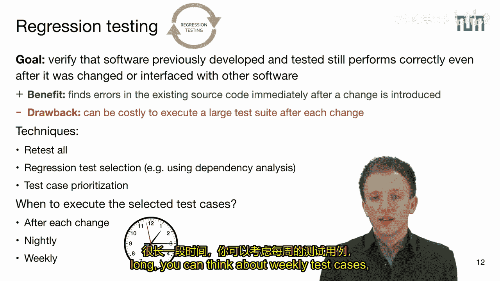

# 034：构建管理 🛠️


在本节课中，我们将要学习构建管理。你将了解构建管理如何帮助开发者编译、测试和打包他们的代码，形成可以交付给客户和最终用户的软件构建版本。学完本单元后，你将能够解释持续集成的概念，并描述回归测试的好处。

## 概述

在软件开发中，开发环境和目标环境不同、沟通效率低下、发布周期长以及项目状态不透明是常见问题。构建和发布管理旨在解决这些问题，通过自动化流程确保软件质量，并促进开发者与用户之间的有效沟通。

## 典型问题场景

以下是软件开发中常见的几种低效场景：

*   **环境差异问题**：客户报告软件无法运行，而开发者回应“在我的电脑上可以编译和运行”。这通常是因为开发环境与目标环境不同。
*   **沟通延迟问题**：客户不喜欢新设计，而开发者抱怨客户没有及早反馈，导致时间浪费。这反映了沟通渠道的低效。
*   **发布周期问题**：客户抱怨距离上次发布已经过去很久。这是因为开发团队没有定期发布软件。
*   **项目透明度问题**：经理不清楚项目当前状态，需要询问“现在进度如何？”。

## 问题根源与改进目标

上一节我们看到了常见问题，本节我们来分析其根源。这些情况的发生，通常是因为开发团队只在实现完全完成后才进行一次交付。在开发过程中，团队不发布软件，因此无法从客户或最终用户那里获得反馈。开发者需要大量时间手动创建版本，然后“扔过墙”交给客户，之后便不再关心软件的使用情况。

然而，开发环境和目标环境往往不同。例如，最终用户使用时可能没有稳定的网络连接，而开发者在开发时却总是使用高速网络。这导致软件很可能无法按预期工作，因为开发者没有在真实条件下进行测试。另一个问题是开发者与客户之间沟通甚少，即使有沟通，也通常通过正式渠道或由项目经理中转。

软件开发者可以做得更好。软件项目的真正目标是创造让客户和用户满意的软件。但开发者通常并不确切知道如何让用户满意，因为他们无法观察用户使用软件的情况。因此，在开发者和客户/用户之间建立沟通渠道至关重要，以便开发者获得反馈来改进软件。

在获得反馈之前，开发者首先需要将源代码从开发计算机转移到目标环境中客户的设备上。为了实现这个目标，构建和发布管理就派上了用场。

## 构建与发布管理简介

我们已经知道开发者将源代码存储在版本控制系统中。此外，他们可以使用持续集成，在版本控制系统每次变更后集成、测试和构建软件，这正是构建管理发挥作用的地方。通过持续交付的理念，他们可以更进一步，自动化软件的交付过程，确保软件能够可靠地、在任何时候发布给客户和最终用户。

持续交付是连接持续集成与目标环境的关键环节，由发布管理来完成。构建和发布管理是软件配置管理中的主要活动，我们在之前的单元中已经介绍过。它负责为外部利益相关者（客户和最终用户）创建版本。构建管理是本单元的主题，发布管理则是下一单元的主题。

## 核心概念与术语

让我们从一些术语开始。**持续集成** 是一种技术，团队成员频繁地集成他们的工作，通常每人至少每天集成一次，甚至更频繁（例如每小时一次），从而实现每天多次集成。

**持续交付** 则更进一步，是一种团队在短周期内持续产出有价值软件的方法，并确保软件可以在任何时候被可靠地发布。

**持续部署** 与持续交付略有不同。在持续部署中，每一个通过自动化测试的变更都会被自动、增量地部署到生产环境。这通常用于服务器应用或Web应用（例如，Facebook或Netflix），以便将Web应用的微小改动在几分钟内从开发计算机部署到实际服务器，让最终用户立即使用。这些公司现在每天进行多次发布，有时甚至超过100次。

另一方面，持续交付通常用于桌面应用和移动应用，开发者在实际向最终用户发布软件之前会有一个手动确认步骤。

## 持续集成实践流程

上一节我们介绍了核心概念，本节我们来看看持续集成的构建管理在实践中如何运作。

开发者通过提交和推送代码到源代码仓库进行交互，正如我们在分布式版本控制单元中学到的那样。这会触发持续集成服务器上的构建，构建过程包括编译阶段、多个测试阶段和打包阶段。我们称之为**构建计划**，我们在其中配置构建流水线。

每次集成都会通过自动化构建进行验证，以尽快检测集成错误。对于每个目标环境（例如不同的操作系统），中央构建服务器将构建任务委托给所谓的**构建代理**。这些代理在实际的目标环境（例如Windows、Mac或Unix等不同操作系统）上编译、测试和打包代码。构建代理有助于减轻构建服务器的负载并扩展持续集成能力。

在构建代理编译源代码之前，它必须解析对外部框架和库的依赖关系，这时**依赖管理**就扮演了重要角色。如果对每次变更都进行测试，我们称之为**回归测试**。解析依赖和回归测试是下一节的主题。

## 依赖管理与Maven

在Java中，你可以使用 **Maven** 来解析依赖。Maven是一个开源的构建和依赖管理工具，功能强大，提供了多种可能性。

其主要思想是将库、框架和插件存储在一个名为 **Maven中央仓库** 的互联网中央仓库中，以简化现有软件组件的重用。这避免了在版本控制系统中保存已编译的二进制文件。相反，你引用这些框架和库，开发机器可以将它们作为外部依赖下载。构建服务器在编译代码时也会下载这些外部框架，这有助于促进重用。

Maven中的主要文件是所谓的 **POM文件**（项目对象模型），你可以在其中配置如何编译Java项目、如何测试、集成、打包和交付它。你可以在Maven网站上找到更多信息，他们有一个“五分钟入门Maven”的教程，我们建议你学习一下。

你可以在幻灯片右下角看到一个依赖示例。依赖项本身也可以有其他依赖项。例如，在这个例子中，`HTTPClient` 是我们应用程序使用的一个框架，它进一步依赖于 `Commons Logging` 库，这个库我们也可以在应用程序中使用。

以下是一个 `pom.xml` 文件的示例，展示了如何配置项目以使用外部依赖，以及如何配置以进行打包、安装和部署软件：

```xml
<project>
  <modelVersion>4.0.0</modelVersion>
  <groupId>com.example</groupId>
  <artifactId>my-app</artifactId>
  <version>1.0</version>
  <packaging>jar</packaging>

  <dependencies>
    <dependency>
      <groupId>com.mashape.unirest</groupId>
      <artifactId>unirest-java</artifactId>
      <version>1.4.9</version>
    </dependency>
  </dependencies>

  <build>
    <plugins>
      <plugin>
        <groupId>org.apache.maven.plugins</groupId>
        <artifactId>maven-jar-plugin</artifactId>
        <configuration>
          <archive>
            <manifest>
              <mainClass>com.example.Main</mainClass>
            </manifest>
          </archive>
        </configuration>
      </plugin>
    </plugins>
  </build>
</project>
```

打包格式是JAR文件（Java归档文件），它包含所有已编译的类文件和配置数据。这里有一个对外部框架 `Unirest` 的依赖，这是一个简化连接到RESTful Web服务的库。示例使用了Maven Jar插件，并定义了Java项目的主类。

Maven支持不同的命令，以下是五个最常用的命令：

1.  `mvn clean`：清除所有生成的构件并更新项目依赖。
2.  `mvn compile`：编译项目的全部源代码，并告知是否有编译错误。
3.  `mvn test`：使用合适的单元测试框架（例如JUnit）执行测试用例，并告知测试是否通过。
4.  `mvn package`：将编译后的代码打包成分发格式，例如JAR文件。
5.  `mvn deploy`：负责将打包好的文件复制到实际的目标环境，这通常在构建服务器上完成。

## 回归测试

如果对源代码的每次变更都进行测试，我们称之为**回归测试**。其目标是验证先前开发和测试过的软件，即使在更改或与其他软件交互后，仍然能正确运行。

好处在于，开发者能在引入变更后立即发现源代码中的错误，因为所有测试用例都会被执行。开发者可以立即看到一个或多个测试用例是否失败，然后修复问题。缺点是，在每次变更后执行大型测试套件可能成本高昂。如果有100个测试用例，每天50个小变更，实际上需要执行5000次测试，你可能没有这样的基础设施。

因此，有不同的回归测试技术：

*   **完全重测**：始终重新运行所有测试用例。虽然昂贵，但能确保修改后的代码没有引入错误。
*   **选择性测试**：只运行测试套件的一部分以节省时间和成本。重要的是识别与源代码变更对应的测试，例如使用依赖分析。这样，只执行属于已更改软件子系统的测试用例。
*   **优先级测试**：对测试用例进行优先级排序，只执行之前确定的最有价值的测试用例集。
*   **调整执行频率**：除了选择测试范围，还可以考虑何时执行选定的测试用例。一种可能是在每次变更后执行。然而，如果测试用例太多且耗时过长，可以考虑**夜间测试**。如果软件和测试套件非常庞大，连夜间测试都耗时太长，可以考虑**每周测试**。



## 总结


本节课中，我们一起学习了构建管理，特别是持续集成的主题。请务必应用回归测试，并开发自动化测试用例，以确保软件的质量。我们下节课再见。