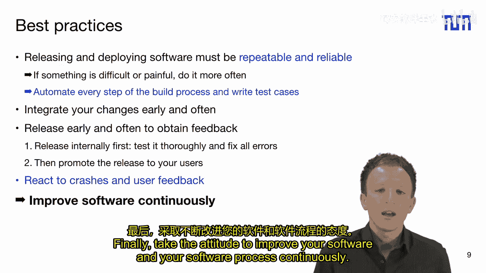

**软件工程基础：8-2：发布管理** 🚀

在本节课中，我们将学习开发者如何将软件构建版本交付给最终用户和客户。我们将探讨持续交付的理念、发布管理的益处，以及反馈在软件开发过程中的重要性。

---

### **发布管理的目标**

发布管理的主要目标是以短周期生产有价值的软件，并确保软件可以在任何时间被可靠地发布。

**发布**意味着将源代码从开发机器上取出，进行编译、测试、打包，并交付到目标环境，这个过程最好是自动化的。

---

### **发布经理的角色**

随后，发布经理的角色开始发挥作用，他承担着多项职责。

发布经理是不同业务部门之间的协调者，旨在促进软件产品或软件产品更新的顺利、及时交付。

他还负责协调项目的不同工件，例如源代码、版本控制系统中的分支，并对其他团队成员和不同的软件组件负责。

---

### **DevOps：开发与运维的协作**

发布管理的一个重要方面是自动化并改进软件交付流程。开发和运维部门必须紧密合作才能实现这一目标，这种协作的焦点催生了 **DevOps** 这一术语。

因此，**DevOps** 代表 **开发** 加 **运维**，它强调这两个部门之间的沟通与协作，并专注于将软件交付的尽可能多的部分自动化。

开发部门的开发人员、质量保证部门的测试人员以及运维部门的操作人员，他们都从不同角度看待软件项目，但必须协同工作以取得最佳成果。发布经理作为软件开发团队中的一个角色，在这些相关部门之间充当联络人，这就是 **DevOps** 的含义。

---

### **持续交付的益处与挑战**

持续交付有不同的益处和挑战，我们现在快速浏览一下。

**益处包括：**

*   **加速软件上市时间**：持续交付意味着在项目启动后尽快发布，如果软件能更早面市，这可以带来相对于竞争对手的市场优势。
*   **构建正确的产品**：持续交付有助于构建正确的产品，因为可以获得用户反馈，从而提高产品质量和客户满意度。
*   **提高团队生产力和效率**：由于创建和发布软件所需的所有步骤都已自动化，这可以节省大量时间和精力。
*   **降低发布失败风险**：不会发生手动步骤执行错误的情况，也不会因为负责手动发布的团队成员休假而无法发布。团队中的任何人都可以通过启动流程来创建发布。

**挑战包括：**

*   **组织挑战**：由于组织中不同部门存在利益冲突，可能很难提出一个适合所有这些部门的解决方案。
*   **传统流程的阻碍**：例如瀑布模型或V模型可能会阻碍持续交付，因为在软件交付之前，必须完成需求获取、分析、设计和实现等不同的大型活动。
*   **技术挑战**：维护源代码以及在不同项目环境中定制交付工作流可能很困难。如果需要支持多个目标环境（例如 Android、iOS、Windows、macOS 和 Unix）甚至多个开发环境（Java、Swift 等），则需要不同的构建和发布流水线、脚本和工具。如果这些环境因软件更新而改变，所有脚本也需要更新，并且由于不同的编程语言和工具，平台间的可重用性可能有限。

---

### **反馈循环的重要性**

让我们再次思考我们的初始目标：我们希望从用户那里获得反馈。但到目前为止，我们只讨论了如何将源代码从开发者交付给用户，只谈了发布管理和构建管理。我们还需要思考在开发过程中如何处理用户反馈，这将在下面的解释视频中展示。

每个软件开发项目的目标都是向用户交付软件。然而，是在软件完全完成时才交付，还是在项目早期就开始交付以获取用户反馈并通过解决这些反馈来改进软件，这两者之间存在巨大差异。

让我们来看一个典型的持续交付和反馈循环。

在项目开始时，开发团队和产品负责人在项目启动会议上收集最重要的需求，并将其放入产品待办事项列表中。此时，需求描述仍然比较宽泛，以保持需求分析的工作量较小。

在冲刺计划会议上，开发团队和产品负责人细化最重要的需求，并将其放入冲刺待办事项列表中。这些需求被精确指定，以便开发人员可以在接下来的冲刺（通常为两到四周）中实现它们。团队承诺完成尽可能多的待办事项项，确保能够完全实现并交付所有选定的项。因此，它可能会将一些已指定的待办事项项放回产品待办事项列表。

在这个冲刺内，团队专注于完全实现选定的冲刺待办事项项，并将其集成到一个潜在可发布的产品增量中。在冲刺结束时，这个产品增量被交付给客户和用户，例如以版本 V1 的形式。

用户和客户现在可以轻松舒适地在自己的计算机上安装和试用该软件。

在试用软件时，客户验证所有冲刺待办事项项是否已完全且正确地实现。他针对每个待办事项项向团队提供反馈。例如，客户可能对两个已实现的待办事项项感到满意，但在第三个中发现了问题。此外，可能还有针对第二个待办事项项的变更请求。

团队分析并优先处理收到的反馈。它不能立即实现较大的变更请求，因此将其放回产品待办事项列表，以便在以后的冲刺中完成。但团队可以立即纠正较小的问题，例如错误或用户界面设计问题。

团队使用持续交付的工作流来创建新版本 V2，并再次交付给客户和用户。客户现在可以立即验证反馈是否已正确实施。他现在感到满意，因为第三个冲刺待办事项项也已完全且正确地实现。

这种定期发布和用户反馈的工作流允许开发者和用户之间进行持续沟通，从而提高所开发软件的质量。

---

### **包含反馈的构建与发布管理工作流示例**

以下是包含反馈的构建与发布管理工作流的一个示例。

1.  **开发者提交代码**：开发者首先将代码提交并推送到版本控制服务器。
2.  **持续集成服务器处理**：持续集成服务器定期轮询这些更改，或被版本控制服务器通知，以便它可以检出、编译、测试和打包以进行构建。
3.  **通知开发者**：持续集成服务器将构建状态通知开发者，以便开发者可以修复潜在问题。
4.  **发布经理手动发布**：然后，发布经理（可以随时手动发布最新的软件构建）将软件上传到持续交付服务器。
5.  **通知用户**：这通知所有最终用户有新版本可用，以便他们可以在目标环境内将软件下载到自己的设备上。
6.  **用户提供反馈**：如果软件包含反馈机制，用户随后能够提供反馈。
7.  **反馈处理**：此反馈随后被上传到持续交付服务器，并作为问题存储在问题跟踪软件中，该软件会通知开发者有新的反馈。

请注意，在此工作流中，错误并未显示，并且此工作流必须为每个平台和每个项目进行定制。

---

### **构建与发布管理的最佳实践**

让我们以一些构建与发布管理的最佳实践来结束本单元。

*   **可重复且可靠**：首先，发布和部署软件必须是可重复且可靠的。
*   **自动化**：如果某件事困难或痛苦，不要手动操作，应更频繁地执行并实现自动化。事实上，应自动化构建过程的每一步，并编写可以自动执行的测试用例。
*   **频繁集成与发布**：使用版本控制和构建管理，尽早且频繁地集成您的更改。尽早且频繁地发布您的软件，以便您可以定期获得反馈。这样您就不会浪费时间设计错误的接口或生产错误的软件。
*   **内部发布与测试**：首先在内部发布软件，例如到预发布环境。彻底测试以修复所有剩余错误，然后将发布推广给您的用户。
*   **响应反馈**：对崩溃和反馈做出反应，让您的用户感到他们的反馈是有价值的，并且它影响着软件的质量。
*   **持续改进**：最后，采取持续改进您的软件和软件流程的态度。

---

### **总结**

在本单元中，我们涵盖了发布管理这一主题，特别是持续交付。请确保自动化您的软件交付流程。我们下个单元再见。