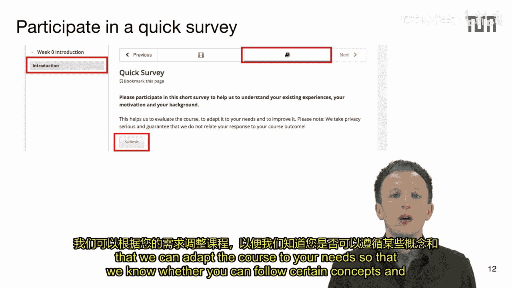

# 【全集】慕尼黑工业大学SEECx 软件工程基础 中英字幕 1080P p01 Lecture 1-1介绍 -BV13sqGBLE64_p1-

Hello and welcome to the introduction of the course softwareftware EngineEssentials。

 My name is Stean Cruche， and together with my course team members。

 Professor Banbroque Andrea Ss and Ancanoplo， we designed this online course about software engineering。

In addition， there are several teaching assistants who helped us to plan。

 organize and conduct discourse， and you will get to know them soon。

Let's start with a short motivation。 You might ask yourself。

 why should you become a software engineer， We have five reasons for you。 First。

 the world is getting more and more complex。 It is not possible to invent a new solution。

 a single hero any more。Teamwork is more important than ever。

 and without good communication and modeling skills， you cannot realize great software。Second。

 innovation software developers create solutions for common problems in all areas and use new technology to simplify the life of people and to enable new ways of working and sharing together。

Third， flexibility。 There are different areas to specialize in such as design。

 testing and management， and companies offer flexible working hours through their advancing I infrastructure。

 software developers can work from home and have a better work life balance。Fourth， recognition。

 While pure developers are often introverts and prefer private instead of public recognition。

Software developers establish a culture in which people regularly express gratitude to workers。

They are recognized as the use of computers and smartphones in our everyday life is becoming more and more important。

Fth opportunities。 There are many different opportunities to grow， to innovate。

 to learn new concepts every day， to improve the life of people， to achieve something useful。

 to experiment， to use creativity and ingenuity to create new solutions for the most important problems。

😊，Of the planet。In this course， youll learn and apply methodologies， techniques。

 workflows and tools to develop software。You learn to transform a problem statement given by a customer into different kinds of U M L models that are consistent。

To map these models to source code。And to package this code into an application that you deliver to the end user。

This process， from the problem statement。To the software is suitable for complex and large software projects。

 independent of the application domain and independent of the concrete development environment。

It doesn't matter if you want to develop software in the automotive or in the finance industry。

It doesn't matter if you want to develop desktop or mobile applications or software for embedded devices or web applications。

The assumptions for this course are that you are motivated to learn more about the development of complex software systems that cannot easily be programmed by a single developer。

If you are a tomb student， you might take this course as a bridge course for your masters studies。

If you are not AOM students， welcome to the course。

 please let us know where you'll come from and tell us more about yourself。

All participants of the course should have basic experiences with a programming language such as Java。

 Python， Swift， or C sharpp， and you must have your own laptop to participate in the online exercises of the course。

Without a laptop， you can watch the videos and participate in some exercises， but not in all of them。

It is beneficial if you have basic knowledge about UML modeling and if you already have practicable experience with developing software。

 then this course might be easier for you。But even if you don't have knowledge in these two areas。

 you will get through the course because we will teach you all the basics about modeling and about software development。

This course is eight weeks long， and each week has a specific topic starting with project organization and management in the first week。

And software configuration management in the second week。

 So the first two weeks focus on managing projects and how to get started with developing。

Then we go into object oriented programming and talk about the principles of object oriented programming。

 such as inheritance encapsulation and polymorphism。In week four。

 we teach you the concepts of requirements， elicitation and analysis where you learn to create the first U L models out of the problem statement。

Then we continue with system we signed in the fifth week where you transition from the problem to the solution and the software architecture that you want to develop。

In week six， youll learn how to map the created models into source code in object design。

Week 7 focuses on model based testing and quality control。

 You learn how to fix the errors that you introduced previously in your source code。

And in the last week， we tell you how to deliver your software to users using build and release management with a focus on continuous integration and continuous delivery。

Each week consists of multiple small video lectures， where we teach you knowledge。

 theories and concepts that you should try to understand。In addition to slide based video lectures。

 such the one， as you see now， we will have explanation videos where we use more animations to explain a problem where real actors in the software engineering process show how a certain concept actually works。

And where you see screencasts of the tools that we introduce。

You will practice this theory in different online exercises。

That you ideally directly complete after you have watched the videos。

You multiple choice quizzes and drag and drop quizzes to test if you have understood the theory。

 and if you can remember it。You also need to program source code to given problems to show that you can apply the knowledge。

In modeling exercises， you need to create UML diagrams to show that you can analyze a problem and find a model to solve it。

Modeling exercises use the peer review approach where you evaluate and create a solution of other students。

In all exercises， you can earn exercise points to pass the course。

Get immediate feedback to reflect about your learning experience and measure your progress in a given topic。

😊，Communication is one of the most important non technical skills in software engineering。

 in particular in large and complex projects。It is also important in education。

You can only learn something if you communicate with us。

 and we can only teach something if we communicate with you。 So we want to get in touch with you。

 And that's why we will use Slack。 Slack is a free chat service where you can connect with team members。

 friends and colleagues。😊，You can post your questions in the Q& A channel。

 you can get into touch with other students， with teaching assistants or instructors。

 and you get answers to all your questions。We also require certain tools for this online course。

 First of all， you need a version control client。 You will learn more about version control and software configuration management in the second week。

 We recommend to use So 3， a Gi client with a graphical user interface。

 which is our preferred tool to share versions with other developers。

You will use Gi to access the exercise code and to submit your solution to the programming exercises。

You also need an integrated development environment or short IDE。

 which helps you to compile your code to see compilation errors and to execute test cases。

We will tell you more about that in the third week of the course that is about object oriented programming。

We recommend to use eclipse， but you can also use other Ides such as Intelliche or Ne beanss。

This course is based on the third edition of the book Object Oriented Software Engineering。

 using UML Pats and Java by Professor Ban Bruque and Ellen Dutoir。

The book covers more details and examples and includes additional material。

So it is always a good idea to look up a concept in this book if you did not fully understand it in one of the videos。

Even if the introduction week is very short， we already have some homework for you。

Please read the problem statement of the university app that you can find on addX in the handout section of the course。

Many examples and exercises will be based on this problem statement， so we will often refer to it。

Discuss the problem statement on Slack with the teaching assistants and with your fellow students。

In addition， we ask you to participate in a quick survey that you can find in the introduction week in the second component。

Fill out a survey after this video and click on submit so that we can use your information anonymously to analyze existing experiences。

 motivation， and a background of all students。The survey only takes a minute and allows us to provide the best learning experience for you so that we can adapt the course to your needs so that we know whether you can follow certain concepts and exercises or not。

Let's start and have a lot of fun in this online course。

 We hope that you are motivated to learn more about the fascinating world of software engineering and that you improve your way of communicating and managing and developing。

😊，See you next time in the first video lecture。

