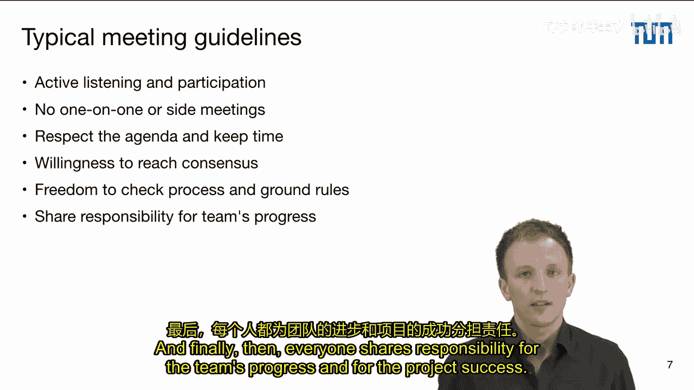

# 【全集】慕尼黑工业大学SEECx 软件工程基础 中英字幕 1080P p02 Lecture 1-2沟通 -BV13sqGBLE64_p2-

Hello and welcome to the unit Communicationer of the coursese Soft EngineeringEssentials。

 My name is Stefan and in this unit you will learn to understand the importance of communication and we explain your typical meeting management guidelines so that you are also able to explain them。

 Let's start with communication， which means imparting or exchanging information with multiple people by speaking。

 writing or any other medium。Software project managers and software engineers need to acquire several skills in order to communicate。

 they need to collaborate， for example， by negotiating requirements with external stakeholders such as the client or team members or even other teams。

They need to be able to present a major part of the system during a review。

 they need to be able to technically write， which means writing proposals or parts of the project documentation and they need to be able to manage teams。

 for example， by facilitating a team meeting finding compromises between multiple people and different conflicting demands and communication is particularly important in large system development efforts where developer spend more time communicating than coding and think about it if you spend more time for communication。

Then you should actually do it in the right way， so you need a clear and accurate communication。

 and this is becoming a critical success factor for your development project We distinguish between communication events and communication mechanisms。

Communication events。Are situations where we exchange information with defined objectives and scopes。

We can have schedule events such as a meeting where we plan the communication in advance。

 and we can have unscheduled events that are a little bit more event driven。

 such as a hallway meeting， or when we talk about our project in a coffee break。

Communication events are tools or procedures that are used when we deal with communication events。

 We can use synchronous mechanisms， tools that require to be at the same time。

 such as a phone call or staying in the same room and having a meeting。

But we can also use asynchronous tools such as chat tools。

 where partners do not need to communicate at the same time。When it comes to meetings。

 they often do not reach the desired outcome， so let's have a look at some situations that we actually do not want to reach。

 such as people are getting bored if the meeting is taking too long and they are sleeping or they are doing something else during the meeting。

The team participants or meeting participants， they forget to discuss the most important meeting points。

But rather discuss other points which are not really necessary and which do not really solve the problems of the participants。

 decisions are forgotten because no one in the meeting is writing them down and after some time if you want to review what kind of decision was made。

 you cannot not find the information anymore。And if shy participants are not able to share their opinion because other team members are talking too much。

 if you experience some of these cases， then meeting management should be introduced。

Meeting management is a procedure to plan and ensure productive meetings。

We are all the most important discussion points。Are shared with each other are discussed where all the information is shared that everyone needs to know。

And meeting management then allows meetings to have a constant level of quality using a structured process。

It provides templates， guidelines and roles such as the facilitator， the Mintaker or the timekeeper。

The facilitator is actually responsible for creating an agenda。

 sending it around one day before the meeting， and then for moderating in the meeting and following all the agenda points that he set up before the minute takeker is writing down notes during the meeting and is sending the protocol to all meeting participants at latest one day after the meeting and the timekeeper controls the time and interrupts other meeting participants in particular。

 the facilitator if the meeting takes too long or if the discussions on not so important items or topics take too long。

We have all inside of the meeting where one person stands out。

 starts talking excessively long without reallyhering to the opinion of other people and eventually wasting everyone's time。

People eventually get quite annoyed and stop even paying attention。

 a better way to handle this is to introduce a few rows inside a meeting。

One important role to have is a primary facilitator who can go through the meeting's agenda and make sure that all the topics get discovered。

It also makes a lot of sense to have a minute taker who will take notes of everything that was discussed so that people can refer back to it later。

Furthermore， a timekeeper can make sure to watch the clock so that discussions don't get excessively long by having the primary facilitator。

 minute taker and timekeeper， everything in the meeting gets discussed concisely。

 and can be referred to， therefore getting everyone happy。

There are other typical meeting guidelines that we quickly want to explain to you first of all。

 it's important that everyone is actively listening and participating in the meeting so that we do not have one on one meetings or site meetings where the team members discuss points that are not relevant for everyone。

Or where they do not actively listening what's going on in the meeting。Then you should think about。

 are these the right participants in a meeting， or should we have smaller meetings with only some participants。

 or should we have multiple meetings afterwards where different topics are discussed in different focus groups where they can then focus on a particular topic。

Everyone should respect the agenda。Whi is sent out one day before the meeting starts so that everyone can actually influence it。

 but then during the meeting we should respect the agenda and keep time so that we can discuss all the points on the agenda。

It's important that everyone has a certain willingness to reach consensus so that the discussions are not too long。

 but on the other hand that we have freedom to check the process and the ground rules， for example。

 in a small meeting retrospective at the end of the meeting。And finally。

 then everyone shares responsibility for the team's progress and for the project success。

In this unit， you learned about the importance of communication and we talked about typical meeting management guidelines。

 that's it for now， see you in the next unit。

