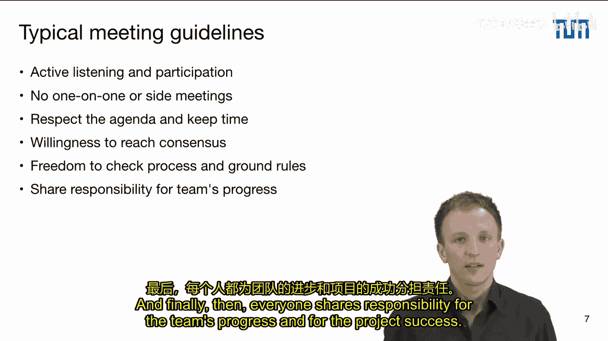

# 软件工程基础：1-2：沟通 📢

在本节课中，我们将要学习沟通在软件工程中的重要性，并了解典型的会议管理指南，以便你能够理解并应用它们。

## 沟通的重要性

沟通意味着通过说话、写作或其他媒介，在多人之间传递或交换信息。软件项目经理和软件工程师需要掌握多种沟通技能。他们需要协作，例如与客户、团队成员或其他团队等外部利益相关者协商需求。他们需要能够在评审会上展示系统的主要部分。他们需要具备技术写作能力，例如撰写提案或项目文档的部分内容。他们还需要能够管理团队，例如主持团队会议，在不同人员及相互冲突的需求之间找到折中方案。

在大型系统开发工作中，沟通尤为重要，因为开发人员花在沟通上的时间可能比编码还多。试想一下，如果你花更多时间在沟通上，那么你就应该以正确的方式进行。清晰准确的沟通，正成为开发项目成功的关键因素。

## 沟通事件与沟通机制

上一节我们介绍了沟通的重要性，本节中我们来看看沟通的两种主要形式：沟通事件与沟通机制。

**沟通事件**是指我们有明确目标和范围进行信息交换的场景。它可以分为两类：
*   **计划内事件**：例如预先安排好的会议。
*   **计划外事件**：例如走廊偶遇的交谈，或在咖啡休息时间讨论项目。

**沟通机制**是我们在处理沟通事件时使用的工具或程序。它也可以分为两类：
*   **同步机制**：要求参与者同时在线，例如电话或线下会议。
*   **异步机制**：不要求参与者同时在线，例如聊天工具。

## 会议管理的必要性

当涉及到会议时，它们常常无法达到预期的效果。以下是几种我们不希望出现的情况：
*   会议时间过长，导致与会者感到无聊、打瞌睡或做其他事情。
*   与会者忘记讨论最重要的议题，反而去讨论那些不必要、不能真正解决问题的内容。
*   由于无人记录，会议决策被遗忘，事后无法追溯。
*   害羞的参与者因其他成员发言过多而无法表达自己的意见。

如果你遇到过上述情况，那么就需要引入会议管理。

## 什么是会议管理？

会议管理是一种规划和确保会议富有成效的程序。它确保所有重要的讨论点都能被分享和讨论，确保每个人都能获得所需的信息。通过结构化的流程，会议管理能使会议保持稳定的质量水平。它提供了模板、指南和角色，例如**主持人**、**记录员**和**计时员**。

以下是这些角色的核心职责：
*   **主持人**：负责创建会议议程，在会议前一天发送给与会者，并在会议中引导讨论，确保按议程进行。
*   **记录员**：在会议期间做笔记，并在会议结束后最晚一天内将会议纪要发送给所有与会者。
*   **计时员**：控制时间，如果会议时间过长或对非重要议题的讨论耗时太久，会打断其他与会者（尤其是主持人）。

## 会议中的角色实践

在会议中，有时会出现一个人主导发言、长篇大论而不顾他人意见，最终浪费所有人时间的情况。这会让其他人感到厌烦，甚至不再关注会议内容。

更好的处理方式是引入会议角色。设置一个**主要主持人**来推进议程并确保所有议题都得到讨论，这非常重要。同时，安排一名**记录员**记录所有讨论内容，以便日后查阅，也很有意义。此外，**计时员**可以确保讨论不会过度延长。

通过设置主持人、记录员和计时员，会议讨论将更加简洁高效，内容有据可查，从而让每个人都感到满意。

## 典型的会议指南

除了角色分配，还有一些典型的会议指南需要了解。以下是几个关键点：
*   **积极倾听与参与**：每个人都应积极倾听并参与会议，避免出现一对一的私下讨论，或讨论与所有人无关的内容。
*   **选择合适的参与者**：应考虑会议参与者是否合适。是否需要召开仅部分人员参加的小型会议？或者是否需要在会后召开多个不同主题的焦点小组会议？
*   **尊重议程**：议程应在会议前一天发出，以便大家提出意见。会议期间应尊重议程并控制时间，确保讨论所有议题。
*   **达成共识的意愿**：每个人都应有达成共识的意愿，以避免讨论过长。同时，也应保留检查流程和基本规则的自由，例如在会议结束时进行简短回顾。
*   **共同承担责任**：最后，每个人都应为团队的进展和项目的成功共同承担责任。

## 总结

本节课中，我们一起学习了沟通在软件工程中的重要性，并详细探讨了典型的会议管理指南，包括沟通事件与机制的区别、会议管理的必要性、关键角色（主持人、记录员、计时员）的职责，以及确保会议高效进行的一系列实用指南。掌握这些知识将帮助你更有效地进行团队协作与项目管理。